# BookBuddy mobile design · Astra

This track improves Sol’s repair flows. A customer can follow what the foreman reports about a visit; the worker sees a separate, private shift record. The provider remains responsible for the work and bills the customer directly. Start with the [improvement plan and nine-slice checklist](foundation/improvement-plan.md).

## Foundation

- [Personas and roles](foundation/personas-and-roles.md): who uses the app and what each role can do.
- [Information architecture](foundation/information-architecture.md): role navigation, app entry, context switching and links.
- [Core flows](foundation/core-flows.md): booking, crew coverage, multilingual communication, site work and later sessions.

## Design system and handoff

- [Design system](system/design-system.md): colour, components, platform rules, accessibility and localisation.
- [Wireframe conventions](system/wireframe-conventions.md) and [SVG template](system/wireframe-template.svg): the shared production standard and sample Jobs screen.
- [Shared job-chat reference](screens/shared/S-10-job-chat.svg): translated and original messages in an assigned worker's view.
- Live references: [customer visit](screens/customer/C-18-follow-live.svg), [worker Today](screens/worker/W-01-today.svg), and [iPhone Lock Screen](screens/shared/S-18-live-activity.svg) with [compact](screens/shared/S-18-live-activity--compact.svg), [minimal](screens/shared/S-18-live-activity--minimal.svg) and [expanded](screens/shared/S-18-live-activity--expanded.svg) Island states.
- [Screen inventory](screens/inventory.md): release and later surfaces, states and slice assignments.

## Screens

### Customer

Specs: [customer entry and booking](screens/customer/C-01_C-08-specs.md) · [visit and aftercare](screens/customer/C-09_C-17-specs.md)

| | | |
| --- | --- | --- |
|  C-01 Jobs home | 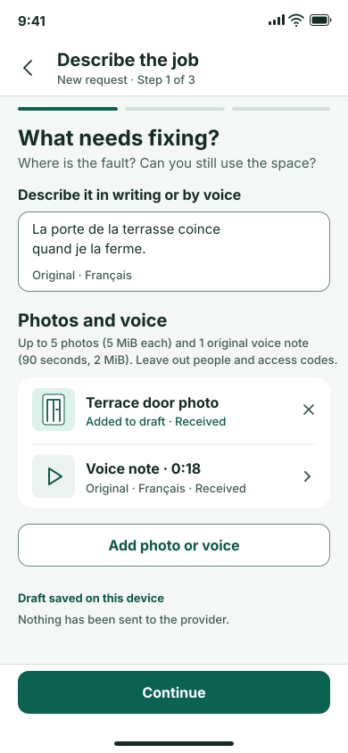 C-02 Describe the job |  C-02 Describe the job — uploading media |
| 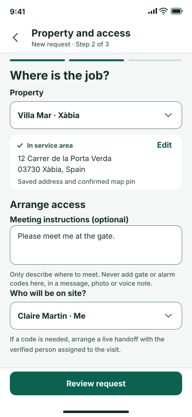 C-03 Property and access |  C-04 Review and send request |  C-04 Review and send request — offline unsent |
|  C-05 Job detail and timeline | 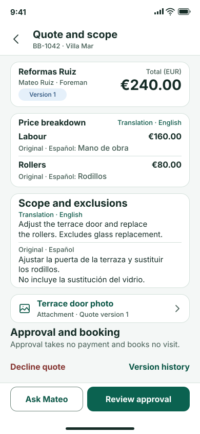 C-06 Quote and scope | 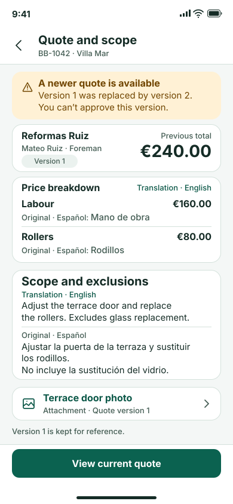 C-06 Quote and scope — superseded |
|  C-07 Approve current quote [Modal] | 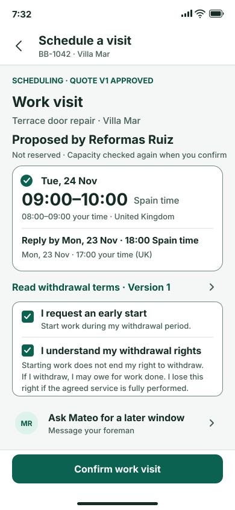 C-08 Schedule a visit | 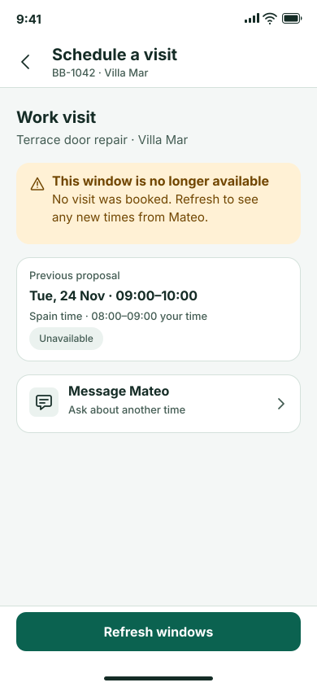 C-08 Schedule a visit — window changed |
| 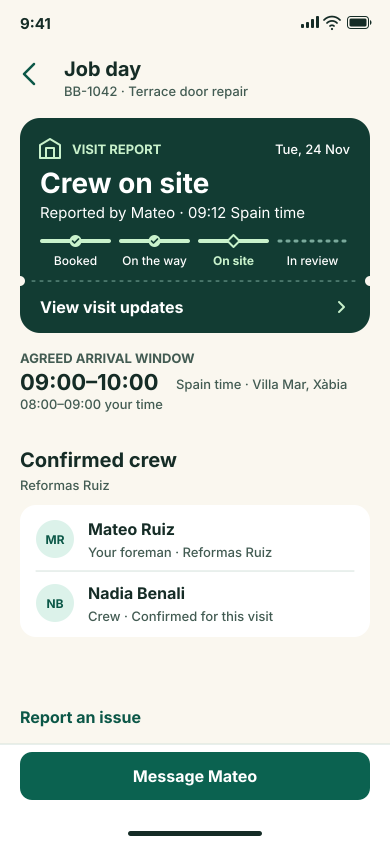 C-09 Job day |  C-09 Job day — crew replaced |  C-10 Completion and sign-off |
|  C-11 Payment and receipt |  C-11 Payment and receipt — paid |  C-11 Payment and receipt — payment failed |
| 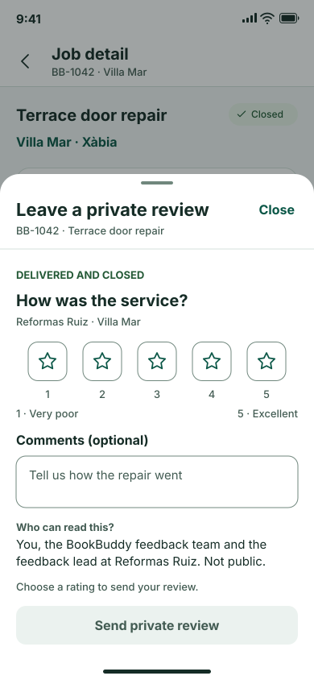 C-12 Leave a review [Sheet] | 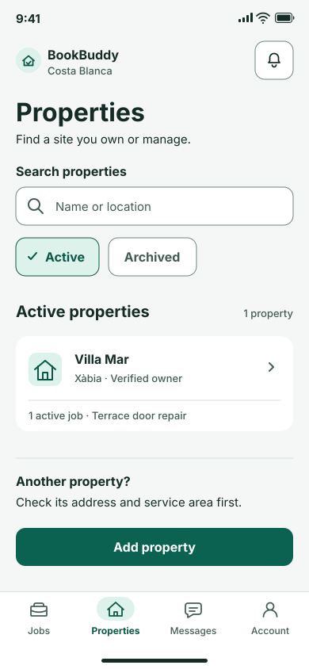 C-13 Properties |  C-14 Property detail and people |
|  C-15 Review a job change |  C-16 Report an issue or follow a case |  C-16 Report an issue or follow a case — case open |
| 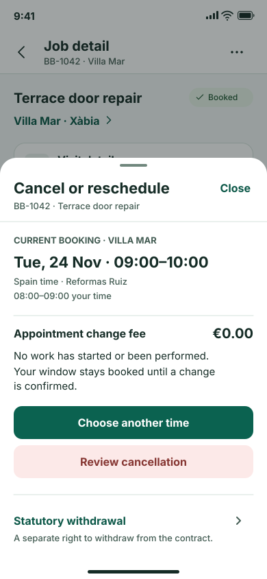 C-17 Cancel or reschedule |  C-18 Follow live | |

### Foreman

Specs: [intake and dispatch](screens/foreman/F-01_F-07-specs.md) · [crew and delivery](screens/foreman/F-08_F-16-specs.md). F-11 and its vetted-pool offers are later, not launch navigation.

| | | |
| --- | --- | --- |
| 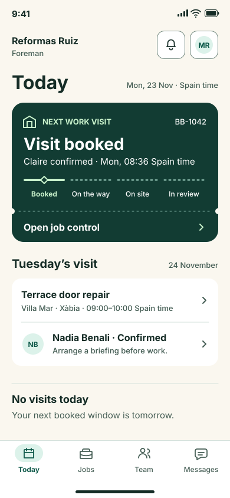 F-01 Today |  F-01 Today — gap alert | 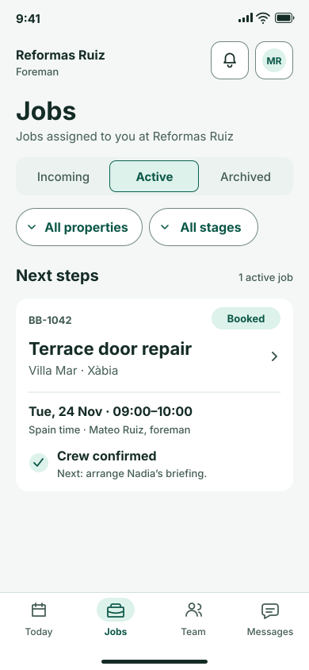 F-02 Jobs |
| 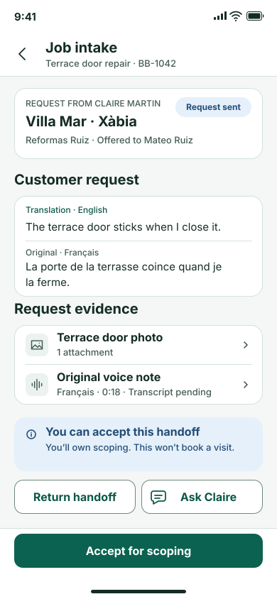 F-03 Job intake |  F-03 Job intake — reassignment |  F-04 Scope and quote editor |
|  F-04 Scope and quote editor — pending review |  F-05 Job control |  F-06 Schedule and availability |
|  F-06 Schedule and availability — conflict | 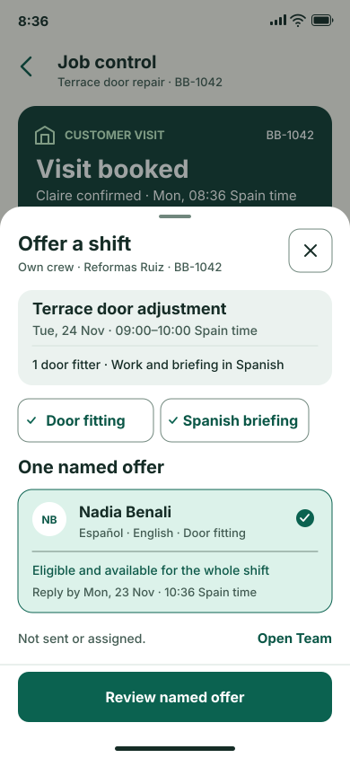 F-07 Assign crew [Sheet] |  F-07 Assign crew [Sheet] — ineligible |
|  F-08 Team roster |  F-09 Worker profile and availability | 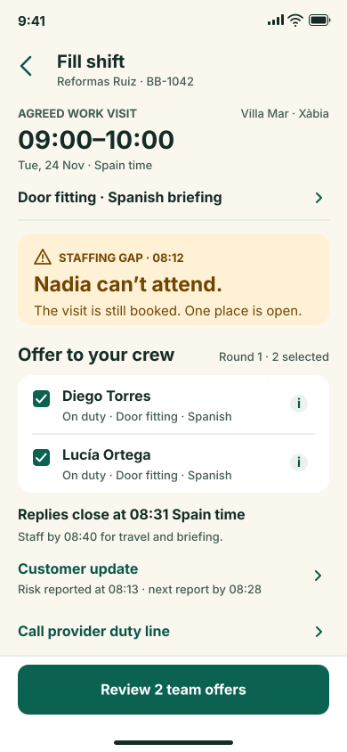 F-10 Fill shift |
|  F-10 Fill shift — offers pending | 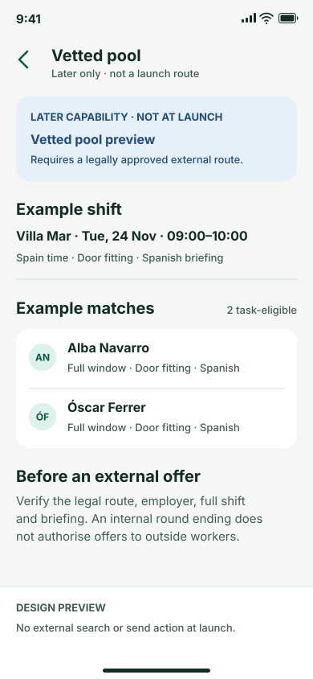 F-11 Vetted pool |  F-11 Vetted pool — no match |
|  F-11 Vetted pool — offers pending | 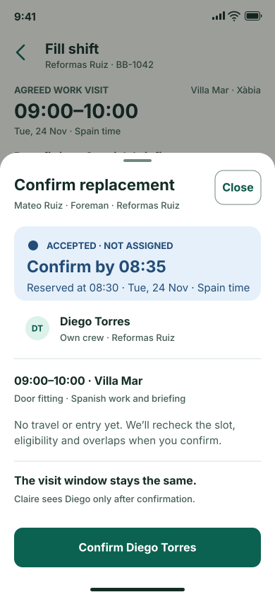 F-12 Confirm replacement [Sheet] |  F-12 Confirm replacement [Sheet] — already filled |
|  F-13 Site log |  F-14 Submit completion |  F-15 Propose job change |
|  F-16 Shift detail |  |  |

### Worker

Specs: [worker shifts and attendance](screens/worker/W-01_W-09-specs.md)

| | | |
| --- | --- | --- |
|  W-01 Today |  W-01 Today — rtl arabic |  W-02 My shifts |
| 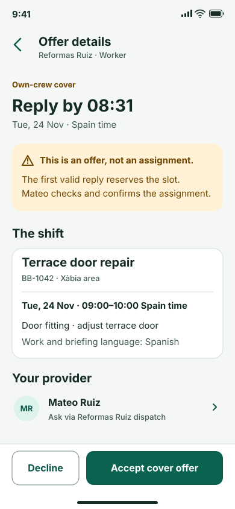 W-03 Offer details |  W-03 Offer details — awaiting confirmation | 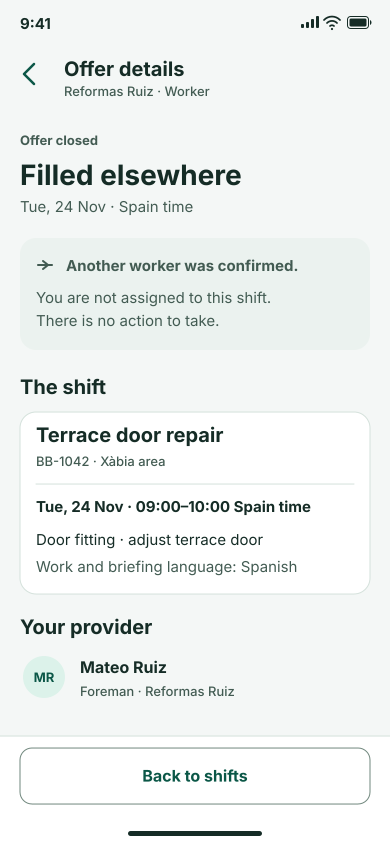 W-03 Offer details — filled elsewhere |
|  W-04 Shift detail |  W-05 Decline or drop out [Sheet] |  W-06 Check in or out [Sheet] |
|  W-06 Check in or out [Sheet] — outside geofence large text | 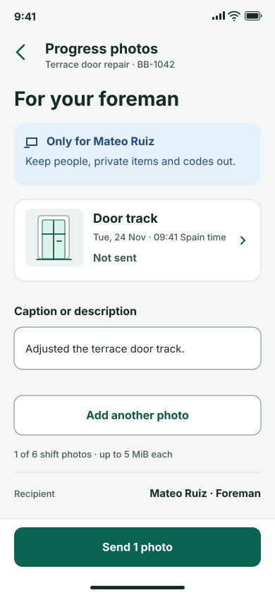 W-07 Add progress photos | 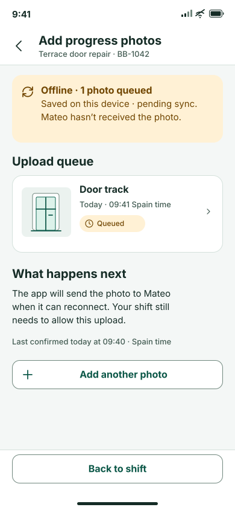 W-07 Add progress photos — queued offline |
|  W-08 Availability | 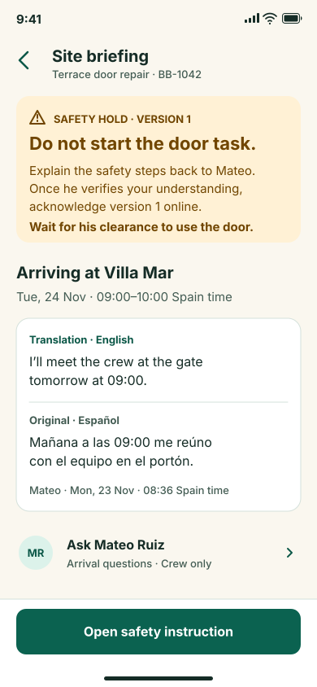 W-09 Site briefing |  |

### Shared

Specs: [access and inboxes](screens/shared/S-01_S-09-specs.md) · [communication, safety and system status](screens/shared/S-11_S-17-specs.md)

| | | |
| --- | --- | --- |
|  S-01 Welcome and app language |  S-02 Sign in or create account | 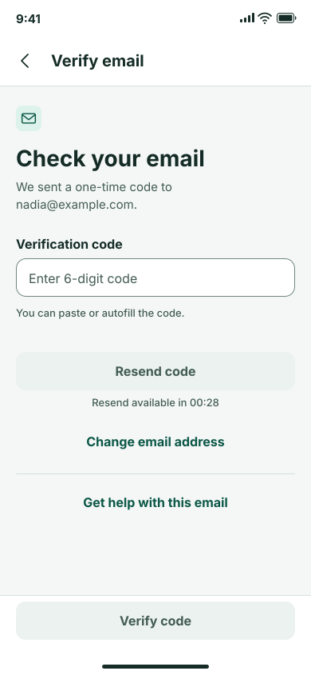 S-03 Verify code and recover access |
|  S-03 Verify code and recover access — locked out |  S-03 Verify code and recover access — wrong code |  S-04 Initial setup |
|  S-05 Accept an invitation |  S-05 Accept an invitation — expired |  S-06 Account and preferences |
|  S-07 Switch role or business [Sheet] |  S-08 Messages |  S-09 Notifications |
|  S-09 Notifications — replacement offer | 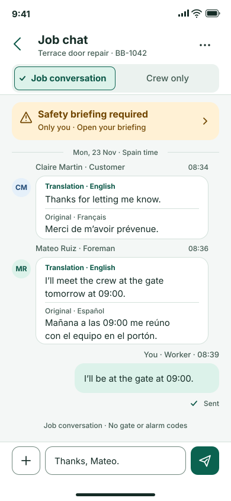 S-10 Job chat |  S-10 Job chat — translation unavailable |
|  S-11 Safety instruction and acknowledgement |  S-11 Safety instruction and acknowledgement — acknowledgement pending | 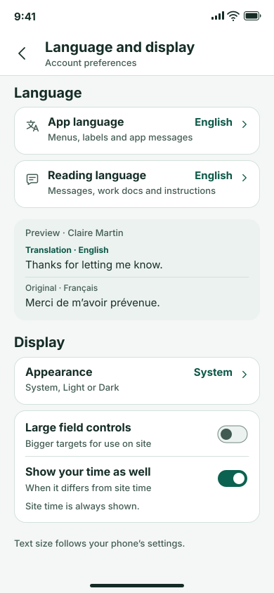 S-12 Language and display |
|  S-13 Chat details [Sheet] | 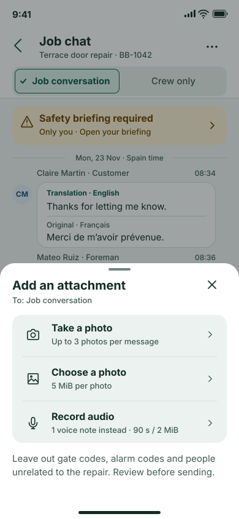 S-14 Attach a photo or record audio [Sheet] |  S-14 Attach a photo or record audio [Sheet] — recording |
|  S-15 Media and original audio preview [Modal] | 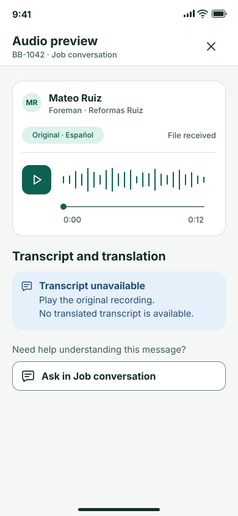 S-15 Media and original audio preview [Modal] — transcript unavailable |  S-16 Help and access status |
|  S-17 Confirm consequential action [Modal] |  |  |
|  S-18 Lock Screen |  S-18 compact |  S-18 minimal |
|  S-18 expanded | | |

### Provider admin (P-)

Specs: [P-01–P-05 specs](screens/shared/P-01_P-05-specs.md)

| | | |
| --- | --- | --- |
|  P-01 Business overview |  P-02 Jobs and handoffs |  P-02 Jobs and handoffs — handoff stuck |
|  P-03 People and access |  P-03 People and access — access revoked |  P-04 Business and eligibility |
|  P-04 Business and eligibility — eligibility expiring |  P-05 Invite or edit membership [Sheet] |  P-05 Invite or edit membership [Sheet] — invite pending |

### Later categories (L-)

Specs: [L-01–L-06 specs](screens/shared/L-01_L-06-specs.md)

| | | |
| --- | --- | --- |
|  L-01 Browse sessions |  L-02 Session detail |  L-02 Session detail — fully booked |
|  L-03 Choose a slot [Sheet] |  L-03 Choose a slot [Sheet] — slot just taken | 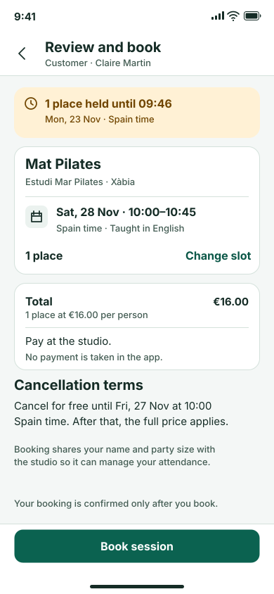 L-04 Review and book |
|  L-05 Session booking |  L-05 Session booking — pending change |  L-05 Session booking — substitute instructor assigned |
|  L-06 Session setup and roster |  L-06 Session setup and roster — cover unavailable |  |

## Decisions and reviews

- [Decided operating model, pricing and launch languages](../docs/decisions/2026-11-23-open-questions.md)
- [Live Activity and attendance constraints](../research/tech-stack/live-activities-and-geofenced-attendance.md)
- [Architecture: mobile tech stack](../docs/architecture/mobile-tech-stack.md)
- [Flow design review and consolidated open questions](../docs/reports/2026-11-23-design-review-flows.md)
- [Visual design review](../docs/reports/2026-11-23-design-review-visual.md)
- [Tech stack research](../research/tech-stack/)
