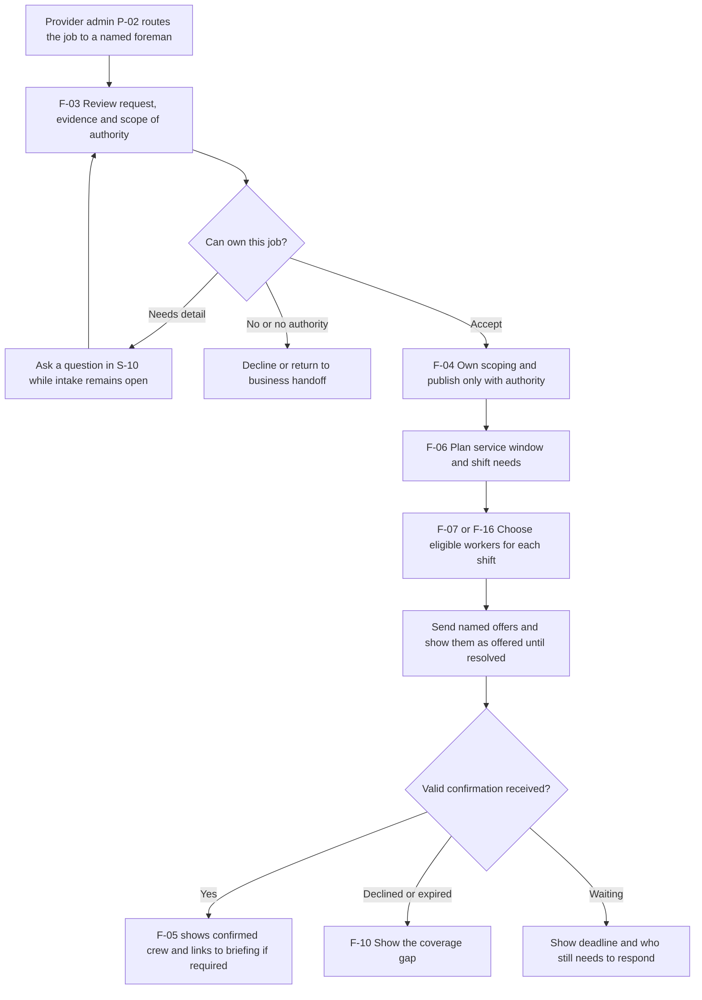
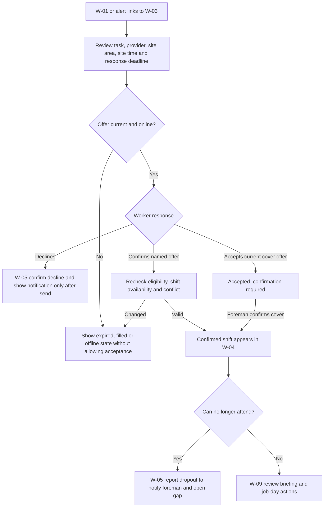
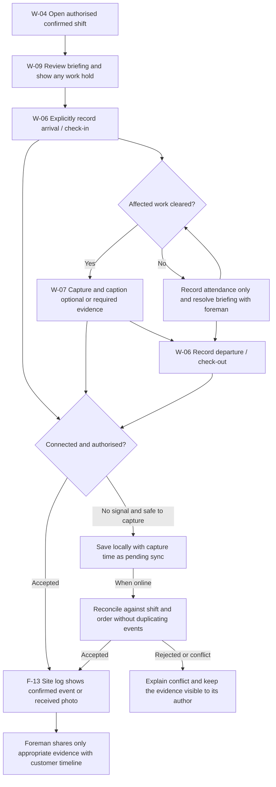
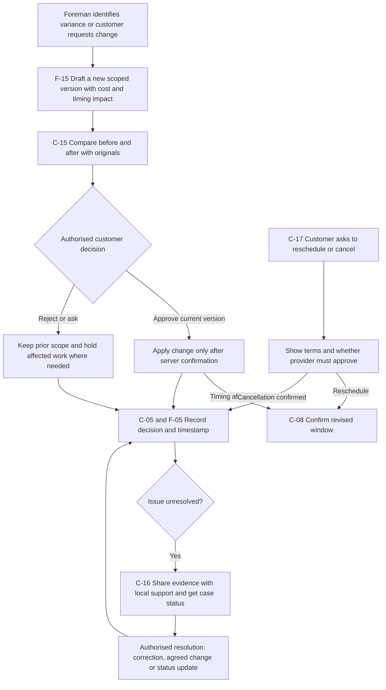

# Core flows

The [inventory](../screens/inventory.md) names the screens; [Personas and roles](personas-and-roles.md) defines who may act. The named provider contracts with, invoices and is paid by the customer. BookBuddy coordinates the booking and helps resolve exceptions. The [owner’s decisions](../../docs/decisions/2026-11-23-open-questions.md) govern launch, including where they supersede an earlier architecture example.

## Shared state and offline rules

- **Job stage:** Draft → Request sent → Scoping → Quote ready → Scheduling → Booked → In progress → Awaiting sign-off → Signed off → Closed. Cancelled is shown only after authoritative cancellation. Show separate, named flags for a crew gap, an open change, a disputed item and payment. A declined quote can return to Scoping if the parties continue; history is not overwritten. Do not call a site assessment a booked repair.
- **Assignment status:** Offered → Confirmed for an ordinary named assignment after valid worker confirmation. For cover, the first valid server-recorded acceptance reserves that round’s slot; `Accepted · awaiting confirmation` grants no assignment, travel or access. Only foreman confirmation assigns. Declined, expired, filled elsewhere and cannot attend have different effects. Chat changes none of them. A dropout opens a gap; it does not cancel the job.
- **Consequential actions require online confirmation:** request submission, quote/change approval, scheduling, offer acceptance, assignment, briefing acknowledgement, sign-off and payment-record updates. Keep an ambiguous operation pending and reconcile its existing ID. Eligible attendance/media can be `Saved on this device · pending sync`, never optimistically received, published or cleared.
- **Privacy and time:** use the site’s stored zone, with viewer time second only if enabled and different. No gate/alarm codes or access secrets anywhere, including drafts, media, translation and chat; arrange a verified live handoff. On assigned devices show only the active scope’s permitted cache for up to 72 hours from last successful authorisation sync; no offline role switch. On shared devices do not leave a persistent cache. Record arrival/departure without any device location or boundary.
- **Scope:** one accountable provider for an approved repair. No supplying labour or booking outside verified scope. Fixture locations are not a pilot decision. Individual external offers, marketplace checkout and later-category navigation are off at launch.

## 1. Customer request, booking and completion

```mermaid
sequenceDiagram
    participant C as Customer
    participant A as App
    participant F as Named foreman
    C->>A: C-02 Describe in own language with optional photos or voice
    C->>A: C-03 Confirm property and access, then C-04 review and send
    A-->>C: C-05 Request sent, not booked
    A->>F: F-03 Send job intake
    F->>A: Accept handoff and scope the work
    opt Assessment needed first
        F->>A: F-06 Propose assessment window
        A-->>C: C-08 Show proposed assessment window
        C->>A: Confirm assessment only
        F->>A: Record scope after visit
    end
    F->>A: F-04 Publish scope and quote version
    A-->>C: C-06 Review scope, exclusions, total and terms
    C->>A: C-07 Approve the current version
    F->>A: F-06 Propose service windows backed by provider capacity
    A-->>C: C-08 Choose or confirm a proposed window
    C->>A: Confirm the proposed service window
    A-->>C: C-05 Booked after current window is confirmed
    F->>A: Confirm named crew and report actual progress
    A-->>C: C-09 Arrival window, named contact and confirmed crew
    opt Customer opens C-18 and chooses Follow live in the foreground
        A-->>C: Optional private OS status; same reported events remain in app
    end
    F->>A: F-14 Submit completion and required evidence
    A-->>C: C-10 Awaiting sign-off
    alt Customer signs off on the approved work
        C->>A: Confirm sign-off as the authorised approver
        A-->>C: C-11 Provider invoice, due date or explicit hold
        opt Customer pays provider directly outside BookBuddy
            C->>A: Record payment sent against the current bill
            A-->>C: Await provider match; show paid only on confirmed reconciliation
        end
        A-->>C: Close service when no outstanding actions remain
        C->>A: C-12 Leave optional review after closure
    else Customer reports an issue instead of signing off
        C->>A: C-16 Report what is unresolved
        A-->>C: Show case status without marking the work accepted
    end
```

- Start with a free description and optional photos or original voice. Review before sending; show upload/transcript status separately and keep the original playable. A failed translation is not a failed request. A selected photo that has not uploaded is not attached; wait or let the customer explicitly remove it. An out-of-area property routes to an explanation and local service contact, not a confirmed job.
- C-06 names the provider and named approver, original scope, exclusions, tax-inclusive total, terms and site-zone expiry (seven calendar days from issue). Review the payment obligation before C-07; approval does not take money. Keep the accepted original and terms immutable and provide a durable copy. A clarification or translation never revises a quote. Booking requires approved scope and agreement to a capacity-backed window; capacity checked is not capacity reserved.
- C-09 retains the agreed arrival window, named contact and confirmed customer-visible roster. C-18 explains **what was reported**, independently of staffing and job stage. Compare completion evidence against the approved quote/change versions. An issue opens C-16 instead of forcing sign-off.
- C-11 records, but does not process, direct payment to the provider (its own external payment link or agreed transfer). Show authorised biller, invoice ID, exact amount/currency and due date, normally seven calendar days after bill delivery. A customer report is not payment confirmation. The provider matches its bank/PSP receipt, then the record can say **Paid**. Keep invoice, payment receipt, adjustments, disputed amounts and confirmed refunds distinct. No platform checkout, wallet, payout, escrow or automatic charge on sign-off. Closure invites an optional private review.

### The visit as reported

| Visible phase or notice | Authoritative source | What the customer sees next |
| --- | --- | --- |
| Booked | Confirmed provider window on C-08 | Agreed site window and named foreman; no live ETA. |
| On the way / On site | Named foreman explicitly publishes F-17 for this visit, from F-05 or F-13 | Plain phase and site report time; older reports in C-18. No worker coordinates, individual attendance, map, route or inferred movement. “On site” does not clear work. |
| Delay / cover being arranged | Foreman publishes the consequence and next update in F-17 | Keep agreed window until C-08 confirms another; show next report time if promised, otherwise contact. Only confirmed roster changes appear on C-09. |
| In review | F-14 authoritatively submits evidence | C-18 points to C-10. End OS follow at visit completion; sign-off, billing and closure stay separate. |

F-17 previews exactly what the customer will see: one structured status for the current visit, reporting time, safe next step and optional next-update time. No free-text crew log posted by default. The foreman publishes online; a failed or unknown result is not a public event. A later correction supersedes an event without rewriting history. Private W-06/F-13 records, shift assignments, S-10 chat, time passing and OS callbacks cannot set a customer milestone. Show unreported milestones as unknown, not completed by implication. Each new visit has its own ledger.

C-05/C-09 open C-18 on mobile or the signed-in web. Opening the record does not start an OS display: **Follow live** requests one locally in the foreground for this device and visit. iPhone uses S-18; Android S-19. Disabled, denied, stale, expired or web-only: keep the timeline, last confirmed site time and contact usable. Stop following, completed/cancelled visits, sign-out and loss of scope end the display; no operational state changes. Reuse the authorised job projection, apply newer confirmed revisions only, catch up by cursor on reconnect, no timer-driven refetch. See [system layouts and lifecycle](../system/design-system.md#system-status-surfaces).

## 2. Foreman accepts a job and assigns crew



Accepting intake creates accountability, not a price, contract approval, worker assignment or scheduled visit. Eligible skills, language, work authorisation, declared availability and conflicts are separate from a worker's profile visibility. A foreman who also works on the job switches into Worker for their own shift confirmation and attendance.

## 3. Worker confirms, declines or drops out



An unconfirmed offer shows the area and relevant task, not precise residential access. For a confirmed shift, `Can't attend` is distinct from declining an offer. If an urgent dropout cannot be sent, state `Foreman not notified` and offer the provider’s verified duty contact; no queued cancellation should look like a released shift. Do not expose the reason to the customer.

## 4. Last-minute replacement: provider’s own crew only

```mermaid
sequenceDiagram
    participant F as Foreman
    participant A as App
    participant W as Eligible candidate
    participant O as Local service
    participant C as Customer
    A-->>F: F-10 Gap from dropout or unresolved shift
    F->>A: Set required task, skills, working language and timing
    F->>A: Check own eligible available team first
    opt Eligible own-team candidate exists
        F->>A: Send an internal offer
        A->>W: W-03 Internal cover offer with expiry
    end
    alt First valid internal acceptance received before expiry
        W->>A: Reserve the slot pending foreman confirmation
        A-->>F: F-12 Accepted, confirmation required
        F->>A: Confirm named worker after eligibility and conflict recheck
        alt Still valid and slot open
            A-->>W: W-04 Confirm assignment and relevant briefing
            A-->>F: Crew confirmed; close other offers for this slot
            A-->>C: C-09 Confirmed arrival roster or timing update
        else No longer eligible, available or slot changed
            A-->>F: Confirm failed; retain gap and explain reason
            A-->>W: Offer closed or returned to pending as appropriate
        end
    else No valid reservation or review timed out
        A-->>F: Keep gap open; no worker assigned
        F->>O: Call duty contact or propose a revised visit
        A-->>C: F-17 reports delivery risk and next update; no candidate details
    end
```

- The foreman selects from **this provider’s own eligible crew only**. Ordinary named offers and urgent internal cover rounds have distinct deadlines. For urgent cover, at most three eligible on-duty people per round, normally 15 minutes to reply and at most one more round if safe. The first valid server-recorded acceptance reserves the place. Foreman or authorised backup has up to five minutes after that reply, capped at the safe staffing cutoff and before shift start, to recheck scope, availability, eligibility and overlap and confirm once. No promotion of a losing reply on timeout.
- A candidate cannot travel, enter or work from a provisional acceptance. Correction, expiry, withdrawal or failed recheck reopens the gap, not a silent assignment. Newly confirmed staff need their own versioned briefing and attendance. On material delivery risk notify the customer immediately, with next update within 15 minutes or sooner as required; a new window needs separate agreement.
- **F-11 and all vetted-pool offers are later**, with no launch entry/link or deadline unlock. If own crew cannot cover, propose a revised visit. If the provider cannot deliver, resolve the old agreement; BookBuddy may introduce a separately verified local business for a **new agreement**, never switch contractors or combine employers' crews in place.
- Customer notices name only the confirmed, customer-visible crew and accurate arrival window. If coverage is unresolved and timing materially at risk, say `Crew cover being arranged` and identify the foreman and next update. When scope or timing changes, route through C-08/C-15 as appropriate. Do not promise instant cover or show an external pool to customers.

## 5. Multilingual chat and safety-critical confirmation


- Make audience visible before send: Job conversation versus Crew only. Foreman is the customer's named contact. Show translation first and original immediately below, labelled with language names. A same-language message is shown once. Show `Translation pending` or `Translation unavailable` with the original still readable. Keep the original audio with any transcript/translation. The app may suggest a source language; correcting the label or posting a correction never overwrites the original.
- A read receipt, machine translation or tap on a chat bubble never acknowledges a safety instruction. The assigned worker can ask for clarification or say they do not understand. The foreman arranges a human briefing/verifies understanding and the person acknowledges the specific instruction. If this cannot be verified, the affected work does not start; attendance can still be recorded. On a material revision the previous acknowledgement is kept as history, not applied to the new version. No auto-ack through silence, no acknowledgement on behalf of someone else, and no substitute for qualifications or on-site safety obligations.
- The [chat reference](../screens/shared/S-10-job-chat.svg) shows a worker in the Job conversation; the pinned briefing action is a private viewer-specific cue, not a message or crew record shown to customers. S-11 holds the instruction and confirmation.

## 6. Site attendance and progress photos



- W-06 records deliberate, location-free job-site arrival/departure. No GPS permission, boundary, background monitoring or automatic check-in/out. An entry outside the expected time window saves the actual time for review; offer a foreman-assisted recorded exception for a worker without a usable phone. Preserve capture time, ordered operation IDs and server receipt. A locally queued arrival/departure pair is not a confirmed log. Amend with a traceable correction. Site attendance is not the employer’s working-time register, payroll or permission to start.
- W-01/W-04 open W-10 for the current shift. Show **Since check-in** only against a confirmed, non-stale arrival; mark pending, checkout and conflicts explicitly. The separate safety hold persists until a human verifies teach-back **and** the worker acknowledges the current version online. An opted-in worker can start a device status display after deliberate foreground check-in; the checkout link opens W-06 to review. Neither expiry nor dismissal checks anyone out.
- Use the system camera/picker and an accessible text alternative. Review images and captions before upload; warn against people, private items or identifying details unrelated to the work. Site evidence goes to the foreman first. A deliberate share publishes selected completed uploads to the customer, and C-10 distinguishes unavailable or not-yet-received evidence from a finished checklist.

## 7. Changes, cancellations and disputes



A change is not a comment. Show the approved original and a separately published proposal with cost delta, new total, timing, affected work and deadline. Keep prior terms and unaffected work; apply only an approved version. For eligible unstarted visits with no work performed, cancellation is **fee-free**. Rescheduling is fee-free: at least 24 hours out, confirm a current like-for-like authorised window; inside 24 hours or if terms/capacity differ, request provider agreement. Keep the original until confirmed. Started work goes to the provider/case with any work already performed itemised, not a cancellation fee. Where applicable offer statutory withdrawal separately with a durable receipt; never turn it into a request for permission. An issue does not imply sign-off, refund or billing hold.

**Provider pricing, not customer checkout.** The first 30 completed paid jobs carry no BookBuddy fee. Under new accepted paid-trial terms, bill the provider monthly: €25 plus applicable VAT per BookBuddy-sourced, signed-off, paid job of at least €150 before VAT. No fee on leads, cancelled or fully refunded jobs or provider-sourced work; credit a later full refund. No customer surcharge or worker fee. P-01/P-02 can show eligibility and statement context, never a deduction from the customer's service invoice. Pricing is a hypothesis, not a guaranteed ongoing tariff.

## 8. Later category: book a Pilates class or massage

```mermaid
sequenceDiagram
    participant P as Provider
    participant A as App
    participant C as Customer
    P->>A: L-06 Publish approved session, language, venue, duration and capacity
    C->>A: L-01 Browse active local services
    A-->>C: L-02 Show session detail, access information and cancellation terms
    C->>A: L-03 Choose slot and group size
    A-->>C: Show short hold with expiry in venue time
    C->>A: L-04 Confirm held slot, party and pay-at-venue terms
    alt Current ten-minute hold and available capacity confirmed
        A-->>C: L-05 Booking with arrival details and service language
        A-->>P: Update roster and occupied capacity
    else Hold expires or capacity changes
        A-->>C: Not booked; show actual remaining seats and keep any original booking
    end
    opt Customer needs a change
        C->>A: Reschedule through L-03/L-04 or cancel with C-17 terms
    end
```

A private massage slot has one booking; a Pilates class or tour may sell multiple places. Show capacity as relevant, venue date/time plus optional local time, advertised activity language, accessibility information, price, duration and terms. No construction quote, progress photo or sign-off stage by default. After attendance, use C-12 if eligible. Team-run sessions can reuse the assignment/cover sequence only where category-specific vetting and staffing are approved; a provider change or cancellation must be stated accurately, not implied to be covered.
