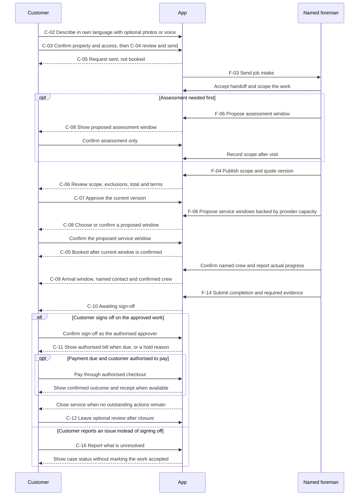
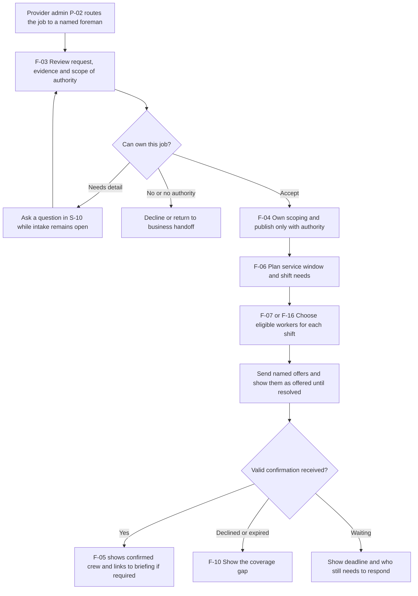
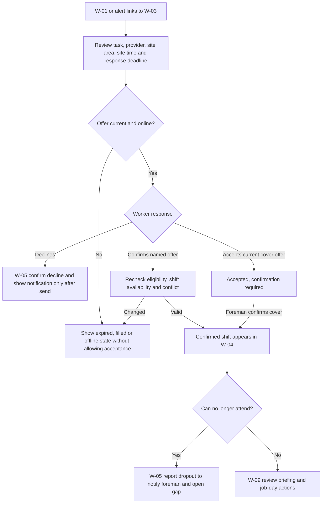
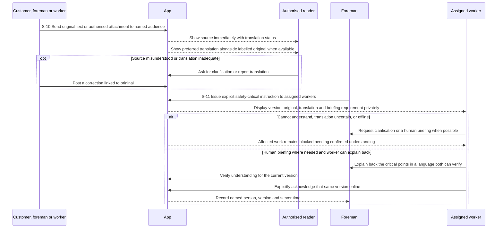
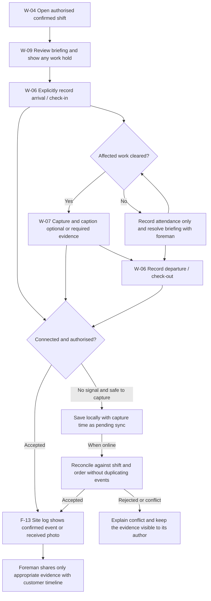
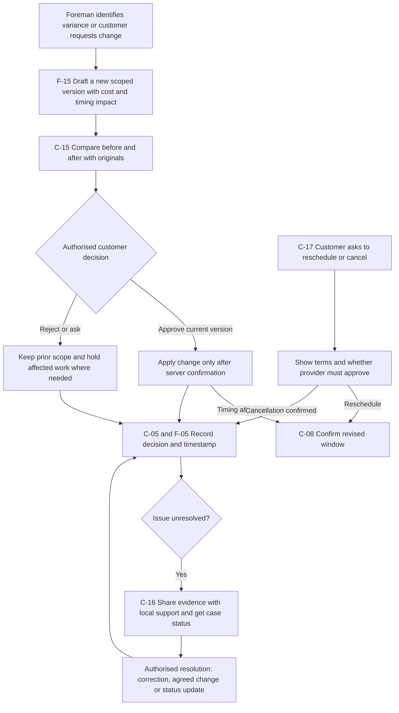

# Core flows

Design the next action around who can take it, what they are committing to and what has actually happened. The IDs below refer to the [screen inventory](../screens/inventory.md); they do not imply API routes or a legal operating model. Roles and grants are defined in [Personas and roles](personas-and-roles.md).

## Shared state and offline rules

- **Job stage:** Draft → Request sent → Scoping → Quote ready → Scheduling → Booked → In progress → Awaiting sign-off → Signed off → Closed. Cancelled is shown only after authoritative cancellation. Show separate, named flags for a crew gap, an open change, a disputed item and payment. A declined quote can return to Scoping if the parties continue; history is not overwritten. Do not call a site assessment a booked repair.
- **Assignment status:** Offered → Confirmed (ordinary named assignment after valid worker confirmation), or Offered → Accepted, confirmation required → Confirmed (cover). Declined, Expired, Filled elsewhere and Cannot attend describe different outcomes. A worker reply in chat is none of these. A confirmed worker saying they cannot attend opens a crew gap without automatically cancelling the job.
- **Consequential actions require online confirmation:** submitting a request, approving a quote/change, agreeing a schedule, accepting or replacing an assignment, acknowledging a safety briefing, signing off and paying. Save safe eligible drafts, chat/media and attendance events locally where allowed. Say `Saved on this device · pending sync` until accepted; use a distinct failed state with retry/reconcile. Never imply pending evidence or a payment has arrived. No offline grant, safety clearance or optimistic coverage. Show last confirmed time on stale records.
- **Time and sensitive data:** appointments, shift and offer deadlines use the service location time zone, with the person's local time alongside if different and enabled. Label the common zone once on site logs and chat. Display sensitive access instructions only to authorised assigned users who need them, never in push copy or on an offer; do not cache access secrets. Mark offline details as last confirmed and provide a contact route if someone cannot verify what they need.
- **Release gates:** provider relationship, categories/trades, permissible work arrangements, verification, support coverage, payment authorisation and liability are [unverified] operating decisions. A UI status must never assert those facts on the basis of a chat, an invite or software matching alone. The [product brief, 21 Nov 2026](../../docs/reports/2026-11-21-builders-company-idea.md#open-questions) documents the operating questions.

## 1. Customer request, booking and completion



- Start with a free description and optional photos or original voice. Review before sending; show upload/transcript status separately and keep the original playable. A failed translation is not a failed request. A selected photo that has not uploaded is not attached; wait or let the customer explicitly remove it. An out-of-area property routes to an explanation and local service contact, not a confirmed job.
- C-06 shows the exact original scope and version with its translation, exclusions, line items and total. Approve only the current version as an authorised approver. A customer can ask the foreman to clarify by chat or decline online; only publishing and approving a new version changes the quote. Booking requires an approved quote, an accountable provider and a confirmed capacity-backed window, not a promise about a particular worker.
- C-09 shows the named foreman, the agreed arrival window and customer-visible confirmed crew, plus any separately reported delay. No live GPS, pending candidate names or implied check-in based on a message. When completion arrives, compare evidence with the approved scope/change versions. An issue routes to C-16 instead of forcing sign-off.
- Sign-off and payment are distinct. Show biller, currency, total and amount due only from authorised records; use the payment provider's flow and display processing until the outcome is known. A repeat tap cannot create a second payment; reconcile uncertain outcomes before retry. Show receipt when available. An approved hold is shown on the affected amount; no implied escrow, refund or settlement on a button tap. Invite, never require, a review after service closure.

## 2. Foreman accepts a job and assigns crew



Accepting intake creates accountability, not a price, contract approval, worker assignment or scheduled visit. Eligible skills, language, work authorisation, declared availability and conflicts are separate from a worker's profile visibility. A foreman who also works on the job switches into Worker for their own shift confirmation and attendance.

## 3. Worker confirms, declines or drops out



An unconfirmed external offer shows the area and relevant task, not precise residential access. For a confirmed shift, `Can't attend` is distinct from declining an offer. If an urgent dropout cannot be sent, state `Foreman not notified` and offer a direct foreman contact route; no queued cancellation should look like a released shift. A reason can be entered without a required public explanation or exposure to the customer.

## 4. Last-minute replacement: own team, then vetted pool

```mermaid
sequenceDiagram
    participant F as Foreman
    participant A as App
    participant W as Eligible candidate
    participant O as Local service
    participant C as Customer
    A-->>F: F-10 Gap from dropout or unresolved shift
    F->>A: Set required task, skills, working language and timing
    F->>A: Check own eligible available team first
    opt Eligible own-team candidate exists
        F->>A: Send an internal offer
        A->>W: W-03 Internal cover offer with expiry
    end
    opt Own team exhausted or recorded urgency cutoff reached
        A-->>F: Unlock F-11 only if approved local provider route exists
        F->>A: Choose match with current task and site eligibility
        A->>W: W-03 External offer through permitted provider
    end
    alt Candidate accepts before expiry
        W->>A: Accept provisionally, not permission to travel or start
        A-->>F: F-12 Accepted, confirmation required
        F->>A: Confirm named worker after eligibility and conflict recheck
        alt Still valid and slot open
            A-->>W: W-04 Confirm assignment and relevant briefing
            A-->>F: Crew confirmed; close other offers for this slot
            A-->>C: C-09 Confirmed arrival roster or timing update
        else No longer eligible, available or slot changed
            A-->>F: Confirm failed; retain gap and explain reason
            A-->>W: Offer closed or returned to pending as appropriate
        end
    else All offers decline or expire, or no permitted route
        A-->>F: No cover confirmed
        F->>O: Escalate or agree a revised plan
        A-->>C: If delivery at risk, notify delay or revised window, not candidate details
    end
```

- Own team first means the external step is unavailable until no internal eligible candidate remains or the system records a justified time cutoff; expire/withdraw outstanding own-team offers before sending external ones. Show skill, required work/briefing language, availability, location and approved legal eligibility for the task, responsible business and time. Language is declared work capability, not nationality. Pending/expired checks cannot pass. External workers are approached only via the authorised local provider/contracting relationship; no public pick-up or customer direction of individual labour.
- Label Offered, Accepted and Confirmed distinctly. A provisional acceptance reserves no permission to travel, access a property or perform work. Final confirmation can apply to only one eligible candidate per gap, rechecking assignment conflicts and current eligibility. Other offers resolve as filled or expired. The new worker needs their own versioned instruction and attendance; prior records are never transferred to them.
- Customer notices name only the confirmed, customer-visible crew and accurate arrival window. If coverage is unresolved and timing materially at risk, say `Crew cover being arranged` and identify the foreman and next update. When scope or timing changes, route through C-08/C-15 as appropriate. Do not promise instant cover or show an external pool to customers.

## 5. Multilingual chat and safety-critical confirmation



- Make audience visible before send: Job conversation versus Crew only. Foreman is the customer's named contact. Show translation first and original immediately below, labelled with language names. A same-language message is shown once. Show `Translation pending` or `Translation unavailable` with the original still readable. Keep the original audio with any transcript/translation. The app may suggest a source language; correcting the label or posting a correction never overwrites the original.
- A read receipt, machine translation or tap on a chat bubble never acknowledges a safety instruction. The assigned worker can ask for clarification or say they do not understand. The foreman arranges a human briefing/verifies understanding and the person acknowledges the specific instruction. If this cannot be verified, the affected work does not start; attendance can still be recorded. On a material revision the previous acknowledgement is kept as history, not applied to the new version. No auto-ack through silence, no acknowledgement on behalf of someone else, and no substitute for qualifications or on-site safety obligations.
- The [chat reference](../screens/shared/S-10-job-chat.svg) shows a worker in the Job conversation; the pinned briefing action is a private viewer-specific cue, not a message or crew record shown to customers. S-11 holds the instruction and confirmation.

## 6. Site attendance and progress photos



- Present check-in and check-out as distinct deliberate events, not background location tracking. Explain when offline that recording arrival is not permission to start work. Preserve the original capture time and the confirmed server receipt; mark late uploads. If checkout follows a locally queued arrival, keep the events ordered and resolve any rejection against the shift rather than inventing a confirmed log. Only the assigned person records their attendance; any allowed correction is visibly recorded, not a replacement of the original event.
- Use the system camera/picker and an accessible text alternative. Review images and captions before upload; warn against people, private items or identifying details unrelated to the work. Site evidence goes to the foreman first. A deliberate share publishes selected completed uploads to the customer, and C-10 distinguishes unavailable or not-yet-received evidence from a finished checklist.

## 7. Changes, cancellations and disputes



A change is not a comment. Show original and proposed scope, price delta/new total, who is accountable and the schedule impact before explicit approval. Keep unaffected work under previous approval; visibly hold only work that cannot proceed safely or within scope. Explain when a revised window awaits separate acceptance. The current booking remains until changed or cancelled authoritatively, with any fees explained using the approved terms. A case preserves the record and shows owner, expected next response if known and any explicitly affected work/payment; it does not silently accept work, cancel the job or promise a refund. Back-office review and findings are not mobile tools.

## 8. Later category: book a Pilates class or massage

```mermaid
sequenceDiagram
    participant P as Provider
    participant A as App
    participant C as Customer
    P->>A: L-06 Publish approved session, language, venue, duration and capacity
    C->>A: L-01 Browse active local services
    A-->>C: L-02 Show session detail, access information and cancellation terms
    C->>A: L-03 Choose slot and group size
    A-->>C: Show short hold with expiry in venue time
    C->>A: L-04 Confirm details and any required payment
    alt Capacity and payment outcome confirmed where required
        A-->>C: L-05 Booking with arrival details and service language
        A-->>P: Update roster and occupied capacity
    else Hold expires, capacity changes or payment unresolved
        A-->>C: Show not booked or processing; return to slots only when retry is safe
    end
    opt Customer needs a change
        C->>A: Reschedule through L-03/L-04 or cancel with C-17 terms
    end
```

A private massage slot has one booking; a Pilates class or tour may sell multiple places. Show capacity as relevant, venue date/time plus optional local time, advertised activity language, accessibility information, price, duration and terms. No construction quote, progress photo or sign-off stage by default. After attendance, use C-12 if eligible. Team-run sessions can reuse the assignment/cover sequence only where category-specific vetting and staffing are approved; a provider change or cancellation must be stated accurately, not implied to be covered.
