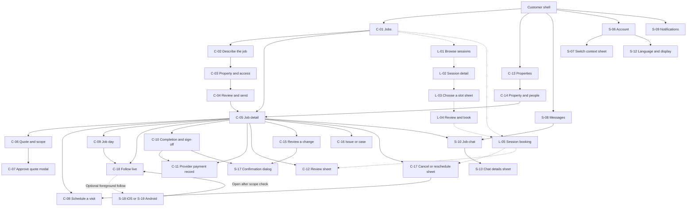
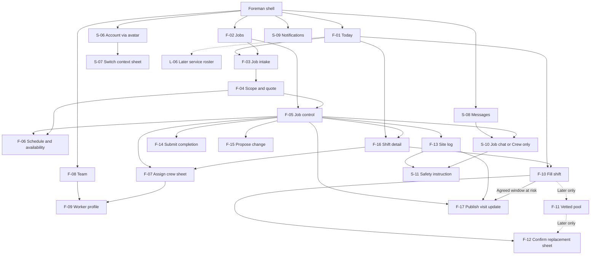
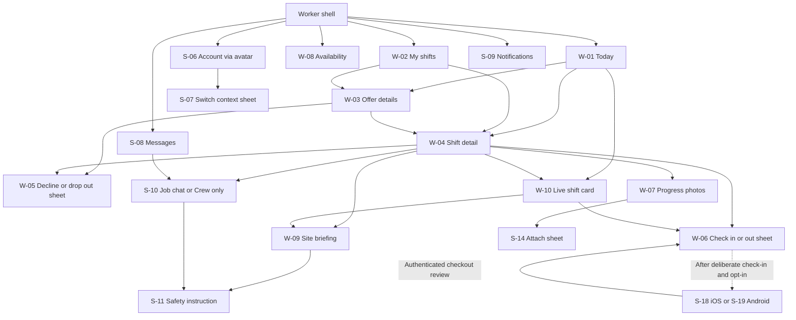
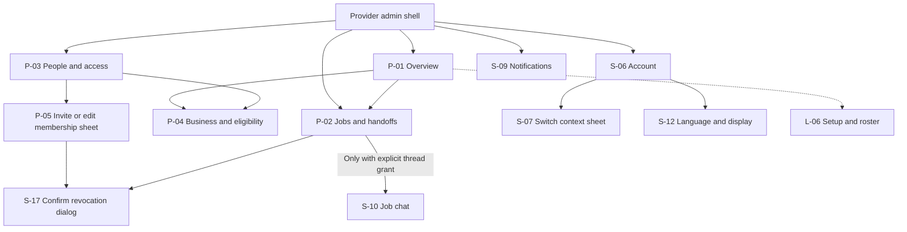

# Information architecture

## One app, scoped by role

Ship **one Android and iPhone app** with a role-specific shell. Customers, foremen and workers can arrive from the same job invitation or notification without installing another app. A small-business owner can move from assigning a shift to viewing their own shift without a second account. Shared surfaces such as chat behave the same, but Jobs, Today and People expose only the work of the current role. Separate apps would clarify audiences at install time but split sign-in, notifications and multilingual support across the same handoff. The role shell gets the clarity without a mixed dashboard. Local operations uses back-office tools, not a fifth mode.

The unit of navigation is **role + organisation where applicable**, with permission to the particular property, job, thread or shift rechecked separately. The same person can have two provider businesses and their own Customer context. A managed property is selected within Customer, not a new account or role. See [role permissions](personas-and-roles.md) and the [complete surface inventory](../screens/inventory.md).

## Navigation rules

| Active role | Tab order (start at first tab) | Header |
| --- | --- | --- |
| Customer | Jobs (C-01), Properties (C-13), Messages (S-08), Account (S-06) | Bell (S-09) at operational roots; show property context where needed |
| Foreman | Today (F-01), Jobs (F-02), Team (F-08), Messages (S-08) | Bell and Account (S-06) avatar at operational roots; label active provider business |
| Worker | Today (W-01), My shifts (W-02), Availability (W-08), Messages (S-08) | Bell and Account avatar at operational roots; label active provider business |
| Provider admin | Overview (P-01), Jobs (P-02), People (P-03), Account (S-06) | Bell at operational roots; label active provider business |

- Four fixed, labelled destinations in each shell. Tab bars show on tab roots; pushed screens, onboarding and full-screen flows hide the bar and provide Back/Up. Returning to a tab restores its authorised stack and scroll position within the current session and role; tapping the already selected tab returns to its root. Account from the Foreman or Worker avatar is a pushed screen, not another tab.
- Push anything that needs its own title, links, long text or review history. Sheets are a bounded choice, confirmation or small edit in the caller's context; expand for larger text or the keyboard. Dialogs are short consequential confirmations. Full-screen media preview is a modal. Keep one sheet/modal active at a time: transition or dismiss first, then restore the cursor and draft. Native pickers return to their caller. C-11 stays a record even when a user leaves to pay a provider independently.
- Back closes the keyboard or transient surface before popping a screen on Android; iOS uses native stack Back/edge gesture and explicit Close for sheets/modals. Do not silently sign out, lose a media draft or switch contexts on Back. Keep drafts on normal navigation. If going back would discard unsaved changes, clarify what would be lost before doing it.
- The notification bell and inbox use the active role/business, not an all-roles feed. An authorisation change removes restricted details on the next navigation or refresh; a revoked scope must not stay open on role switch. Use S-07 from Account to switch to another granted context. Label each option with role and business; the picker lists existing access, not a way to grant new access. Save authorised drafts, open the new shell's root unless following a link, and keep restricted records out of the old back stack. Switching back can resume an authorised draft. Sign-out with unsent work offers return to finish or explicit discard before clearing the account cache; it cannot silently discard or send.

## Onboarding, sign-in and language

1. **S-01 Welcome:** offer **English** and **Português (Portugal)** before identity verification. Use explicit local choice, otherwise ordered device preferences with `pt` mapped to `pt-PT`, then English. S-12 opens in language-only mode. After sign-in the saved account choice wins. Public web uses `/en/…` and `/pt-PT/…`; a public link does not change account settings.
2. **S-02 / S-03 Identity:** one email and one-time code flow for new and returning accounts. Support code paste/autofill, changing email, resend with limits, and help when the user no longer controls the address. A link opened signed out is retained as an opaque destination until the authenticated account and any required onboarding/invite can be checked. No guest visibility of job content.
3. **S-04 Preferences:** ask for display name and reading language, including Original only. Never infer nationality, work language or consent from the UI. Default to site time only; optionally show viewer time as well. Ask for notifications, camera or mic in context with alternatives. No location permission for attendance. Do not gate the owner web path or job timeline on installing the app.
4. **S-05 Invitations:** for crew, business or managed property access, confirm the verified account matches the invite before revealing details. Show role and limits; accept, decline, or get a reissued invite. A first-time self-serve customer goes to Jobs. Use a grant issued by an authorised admin or local operations for provider contexts, not a role selector to self-register as crew. Membership, verification/eligibility and a named assignment are separate. A pending gate leads to a limited business/worker state and help, not a live job or offer.
5. **S-06 / S-12 Settings:** keep UI language, translation reading language, work languages and original content separate. Skills and work languages live in the provider/worker record, not the translation switch. Changing UI/translation language never changes an approved quote, an instruction version or the time of a booked visit. Apply [localisation rules](../system/design-system.md#localisation-and-original-content) throughout, including onboarding and errors.

Switching role/business requires a current online grant; when offline stay in the already-authorised active context or exit. Hide/end any previous scope’s device status. For protected grant changes use recent step-up or verified operations; an email challenge alone is not authority to publish terms, change the last manager or administer a provider.

## Notification and deep-link contract

Open a record, not an action. A notification never accepts a job, a shift or a quote with a single tap. Use generic lock-screen copy and an opaque destination reference; no street address, payment amounts, original message text or crew eligibility details in the notification payload. Apply the same checks for in-app inbox, verified invite links and OS notifications.

| Event | Destination | Parent / fallback |
| --- | --- | --- |
| Quote, job change, schedule or sign-off ready | C-06, C-15, C-08 or C-10 | C-05; current version if permitted, expired/superseded explanation otherwise |
| Day, confirmed roster, provider invoice/receipt or issue reply | C-09, C-11 or C-16 | C-05 or Jobs; only authorised customer-visible information |
| Customer visit status display; worker shift status display | C-18; W-10 or W-06 for checkout | After unlock resolve current account, role and live visit/shift. Cold customer: Jobs → C-05 → C-09 → C-18. Cold worker: Today → W-04 → W-10 (or W-06 sheet over W-04). Warm Back restores the actual caller. Never commit through a link. |
| Intake, crew gap, accepted replacement or shift update | F-03, F-10, F-12 or F-16 | F-02/F-05 or F-10 behind the F-12 sheet |
| Offer, confirmed shift or instruction changed | W-03, W-04 or S-11 | W-01/W-04; expired/filled offers read-only if still permitted |
| New message | S-10 in the authorised audience | S-08 or authorised job detail; scroll to message if available, otherwise to the thread with a plain explanation |
| New invite, business eligibility or handoff | S-05, P-04 or P-02 | S-01/auth or P-01; no duplicate submission on resume |

After authentication, check account, scope, target access and freshness. If the active context cannot open the item but another granted context can, show S-07 with a safe destination label and ask to switch; Cancel returns to the prior root. If no authorised context, use S-16 with generic copy and a way back; do not reveal whether another user's item exists. If the link is valid but connectivity prevents checking a consequential action, show the authorised cached context where available and disable that action until checked online. Build the permitted parent path on cold launch so Back does not send the user to an unrelated role or sign-in loop. Consume the pending destination once.

## Role navigation maps

Solid lines are construction-release routes. Dashed lines mark later routes or explicitly labelled optional OS displays; no “coming soon” launch tab. F-11 and external offers have no launch entry, even by deep link. S-18/S-19 are OS views, not navigable app records. `S-09` feeds the scoped destinations above. The signed-in owner portal supports the full customer record without a native activity.

### Customer

### Foreman

### Worker

### Provider business admin

## Conversation audiences and later categories

S-10 has **Job conversation** (authorised customer, foreman and assigned staff with a job-chat grant) and **Crew only** (named foreman and permitted workers on the relevant job). Show the switch only to users who have both. An explicitly designated Provider admin can join the authorised job conversation, not crew-only content by default. The Foreman remains named contact; no private customer-to-worker directory, contact details or direct messages. An active briefing cue on S-10 is visible only to the relevant crew; it opens S-11 privately. A replacement gains neither audience from an open offer and is granted only what the confirmed assignment requires.

Later sessions reuse the Customer and provider/crew shells: a browse entry on C-01, session cards in Jobs and setup/roster from P-01 or the designated foreman's Today. A solo provider does not see crew cover by default. Team-based categories may reuse assignment and cover with category-specific approvals; no construction crew or eligibility is reused by default. No later screen or empty category tab competes with the launch request path.
