# Customer: request a repair, review a quote and book a visit

Claire Martin requests a terrace door repair at Villa Mar in Xàbia. On Monday she sends the request, accepts the provider’s fixed-price offer and confirms a work visit. C-01 shows the booking before any crew report; C-05 shows the job after Mateo’s Tuesday on-site report. The dates, site address, English reading aids, assessment fee and prices illustrate the flow, not a launch catchment, translation pair or rate. Variants are alternate states of the same screen.

## Rules for this slice

- **Context and navigation.** This is the Customer shell. Job, property, thread and action grants are independent. Check the intended role and record on entry, refresh and before each consequential action. An authorised but non-approving customer can read a quote; someone who loses record access sees S-16 without restricted details. On a deep link, restore the permitted parent stack. A notification opens a record, never approves or books it. Only C-01 has the tab bar. Use stacked Back on iOS and toolbar Up/system Back on Android. Dismiss an active keyboard or transient surface before popping. Back preserves eligible draft fields, attachment state and scroll position. Warn before discarding; the S-06 sign-out flow handles unsent drafts separately.
- **Offline and uncertain outcomes.** On a locked, individually assigned native device, keep only the permitted active-context record for 72 hours after the last successful authorisation sync. On shared phones/browsers leave no persistent job or attachment cache. An unsent draft expires after 14 days without an edit; warn from day 11. Keep pending uploads and uncertain submissions separate until reconciled; surface unresolved items at seven days and obtain a disposition by day 30. Never store access secrets, even online. Cached server records show the last confirmed time and which actions need a connection. Reconnection can resume authorised media uploads and refresh records, never submit a request, approve or agree a time without an explicit tap. During a mutation, preserve its labelled action and prevent duplicate taps. If the outcome is uncertain after a timeout or app restart, check the original attempt before exposing Retry. An empty cache is not an empty list. Do not relabel an item as sent, approved or booked on tap alone.
- **Accessibility and feedback.** Use the [design system](../../system/design-system.md): 48-unit common targets, visible focus, selected state not conveyed by colour alone, and status copy outside colour/icon encoding. Announce durable transitions politely; announce blocking errors with their recovery. Haptics are optional and platform-controlled, only where noted for deliberate selection or confirmed completion. No feedback depends on haptics or motion. At large type let titles, cards, bars and actions grow or stack, keeping a scroll path to the next action. Respect Reduce Motion. In the focus sequences below, omit decorative icons, initials, separators, indicators and skeletons.
- **Language and times.** The bundled UI ships in English (default) and Português (Portugal), selectable before sign-in. An Arabic authored passage or RTL test does not imply an Arabic UI. Display only reviewed reading pairs, or the original alone for Original only; original prose and audio follow their source; translations follow the reading preference. Present a translation above its labelled original, not in place of it. If same language, show the source once; if pending or unavailable, keep the original readable/playable. Wrap rather than shrink for long labels or addresses. In RTL, mirror navigation, controls and row alignment; isolate job IDs, names, prices and times, and apply each original paragraph's own direction. The same scoped decisions are available on signed-in web without app installation. Dates and EUR formatting follow locale without changing values. Appointments use the site date and Spain time (`Europe/Madrid`), with a full local date and time where the zone differs and the preference is enabled. Do not compute an offset from the device clock alone.

## C-01 Jobs home

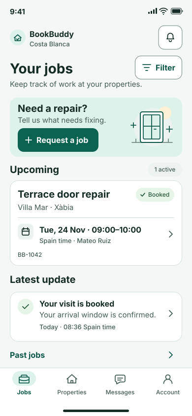

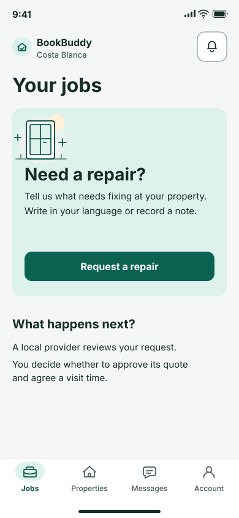

**Purpose and routes.** Customer root on launch or Jobs tab. Reopen a job, resume an unsent draft or start a repair request. Tabs open C-13 Properties, S-08 Messages and S-06 Account; the bell opens S-09 in Customer context.

**Layout and data.** Under the brand, bell, Jobs title and Filter, put the confirmed visit before new work. The paper-backed ticket gives the phase, source, site time, window and a single `View visit updates` destination. On Mon, 23 Nov at 08:36 Claire confirmed BB-1042 for Tue, 24 Nov, 09:00–10:00 Spain time. Only Booked has a current diamond; On the way, On site and In review remain dashed. The ruled group below contains job history for Villa Mar and the named foreman at Reformas Ruiz. Request a repair and Past jobs follow. No crew report is inferred from a booking.

**Interactions.** `View visit updates` opens C-18 in-app, without subscribing. `Job details and history` opens C-05; `Message Mateo` opens the permitted S-10 Job conversation. `Request a repair` opens C-02 without replacing an existing draft. A draft card returns to the latest incomplete step (or the saved review if complete). Tap a server job card anywhere to push C-05; use the actual caller on Back. Filter opens a Bottom sheet with property and status chips; select, Clear, or Apply to commit the filter, or Close without applying changes. Keep selected context visible after applying; preserve it and scroll on return from a job. Past jobs expands the archive list in this tab and scrolls to its heading; the row toggles back to Upcoming. Pull to refresh when online; pagination failure offers retry at the end without dropping loaded rows. Tabs preserve their allowed stacks; reselecting Jobs returns to the root. Do not trigger refresh or a haptic on tab reselection.

**States and edges.** First job shows the primary request invitation and what happens next, with neither a ticket nor an empty job list. A draft-only home leads with Resume. Without a booked visit, lead with the most urgent actionable job. A confirmed delivery-risk notice belongs on or next to the affected ticket; it does not move the window. Filtered-empty explains the active filter and offers Clear filters. An unsent draft sits separately from jobs, labelled `Draft · Not sent` or `Saved on this device`; never use an issued job ID until accepted. Decision-due cards show the exact next action the viewer can take. Upcoming contains future confirmed visits and identifies work vs assessment when needed; history uses Closed or Cancelled only from confirmed records. Cached cards show the last update, do not imply a cached next action is available, and do not reintroduce a revoked job in a cached ticket. First load preserves the section layout and announces loading; no-results copy waits for a successful result.

**Platform, access and localisation.** iOS uses native tab/sheet presentation; Android uses bottom navigation, Material modal sheet and system Back, which dismisses the filter before leaving the root. Focus: Notifications (unread count if any), title, Filter, visit ticket (including all four reported/unreported states), job detail, foreman chat, request CTA, Past jobs, tabs. In first use the request CTA comes first after the page title. Each card is one target with stage and next step read together, not a collection of separately focusable chevrons. At large type the Filter drops below the title and card dates/zones wrap; mirror card chevrons and tab order in RTL.

## C-02 Describe the job

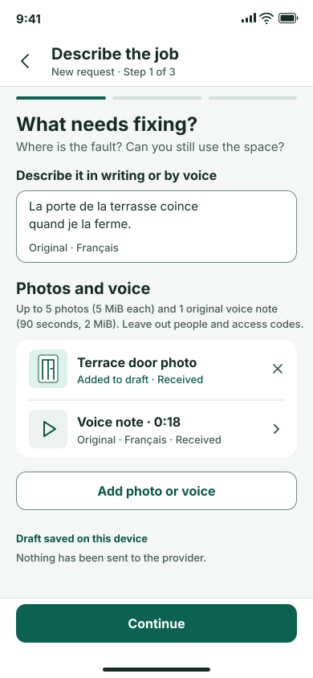

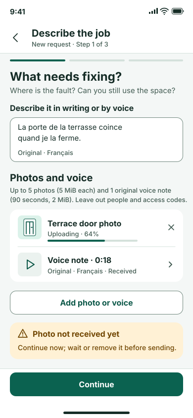

**Purpose and routes.** First step from C-01, a resumed draft, or the description Edit link on C-04. Continue to C-03 in the normal flow; when editing from Review, return to C-04 after a valid edit. Back to Jobs leaves a draft if there is content worth saving.

**Layout and data.** Step 1 leads with “What needs fixing?” and asks where the fault is and whether the space can still be used. Claire’s text is `La porte de la terrasse coince quand je la ferme.` Two rows share one attachment tray: the terrace door photo, then playable original French audio (0:18). `Added to draft · Received` means the original bytes were acknowledged, not that intake has the request. In the alternate only the photo is still uploading (64%); the original voice note is already received. Add photo or voice, a persistent readiness message and Continue follow. Trade/category is optional, with “Not sure”; photos alone are not a launch request. A likely emergency needs the appropriate local emergency route, not a priority booking.

**Interactions.** Tap the input to type or dictate in any language; the app does not change the original. Add opens S-14, which leads to the native camera/photo library or the in-app record/review controls. Permission is asked at use, not on entry. In the tray, tap a thumbnail or voice title for S-15, or Play to hear the original inline. Play becomes Pause; no autoplay. The photo has its own Remove target; voice details and Remove live in S-15. Name removal for its item. For an incomplete upload, removing the item cancels that attachment; during review this is an explicit action, never an automatic omission. If discarding the only original voice description, warn that a description will still be needed. Continue requires non-whitespace text or a valid recorded voice description; a photo alone is supplemental. If invalid, show an inline error, scroll to and focus Description, and explain the voice alternative. A captured original can advance with upload pending, but C-04 cannot send it until the server acknowledges the original or intentionally removed.

**Capture limits.** Per request: at most five photos (≤5 MiB each, new captures 2,048 px on the long edge) plus one original voice note (≤90 seconds and ≤2 MiB). No video. Check limits before staging or upload, including the 100 MiB per-account device limit for pending media. Offer a shorter recording, a different file or explicit removal; never evict another unsent item. Strip shared photo location metadata. Keep names, people, documents, gate/alarm codes and other access secrets out of text, pictures and audio. Only submitted material goes to authorised intake and the assigned provider.

**States and edges.** Empty: preserve space for entry, no fake attachments. Draft: show saved status only when actually saved. Mixed media: independent photo and audio states. Uploading: percentage when known; if not known, use labelled progress. Failed: keep preview and Retry/Remove. Offline: show `Saved on this device · pending sync` for queued media where permitted, and keep the request unsent. Denied camera: offer Photo Library or text; denied mic: offer text or OS settings, not repeated prompts. Picker cancel changes nothing. Transcript pending/unavailable and translation pending/unavailable do not block readiness of an uploaded original. If an attachment cannot be read after returning from the OS picker, explain and allow replacement without losing other inputs. Warn before capturing identifiable people or unrelated documents; use S-16 for verified removal/escalation if a secret was captured by mistake.

**Platform, access and localisation.** Use iOS and Android system photo pickers and native permission UI. iOS edge Back or Android Back dismisses the keyboard/surface in the platform order and restores the insertion point on return. Focus: Back, step and title, Description with helper/error, attachment rows in insertion order (Preview, Play/Pause when present, Remove), Add, live draft/upload status, Continue. Quiet progress announcements at meaningful milestones, not each percentage point. Grow the editor and tray at large type; scroll the focused input above the keyboard. Read French text with its source language, keep mixed-direction captions legible, and format duration independently of writing direction.

## C-03 Property and access

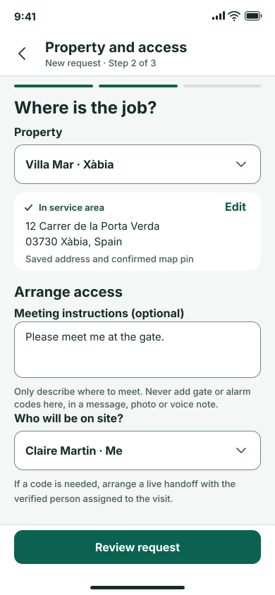

**Purpose and routes.** Attach the request to the correct service address and explain safe arrival. Entry from C-02 or C-04 Edit. Continue to C-04; Back returns to C-02 or to Review as appropriate, retaining edits. Property selection links to C-13; authorised add/edit goes to C-14 and returns with the selected record, rechecked for eligibility.

**Layout and data.** Step 2 asks where the job is. The saved site picker sits above its verified address: Villa Mar, 12 Carrer de la Porta Verda, 03730 Xàbia, Spain (fictional). The check means the stored address and owner-confirmed pin are in the catchment, not that Claire owns the property. “Please meet me at the gate” is a non-secret request note; Claire selects herself as the person on site. That contact choice grants no access to the job. Review request stays pinned below.

**Interactions.** Open the property picker to view allowed sites and choose one or take the Add property route. For a new property, C-14 collects a name and locale-appropriate address (street, number or equivalent, locality, postal code, country; extra address lines when needed); confirm the map pin and validate the normalised address and pin online on creation or change. Reuse the stored result until relevant data changes; return after choosing that saved site. A rural or ambiguous mismatch goes to local operations without exposing other accounts. If a property change leaves previous access or contact details referring to another site, preview the change and confirm clearing those fields first. A permitted user can edit the shared property in C-14; ordinary request edits do not silently change its saved record. The contact picker supports Me, a permitted existing contact, or No one on site / To be arranged. If no one is on site, prompt for a safe handoff note or arranging access with the named contact later. If a secret is indispensable, the verified owner, manager or foreman arranges a live handoff shortly before entry with a verified, currently assigned recipient. Keep only who arranged it and when. No gate/alarm codes in the product, including chat, images, voice, translation, cache or push. If the recipient cannot be verified, hold entry. Continue checks a selected, complete address and clearly identified on-site arrangement; highlight each required missing value before continuing.

**States and edges.** Known verified property uses the saved summary. New/incomplete property exposes missing fields in C-14 and doesn't present a ready address. Delegated read-only: omit shared Edit and explain the role, but allow valid request-specific notes when the request grant permits; otherwise offer S-16. Outside service area: show `This address is outside our service area` with Change property and local-service/S-16 route; no request acceptance or booking. Offline: allow review of an eligible draft using an authorised cached property, labelled `Can’t verify this address offline`; C-04 cannot send until checked. Keep unsaved input on verification errors. If address/grant changes at Review, return to this step with an explanation; do not silently send to a different site.

**Platform, access and localisation.** Use iOS sheet presentation or Android Material sheet for bounded pickers; push C-13/C-14 for longer records. Use native address/text keyboards, not a numeric-only postal keyboard. Focus: Back, title/step, Property, address and Edit if permitted, notes and hint/error, contact and helper, Review request. Expose selected property and contact states to VoiceOver/TalkBack; at large type place Edit on its own row, not on top of the address. Preserve accents, address punctuation and authored note direction; localise address order and postcode rules without rewriting the saved address.

## C-04 Review and send request

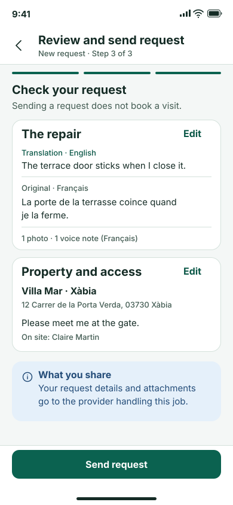

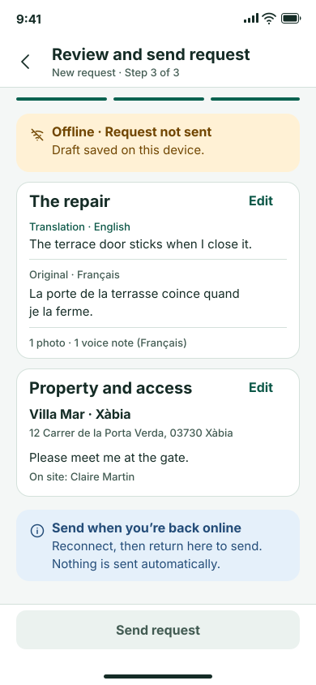

**Purpose and routes.** Last step from C-03 or a saved review. Check the details and explicitly submit a request, not a booking. Repair Edit returns to C-02; Property and access Edit returns to C-03; each returns to this review after its local checks. Back keeps the draft. A confirmed receipt replaces the request stack with C-05 and makes C-01 the parent.

**Layout and data.** Step 3 asks “Ready to send?” and explicitly says that it does not book a visit. Repair and Property and access are two editable sections of one review sheet. The normal fixture illustrates a stored English reading aid above the exact French original, conditional on a reviewed pair. The offline example shows the original without translation. Each records two acknowledged originals, the verified site and Claire’s meeting arrangement. Disclose authorised intake and the provider handling the request before Send. On the offline variant the unsent banner and disabled action explain that returning online will not submit the draft.

**Interactions.** Tap the named Edit controls to change the relevant group; restore focus to that group on return. Pending/failed media gets a row with status and Review attachments, which goes to C-02 for retry or intentional removal. Finish all checks before enabling Send: non-blank text or one received original voice note, a current authorised in-area property, an arrival arrangement (including To be arranged), and server acknowledgement for each retained original. Recheck scope and send online only on the deliberate tap. On tap, keep the request summary, disable repeat sends and show `Sending request…`; no second dialog is needed on this deliberate review step. Announce receipt only on server confirmation, with optional completion haptic; C-05 shows `Request sent · Not booked`.

**States and edges.** Complete online draft is ready. Incomplete sections show a specific correction link; unuploaded media is not counted as attached. Missing translation/transcript is not a request error. Offline: reason for disabled Send remains visible (not queued, no automatic send), and eligible fields remain editable. Definitive failure: `Request not sent`, persistent explanation, inputs intact, retry only when relevant; uncertain failure: `Checking whether your request was received`, no fresh send until reconciled. For a scope/address conflict, require a new review before send. If media was removed and it supplied the only valid initial description, return to C-02 instead of treating the request as complete.

**Platform, access and localisation.** Pinned action respects iOS home inset or Android gesture/button inset; the scroll region ends above it. Focus: Back, title/step, readiness or offline status, repair translation and original then media and Edit repair, property/address/notes and Edit property and access, sharing note, Send. Blocking reasons are readable even where native disabled controls are skipped. Move focus to the job stage on transition; keep edit rows and privacy copy fully readable at large text and in RTL, with address and original prose isolated.

## C-05 Job detail and timeline

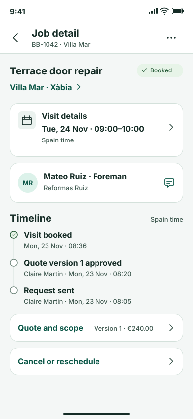

**Purpose and routes.** Authoritative stage, next action and named contact. Entry from C-01, C-14 related jobs, C-04 after receipt, or S-09/deep link after grant checks. Back returns to the actual permitted parent; a cold link can use C-01. Property link opens C-14. The foreman card opens S-10 Job conversation; it never reveals private contacts or Crew only.

**Layout and data.** Header: terrace door repair, BB-1042, Villa Mar · Xàbia and More. The ticket now reads “Crew on site”, reported by Mateo at 09:12 Spain time on Tue, 24 Nov. Its booked and on-the-way steps have ticks; on-site has the current diamond; In review is unreported. `View visit updates` opens C-18; opening does not start a device display. Visit details groups the unchanged 09:00–10:00 agreed window (C-09) with a separate message row for Mateo Ruiz, foreman at Reformas Ruiz. Job history groups the Mon, 23 Nov decisions in Spain time: booking at 08:36, Claire’s €240.00 V1 approval at 08:20, request receipt at 08:05. The approval opens its immutable quote. The final property link opens C-14. Keep visit reports separate from these job decisions.

**Interactions and states.** A next-action card is one target; link rows and the More menu use explicit labels. Scroll to earlier events; pull to refresh when online. Tap a linked timeline event to open its authorised record/version; events without a destination are passive. More offers Report an issue to C-16 and eligible secondary actions not already visible. Use the following transitions after authoritative updates:

| Current stage or flag | What to show and where to go |
| --- | --- |
| Request sent | `Not booked`; receipt and who will respond if known. No foreman name or chat route before the assignment/thread grant exists. |
| Scoping | Named foreman when assigned; messages/clarification, or `Review assessment time` → C-08. A confirmed assessment remains an assessment. |
| Quote ready | `Review quote` → C-06. Flag `Approval needed` only when the actor can approve; otherwise read-only quote or approver status. |
| Scheduling | `Choose a visit time` → C-08 when proposals exist; otherwise `Waiting for visit times`, with chat if available. Approved quote remains readable. |
| Booked | `View visit updates` → C-18 (confirmed booking, even before a crew report); `Visit details` → C-09; confirmed site window, optional local time; `Cancel or reschedule` → C-17 if eligible. |
| In progress | Current progress and shared evidence only; C-18 for the latest public report; C-09 for job-day details; `Review a change` → C-15 if issued. A crew-cover flag does not show candidate names or cancel a visit. |
| Awaiting sign-off | `Review completed work` → C-10, with issue alternative; C-11 only when the authorised bill stage permits it. |
| Signed off | Recorded sign-off; C-11 shows payment/receipt or hold only as recorded. Do not imply payment from sign-off. |
| Closed | Read-only history; optional C-12 review if eligible and not already recorded; authorised receipt link remains. |
| Cancelled | Record the confirmed cancellation and end the visit ticket/display. Eligible cancellation is fee-free. Separately identify any performed work or statutory withdrawal; a pending move or case does not cancel the booking. |
| Issue open / change or payment hold | Separate flag with affected work, payment or timing and link to C-16, C-15 or C-11 as appropriate. Do not obscure unaffected work or rewrite the previous approval. |

**Sources and privacy.** Only a confirmed C-08 window, a deliberately published F-17 milestone or an F-14 completion submission advances the visit ledger. Do not backfill unreported steps. A check-in, shift offer, reservation, timer, chat or media upload is not a customer event. Correct reports visibly; show risk or cover as a notice with the named foreman, last confirmed site time and next update only if promised. Never disclose individual attendance, candidate details, locations or routes. If delivery is stale, show the last report and contact; C-18 remains usable without following, on web and when OS updates are denied.

**Recovery and edges.** Stale data shows `Last confirmed` plus timestamp; linked cached read-only records remain discoverable if permitted. Retry missing timeline pages separately with current stage intact; initially empty timelines explain what will appear. If an old notification points to a now-superseded authorised record, show the relevant read-only explanation. On revoked or unknown access, clear the detail and use S-16; present no provider-only assignment or location-tracking data.

**Platform, access and localisation.** Native toolbar and overflow menu on each platform; system Back dismisses the menu or returns to the permitted parent and restores scroll. Focus: Back, title/reference, More, phase/source and timeline target, visit details, foreman contact, history in displayed order, View property. Announce true stage changes politely without jumping focus mid-scroll. At large text move badges below the title and put date plus zone on their own lines. Mirror the timeline rail and chevrons, not time ranges or job IDs.

## C-06 Quote and scope

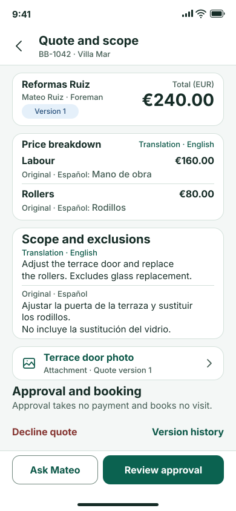

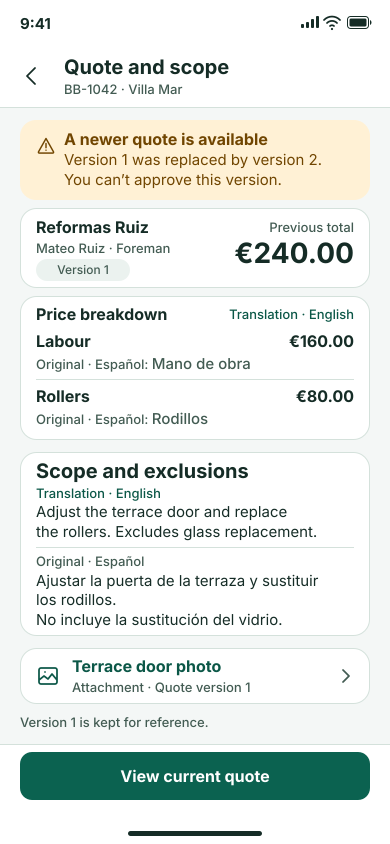

**Purpose and routes.** Inspect a versioned offer from C-05 or an authorised quote link. When opened from the live S-09 inbox, Back restores that inbox’s filter, scroll position and focus on the triggering notification. When entered from the job or opened on cold launch, C-05 is the parent. `Review approval` opens C-07 for this exact version; Cancel restores the same quote version, position and trigger. `Ask Mateo` opens S-10 in the Job conversation and returns to the same version and scroll position. Only a fresh, authorised confirmation in C-07 records approval.

**Layout and data.** Lead with the issued version and tax-inclusive EUR total. Reformas Ruiz provides and bills the service; BookBuddy coordinates the booking. Claire Martin is the named approver. V1 is issued Mon, 23 Nov at 08:15 and expires **seven calendar days from issue**, Mon, 30 Nov at 08:15 Spain time (`Europe/Madrid`). One ruled sheet holds Labour / `Mano de obra` €160.00 and Rollers / `Rodillos` €80.00, total €240.00. The English reading aid says “Adjust the terrace door and replace the rollers. Excludes glass replacement.” Exact Spanish original: `Ajustar la puerta de la terraza y sustituir los rodillos.` `No incluye la sustitución del vidrio.` The Terrace door photo is received evidence expressly included with V1, not the job gallery.

**Issued terms.** Read the issued terms opens the full versioned document in this record. Include provider legal identity/contact and complaint route, site, itemised deliverables/exclusions, applicable IVA and fixed total, any separate assessment price, scheduling assumptions, completion evidence, payment, cancellation, withdrawal and remedy terms. For this no-deposit offer the customer pays Reformas Ruiz directly against its final bill, normally due seven calendar days after delivery of the authorised bill; booking and sign-off do not charge. No BookBuddy surcharge. Show the immutable Spanish original and required contracting-language disclosures; label a provider-reviewed translation as a reading aid, never as substitute terms. If a relied-on document is missing or the person does not understand it, keep Ask Mateo available, not a blind approval.

**Interactions.** Review approval requires a fresh current, valid quote and the named customer approver’s current grant for the property (not the quote author's own account). If the view is old, offer `View current quote`, which opens that version at its title; no direct approval from a stale link. More → Version history opens a bounded list of authorised versions and dispositions; selecting a version closes that list and displays the immutable record. For a long list, use a full-height sheet. `Ask Mateo` makes no commercial decision; a chat reply cannot amend a quote. More → `Decline quote` opens S-17 with version, property, actor and effect; submit only against the current quote online. Definitive decline shows the recorded outcome and may return the job to Scoping; a failed or uncertain decline leaves it unchanged until reconciled.

Tap an issued attachment row to open S-15 in read-only mode for that exact quote version, including when a prior version remains readable. Closing S-15 returns to the same version and scroll position and restores focus to the originating row. The viewer cannot edit, remove or replace issued evidence. The customer version includes only evidence explicitly shared in F-04; private or unreceived evidence never appears here. If issued evidence is temporarily unavailable, keep its row with an explanation and a retry or reconnect path rather than silently omitting it; if access is revoked, stop showing restricted content.

**States and edges.** Current/approvable: both clarification and approval available. Current/read-only: show `You can view this quote, but can’t approve it`; no decline/approve if the decision grant is absent; show scoped approver information only if permitted. Clarification: original and financial terms remain unchanged while the conversation is open. Superseded: read-only older total and scope, explicit replaced-by version and CTA to review it. The illustrated V1 was replaced before acceptance; More retains V1’s original terms and history. An already approved V1 is never overwritten by this path; no old decline or approve. Expired: explicit expiry in Spain time, `Ask Mateo for an updated quote`; do not relabel an expired quote as superseded unless a successor exists. Declined: show action time and actor where permitted, no repeated decline. Approved: show exact approved record, clear decision controls, point back to C-05 for scheduling; offer the accepted version and terms on durable medium (for example, an emailed PDF). Any later proposal needs separate publication and C-15 consent by the named approver. Expiry prevents new acceptance, not performance of an agreed job. Cached/offline: show current-as-of time and disable all consequential actions until rechecked; translation unavailable keeps the original readable. If required scope, version or commercial terms cannot be retrieved, treat it as incomplete rather than asking the viewer to approve partial details.

**Platform, access and localisation.** Use native stack navigation and native/Material sheet for version history. Focus: Back, title/context, More, version warning if present, quote version and total, line items, scope translation then original, issued attachment rows, issued terms, Ask Mateo and Review approval (or View current quote). Pair each cost description and original with the single amount for screen readers; announce the attachment name, quote version and preview action. Use tabular figures, never abbreviate the total, and stack the footer at larger sizes. Preserve precise EUR values, source/legal language and scope exclusions in both directions; numbers and currency are bidi-isolated.

## C-07 Approve current quote

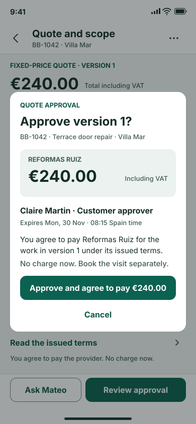

**Purpose and routes.** Record explicit, authorised approval of the reviewed quote. Only C-06 opens this modal. Cancel restores the same C-06 version, scroll position and trigger. Approval success closes to C-06 with a confirmed receipt and a route to C-05 for scheduling; it does not skip to a booked screen or change where Back returns.

**Layout and data.** The modal sits over the actual C-06. It names BB-1042 · Terrace door repair · Villa Mar, Reformas Ruiz, V1, €240.00 including VAT, Claire Martin as the named customer approver and the site-time expiry. Claire agrees to pay Reformas Ruiz for the work under that version’s issued terms. The primary action says `Approve and agree to pay €240.00`; Cancel makes no decision. This forms the agreement, but it does not take payment, book a visit, request early performance or waive withdrawal.

**Interactions.** Open with focus on the title (or safer Cancel where native defaults require it). No backdrop dismissal or swipe that could accidentally confirm. Cancel/Close, Android Back and the accessibility escape gesture dismiss before submission without any change. At confirm, check that Claire is the named customer approver, is not the author/seller approving her own quote, and still has authority over the exact site, version, price, terms and unexpired deadline online; submit that reviewed record, not whatever version happens to be latest. Show processing and suppress repeat taps. If the user leaves while a request is unresolved, C-06 continues to show a checking status; leaving is not undo. On an authoritative approval, announce version and amount on C-06 and optionally play a completion haptic once. Record the original, version and terms, actor/grant, time, amount and reviewed translation actually shown. Provide the accepted terms on durable medium and keep the receipt on the parent. No approval from chat, silence or switching roles.

**States and edges.** Ready as shown. Changed since review: cancel the proposed decision, replace the confirmation content with a reason and `View current quote`; close to the appropriate C-06 first, where the new terms must be read before confirming. No authority: if still entitled to view, close to read-only C-06 with a reason; if record access is revoked, clear parent details and route to S-16. Network/expiry failure: say `Quote not approved` if definitive, retaining Cancel and safe retry only when the same version remains valid. For unknown outcome communicate checking, do not send again until reconciled. Offline never shows an enabled confirmation.

**Platform, access and localisation.** Use an accessible iOS confirmation presentation or Android modal dialog with predictive Back where supported; no nested dialog. Move focus inside, hide underlying controls from the accessibility tree, and restore focus to the trigger or the confirmed/invalidated status on return. Reading order: title, job/property, provider/version/total, actor, deadline, consequence, Approve and agree to pay, Cancel. With large type, grow toward a full-height modal, scroll the details and stack actions without truncating Cancel, the decision verb, the amount or the role. Localise the full action string, not a verb concatenated with a currency; keep amounts, job ID and source name isolated in RTL.

## C-08 Schedule a visit

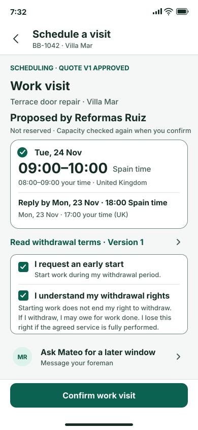

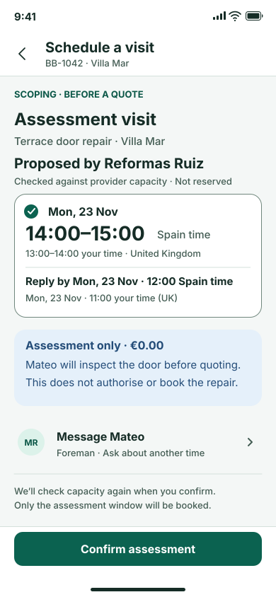

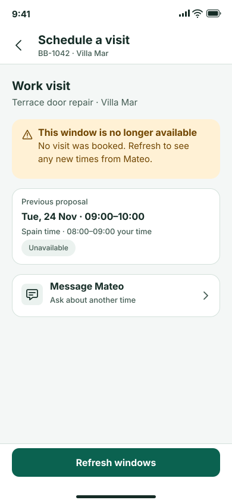

**Purpose and routes.** Choose or confirm a provider-proposed assessment or work window from C-05, an authorised S-09 link or a reschedule flow in C-17. Back returns to that permitted parent without changing a booking. Message Mateo opens S-10; return preserves any still-current selection. On authoritative agreement, return to C-05 with the accurate visit type/status and show C-09 only for applicable confirmed job-day details. A confirmed booking can open C-17 to manage terms or request a reschedule; dismiss that sheet before pushing C-08 again.

**Layout and data.** The work proposal names Reformas Ruiz, V1 approval and the site, then shows a capacity-checked but **unreserved** arrival window. Tue, 24 Nov, 09:00–10:00 Spain time is the decision; 08:00–09:00 UK time is the optional second display. Keep site time alone by default; offer the second zone at the first decision if it differs. The checked early-start row illustrates a choice already made, never a default. Message Mateo and Confirm work visit remain separate. The assessment variant has no approved repair or early-start selection: a separately issued €0.00 inspection on Mon, 23 Nov, 14:00–15:00 Spain time. If an assessment carries a price, disclose its separate provider terms and payment obligation before agreement; do not reuse a repair approval.

**Interactions.** Group windows by site date. A date or agenda jump scrolls to its group; with optional compact day/calendar view for many dates, keep the equivalent agenda available. A single current proposal can be preselected without acceptance; multiple choices require selection, optional restrained selection haptic and accessible radio state. No auto-book when a window is selected. The provider checks capacity when offering the window. Confirmation rechecks current provider capacity, exact proposal revision, visit type and customer grant online before committing once; a work visit also requires the current approved scope and accountable provider. The primary label matches the effect: `Confirm assessment`, `Confirm work visit` or `Request new time` when provider agreement is still required. For work within an applicable statutory withdrawal period, show the early-start terms and consequences before an independent, unticked express request and applicable acknowledgement. No opt-in by accepting a quote, picking a window or silence; allow a later proposal rather than conditioning approval on waiver. Record the version and choices. Start alone is not loss of withdrawal rights. Before the tap state the chosen site window and whether the old time remains. `Ask about another time` is chat, not scheduling; an alternate becomes selectable only when formally proposed.

**States and edges.** Separate the illustrated assessment from the illustrated work proposal; an assessment receipt never creates a booked repair. No windows: `No visit times yet` with a named contact if available; do not enable arbitrary slot selection. Changed/expired: retire the old selection, show its former time and `Refresh windows`; if new proposals are available show them without silently selecting a replacement. Pending request or outcome check: preserve the selected window and status, disable another send, reconcile before retry. Definitive success: a confirmation persistent on C-05, plus optional completion haptic. Reschedule requested: current confirmed window stays in force until changed authoritatively (show both); cancellation needs C-17 and its own outcome. Offline cached: last-confirmed time, read-only proposals, no agreement. In the failed move drawing Wednesday 25 Nov, 09:00–10:00 was lost at confirmation; Tuesday 24 Nov, 09:00–10:00 remains booked. Refresh windows reads new proposals, never retries the move automatically. If the site date differs from the viewer's, show both full dates and zones; handle DST using each visit's actual date. Do not expose coverage or pending worker details.

**Managing an existing visit.** Changes are fee-free. At least 24 hours before an unstarted visit, directly confirm a current provider-authorised like-for-like alternative with unchanged scope and price. Inside 24 hours, or with different terms or capacity, request provider agreement; the reply target is four staffed hours, or before the visit if sooner and staffed, not a promised new time. The old booking changes only on a confirmed replacement. Before start with no work performed, eligible self-service cancellation in C-17 costs €0. If work has already been performed, send termination to the provider/case for itemisation, not a cancellation fee. Keep any applicable direct statutory withdrawal and its durable receipt separate from visit management; it is not a request for permission.

**Platform, access and localisation.** iOS may use native date navigation for a larger agenda; Android uses equivalent date navigation with readable agenda/text alternative, respecting system Back and bottom inset. Focus: Back, title/type/property, quote or conflict status, date headings, window choices with proposed/selected state and both time labels, separate early-start terms and choice where applicable, consequences, Message Mateo, primary action. At large text stack the two zone lines and date controls; keep time ranges intact where possible and repeat the full accessible time context on each choice. In RTL mirror selection/radio layout, not the clock icon or internal order of dates, job IDs and time ranges.

## Open design questions

- Which service catchment and named local contact should C-03 use for ambiguous addresses? Villa Mar illustrates a verified address, not the choice of pilot geography.
- Which provider signatory and consumer-law reviewer will approve the production consent, early-start and withdrawal wording in each required contracting language? The fixture makes the obligation explicit without claiming that a prototype phrase meets local legal requirements.
- Who will review European Portuguese customer copy and the proposed reading pairs for intake and issued quote aids? The French-to-English example is illustrative, not an enabled launch pair.

## Navigation

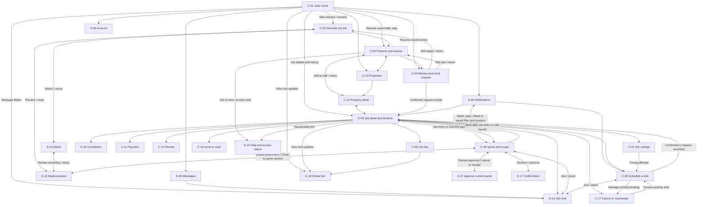

## Review responses

- **FL-01, FL-02:** Both C-06 drawings retain the issued cost originals and attachment; S-15 returns to that version. Back from a warm notification restores S-09, while a cold quote link builds C-05 as parent. C-07 Cancel does not replace V1.
- **V-CA-01:** C-02 says “Added to draft · Received” only for the acknowledged photo. The uploading variant cannot send that file until receipt or deliberate removal.
- **Original and chronology:** The V1 rollers wording and glass exclusion remain verbatim. C-05 retains Claire’s 08:20 approval and 08:36 booking on Monday; Tuesday’s 09:12 on-site report neither changes that booking nor establishes an individual worker’s attendance.
