# Customer screens C-09–C-18

Claire Martin follows **BB-1042 · Terrace door repair** at **Villa Mar · Xàbia**. Reformas Ruiz is the provider; Mateo Ruiz is Claire’s named foreman and contact. The booked work visit is **Tue, 24 Nov · 09:00–10:00 Spain time** (`Europe/Madrid`); Claire’s optional UK display is **08:00–09:00 your time**. Approved quote v1 is **€240.00**; C-15 and the open case show separate branches, not changes already applied to the signed-off and paid examples.

## Rules for this slice

- **Navigation.** C-13 is a Customer tab root (Jobs, Properties, Messages, Account); the other screens are pushed or presented over a caller, without duplicate tab bars. Back and Close pop to the actual authorised caller and restore its trigger, filter and scroll position, including when the caller is the open S-09 inbox. iOS uses native Back/edge swipe and sheet detents; Android uses Up and system/predictive Back (keyboard, then sheet, then route). Sheets give focus to their title, keep it within the sheet and return it to the initiating control. Never stack overlays. Only a cold job link constructs C-05 as the parent if authorised; other cold links rebuild their own permitted parent (for example C-13/Jobs, or L-05 for a later booking case). S-16 explains invalid or inaccessible links without revealing the underlying record.
- **Authority and connection.** Viewing a property or job does not grant approval, sign-off, payment, booking changes or inviting. Check the particular capability and the exact version immediately before submitting. If the same account authored the commercial proposal, do not allow it to approve it in Customer context. On revoked access, remove restricted content and actions immediately on recheck; don't expose hidden records in search, history, notifications or drafts. Show last confirmed time on cached records; no offline approval, payment report, booking change or new grant. Check the result after an interrupted request before offering a retry. Differentiate draft, sending, pending reconciliation, failed and confirmed.
- **Interaction and accessibility.** Use native focus, at least 44 × 44 pt iOS / 48 × 48 dp Android targets (48 common), Dynamic Type/font scaling, and text plus icon for meaningful statuses. At larger text sizes, stack actions and let pinned regions grow or move into scroll; never truncate dates, grant limits, amounts or consequences. Focus a new route’s heading, keep focus during background refresh, announce meaningful updates politely, and focus the first invalid field on an explicit submit attempt. Buttons show pressed/focused states and keep their intent while processing. No haptic for merely opening a route, pending sync, failure or ordinary taps; one optional platform success cue follows verified completion of a consequential action. Platform motion, vibration and accessibility settings always apply.
- **Language and dates.** English is the default UI and Português (Portugal) the second. Use bundled ICU copy, including status and recovery. UI language never changes EUR, site time, approved text or stored evidence. Default to the site zone; when enabled, put viewer time second, with its own date if different. Read translations only for reviewed pairs, above the labelled immutable original; Original only and unavailable translations still show the source. Allow 40% expansion; isolate mixed-direction names, amounts and IDs. The signed-in portal supports these decisions and reports without an app install.

- **Device and privacy.** On an individually assigned phone, show only the active scope’s minimum safe snapshot for up to 72 hours from its last successful authorisation sync. Do not persist bills, received evidence, archived threads or customer attachments on shared devices; received media previews are session-only. Safe unsent drafts expire after 14 days without edits, with a warning from day 11. Separate uncertain sends from disposable drafts and reconcile once against the original operation. Never collect entry codes in fields, images, audio or chat, or cache, translate or push them.

## C-09 · Job day

**Purpose and entry.** C-05’s booked visit and S-09 day/crew events open this record. Back restores the C-05 visit trigger or the live S-09 inbox, including its filter and position. Only a cold authorised job link constructs C-05 behind Job day. After completion the next action can push C-10; Back from that page returns to Job day if it was the caller. The booking and the crew assigned to deliver it are separate facts.

**Layout.** A paper visit ticket leads with the latest public milestone: **Crew on site**, reported by Mateo at 09:12 Spain time. The four labelled marks record Booked, On the way, On site and In review; the last is unreported. **View visit updates** opens C-18 without starting a device display. Beneath the ticket, the agreed window is 09:00–10:00 Spain time (08:00–09:00 in Claire’s enabled UK view). The ruled roster shows Mateo Ruiz as foreman and Nadia Benali as crew, not attendance. Only Mateo is the contact. Report an issue and Message Mateo remain separate actions.

**Interactions.** Message Mateo pushes S-10 in the Job conversation; no Crew only option or worker DM. Report an issue pushes C-16 with job/visit context but doesn’t notify anyone until sent. If the provider proposes a different window, show it as proposed and link to C-08 while keeping the agreed one labelled. If an approved-scope decision is needed, link to C-15; neither a chat nor a cover confirmation changes the price or visit. Scroll the roster and updates; refresh the record by the native refresh gesture or a named retry button on stale/error, without resetting focus. No confirmation or haptic for consulting the roster.

**States and edge cases.** Scheduled: agreed window, not a live countdown or check-in. Delayed: show the reported delay separately from the original window and the next update only if known. Cover being arranged: show delivery risk and a foreman contact; show only still-confirmed names, no candidate, dropout reason or staffing detail. Crew updated: publish only the new confirmed roster, with update time/date and whether the window changed. On site: show only a customer-visible confirmed arrival, never infer it from GPS, clock or chat. Completed: route to completion evidence once submitted; show neutral completion/submission status accurately. Empty roster, loading and cache are distinct (e.g. “No confirmed crew to show yet” versus “Last confirmed …”); if a record can’t be verified, don’t retain visible inaccessible details. Contact can save an eligible chat draft offline but a queued message isn’t delivered.

The two pre-arrival examples are separate branches. Both retain **Visit booked** (Mon, 23 Nov at 08:36). In the risk branch, Mateo published the delivery risk at 08:33 and promised a report by 08:48; only Mateo is still confirmed. In the successful cover branch, the first valid acceptance reserves the slot privately. After rechecking, Mateo confirms the assignment at 08:34 Spain time (07:34 UK), before the 08:40 safe staffing cutoff. F-16 and C-09 then show Diego Torres on the roster, with the original window unchanged. This is not a departure, arrival or safety clearance. Never show absence reasons or individual attendance.

**Platform, focus and locale.** iOS native Back/refresh; Android Up/Back and equivalent refresh with a button fallback on errors. Read header → phase, source, rail and updates link → agreed window and zones → any disruption → confirmed roster → issue → message. Announce “Crew updated. Diego Torres confirmed. Arrival window unchanged” without moving focus. Skip initials and calendar illustration; let names and roles reflow independently. Read arrival as a range with both zones named; in RTL mirror card icon placement but preserve the chronological window.

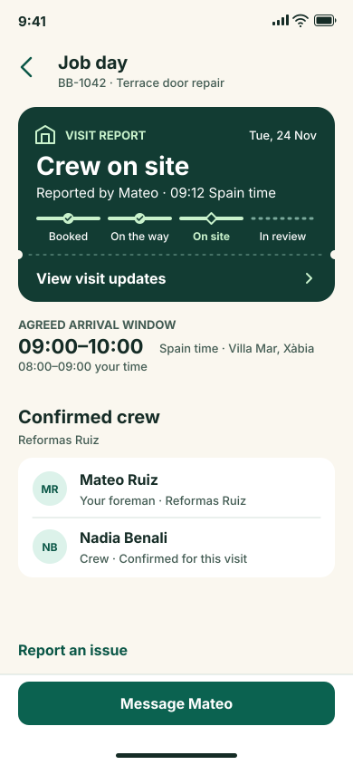
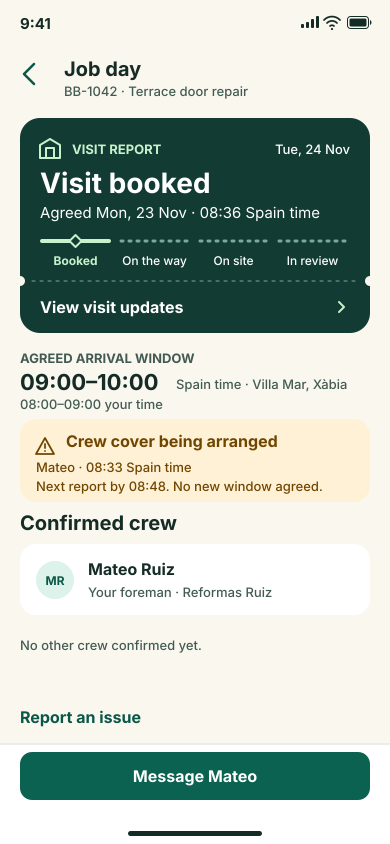
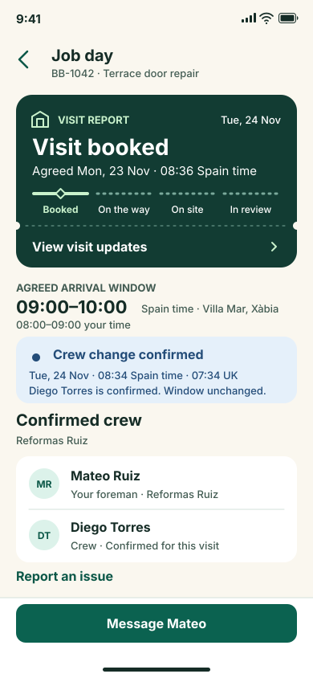

## C-10 · Completion and sign-off

**Purpose and entry.** C-05, C-09 after completion or an S-09 completion event opens the foreman’s submitted completion. Compare it with the approved scope, not with the latest proposed change. Back restores the actual caller and trigger; only a cold authorised job link constructs C-05. After confirmed sign-off, View provider invoice opens C-11 when an authorised bill exists. Report an issue opens C-16 without accepting the work.

**Layout.** Completion 1, submitted by Mateo for Reformas Ruiz, is awaiting Claire’s sign-off. Under approved quote v1 (€240.00 including tax), each reported item has its own result: the adjusted terrace door closes without catching, and the new rollers slide smoothly. One received **After adjustment** photo of the common affected area belongs to both lines. It is the selected F-14 evidence, not another upload. Glass is excluded. Claire can inspect the photo, report a problem or review sign-off. The decision names her; it is neither a payment nor a waiver of remedies.

**Interactions.** Photo row opens S-15 with the caption, media gestures and native Close; return to that row. Review sign-off opens S-17 naming Claire in Customer context, the property, submitted completion and approved version(s). It says “Sign off work,” not “Pay” or “Close job.” Confirm online against the reviewed completion and grant; Cancel returns without changes. Persist confirmed actor, version and time on C-10/C-05; confirmation never submits a payment. Report an issue passes the relevant completion item to C-16, which retains its own draft. Checklist rows are evidence, not checkboxes; partial sign-off is not offered on this surface.

**States and edge cases.** Awaiting sign-off with reviewed evidence; evidence unavailable distinguishes still uploading, not shared, deleted, retrieval failure and no attachment. Retry only unavailable media; don't imply its contents prove completion. If evidence is required but unreceived, or completion changes during review, block confirmation with the reason and surface the new record rather than applying consent. Current record may be accepted (read-only history and next step), issue open (link to case; distinguish affected item and status), or unauthorised (explain missing sign-off grant, no active CTA). A withdrawn submission or disputed item must not appear accepted. Send one reminder after three calendar days and follow up with a person after seven; silence is never deemed acceptance or a charge. For concealed work use the agreed before-cover image, test or certificate. A corrected F-14 submission gets a new version; retain prior evidence and sign-off. Offline shows authorised cached evidence where available, sign-off disabled and issue draft entry if eligible.

**Platform, focus and locale.** S-15 uses platform full-screen modal/back/gesture behavior with a labelled Zoom alternative, S-17 uses the platform confirmation presentation with the same copy and safe focus. Read heading → submission and approved version → each item and its result → captioned area photo → named signatory and consequences → actions. Checks are read as “Reported complete,” not as selected controls. Evidence and notes wrap, actions stack, and translated notes and captions retain their Spanish original when present; checklist status labels are localised UI text.

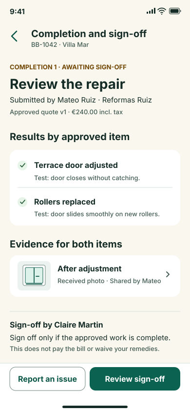

## C-11 · Provider payment record

**Purpose and entry.** Open from C-05, C-10 after sign-off, or an authorised S-09 bill or receipt. Reformas Ruiz sells, invoices, takes payment and handles remedies; BookBuddy coordinates the booking and records what happened. Back returns to the actual caller. The customer can pay the provider independently without using this screen.

**Layout.** The provider’s invoice number, tax-inclusive EUR total and biller lead. The fixture is **RR-1042 · €240.00**, quote v1, delivered Tue, 24 Nov and due Tue, 1 Dec (seven calendar days after delivery, site time). **View provider invoice** opens the authorised document and its agreed direct transfer instructions. If the provider instead supplied its own external payment link, identify the provider before leaving the app. There is no BookBuddy checkout, bank/card form, platform surcharge, wallet or settlement control.

**Interactions.** After paying the provider, Claire chooses **Record payment sent**. Review the intended provider, invoice, amount, payment date, method and any permitted reference, with the explicit consequence “This sends a report, not money.” Check the current bill and reporting grant online; keep one report operation on an uncertain send. A confirmed report shows who sent it and when. Leave the amount unmatched until Reformas Ruiz reconciles its bank or PSP receipt to this invoice. Neither sign-off, a screenshot, a browser return nor a customer report is proof of payment. **Get payment help** opens the scoped C-16 case; S-16 handles missing access. No report can collect funds, issue a refund or establish fee eligibility.

| State | What Claire sees and can do |
| --- | --- |
| Not due / due | Without a delivered bill, show why nothing is due if known; do not invent a zero invoice. Once due, show the current bill, provider’s instructions and record-only action. |
| Report sent · awaiting provider match | The 25 Nov report shows €240.00 sent, not **Paid**. View the sent report or ask for help. Do not suggest paying again or submitting another report. |
| Could not save / outcome unknown | A definite recording failure offers **Retry payment report** against the same bill, never retry payment. If receipt is uncertain, say “Checking your report” and reconcile its existing ID before offering retry. No inference about the bank transfer. Retain safe input on failure. |
| Paid · matched by provider | Reformas Ruiz matched the €240.00 transfer on Wed, 25 Nov; balance €0.00. Open its invoice or the separate payment receipt; share only the authorised receipt on explicit request. If a receipt is pending, keep the match and explain why the document is unavailable. |
| Disputed, adjusted or refunded | Itemise affected unpaid amount and any **provider-authorised** deferral, separate from the undisputed balance. A paid sum is not held. Show only recorded decisions: refund pending until confirmed; show amount, reason, date, corrected invoice when applicable and remaining balance. No escrow, release or refund button. A dispute goes to C-16, not a new charge. |

**Platform, focus and locale.** iOS and Android offer native document preview/share and return to the same bill; the signed-in browser offers the same record and acts without installation. Offline, expired or read-only: no report or new export; explain the restriction. Read invoice ID → amount and currency → provider → recording or match status → dates and documents → help or report. Announce a confirmed report and confirmed match as different events. Format but never convert EUR or translate the provider’s official identifiers.

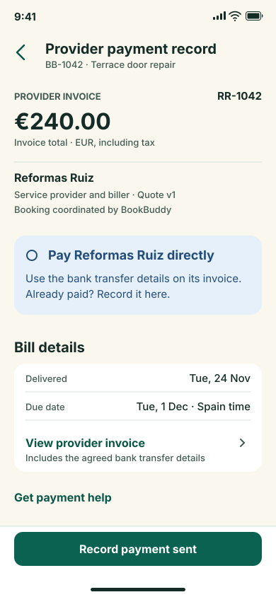
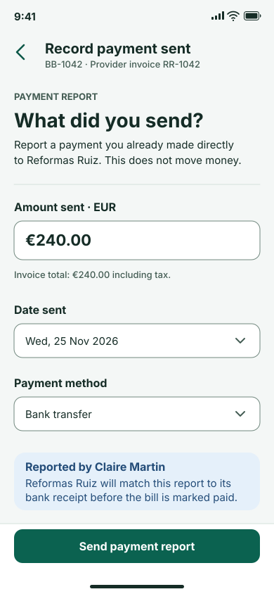
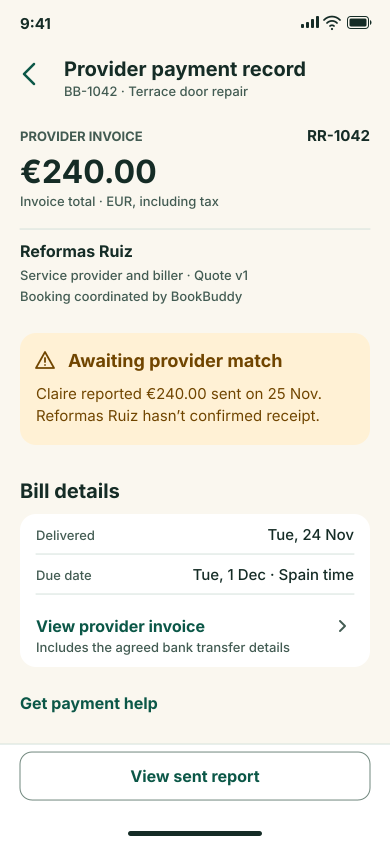
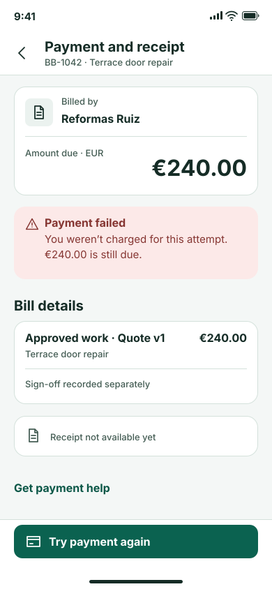
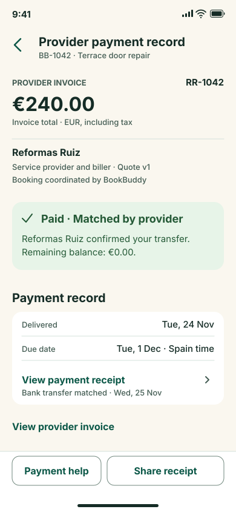

## C-12 · Leave a review [Sheet]

**Purpose and entry.** Optional feedback from C-05 after service closure or its post-closure prompt; later from L-05 after attendance if eligible. The drawing opens over the closed job. Close, swipe-to-dismiss and Android Back return to the same parent; a review does not affect payment, case handling or closure.

**Layout.** The expanded sheet leaves the closed C-05 job visible. It names the job, provider and eligible service (delivered and closed); five discrete rating choices have visible numbers and endpoint meanings. The labelled optional Comments field comes before the audience: **you, BookBuddy’s feedback team and Reformas Ruiz’s designated feedback lead**. Nothing is public or anonymous. Send private review stays disabled until Claire chooses a rating.

**Interactions.** Tap 1–5 to choose or change the rating, with a checked state and optional selection feedback. Submitting never happens on a star tap. Optional text opens native IME and expands the sheet; it can be cleared independently. Save an eligible local draft on normal dismissal; reopening restores it while access remains. If saving the draft is unavailable, ask before discarding using a replacement confirmation, not a stacked modal. Validate selection, keep comments on a retry, and only close on server-confirmed success, with a persistent “Review submitted” state on the parent. Don’t use review as the primary way to report an issue.

**States and edge cases.** One optional private review per delivered, verified closed repair, or later per provider-confirmed attended booking, within 30 calendar days of actual service. Payment, an elapsed visit, cancellation or no-show alone do not qualify. A refund for delivered work does not automatically disqualify it. Distinguish unrated, safe local draft, submitting, submitted, failed and ineligible. Reconcile unknown send outcomes before retry. After submission there are no self-service edits; request correction or withdrawal through support. A provider response uses the same private feedback channel. The crew, other customers and the public have no access; reviews never settle a case or affect a bill.

**Platform, focus and locale.** Native detents and drag on iOS; Material modal sheet/IME first Back on Android. Focus title → Close → provider/service context → a single named Rating group (“1 of 5, very poor” through “5 of 5, excellent,” with selected state) → comments → helper → Send. At large sizes replace the tight row with an accessible wrapping list/radio group as needed. In RTL mirror leading layout and arrange options in reading order while announcing the actual rating value; never depend on star direction.

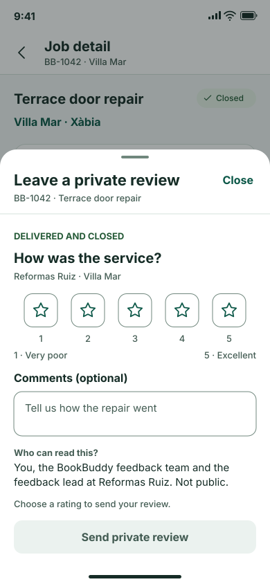

## C-13 · Properties

**Purpose and entry.** Customer Properties tab or C-03 property shortcut. Find a site, open C-14, or create a new eligible property. A C-03 entry is a selection flow without the tab bar; Back restores the request draft. The root artboard shows one active, owned site and its active-job count.

**Layout.** Root BookBuddy/Costa Blanca header and bell, page title, Input with persistent **Search properties** label and optional **Name or location** hint, Active/Archived filter Chips, property List with result count and single-target rows, a ruled Add property section and fixed Customer Tab bar. Villa Mar · Xàbia shows “Verified owner” and its one active terrace-door repair. The property count excludes unaccepted invitations; a pending transfer does not remove the existing manager. A delegated property shows the actual access label, e.g. “Managed · View only”; never infer ownership from “Site contact.”

**Interactions.** Type/clear search; filter only visible properties by display name, locality or authorised address; never index private access instructions. Select a chip to change the listing while keeping query text; tapping a property pushes C-14, or returns the ID into C-03 when picking an eligible request property. Add property opens C-14 New. From C-03 only a confirmed eligible property can populate the request; saving a property is not sending a job. Bell opens S-09 in Customer context. Tab taps restore authorised scroll and stack per the IA; a second tap on the selected tab returns to its root. No haptic on navigation or search.

**States and edge cases.** First use: add if eligible or explain how authorised access arrives. One/many and delegated; count, access and status can wrap. Archived selection shows only visible archived entries with no availability implied. Filtered empty names the filter or query and offers Clear; loading preserves headings, list error offers retry, offline shows Last confirmed and any permitted cached rows, not a false empty list. Create/edit can start as eligible drafts offline; cannot publish before verification. Refresh removes revoked access and clears invalid selections in C-03; never auto-pick another property with a similar name.

**Platform, focus and locale.** iOS uses the native search field and tab safe area; Android uses its search/IME and navigation insets. Focus header/Bell → page title → search and clear → filters (announce selected) → result count/rows → Add → tabs. Announce completed count changes, not each keystroke. Wrap address, role and job count; preserve “Xàbia,” compare search using locale-aware normalisation, and mirror tab order as defined by the design system.

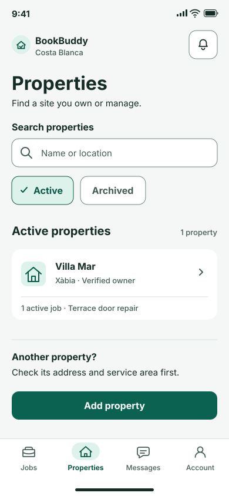

## C-14 · Property detail and people

**Purpose and entry.** C-13 site or Add property, C-03 add/edit and C-05 site link. Maintain the authorised site and its access; select a permitted job to C-05 or return a confirmed property to C-03. Closing stays within Customer context. No provider membership or worker assignment can be managed here.

**Layout.** Villa Mar leads with its verified service address in Xàbia and Edit details. The next group names Claire Martin as site contact; the safe meeting arrangement is “Mateo will meet the crew at the gate.” The job row shows Terrace door repair, BB-1042 · Booked, and Tue, 24 Nov · 09:00–10:00 Spain time. People and permissions names Claire as verified owner. **Permission details** explains grant scope and verified transfer; **Invite someone** is a separate action. The artboard omits the street address. The actual authorised record displays only what the viewer needs.

**Interactions.** Edit details opens a local edit mode with persistent labels for property name, required address fields, contact and separately labelled access notes. Save validates required fields, shows inline errors, and revalidates address/service area and grants before persisting. Check the normalised service address and owner-confirmed map pin against the catchment online on creation or change; reuse the result until changed. Direct rural, ambiguous or conflicting cases to operations without revealing other accounts. This establishes serviceability, not ownership. Permit non-secret handoff notes only. If a secret is indispensable, arrange a verified live handoff; record who arranged it and when, never the secret. A failed verification holds entry. Back keeps eligible unsaved edits; if they cannot be saved, present a discard-or-return decision. Job rows open permitted C-05 details; a newly added property has no job history. Permission details and any member row open readable scoped grants; only a permitted manager sees editing/revocation controls. Invite someone opens a bounded editor (full height with keyboard or large text): verified recipient entry, property, explicit permissions and a review of what can be seen or done. Validate destination and allowable grants; invite receipt is pending, not access. Verified invitee accepts through S-05. Resend/revoke only for the current grant or pending invite; show a confirmation with actor/property and effect before revocation. Return confirmed status to People; an open draft does not take effect.

**States and edge cases.** New/edit and unsaved changes; duplicate or unverified address/error; archived view with no new work or new delegation unless separately permitted; delegated read-only hides edit, invite and sensitive notes if not granted. Pending invitation is scoped and revocable; accepted counts only after verified acceptance; expired or revoked no longer grants access and cannot be “accepted” by opening an old link. Independent capabilities distinguish viewing jobs from sign-off, payment, quote/change decisions and delegating. Don’t let a manager escalate beyond their own grant or revoke the only authorised owner without a valid handoff; refresh on grant conflict and keep nonsecret permitted draft inputs. A verified owner or operations-verified authority is needed to delegate control. Default invites to view-only, with no historical job access. Limit to five outstanding per property, one per recipient/property, expiring after 48 hours. Permit two reissues per recipient per seven days, at least 15 minutes apart; reissue withdraws the old link. A verified owner confirms the successor, who verifies and accepts equivalent authority before the last manager is removed. If the owner cannot act, operations verifies independently or leaves the property restricted. Never transfer via an address match or forwarded invite. Only the verified owner or equally authorised successor can archive, with no live jobs or unresolved cases. An archived record is read-only.

**Platform, focus and locale.** Use native edit keyboards, save/close and pending-invite confirmation, with equivalent Android IME/Back behavior. Focus heading → address/contact/Edit → access note → jobs → People/grant states → Invite; focus the first validation error, and restore focus to the changed row after a confirmed update. Label invite status in text. Allow address lines and permission descriptions to wrap; use country-aware address format and bidi isolation for identifiers and contact values without altering originals.

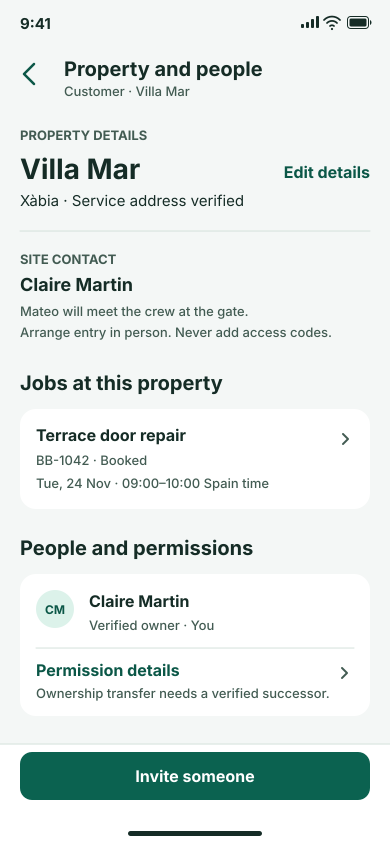

## C-15 · Review a job change

**Purpose and entry.** C-05, C-09 or an S-09 change event opens the current version or its permitted history. Back restores the actual caller and trigger; only a cold authorised job link constructs C-05. An authorised timing revision goes to C-08 as a separate booking decision. This is commercial scope approval, not a chat reply or sign-off.

**Layout.** Change 1 names the issuing provider and publisher, Mateo. The proposed tax-inclusive total (€280.00) leads; the signed increase (+€40.00), existing total (€240.00), reply deadline and unchanged arrival window are adjacent. The issued deadline in this example is Tue, 24 Nov · 10:00 Spain time. Below, keep approved v1 and the separately issued addition in distinct, ruled blocks with their reviewed reading aids. The received “Worn latch plate” photo opens S-15. The hold explicitly names the added work; the door adjustment and rollers remain approved. Decline change, Ask Mateo and Review approval stay reachable.

**Interactions.** Ask Mateo opens S-10 with a reference to the version; sending a question leaves it open. Review approval opens S-17 with item, author, Claire’s Customer/property context, original and proposed totals, version, scope/timing effect and an explicit “Approve change” action. Decline change opens a separate S-17 confirmation: proposed work is not authorised; any optional reason does not approve other work or cancel the visit. Only the named approver, Claire Martin here, can decide on that exact issued version online. Approval explains the additional payment obligation but moves no money. Reject or clarify without losing prior terms. Require a fresh confirmation if terms change; record version, actor, time, grant and durable copy on acceptance.

**Response deadline.** The provider’s default is 72 hours, capped by an earlier start of the affected work. Show the deadline F-15 issued for this version. On approval, the server checks that the version is still open and its issued deadline has not passed. C-15 never calculates a separate cutoff. On expiry without a decision, retain the old terms and replan the affected work. If a new visit window is required, route to C-08 with the existing booking still labelled current until confirmed. A hold links to C-16 if there is an authorised case; only explicitly affected work is held.

**Evidence and versioning.** The publisher reviews the attachments selected for the customer on F-15 before issuing the version. Only selected, received, customer-visible attachments are included; private draft evidence is labelled “Not included” before publication. C-15 lists just the attachments bound to the exact version being reviewed. A row opens S-15 in read-only mode; closing restores that same comparison, scroll position and attachment trigger. Display a retrieval error and targeted retry for an included file that cannot load; do not substitute a newer file. Later uploads do not change the issued attachment list or Claire’s approval. Any revision to that list requires a newly issued version and fresh review.

**States and edge cases.** Open, superseded/withdrawn/expired (read-only history with safe link to current proposal if authorised), approved, rejected, offline/read-only and issue on hold. Approved and rejected show recorded actor/date/versions. An obsolete notification or mid-confirmation revision must not approve a newer proposal, reuse an old price or silently dismiss a refusal; explain and reload the comparison. No same-author self-approval, implicit translation consent, or approving one part of a proposal by tapping a checklist row. In the absence of a valid approval, existing scope stays in force and uncertain/scope-dependent work remains held as appropriate. Missing translation leaves original and status readable; Ask Mateo stays the clarification route.

**Platform, focus and locale.** Use native S-17 confirmation on iOS and Android; Back/Cancel restores the exact decision trigger. Read publisher/version → proposed and prior totals/delta → deadline and timing → approved translation/original → proposed translation/original → received attachments → hold scope → Decline/Ask/Review. Stack the price labels at larger sizes; never truncate the signed adjustment or the original. Set original text language for speech synthesis, apply the optional local-time display if zones differ, and mirror directional icons in RTL.

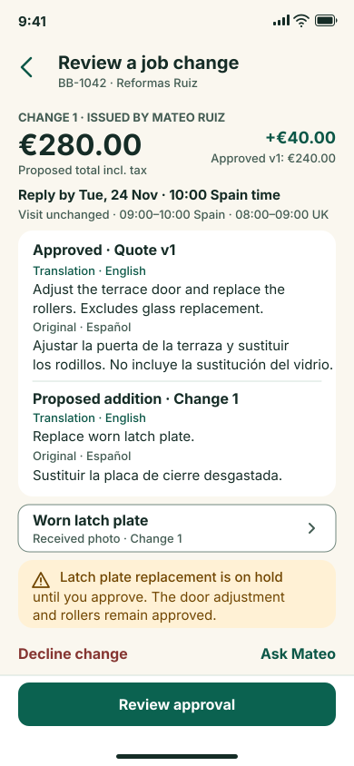

## C-16 · Report an issue or follow a case

**Purpose and entry.** Open from C-05, C-09, C-10, C-11, C-15 or S-16 through an authorised job; S-09 issue replies open the case, not a new report. Show an existing matching case when found rather than silently duplicating it. Back returns to the caller; View affected job/payment may reopen the authorised target from the case’s details.

**Layout.** The report starts with “What went wrong?”, item/category, description, evidence and an audience preview. The example concerns the door catching after adjustment. The customer and assigned BookBuddy case handler can see the report; only the necessary item packet goes to the provider’s designated billing or rectification lead. No automatic chat or crew sharing. On accepted submission the form becomes a durable, dated receipt, not a toast. Case 01 names Ana Costa as Claire’s BookBuddy contact; Reformas Ruiz remains responsible for the remedy. The record shows receipt at 10:28 and Ana’s acknowledgement at 10:42 Spain time on Tue, 24 Nov. No work hold, sign-off, amount due or collection deferral is recorded here.

**Interactions.** Choose category (e.g. work quality, visit, bill) and an authorised affected item; offer Whole job / Not sure when exact item isn’t known. Enter narrative and optional evidence; show what will be sent and who can see it. S-14 opens the camera/library/audio paths as allowed, S-15 previews and permits removal of the user’s own unsent attachments. Do not send a report referring to still-pending media; wait, retry or explicitly remove it and send text. Send validates category, affected context and nonblank description; explicit send submits online, only a confirmed result creates a case and replaces the form. View report and receipt opens read-only detail with its durable reference, original text, received attachments and a copy the reporter can retain. Limit each report or update to five photos (≤5 MiB each) and one original voice note (≤2 MiB, ≤90 seconds); strip photo location metadata, no video at launch or gate/alarm codes in attachments. The 100 MiB device cap covers all pending media for the account. Message Ana about this case opens a labelled, scoped composer in this record; no bleed into Job conversation or Crew only. Mark its success only after accepted. Route users needing another support channel to S-16 if an approved route is available, without guessing contact details or sharing extra job context.

**States and edge cases.** Draft, submitting, submitted, acknowledged, awaiting response, resolved, failed, cannot submit offline. Preserve safe eligible drafts with “Saved on this device · not sent”; no local support notification or case ID until receipt. On uncertain send, reconcile before enabling retry. Timeline records actual actor/date/zone, support updates and confirmed effects; no resolution by elapsed time or chat. Resolved shows the official outcome and recorded affected work/payment only; if replies are closed, offer authorised help instead of a reply box. The case owner aims to acknowledge within one business day, give a substantive update within two and update every two business days while waiting for a plan. These are staffed targets, not a guaranteed reply time or resolution. The case owner may ask the provider for correction; F-14 submits a new version, never overwriting a historical decision. Only the provider’s named billing authority may separately defer collection of a disputed unpaid amount. Show amount, item, basis, named decider, next review date and any unaffected balance; target a recorded decision within two business days. A paid amount cannot be “on hold.” Closure does not release funds: display only an authorised resumption, corrected invoice or confirmed refund. Route unresolved complaints to the provider and appropriate regional/ADR information via S-16. Scope changed/deleted: show safe explanation, revalidate impacted items and authorship; keep authorised nonsecret draft data when possible. Reporting from S-16 does not bypass the job grant.

**Later booking mode (not in the construction release).** L-05 opens C-16 with the authorised session booking, its provider and the affected service or payment, e.g. BB-S1042 · Mat Pilates · Estudi Mar Pilates. Both the draft and any resulting case stay keyed to that booking. Offer **Whole booking** when there is no specific service or payment item. Show only booking-relevant effects and offer a route back to the same L-05 booking and trigger. Case attachments and previews stay in the case’s authorised audience; they are not visible in studio chat or to other attendees. Revalidate the booking and case grants on return, refresh and deep link. If the booking can’t be verified, use the safe help path; never search for or fall back to a construction job, property, repair item or bill.

**Platform, focus and locale.** Use iOS/Android native pickers and keyboard, with equivalent selection and denied-permission recovery via text or other media. Report focus: heading → category → affected item → message → evidence → visibility → Send; move to case title on confirmed submission. Case focus: status/reference and dated receipt → named handler → affected items and any verified holds → history (newest first, site time) → case message. Append updates without moving focus. Per-paragraph direction for authored text and labels for translations; never convert case reference or promise a deadline when localising dates.

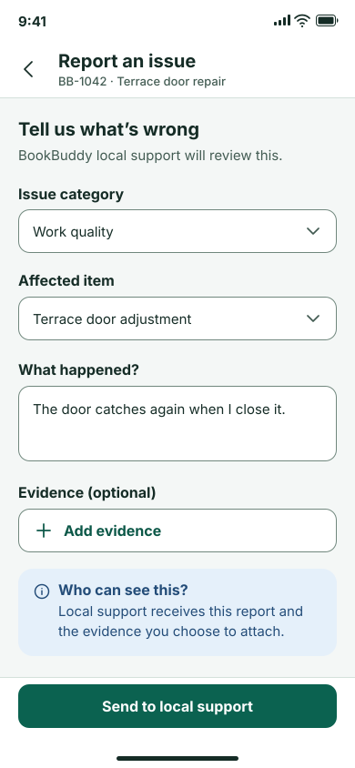
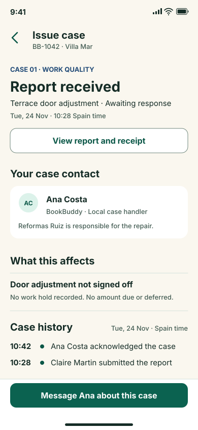

## C-17 · Cancel or reschedule [Sheet]

**Purpose and entry.** C-05 or C-08 opens this sheet over its own current visit. Later, L-05 uses the booking’s own terms and slot flow. Close, Back or an abandoned review restores the actual caller, without changing the booking. A recorded cancellation or request updates that caller separately.

**Layout.** The booked job remains visible behind the sheet. Show the existing provider, site/time and optional viewer zone, then the **€0.00 appointment change fee** and eligibility: the visit has not started and no work has been performed. Choose another time and Review cancellation are different decisions. A ruled **Statutory withdrawal** entry is separate from both. Do not describe work already performed as a cancellation fee.

**Interactions.** For a fee-free move, dismiss the sheet and open C-08. At least 24 hours before the visit, allow direct confirmation of a current provider-authorised, capacity-backed alternative with unchanged scope and price. Inside 24 hours, or if capacity or terms differ, request provider agreement; a response is targeted within four staffed hours, or by the visit if sooner and staffed. Show the old window as booked until a replacement is confirmed. Conflict, expiry or declining the offered time never cancels it. For a later like-for-like session move, dismiss C-17, open L-03 over L-05, then push L-04 only on receipt of a hold. Keep its existing booking on failure.

**Cancellation.** For an eligible unstarted visit with no work performed, Review cancellation replaces the sheet with the specific appointment, actor, €0 fee and consequences; Keep booking is safe. Confirm cancellation acts directly online, not a request for permission. No late fee or automatic refund. If work has started or been performed, refer ordinary termination to the provider/C-16 and itemise any supported amount for work done. A provider cancellation costs the customer nothing; offer a new authorised time or handle sums paid for undelivered work through the provider. Never silently rebook, charge or mark unconfirmed crew shifts cancelled.

**Withdrawal.** Where applicable, give a direct contract-specific action and durable dated receipt. The variant is an eligible distance contract with no work performed or payment recorded. It names Claire, the property, approved version and provider. Keep my contract backs out; Confirm withdrawal delivers the notice without permission from the provider and returns its reference. In-scope service contracts generally have 14 calendar days from conclusion; longer periods and applicable exceptions take precedence. If early performance was expressly requested, show the applicable disclosures and authorised itemisation; starting is not automatically loss of the right. Full performance and its conditions, expressly requested urgent repairs and later fixed-date leisure bookings need their own assessment, not a visit-date shortcut. A payment adjustment, if due, appears separately on C-11.

**States and accessibility.** Distinguish direct cancellation, a direct like-for-like move, request awaiting agreement, original still booked, already cancelled, started work, withdrawal sent and unavailable authority. Require a current online grant and terms for changes, and reconcile any uncertain send against the same operation before retry. If offline prevent an unconfirmed app submission from reading as sent; give the provider’s permitted withdrawal/contact route. iOS detents and Android Back/IME retain an explicit Close. Focus date, site zone, eligibility and €0 before either action. Review focuses Keep booking/Keep my contract first. Announce the verified outcome and restore the trigger on the actual parent.

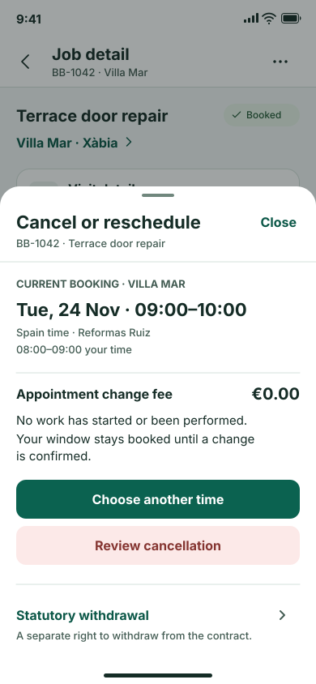
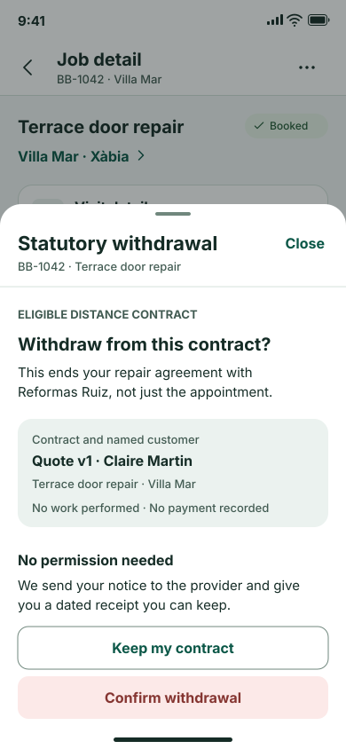

## C-18 Follow live

**Purpose and entry.** **Visit updates** answers what has been reported and what Claire needs to do. The active ticket in C-01, the visit link on C-05 or C-09, or an unlocked S-18/S-19 tap opens the same scoped visit record. Opening it does **not** start following. A warm Back returns to the actual caller; a cold device link resolves account, Customer grant and visit, then constructs Jobs → C-05 → C-09 → C-18. If access is lost, end/redact the display and use S-16 without revealing job details.

**Layout and evidence.** The ticket shows Tue, 24 Nov, **Crew on site**, “Reported by Mateo · 09:12 Spain time,” the four states and the still-agreed 09:00–10:00 window. C-08 supplies Booked (Mon, 23 Nov at 08:36). Mateo explicitly published On the way at 08:48 and On site at 09:12 via F-17; the ledger groups these by date in Spain time, latest first, with the named source. In review is unreported until F-14 actually submits the completion. The next step is to wait for Mateo’s results; Message Mateo opens the authorised S-10 Job conversation. Once a completion is submitted, offer C-10. A worker’s location-free check-in at 09:14, a cover acceptance, an upload, elapsed time and chat do not change this ledger. Never disclose private attendance, location, route, access notes, candidates or reasons for absence.

**Interactions.** The in-app ledger works without notification permission. Only an explicit foreground **Follow live** requests a local display for this device and this visit. Explain its limited contents before asking: a generic service visit, its reported phase and source time. iOS uses S-18 on the Lock Screen and a compatible Island; Android uses the ordinary S-19 notification, not an Island. Duplicate taps reuse the same display. Once following, show **Stop following**. Stopping changes no booking, report, chat preference or other device. An OS tap opens the current authorised record after unlock, never signs off, tracks a worker or changes work status.

| Condition | Ticket, ledger and next step |
| --- | --- |
| Before first crew report | Show the agreed window and **No crew report yet**. A later explicit event can be current while an earlier notch is still unreported. No inferred travel, estimated arrival or backfilled event. |
| Delay or cover at risk | Show the customer-safe disruption, source and site time beside the last reported milestone. Keep the existing window until C-08 confirms a revision. Show the next update only if promised; once missed, label it overdue and offer Mateo’s contact, not a new ETA. |
| Correction, stale or offline | Keep the prior record visibly linked to the correcting event. Apply newer confirmed revisions only. At the stale deadline show **Last reported [site time]**, not a live pulse or a fresh timestamp from a repaint. Keep the permitted last-confirmed record and contact; distinguish an offline draft from a delivered message. On reconnect catch up by cursor; no polling or network timer. |
| Following stopped, denied or unavailable | A stopped or dismissed display stays off until the customer deliberately follows again. Honouring Android 13+ permission, a disabled channel, iOS settings or unsupported hardware never blocks the timeline. Offer settings only by choice; no repeated permission request or immediate repost. Web shows the signed-in timeline and contact without Follow live, an install demand or a fake OS card. |
| Ended, cancelled or access changed | End display on visit completion, cancellation, sign-out, role/business switch or revoked scope. A completed authorised record keeps its history; a new visit has a separate ledger. iOS ends at eight active hours; its final Lock Screen snapshot may linger up to four hours more, clearly not live. No automatic restart. No launch push-to-start: iOS 17.2+ and a previously registered token would be prerequisites for a later remote start. |

**Platform, focus and locale.** Use the OS surface only on supported, proven signed builds; otherwise offer the in-app record. Announce a new reported event once without stealing focus. Completed marks are solid with a check; current is a diamond, unreported dashed. Give the rail a full spoken label independent of colour. A new confirmed notch settles once in 180 ms; reduced motion swaps immediately. Screen-reader order follows phase/source → labelled rail and agreed window → dated reports → next step/contact → device display explanation and control. Use the site IANA zone; a second zone is supplementary. At large sizes let the ledger scroll and actions stack.

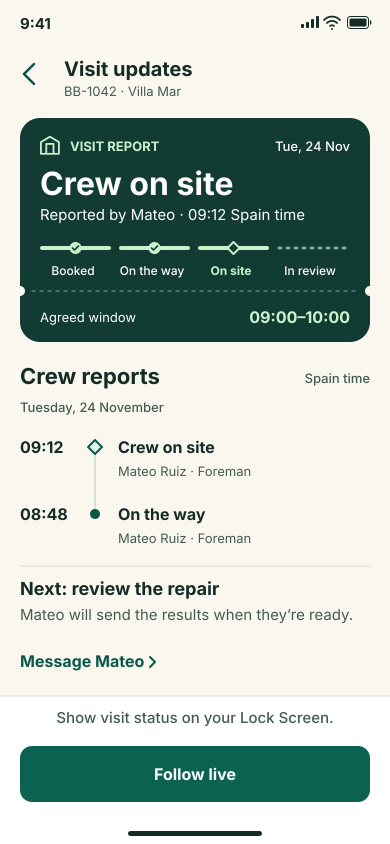

## Open design questions

- **Case operations:** Who will staff the named handler and backup for the actual catchment, and which regional complaints route should S-16 show? Ana Costa is a fictional contact; the response cadence is a target, not a promise of coverage.
- **Withdrawal copy and property verification:** Counsel and operations still need to validate the exact early-start/exception disclosures and the acceptable redacted proof and deletion schedule for a transfer. A forwarded invite, a map pin or an appointment cancellation must not stand in for those decisions.
- **Device readiness:** Which signed pilot phones pass local start, stale-state display, update and teardown? Offer C-18 without an OS surface wherever those gates fail. The report form and date fixtures illustrate an agreed direct transfer; they do not select a processor, pilot site or production reconciliation integration.

## Navigation

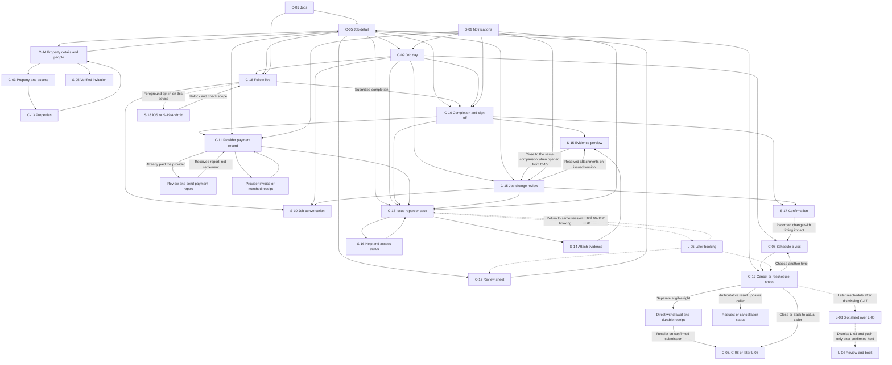

## Review responses

- **Navigation and evidence (FL-03, FL-06):** C-09/C-10/C-15 restore the actual authorised caller, and C-17 distinguishes dismissal from a recorded outcome. C-15 binds the received photo to the issued version; S-15 returns to that comparison. Later cases retain their booking key and L-05 parent.
- **Approved original and affected work (FL-09, V-CB-01):** The v1 Spanish reads “Ajustar la puerta de la terraza y sustituir los rodillos. No incluye la sustitución del vidrio.” Change 1 separately reads “Sustituir la placa de cierre desgastada.” Only that latch plate work is on hold. Translation, chat and silence change neither record.
- **Visit, evidence and money:** C-09 displays confirmed names only; a reservation never appears as staffing. C-18 does not publish a personal check-in or clear any safety hold. C-10 presents both results and the shared after photo; sign-off is not payment. The provider-direct decision supersedes the old checkout example: C-11 retries a failed report, not a charge.
