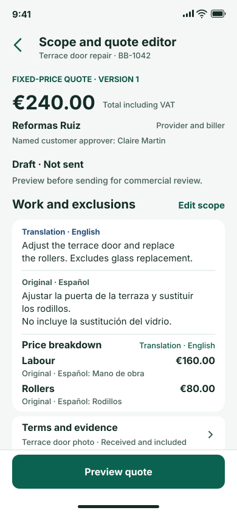
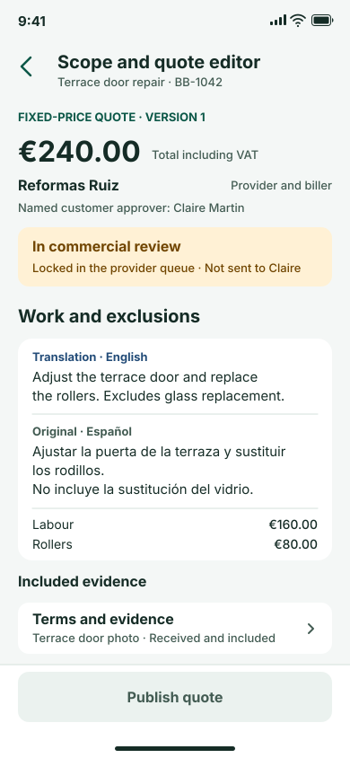
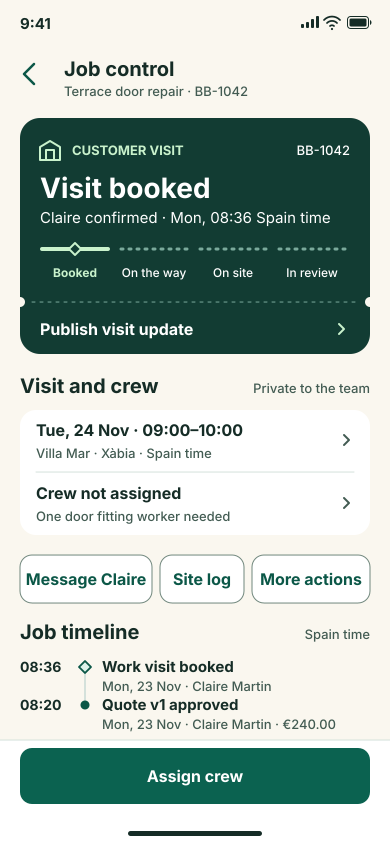
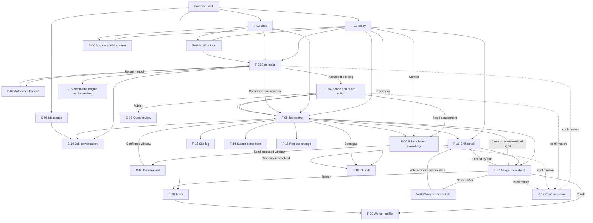

# Foreman · Today to crew assignment (F-01–F-07)

These screens take Mateo Ruiz from accepting Claire Martin’s request to scheduling the work and offering the shift. The account is acting as **Foreman · Reformas Ruiz**, not as Provider admin or Worker. The artboards show different decision points for `BB-1042 · Terrace door repair` at Villa Mar · Xàbia. Read the defaults in this order: intake, quote draft, tentative work window, booked without crew, named offer review, and Monday’s overview with confirmed crew. The Tuesday gap artboard follows Nadia Benali’s 08:32 Spain time dropout. The booked-job reassignment, conflict and ineligible artboards are alternatives, not events that overwrite the default records.

## Rules across this slice

- **Navigation and context.** Only Today and Jobs display the Foreman tab bar: Today, Jobs, Team (F-08), Messages (S-08). The bell opens S-09 for the active context; the Mateo avatar pushes S-06. Returning to a tab restores its stack, filters and scroll position; reselecting the active tab returns to its root. Pushed pages have Back/Up and no tab bar. Deep links open records, never actions; recheck job scope and freshness and build the authorised parent stack. Wrong active context with another grant offers S-07; no grant uses S-16 without confirming a job exists. Clear revoked details and unsuitable back-stack entries on navigation/refresh.
- **Drafts and confirmation.** Normal Back preserves authorised input and cursor position. Only a deliberate discard clears a draft; if dismissal would lose anything, explain what and ask first. Accepting/returning intake, publishing, proposing time and sending offers all require online acknowledgement. S-17 confirms the item, action, role/business and downstream effect; no material action is taken from a toast, OS alert or chat. Preserve the action verb while processing, prevent repeat submission, and reconcile uncertain outcomes against the record before allowing a retry. Show persistent confirmed or failed feedback on the parent; a short optional completion haptic follows the actual response only. Selected dates or candidates may receive restrained native selection feedback. Respect reduced motion and vibration settings; no haptics for scrolling, links, read-only controls or failed requests.
- **Loading, connectivity and permissions.** Skeletons reserve existing sections and are not focus targets. Announce significant waits; preserve the last authorised record through targeted errors, marked `Last confirmed [time]`, with explicit Retry. A safe local draft says `Saved on this device · pending sync`; this never means published, agreed or staffed. Cached records contain no access secrets and cannot authorise mutations. If there is no authorised cache, show an offline/access explanation and recovery, not an empty worklist. Present a change that invalidates visible choices inline; keep safe text and review context. Don’t move focus for routine updates. If an update removes the current target, focus the status summary or next valid action.
- **Platform and accessibility.** iOS uses native Back and edge swipe for pushes, VoiceOver and Dynamic Type; Android uses Up, system/predictive Back (IME first, then sheet, then route), TalkBack and font scaling. Root system Back is platform-defined, not sign-out or role switch. Hit regions are at least 44 × 44 pt on iOS and 48 × 48 dp on Android (56 × 56 in field mode); expand invisible hit areas around text links and icons without overlap, or grow rows. Status icons and colour supplement text; decorative avatars and dividers are skipped. At accessibility sizes panes stack, tabs/filters wrap or offer equivalent labeled controls, rows grow and content scrolls behind no action. Sticky actions reflow with insets and keyboard so the focused input stays visible. For dialogs, focus the title or Cancel, and return focus to the trigger or its outcome. Sheet focus is contained; its caller is not accessible until dismissal.
- **Localisation.** English and Spanish UI are independent of reading and work/briefing languages. Leave at least 30–40% expansion and allow more wrapping; use locale plural and time/date rules and actual EUR, with no conversion. Operational dates are in `Europe/Madrid`, labeled Spain time; when locally different and enabled, show local time as a separate labeled line, including a different calendar day if needed. Use directional isolation for `BB-1042`, names, times and money; mirror leading/trailing actions, tabs and directional chevrons for Arabic RTL, not numbers, clocks or icons with fixed meaning. Text and audio keep their source; render an available reading-language translation first and the labelled original immediately below, or one copy if the same language. A translation is not agreement or evidence of work-language capability.

## F-01 · Today

**Purpose and routing.** Foreman launch/Today tab. Triage by urgency before scanning appointment times. Intake goes to F-03, a shift to F-16, a timing conflict to F-06, an urgent open gap to F-10, and a job-only card to F-05. The briefing cue opens F-16 to its briefing status, not an acknowledgement on Nadia’s behalf. Back on a pushed route restores the same date and scroll offset.

**Layout.** Provider header, bell and avatar; page title and site-day label; day agenda with a labeled empty state or chronological Shift cards; Upcoming with next visit and count; Needs attention with Banners. Monday’s default has no visits that day; Tuesday’s work visit is Upcoming with Nadia confirmed. On Tuesday, Needs attention moves above Today’s agenda: the gap banner names Nadia, shows `Reported at 08:32 Spain time` and says the visit remains booked. The 09:00–10:00 visit is now in Today’s agenda and its Shift card says `Shift open · cover needed`, not `Confirmed`.

**Interactions.** Tap a card anywhere to open the stated record, with no nested competing control. `Fill shift` is a persistent action on the urgent banner and opens F-10; staff names and working requirements are available to the foreman there, not sent to Claire. A confirmed update re-renders both the alert and shift from the same record. Read and scroll normally; native refresh plus an accessible Retry requests current data without wiping the current section. Card taps are navigation only (no validation, confirmation or haptic); completing cover elsewhere never auto-navigates away from Today.

**States and edge cases.** No work: explain there are no scheduled visits or actions, with Jobs still reachable. Upcoming: separate confirmed shift, pending offer deadline and unassigned status; a pending response never counts as covered. Conflict: identify the affected window and `Review timing`, without promising a reschedule. Urgent gap: last confirmed dropout and its site time, open shift and impacted booking; if cover is resolved remotely replace the alert with current confirmed staffing after refresh. Failed dropout is not a confirmed gap. Offline/stale: keep safe cached agenda with last confirmed time, mark flags as last known, do not show “No work” when unknown; F-10 can be read if cached but offers/confirmation are blocked. Combine partial load or error with an inline retry in the affected section. Multiple alerts sort by operational urgency and deadline; never hide an urgent item merely because it’s tomorrow.

**Platform, focus and locale.** Root tab uses native safe-area chrome. Focus order: business/active context, Notifications, `Account, Mateo Ruiz`, title and site date, urgent items, chronological agenda/upcoming, other attention items, tab bar. Announce a new urgent alert politely without jumping focus. Each Shift card reads job/site, date with zone, then crew state; at large text put the deadline or site zone on a separate line, not an ellipsis. Mirror card navigation, retain chronology and show the date on alerts even when relative wording is localised.

## F-02 · Jobs

**Purpose and routing.** Jobs tab locates foreman-scoped incoming handoffs, current bookings and history. A pending incoming job opens F-03; an owned active/archived job opens F-05 in current or read-only mode. A restricted or reassigned result that no longer belongs in this context is removed, with S-16 for a stale external link.

**Layout.** Root provider header; title and supporting sentence; one Segmented control for Incoming, Active, Archived; property/stage Filter chips; headed list with accessible count and one Job card per result. The Active example shows `Booked` for the lifecycle and `Crew confirmed · Briefing required` separately. Cards include title, ID, property, named foreman if appropriate, next action or confirmed site window. No edit/send actions sit inside a card.

**Interactions.** Tap a segment; update the selected state, applicable filters and result list without a navigation push. Property/Stage opens one single-purpose Bottom sheet with current choice, All and Close; pick to apply and restore focus to the chip. Available stages match the segment. An unavailable selected value is explained and can be cleared; don’t silently change the property when switching segments. Tap a card or activate via assistive tech to navigate; normal scroll and refresh are supported. No validation or consequential confirmation for navigation/filters. A segment or a filter selection can use restrained native selection feedback, not every card tap.

**States and edge cases.** Incoming shows new/clarification due with routing status; only named authorised handoffs appear. Active spans Scoping through Signed off and shows separate gap/change/issue/payment flags as allowed. Archived shows Closed or Cancelled as recorded and no live controls; historical data never overwrites the current version. Empty segment explains what belongs there; filtered empty shows the actual filters and `Clear filters`. A partial/paging failure retries that page once requested without dropping existing rows. Stale/cached shows last confirmed time and scope limitations; never show unverified current counts as truth. Preserve selection and visible position when an acted-on job moves segment; show a confirmation on return if the old list no longer contains it.

**Platform, focus and locale.** Native tab/segmented semantics and native sheet/Back rules. Focus: header, title, segments with selected state, filters with current values, list/count, cards, tabs. At large type segments can stack and filters wrap; display property names, times and lifecycle labels without truncation of critical terms. Mirror segment order and chip alignment in RTL while keeping selected stage and sort unchanged.

## F-03 · Job intake

**Purpose and routing.** From F-01, F-02, scoped S-09 or a P-02 admin handoff. Initial intake accepts responsibility to scope the request and opens F-04; if needed F-04 can route to F-06 for an assessment. Reassignment accepts responsibility for an existing job at its current stage and opens F-05 only after confirmation. `Ask Claire` opens authorised S-10 Job conversation; Back returns to the same intake. Returning or declining an offer records the outcome for the business and returns to the authorised caller without cancelling the request or booking.

**Layout.** Both modes show the job and ID in the pushed header. Initial intake shows Claire Martin, Villa Mar · Xàbia, Reformas Ruiz and the named offer in a Job card, then the English translation and French original, the evidence list (`Terrace door photo`, original `Français · 0:18` voice), the authority Banner, `Return handoff`, `Ask Claire`, and pinned `Accept for scoping`. Reassignment shows the actual stage (`Booked`), the incumbent Inés Vidal separately from incoming foreman Mateo Ruiz, the reply deadline in Spain time, and the quote, work visit and confirmed crew that will stay in place. It has a pending-transfer Banner, `Return handoff`, and pinned `Review transfer`. Display only details authorised for the offer; never show residential secrets or assume a chat grant before acceptance.

**Interactions.** In initial intake, photo and voice open S-15 for zoom, playback and transcript when available; dismissal restores attachment focus. `Ask Claire` opens Job conversation only with a thread grant; it does not send a preset message or change ownership. `Accept for scoping` opens S-17 with the job, role and business and explains that acceptance does not set a price, book a visit or assign crew. Require the current named initial offer, valid authority and no intervening owner.

In reassignment, `Review transfer` opens S-17 with the named handoff from Inés Vidal to Mateo Ruiz, job, current stage, business, expiry and effect of accepting accountability. Cancel returns to `Review transfer`. `Accept transfer` rechecks the intended recipient, current authority, unexpired offer and handoff version, and that the **expected incumbent** still owns the job. An incumbent matching the offer is not a conflict; a different owner or superseded handoff invalidates it. A material change to the reviewed job summary requires a fresh review. After a confirmed transfer, open F-05 with the new responsible foreman while preserving the existing stage, approved scope and quote history, booked visit, crew/briefing and job records. Do not open F-04 or reopen scoping as part of the transfer.

In either mode, `Return handoff` opens bounded reason entry (optional notes where permitted), then replaces it with confirmation naming the business recipient, what stays in place and who can read the reason. Do not expose the reason to Claire by default. Confirmation uses the shared online, failure and haptic rules. Read-only viewers get a safe business or S-16 route rather than a disabled dead end.

**States and edge cases.** Initial intake: new; clarification needed, preserving the original request and last confirmed question; accepted for scoping, with `Continue to scope`. Reassignment: pending, with the incumbent accountable; confirmed transfer, with `Open job control` if revisiting the receipt. Returned, declined or expired offers are read-only with no acceptance action. On a declined or expired transfer, the incumbent stays accountable where still authorised. If authority was revoked, do not silently transfer or reinstate it; show the safe business escalation. A reassigned or superseded offer explains the change without disclosing newly restricted details. Missing authority offers a safe contact path; intake or transfer acceptance is separate from publishing authority. Show only received evidence; translation or transcript failure leaves the original usable. Offline keeps only authorised cached details and disables acceptance and return; reconcile an in-flight outcome before retry.

**Platform, focus and locale.** iOS native stack and preview dismissal; Android Up and system Back dismiss media before the route. In initial intake, focus Back, title/job, handoff, customer request (English then `fr` original), evidence and authority, then return, ask and accept. In reassignment, focus Back, title/job and stage, current and offered foremen, deadline, unchanged records, pending-transfer status, return and review. At large type stack the secondary actions and let the owner rows, evidence and site-time labels wrap. In RTL keep current and proposed ownership separately labelled; preserve original content direction and isolate dates, amounts and job ID.

## F-04 · Scope and quote editor

**Purpose and routing.** Accepted intake, F-05 quote section or authorised clarification notification. Define a versioned offer for Claire’s approval; identify work, exclusions, cost, evidence and terms. `Plan a site assessment` pushes F-06 with assessment type and preserves the quote draft. Published versions lead to F-05 and are visible to Claire in C-06; after approval, `Schedule work visit` leads into F-06. Changes to an approved scope use F-15, not an edit to the approved quote.

**Layout.** Pushed header; version/status panel with business; editable scope card (Translation · English then Original · Español); Cost lines and fixed total in EUR; Terms and evidence list row; optional site-assessment action and pinned `Preview quote`. Draft uses v1 scope “Adjust the terrace door and replace the rollers”; glass replacement excluded. Labour `€160.00` and Rollers `€80.00` total `€240.00`. Original cost labels are `Mano de obra` and `Rodillos` in the full editor/preview. The pending-review variant uses a persistent Banner and read-only review snapshot; `Publish quote` is unavailable, and Claire has not received it.

**Interactions.** `Edit scope` opens labeled multiline Inputs for original scope and exclusions with the source language control; preserve both when navigating, distinguish translation status from validation, and save edits back to the draft. `Edit costs` edits line description, quantity and price in the quote currency, shows live totals, and allows explicit add/remove; removal remains draft-only and is reversible before preview. `Terms and evidence` opens the full edit/review surface for written terms and attachments; attach via S-14 and review via S-15. Label evidence `Included in quote` or `Internal · not sent to Claire`. Only explicitly selected, received attachments that Claire is authorised to see are issued with the exact version. For v1, Mateo selects `Terrace door photo`; internal or pending evidence is excluded. Review shows job, business, authorised recipient, exact version, original + translations, included/excluded scope, full total/currency, terms and the issued attachment list exactly as it will appear on C-06. Validate required scope, terms and cost lines, representable quantities/amounts, totals from saved lines, current version and business grants; use inline errors linked to the first invalid field. An authorised publisher confirms `Publish quote` in S-17 with the €240.00 amount (no payment or booking). A draft author without authority can submit a permitted business review rather than publish. Review submission likewise identifies who sees what and waits for acknowledgement. A mutation failure preserves input and the review position; confirmed publication returns to F-05 with `Awaiting customer approval`.

**States and edge cases.** Draft may be empty, incomplete, offline or unblocked for preview. Assessment needed keeps any quote draft while recording separately that a visit to scope is needed; assessment agreement is not a booked repair. Pending business review locks the submitted version; do not claim automatic approval/send or allow an inline override. If returned for correction, retain history and show the next editable revision. Sending keeps version and current amount stable; after acknowledgement show awaiting customer. If Claire declines, records remain and a new version can be scoped when authorised; a previously sent revision is read-only when superseded, expired or approved. Show the current version and exact outcome, not an older action. A race at publish returns the current version/grant and keeps safe draft data; no duplicate quote or implicit approval. A person cannot approve their own proposal by switching contexts.

**Platform, focus and locale.** iOS uses multiline/amount keyboard and native media; Android supports IME Back and a locale-friendly numeric keyboard. Validation never assumes that a period is the decimal separator. Focus: Back/title and version/authority, work label/edit and translated/original text, cost edit and lines with amounts, total, terms/evidence, assessment, preview. When editing or at large text, labels/amounts stack and the keyboard does not obscure validation or sticky action. Keep EUR and line values consistent across source and translated preview. Mirror edit links for RTL and isolate each currency amount.

## F-05 · Job control

**Purpose and routing.** Operational home for a specific job from F-01, F-02, F-04, a confirmed F-03 reassignment, scoped S-09 or a validated deep link. Route to the current decision; do not merge job stage, crew, briefing, evidence or billing into one status. Back returns to the authorised caller, or a scoped Jobs parent when launched cold.

**Layout.** Pushed title; Job card with ID, lifecycle badge, Villa Mar · Xàbia and named customer/foreman; Visit and crew List; Manage job buttons; Timeline (most recent first) with `Spain time` shown once beside its heading; pinned next-action button where useful. The visit is booked for Tuesday at 09:00–10:00 Spain time, while one door fitting worker still needs assignment. The timeline shows the visit booked Mon, 23 Nov at 08:36 and Claire Martin approving quote v1 (`€240.00`) at 08:20 the same day. The timeline card scrolls above the pinned footer; keep each event’s date, time, actor and amount readable as rows grow. No financial credentials or raw eligibility data.

**Interactions.** Visit row opens F-06; crew status row opens F-16; `Assign crew` opens F-07 over this page. If an open gap already exists, use `Fill shift` (F-10), not the normal named-assignment sheet. If waiting for a named offer response, use `View offers` to F-16 with its deadline. `Message Claire` opens S-10 Job conversation (no send on tap); if Crew only is available, user can choose it in S-10 and return without changing audience elsewhere. `Site log` opens F-13; `Propose change` F-15; `Completion` F-14 (state/gates continue there). In stage-specific layouts `Review quote` returns to F-04. Linked Timeline rows open their authorised record, otherwise event text is noninteractive. Scroll to earlier events, with targeted paging retry if needed. Navigation itself needs no validation, confirmation or haptic; consequential actions and feedback stay in their target surfaces.

**States and edge cases.** Scoping: `Continue scope` or `Plan assessment`; quote out: exact version and awaiting/declined/expired outcome; Scheduling: `Propose work window` until the agreed record is confirmed; Booked: show separate crew assignment, acknowledgement and gap states. In progress: expose confirmed attendance/evidence without guessing from messages or drafts. Change pending: show F-15 and hold only affected work; keep approved scope and agreed window until revised decisions are confirmed. Awaiting sign-off: indicate submitted evidence/decision without using a Paid or Closed badge. Issue open: show separate status and authorised local-service path; no automatic payment, sign-off or cancellation effect. Signed off, Closed or Cancelled: retain the authorised history, suppress obsolete mutations. Exception banners (stale, access changed, phase changed) retain only permitted data and carry an explicit next step. Empty site log is not proof of no work; pending evidence is not shared evidence.

**Platform, focus and locale.** Standard native Back/Up after dismissible surfaces; when returning from F-07, focus `Assign crew` or the resulting offer/crew status. Default focus: Back/title, job/status, visit, crew, management actions in visual row order, timeline, pinned action. Screen readers announce states independently (e.g. `Visit booked; crew not assigned`). At large type stack actions into one column and keep timeline event title/time paired. RTL mirrors list icons and row layouts without changing timeline order or restructuring localised prices and site times.

## F-06 · Schedule and availability

**Purpose and routing.** F-04 needing assessment, F-05 timing, or F-01 conflict. Check provider capacity and propose a site appointment for customer agreement. An assessment is a scoping visit; a work window requires approved scope and a responsible provider. Exit to the caller with saved authorised draft or `Proposal sent`; Claire confirms via C-08, then F-05 shows booking only once agreement is authoritative. A schedule problem involving just crew replacement belongs to F-10/F-16; don’t shift a customer booking silently.

**Layout.** Pushed title; `Site assessment`/`Work visit` Segmented control, labelled approval/agreement state; Calendar/day view (week controls, date cells, site-zone line, Agenda view); selected date and tentative Badge; start/end Inputs; capacity or conflict Banner; customer-confirmation notice or explicit alternative-window action; pinned `Review proposal`. Default Tuesday 24 Nov 09:00–10:00 has one eligible crew slot for door fitting and a Spanish briefing; this is capacity, not a worker commitment or reservation guaranteed by the artwork.

**Interactions.** Select type and date, move one week with arrows, switch to accessible Agenda view without losing date/edit, or activate a named time field to edit using the native picker (typed input where supported). Today is indicated separately from selected. Assessment route opens on assessment; if work is gated, show why when navigating to that type without allowing send. Time fields and date stay selected when a conflict appears. `Find an available window` opens the same date/agenda selector filtered to checked available alternatives; selecting one updates the tentative input, not any booking. Validate ordered start/end, time zone and date, no past or unavailable window, current job/grants, appropriate scope/type and adequate checked capacity across the full interval. Reject ambiguous/nonexistent site times with concrete alternatives; show site and optional user time during review. Review S-17 names job, business, appointment type, window, current confirmed booking if applicable, expiry if set and approval still needed. Submit online and show proposal sent only after acknowledgement; on retry reconcile the old outcome rather than create a second proposal. Selection can use native feedback; only acknowledged proposal earns completion feedback.

**States and edge cases.** Known-capacity tentative is ready to review; unknown/checking/loading shows the difference, retains draft and disables review/send to not imply capacity. Unavailable/conflict shows what is missing without identifying unrelated jobs/crew; alternatives can be absent, in which case offer change timing or intake/local escalation as permitted. Proposal pending customer remains tentative/proposed with the actual deadline where known, and off-screen updates don’t move focus. `Agreed` shows the exact confirmed record and authorized reschedule action; changed/expired proposal is read-only with `Choose another window`. Reschedule needed displays the currently agreed window separately; it remains current until replacement/cancellation is authoritative, with no claim that an impacted visit can proceed. Simultaneous bookings/availability changes at review re-open the same inputs with fresh conflicts. Offline marks capacity stale, allows safe draft editing only, and never sends. No crew identity is necessary to show capacity.

**Platform, focus and locale.** iOS native date/time picker and Back; Android platform picker with typed alternative where supported, IME Back and Up. Read order: Back/title, visit type and approval, calendar header and navigation, dates with full labels (`Tuesday, 24 November, selected`), site zone/Agenda view, date and state, start/end, capacity, alternative or notice, review. Large text defaults to an equivalent vertical agenda when the week grid cannot hold seven useful date targets. Week starts with local convention; dates remain interpreted in Xàbia’s zone. RTL mirrors controls/calendar arrangement, but screen readers traverse dates chronologically with explicit names and zones.

## F-07 · Assign crew [Sheet]

**Purpose and routing.** From F-05 or F-16 for an unfilled ordinary shift in Reformas Ruiz. Select eligible named workers for the shift needs and send offers. This is not a provisional replacement: an existing dropout or unresolved cover gap goes through F-10/F-12. Return to F-05 or F-16 after close or acknowledged send, retaining the correct named shift and showing `Offered`, not `Confirmed`.

**Layout.** Dim the caller with a 40% scrim. The Bottom sheet has a handle, title, job/business context, explicit Close, and a Shift checklist: `Terrace door adjustment`, Tue 24 Nov 09:00–10:00 Spain time, one Door fitting worker, and `Español` for work and briefing. Filter chips and Worker cards precede the roster link and pinned `Review offer`, disabled if there is no eligible selection. Nadia Benali is selected in the ready state; her card shows work languages, skill, eligibility, availability and the response deadline. In the alternative, her work-language record lacks Spanish and her eligibility review is pending. Neither blocker can be overridden here or with a machine translation. `No eligible matches` does not mean the worker has no useful qualifications.

**Interactions.** Scroll and expand via native sheet controls, with Close always reachable; swipe down/Back affect only the sheet, and never send. Skill/language chips filter browsing; opening a filter can inspect other team records, but the fixed shift requirements stay visible and unmatched workers are never selectable. Tap an eligible Worker card to select/deselect for the displayed shift; use a checked affordance, and keep selection when expanding the sheet. Candidates who fail a check can be inspected but not selected. `Open Team` goes to F-08; the ineligible row opens permitted F-09 for specific status. Dismiss/restore the sheet around a push rather than stack onto it. Return restores candidates and a still-valid selection, with freshness rechecked. `Review offer` replaces the sheet with S-17 for worker, slot, site zone, task, business, expiry, and regular offer effect (worker must confirm; no property access now). Send requires valid shift version, open slot, sufficient named selections for the chosen slot(s), authorised provider/business, current task/language/eligibility through the shift and no conflict. Recheck at send and again on worker confirmation. If all conditions hold, send once, show `Offered` with expiry; a worker’s valid named confirmation then makes the slot `Confirmed`. Don’t show other jobs’ details as conflict reasons. Restrained selection and confirmed-send haptics follow the shared rules. Close or Back with an unsent selection preserves it when safe; if the route cannot retain it, ask before discard.

**States and edge cases.** Eligible selected/unselected; no matches due to requirements versus filtered empty (reset browse filters, don’t remove requirements); unavailable/conflicting; not eligible, expired/pending eligibility and language mismatch (reason and recovery). Already assigned is read-only or routes to F-16, never sends a second offer. Offers pending show names, response deadlines and states without counting staff as confirmed. Declined/Expired/Filled elsewhere or a reported dropout are distinct and route unresolved needs to F-10 as appropriate. `Refresh required` (stale, offline or mid-review changes) keeps safe selection context, disables send and offers recheck. Selection invalidated by another confirmed action is cleared with specific, safe inline feedback. Processing preserves recipient and deadline; network uncertainty reconciles before retry and never claims that a worker got notified. Ineligible external candidate search is not available here; use the separately gated cover flow.

**Platform, focus and locale.** iOS native sheet detents and Close; Android Material modal sheet, Up/system Back with IME first; both may expand to full height with accessibility type. Focus on entry: title, then Close, shift metadata/requirements, filters, candidate summary (state and blockers), roster link, explanatory note, action. Screen reader example: `Nadia Benali, selected, eligible and available` vs `Nadia Benali, not selectable, Spanish briefing required, eligibility review pending`; when profile is allowed name the actual profile action. Focus returns to caller’s trigger or outcome. At large type allow blocker/status and deadline to wrap, and move link/action onto its own row rather than shrink. UI/reading language can differ from the displayed working languages; localise day/deadline with the explicit site zone and don’t infer nationality.

## Open design questions

- **Business quote review:** the foundation separates accepting intake from commercial publishing but does not name the review owner, queue or launch turnaround. The pending-review artboard assumes a permitted review request with a read-only snapshot and no automatic publication. Confirm who handles it, what terms/expiry are mandatory and where status comes back; no universal business bypass is assumed.
- **Capacity policy:** `Capacity available` is a checked provider statement, not a reserved or assigned worker. Confirm whether tentative capacity is ever held, which worker/briefing attributes it requires for each visit type, and who sets expiry or escalation cutoffs. Until known, recheck on proposal/agreement and never label a draft `Held`.
- **Worker eligibility display:** “pending” and “expired” are safe coarse outcomes, not reasons for a worker’s underlying check. Confirm which eligibility statuses and dates foremen may see in F-09. Neither skills nor declared language are waivable in F-07; changes go through authorised team/shift requirements, or F-10 for an existing gap.

