# Foreman · Today to crew assignment (F-01–F-07)

Mateo Ruiz is acting as **Foreman · Reformas Ruiz**, not as Provider admin or Worker. Follow `BB-1042 · Terrace door repair` at Villa Mar from Claire’s request through the draft quote, proposed work window, booked visit and ordinary offer to Nadia Benali. Monday’s dashboard shows the confirmed shift. Tuesday has two independent examples: the delivery-risk branch starts with Nadia’s 08:12 dropout; the on-site branch shows Mateo’s public report at 09:12 and Nadia’s separate attendance receipt at 09:14. Neither branch rewrites the other.

## Rules across this slice

- **Navigation and context.** Only Today and Jobs display the Foreman tab bar: Today, Jobs, Team (F-08), Messages (S-08). The bell opens S-09 for the active context; the Mateo avatar pushes S-06. Returning to a tab restores its stack, filters and scroll position; reselecting the active tab returns to its root. Pushed pages have Back/Up and no tab bar. Deep links open records, never actions; recheck job scope and freshness and build the authorised parent stack. Wrong active context with another grant offers S-07; no grant uses S-16 without confirming a job exists. Clear revoked details and unsuitable back-stack entries on navigation/refresh.
- **Drafts and confirmation.** Normal Back preserves authorised input and cursor position. Only a deliberate discard clears a draft; if dismissal would lose anything, explain what and ask first. Accepting/returning intake, publishing, proposing time and sending offers all require online acknowledgement. S-17 confirms the item, action, role/business and downstream effect; no material action is taken from a toast, OS alert or chat. Preserve the action verb while processing, prevent repeat submission, and reconcile uncertain outcomes against the record before allowing a retry. Show persistent confirmed or failed feedback on the parent; a short optional completion haptic follows the actual response only. Selected dates or candidates may receive restrained native selection feedback. Respect reduced motion and vibration settings; no haptics for scrolling, links, read-only controls or failed requests.
- **Loading, connectivity and permissions.** Skeletons reserve existing sections and are not focus targets. Announce significant waits; preserve the last authorised record through targeted errors, marked `Last confirmed [time]`, with explicit Retry. A safe local draft says `Saved on this device · pending sync`; this never means published, agreed or staffed. Cached records contain no access secrets and cannot authorise mutations. If there is no authorised cache, show an offline/access explanation and recovery, not an empty worklist. Present a change that invalidates visible choices inline; keep safe text and review context. Don’t move focus for routine updates. If an update removes the current target, focus the status summary or next valid action. On a locked, individually assigned device the minimal active-scope cache expires 72 hours after the last successful authorisation sync; shared devices keep no persistent cache. No offline context switch. Keep gate and alarm codes out of fields, media, translations, chat, cache and notifications. Arrange any necessary secret handoff live between verified people.
- **Platform and accessibility.** iOS uses native Back and edge swipe for pushes, VoiceOver and Dynamic Type; Android uses Up, system/predictive Back (IME first, then sheet, then route), TalkBack and font scaling. Root system Back is platform-defined, not sign-out or role switch. Hit regions are at least 44 × 44 pt on iOS and 48 × 48 dp on Android (56 × 56 in field mode); expand invisible hit areas around text links and icons without overlap, or grow rows. Status icons and colour supplement text; decorative avatars and dividers are skipped. At accessibility sizes panes stack, tabs/filters wrap or offer equivalent labeled controls, rows grow and content scrolls behind no action. Sticky actions reflow with insets and keyboard so the focused input stays visible. For dialogs, focus the title or Cancel, and return focus to the trigger or its outcome. Sheet focus is contained; its caller is not accessible until dismissal.
- **Localisation.** Ship English (`en`, default) and Português (Portugal) (`pt-PT`). Both UI catalogs are bundled, and selection starts before sign-in. Reading preference (including Original only), the language of an original and the spoken working/briefing language are independent. Show a reviewed reading aid first with the labelled exact original immediately below; show the original once when no translation is needed or when one is unavailable. The French and Spanish fixtures are authored content, not extra UI locales. Allow +40% expansion, growth at large text sizes and RTL stress with isolated IDs, dates and amounts. Format the actual EUR values. Show site time (`Europe/Madrid`) first and a dated viewer-zone time second only when enabled and different. Language never changes terms, timing, authority or safety status.

## F-01 · Today

**Purpose and routing.** Foreman launch/Today tab. Triage by urgency before scanning appointment times. Intake goes to F-03, a shift to F-16, a timing conflict to F-06, an urgent open gap to F-10, and a job-only card to F-05. The briefing cue opens F-16 to its briefing status, not an acknowledgement on Nadia’s behalf. Back on a pushed route restores the same date and scroll offset.

**Layout.** On Monday, **Visit booked** leads in one deep-green ticket: Claire confirmed the window at 08:36 Spain time. The diamond marks Booked; the three dashed segments have no crew report. Below it, Tuesday’s ruled agenda shows the 09:00–10:00 terrace door repair, Nadia’s confirmed assignment and a separate prompt to arrange her briefing. “No visits today” refers to Monday, not to tomorrow’s shift. In the Tuesday contingency, an amber delivery-risk panel comes first. Nadia reported that she could not attend at **08:12**. The agenda still shows the agreed 09:00–10:00 window; it no longer counts her as cover.

**Interactions.** `Open job control` opens F-05. The shift or briefing row opens F-16. `Manage cover` opens F-10: Mateo checks his own crew and uses F-17 to tell Claire immediately if delivery is at risk. Acknowledge the actual public report separately. Include the next update within 15 minutes or by visit start if sooner; no worker name, reason or provisional reply. If a round cannot finish safely, contact the provider duty lead or propose a revised visit in F-06. None of these links cancels or moves the booking. Refresh updates the affected record and keeps focus.

**States and edge cases.** No work: explain there are no scheduled visits or actions, with Jobs still reachable. Upcoming: separate confirmed shift, pending offer deadline and unassigned status; a pending response never counts as covered. Conflict: identify the affected window and `Review timing`, without promising a reschedule. Urgent gap: last confirmed dropout and its site time, open shift and impacted booking; if cover is resolved remotely replace the alert with current confirmed staffing after refresh. Failed dropout is not a confirmed gap. Offline/stale: keep safe cached agenda with last confirmed time, mark flags as last known, do not show “No work” when unknown; F-10 can be read if cached but offers/confirmation are blocked. Combine partial load or error with an inline retry in the affected section. Multiple alerts sort by operational urgency and deadline; never hide an urgent item merely because it’s tomorrow.

**Platform, focus and locale.** Read the business, bell, account, title and site date, then either the booked ticket or the urgent risk, agenda and tabs. The ticket describes each reported or unreported step. A new report changes its mark once in 180 ms, immediately with reduced motion; announce it once without a focus jump. Read the agenda chronologically and preserve full dates, site times and shift states at large type.

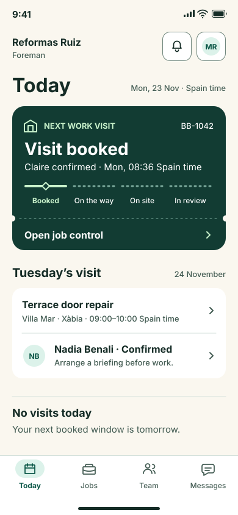

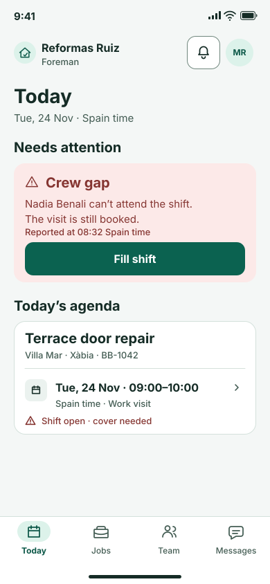

## F-02 · Jobs

**Purpose and routing.** Jobs tab locates foreman-scoped incoming handoffs, current bookings and history. A pending incoming job opens F-03; an owned active/archived job opens F-05 in current or read-only mode. A restricted or reassigned result that no longer belongs in this context is removed, with S-16 for a stale external link.

**Layout.** Incoming, Active and Archived stay fixed above property/stage filters. In Active, a material **Delivery at risk** group precedes **Next steps**; omit empty groups. The routine example is a booked job with a confirmed worker whose briefing still needs arranging. The alternate shows that same job after a confirmed 08:12 dropout: the amber text names the staffing problem and the booked window it threatens. It moves groups, not stages, and appears only once. Neither list publishes an update or assigns staff.

**Interactions.** Tap a segment; update the selected state, applicable filters and result list without a navigation push. Property/Stage opens one single-purpose Bottom sheet with current choice, All and Close; pick to apply and restore focus to the chip. Available stages match the segment. An unavailable selected value is explained and can be cleared; don’t silently change the property when switching segments. Tap a card or activate via assistive tech to navigate; normal scroll and refresh are supported. No validation or consequential confirmation for navigation/filters. A segment or a filter selection can use restrained native selection feedback, not every card tap.

**States and edge cases.** Incoming shows new/clarification due with routing status; only named authorised handoffs appear. Active spans Scoping through Signed off and shows separate gap/change/issue/payment flags as allowed. Archived shows Closed or Cancelled as recorded and no live controls; historical data never overwrites the current version. Empty segment explains what belongs there; filtered empty shows the actual filters and `Clear filters`. A partial/paging failure retries that page once requested without dropping existing rows. Stale/cached shows last confirmed time and scope limitations; never show unverified current counts as truth. Preserve selection and visible position when an acted-on job moves segment; show a confirmation on return if the old list no longer contains it.

**Platform, focus and locale.** Native tab/segmented semantics and native sheet/Back rules. Focus: header, title, segments with selected state, filters with current values, list/count, cards, tabs. At large type segments can stack and filters wrap; display property names, times and lifecycle labels without truncation of critical terms. Mirror segment order and chip alignment in RTL while keeping selected stage and sort unchanged.

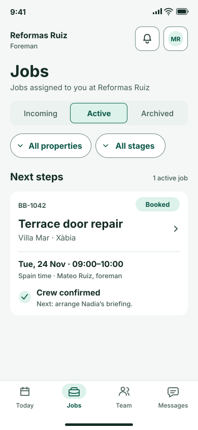

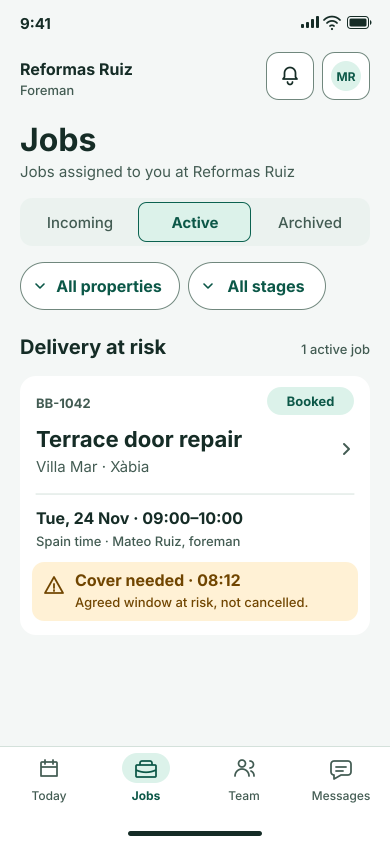

## F-03 · Job intake

**Purpose and routing.** From F-01, F-02, scoped S-09 or a P-02 admin handoff. Initial intake accepts responsibility to scope the request and opens F-04; if needed F-04 can route to F-06 for an assessment. Reassignment accepts responsibility for an existing job at its current stage and opens F-05 only after confirmation. `Ask Claire` opens authorised S-10 Job conversation; Back returns to the same intake. Returning or declining an offer records the outcome for the business and returns to the authorised caller without cancelling the request or booking.

**Layout.** Initial intake asks “Take the lead on this job?” above the customer, property and named recipient. Claire’s translated request and French original precede her received terrace door photo and original voice note (0:18; transcript pending). The separate authority notice says that accepting is for scoping only; `Return handoff`, `Ask Claire` and `Accept for scoping` all remain reachable. A transfer instead asks whether to take over the **booked** job: Inés Vidal is the incumbent and Mateo is the proposed recipient. Reply by Mon, 23 Nov at 17:00 Spain time. The €240.00 approved v1, Tuesday booking and confirmed Nadia shift stay intact. The provider and publishing authority do not change on acceptance.

**Interactions.** In initial intake, photo and voice open S-15 for zoom, playback and transcript when available; dismissal restores attachment focus. `Ask Claire` opens Job conversation only with a thread grant; it does not send a preset message or change ownership. `Accept for scoping` opens S-17 with the job, role and business and explains that acceptance does not set a price, book a visit or assign crew. Require the current named initial offer, valid authority and no intervening owner. Permit only one live handoff to a named recipient. Local operations sets the default two staffed-hour deadline (business days 08:00–18:00 Spain time, excluding local holidays). For an at-risk handoff due within four staffed hours use 30 staffed minutes and a call; call duty immediately if waiting would put the visit at risk. Reoffer once to an authorised alternate after a decline/expiry, otherwise escalate to provider admin and the local desk.

In reassignment, `Review transfer` opens S-17 with the named handoff from Inés Vidal to Mateo Ruiz, job, current stage, business, expiry and effect of accepting accountability. Cancel returns to `Review transfer`. `Accept transfer` rechecks the intended recipient, current authority, unexpired offer and handoff version, and that the **expected incumbent** still owns the job. An incumbent matching the offer is not a conflict; a different owner or superseded handoff invalidates it. A material change to the reviewed job summary requires a fresh review. After a confirmed transfer, open F-05 with the new responsible foreman while preserving the existing stage, approved scope and quote history, booked visit, crew/briefing and job records. Do not open F-04 or reopen scoping as part of the transfer.

In either mode, `Return handoff` opens bounded reason entry (optional notes where permitted), then replaces it with confirmation naming the business recipient, what stays in place and who can read the reason. Do not expose the reason to Claire by default. Confirmation uses the shared online, failure and haptic rules. Read-only viewers get a safe business or S-16 route rather than a disabled dead end.

**States and edge cases.** Initial intake: new; clarification needed, preserving the original request and last confirmed question; accepted for scoping, with `Continue to scope`. Reassignment: pending, with the incumbent accountable; confirmed transfer, with `Open job control` if revisiting the receipt. Returned, declined or expired offers are read-only with no acceptance action. On a declined or expired transfer, the incumbent stays accountable where still authorised. If authority was revoked, do not silently transfer or reinstate it; show the safe business escalation. A reassigned or superseded offer explains the change without disclosing newly restricted details. Missing authority offers a safe contact path; intake or transfer acceptance is separate from publishing authority. Show only received evidence; translation or transcript failure leaves the original usable. Offline keeps only authorised cached details and disables acceptance and return; reconcile an in-flight outcome before retry.

**Platform, focus and locale.** iOS native stack and preview dismissal; Android Up and system Back dismiss media before the route. In initial intake, focus Back, title/job, handoff, customer request (English then `fr` original), evidence and authority, then return, ask and accept. In reassignment, focus Back, title/job and stage, current and offered foremen, deadline, unchanged records, pending-transfer status, return and review. At large type stack the secondary actions and let the owner rows, evidence and site-time labels wrap. In RTL keep current and proposed ownership separately labelled; preserve original content direction and isolate dates, amounts and job ID.

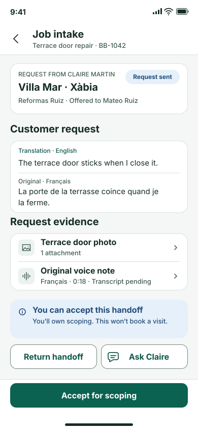

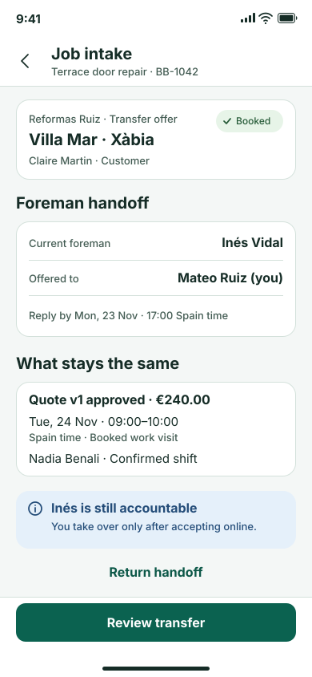

## F-04 · Scope and quote editor

**Purpose and routing.** Accepted intake, F-05 quote section or authorised clarification notification. Define a versioned offer for Claire’s approval; identify work, exclusions, cost, evidence and terms. `Plan a site assessment` pushes F-06 with assessment type and preserves the quote draft. Published versions lead to F-05 and are visible to Claire in C-06; after approval, `Schedule work visit` leads into F-06. Changes to an approved scope use F-15, not an edit to the approved quote.

**Layout.** Lead with **Version 1 · €240.00 including VAT**. Reformas Ruiz is the provider and biller; Claire Martin is the named customer approver. One ruled surface shows a labelled English reading aid, the exact Spanish original and the two lines: Labour / `Mano de obra` €160.00 and Rollers / `Rodillos` €80.00. The original is **“Ajustar la puerta de la terraza y sustituir los rodillos.” “No incluye la sustitución del vidrio.”** Draft actions edit scope/costs, plan an assessment or preview. `Terms and evidence` lists the received terrace door photo explicitly included with this version. The review variant has no editing actions: the locked snapshot is in the provider queue, not with Claire, and `Publish quote` is unavailable.

**Interactions.** `Edit scope` opens labeled multiline Inputs for original scope and exclusions with the source language control; preserve both when navigating, distinguish translation status from validation, and save edits back to the draft. `Edit costs` edits line description, quantity and price in the quote currency, shows live totals, and allows explicit add/remove; removal remains draft-only and is reversible before preview. `Terms and evidence` opens the full edit/review surface for written terms and attachments; attach via S-14 and review via S-15. Label evidence `Included in quote` or `Internal · not sent to Claire`. Only explicitly selected, received attachments that Claire is authorised to see are issued with the exact version. For v1, Mateo selects `Terrace door photo`; internal or pending evidence is excluded. Review shows job, business, authorised recipient, exact version, original + translations, included/excluded scope, full total/currency, terms and the issued attachment list exactly as it will appear on C-06. Validate required scope, terms and cost lines, representable quantities/amounts, totals from saved lines, current version and business grants; use inline errors linked to the first invalid field. An authorised publisher confirms `Publish quote` in S-17 with the €240.00 amount (no payment or booking). A draft author without authority can submit a permitted business review rather than publish. Review submission likewise identifies who sees what and waits for acknowledgement. A mutation failure preserves input and the review position; confirmed publication returns to F-05 with `Awaiting customer approval`.

**Review and issue.** Submit the snapshot to **Needs commercial review** in P-02. The provider designates a commercial reviewer and backup; one business day to issue or return with a reason is a service target, never automatic publication. F-04 and F-05 show `In review`, `Returned for changes` or `Issued` against that version. A separately verified publisher grant permits direct issue where applicable; an admin title or intake acceptance does not. Identify the legal provider/contact, site, deliverables and exclusions, IVA and fixed EUR total, timing assumptions, any separately priced assessment, evidence needed per completed line and payment, cancellation, withdrawal and complaint terms in preview. Include at most five photos and one original voice note per version (5 MiB/photo; 2 MiB and 90 s/voice). Never publish an unreceived file or a private log by implication.

The issued fixture runs seven calendar days, Mon, 23 Nov 08:15 to Mon, 30 Nov 08:15 Spain time. Preserve the approved original, evidence selection, applicable terms, named approver and decision time on a durable copy. Approval can incur the stated payment obligation to Reformas Ruiz; approval, publication and booking do not charge the customer. Later work or price changes need a separate F-15 version and explicit authorised customer agreement.

**States and edge cases.** Draft may be empty, incomplete, offline or unblocked for preview. Assessment needed keeps any quote draft while recording separately that a visit to scope is needed; assessment agreement is not a booked repair. Pending business review locks the submitted version; do not claim automatic approval/send or allow an inline override. If returned for correction, retain history and show the next editable revision. Sending keeps version and current amount stable; after acknowledgement show awaiting customer. If Claire declines, records remain and a new version can be scoped when authorised; a previously sent revision is read-only when superseded, expired or approved. Show the current version and exact outcome, not an older action. A race at publish returns the current version/grant and keeps safe draft data; no duplicate quote or implicit approval. A person cannot approve their own proposal by switching contexts.

**Platform, focus and locale.** Read version, full amount including VAT, provider, named approver and status before scope, the labelled original, cost lines, edit actions, evidence and preview. Cost input accepts the locale’s decimal separator. At large text sizes stack the amounts and allow the original to wrap intact; no horizontal squeezing or shortened exclusions. In the locked variant neither an edit link nor a disabled publish control substitutes for the queue status.

## F-05 · Job control

**Purpose and routing.** Operational home for a specific job from F-01, F-02, F-04, a confirmed F-03 reassignment, scoped S-09 or a validated deep link. Route to the current decision; do not merge job stage, crew, briefing, evidence or billing into one status. Back returns to the authorised caller, or a scoped Jobs parent when launched cold.

**Layout.** A visit ticket carries only the latest customer-visible milestone, its source and site time, plus `Publish visit update`. In the booked example Claire agreed at 08:36 Monday; no travel or arrival report exists. The private crew box says one door fitter is still needed. The job timeline records Claire’s €240.00 v1 approval at 08:20 and booking at 08:36, newest first. In the on-site example Mateo reported On the way at 08:48 and On site at 09:12 Tuesday. Nadia’s **09:14** check-in sits in the private crew box, not on the rail. Her terrace door task remains held. The agreed window is still 09:00–10:00 Spain time. Message, site log and job actions follow; the footer acts on the shift, not the customer timeline.

**Interactions.** `Publish visit update` opens F-17, not a one-tap broadcast. Mateo previews exactly what Claire may see and confirms the current visit online. On the way and On site require that explicit report; a cover/delay notice annotates the unchanged booking and states the next update if promised. F-14 submission, not an upload or draft, creates In review. Private attendance, crew acceptance, chats, evidence and elapsed time never fill missing milestones. Keep original reports with linked corrections; an uncertain publish does not advance the ticket.

The schedule row opens F-06; the crew row opens F-16. `Assign crew` opens F-07 for an ordinary unassigned slot. An unresolved dropout instead routes to F-10; an open offer routes to F-16 with its deadline, not to a duplicate send. `Message Claire` opens S-10 Job conversation, `Site log` opens F-13. `More actions` includes timing, quote (F-04), propose change (F-15) and completion (F-14) as the current role and stage permit. `Open shift briefing` opens the private F-16 briefing route to S-11. Arriving is not permission to start: the affected task stays blocked until a human verifies teach-back in a language Nadia understands **and** Nadia acknowledges that current version online. No one acknowledges for her.

**States and edge cases.** Scoping: `Continue scope` or `Plan assessment`; quote out: exact version and awaiting/declined/expired outcome; Scheduling: `Propose work window` until the agreed record is confirmed; Booked: show separate crew assignment, acknowledgement and gap states. In progress: show confirmed private attendance/evidence without changing the public report. Change pending: show F-15 and hold only affected work; keep approved scope and agreed window until revised decisions are confirmed. Awaiting sign-off: indicate submitted evidence/decision without using a Paid or Closed badge. Issue open: show separate status and authorised local-service path; no automatic payment, sign-off or cancellation effect. Signed off, Closed or Cancelled: retain the authorised history, suppress obsolete mutations. Exception banners (stale, access changed, phase changed) retain only permitted data and carry an explicit next step. Empty site log is not proof of no work; pending evidence is not shared evidence. If a visit is stale, retain its last confirmed report and source time with a stale label. Do not roll forward a missed report or infer one from a device reconnect. Only a fresh, authorised confirmation changes the public ledger.

**Platform, focus and locale.** Back/Up restores the actual caller. Read the public milestone and provenance, publish link, private crew/hold, job actions, timeline and footer in that order. Do not announce private attendance as a new visit report. The four notches distinguish recorded, current and unreported even without colour; changed marks settle once in 180 ms or switch immediately with reduced motion. Keep the time column associated with its event when text stacks. After closing F-07, restore focus to `Assign crew` or the pending-offer result.

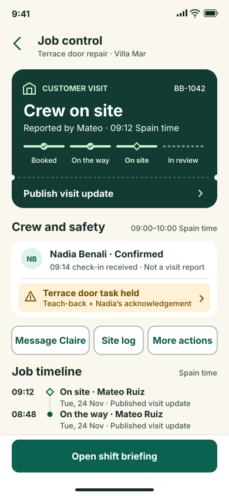

## F-06 · Schedule and availability

**Purpose and routing.** F-04 needing assessment, F-05 timing, or F-01 conflict. Check provider capacity and propose a site appointment for customer agreement. An assessment is a scoping visit; a work window requires approved scope and a responsible provider. Exit to the caller with saved authorised draft or `Proposal sent`; Claire confirms via C-08, then F-05 shows booking only once agreement is authoritative. A schedule problem involving just crew replacement belongs to F-10/F-16; don’t shift a customer booking silently.

**Layout.** Lead with the scheduling question, visit type and approval state. Calendar and accessible agenda offer the same site dates; show start/end and **Capacity checked, not reserved**. For the approved repair, Tue, 24 Nov 09:00–10:00 has door-fitting capacity and a way to brief in Spanish. No worker is assigned. For the unquoted assessment, Mon, 23 Nov 14:00–15:00 is €0.00 for inspection only. Check a competent, authorised assessor, access arrangements and the briefing appropriate to the site hazards; it is never a repair appointment. On a capacity conflict, keep the selected inputs, state the missing requirement, offer alternatives and disable review.

**Interactions.** Select type and date, move one week with arrows, switch to accessible Agenda view without losing date/edit, or activate a named time field to edit using the native picker (typed input where supported). Today is indicated separately from selected. Assessment route opens on assessment; if work is gated, show why when navigating to that type without allowing send. Time fields and date stay selected when a conflict appears. `Find an available window` opens the same date/agenda selector filtered to checked available alternatives; selecting one updates the tentative input, not any booking. Validate ordered start/end, time zone and date, no past or unavailable window, current job/grants, appropriate scope/type and adequate checked capacity across the full interval. Reject ambiguous/nonexistent site times with concrete alternatives; show site and optional user time during review. Review S-17 names job, business, appointment type, window, current confirmed booking if applicable, exact proposal expiry in site time and approval still needed. Submit online and show proposal sent only after acknowledgement; on retry reconcile the old outcome rather than create a second proposal. Selection can use native feedback; only acknowledged proposal earns completion feedback.

**Capacity and agreement.** Recheck the whole window at **send**, then again in the customer’s **agreement** at C-08. Check all required skills, provider scope, availability across the full interval and a viable human briefing; no tentative hold, assignment lock or countdown. Set the proposal deadline no later than the earlier of the next staffed day’s end and the safe staffing cutoff. Confirm the window only on success. C-08 handles any required early-start consent separately from booking and from quote approval. A lost race leaves the old window untouched: the failed-move example shows Tue, 24 Nov 09:00–10:00 still booked after Wed, 25 Nov 09:00–10:00 lost capacity.

**States and edge cases.** Known-capacity tentative is ready to review; unknown/checking/loading shows the difference, retains draft and disables review/send to not imply capacity. Unavailable/conflict shows what is missing without identifying unrelated jobs/crew; alternatives can be absent, in which case offer change timing or intake/local escalation as permitted. Proposal pending customer remains tentative/proposed with the actual deadline where known, and off-screen updates don’t move focus. `Agreed` shows the exact confirmed record and authorized reschedule action; changed/expired proposal is read-only with `Choose another window`. Reschedule needed displays the currently agreed window separately; it remains current until replacement/cancellation is authoritative, with no claim that an impacted visit can proceed. Simultaneous bookings/availability changes at review re-open the same inputs with fresh conflicts. Offline marks capacity stale, allows safe draft editing only, and never sends. No crew identity is necessary to show capacity. Like-for-like moves at least 24 hours out can be agreed directly against a current provider-authorised alternative. Inside 24 hours or with changed terms/capacity, request provider agreement. Fee-free appointment management does not waive statutory withdrawal or settle work already done.

**Platform, focus and locale.** iOS native date/time picker and Back; Android platform picker with typed alternative where supported, IME Back and Up. Read order: Back/title, visit type and approval, calendar header and navigation, dates with full labels (`Tuesday, 24 November, selected`), site zone/Agenda view, date and state, start/end, capacity, alternative or notice, review. Large text defaults to an equivalent vertical agenda when the week grid cannot hold seven useful date targets. Week starts with local convention; dates remain interpreted in Xàbia’s zone. RTL mirrors controls/calendar arrangement, but screen readers traverse dates chronologically with explicit names and zones.

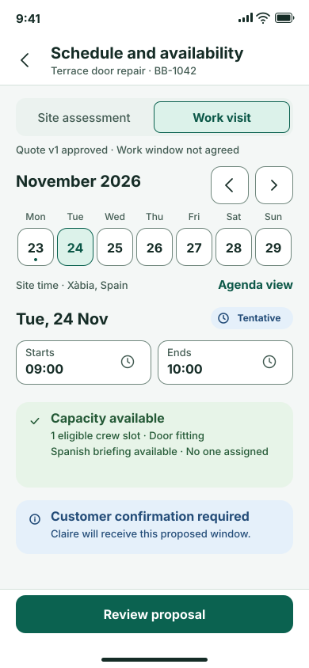

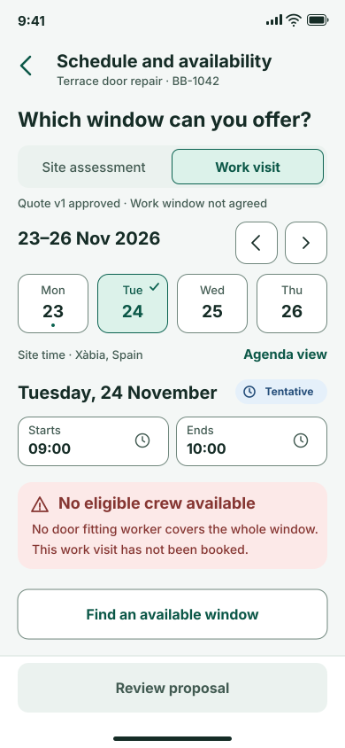

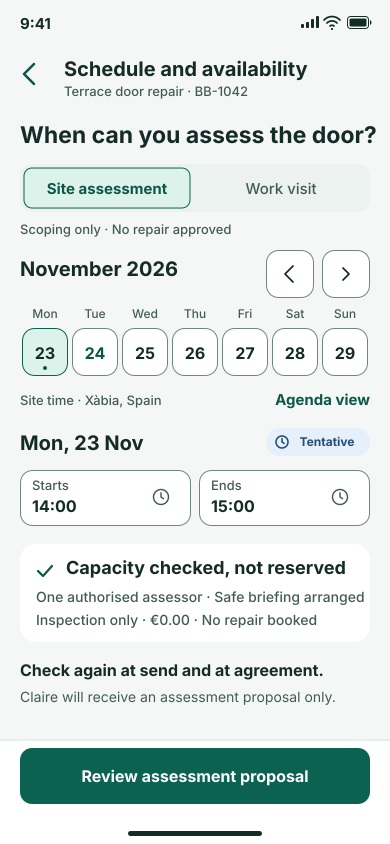

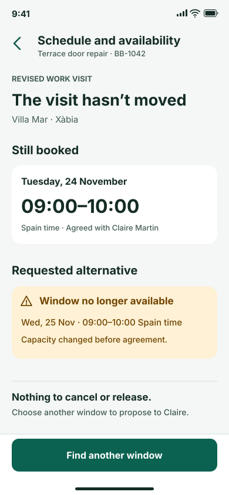

## F-07 · Assign crew [Sheet]

**Purpose and routing.** From F-05 or F-16, send one ordinary named offer for one open slot to a member of **Reformas Ruiz’s own crew**. An eligible worker’s valid confirmation can confirm that ordinary assignment. A dropout is different: F-10 runs an internal cover round; only the first valid reply reserves the place, and F-12 requires fresh foreman confirmation before assignment. A reservation grants no travel, property access, start permission or public roster entry. No external individual pool at launch.

**Layout.** `Offer a shift` opens over the actual booked F-05 or F-16 parent with a handle, Close and 40% scrim. The requirements stay visible: terrace door adjustment, Tue, 24 Nov 09:00–10:00 Spain time, one door fitter and a Spanish briefing. Skill and language filters affect browsing, not requirements. A checked Nadia is selected in the ready state. The ordinary reply deadline is Mon, 23 Nov at 17:00 Spain time; she has not been offered or assigned the shift merely by selection. In the alternative, English and door fitting are on record but the Spanish briefing requirement is unmet and eligibility review is pending. Her profile and Team remain reachable; `Review named offer` is disabled.

**Interactions.** Scroll and expand via native sheet controls, with Close always reachable; swipe down/Back affect only the sheet, and never send. Skill/language chips filter browsing; opening a filter can inspect other team records, but the fixed shift requirements stay visible and unmatched workers are never selectable. Tap an eligible Worker card to select/deselect for the displayed shift; use a checked affordance, and keep selection when expanding the sheet. Candidates who fail a check can be inspected but not selected. `Open Team` goes to F-08; the ineligible row opens permitted F-09 for specific status. Dismiss/restore the sheet around a push rather than stack onto it. Return restores candidates and a still-valid selection, with freshness rechecked. `Review named offer` replaces the sheet with S-17 for worker, slot, site zone, task, business, expiry, and regular offer effect (worker must confirm; no property access now). Send requires valid shift version, open slot, one named ordinary recipient for this open slot, authorised provider/business, current task/language/eligibility through the shift and no conflict. Recheck at send and again on worker confirmation. If all conditions hold, send once, show `Offered` with expiry; a worker’s valid named confirmation then makes the slot `Confirmed`. Don’t show other jobs’ details as conflict reasons. Restrained selection and confirmed-send haptics follow the shared rules. Close or Back with an unsent selection preserves it when safe; if the route cannot retain it, ask before discard. The ordinary reply window is two of the recipient’s scheduled working hours, capped by the safe staffing cutoff. Check task fit and approval through shift end, actual work and briefing languages, full availability including travel/rest and overlaps. Profile details expose only coarse eligibility, last check and effective cutoff, never underlying documents or private reasons. Filters and machine translation cannot cure a mismatch.

**States and edge cases.** Eligible selected/unselected; no matches due to requirements versus filtered empty (reset browse filters, don’t remove requirements); unavailable/conflicting; not eligible, expired/pending eligibility and language mismatch (reason and recovery). Already assigned is read-only or routes to F-16, never sends a second offer. Offers pending show names, response deadlines and states without counting staff as confirmed. Declined/Expired/Filled elsewhere or a reported dropout are distinct and route unresolved needs to F-10 as appropriate. `Refresh required` (stale, offline or mid-review changes) keeps safe selection context, disables send and offers recheck. Selection invalidated by another confirmed action is cleared with specific, safe inline feedback. Processing preserves recipient and deadline; network uncertainty reconciles before retry and never claims that a worker got notified. No individual external search or override. Use the provider’s own F-10 cover workflow only for an existing gap; if own cover fails, use duty contact or a revised visit.

**Platform, focus and locale.** iOS native sheet detents and Close; Android Material modal sheet, Up/system Back with IME first; both may expand to full height with accessibility type. Focus on entry: title, then Close, shift metadata/requirements, filters, candidate summary (state and blockers), roster link, explanatory note, action. Screen reader example: `Nadia Benali, selected, eligible and available` vs `Nadia Benali, not selectable, Spanish briefing required, eligibility review pending`; when profile is allowed name the actual profile action. Focus returns to caller’s trigger or outcome. At large type allow blocker/status and deadline to wrap, and move link/action onto its own row rather than shrink. UI/reading language can differ from the displayed working languages; localise day/deadline with the explicit site zone and don’t infer nationality.

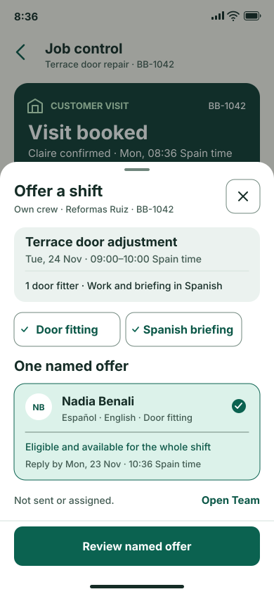

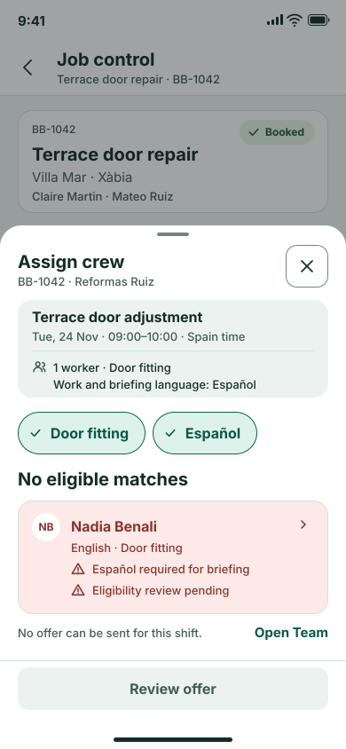

## Open design questions

- **Provider readiness:** which named reviewer and backup actually staff the provider’s commercial queue, and who will cover the duty line and safe scheduling cutoff for each shift? The one-business-day review target and reply windows are not delivery guarantees.
- **Field review:** which human reviewers will validate Portuguese field copy, the reading-language pairs shown to real crews, and the briefing provision for each supported task? The Spanish briefing shown here is a requirement of this shift, not a launch UI language.
- **Fixture decisions:** Tuesday’s 08:12 dropout allows a bounded own-crew round before the safe cutoff. The 09:12 On site report belongs to a separate, staffed branch. Neither fixture implies that a cover round always succeeds.

## Navigation

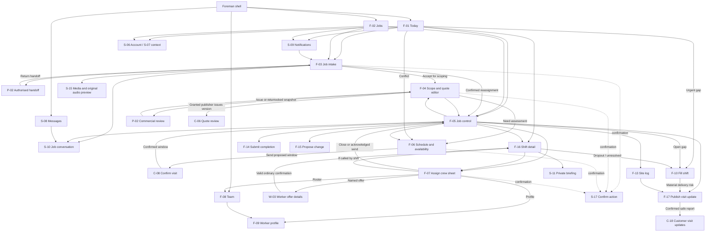

## Review responses

- **Handoff and commercial authority:** the incumbent remains responsible until the checked transfer; the customer, accepted quote, visit, shift and holds survive. P-02 owns provider review, not F-03. Only an explicitly authorised publisher can issue the locked commercial version.
- **Quote consistency:** the two Spanish sentences, exclusions, line amounts and selected terrace door photo in F-04 match C-06; edited translations cannot revise the approved terms.
- **Staffing, reporting and safety:** F-07 is not F-12. An ordinary offer, a cover reservation, a confirmed assignment, a private attendance receipt and a published F-17 milestone have different effects. The on-site example keeps the task held for verified teach-back and the worker’s own acknowledgement.
- **Changed capacity:** no provisional work window is held. A failed second check preserves the agreed window, as in C-08.
