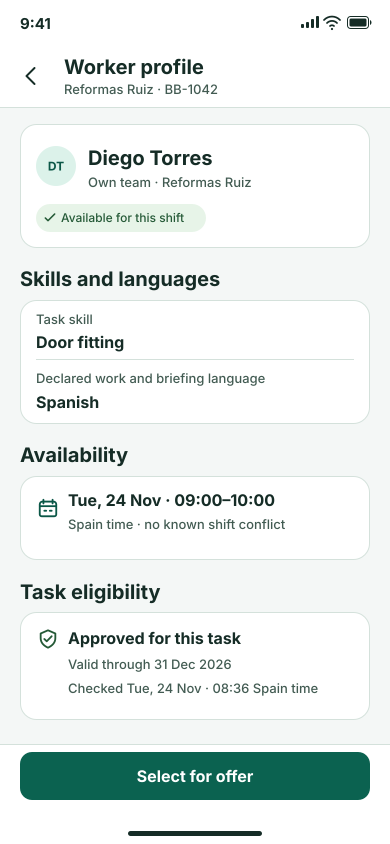
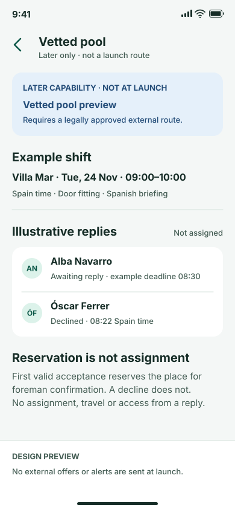
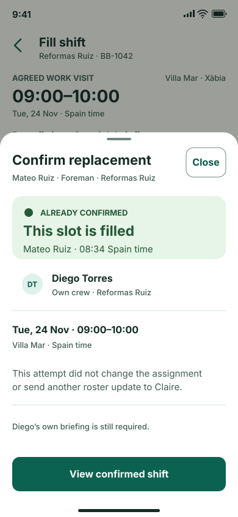
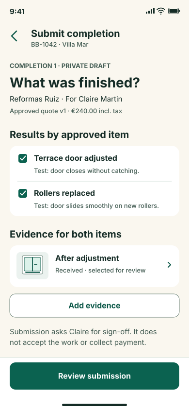
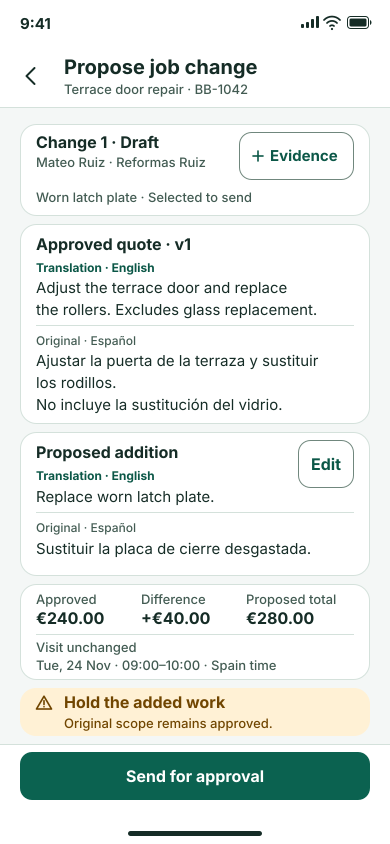
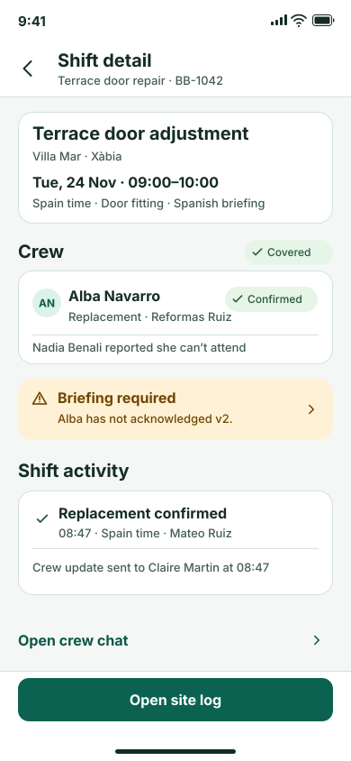
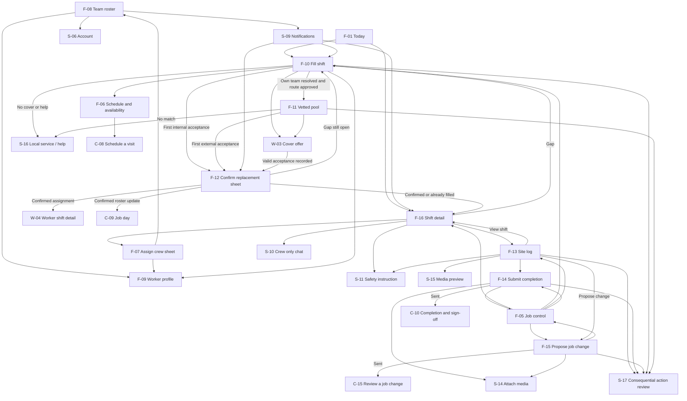

# Foreman team, cover and site work · F-08–F-16

Mateo Ruiz runs **BB-1042 · Terrace door repair** for Reformas Ruiz at **Villa Mar · Xàbia**. The booked window is **Tue, 24 Nov · 09:00–10:00 Spain time** (`Europe/Madrid`). Nadia Benali is the original assignee. In the cover branch she reports that she cannot attend, then Alba Navarro replaces her through the vetted pool. F-13 and F-14 continue from that confirmed assignment. F-15 is a separate branch in which Mateo proposes extra work; it is not part of the completed scope shown in F-14.

## Shared behaviour

- **Context and freshness.** Assert the active Foreman grant for the business and the record before revealing details or submitting a decision. Recheck on deep-link, resume and mutation. If access is removed, dismiss restricted content and use S-16 with a safe return path. Show cached details only while authorised and label them `Offline · last confirmed [date/time]`. No cached access secrets; no assigning, sending a cover offer, confirming, publishing or sharing offline. Where allowed, safe drafts survive Back and permitted context changes; saving locally does not send anything.
- **Actions.** Actions say what they do, show processing without moving focus, and prevent repeat submissions while the result is unknown. If the response is interrupted, show `Checking status…` and reconcile the original action before enabling retry. Announce final status once, use a restrained platform completion haptic only after server confirmation, and never depend on a haptic or toast to convey the outcome. Layout-preserving loading and inline error/retry retain entered data.
- **Platforms and access.** Match the [design system](../../system/design-system.md): iOS native Back/edge swipe, Dynamic Type and VoiceOver; Android Up and system/predictive Back, font scaling and TalkBack. Back dismisses the keyboard, then any open transient surface, then a route; it never silently discards or submits. Use 48-unit common hit areas, 56 in field mode, and large single-column actions where practical. At large type, allow content, headers and rows to grow or scroll; keep Back/Close, record context, deadline and action readable. Native sheet, photo and date/time controls differ by platform; the decision, audience and effects do not.
- **Language and time.** Allow 30–40% string expansion and wrap beyond it. Use locale-specific dates, numerals and currency; always show the site date and zone for deadlines and visits, with the viewer's time separately when enabled and different. RTL mirrors layout and navigation, not clocks, photos, checkmarks, currency values, names or job IDs. Isolate inline Latin text, IDs, times and amounts. Language names represent declared working capability, not nationality or UI/reading language. Where content is translated, display the translation first and the labelled original immediately below; if unavailable, keep the original and show translation status.

## F-08 · Team roster

- **Purpose and routes.** Find workers within Reformas Ruiz. Enter from the Team tab or the roster link in F-07; tap a worker for F-09. The bell opens S-09, the avatar opens S-06, and the other tabs follow the Foreman shell. A return from F-09 restores the query, filter and position. A roster link from F-07 remembers its assignment context without leaving a sheet open under another route.
- **Layout and data.** Reuse the Today business header with its bell and Account avatar. Below the page title, show a Search input labelled `Search team`, with `Name or skill` as the hint. Filter controls use 16-unit labels and 48-unit targets. The eligibility summary and Worker cards scroll above the fixed tabs. The summary counts approved members and pending reviews across the roster, not people guaranteed to work a given shift. Each row shows name, declared door fitting/working language and today's coarse availability or eligibility exception. Nadia is unavailable, Diego Torres and Lucía Ortega are available, and Inés Pardo is under review. Availability uses site time; a roster status is not assignment eligibility.
- **Interactions and states.** Search names or skills (case/diacritic-insensitive, without altering displayed names). `All team` or `Available` changes the list; `More filters` opens a bounded Bottom sheet for skill, working language and eligibility with Apply/Clear. Available excludes unknown, expired or pending eligibility if the user is filtering for staffing readiness. Active and unavailable workers remain viewable under All team. Show pending/expired eligibility separately from availability, true empty with a route to contact the business admin, filtered empty with `Clear filters`, and cached read-only results with last-confirmed time. Do not reveal removed workers through old search results. There are no profile edits, invites or raw credentials here.
- **Platform, access, locale.** Native search keyboard/clear control on both platforms; Android Back dismisses input first, iOS retains the tab stack when switching tabs. Focus: business, Notifications, Account, heading, `Search team`, filters (announce selected), eligibility count, worker rows (name, status, skills/languages), tabs. Keep the field label visible when filled. Flow longer filter labels onto another row rather than reducing the type or insets, and at large type put status below each worker's name. Localise filter counts and mirror row chevrons in RTL; preserve names and accents.

## F-09 · Worker profile and availability

- **Purpose and routes.** Inspect fit without viewing supporting legal records. Enter from F-08, F-07 or the separate info target on F-10, then Back to that caller. `Select for offer` appears only with a current shift context and an eligible worker; it preselects the worker on F-07/F-10 and returns there. It sends nothing. Browsing from the roster has no staffing action.
- **Layout and data.** Worker card and Status badge, Skills and languages list, Calendar/availability summary and coarse task eligibility card. The fixture shows Diego Torres, door fitting, Spanish, no known overlap for the booked window, approval for this task through 31 Dec 2026, and the time of the last eligibility check. On a general profile, show declared availability and label the scope of approval instead of implying fit for an unspecified task.
- **Interactions and states.** If a window conflicts or availability is unknown, show the blocked time range without naming another job/customer. For stale, pending, expired or task-ineligible checks, explain the reason and disable selection; `Refresh` rechecks online. Never treat a declared window as an acceptance. A worker removed from visible scope goes to reason-safe S-16, not a cached profile. A valid selector can provide one selection haptic, not an offer-sent confirmation. Assignment eligibility is checked again when an offer goes out.
- **Platform, access, locale.** Native stack Back on iOS and Up/system Back on Android; an F-07 caller is restored after the pushed profile closes. Focus: Back, title, worker and availability, skills/languages, window, eligibility/valid-through, then Select. Stack long availability and applicability labels instead of wrapping them into badge icons. Use site zone and an optional second zone for the window; isolate date and names in RTL, no flag icons.

## Replacement: from gap to confirmed crew

| Event | What Mateo sees | What others see |
| --- | --- | --- |
| Nadia reports dropout | F-10 shows an open gap for the existing visit. The job is not cancelled. | Nadia's dropout resolves only after receipt. No new crew is shown to Claire. |
| Offers go out | `Offered`, a site-time deadline and responses as received. A decline and expiration are different. | An authorised worker sees W-03. No precise residential access or permission to travel or start. |
| First valid acceptance | `Accepted · confirmation required` with `Review accepted replacement` opening F-12. First valid acceptance reserves the place for foreman confirmation. | Other offers cannot be accepted while that place is reserved. They show `A replacement is being confirmed`, not `Filled elsewhere` until assignment exists. No customer roster change yet. |
| Mateo confirms and the slot is still open | F-16 shows a confirmed replacement and a new personal briefing requirement. One roster update is recorded for the assignment; show notification status separately. | W-04 grants only authorised shift details. W-09/S-11 require the replacement's own briefing and acknowledgement. C-09 shows only the confirmed customer-visible roster and unchanged arrival window, or an accurate timing update. |
| No valid acceptance, confirmation fails, or delivery is at risk | Gap remains unless another action already filled it. Offer recovery, escalation or a revised plan as appropriate; never claim cover from an offer or chat. | If timing is materially at risk, C-09 says `Crew cover being arranged` and gives Mateo and the next update if known. A revised window goes through C-08. No candidate names, replies or eligibility details go to the customer. |

First valid acceptance reserves the place for foreman confirmation, not permission to travel or work. Define first by the order in which the server records valid acceptances for the same current gap, not device time or notification order. A decline closes only that worker's offer; neither a decline nor a chat reply reserves anything. Accept only if the offer is current and unexpired, the worker is eligible for the task, business/route and whole shift, and there is no overlap. A later acceptance cannot displace the provisional worker. If the provisional acceptance is withdrawn, expires at its review cutoff or fails recheck, explain why it closed and refresh the gap. Only still-valid offers can reopen; a worker who previously saw a blocked action must choose Accept again on an open offer. Never promote a rejected or blocked tap into acceptance. If the shift is cancelled, replaced or rescheduled, close obsolete offers and re-evaluate the current shift, not the old gap. The worker reply deadline and foreman review cutoff are distinct.

## F-10 · Fill shift

- **Purpose and routes.** One record to staff an open slot: check own team first, then use F-11 if permitted. Enter from F-01, F-05, F-16 or an authorised S-09 gap alert. Back returns to the caller without stopping offers. The Shift card opens `Review shift requirements`, a Bottom sheet for task, required skill, briefing/work language and shift timing. Before sending, a permitted foreman can set task-fit requirements within the approved scope; a booked timing or scope change must go through F-06/C-08 or F-15/C-15 instead. The sheet is read-only while offers are open; a material scope or timing change invalidates the affected offers rather than silently editing them.
- **Layout and data.** Shift card with task, property, date, zone, door fitting and Spanish briefing; dropout/error Banner or offer countdown; `1. Own team` Worker cards or responses; `2. Vetted pool` gate; support link; fixed Button. Nadia's dropout was reported at 08:32. Diego and Lucía are eligible selections in the ready artboard (selection is deliberate, not pre-applied on fresh entry). Pending shows Diego waiting, Lucía declined at 08:38 and a reply expiry of 08:42 Spain time. A countdown is never the only deadline.
- **Interactions.** Tap a candidate selection region to include/remove them; the independent `View [name] profile` target pushes F-09. `Send N team offers` opens an S-17 review naming recipients, task, expiry and effect, then sends only online after rechecking eligibility, availability and gap. No candidate means no active send. `Withdraw open team offers` names which outstanding offers will close; after server confirmation remain in the gap. The support link opens S-16 for help, not automatic closure or pool authorisation. On the first valid acceptance, show a persistent `Review accepted replacement` into F-12; background response updates never open it over a task without a tap.
- **Gate and states.** Pool is unavailable until there is no internal eligible candidate left to approach and no internal offer still open, or a justified urgency cutoff is recorded. A cutoff closes outstanding internal offers before an external send; a manual withdrawal alone does not bypass an available own team. If an acceptance and cutoff arrive together, the first valid server decision takes effect. A valid provisional acceptance keeps the pool locked until the gap is covered or the acceptance closes; a cutoff cannot displace it. Never run internal and external offers in parallel across the cutoff. Show the exhaustion/cutoff time, reason and `Open vetted pool` only with an approved route. Pending, expired, conflicting or unverified candidates cannot pass. For blocked route or exhausted supply, show `No cover confirmed`, local service and revised-window options. If covered, replace send actions with `View confirmed shift`; if stale/offline, freeze last-known responses and disable sends, withdraw and pool entry until rechecked.
- **Platform, access, locale.** iOS uses native Back and Android system Back returns one level, not a withdrawal. Focus: Back, shift requirements, gap/deadline, own-team section and response counts, candidate select then separate profile, pool explanation, support, action. Announce new replies or cutoff once; do not announce every tick or reorder the focused item. At large type stack countdown under its title, and require an absolute site deadline, not an isolated `03:00`. Mirror selection/action positions in RTL without reversing times.

## F-11 · Vetted pool

- **Purpose and routes.** Show only external cover available through the approved local provider route after F-10's internal step resolves. Back returns to F-10 with activity intact; after the first valid acceptance, `Review accepted replacement` opens F-12. If there is no authorised route, do not show pool names or give a way to send; take the foreman back to the F-10 explanation/support path.
- **Layout and data.** Shift card and recorded own-team outcome, Match requirements card, selectable Worker cards, offer deadline and fixed Button. Filters are mandatory: door fitting, Spanish for work and briefing, availability for the full window with no overlap, catchment fit, current eligibility for the task/site/time and approved provider route. These are not optional fallbacks. Show area and declared availability, not GPS or raw credentials. In the sample the own-team step closes at 08:42; Alba Navarro and Óscar Ferrer match and have been selected for offers due **Tue, 24 Nov · 08:50 Spain time**.
- **Interactions and states.** Select/deselect matches and tap `Send N pool offers` to review recipients, deadline, Xàbia area, task and accountable business in S-17. Recheck route, gate and candidates before accepting the send; don't silently send to a changed partial list. W-03 receives only area, task, time, provider and permitted contact. Pending shows `04:30` left, a distinct declined state for Óscar and `First valid acceptance reserves the place for foreman confirmation`. Update in place for accepted, declined, expired, withdrawn or filled. When a worker accepts validly, disable further selection and offer acceptance, show `Accepted · confirmation required` and offer `Review accepted replacement`. A newly changed eligibility record removes the match and exposes the coarse reason without revealing a document. If nothing passes, `No eligible matches` and `No cover confirmed` offer `Escalate to local service` (S-16, with job ref only as authorised) or Back to plan in F-10. Escalation does not change the booking or guarantee a response. If the approved route closes or the connection drops, block offers and show last confirmed status; retry only after the gate and list recheck.
- **Platform, access, locale.** Same portal and content on iOS/Android; use native Back and the platform dialog for review. Focus: Back, shift, internal outcome, requirements, results/count (or no-match reason), candidate checkboxes with name and fit, deadline/status, support, primary action. Keep list position and focus on live updates; at large type stack count/time and allow the full match criteria text to wrap. Retain provider and names verbatim; use site time and optional local time separately, mirrored RTL without mirroring clock or date glyphs.

## F-12 · Confirm replacement [Sheet]

- **Purpose and routes.** Finalise the worker with the first valid acceptance, exactly once for the open slot. Open from F-10/F-11 or an acceptance alert in S-09 (use F-10 behind the sheet on cold launch). Close goes back to the refreshed caller without cancelling the provisional acceptance. `View confirmed shift` leads to F-16 with an authorised parent stack; if the slot still needs cover, return to the current gap in F-10. A stale link can show the result read-only but never auto-confirm.
- **Layout and data.** Dim the caller with 40% scrim. Bottom sheet with handle, title, explicit Close, job/Foreman/business context, accepted Status banner, worker/provider, dated shift, skill/language and eligibility summary, visit/customer/briefing impact and pinned Button. Alba is provisionally accepted at 08:46 Spain time. The agreed window is unchanged. Claire receives only the confirmed roster update; Alba must complete her own briefing. The sample `Confirm by 08:52 Spain time` is the foreman review cutoff, separate from the worker reply deadline of 08:50. Use the shift date alongside if not already clear in context.
- **Interactions and states.** `Confirm Alba Navarro` is the final action, not an automatic result of acceptance. During processing hold focus on the named action, prevent another submit and explain when checking the result. Recheck active authority, the provisional acceptance, latest gap/shift version, intrinsic eligibility/approved route for the whole shift and overlaps. If valid and open, confirm one worker, close other offers, assign the new briefing and record one roster update. Refresh F-10/F-11/F-16 and W-04. Show `Crew update sent` only when it is recorded as sent, otherwise `Crew update pending`; neither means read.
- **Race and failure.** If the server says this gap is already filled, replace the confirmation CTA with `View confirmed shift`. Show the authorised current assignee and timestamp if permitted, e.g. Alba at 08:47 after Mateo confirms on another device. Do not show a second success, reopen staffing, reassign or send a duplicate customer update. If another authorised assignment filled the slot, show that confirmed record and never expose unrelated candidate details. If availability, eligibility, the provisional acceptance or time has changed but the slot remains open, explain the safe reason and offer `Return to fill shift`; don't treat it as filled. A cancelled/superseded slot goes to the current shift status. No offline confirmation; an ambiguous response shows `Checking status…` before any retry.
- **Platform, access, locale.** Native modal sheet: iOS detent with explicit Close; Android back/Up dismisses the sheet before parent. Swipe/dismiss does not revoke or confirm anything; if a request remains in flight, persist its processing state when the user closes. Trap accessibility focus in the sheet, starting at title; then Close, accepted/filled state, worker/slot, check and impact, named action. Restore focus to the opening row or current safe result. At large type expand to full height and scroll, with an accessible action and Close. Use complete translated action strings with a name placeholder; isolate times and names in RTL.

## F-13 · Site log

- **Purpose and routes.** Inspect attendance, briefing and received evidence from F-05 or F-16 (shift-scoped when opened there). `View shift` opens F-16 for the selected shift; `Propose change` opens F-15 if authorised for the job. Open S-11 from the briefing row, S-15 from the photo preview, or F-14 from `Review completion`. Returning from these destinations restores the same log position, photo selection and initiating control. If `View shift` returns to the existing F-16 caller, reopening its site log restores that same state instead of nesting another shift route. Back from the log returns to its own caller. The log is not an attendance editor or a customer thread.
- **Layout and data.** Date/zone and last-confirmed time with a separate `View shift` row, Safety summary row, chronological Timeline with named actor and state, Evidence gallery, sharing notice, job actions (`Review completion`, `Propose change`) and fixed `Review sharing` Button. Alba acknowledged S-11 v2 at 08:54, checked in at 09:00, uploaded `After adjustment` at 09:34 and checked out at 10:00 (confirmed receipt 10:04). Preserve capture and receipt when late or different. The drawn tile is a fixture icon, not actual site photography. Private evidence is available only to permitted viewers; `Not shared` is not a sync state.
- **Interactions and states.** Tap briefing to read the exact version, status and any newer hold; a prior worker's acknowledgement never transfers. Tap a gallery cell to preview, or its separate checkbox to select a received photo. `Review sharing` shows S-17 with the specific images, job and authorised customer audience; explicitly confirm to publish only those items. For people or unrelated sensitive material, deselect and use an appropriate retake. Keep private entries, pending media and attendance notes out of customer publishing. No entries shows `No site updates received`; pending receipt and evidence processing differ from server-confirmed arrival. A worker-only local queue is not visible to Mateo until received. Rejected/out-of-order events show actual reconciliation status and direct the author to resolve through W-06/W-07 or support; never insert or edit another person's check-in. Prevent share of failed, missing or unauthorised media. Preserve selection on recoverable failure and display sober offline/stale and shared states.
- **Action availability.** `View shift` requires a selected, authorised shift; when a job-level log has multiple shifts, select one before opening it. Show `Propose change` only with the grant to draft for that job; F-15 rechecks authority to publish separately. Neither action shares evidence or changes attendance.
- **Platform, access, locale.** S-15 uses platform full-screen Close/Back and optional pinch or accessible zoom controls. Focus: Back, date/freshness, `View shift`, briefing, chronological events, photo preview then `Select After adjustment for sharing`, sharing note, `Review completion`, `Propose change`, `Review sharing`. At large type move times beneath each label and stack gallery rows and secondary buttons. Read zone once in the timeline header, localise timestamp format, and mirror alignment rather than chronology in RTL.

## F-14 · Submit completion

- **Purpose and routes.** From F-05 or F-13, review finished approved work and evidence for customer sign-off. Back preserves the authorised draft. A confirmed send returns to F-05 `Awaiting sign-off` and creates the C-10 review for the authorised customer. It is neither sign-off nor a payment request.
- **Layout and data.** Job/customer Draft card, versioned scope Checklist, evidence preview, Add evidence, persistent note Input, handoff explanation and fixed Button. The €240.00 quote v1 covers adjusting the terrace door and replacing the rollers (glass excluded); both listed tasks are checked in this ready draft. One uploaded photo `After adjustment` is selected; the note reads `The door slides and closes smoothly with the new rollers.`
- **Interactions and states.** Check each finished item deliberately; no bulk marking upon photo upload or checkout. Add photos through S-14 and preview/select or remove them through the draft and S-15. Use only received, appropriate evidence for the customer, never crew-only notes or unrelated photos. A required upload pending/failed disables sending and explains the remedy; optional evidence may be explicitly deselected, not silently dropped. `Review submission` validates current approved version, checked scope, required evidence, audience and authority, then opens S-17 naming the handoff. Keep draft if offline, rejected or during a version conflict. For an unresolved change, explain which reviewed items are affected and link F-15; do not claim unapproved work. If the approved version changed, retain evidence/draft and require re-review of affected checklist items. After submit show Awaiting sign-off; if returned for correction, keep the earlier submission in history and indicate what needs correction before resubmitting. C-16 issues never silently mark work accepted.
- **Platform, access, locale.** Use iOS system Photos/Camera and Android Photo Picker/Camera via S-14, with permission-denied alternatives. Focus: Back, job/draft, checklist with per-item check state, evidence preview/action and status, `Note for Claire Martin`, confirmation explanation, Review submission. Expand multiline input and scroll with the native keyboard; make the pinned action reachable at large sizes. Keep quote version, attachment status and exact authored note across locales. Translate for viewers separately with original preserved.

## F-15 · Propose job change

- **Purpose and routes.** Propose and track a versioned change from F-05 or the `Propose change` action in F-13, without overwriting the approved agreement. Back preserves authorised drafts and restores the caller, including the same log position and trigger when opened from F-13. Confirmed publication returns to F-05 with the open-change flag and opens C-15 for the authorised approver; questions go to S-10 and revised visits to F-06/C-08 after scope approval where required.
- **Layout and data.** Draft/version with accountable Mateo Ruiz/Reformas Ruiz and Evidence Button; `Approved quote · v1` and `Proposed addition` cards with English translations above Spanish originals; Edit; price/timing comparison; affected-work banner; fixed Button. The locked before card reproduces C-06's issued v1 text: `Adjust the terrace door and replace the rollers. Excludes glass replacement.` / `Ajustar la puerta de la terraza y sustituir los rodillos. No incluye la sustitución del vidrio.` The addition shared with C-15 is `Sustituir la placa de cierre desgastada.`; its English translation is `Replace worn latch plate.` The draft adds **+€40.00** to **€240.00**, for a **€280.00 proposed total**, with no change to the Tue 09:00–10:00 visit. Only the added work is on hold. The received `Worn latch plate` photo is selected to send with Change 1.
- **Interactions and states.** Edit opens a bounded, expandable input surface for source text, price delta, affected items, responsibility and timing impact; keep the prior approval locked. Translate the single authored addition, never edit the source by editing its translation. `Evidence` opens the draft's attachments, with S-14 for capture and S-15 for preview. Mark private draft items `Private draft · excluded`. Review the exact received attachments selected for Claire in S-17; bind them to the issued change version shown in C-15. New uploads do not alter a published version, and an author revision of a published proposal creates a new version requiring fresh review.
- **Publication and recovery.** `Send for approval` reviews the exact proposal, audience and hold in S-17. Validate meaningful scope/impact, currency and consistent amounts, selected evidence, authorised publisher and latest approved version. Show whether revised timing needs separate acceptance. Without a publish grant, offer only permitted draft/review actions. Distinguish Draft, Sending, Awaiting approval, rejected, withdrawn, superseded, approved and the independent affected-work hold. Withdrawal names the current proposal and preserves history; it cannot reverse an approval that won the race. Rebase a stale draft for review rather than overwrite the decision. Customer questions are not consent; no self-approval through role switching. Approval updates the authorised scope, not automatically the booking or a charge. For offline/failed publish, retain safe draft and reconcile before retry.
- **Platform, access, locale.** Use platform keyboard with locale-aware EUR entry and accessibility-friendly typed alternative for any date/time picker. Focus: Back, draft/actor, attachment status and Evidence, current scope then original, proposed scope then original and Edit, approved/delta/proposed amounts, booked/revised time, hold, Send. Grow and scroll the comparison cards; at large type stack currency labels and values. Never truncate the scope, exclusion, original wording or figures. Maintain source-language paragraph direction and isolate complete EUR amounts in RTL; translation cannot alter terms or signal consent.

## F-16 · Shift detail

- **Purpose and routes.** Show one shift's staffing and delivery state from F-01, F-05, F-13 `View shift` or an authorised S-09 update, and after confirmed F-12. Unassigned offers go through F-07; dropout/unresolved coverage goes to F-10. The briefing row opens S-11; when permitted open S-10 explicitly in `Crew only`, and `Open site log` opens F-13 at this shift. If F-13 was the caller, Back or `Open site log` restores that log at its prior position rather than nesting a second copy. Back otherwise returns to the caller without shifting the schedule.
- **Layout and data.** Shift card, Crew heading and coverage Status badge, named assignment and prior dropout, briefing Banner, activity Timeline and fixed action. This covered snapshot shows Alba confirmed at 08:47, Claire's roster update sent at 08:47, and Alba's own v2 briefing still required. The visit is unchanged and Nadia's earlier status remains historical. Coverage, attendance, briefing and customer update are separate records.
- **Interactions and states.** `Assign crew` for an open unassigned slot, Offered with deadline/no confirmed attendance, Confirmed with crew and next briefing action, Dropped with a Fill shift action, Covered with the replacement named, and Cancelled with reason-safe history and no assign/fill. Show checked in/out using actual attendance receipt states; an old worker's attendance or briefing cannot attach to the replacement. Attendance is not clearance for affected work. If notification has not been recorded sent, show pending, not read/delivered. Cached data shows last-confirmed time and disables writes; refresh rechecks before changing assignment. Link to evidence, never offer a foreman action to impersonate worker attendance or acknowledgement.
- **Platform, access, locale.** Normal iOS stack and Android Up/system Back, native confirmation when changing assignments in their respective surfaces. Focus: Back, shift time/zone and task, Crew and coverage, worker and history, briefing/hold, activity, `Open crew chat`, then Open site log or staffing action. Large type stacks crew name and statuses and keeps priority state above audit history. Use site and optional local time labels; mirror links, not the timeline order or numeric times in RTL.

## Open design questions

- **Urgency and review cutoffs.** The UX distinguishes offer expiry, an audited own-team cutoff and the bounded provisional review window. The sample deadlines illustrate the flow, not a service-level promise. Local operations must set who may justify an earlier cutoff, how long to hold a valid acceptance and when to show the next customer update; never hold beyond shift start or a newer slot revision.
- **Pool and escalation policy.** Decide the permitted provider/contracting routes, offer batch cap, expiry policy and available escalation channels/hours before launch. An unavailable route blocks external offers, not the support path. Reformas Ruiz stays the accountable provider; a match is not a guarantee of legal approval or delivery.
- **Completion and change policy.** Confirm per-scope required evidence, permitted foreman publishing authority and how a case returns a completion for correction. Keep the original versions and customer decisions visible regardless of policy.

## Navigation

Arrows crossing roles are notification or record handoffs, not role switches.

