# Foreman team, cover and site work · F-08–F-17

Mateo Ruiz is the accountable foreman for Reformas Ruiz on **BB-1042 · Terrace door repair**, at **Villa Mar · Xàbia**. Claire Martin has approved quote v1. The agreed window is **Tue, 24 Nov · 09:00–10:00 Spain time** (Europe/Madrid). A worker shift, a customer visit report and a signed-off repair have different sources.

Read the alternatives separately. In the successful cover branch, Nadia reports a gap at 08:12 and Mateo confirms Diego at 08:34. F-13/F-14 continue from that assignment. In the late-dropout branch, Nadia’s 08:32 report leaves too little time to run a round; Claire gets a risk notice, not a replacement or a silently changed visit. F-15 illustrates a separate commercial decision. The ordinary visit in F-17 matches [C-18](../customer/C-18-follow-live.svg); its correction is an alternative history.

## Shared behaviour

- **Context and freshness.** Assert the active Foreman grant for the business and the record before revealing details or submitting a decision. Recheck on deep-link, resume and mutation. If access is removed, dismiss restricted content and use S-16 with a safe return path. Show cached details only while authorised and label them `Offline · last confirmed [date/time]`. Use only the permitted active minimum on an individually assigned device for up to 72 hours after its last successful authorisation sync; no persistent shared-device cache or offline role switch. No entry or alarm codes in records, chat, media or drafts; arrange a verified live handoff. No assigning, sending a cover offer, confirming, publishing or sharing offline. Where allowed, safe drafts survive Back and permitted context changes; saving locally does not send anything.
- **Actions.** Actions say what they do, show processing without moving focus, and prevent repeat submissions while the result is unknown. If the response is interrupted, show `Checking status…` and reconcile the original action before enabling retry. Announce final status once, use a restrained platform completion haptic only after server confirmation, and never depend on a haptic or toast to convey the outcome. Layout-preserving loading and inline error/retry retain entered data.
- **Platforms and access.** Match the [design system](../../system/design-system.md): iOS native Back/edge swipe, Dynamic Type and VoiceOver; Android Up and system/predictive Back, font scaling and TalkBack. Back dismisses the keyboard, then any open transient surface, then a route; it never silently discards or submits. Use 48-unit common hit areas, 56 in field mode, and large single-column actions where practical. At large type, allow content, headers and rows to grow or scroll; keep Back/Close, record context, deadline and action readable. Native sheet, photo and date/time controls differ by platform; the decision, audience and effects do not.
- **Language and time.** Ship English (default) and Português (Portugal); UI locale, Original only/reading preference and actual working or briefing language are separate. Allow 30–40% string expansion and wrap beyond it. Use locale-specific dates, numerals and currency; always show the site date and zone for deadlines and visits, with the viewer's time separately when enabled and different. RTL mirrors layout and navigation, not clocks, photos, checkmarks, currency values, names or job IDs. Isolate inline Latin text, IDs, times and amounts. Language names represent declared working capability, not nationality or UI/reading language. Where content is translated, display the translation first and the labelled original immediately below; if unavailable, keep the original and show translation status.

## F-08 · Team roster

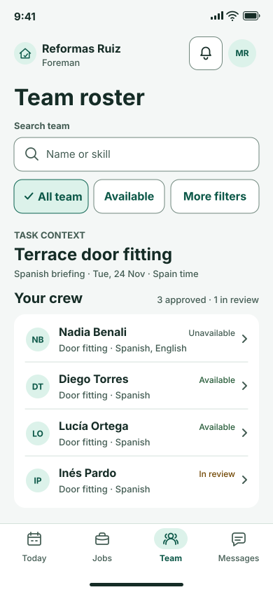

- **Purpose and routes.** Find workers within Reformas Ruiz. Enter from the Team tab or the roster link in F-07; tap a worker for F-09. The bell opens S-09, the avatar opens S-06, and the other tabs follow the Foreman shell. A return from F-09 restores the query, filter and position. A roster link from F-07 remembers its assignment context without leaving a sheet open under another route.
- **Layout and data.** The existing business header, labelled Search team field and three filters sit above the task context and one ruled list. From the job picker the context is Terrace door fitting, Spanish briefing and the site day; a general Team entry has no implied job. The sample lists Nadia (unavailable), Diego and Lucía (available), and Inés (in review). Three approved and one in review counts checks, not people committed to this visit. Show task, declared working languages and coarse status without ranking, performance measures or reasons for absence.
- **Interactions and states.** Search names or skills (case/diacritic-insensitive, without altering displayed names). `All team` or `Available` changes the list; `More filters` opens a bounded Bottom sheet for skill, working language and eligibility with Apply/Clear. Available excludes unknown, expired or pending eligibility if the user is filtering for staffing readiness. Active and unavailable workers remain viewable under All team. Show pending/expired eligibility separately from availability, true empty with a route to contact the business admin, filtered empty with `Clear filters`, and cached read-only results with last-confirmed time. Do not reveal removed workers through old search results. There are no profile edits, invites or raw credentials here.
- **Platform, access, locale.** Native search keyboard/clear control on both platforms; Android Back dismisses input first, iOS retains the tab stack when switching tabs. Focus: business, Notifications, Account, heading, `Search team`, filters (announce selected), task context, eligibility count, worker rows (name, status, skills/languages), tabs. Keep the field label visible when filled. Flow longer filter labels onto another row rather than reducing the type or insets, and at large type put status below each worker's name. Localise filter counts and mirror row chevrons in RTL; preserve names and accents.

## F-09 · Worker profile and availability

- **Purpose and routes.** Inspect fit without viewing supporting legal records. Enter from F-08, F-07 or the separate info target on F-10, then Back to that caller. `Select for offer` appears only with a current shift context and an eligible worker; it preselects the worker on F-07/F-10 and returns there. It sends nothing. Browsing from the roster has no staffing action.
- **Layout and data.** Name and own-business membership first. In the shift-scoped fixture the ruled record shows the approved door-fitting task, Spanish as a working language, and Mateo as available to brief in Spanish. The check is valid through 31 Dec 2026, last checked Tue, 24 Nov at 08:15 Spain time. Diego is on duty with no known overlap for 09:00–10:00. This is eligibility for a particular shift, not permission to start or proof that Diego understood an instruction. A general profile lacks a shift selector and describes the scope of each check.
- **Interactions and states.** If a window conflicts or availability is unknown, show the blocked time range without naming another job/customer. For stale, pending, expired or task-ineligible checks, explain the reason and disable selection; `Refresh` rechecks online. Never treat a declared window as an acceptance. A worker removed from visible scope goes to reason-safe S-16, not a cached profile. A valid selector can provide one selection haptic, not an offer-sent confirmation. Assignment eligibility is checked again when an offer goes out.
- **Platform, access, locale.** Native stack Back on iOS and Up/system Back on Android; an F-07 caller is restored after the pushed profile closes. Focus: Back, title, worker and availability, skills/languages, window, eligibility/valid-through, then Select. Stack long availability and applicability labels instead of wrapping them into badge icons. Show availability corrections with the reporting actor; do not edit the worker’s declaration. Use site zone and an optional second zone for the window; isolate date and names in RTL, no flag icons.

## Replacement: from gap to confirmed crew

| Event | What Mateo sees | What others see |
| --- | --- | --- |
| Dropout received | One open shift, still a booked visit. Assess delivery risk now. | No automatic change to the customer milestone or window. |
| Internal offers sent | Named recipients, reply deadline and actual responses. | W-03 gives on-duty recipients the task, area, provider and deadline, not the residential address or site access. |
| First valid acceptance | A single reservation with a separate review deadline. F-12 opens only on request. | Losing attempts see “A replacement is being confirmed”, not “Filled elsewhere”. No customer name, travel or entry from a reservation. |
| Foreman confirms after recheck | F-16 records exactly one assignment with the named actor and time. Notification status is separate. | W-04 opens only the assigned shift; W-09/S-11 require the replacement’s own briefing. C-09 shows only confirmed, customer-visible names, not the reason for a change. |
| No safe cover | F-10 retains the gap, the duty contact and the actual visit. | Mateo reports the impact in F-17. C-08 accepts a new visit only if both parties agree and capacity still checks out. |

First means server order for this gap and round, not handset time, a decline, a chat reply or an alert receipt. The first valid acceptance reserves one place. Only current provider authority, current acceptance, task/site/language eligibility and availability across the whole shift can turn it into an assignment. A reservation never grants permission to travel, enter or work. No penalty for a decline or a missed offer.

## F-10 · Fill shift

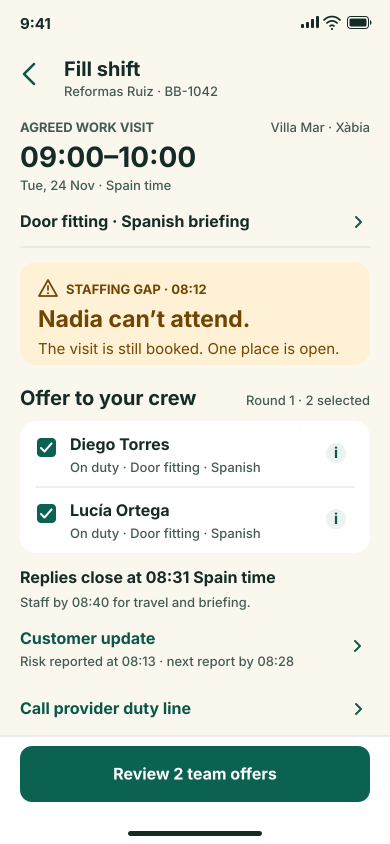

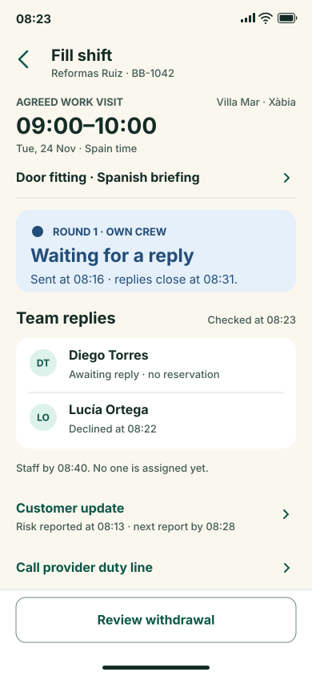

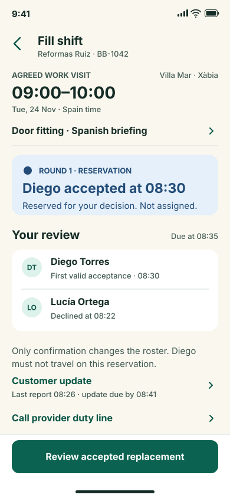

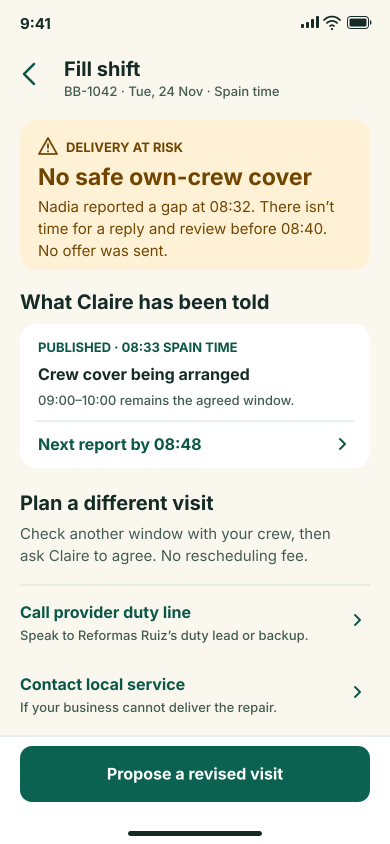

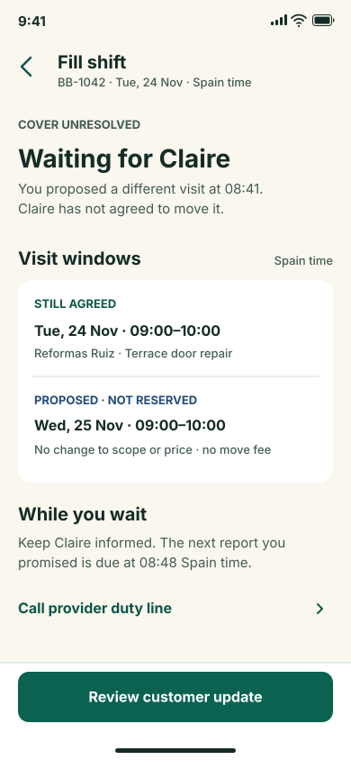

- **Purpose and routes.** Enter from F-01, F-05, F-16 or a checked S-09 gap alert. Back restores the actual caller and leaves offers intact. The shift requirements row opens a bounded sheet for full window, task, skill and briefing language. The foreman may narrow task fit within approved scope before sending, not edit booked terms in this sheet. Material revision closes obsolete offers. Each candidate’s checkbox and separate profile button have their own targets (F-09 → same selection).

- **Ready.** Mateo selects eligible on-duty workers from **Reformas Ruiz only**. One urgent round contacts at most three; never silently select, rank or broadcast. Recheck employer, whole-shift status, travel, rest, overlaps, task/site fit and a feasible human briefing before issue. Show just the coarse blocking reason and a human review route for ineligible or stale records. Review 2 team offers → S-17 names recipients, task, absolute expiry and effect; send only the reviewed set online. Sending does not staff a shift or prove anyone received the alert.

- **Timing.** After the 08:12 dropout a delivery-risk notice was published at 08:13 with a next report by 08:28. In the sample round sent at 08:16, replies close at 08:31. Aim for staffing at least 20 minutes before start (08:40 here), earlier for actual travel or briefing. Normally allow 15 minutes to reply; at least five for replies and five for review before the safe cutoff. At most one additional internal round if still safe; no timer starts it. The accountable foreman or pre-authorised backup may end a round early for a recorded delivery or safety reason. Close outstanding offers before starting another; never displace a valid reservation.

- **Pending, expired, withdrawn or reserved.** Pending at 08:23 shows Lucía declined at 08:22 while Diego has not replied. Review withdrawal → S-17; close outstanding offers only on confirmation, leaving the gap open. At 08:30 Diego’s first valid acceptance reserves the slot; other attempts cannot win and F-12 allows review until 08:35. The reply deadline of 08:31 does not expire his reservation. The reserved view also shows Mateo’s follow-up risk report at 08:26, with the next due by 08:41. A timeout, withdrawal or failed recheck never promotes a losing tap: only still-valid offers reopen to a deliberate response. If covered, replace offers with View confirmed shift. A stale view labels the last known time and disables offer actions until checked online.

- **No safe cover.** In the late alternative Nadia drops at 08:32. Eight minutes to the 08:40 safe cutoff cannot accommodate five minutes to reply plus five to review. The same recovery applies when eligible supply is exhausted, a final round expires, or a reservation fails and another safe round is impossible. Stop offering; show the time/reason and keep the gap open. A verified provider duty work number reaches its lead or backup; an unrecorded phone conversation is not an assignment. S-16 gives the local phone/form and staffed hours (08:00–18:00 Spain time on local business days), or the next opening. A booked visit still needs an employer backup. Never advertise an unproven callback time.

- **Tell Claire, then propose.** When delivery is materially at risk Mateo publishes the consequence immediately in F-17. In the late example he reported at 08:33 that cover was being arranged, with a next report by 08:48. Show the saved notice separately from pending delivery. “Propose a revised visit” → F-06 with the old window and unchanged approved terms. Check capacity when sending the fee-free proposal and again when Claire agrees in C-08; no tentative hold. The sent example at 08:41 for Wed, 25 Nov 09:00–10:00 leaves Tuesday’s window in force and calls out the 08:48 reporting commitment. On rejection, expiry, conflict or no reply, retain the original visit with its risk and contact the customer; no new visit, no automatic cancellation. If the provider cannot deliver, resolve the old agreement before BookBuddy introduces a separately verified business for a **new agreement**. No contractor substitution or mixed crew.

- **Platform, access and locale.** Label status, scope and absolute deadlines in site time. Keep critical actions 56 high in field mode; when large text needs more room, stack selection and profile targets, put context before list and allow scroll. Return focus to the selected row or updated decision, announce one server change without reordering focus. No ticking announcements or polling, and no external offer or pool link at launch.

## F-11 · Vetted pool — later only

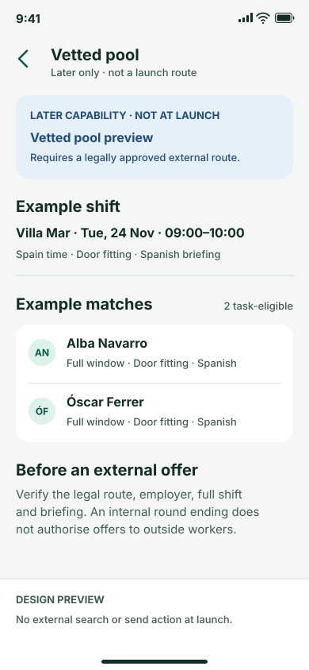

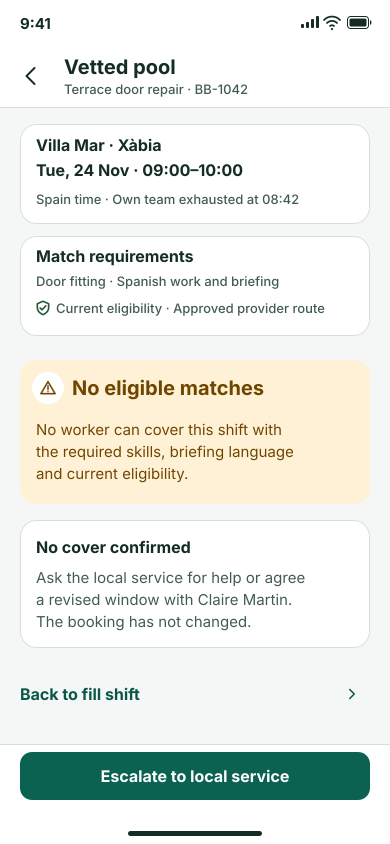

- **Purpose and routes.** These are design-library views for a possible future legally approved route, not reachable launch screens. No launch route, API action, push, inbox item, search result, deep link, timer unlock or hidden offer. A legacy link uses the reason-safe access fallback without exposing outside workers. The working fallback is F-10 → provider duty lead / revised visit.

- **Layout and states.** Keep the original search, pending and no-match story, with an explicit Later capability banner and a design-preview footer rather than a live send button. Alba and Óscar are hypothetical external matches, not crew in any launch shift. Search would require legally approved employer/route, whole-window availability, task/site approval and Spanish briefing. In the illustrative pending view an open offer has an absolute deadline and Óscar’s decline does not reserve it. A first valid acceptance would reserve for foreman confirmation, not assign or grant site details. No eligible match leaves the existing booking and contractor unchanged.

- **Platform, access and locale.** State the later-only boundary before the list and in the screen title for assistive technology; use names as authored, not nationality labels. Future-state documents show site time. No launch accessibility tree, native navigation destination or customer projection contains these records.

## F-12 · Confirm replacement [Sheet]

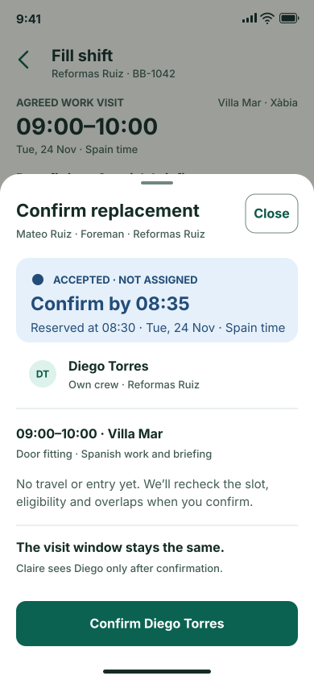

- **Purpose and routes.** Review one reserved worker from F-10 or a checked S-09 acceptance alert. Use the actual reserved F-10 page behind the 40% scrim; a cold alert builds that parent. The sheet opens only on a tap. Close returns to the caller without withdrawing, assigning or extending the reservation.

- **Layout and deadlines.** Name the acting foreman, provider and worker. Diego’s first valid acceptance reserved at 08:30; review ends at 08:35, five minutes after the accepted server event, capped by the safe staffing cutoff and strictly before shift start. Show the shift date, named zone, full window, required door fitting and Spanish briefing. The reservation status is not a successful check. No travel/access before confirmed assignment; Diego’s briefing remains separate.

- **Confirm once.** Confirm Diego Torres checks the acting foreman or pre-authorised backup, own employer and whole-shift eligibility, availability including overlap/travel, current gap revision and unexpired reservation together online. On success close competing offers and assign exactly once. F-16/W-04 show Diego confirmed at 08:34; C-09 may show that confirmed name and time, not replies, reasons or a new milestone. Keep customer notice pending/sent/read distinct. Do not change the agreed visit.

- **Competing or unknown result.** A duplicate on another device renders the existing authoritative assignment and View confirmed shift, no repeat success or notification. If the worker withdrew, eligibility lapsed, the review expired or the shift changed, show the reason and Return to fill shift if there is still a gap; if cancelled/replaced, go to the current shift status. Never promote a competing tap. Offline is read-only. An interrupted confirm reconciles its original operation ID before any retry, even after dismissal.

- **Platform, access and locale.** Native Close/dismiss/predictive Back restores the opener. Trap focus in the sheet; title and Close, decision cutoff/site time, worker and visit, effect, named action. Full-height detent and scrolling at large text; keep the name and cutoff accessible. Announce the authoritative result only once.

## F-13 · Site log

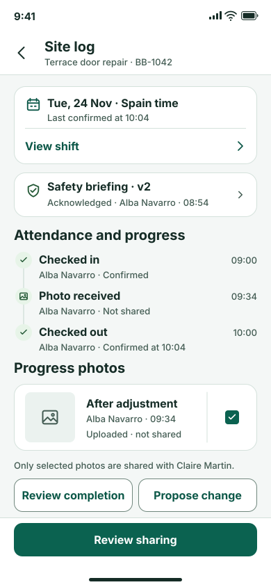

- **Purpose and routes.** F-05 opens the job log; F-16 opens the selected shift’s log. View shift opens that F-16, Propose change opens F-15 for an authorised drafter, Review completion opens F-14. Publish visit update opens a private F-17 composer, not a share of the log. Open S-11 from a worker’s briefing and S-15 from a photo. On Back restore the actual caller, selection, scroll and trigger rather than nesting another shift/log pair. Choose a permitted shift before View shift at job level.

- **Layout and data.** Lead with Private site record, site day and last confirmation. At 08:53 Mateo verified Diego’s teach-back and at 08:54 Diego acknowledged v2 online. These are separate records; a previous worker’s receipt cannot clear anyone else. The reverse-chronological ledger shows Diego’s deliberate arrival at 09:00, a received private after photo at 09:34 and departure at 10:00, received at 10:04. Preserve event, capture and receipt times separately. Site presence is neither permission to start, a customer milestone nor the employer’s statutory time register. No device location or boundary.

- **Evidence sharing.** The After adjustment tile has separate preview and selection targets. Selected for Claire is still **not shared**. Review photo sharing opens S-17 with the exact received files, job and permitted customer audience. Publish only on explicit online confirmation; sharing a photo does not publish On site or In review. Keep private check-ins, reasons, discussion and unreceived media out. No gate/alarm codes, bystanders or unrelated personal details in media; remove location metadata, retake or deselect unsuitable material. Show already shared rather than publishing twice.

- **States and recovery.** No entries → “No site updates received.” A handset-only queue is invisible to Mateo; an upload in processing is not a received file. An out-of-order or rejected receipt retains the actual event and identifies a correction route for the author through W-06/W-07 or support. Never edit another worker’s check-in or acknowledge for them. A foreman-assisted attendance exception names the reporting worker and recording actor and keeps the correction history. Offline/stale is labelled and read-only; on failure retain only still-authorised selection and reconcile before another share.

- **Platform, access and locale.** Focus: heading and View shift, dated freshness, named v2 briefing, ledger events in presented order, preview/selection state, Publish visit update, job actions and Review photo sharing. At larger sizes stack controls and let body and photo captions scroll. S-15 returns to the evidence item. Announce receipt changes once, not each transfer tick; keep actual site times in order in RTL.

## F-14 · Submit completion

- **Purpose and routes.** F-05/F-13 → private completion draft. Back returns to that caller. Review submission opens S-17 for Mateo to hand the exact evidence packet to Claire, the named sign-off holder. Only confirmed submission creates C-10 and records **In review** in C-18; F-05 shows Awaiting sign-off. It ends the active visit display, not the service contract. It does not accept the work, create a paid record or collect money.

- **Layout and data.** Private draft 1, provider Reformas Ruiz, Claire Martin, quote v1 and tax-inclusive €240.00. Mateo individually confirms Terrace door adjusted (“Test: door closes without catching.”) and Rollers replaced (“Test: door slides smoothly on new rollers.”). The received After adjustment photo is selected for both approved lines in this one affected area. Each row opens an editable result/test note; the area reading aid never rewrites the approved terms.

- **Evidence.** Use the requirements on the approved quote: a short result/test for every completed line and an appropriate received after photo per observable area where safe. A before photo is needed when essential to comparison; for concealed work use the agreed before-cover photo, test or certificate. Agree a non-intrusive alternative before work, not an ad hoc waiver on submission. S-14 accepts up to eight photos per submission, ≤5 MiB each (new captures normally 2,048 px long edge); no voice/video. Use received, deliberately selected customer-safe evidence only. View in S-15, remove or explicitly deselect an optional item.

- **States.** Retain a safe offline draft. Missing notes, a required unreceived file, unresolved change or relevant open hold block sending with the item and remedy identified. Reconcile unknown uploads before retry; changed scope requires re-review against the current accepted version. S-17 shows item-level results, exact files and audience; confirmed send may be followed by sign-off or C-16 issue. No automatic sign-off on silence. If the case handler and provider’s rectification lead return a specific item for correction, record what failed and the replacement evidence needed, preserve the original packet and publish a **new** submission for Claire. Case/billing/collection decisions remain separate.

- **Platform, access and locale.** Use native picker/camera via S-14; denial allows selecting permitted received evidence or returning to the draft. Label check state, each test, receipt and associated approved item separately. Allow long results to wrap, scroll past the keyboard and return focus from S-15/S-17 to the initiating row. Keep the original authored test note when a reviewed translation is shown.

## F-15 · Propose job change

- **Purpose and routes.** From F-05 or an authorised F-13 Propose change action, draft a separate version against the approved agreement. Back restores caller, scroll and source evidence; a confirmed issue returns to F-05 with Open change and creates C-15 for Claire. Questions go to S-10; a different arrival window is separately proposed and agreed through F-06/C-08.

- **Layout and immutable originals.** Change 1 shows provider/publisher, proposed tax-inclusive €280.00, approved €240.00 and signed difference +€40.00. Named approver Claire Martin, deadline Tue, 24 Nov · 10:00 Spain time; agreed 09:00–10:00 visit unchanged. The locked before panel preserves both the issued reading aid, “Adjust the terrace door and replace the rollers. Excludes glass replacement.”, and its exact original, “Ajustar la puerta de la terraza y sustituir los rodillos. No incluye la sustitución del vidrio.” The separate proposal is “Sustituir la placa de cierre desgastada.” (“Replace worn latch plate.”). Only the added latch plate work is held. Unaffected original work may proceed only if otherwise safe and cleared.

- **Draft and evidence.** Edit the proposed original, affected lines, cost and timing impact, who fulfils the work and the response deadline. Default to 72 hours, capped at any earlier start of affected work. Edit never changes approved v1 or changes a source by editing its translation. Evidence opens received Worn latch plate, selected for the proposed version; excluded drafts stay private. Use S-14/S-15 for capture/preview (up to five photos plus one original voice note per version; ≤5 MiB/photo, ≤2 MiB and 90 seconds/voice). Keep original audio. No unreceived files, access secrets or unrelated personal details in the issued packet.

- **Publication and consent.** Only a provider-authorised publisher issues the exact reviewed proposal online. Without that grant, Send for commercial review locks the submitted draft in the P-02 queue for the named reviewer/backup; returned drafts retain the reason. No issue on timeout or by accepting intake. With the grant, Review change for approval → S-17 identifies publisher, named approver, version, impact, hold, deadline and selected evidence; confirm issue before C-15 appears. The original and any consent remain durable. Only the current named customer approver can explicitly accept the issued version online. No self-approval, silence, translated wording or chat consent. No charge or automatic move.

- **States, platform and access.** Distinguish draft, commercial review, return, sending, awaiting approval, withdrawn, expired, rejected, superseded and approved. On silence, expiry or rejection retain the prior terms; replan the affected work. A pending withdrawal cannot undo an approval that has already committed. Preserve history, rebase a stale draft for explicit review and reconcile an interrupted issue before retry. Native keyboard and editable typed time/currency alternatives; focus version/amount/deadline, each labelled translation and original, hold, evidence, action. At large type scroll complete source paragraphs; never truncate a price or exclusion.

## F-16 · Shift detail

- **Purpose and routes.** Enter from F-01, F-05, the selected shift in F-13, a checked S-09 shift update or F-12’s confirmed result. Staffing action depends on the slot: F-07 for a named ordinary offer, F-10 for cover. Open Diego’s briefing → S-11 as foreman, Open crew chat → the authorised Crew only audience in S-10, Open site log → shift-scoped F-13. Back restores the caller; reuse an existing log/shift parent instead of pushing a duplicate.

- **Layout and data.** The private shift ticket names the real record: Replacement confirmed by Mateo at 08:34, Tue, 24 Nov · Spain time for 09:00–10:00. Diego is Reformas Ruiz’s own replacement for door fitting. No arrival is recorded. The notice about the confirmed roster was sent at 08:34; that is not proof Claire read it. None of these changes the public visit phase. Do not convert a roster count into “On site”.

- **Safety before work.** The v2 terrace door hold is active: Mateo briefs Diego in a language he actually understands, verifies his explanation or demonstration with a qualified language bridge if necessary, **and Diego must acknowledge that same version online**. Keep the scope on hold until both receipts exist, even after arrival. If comprehension, a qualified interpreter, access or current terms cannot be verified, stop affected work and contact the provider lead. A replacement or materially revised instruction needs its own verification and worker acknowledgement.

- **Other states.** Unassigned (F-07); Offered with reply deadline (not staffed); Confirmed (not yet attending); Dropped with actor/time in private history (F-10); Covered (confirmed replacement only); checked in/out with actual event/receipt; Cancelled with no staffing action; stale with last confirmed site time and online checks required. Private history keeps Nadia’s dropout without publishing its reason. A worker’s availability change alone never cancels an assignment. A phone report is attributed to the person recording it, not a fabricated worker action.

- **Platform, access and locale.** Read ticket and timestamp, hold and briefing action before staffing/attendance and routine chat/log actions. Native Back/Up returns without altering staffing. Keep names, site date and zone, grant and hold scope legible at large type. Do not infer clearance, travel or statutory working time from a clock or missing checkout.

## F-17 · Publish visit update

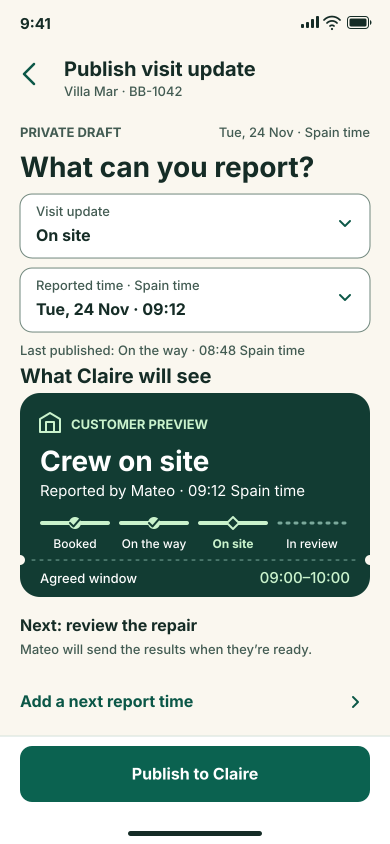

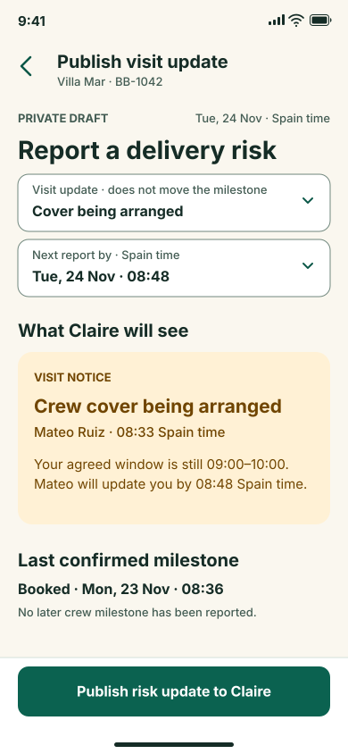

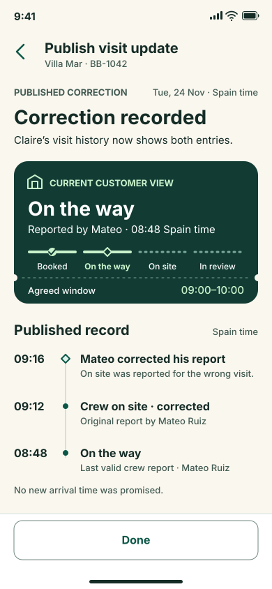

- **Purpose and routes.** From F-05 or F-13, or from F-10 when the agreed visit is at risk, the named foreman reports what actually happened. Back returns to the calling job, log or gap; no publish on Back, on leaving the field, or on reconnect. The visit ledger remains available to the authorised customer in C-09/C-18, native or signed-in web, whether or not anyone follows it.

- **Audience and choice.** Start private, scoped to this visit. Choose **On the way**, **On site**, or a structured disruption such as delay or crew cover being arranged. Booked comes only from the confirmed window; In review comes only from confirmed F-14 submission. Preserve prior confirmed steps; leave unknown steps dashed even when a later true event is current. Never derive status from elapsed time, location, shift acceptance, individual attendance, chat, safety acknowledgement or an upload. No free-text crew log, absence reason, address/route, secret or private contact slips into a report or OS payload.

- **Draft and preview.** Set the actual site reporting time and a safe next step; show the agreed visit and last confirmed public report. Add a future next-report time only when making a commitment; do not provide rolling estimates. Mateo’s primary draft previews Crew on site, reported 09:12 Spain time, following his 08:48 On the way report. Claire will review the repair when he submits it; the 09:00–10:00 window stands. A labelled preview is not a public event. Native date/time controls allow typed input as an alternative; preserve the site instant when showing a second zone.

- **Risk, not rescheduling.** On material risk publish the consequence immediately. The 08:33 late-dropout example promises a next update by 08:48, with the existing 09:00–10:00 window and Mateo as contact. Choose the next report within 15 minutes or by visit start if sooner; after the start give the next 15-minute checkpoint or a confirmed plan. Do not show candidate names, individual movements or why someone is absent. Offer F-06/C-08 for an actual fee-free revised visit; a notice/proposal cannot change the booking. If the promised time passes, label it overdue and display the last confirmed source time, not a forecast.

- **Fresh online confirmation.** Publish to Claire is the explicit action on the reviewed customer projection. Recheck the named foreman grant and current business/job/visit, booking revision, source time, last public revision, correction target where applicable and audience. A changed window, replaced/cancelled visit or intervening report invalidates the preview. Show what changed, rebuild only for the authorised current record and ask for a fresh review; never publish a stale draft into a different visit. Offline disables publishing with its reason, not a queued public event.

- **Receipt and correction.** During sending keep the button and selection stable. On a lost response mark the outcome unknown; do not append an event or fan out notices until the existing operation is reconciled. A known failure keeps the private draft; retry with intent, not a timer. A committed event names the foreman and site time and links to the exact visit revision; “published” is not notification delivery or a read receipt. From a published report, Correct report selects that exact event, shows the original alongside the proposed customer-safe correction and resulting phase, and requires the same fresh review online. Append and link the correction; never erase or backfill. In the alternative pictured, Mateo corrected a wrong-visit On site report at 09:16. The original 09:12 entry is labelled corrected; 08:48 On the way becomes the last valid report. Done returns to the caller.

- **Platform, access and locale.** Label the intended customer audience before the action; read the structured choice, site date/time, last report, full preview (including missing rail steps), next step and publish control. Announce a confirmed change once without moving focus; reduced motion swaps the notch immediately. No OS permission prompt or remote start here. Optional OS displays use only the generic permitted revision, never the private composer or names. Native and web remain usable after denial, stale delivery or a dismissed display.

## Open design questions

- **Operating readiness, not policy.** Which named provider lead and backup actually answer the duty work line during each booked visit? Rehearse a missed alert, an unanswered call and a failed confirmation with the people who will answer. The sample times illustrate the accepted bounds, not a service guarantee.

- **Field review.** Have the provider’s prevention lead and working crew verified that the planned Spanish briefing and teach-back fit this task and time window? Test each additional spoken language or dialect with an available qualified human; a translated catalog does not establish coverage.

- **Publishing decisions to test.** The risk preview uses structured language and an explicit next-report time; it never publishes a reason for absence. Check with foremen and remote owners that they can distinguish a promised report from a proposed arrival and see which milestone survives a correction. Review English and pt-PT labels on the actual small supported devices.

## Navigation

Arrows crossing roles are record handoffs, not role switches or guaranteed push deliveries. F-11 is shown in isolation: it has no launch entry, including from alerts.

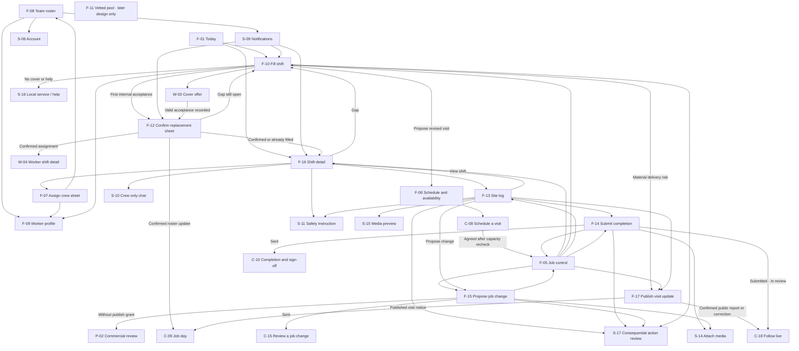

## Review responses

- **FL-09 / FL-06:** The locked quote and exclusion, separate authored addition, +€40.00 delta, €280.00 total and selected received evidence match the C-15 handoff. A new translation, uploaded file or changed locale never edits the approved record.

- **FL-08 / FL-10 / FL-13:** The successful F-01 → F-10 branch uses the same 08:12 dropout. The 08:32 late-dropout alternative has no safe timed round. A first valid acceptance reserves one internal place; F-12 rechecks and confirms once. Withdrawal, a lost race and a missed review deadline keep their own outcomes. No launch F-11 route.

- **FL-04 / FL-11 / FL-12:** C-09 and F-16 use Diego’s confirmed 08:34 roster event. F-13 exposes View shift and Propose change separately from photo sharing and public status. Arrival and assignment never release a safety hold: human verification and the named worker’s current-version acknowledgement are both required.
