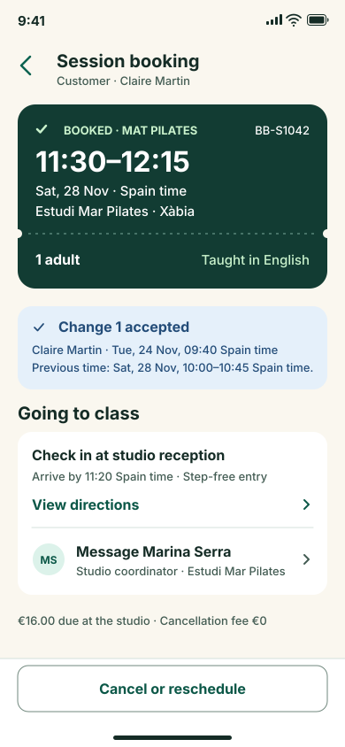
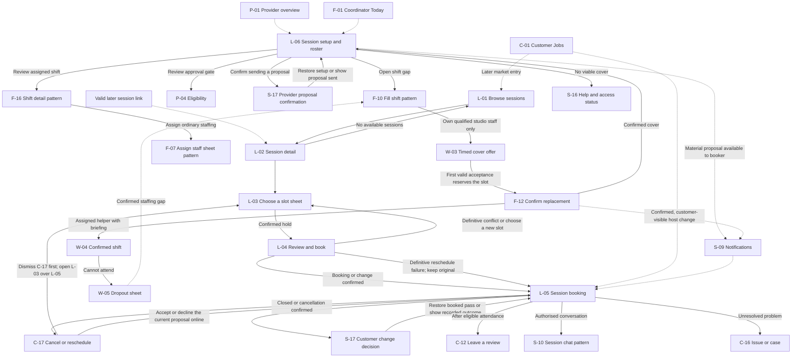

# L-01–L-06 · Later-category sessions

These are **later-only** flows for a customer booking a local service and the supplier running it. No construction-release tab, disabled entry, search result, notification or deep link opens them. In an enabled market, C-01 can link to sessions, P-01 to setup and the designated coordinator’s F-01 to their roster. Five screens push; L-03 is a sheet over its actual caller. None has tabs. A class has a booking pass, not a construction progress rail, attendance clock or Follow live control.

## Fixtures and shared rules

| Category and listing | Capacity and price | Delivery, arrival and staffing |
| --- | --- | --- |
| Mat Pilates · Estudi Mar Pilates, Xàbia | Eight places per class, €16.00/person; 45 min | Adults-only beginner mat class in English. Step-free entrance; arrive at reception 10 minutes early. The studio is the supplier. Marina Serra coordinates; Elena Costa teaches unless an equivalent studio instructor such as Lucía Vidal is confirmed. No guaranteed named instructor. |
| Relaxation massage · Calma Massage, Xàbia | One private booking, €48.00/appointment; 60 min | Non-clinical relaxation in Spanish; step-free massage room. The solo supplier offers no cover. No treatment claims or medical histories in the listing, booking or roster. |
| Tennis coaching · Arenal Tennis, Xàbia | One private booking, €32.00/appointment; 60 min | English; step-free court access, check in at the courts. A team can offer a coach with current sport, participant-level and language eligibility. Private coaching in this fixture has no quantity stepper. |
| Old town walking tour · Rutes Xàbia, Xàbia | Multiple places, €22.00/person; 90 min | English; show the confirmed meeting point, steps and uneven paving. A team can offer a guide with the appropriate route, delivery language and category eligibility. |

**Category gate.** Start with fixed-venue, adults-only small-group Pilates only after referral demand and studio, insurance, instructor, venue and emergency checks support a separate trial. The four-listing artboard illustrates a *subsequent* market where each category has been cleared; it does not put massage, coaching or tours in the first session trial. Approve tennis coaching for its actual function and participant level; approve a tour’s responsible operator, guide and route. Verify each supplier separately. No construction credentials transfer. Xàbia and the people, dates and prices here are fixtures, not a pilot commitment.

**Scope.** A group slot counts people; a private slot counts appointments. Keep places, holds, bookings, supplier receipts, attendance and staffing distinct. The named provider sells, invoices and remedies; BookBuddy coordinates. Neither selecting, holding, booking nor checking attendance takes a payment. S-09 notifications use generic copy and opaque links. After sign-in check the active market, role, business and record. Ask before an authorised switch (S-07); otherwise use reason-safe S-16. Never reveal the prior scope’s cache or accept a consequential action from an alert.

**One place through the flow.** Claire Martin chooses one of three open places on Sat, 28 Nov 2026, 10:00–10:45 Spain time (Europe/Madrid; 09:00–09:45 in the UK if requested). L-04 shows her ten-minute server hold expiring Mon, 23 Nov at 09:46 Spain time. Five booked + one held leaves two available. Confirmation converts that hold, once, to booking BB-S1042: six booked, none held, two available. Arrive by 09:50; €16.00 is due to the studio. Cancellation costs €0 up to the 10:00 start, with no late/no-show debit. Other drawings show alternative states, not events to add to these counts.

**Interaction and platform baseline.** Use 48-unit tap targets (at least 44 pt iOS and 48 dp Android); accessible reading order follows visual order and decorative graphics are skipped. Long pages scroll, pinned bars never conceal the final field and safe areas follow the platform. In field mode use at least 56-unit targets. iOS uses navigation Back or edge swipe, Android Up and system Back (including predictive Back where supported). Dismiss IME, active sheet or provider UI before popping; return focus to the prior control. Use native date and optional maps surfaces; booking has no payment UI. Transitions honour Reduce Motion; haptics are optional native selection or confirmed success feedback, never a signal for a network request in flight. With Dynamic Type or Android font scaling, rows grow, price/status can take their own line and action bars/sheets expand or scroll. Keep Back, Close, status and the next available action usable.

**Language and time baseline.** Use the bundled English (default) and Português (Portugal) UI; Original only is a valid reading preference. Allow 30–40% copy expansion. In RTL stress fixtures mirror reading alignment, Back and directional chevrons, not clocks, checkmarks, times or digits. Isolate names, prices, dates and booking references in bidirectional text. Localise dates, counts, plurals and EUR display; never convert the currency or turn a translated date or title into a new booking. Show venue time first and optional device time with its own date if different; recalculate display, not the reservation, if the traveller’s zone changes. Spell out the language actually spoken. UI language, a translated listing, preferred chat translation language and a host’s ability to teach or brief are separate. Provider descriptions/access notes show labelled original and translation when different; only original with pending/unavailable status when translation cannot be delivered. Standardised terms display the exact current approved version that the booking records; if no understandable approved terms are available, don’t take consent on unverified machine translation.

## L-01 Browse sessions

- **Purpose and navigation.** Find an active listing by locality and category. Enter from C-01’s later Browse entry; Back restores Jobs. Tap a card once to push L-02; Back from L-02 restores category, location, result position and card focus. A valid detail link does not change the browse filters.
- **Layout and data.** Location and wrapping chips filter one ruled list. Each row is one target: service, actual supplier, duration, delivery language, format or age restriction, a specific access fact, and price including its unit. Announce “Mat Pilates, €16.00 per person,” not just the number. Private services say “per appointment”. In the first-category view only All and Pilates appear; the later four-result example contrasts a step-free studio and courts with a tour that includes steps and uneven paving. The locality comes from the selected filter, not device location.
- **Actions and validation.** Tap a category to replace the results and reset scroll; All clears that category. Tap the location to choose a supported locality from a searchable list sheet; apply replaces the location, Close leaves it unchanged. Manual locality is sufficient, with no device location permission. Pull to refresh or use an accessible Refresh/Retry action; ignore an earlier response if filters have changed. Selection feedback on the chosen chip is optional; opening a card does not need haptics.
- **States and edge cases.** Initial loading preserves filters and uses non-focusable skeletons with a polite status. Results update with a count. Filtered empty retains the filters with Clear category; no local supply offers Change location. A closed category is omitted from normal choices; if closed while selected, explain it and offer All rather than suggesting bookings remain available. Cached results include last checked time and explain online availability checks; an initial network failure has a separate Retry. A listing removed between tap and fetch gets its appropriate safe L-02/S-16 state, not an apparent booking error.
- **Access, platform and locale.** Focus: Back → location → selected category/result filters → results heading → cards. Announce the filter selection and count once; don’t send focus to the list on refresh. At large text chips wrap and card content/price stack. The location chooser is a native-style detent on iOS and a Material bottom sheet on Android; keyboard Back never commits a location. Mirror layout in RTL but keep provider/locality names as entered and format each price with its actual billing unit.

## L-02 Session detail

- **Purpose and navigation.** Evaluate a group or private service before choosing a time. Open from L-01 or an authorised current link after market and listing checks. Back returns to the saved list or a permitted Jobs → Browse parent path. Choose a slot opens L-03 without leaving page context; close restores the trigger. The venue details row expands or opens the full venue/access and meeting directions in context (use a pushed view for long text); map handoff is optional and readable directions remain in app.
- **Layout and data.** The supplier header and class summary name Estudi Mar Pilates, Xàbia, adults-only group format, beginner level, 45 minutes and €16.00 per person. The next class shows the venue-zone start/end and three available places, not a reservation. Under **At the studio**, show actual spoken English, mats provided, step-free entrance and reception arrival; **View venue details** opens full directions. Then show the studio’s pay-at-venue terms and €0 cancellation up to start. Choose a slot opens L-03 without reserving a place. For private services give the appointment unit and any genuinely guaranteed practitioner; never infer those terms from the translated title.
- **States and edge cases.** Private, class or group use the same sections, but private copy says “Appointment available,” not “1 place left.” Full means no open published times: persistent “Fully booked” and Browse other sessions; do not promise a waitlist. Paused for staffing says “Booking unavailable” with no internal details. Unpublished is not offered; authorised legacy bookings resolve through L-05 and do not expose an unpublished listing. Cancelled listing/slot explains the cancellation without showing a Book button; an unaffected later time can still be available for its own slot. Offline cached details are labelled with the last check; selection cannot start until current online availability returns. A refresh that removes the next available slot updates the banner without losing reading position.
- **Access, platform and locale.** Focus follows Back, class, availability, studio facts and venue details, booking terms, then footer action. Announce a changed availability status once without moving focus. Allow text and dates to wrap, with optional viewer time on its own line. Directions stay available without a maps app. Translation of the listing never changes the language of instruction.

## L-03 Choose a slot [Sheet]

- **Purpose and navigation.** Choose a start/end time and, for groups, place count. Open over L-02 for new bookings. For a reschedule, the C-17 handoff is to dismiss C-17, present L-03 over the existing L-05 booking, then dismiss L-03 and push L-04 only after a confirmed hold returns. C-17 cannot open L-04 directly. “Change slot” in L-04 returns to the caller and reopens this picker. Close, downward dismissal or Android Back keep the caller and original booking; a selection alone reserves nothing.
- **Layout and data.** Over the dimmed L-02 (or L-05 for a move), show a handle, accessible title, explicit Close, service and venue zone; then dates, quantity, and a chronological list of start/end times and capacity. Group classes use a labelled Places stepper with bounded minus/plus controls. Private services instead show “1 appointment”; on a move the original party is fixed. A selected radio isn’t a hold. The banner explains the ten-minute hold and that it is free.
- **Actions and validation.** A date change clears an invalid choice. A party increase that exceeds the chosen slot clears the time, not the party. **Hold 1 place for review** (pluralise for the requested count) asks the server to hold that exact party and slot for ten minutes. Lock the attempt in flight. Only the confirmed response opens L-04. No charge. At zero remaining, mark the slot sold out. With one place left for two, show “1 place left; you requested 2”, keep two and make no booking. Guests can explicitly reduce a *new* party then select again, or choose another time. Never shrink an existing party on a move. If inventory is unknown, say so and refresh; don’t call it sold out. No automatic alternative. Keep an original booking on any failed move.
- **States and edge cases.** Default/available, loading day, no published times, completely sold-out day, held with exact venue-zone expiry, expired/conflict, and no connection are distinct. If a hold arrives after dismissal, release it or let it expire without a charge or opening review. Before retrying a lost hold response, reconcile its status; a leftover hold cannot be used to make a second booking. Reopening after timeout shows refreshed inventory and an expiry explanation. For a DST ambiguity, show a disambiguating zone/offset; do not generate nonexistent local times or conflate slots with the same wall time.
- **Access, platform and locale.** On open, focus sheet title; next Close, venue time, dates, Decrease/Increase places and value, time rows, guidance and Continue. Trap focus inside the sheet; name times with selected/sold-out/remaining status and read the invalidation once. Avoid live announcements every countdown second. Restore focus upon dismissal, or focus L-04 title after success. iOS detents expand or dismiss with native gestures; Android modal sheet supports Back. Explicit Close remains reachable and both can expand to full height for font scaling. Mirror stepper/navigation position, not the arithmetic meaning or focus sequence; localise dates, party count and capacity.

## L-04 Review and book

- **Purpose and navigation.** Only a confirmed L-03 hold opens review. Identify the acting customer. Back or Change slot returns to the proper caller/picker and releases the abandoned hold without charge. Don’t claim a release or a cancellation for an unresolved submission. Replace review with L-05 on success; Back must not resubmit.
- **Layout and data.** Lead with the held quantity, absolute expiry in venue time and “Not booked yet”. Show the held class, supplier, date, time, party, spoken language and Change slot. Then show the tax-inclusive total and unit price, versioned studio terms, €0 cancellation through class start and roster disclosure (booker name and party size). **Book 1 place** commits the held capacity and these terms together. Pay the named studio directly at the venue. No card, deposit, payment sheet, speculative receipt or no-show charge.
- **Actions and validation.** Online, recheck acting customer, market/provider, slot coverage, unexpired server hold, exact party, price and current terms in the same commitment. Convert the hold to booked places once; do not subtract it a second time. A changed term requires a fresh review and decision. For a move, name the existing reference, booked and requested times and any changed terms; use **Confirm reschedule**. Release the original capacity only when the new booking for that same party commits. A paused slot cannot confirm even from an otherwise unexpired hold.
- **States and edge cases.** During submission preserve the named action and label it in progress. Reconcile a lost reply using the same attempt; do not rebook or report definitive failure while checking. Offline before sending is not an unknown outcome. Expiry releases unused capacity without booking or charge; show verified remaining places, then offer the picker. A failed new booking says **Not booked**. In the failed-move drawing the proposed 11:30 class can no longer confirm. **Your booking is unchanged** identifies BB-S1042, 10:00, one adult, the same provider, €16.00 and pay-at-studio terms. Return to L-05 or choose another slot. The device clock cannot extend the hold.
- **Access, platform and locale.** Focus Back → hold/result → session and party → Change slot → total/terms → commit or recovery. Announce the expiry or outcome once, not every second. Grow the review and footer for text scaling; preserve the complete total, expiry date, venue zone and consent in both UI languages. Elapsed time is not proof of booking failure.

## L-05 Session booking

- **Purpose and navigation.** Enter from later C-01, successful L-04 or an authorised S-09 update. Back returns to the authorised origin, not the completed review. The booking holder can open C-17 to cancel or move; dismiss C-17 before opening L-03 over L-05. Push L-04 only after a confirmed replacement hold. A proposal from the supplier instead uses L-05 and S-17. Contact the coordinator through the scoped S-10 session audience, C-16 for a case and C-12 for an eligible private review.
- **Layout and data.** The booking holder is in the header. The pass leads with the *confirmed* time, class, provider, venue zone, reference, party and actual delivery language. No visit rail, QR, live tracking or inferred attendance. Under **Going to class**, give reception, exact arrival time and step-free access; View directions provides readable directions and an optional native map. A tour needs the confirmed meeting point. Marina Serra is the named studio contact, distinct from the instructor. Show only a current confirmed instructor and distinguish an amount due from a provider-confirmed payment.
- **Customer management.** Allow direct €0 cancellation until the class starts, without a card or no-show collection. At least 24 hours out, allow an online move into an available like-for-like slot at the same party, price and terms; inside 24 hours or for a non-equivalent change, request the provider’s decision (four staffed hours is the response target, not a guarantee). The original booking stays in force until a move succeeds. Don’t equate managing an appointment with statutory withdrawal; assess applicability for this category separately. When cancellation is confirmed, show actor and time and remove arrival actions. If an action is unavailable, explain why and offer the coordinator.
- **Staff or material change?** A confirmed equivalent substitute at the same studio, with no guaranteed host and unchanged class, time, price, access, venue and language, needs notice, not consent. The Lucía Vidal variant leaves the pass unchanged. If coverage is unresolved, share only the delivery risk, coordinator and next promised update, not candidates or dropout reasons. Changed time, venue, advertised language, guaranteed host or other material terms need the booker’s explicit decision on the exact version. A different supplier requires a new agreement.
- **Proposed and accepted.** Change 1 offers 11:30–12:15 under the unchanged studio terms. Keep 10:00–10:45 on the pass. **Accept change** and **Decline change** each open S-17 naming Claire, BB-S1042, the exact proposal and consequence. Cancel returns without deciding. Recheck authority, currency of proposal and, for acceptance, delivery and capacity. Reconcile an uncertain response; never use silence, chat, a staff assignment or a push as consent. Only after the confirmed acceptance does the pass show 11:30; receipt retains Claire’s decision, venue-zone time and original 10:00 slot as history. A declined or unanswered proposal does not cancel or charge the customer. Deliver the original if possible; otherwise record the provider cancellation and offer a voluntary fee-free rebook. Withdrawn or superseded proposals cannot be accepted.
- **Attendance and review.** Only the designated provider host/coordinator records checked attendance or no-show. Invite the eligible booker to C-12 within 30 calendar days of actual provider-confirmed attendance; no review for the passage of time, payment alone, a cancellation or no-show. One optional private rating and comment, not a public instructor ranking.
- **Offline and edge cases.** Show only authorised last-confirmed details and site time. Never treat cached seats, proposals or assignments as current enough to act. No persistent cache on a shared device; on assigned devices use the active scope only, for at most 72 hours since successful authorisation sync. Loss of scope removes the record and its back stack. A stale link cannot reveal another account’s booking. Outside the app use generic notification copy and an opaque link to the checked record, not a session status display.
- **Access, platform and locale.** Focus Back → pass/date/status → update; in pending-change mode read change version, booked terms, proposed terms and unchanged terms in order. Continue through the available arrival, contact and management actions, then Decline change and Accept change when shown. Announce material changes once, without moving focus; open C-17/C-12 with focused sheet title and open S-17 with focus on its title or safer action, restoring focus on close. Use iOS Maps/Android map intents optionally, with accessible arrival text always available. At large text stack decision buttons, comparison values, badge and support rows. Use an exact venue date/time and preserve reference in RTL. Don’t translate staff names or mislabel the spoken language when the user changes reading preference.

## L-06 Session setup and roster

- **Purpose, roles and navigation.** Publish available sessions and separate attendance capacity from staffing. Enter from later P-01 scoped to the provider, or from F-01 as a designated coordinator (Foreman capability with a category-appropriate label) for their assigned session. Back restores the correct caller. Publishing belongs to an authorised Provider admin; the coordinator needs explicit operations, audience and roster grants. Membership alone, even as an admin, never permits shift confirmation on behalf of someone else. Use S-07 to switch only when granted; use P-04/S-16 for category gates or support. Solo providers with applicable access see their calendar and booked count but no crew action or external pool by default.
- **Layout and data.** The published view names the supplier, time, language, step-free access, price and pay-at-venue terms. **Attendee roster** counts six booked, two available, no active holds. It opens a scoped list of booker names, party sizes and actual attendance, never medical or card details. **Staffing and safety** separately identifies the confirmed studio instructor, the coordinator who verified teach-back, the worker’s own current acknowledgement and venue checks. These are records rather than a blanket all-clear. The admin’s Edit session does not assign staff. The coordinator’s no-cover view instead leads with the affected time and booking pause, then six still-booked seats, the checks needed to reopen, cover history and duty/support contact.
- **Setup and validation.** Edit session opens a pushed editor within L-06 with persistent inputs, helper/errors, Calendar and day view, source language and translated preview. Capture service/category, group or private capacity, approved venue/meeting point and access information, actual delivery language, durations and non-overlapping publishable slots, price/currency/basis, pay-at-venue and €0 cancellation terms, accountable host and staffing requirements. Validate required values, positive seat count (fixed one private booking), positive duration, unambiguous venue time, provider/service capability and host/resource conflicts before online publish. Don’t lower capacity below confirmed bookings plus active holds. Explain how changes affect existing bookings before saving. A pause can prevent new bookings without cancelling or moving any existing booking. Keep drafts on ordinary Back; use a single discard confirmation only when at risk of losing unsaved work. Offline, save eligible drafts as on-device only; cached rosters clearly show last checked time and cannot be used to book, publish, cancel or confirm staffing.
- **Material changes for existing bookings.** An authorised provider publishes a proposal for the specific affected booking and version, rather than overwriting its booked terms. A provider-side S-17 can confirm sending that proposal; it cannot accept on the customer’s behalf. S-09 notifies the booker and the versioned decision happens in L-05. Any staff confirmation in F-12 is separate from that decision.
- **Cover and required briefing.** A confirmed W-05 dropout opens the instructor gap. Pause **new holds and confirmations for this slot immediately** when required coverage is lost without an equivalent confirmed host; existing bookings remain valid. Marina uses the F-10 pattern only for qualified, available staff of this studio. The first valid server-recorded W-03 acceptance reserves the role; other replies do not win on expiry. A reservation is not an assignment or authority to travel, attend or start. Only the authorised coordinator acting as foreman in F-12 can assign after a fresh online scope, eligibility, expiry, availability and conflict check. A failed check leaves the gap open. The new instructor gets only assigned access. Where a safety briefing is required, affected work stays held until human teach-back is verified in a language the worker understands **and that worker acknowledges the same version online**. No attendance, chat, translation, old version or prior instructor’s clearance substitutes.
- **Reopen or resolve.** A seat can be empty while sales are closed. No new confirmation, including from an existing hold, until the coordinator has verified the host, venue, spoken language, available capacity, staff and participant safety, and the accuracy of the offer. Inform customers about a confirmed equivalent substitute with no guaranteed host. Never route to an outside worker pool. If the studio has no qualified cover, keep the gap, call the duty contact and tell affected bookers what is known. A material proposal goes to L-05; if the original cannot be delivered, the provider records cancellation and offers a fee-free alternative. Seat release, customer notification, delivery and actual attendance have independent receipts. Only the designated host/coordinator logs checked attendance or no-show; it does not mark a receipt paid.
- **Other states.** Draft is private; Needs approval identifies the missing category gate. Full means no seats available, not a staffing failure. Cancelled removes hold/booking actions and records affected bookings and notice status. Failed publish retains the draft, a stale roster is read-only, and a failed assignment leaves the gap. No actions on a revoked grant. Publish or resume only under current online authority.
- **Access, platform and locale.** Focus Back → session/role/status → setup → attendee count/list → staffing/cover status → recovery/commit. Announce definitive changes politely; focus first invalid field on failed validation. Access and briefing controls have explicit names; use large targets and stacked rows for outdoor coaching/tours. On iOS use native date/time entry and detents for narrow choices; on Android use platform picker and Up/Back, with text alternatives where available. Long editors push; S-17 confirmation restores focus to its trigger. Keep schedule, count and status labels adaptable for RTL/plurals and preserve formal provider names and verified language/eligibility fields unchanged.

## Open design questions

- Which studio, insurer and named local compliance lead can verify the actual instructor function, venue access and emergency provision in the first later market? The drawing uses a step-free entrance and an adults-only class; it does not certify a facility or select a pilot location.
- Which staff will review the European Portuguese class, access and booking terms against the source and test whether bookers can distinguish a held place from a booking? The fixture uses one adult and terms v1; the ten-minute hold, pay-at-venue model and fee-free cancellation are settled.
- Can the intended studio coordinator and bookers use both change paths with maximum native text size and a screen reader without losing the previous time or party? The design keeps the old pass while an offer is pending; implementation needs device proof.

## Review responses

- **Capacity and failed moves.** L-03 distinguishes zero remaining from one remaining for a party of two. L-04 converts only the exact held capacity, with no charge or duplicate subtraction. Its failed-move state retains the original party, time and reference.
- **Commercial terms.** [Owner decisions](../../../docs/decisions/2026-11-23-open-questions.md) and the accepted [session terms](../../../docs/reports/2026-11-23-open-question-suggestions/commercial.md#9-later-session-cancellations-and-material-substitutions) replace the old 24-hour cancellation penalty. The 24-hour threshold governs *how to move*, not a fee. No prepayment flow or construction quote is reused here.
- **Consent and staffing.** The L-05 variants distinguish an equivalent instructor notice, a proposal and a confirmed customer decision with history. L-06 never sells a held place after required cover is lost or treats staff confirmation as customer consent. Reservation, assignment, safety and attendance remain separate. See [session coverage rules](../../../docs/reports/2026-11-23-open-question-suggestions/workforce.md#19-what-happens-to-bookings-when-a-host-drops-out).
- **Release boundary.** The first enabled-category drawing is Pilates only. The multi-category view is not a launch directory; neither a deep link nor the construction release exposes later sessions.
