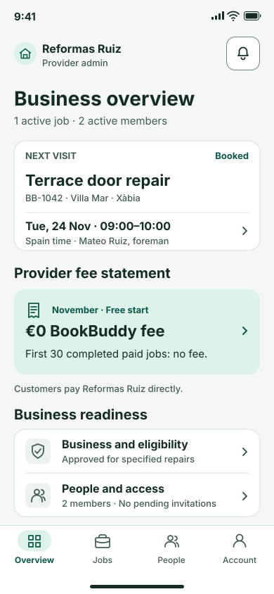
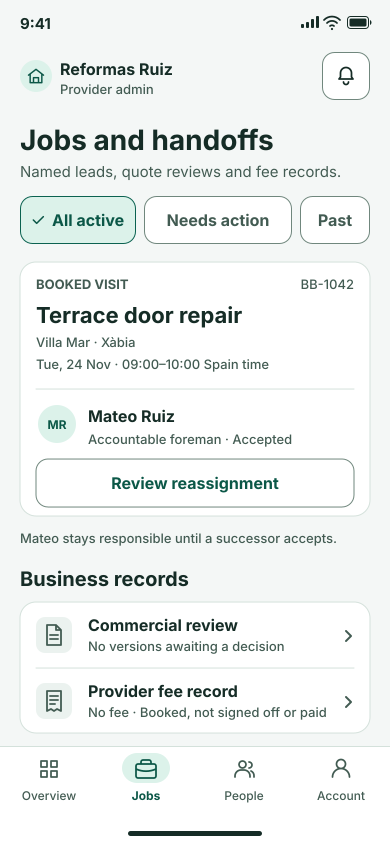
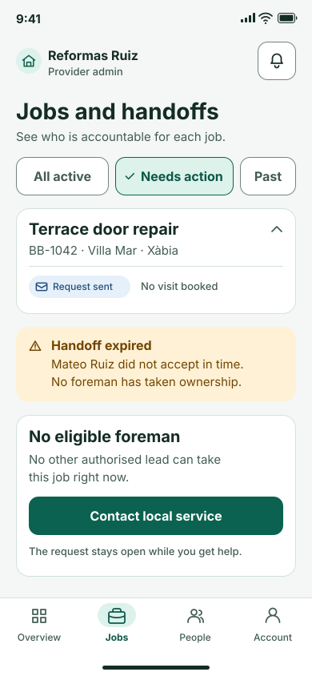
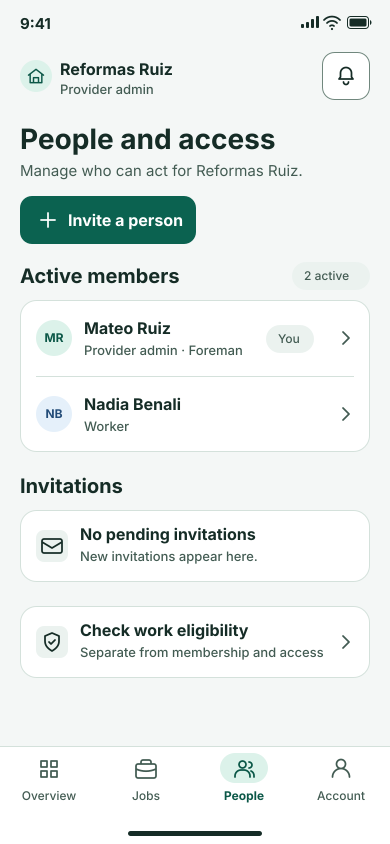
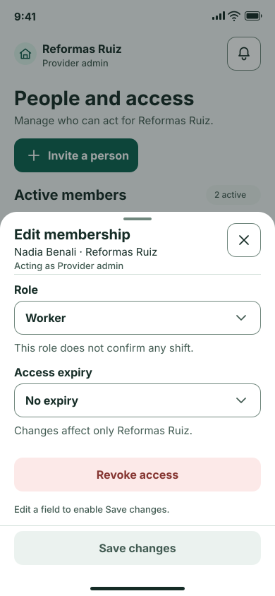
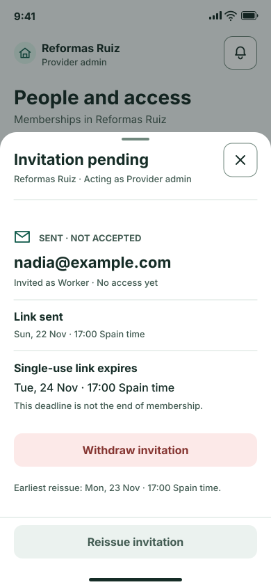
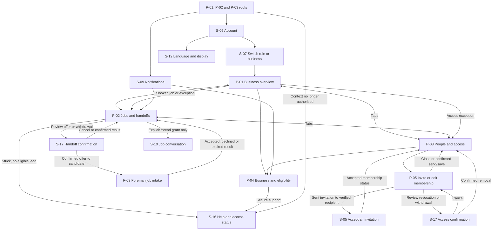

# Provider business admin · P-01–P-05

Mateo Ruiz administers **Reformas Ruiz** in BookBuddy. He is also its foreman, but the provider admin context does not grant foreman actions. These screens cover one business at a time. The booked fixture is BB-1042, Terrace door repair at Villa Mar · Xàbia, Tue, 24 Nov, 09:00–10:00 Spain time. The stuck handoff and pending invitation are alternative, earlier snapshots; the revoked membership shows a possible later outcome. The numbers and eligibility dates in the drawings illustrate state, not operating policy.

## Shared behaviour

- **Shell and deep links.** P-01, P-02 and P-03 share the fixed Overview, Jobs, People and Account tabs. Account opens S-06; S-07 lists only already-granted role and business contexts. Operational roots have a bell for S-09, scoped to the active context. P-04 is pushed without tabs; P-05 is a sheet over P-03. Each tab restores authorised scroll and selection; reselecting its tab returns to its root. Links open records, never perform actions. Recheck the signed-in identity, active business, capability and item access; offer S-07 only when another context is authorised, otherwise use S-16 with reason-safe copy. A cold admin link builds an authorised parent path from P-01; Back from a bell or a pushed page returns to its caller when available.
- **Authority and freshness.** Membership, eligibility and a named assignment are independent. Read access does not imply permission to change ownership, invite, edit access, publish quotes, share records or participate in chats. Submissions require an authoritative online result. Keep a processing label and suppress duplicate submissions; if the outcome is unknown, reconcile against the current record before enabling retry. Never queue admin actions for later submission. Cached status is read-only, marked with the last confirmed time; do not retain or display eligibility evidence, residential access details or contact credentials in a cache. When a scope is lost, remove restricted rows and queued navigation; return to an authorised parent only if it remains allowed, otherwise use S-16 without identifiers. Restore only draft fields the viewer is still allowed to see.
- **Accessibility and platform.** Use the [design system](../../system/design-system.md) and [navigation contract](../../foundation/information-architecture.md). Label controls and their state for VoiceOver/TalkBack; group card text as one meaning and exclude decorative icons, dividers and initials when the name is present. Text and icon communicate non-neutral status; colour is not the signal. Use 44 pt / 48 dp minimum hit targets, visible focus, scroll at the largest type size and honour Reduce Motion. Announce server-confirmed outcomes politely and show them persistently; completion haptic is optional and occurs only after the outcome is known. Do not use haptics for reading or network waiting.
- **Localisation.** Allow 30–40% text growth and let rows, chips, action labels and sheet content wrap. Keep names, identifiers, legal records and invitation addresses as supplied. Isolate bidirectional job IDs, names, email, dates and times; mirror layout, chevrons and tabs in RTL, not clocks or characters. Format dates and numbers in the UI locale; service deadlines are Spain time (`Europe/Madrid`), with viewer time secondary if enabled and different. Localising a deadline does not change it. UI language does not change what a person may do or which working languages they have declared.

## P-01 · Business overview

**Purpose and routes.** Open the dashboard at provider admin launch, by the Overview tab, or after choosing Reformas Ruiz in S-07. It shows who owns the next job and which exceptions need follow-up. From here open P-02 for the job or handoff, P-04 for eligibility, P-03 for a team/access exception, S-09 for notifications or S-06 via Account.

**Layout and data, top to bottom.** Context header (business and active role, notification button); page title and intro; passive summary card with authorised active job/member counts; exception list when necessary; next-visit **Job card** (job title, property/area, reference, exact stage **Status badge**, confirmed window and accountable foreman); business readiness **List** rows for eligibility and memberships; **Tab bar**. Counts include only records available to that viewer. The normal fixture shows 1 active job, 2 active members and the booked visit. Business approval is scoped, not a statement of general legal clearance or crew readiness.

**Interaction.** Tap the job card once to open and expand that job in P-02 under the appropriate filter. The whole readiness or exception row opens its destination with the relevant record in view if still authorised. Passive counts and badges are not targets. Scroll to see more; pull to refresh or use the visible Retry action after a failed load. Nothing on the dashboard changes ownership, eligibility, access or a booking. From a notification, a focusable status heading gives context before supporting data.

**States and edges.** Onboarding shows `Business review pending` and a link to P-04, not empty indicators presented as failure. Active shows the fixture; with no upcoming visit show `No visit booked` while still surfacing open handoffs. Action needed moves urgent issues ahead of routine cards, names what needs attention and routes to P-02/P-03/P-04. If several apply, show overdue handoffs and currently blocking checks before upcoming expiry and pending invitations; use absolute dates. Restricted with valid overview access shows only allowed cards and a service route where appropriate; without the business context use S-16. Loading uses a quiet layout skeleton; partial failure says what did not load with a targeted Retry, not a zero count. Cached shows `Last confirmed …` and no new “ready” verdict; a previously confirmed visit is not projected forward if its details cannot be refreshed.

**Platform, focus and locale.** Native-aligned iOS tab bar; on Android, bottom navigation above system insets and system Back at the role root. Focus: business context → Notifications → title → counts as phrases → exception rows → visit → readiness → tabs. At large type counts stack and cards grow; prioritise complete deadline and location labels over badges fitting a single line. Use plural forms for counts and keep BB-1042 and site times isolated in RTL.

## P-02 · Jobs and handoffs

**Purpose and routes.** Jobs tab, P-01 or S-09 opens the business job list and, when supplied, the selected record. A provider admin with authority offers or reoffers job ownership; the target accepts or declines in F-03 as Foreman. S-17 confirms the admin's offer. Escalate via S-16. An explicit job-conversation grant can expose `Open job conversation` to S-10; neither the admin role nor an offer implies that grant. No link to Crew only from this role.

**Layout and data, top to bottom.** Context header; title and intent; **Chips** for All active, Needs action and Past, with 16-unit control labels and 48-unit hit heights (wrap the row as needed); **Job cards** with title, property/area, ID, exact job stage and confirmed visit if any; inline job ownership panel under the expanded row; optional refusal/expiry/authority **Banner** or short **Timeline** of ownership changes; **Tab bar**. Display current owner, candidate separately, last event and expiry in site time. Recommended next action is visible without relying on colour. Booked fixture shows Mateo as accountable foreman and an Accepted badge, separate from Booked. The earlier stuck fixture shows Request sent, expired intake, no owner and no booking. No quote, billing or worker contact credentials are required to manage ownership.

**Interaction.** Tap a filter to replace the list while preserving each filter's authorised scroll. Tap the whole job card to expand/collapse its adjacent panel; selecting a different card closes the previous expansion. A valid deep link chooses the filter and expands the target. `Choose a foreman` or `Review reassignment` expands a single-choice list in the same route. List only people with an active Foreman grant in this business and the required authority for this job; state any visible restriction that blocks a candidate, or explain that there are no eligible candidates. Select one to enable `Review handoff`; S-17 names the business, acting role, job, candidate, intake deadline and effect (sends an offer, does not accept it). Cancel returns to the selection; `Send handoff offer` rechecks item, grant, candidate and version. On success close the dialog, show `Offer sent · Awaiting acceptance` with deadline, and restore focus to the ownership status. If a foreman is already accountable, that person remains named until a successor accepts and the server confirms transfer; if the incumbent loses authority first, surface an ownership gap and escalate instead of naming that person as able to act. A confirmed transfer does not alter the approved scope, schedule, commercial authority or crew. F-03 handles intake separately; Mateo must switch context to act on his own offer. Close or withdraw a live offer through S-17 before reoffering; no duplicate simultaneous offers. `Contact local service` opens S-16 without submitting a case; include a job reference only when authorised and reviewed. Android/iOS Back from a dialog cancels unless sending, when dismissing does not cancel the operation.

**States and edges.** Unassigned shows no owner and an offer CTA only if permitted; offered shows pending reply and an absolute deadline; accepted names the current owner. Declined or expired keeps the event and no assumption of acceptance, permits choosing a different eligible lead if available, or shows the stuck state and escalation. For an expired reassignment distinguish the continuing incumbent from `No foreman` on first intake. Missing authority shows the rule and a safe contact path without a disabled guessing game. No eligible lead leaves the request open and does not invent a booking. Closed/cancelled is read-only and Past; no automatic archival on expiry. Empty filters distinguish `Nothing needs action` from `No jobs yet`; show clear-filter action where useful. Loading preserves visible list structure; offline shows last confirmed status, no choice or submit; version conflicts show `Ownership changed while you were reviewing` with the new state, keep the selection only if still valid and require a fresh review. A response crossing expiry shows the server's result, not an assumption from the timer. A failed send shows `Offer not sent` only when known; otherwise reconcile first. Crew cover and timing continue through the foreman flow, not this list.

**Platform, focus and locale.** Use iOS native confirmation and Android platform dialog/Back; Focus starts on the title or Cancel in S-17 and returns to the triggering action on cancellation. Main sequence: business/context → Notifications → heading → selected filter group → job card with expanded state → owner/current offer → next step/chooser → history → tabs. Keep expiry and booking time on separate, fully readable lines at larger type. Localise status words distinctly (`Expired` is not `Declined`), use absolute site deadlines and mirror chevrons, not times.

## P-03 · People and access

**Purpose and routes.** People tab, P-01 access shortcut, and return from P-05. Inspect active memberships, pending invitations and retained revocation history. Open P-05 for a permitted invite/edit or to inspect a readable read-only membership; open P-04 for work eligibility only if authorised.

**Layout and data, top to bottom.** Context header; title; **Button** `Invite a person`; inline notice after an action; sectioned **List** with authorised active names, roles and optional grant expiry; pending invitations with requested role, link-expiry status and recipient display name or masked address where allowed; read-only access history when present; separate P-04 eligibility row; **Tab bar**. Mateo's two labelled roles are separate grants, not two accounts. Nadia has a Worker membership; it does not show any raw eligibility evidence, assignment details or property access. The revoked variant shows confirmed loss of Nadia's Worker role, no Nadia row in Active members, and **Revoked** with a timestamp under Access history.

**Interaction.** `Invite a person` opens a blank P-05 invitation form. Tap an active member to inspect or edit assignable grants; Mateo's own protected admin grant is read-only. Tap a pending invitation to open its management mode, not to accept on the recipient's behalf. Revoked history has no editable control, no quick restore, and no swipe action; a new grant uses the eligible invite flow. `Check work eligibility` pushes P-04 without moving into Worker or Foreman. Use pull to refresh or Retry after failed fetch. After P-05 completion update only on authoritative outcome, announce the result and move focus to the matching row or the persistent outcome if the row moved/disappeared. When access is removed, an authorised admin sees only the permitted history; a member who lost the business context sees a reason-safe S-16, not this screen. Impact on any shifts must be addressed in a granted operational context, not silently replaced here.

**States and edges.** Active with multiple roles shows each grant and which expires rather than a single misleading expiry. Pending, accepted, declined, expired and withdrawn invitations are distinct; an accepted membership moves into the active list only once. Revoked shows the exact removed role and, if others remain, leaves those roles active. If an authorised fixture has no other members or invitations, explain how to invite; an unprivileged viewer sees read-only membership and support, not an invitation CTA. Loading does not reveal stale names before checking scope; cached permitted rows are read-only and marked stale; failures in a single section keep other current sections with targeted retry. Do not reveal whether the same person is a member of another business. If viewing scope changes while a sheet is open, close it, drop invalid draft fields and restore focus on the authorised surface.

**Platform, focus and locale.** iOS sheet detent with explicit Close follows the standard presentation; Android modal sheet supports system Back; neither requires a swipe. Root focus: context → Notifications → title → Invite → outcome → active members → invitations/history → eligibility → tabs. Read `Mateo Ruiz, you, Provider admin and Foreman`; `Revoked` is a status, not a focusable button. At large text let roles and expiry stack rather than clipping; use locale list grammar and preserve personal names in RTL.

## P-04 · Business and eligibility

**Purpose and routes.** Pushed from P-01, P-03 or the matching eligibility notice in S-09. It explains which capability is approved and what needs follow-up. Up returns to the authorised caller or P-01 for a cold link. The only route for evidence or disputes is the secure local service handoff via S-16; there is no staff review queue in the app.

**Layout and data, top to bottom.** Back/Up and context header; intro or **Banner** for a blocking/expiring status; business verification **Card** with approved scope and any restrictions; work eligibility **Cards/List** with authorised worker name, scoped **Status badge**, validity date/time and plain consequence; secure support **Button**; last confirmed timestamp. The expiring fixture shows Nadia's eligibility ends Wed, 25 Nov at 17:00 Spain time. The business remains approved for construction repairs in its own verified scope. Show a business scope validity date if the verified record has one; if unavailable do not infer indefinite approval from an absent date. No document names/numbers, files, credential images, proof submission form or legal investigation notes are shown.

**Interaction.** Scroll through statuses; statuses and their cards are read-only. `Contact local service` opens S-16 with a minimal, reviewed reference if authorised. Evidence is handled only through the approved secure support route, never prefilled into a public chat, generic email body or notification. Back restores caller scroll; any app return rechecks visible status before presenting it as current. Manual Retry or pull to refresh requests current records; it does not reverify eligibility or create a case. No completion haptic for opening or refreshing read-only status. In the expiry warning, show the cutoff and state that only assignments that end before the cutoff can be made with that check; confirmation in the foreman flow must still recheck the entire task/shift and approved scope. The display does not cancel an existing shift or declare permission to start; a newly affected shift needs authorised review and no automatic replacement.

**States and edges.** Pending review names the unresolved capability and blocks actions that need it; approved names scope; expiring gives absolute cutoff and impact; expired blocks covered actions from cutoff; suspended displays the affected approved scope as on hold until resolved. Needs evidence gives the safe support route and no guessing about which document to transmit. A worker may have a restricted check while the business remains approved, and vice versa; do not collapse them into one status. If the worker record is not authorised, omit it without exposing their eligibility; if route access is denied, use generic S-16. Distinguish no records from no authorised records. Loading or partial failures use skeleton/targeted retry; offline shows last confirmed, no certainty about present eligibility and no sending. On expiry during a session, use a current server result at the next meaningful check; a cached status must not be used to grant work.

**Platform, focus and locale.** iOS Back and edge swipe; Android Up and system Back. Focus: route title/context and Back in native order → urgent banner → business scope → worker status/date → support → confirmation timestamp. Announce changes only when authoritative, preserve focus on refresh, and allow status after the person name to wrap independently. Use locale-native date wording and add textual Spain time (and viewer’s time only when relevant); avoid ambiguous numeric dates and avoid translating business or legal identifiers.

## P-05 · Invite or edit membership [Sheet]

**Purpose and routes.** From P-03 `Invite a person`, active membership or pending invitation. Stay in P-03's business and role. S-05 permits acceptance only when the verified signed-in account matches the invited email exactly; matching the person's name is not enough. The admin cannot accept for the recipient. S-17 handles revocation and other destructive or immediate permission changes. Close returns to P-03, or S-16 if that context is no longer authorised.

**Layout and data, top to bottom.** **Bottom sheet** with dimmed People parent, handle, explicit Close, mode title, person and business context and `Acting as Provider admin`; scrollable fields/read-only data; separate destructive action when permitted; pinned **Button** and safe area. Edit shows persistent **Input** labels for role and access expiry and what a change does; invitation mode adds recipient email, scoped roles and requested membership expiry, with the separate invitation-link deadline stated before sending. In pending mode show actual sent time and separate link deadline, no active role badge, `Resend invitation` and `Withdraw invitation`. In the fixture, Mateo sends the Worker invite to `nadia@example.com` on Sun, 22 Nov at 17:00 Spain time. Nadia accepts in S-05 using that verified account, and S-09 records acceptance at 17:20 that day. The link expiry is Wed, 25 Nov at 17:00 Spain time; this deadline is not membership or work-eligibility expiry. The normal artboard is unchanged edit state; `Save changes` is disabled until an allowed change exists.

**Interaction and validation.** Invite: type/paste recipient email with standard email keyboard, submit only with a validly formed unambiguous address, at least one allowed role and a future expiry when one is required or selected. Trim leading/trailing whitespace; never silently rewrite the identity. Expand the role control into inline choices with role effects and business scope, plus explicit selection state; the current actor may grant only capabilities allowed by policy. In edit mode, unavailable role changes remain read-only with a reason, existing protected grants cannot be removed, and a new role grant does not create a job assignment. Expand expiry inline or use system date/time input and display the exact deadline and zone after return; `No expiry` appears only when allowed. Standard invitation shows role/business/expiry in the sheet before `Send invitation`; Save applies only on online confirmation. Immediate elevated or removal effects (including shortening active access where it will affect work) are reviewed in S-17, not applied by the selector. If new role requires acceptance, mark only that grant pending, not existing grants. Pending mode `Resend invitation` sends only the current eligible invite; show cooldown with an explicit available time and reconcile if read status changed. If the link is expired, use explicit `Issue new invitation` after review; don't silently extend a link or grant. `Withdraw invitation` and `Revoke access` switch from the sheet to S-17, never stack. Name person, selected grant/business and affected access; for revoke indicate any ongoing accountability impact before confirmation. If the person is the last authorised admin or the only accountable foreman and a safe transfer is required, block the destructive action with a reason and local-service route. Do not automatically cancel bookings, mark workers covered or remove other roles. S-17 Cancel returns to the same sheet cursor; after success, return to P-03 and show `Invitation sent`, `Changes saved`, `Invitation withdrawn` or `Access revoked` only when confirmed.

**Dismissal and feedback.** Close, the platform's sheet dismissal gesture or Android Back dismisses a clean sheet; if the keyboard is open, dismiss it first. For unsaved changes, replace the sheet with a discard prompt (`Keep editing` / `Discard changes`) and restore the draft when editing resumes. If sending, preserve the processing state if the sheet closes; returning does not resend. Show label-preserving progress, then a persistent P-03 outcome and optional confirmation haptic. On error, keep safe permitted fields, explain how to fix the issue and focus the first invalid field or the error summary. Retry only after the prior request outcome is known.

**States and edges.** Empty invite shows helper and disabled CTA until valid; populated or edited shows actionable review; submitting stays single-flight. Pending allows resend or withdrawal only with authority and delivery policy, not when accepted. Duplicate within the business shows `Invitation already pending` with a route to that invitation or `Already a member` with a route to that member, only if the admin can see the record; otherwise give neutral restricted copy. No lookup leaks another business's membership or account existence. If accepted or removed in parallel, close invalid actions and show latest authorised status. Cannot grant explains which selection cannot be granted without disclosing hidden authority records. Invalid expiry, concurrent change, backend rejection, revoked actor and lost network each keep separate outcomes. Offline is read-only for sensitive records; an open authorised safe draft may remain on-device as unsent, but do not persist a recipient address in a general offline cache or queue the send. When online again, check authority and re-review before submission. Invalidated authorisation clears restricted fields and closes the sheet to an authorised parent.

**Platform, focus and locale.** On iOS use native sheet detents that expand for keyboard and accessibility, with an explicit Close button. On Android use a Material bottom sheet, keep the action footer above the keyboard and support predictive Back in keyboard-then-sheet order where available. Focus enters the title and context, then Close, fields and their helper/errors, separate destructive action, primary action. Scrim and background are inert. On clean dismissal restore the opener; on destructive success focus the persistent P-03 outcome. When expanding choices, retain focus on the selected option or return it to the controlling field on collapse. Let labels and effect explanations wrap, and render email as one isolated LTR value in RTL. Dates and related helper text remain fully readable without opening a picker.

## Open design questions

- Which provider grants may be issued by an admin without local-service approval, and what transfer safeguards apply to the last admin or only accountable foreman? These designs assume no self-escalation and no removal that would silently strand a protected responsibility.
- Who sets intake offer deadlines, resend limits and invitation-link lifetimes; when does a stalled handoff go to an on-call local service? The designs use explicit recorded deadlines and do not promise an operations response time.
- What evidence/status may the admin see, what alert lead time applies, and who reviews a confirmed shift that crosses a newly reported expiry? Keep this to scoped status, dates and a secure support route until the policy is known.

## Navigation

