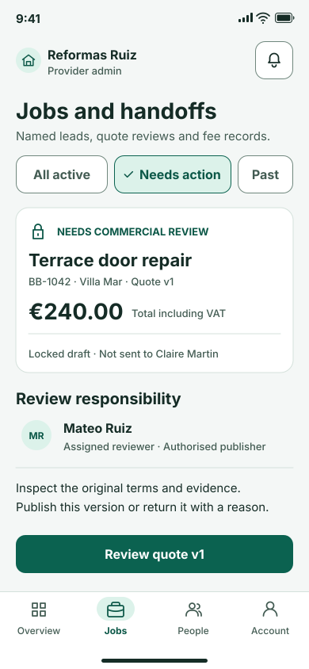
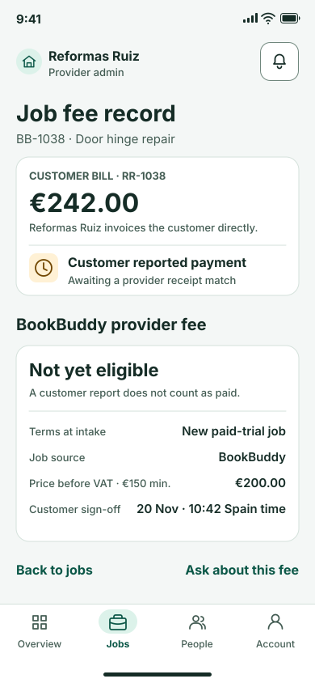
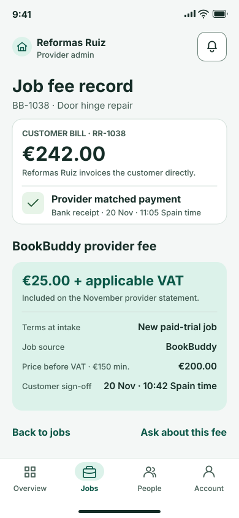
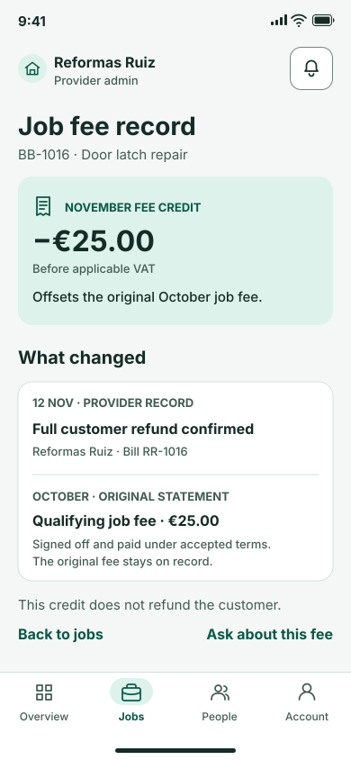
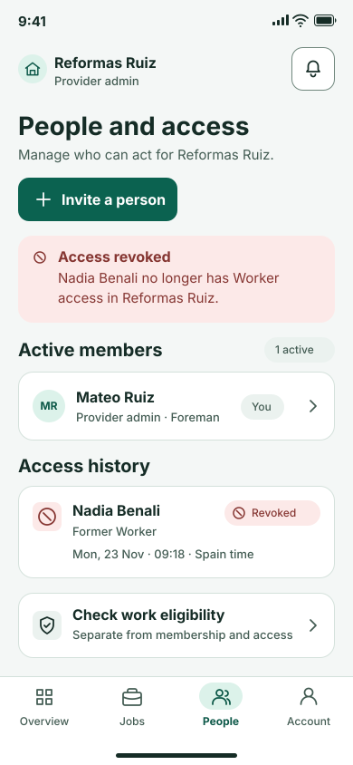
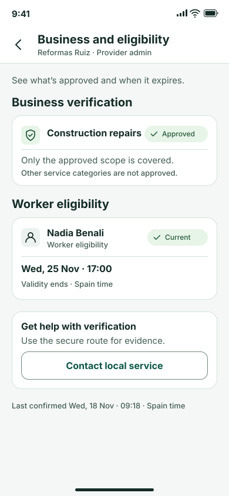
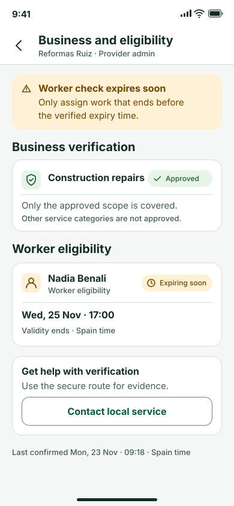
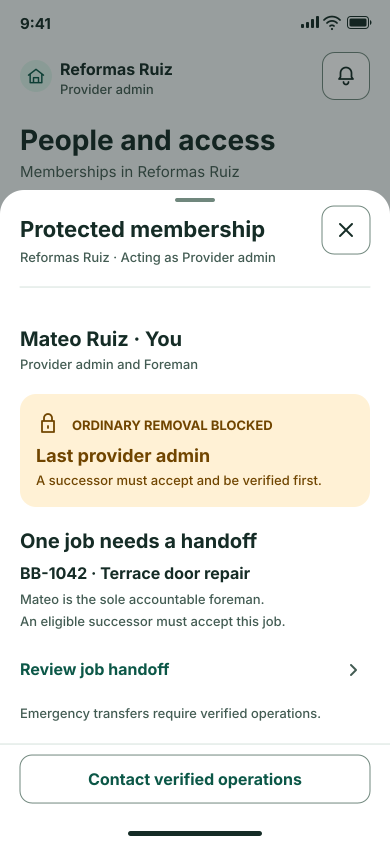
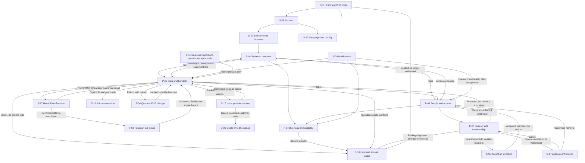

# Provider business admin · P-01–P-05

Mateo Ruiz administers **Reformas Ruiz** and separately works as its foreman. The active role determines what he can do. In the booked example he owns BB-1042, the terrace door repair at Villa Mar in Xàbia, Tue, 24 Nov, 09:00–10:00 Spain time. Its intake and quote-review examples show earlier alternatives, not problems on the booked visit. The November paid-trial statement illustrates a later fee model using two different jobs. Neither the fixtures nor the tariff hypothesis sets the pilot location, size or duration.

## Shared behaviour

- **Shell and deep links.** P-01, P-02 and P-03 share the fixed Overview, Jobs, People and Account tabs. Account opens S-06; S-07 lists only already-granted role and business contexts. Operational roots have a bell for S-09, scoped to the active context. P-04 is pushed without tabs; P-05 is a sheet over P-03. Each tab restores authorised scroll and selection; reselecting its tab returns to its root. Links open records, never perform actions. Recheck the signed-in identity, active business, capability and item access; offer S-07 only when another context is authorised, otherwise use S-16 with reason-safe copy. A cold admin link builds an authorised parent path from P-01; Back from a bell or a pushed page returns to its caller when available.
- **Authority and freshness.** Membership, eligibility, job responsibility, commercial publication and billing authority are independent. Before activating admin or other high-impact grant powers, require a recent passkey check where supported or independent verification by local operations. Recheck each consequential decision online; one operation at a time. An uncertain outcome is reconciled against the same operation before retry. Never queue a grant, offer, publication or payment-record change offline. On an assigned device only, permitted minimal job context is read-only for up to 72 hours from the last successful authorisation sync; show “Last confirmed” with site date and time. No persistent shared-device cache, offline role switch, raw evidence, private contacts, payment credentials or access codes. Reconnect applies revocations before showing data; on loss of scope discard restricted drafts, rows and destinations and return to an authorised parent or reason-safe S-16.
- **Accessibility and platform.** Use the [design system](../../system/design-system.md) and [navigation contract](../../foundation/information-architecture.md). Label controls and their state for VoiceOver/TalkBack; group card text as one meaning and exclude decorative icons, dividers and initials when the name is present. Text and icon communicate non-neutral status; colour is not the signal. Use 44 pt / 48 dp minimum hit targets, visible focus, scroll at the largest type size and honour Reduce Motion. Announce server-confirmed outcomes politely and show them persistently; completion haptic is optional and occurs only after the outcome is known. Do not use haptics for reading or network waiting.
- **Localisation.** Ship English (default) and Português (Portugal), using the bundled `en` and `pt-PT` catalogs. UI language and reading preference (including Original only) are separate. Allow 30–40% text growth and let rows, chips, action labels and sheet content wrap. Keep names, identifiers, legal records and invitation addresses as supplied. Isolate bidirectional job IDs, names, email, dates and times; mirror layout, chevrons and tabs in RTL, not clocks or characters. Format dates and numbers in the UI locale; service deadlines are Spain time (`Europe/Madrid`), with viewer time secondary if enabled and different. Localising a deadline does not change it. UI language does not change what a person may do or which working languages they have declared.

## P-01 · Business overview

**Purpose and routes.** Open the dashboard at provider admin launch, by the Overview tab, or after choosing Reformas Ruiz in S-07. It shows who owns the next job and which exceptions need follow-up. From here open P-02 for the job or handoff, P-04 for eligibility, P-03 for a team/access exception, S-09 for notifications or S-06 via Account.

**Layout and data, top to bottom.** Below the business/role header, authorised counts sit under the page title: one active job and two active members. The next visit leads with its booked window, site, reference and named foreman. Below it, **Provider fee statement** identifies the month and free-start or accepted paid-trial status. Customers pay Reformas Ruiz directly; BookBuddy bills the business separately. Two ruled readiness rows open P-04 or P-03. Do not present worker attendance, a progress rail or a new booking from this administrative view.

**Interaction.** Open the booked visit or an ownership exception in P-02, the scoped check in P-04, or the people row in P-03. The provider statement expands in place in P-01 for a viewer with commercial read access. The November example lists the BB-1038 fee (€25 before applicable VAT) and a November credit (−€25 before applicable VAT) for the October BB-1016 fee. Net fees before VAT are €0.00. Select a line to open the reason and linked job record in P-02; Back restores the statement and selected row. Show the applicable fee invoice/credit tax amounts from the issuer’s records when issued; a statement subtotal is not a tax invoice. Nothing on P-01 collects money, matches a receipt or edits either bill.

**Fee terms.** No BookBuddy fee on the first **30 completed paid jobs**; customers still owe the agreed service price to their provider. This is the initial programme cohort, not 30 free repairs per customer or a new allowance for each business. Reaching 30 does not enrol a provider. Only **new** jobs under the provider’s **accepted paid-trial terms** can qualify: €25 plus applicable VAT per BookBuddy-sourced, signed-off, paid job with an agreed service price of **at least €150 before VAT**, billed monthly to the provider. No customer surcharge, worker fee or deduction from job proceeds. Prior work is not repriced.

**States and edges.** Onboarding shows `Business review pending` and a link to P-04, not empty indicators presented as failure. Free start shows €0 BookBuddy fee, not zero customer bills. Without accepted paid terms show no fee accrual, not an active trial. The paid fixture uses only confirmed charges and credits; missing financial data is “Unavailable”, not €0. Do not expose amounts, fee-eligible counts or statement links outside the financial grant. Active shows the fixture; with no upcoming visit show `No visit booked` while still surfacing open handoffs. Action needed moves urgent issues ahead of routine cards, names what needs attention and routes to P-02/P-03/P-04. If several apply, show overdue handoffs and currently blocking checks before upcoming expiry and pending invitations; use absolute dates. Restricted with valid overview access shows only allowed cards and a service route where appropriate; without the business context use S-16. Loading uses a quiet layout skeleton; partial failure says what did not load with a targeted Retry, not a zero count. Cached shows `Last confirmed …` and no new “ready” verdict; a previously confirmed visit is not projected forward if its details cannot be refreshed.

**Platform, focus and locale.** Native-aligned iOS tabs; Android bottom navigation and system Back at the role root. Focus follows context → Notifications → title and counts → any blocking exception → next visit → provider fee → readiness → tabs. In the statement, read issuer, recipient, month, signed amounts and tax basis together; a credit is spoken as a credit, not just a minus sign. Stack figures before they collide at larger text sizes.

## P-02 · Jobs and handoffs

**Purpose and routes.** Jobs tab, P-01 or S-09 opens the business job list and, when supplied, the selected record. A provider admin with authority offers or reoffers job ownership; the target accepts or declines in F-03 as Foreman. S-17 confirms the admin's offer. Escalate via S-16. An explicit job-conversation grant can expose `Open job conversation` to S-10; neither the admin role nor an offer implies that grant. No link to Crew only from this role.

**Layout and data, top to bottom.** Context, page title, and All active / Needs action / Past filters with 16-unit labels and 48-unit targets. The expanded job keeps the stage, service window, named lead and acceptance together. The booked fixture shows `Review reassignment`, then commercial queue and provider-fee rows. Its existing booking is neither paid nor signed off. The stuck intake puts the expired offer and deadline first, then identifies the unbooked request, lack of an eligible alternate and the local service action. Fee records opened from a job or statement show the provider’s customer bill first and the separate BookBuddy fee decision below. `Back to jobs` closes the detail in this tab; platform Back restores the actual caller.

**Interaction.** Tap a filter to replace the list while preserving each filter's authorised scroll. Tap the whole job card to expand/collapse its adjacent panel; selecting a different card closes the previous expansion. A valid deep link chooses the filter and expands the target. `Choose a foreman` or `Review reassignment` expands a single-choice list in the same route. List only people with an active Foreman grant in this business and the required authority for this job; state any visible restriction that blocks a candidate, or explain that there are no eligible candidates. Select one to enable `Review handoff`; S-17 names the business, acting role, job, candidate, intake deadline and effect (sends an offer, does not accept it). Cancel returns to the selection; `Send handoff offer` rechecks item, grant, candidate and version. On success close the dialog, show `Offer sent · Awaiting acceptance` with deadline, and restore focus to the ownership status. If a foreman is already accountable, that person remains named until a successor accepts and the server confirms transfer; if the incumbent loses authority first, surface an ownership gap and escalate instead of naming that person as able to act. A confirmed transfer does not alter the approved scope, schedule, commercial authority or crew. F-03 handles intake separately; Mateo must switch context to act on his own offer. Close or withdraw a live offer through S-17 before reoffering; no duplicate simultaneous offers. `Contact local service` opens S-16 without submitting a case; include a job reference only when authorised and reviewed. Android/iOS Back from a dialog cancels unless sending, when dismissing does not cancel the operation.

**Intake deadline and continuity.** Local operations sets the policy; show the actual deadline before send. Normally allow two staffed hours, Mon–Fri 08:00–18:00 Spain time, excluding local public holidays. For an at-risk same-day handoff due within four staffed hours, allow 30 staffed minutes and call the recipient. If waiting puts the visit at risk, call the provider duty line immediately. On failure reoffer once to an eligible alternate, otherwise escalate to the provider admin and local desk. Ordinary removal of a sole accountable foreman requires an eligible successor to **accept each open job** online. A declined or expired transfer cannot clear that responsibility. Safety/security suspension cuts access immediately, parks the responsibility with verified operations and pauses affected commitments until replacement is confirmed.

**Commercial review.** Both F-04 quotes and F-15 changes enter `Needs commercial review` as locked snapshots in P-02. The provider names a reviewer and backup; in the drawn example Mateo has an explicit, verified publishing grant in addition to being foreman and admin. Show the assigned reviewer, version, gross EUR total, exact original and terms, expiry, named customer approver and only received, selected evidence in the review. `Review quote v1` opens the snapshot in this queue. Return it with a reason, or, **only** with a current publisher grant, review issuance via S-17 and publish that exact version. Without that grant route to the named publisher. One business day is a publish-or-return target, never automatic publication. F-04/F-05/F-15 show the actual returned reason or issued version; an unissued draft stays private. A change preserves the approved original verbatim and presents a separate proposal with delta, new total, timing and affected-work hold. Publishing is not customer consent: only the named, authorised customer may approve online, and never the same actor by switching role.

**Direct payment record.** Reformas Ruiz is the seller, biller and remedy provider. In the BB-1038 example, bill RR-1038 is €242.00 including VAT; the agreed service price before VAT is €200.00. The customer pays the provider independently. C-11’s report is `Awaiting a provider receipt match`, not a paid badge or a fee. Only the provider’s confirmed bank/PSP reconciliation against the same bill, amount and currency supplies `Provider matched payment`. The admin reads only the permitted result; no bank details or proof images, mark-paid shortcut, charge, payout or refund action. A screenshot, browser return, case or customer sign-off cannot substitute for the match. If a record submission failed or is uncertain, distinguish that from a failed payment; reconcile before retry.

**Why a fee appears.** For BB-1038 the new accepted terms, BookBuddy source, ≥€150 agreed before VAT, named customer sign-off and provider-matched paid bill qualify it once. BookBuddy includes €25 + applicable VAT on its monthly provider statement. A lead or cancellation does not qualify. Neither do provider-sourced work, an under-threshold price, earlier terms, work without sign-off, an unpaid or unmatched bill, or a fully refunded job. Show the actual exclusion or missing fact; never infer origin or pre-VAT price from a payment report or gross quote. Unknown/disputed facts are unresolved, not eligible. A later confirmed **full** refund credits the fee and its applicable tax against the original statement line; the BB-1016 example preserves both the October fee and November credit. A pending refund is not a credit. A partial refund is not a full-refund reversal. For a wrong source, amount or receipt, `Ask about this fee` opens the secure human correction route via S-16; retain the original and link the verified correction, reason, actor, reference, date and resulting statement adjustment. Replays add neither a second fee nor a second credit. Correcting a provider statement never changes the customer invoice; the provider issues any needed corrective invoice and handles the actual refund.

**States and edges.** Unassigned shows no owner and an offer CTA only if permitted; offered shows pending reply and an absolute deadline; accepted names the current owner. Declined or expired keeps the event and no assumption of acceptance, permits choosing a different eligible lead if available, or shows the stuck state and escalation. For an expired reassignment distinguish the continuing incumbent from `No foreman` on first intake. Missing authority shows the rule and a safe contact path without a disabled guessing game. No eligible lead leaves the request open and does not invent a booking. Closed/cancelled is read-only and Past; no automatic archival on expiry. Empty filters distinguish `Nothing needs action` from `No jobs yet`; show clear-filter action where useful. Loading preserves visible list structure; offline shows last confirmed status, no choice or submit; version conflicts show `Ownership changed while you were reviewing` with the new state, keep the selection only if still valid and require a fresh review. A response crossing expiry shows the server's result, not an assumption from the timer. A failed send shows `Offer not sent` only when known; otherwise reconcile first. Crew cover and timing continue through the foreman flow, not this list.

**Platform, focus and locale.** Use iOS native confirmation and Android platform dialog/Back; Focus starts on the title or Cancel in S-17 and returns to the triggering action on cancellation. Main sequence: business/context → Notifications → heading → selected filter group → job card with expanded state → owner/current offer → next step/chooser → business records or linked history → tabs. Keep expiry and booking time on separate, fully readable lines at larger type. Localise status words distinctly (`Expired` is not `Declined`), use absolute site deadlines and mirror chevrons, not times. Commercial detail reads the provider bill and receipt state before the fee amount, basis or credit; preserve signed amounts and “before VAT” when text wraps.

## P-03 · People and access

**Purpose and routes.** People tab, P-01 access shortcut, return from P-05, or S-09’s accepted-membership alert for an authorised admin. The alert opens the scoped member’s **current** grants, not automatic access based on the old invitation. Inspect active memberships, pending invitations and retained revocation history. Open P-05 for a permitted invite/edit or to inspect a readable read-only membership; open P-04 for work eligibility only if authorised.

**Layout and data, top to bottom.** Business/role header; page title; **Invite a person**; authorised active names and roles in a ruled member list, with any grant-specific expiry. A blue notice explains why Mateo’s last admin grant is protected. Pending invitations show requested role and link expiry, and only the recipient name or masked address where permitted. The revoked variant puts the confirmed outcome above Invite: only Mateo is active, and Nadia appears in read-only access history with exact role and time. `Check work eligibility` opens P-04; membership is not eligibility, assignment or access to a customer. No raw evidence, personal contacts, reason for suspension or other employers.

**Interaction.** `Invite a person` opens a blank P-05 invitation form. Tap an active member to inspect or edit assignable grants; Mateo’s protected record in P-05 lists each blocked responsibility; granting Worker access to Nadia does not grant Job chat or access to crew threads. Tap a pending invitation to open its management mode, not to accept on the recipient's behalf. Revoked history has no editable control, no quick restore, and no swipe action; a new grant uses the eligible invite flow. `Check work eligibility` pushes P-04 without moving into Worker or Foreman. Use pull to refresh or Retry after failed fetch. After P-05 completion update only on authoritative outcome, announce the result and move focus to the matching row or the persistent outcome if the row moved/disappeared. When access is removed, an authorised admin sees only the permitted history; a member who lost the business context sees a reason-safe S-16, not this screen. Impact on any shifts must be addressed in a granted operational context, not silently replaced here.

**States and edges.** Active with multiple roles shows each grant and which expires rather than a single misleading expiry. Pending, accepted, declined, expired and withdrawn invitations are distinct; an accepted membership moves into the active list only once. Revoked shows the exact removed role and, if others remain, leaves those roles active. If an authorised fixture has no other members or invitations, explain how to invite; an unprivileged viewer sees read-only membership and support, not an invitation CTA. Loading does not reveal stale names before checking scope; when offline, do not persist or redisplay the member directory from a shared-device cache; any already-authorised in-memory summary is read-only and marked stale; failures in a single section keep other current sections with targeted retry. Do not reveal whether the same person is a member of another business. If viewing scope changes while a sheet is open, close it, drop invalid draft fields and restore focus on the authorised surface.

**Platform, focus and locale.** iOS sheet detent with explicit Close follows the standard presentation; Android modal sheet supports system Back; neither requires a swipe. Root focus: context → Notifications → title → any confirmed outcome → Invite → active members → last-admin protection → invitations/history → eligibility → tabs. Read `Mateo Ruiz, you, Provider admin and Foreman`; `Revoked` is a status, not a focusable button. At large text let roles and expiry stack rather than clipping; use locale list grammar and preserve personal names in RTL.

## P-04 · Business and eligibility

**Purpose and routes.** Pushed from P-01, P-03 or the matching eligibility notice in S-09. It explains which capability is approved and what needs follow-up. Up returns to the authorised caller or P-01 for a cold link. The only route for evidence or disputes is the secure local service handoff via S-16; the mobile app has no verification evidence-review queue.

**Layout and data, top to bottom.** Back/Up and business/role; the verified business scope, then Nadia’s effective door-adjustment status and cutoff. Approval for non-structural door repairs is not approval for every trade or an instruction to begin. In the expiring snapshot her check ends **Wed, 25 Nov at 17:00 Spain time**; business scope is unchanged. The current snapshot shows the renewed worker record, confirmed Mon, 23 Nov at 09:40, valid until **Wed, 24 Feb 2027 at 17:00 Spain time**. Put an actionable expiry ahead of routine approvals. Finish with the secure verification/corrections route and last-confirmed timestamp. State any effective business cutoff separately. The business check shown has no fixed expiry: its 90-day **review-by** date is Sun, 21 Feb 2027. That date prompts a review; it is not a made-up validity cutoff. Show only the safe check label, scope, status and relevant dates. No document names, files, IDs, immigration, medical or disciplinary reasons.

**Interaction.** Scroll through statuses; statuses and their cards are read-only. `Contact secure verification` opens S-16 with a minimal, reviewed reference if authorised. Evidence is handled only through the approved secure support route, never prefilled into a public chat, generic email body or notification. Back restores caller scroll; any app return rechecks visible status before presenting it as current. Manual Retry or pull to refresh requests current records; it does not reverify eligibility or create a case. No completion haptic for opening or refreshing read-only status. In the expiry warning, show the cutoff and state that only assignments that end before the cutoff can be made with that check; confirmation in the foreman flow must still recheck the entire task/shift and approved scope. The display does not cancel an existing shift or declare permission to start; a newly affected shift needs authorised review and no automatic replacement.

**Expiry and correction.** Alert the admin 30 and 7 calendar days before expiry; alert the accountable foreman only when an assigned job is affected. These are renewal reminders, not automatic suspensions. New lapse or suspension blocks new offers in that scope immediately. Flag existing affected shifts to the employer’s accountable foreman and local compliance lead; they resolve, stop or restaff affected work before it proceeds. Privately notify the worker, keep actual attendance and offer human review. The customer’s booking is not automatically cancelled; P-04 cannot assign cover. Even a renewed check cannot release a safety hold: human teach-back must be verified and that worker must acknowledge the same instruction online.

**States and edges.** Pending review names the unresolved capability and blocks actions that need it; approved names scope; expiring gives absolute cutoff and impact; expired blocks covered actions from cutoff; suspended displays the affected approved scope as on hold until resolved. Needs evidence gives the safe support route and no guessing about which document to transmit. A worker may have a restricted check while the business remains approved, and vice versa; do not collapse them into one status. If the worker record is not authorised, omit it without exposing their eligibility; if route access is denied, use generic S-16. Distinguish no records from no authorised records. Loading or partial failures use skeleton/targeted retry; offline shows last confirmed, no certainty about present eligibility and no sending. On expiry during a session, use a current server result at the next meaningful check; a cached status must not be used to grant work.

**Platform, focus and locale.** iOS Back and edge swipe; Android Up and system Back. Focus: route title/context and Back in native order → urgent banner → business scope → worker status/date → support → confirmation timestamp. Announce changes only when authoritative, preserve focus on refresh, and allow status after the person name to wrap independently. Use locale-native date wording and add textual Spain time (and viewer’s time only when relevant); avoid ambiguous numeric dates and avoid translating business or legal identifiers.

## P-05 · Invite or edit membership [Sheet]

**Purpose and routes.** From P-03 `Invite a person`, active membership or pending invitation. Stay in P-03's business and role. S-05 permits acceptance only when the verified signed-in account matches the invited email exactly; matching the person's name is not enough. The admin cannot accept for the recipient. S-17 handles revocation and other destructive or immediate permission changes. Close returns to P-03, or S-16 if that context is no longer authorised.

**Layout and data, top to bottom.** Over the actual People parent: scrim, handle, mode title and Close, business and acting role, fields or a read-only record, separate destructive action if allowed, and one pinned action. An unchanged edit shows Nadia’s Worker role, membership expiry, privileged-access contact, `Revoke Worker access` and an unavailable `Save changes`. A new invite names the recipient, ordinary role, membership expiry and a separate expected link deadline. Pending shows the recipient, unaccepted Worker role, issue/expiry dates and reissue availability. Here Mateo invites `nadia@example.com` on Sun, 22 Nov at 17:00 Spain time; the single-use link expires Tue, 24 Nov at 17:00. The drawing is **before** Nadia accepts via S-05 at 17:20 on Sun, 22 Nov. Once accepted, the link cannot be reissued. Link expiry, membership expiry and task eligibility are three different things.

**Interaction and validation.** Type or paste the email, trimming surrounding whitespace without rewriting the identity. Require an unambiguous valid address, an allowed role and a future membership expiry where needed. Offer only **Worker** or **verified Foreman** of this business. An approved admin may grant Job chat only where needed on specific named jobs; it is not bundled with membership, crew chat or publication. A Worker invite gives no assignment, site access or permission to start work. A Foreman still needs named-job responsibility in P-02. Expand ordinary choices inline and show effects; `No expiry` for the membership is available only where permitted. A standard invite is single-use, bound to this verified address, business and grant, and valid **48 hours from issue**. Recheck authority and show `Invitation sent` on P-03 only after receipt. A successful send is not acceptance or proof of email delivery.

**Reissue, withdraw and revoke.** BookBuddy fixes the link policy: at most **one reissue per 24 hours and two per rolling seven days per address/business**. Show the earliest permitted time, not a countdown, and disable reissue while blocked. An eligible confirmed reissue invalidates the old link and issues its own 48-hour link. Never extend a link in place; an expired link needs explicit review and reissue. A wrong mailbox requires withdrawal and a fresh invite, not reassignment. Replace P-05 with S-17 for withdrawal, revocation or immediate loss of access (including a shortened effective expiry); do not stack. Name the exact person, business, grant and affected commitments. Cancel restores the selection; confirmed removal, withdrawal or edit returns to the updated P-03 row or persistent result. Do not remove unrelated roles, cancel visits or silently replace crew. Audit the actor, grant, scope, time and effect.

**Privileged and protected access.** Admin grants, delegated publishing authority and emergency transfers are verified by local operations. The `Admin or publishing access` and `Contact verified operations` routes lead to S-16, never an elevated option in the selector. Email possession alone cannot activate high-impact grant powers. P-05 lists why ordinary removal is blocked: an incoming admin must **accept and be verified before** removing the last admin; an eligible foreman must **accept every open job before** removing its sole accountable foreman. `Review job handoff` returns to P-02 for the named job. Recheck these protections atomically at submit, including concurrent removals. For safety/security suspension, remove access immediately and place affected commitments on hold with verified operations until responsibility is confirmed. Never preserve unsafe access to satisfy the normal succession rule. No self-escalation, self-sign-off or self-approval via a switch to Customer.

**Dismissal and feedback.** Close, the platform's sheet dismissal gesture or Android Back dismisses a clean sheet; if the keyboard is open, dismiss it first. For unsaved changes, replace the sheet with a discard prompt (`Keep editing` / `Discard changes`) and restore the draft when editing resumes. If sending, preserve the processing state if the sheet closes; returning does not resend. Show label-preserving progress, then a persistent P-03 outcome and optional confirmation haptic. On error, keep safe permitted fields, explain how to fix the issue and focus the first invalid field or the error summary. Retry only after the prior request outcome is known.

**States and edges.** Empty invite shows helper and disabled CTA until valid; populated or edited shows actionable review; submitting stays single-flight. Pending allows withdrawal, or reissue only within the stated limits. Neither is available after acceptance. Duplicate within the business shows `Invitation already pending` with a route to that invitation or `Already a member` with a route to that member, only if the admin can see the record; otherwise give neutral restricted copy. No lookup leaks another business's membership or account existence. If accepted or removed in parallel, close invalid actions and show latest authorised status. Cannot grant explains which selection cannot be granted without disclosing hidden authority records. Invalid expiry, concurrent change, backend rejection, revoked actor and lost network each keep separate outcomes. Offline is read-only for sensitive records; an open authorised safe draft may remain in memory as unsent, but do not persist a recipient address in a general offline cache or queue the send. When online again, check authority and re-review before submission. Invalidated authorisation clears restricted fields and closes the sheet to an authorised parent.

**Platform, focus and locale.** On iOS use native sheet detents that expand for keyboard and accessibility, with an explicit Close button. On Android use a Material bottom sheet, keep the action footer above the keyboard and support predictive Back in keyboard-then-sheet order where available. Focus enters the title and context, then Close, fields and their helper/errors, separate destructive action, primary action. Scrim and background are inert. On clean dismissal restore the opener; on destructive success focus the persistent P-03 outcome. When expanding choices, retain focus on the selected option or return it to the controlling field on collapse. Let labels and effect explanations wrap, and render email as one isolated LTR value in RTL. Dates and related helper text remain fully readable without opening a picker.

## Open design questions

- Which named reviewer, publishing backup and billing contact will each provider nominate, and who at BookBuddy will resolve disputed statement lines with them? The drawings use a verified owner-operator publisher and separately scoped financial read access; neither is a default admin power.
- Which independently verified duty contact and backup will handle emergency transfers and eligibility corrections in the chosen catchment? Keep support targets internal until the rota has been rehearsed.
- The statement shows pre-VAT fee and credit lines. Which invoice series, applicable VAT treatment and correction references should appear on the issued provider documents? Confirm those details with the issuer and tax adviser rather than inferring them from the service invoice.

## Navigation

## Review responses

- **Invitation continuity (FL-23 / V-P-01).** The P-05 pending state uses the verified Nadia address and precedes the S-05 acceptance on Sun, 22 Nov at 17:20. The 48-hour provider-link policy sets the unconsumed deadline to Tue, 24 Nov at 17:00. It is not a property invitation or an authentication-code deadline.
- **Handoffs and filters (FL-19 / V-P-02).** S-17 sends one named foreman an offer, never an assignment; only the recipient’s confirmed intake acceptance changes ownership. All three P-02 list filters keep 16-unit labels with 48-unit targets. This administrative transfer is separate from worker cover: first valid acceptance reserves the slot; the foreman rechecks and confirms to assign.
- **Commercial and privacy boundaries.** P-02 now has an accountable commercial review queue and linked provider fee records. Neither a successful role switch, a customer payment report nor a customer case supplies missing commercial authority or a financial result. P-03–P-05 keep raw evidence and privileged grant decisions out of ordinary membership controls.
