# Shared screens S-01–S-09: access, account and inboxes

Use these screens to sign in, choose a granted role and open a record without acting on it. Follow the [navigation contract](../../foundation/information-architecture.md), [role rules](../../foundation/personas-and-roles.md), [core flows](../../foundation/core-flows.md), [owner decisions](../../../docs/decisions/2026-11-23-open-questions.md) and [design system](../../system/design-system.md). The artboards are separate moments. The assigned Worker can read a crew thread; the worker receiving a cover offer cannot open either conversation from that offer.

## Rules used on every screen

- **Navigation and feedback:** iOS uses native Back and edge swipe on the stack; Android handles system Back in order: keyboard, transient surface, then one route. Android also provides Up on pushed screens and uses predictive Back where available. Keep forms, filter selections and list scroll positions on ordinary Back. Use native safe areas and keyboard insets, including Android's three-button navigation. Respect Reduce Motion and disabled vibration. Selection haptics are optional for a deliberate choice and completion haptics are reserved for confirmed outcomes; neither replaces visible or spoken feedback.
- **Accessible layout:** controls are at least 44 pt on iOS and 48 dp on Android, including small icons and text actions. Use native roles, headings, field labels, selected/disabled semantics and polite status announcements. Allow Dynamic Type and Android font scaling to wrap headings and rows, stack adjacent actions and scroll the body at the largest setting. Back, Close and any pinned primary action stay reachable; nothing essential is conveyed by colour or an icon alone. The focus sequences below describe screen-reader traversal, not forced keyboard focus.
- **Localisation:** Bundle the complete `en` and `pt-PT` ICU catalogs. English is the source and fallback; adding a locale requires catalog completion, native review and enabling its metadata, not a new flow. Use `Intl`, whole messages and +40% expansion. Launch UI is LTR. For non-shipping RTL tests, mirror directional controls, not the characters in an ID, address, code or time. Keep UI, reading preference, actual authored language and spoken working language separate. A language change cannot alter an approved original, consent, EUR amount or booked instant. Show the site’s saved IANA zone first; add viewer time only when enabled and different.
- **Access and connectivity:** Check account, role/business, record grant and freshness; redact revoked content before showing a new view. A locked, individually assigned device may show the minimum permitted active-context snapshot for at most 72 hours from its last successful authorisation sync. Expiry hides it; a shared device retains no persistent private cache. No offline context switch, invitation response, offer response or grant. Do not store access codes in content, caches, media or push. Keep navigation available during loading. An unknown write outcome needs reconciliation, not a second submission.

## S-01 · Welcome and app language

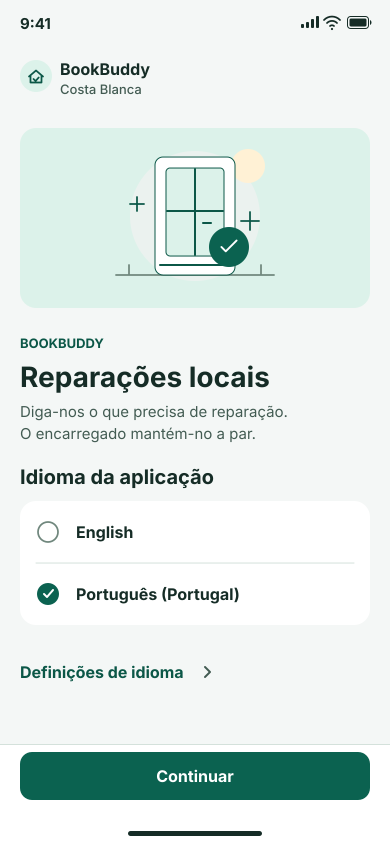

**Purpose and route.** First launch or signed-out return, including an opaque invite or alert. Choose either language right here. Language settings opens the pre-auth, UI-language-only S-12 and returns here. Continue → S-02. No role or account is created.

**Layout and data.** Keep the service mark and terrace-door illustration. Under the welcome text, show two full-width radio rows: **English** and **Português (Portugal)**. The first fixture marks English as selected and labels it Device language; the second shows the controls and Continue button in European Portuguese immediately after an explicit choice. Use autonyms, not flags.

**Interactions and states.** Use the explicit device-local choice first, then the ordered device languages (`en-*` → `en`; `pt` or another Portuguese variant → `pt-PT`); otherwise use English and explain that the device language is unavailable. Selection changes the bundled UI in place, even offline, with no catalog request. Follow device changes only when there is no explicit choice. After sign-in the saved account choice wins. A pending invitation or update shows only “Sign in to open your invitation/update”; do not show sender, business or subject. Keep just one opaque destination through sign-in. Continue can open the email form offline.

**Access and language.** Read heading, purpose, language group with selected state, settings, Continue. Keep focus on the selected radio as its surrounding UI changes; on return from S-12 restore focus to settings. Mark the names with their language for speech and skip the decorative illustration. An iOS welcome root has no Back; Android Back follows normal root behaviour.

## S-02 · Sign in or create account

**Purpose and route.** Verify one email for new and returning users. Enter from S-01, session expiry, or the pre-auth link path. Send code → S-03 for the submitted address; Get help signing in → S-16 → return with email intact. Back returns to the preceding safe screen; a first signed-out deep link cannot pop into private content.

**Layout and data.** Sign in / Email verification header, “What’s your email?”, persistent labelled email input, code-validity notice, help and pinned Send code. `nadia@example.com` is a fictional entry, not a value taken from an unverified link.

**Interactions and states.** Enter or paste an email; trim outer whitespace for submission, preserve what the user typed for edits and do not rewrite the address to try to match an invitation. Button and keyboard action submit once when the field passes basic email formatting validation; missing/invalid email stays inline and points focus to the field. Disable repeat submission while sending and keep the entered address. Advance on an accepted code request, not a local tap. Use the same screen and response for new and returning accounts: do not disclose account existence. Request at most three sends total per address in 30 minutes, with separate source/device throttles. A resend needs at least 60 seconds. If limited, show the service’s retry time in the viewer’s zone without clearing the address or disclosing whether it exists. Offline or a send failure retains the input, distinguishes no connection from an uncertain request, and offers a safe retry when possible. An expired session uses “Sign in again to continue” rather than reopening the old restricted stack.

**Platform, access and language.** Native email keyboard on both platforms, autocapitalisation and autocorrect off; iOS Return and Android IME action use the same validation as Send code. Traverse toolbar, heading/explanation, field and its associated error, banner, help, Send code. Keep the active field and error above the keyboard. Email input always reads left to right; error and button labels can wrap.

## S-03 · Verify code and recover access

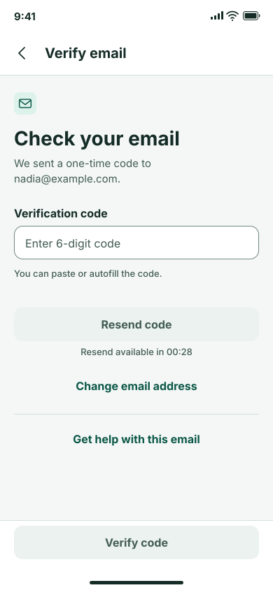

**Purpose and route.** Enter from S-02 after a code request. Verified users with incomplete profiles go to S-04; otherwise run the one-time destination check described below. Change email and Back → S-02 without losing the opaque destination. Get help with this email → S-16, not another account’s recovery data.

**One-time destination check (S-03 and S-04).** With a verified account and complete setup, check the retained opaque destination once. A matched invite opens S-05; an authorised record in the active context opens with its authorised parent; a different granted context opens S-07 for an explicit switch; an inaccessible destination opens S-16. Use the authorised role root only when there is no retained destination (C-01 for a self-serve customer).

**Layout and data.** Verify email header, submitted address, one labelled six-digit input, status or inline error, then resend (when available), Change email address and Get help with this email. Verify code stays pinned and disabled until the entry is complete. In the waiting fixture resend is available in 28 seconds. At lockout both checks and requests are blocked; the fixture resumes at **09:56 your time**, not the site time. No artboard contains a usable code.

**Interactions and states.** The random, single-use six-digit code is bound to this email and sign-in attempt for **10 minutes**. Keep leading zeros; paste and autofill fill the field without submitting. On Verify, disable duplicate taps. A mismatch clears the submitted value and returns focus to the input; expiry points to Resend. A successful resend invalidates the previous code and restarts the 60-second cooldown, not the failure count. The three-send/30-minute limit also applies to resends. After **five failed checks in that window**, pause verification and reissue for **15 minutes**. Show a neutral local retry time. Changing email cannot reset the old limit. Slow delivery: check spam or correct the address; no automatic resend. Offline: keep the opaque destination but do not verify or consume it. Never log a code or challenge value.

**Recovery and assurance.** Before losing mailbox access, the signed-in user can enrol a passkey in **S-06 Account → Security**. To change the address after mailbox loss, prove possession of a passkey already registered to that account **and** verify the new email. Without both, do not transfer the account or offer to enrol a first passkey during recovery. Audit the change, notify the former address and revoke old sessions. An authorised sender may withdraw and reissue a *pending invite*; that does not recover an account or transfer a property or business. A name, address, screenshot, forwarded invite or call from a new number is not proof. S-16 can explain the verified operations route.

**Platform, access and language.** Use iOS one-time-code suggestion and Android autofill where the OS can supply a code; always allow ordinary input and manual paste without reading the clipboard unprompted. Use native numeric keyboard for a numeric challenge. Traverse heading/address, code field plus error, resend/time, change email, help, Verify code. Announce when resend becomes available, not every countdown tick. Keep the code in logical order in RTL; localise digits/time presentation as appropriate without altering the submitted code. The persistent lockout copy remains readable when the IME hides.

## S-04 · Initial setup

**Purpose and route.** After first verified account, or on a return from S-05 when setup is incomplete. After a confirmed save, run the same one-time destination check as S-03, including retained non-invitation links such as jobs and messages. Back retains the setup draft with the current verified identity; leaving all the way out of that identity is explicit.

**Layout and data.** “What should we call you?” leads the form. The name will be visible to people on the user’s jobs. Below it, a ruled Messages and times list has **Reading language: Original only** and **Also show my time** off. With the switch off, a visit in Xàbia shows its site time (`Europe/Madrid`); when enabled, a different viewer zone appears second. The switch never replaces the site time or moves a visit. Continue saves this setup.

**Interactions and states.** The user must supply a non-blank display name; support Unicode, spacing within names and a single name rather than forcing first/last fields. Reject blank-only input, not names unfamiliar to the default UI locale. Start at Original only when no reading preference exists. S-12 offers only reviewed reading pairs and always Original only, independently of UI locale or work languages. A translation sits beside the labelled, unchanged original. Returning preserves the typed name. Seed the chosen UI locale with this normal onboarding save; do not overwrite a saved account locale on every sign-in. The time switch applies only to this setup draft until Continue. Optional preferences can be left at their shown defaults. Don’t request notification, microphone or camera permissions here. Incomplete setup retains input and explains what is needed. On save, remain on the screen during submission; a failed or offline save keeps a safe scoped draft and says it is not complete. Only a confirmed save resumes the retained destination without asking the user to open the link again.

**Platform, access and language.** Use native text field, switch and keyboard dismissal. Traverse heading, name and visibility helper, reading language/value, “Also show my time” toggle and explanation, Continue. Return focus to the reading row after S-12. At large type, move the switch below the label if needed, with one accessibility element for the label and value. Reading-language choices are independent of UI and skills; resolve device time using its zone, not by inferring nationality or changing an appointment.

## S-05 · Accept an invitation

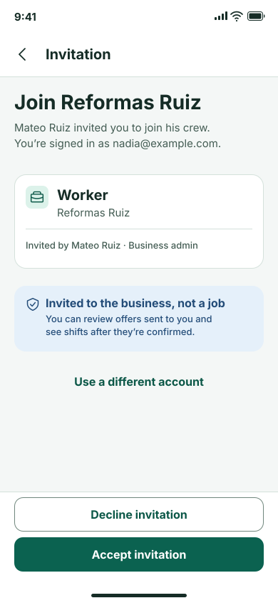

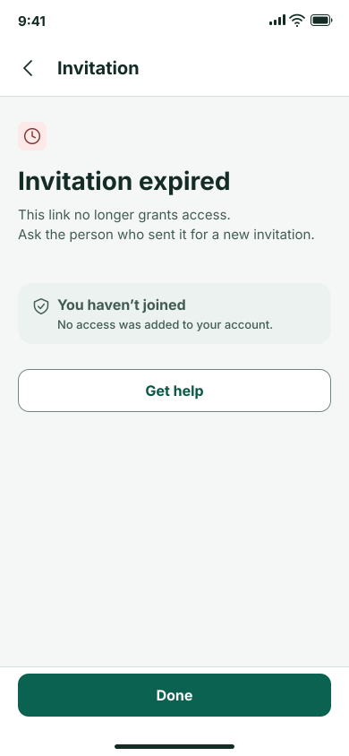

**Purpose and route.** Review an authorised provider/crew membership or a managed-property delegation. Enter from a verified link (P-05 or C-14), or from onboarding. Before verification route through S-01–S-04 as needed. After confirmed acceptance, open the granted role root unless eligibility still blocks access. For a Worker grant with eligibility pending, open S-16 in pending-eligibility mode in that Worker context, not W-01’s ordinary empty state or the offers list. Decline or Done returns to the previous safe root; if new with no provider grant, the app does not open a provider shell.

**Layout and data.** Show the matched, verified email; offered role; named inviter and business; and the **link** expiry. In the P-05 fixture Mateo Ruiz, Provider admin, invites `nadia@example.com` as Worker in Reformas Ruiz. The link expires **Tue, 24 Nov at 17:00 Spain time**; that is not the end date of an accepted membership. Explain “Membership only” before Use a different account and the pinned Decline / Accept actions. No shift, chat membership, precise site access or eligibility comes with this link. A property invitation names the property and each delegated right. Default to view-only without history; request, approve, sign off, record payment and delegate are separate grants within the inviter’s authority.

**Interactions and states.** Signed out: no sender/scope details. Verified wrong account: generic “This invitation isn’t for this account”; show the user’s own verified identity with Use a different account and help, never disclose the intended recipient. Account change keeps only the opaque reference and uses S-06/S-17’s unsent-work guard if needed. Valid: Accept rechecks matching verified recipient, scope, grantor authority, expiry, withdrawal and prior use online. Provider and property invite links last 48 hours. Reissue withdraws the previous link. Show the actual deadline and zone rather than a rolling countdown. An ordinary invite cannot grant a new admin, publishing authority or emergency transfer. Decline can go through S-17 with “This invitation will no longer be available to you”; Back/Cancel has no effect. Disable both actions during either request, navigate only on a confirmed response and recover a duplicate/reopened accepted link without creating another grant. Expired shows the variant with Get help and Done, and points the user to the person who sent the original link; no privileged reissue action for the invitee. Revoked or unrecognised uses safe unavailable copy and removes scope details; if a request races with revocation, replace the old card immediately. If offline before validity can be checked, do not show a grant or actionable invitation; keep the opaque link and offer retry when online.

**Worker membership confirmed, eligibility pending.** S-16 shows the confirmed Worker membership in Reformas Ruiz, explains that work and offers remain blocked while eligibility is pending, and gives the worker a safe contact route for help. Back returns to a permitted restricted view, such as Worker Account (S-06), not to offers or to an ordinary “no work” screen. P-04 is only available to a separately authorised Provider admin in that business context.

**Current access after acceptance.** An accepted-invitation alert or a reopened consumed link is not an invitation form. Check the signed-in recipient’s present access to that business or property. If authorised, show **Your current access** in S-05, read-only: name the scope and list the permissions in force now, including changes since acceptance. Put the dated acceptance under History only if the viewer can still see it. No Accept, Decline or reissue. If membership is restricted, show S-16 with only the permitted status and help. If access was lost or cannot be disclosed, clear stale inbox details and show neutral “Access unavailable”, without the former role or scope. Back from an alert returns to the same permitted S-09 list position and filter. A Provider admin viewing someone else’s membership goes to the checked member in P-03, not this recipient view.

**Platform, access and language.** Push with native Back/Up; the decline confirmation uses the platform presentation for S-17 and restores focus to Decline on cancel. Traverse heading/email, inviter, role and scope, limits, account change, Decline, Accept; in the expired state, title, status, Get help, Done. Wrap inviter, email, property and role on separate accessible lines if needed. Localise the role/permission labels, not the person or business names. Announce accepted or declined only after confirmation; no haptic for an error or an unverified invite.

## S-06 · Account and preferences

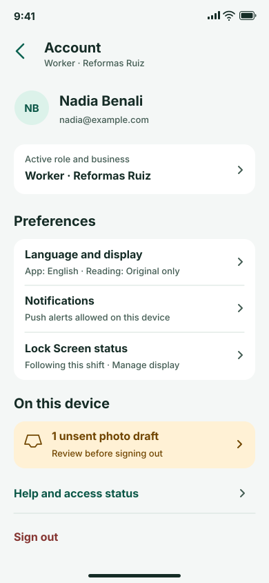

**Purpose and route.** Customer and Provider admin: Account tab with the role’s tab bar. Foreman and Worker: header avatar opens a pushed Account with Back and no tab bar, as shown. Exit to the same role stack unless a confirmed switch or sign-out replaces it.

**Layout and data.** Name and verified email, active Worker · Reformas Ruiz context, a ruled Preferences list, On this device, Security, help and sign-out. Nadia has English UI, Original only reading, ordinary push allowed, and an opted-in display for this shift. The amber **1 unsent photo draft** opens her private W-07 draft while authorised. It has not been uploaded or seen by anyone else. Use actual counts and distinguish an editable draft from an upload or attendance operation awaiting a receipt.

**Security → Set up a recovery passkey.** Optional for every signed-in role, including a newly verified Customer without a business grant. Security names the verified account and explains: “If you lose access to this email, use your passkey and verify your new address.” On **Create passkey**, check the online session and recent proof of control of the current account before requesting a registration challenge bound to that account. For first enrolment, reverify the existing mailbox if the sign-in is no longer fresh. Use the platform’s passkey prompt. On return, show **Passkey registered** only after the service verifies and stores the registration against the same account.

If the user cancels the prompt, return to Security with **No passkey added** and leave existing credentials unchanged. If passkeys are unavailable, explain that this device or browser cannot create one; keep the rest of Account usable. Offline, ask the user to reconnect. If the final response is lost, check the registration outcome before offering another attempt. Back returns to the Security row in Account. Registration neither changes the email nor grants privileges: privileged actions still require a fresh supported passkey check or independent verification by local operations.

**Interactions and states.** A second current grant enables S-07; with just one, show context as a fact. Language and display opens S-12. Notifications shows the system’s actual permission/channel and Enable or Open device settings as appropriate; re-read permission on return. Denial never disables S-09. **Lock Screen status** opens the currently authorised W-10 (C-18 for a customer) to manage that device’s display. Show Off, active, ended or unavailable truthfully. Stop following affects only this device, not the record, shift, attendance or hold. No active display? Explain where to opt in during the foreground visit or deliberate check-in; Account itself does not start one. Android labels the surface “Ongoing notification”; web offers the in-app record, not an OS switch.

**Sign-out and unsent work.** S-17 names this account and the device effect. With a discardable draft, choose Return to finish or explicitly discard just the named draft and sign out. Never silently send or discard it. Pending attendance, submitted uploads and uncertain sends are separate: retain until acknowledged or resolved, surface unresolved items at seven days and require a reconciliation disposition by 30 days. Block destructive sign-out if it would erase the only unresolved record. On confirmed sign-out end/redact the scoped device display, clear private cache and restricted history, and return to S-01 retaining only the pre-auth device UI choice. Offline distinguish clearing this device from revoking remote sessions.

**Platform, access and language.** The OS settings and passkey prompts may take over temporarily; restore focus to the invoking control on return and announce the confirmed outcome. Traverse title/context, identity, active context, language/display, notifications, device status, unsent work, Security, help, then Sign out. Name the avatar trigger “Account, Nadia Benali” rather than reading its initials. At large text, stack each row’s label and value and allow scrolling. Spell out both language settings; isolate role/business and address spans in RTL.

## S-07 · Switch role or business [Sheet]

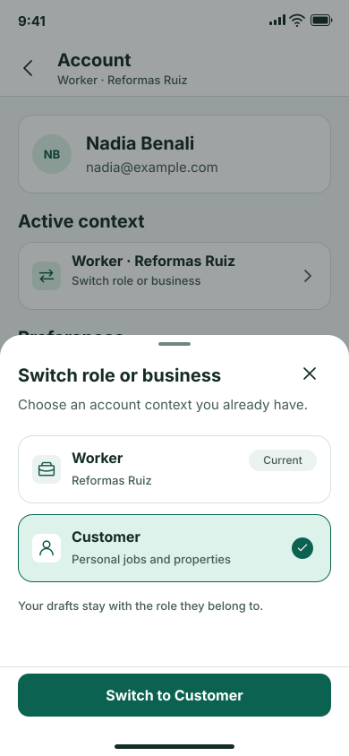

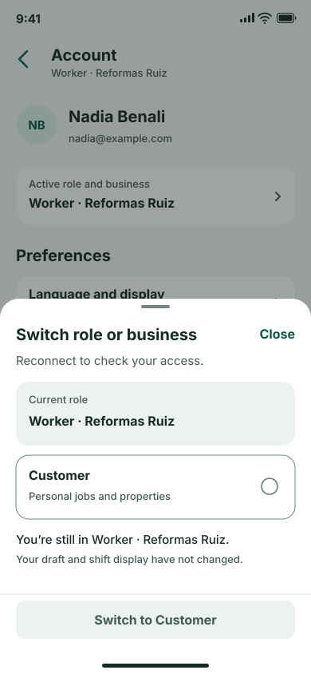

**Purpose and route.** From S-06 or after a link is rechecked and only a different granted context can open it. The artboard is a **Bottom sheet** over dimmed Account; the link case shows the safe prior root instead. Close, Cancel or dismissal returns without changing role. Confirm opens the new role’s root or the authorised destination over its permitted parent path.

**Layout and data.** A real Account page remains behind the scrim. The sheet has a handle, Close, current Worker · Reformas Ruiz, and a separate selected Customer choice. It explains both consequences: the Worker display ends, but the unsent photo stays in Worker drafts. Switch to Customer is the only commit. In the offline variant neither role nor display changes and the switch is unavailable. Changing a Customer property is not a role switch.

**Interactions and states.** Tapping a row selects it without switching; an optional selection haptic may accompany the check. Switch is disabled with no alternative selected. A deep-link sheet offers only contexts that can open that link and uses a safe label (e.g. “Review a shift offer”), not job or recipient details from another context. Tap the explicit “Switch to [role]” action (include business in the confirmation label or immediately above for two businesses in the same role). Persist eligible drafts under their originating account, role and business; a switch does not send them. If a draft cannot be preserved, keep the current context and explain. While checking the new grant, keep the sheet’s processing state; no optimistic switch or exposure of records. A revoked selection is removed, explains that access changed and permits a fresh selection or S-16. If the active grant was itself revoked, return only to an authorised root or safe access screen. One-context presentation shows no switch CTA; no available authorised target routes to S-16, not a role registration flow. Cancelled switches retain the original role, drafts and scroll position; a cancelled link does not resume by surprise. On a confirmed online switch, end/redact old-scope S-18/S-19 and remove old-scope alerts, badges, previews and restricted history before opening the new role. Partition queued work; never transfer or submit it as the new role. Rebuild only the permitted destination and parent. A switch never counts as a second approver of the same account’s quote. Offline switching is not supported, even for previously used contexts. Explain that access cannot be checked, keep the current role only while authorised, and offer Close. No auto-switch on reconnect.

**Platform, access and language.** Use an iOS native detent with explicit Close and swipe-down optional, or Android modal bottom sheet with system Back. While the result is uncertain, do not present a completed switch on swipe or reopen a second sheet. Expand for large type; hold Close and the action in view or make them reachable in the full-height presentation. Trap modal traversal; focus title, Close, cue, role options (radio semantics, spoken “Current”/“Selected”), draft note, action. Restore the caller focus on dismissal; focus the new title after success. Wrap business names/role labels without isolating them visually from current/selected status.

## S-08 · Messages

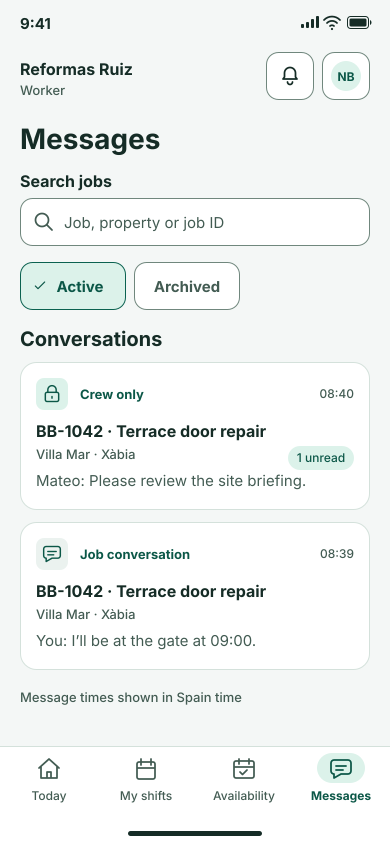

**Purpose and route.** Customer, Foreman and Worker Messages tab → a granted S-10 audience. Return to the same search/filter/scroll state. Bell → S-09; Foreman/Worker avatar → S-06. Provider admin has no Messages tab: explicitly granted job chats are entered from the authorised job link instead.

**Layout and data.** Worker header and tabs match W-01; Messages is selected. Search jobs and Active / Archived precede one job heading (Terrace door repair, BB-1042 · Villa Mar · Xàbia). Two ruled rows sit under it, one per granted audience: **Crew only**, Mateo, 08:40, **1 unread**; **Job conversation**, “You: I’ll be at the gate at 09:00.”, 08:39, **Read**. Times are Mon, 23 Nov in Spain. Show previews only in the authorised app, with a content-type label rather than a sensitive attachment thumbnail. A row opens exactly one audience, not a private message to the sender.

**Interactions and states.** Search by job title, visible property or job ID within the active role’s authorised audience index only. Clear query with a labelled action when it is non-empty. Filter changes update the result list in place without clearing the query. Tap anywhere on a row to open exact S-10 audience; switching inside S-10 is available only to people with both grants. Advance only the viewed audience’s read position, through messages actually presented. Never clear the sibling audience on fetch, job open or preview. Read is not receipt by every participant, job progress or briefing acknowledgement. Read-only archived threads remain readable while permitted; S-10 shows why sending is unavailable. First-use empty says there are no conversations yet and points back to work, while no search result offers Clear search and no archived results offers Active. Loading uses skeletons/announced wait; paging failure keeps the known rows and puts Retry at the end. Offline label gives last confirmed time and searches only permitted cached rows, indicating that results may be incomplete. On removal or a race, remove the detail/preview and show S-16 or the remaining authorised list. A foreground update never steals focus; do not reorder underneath an active tap or screen-reader traversal. No swipe-only actions, cross-role search, worker directory or automatic access from an offer.

**Platform, access and language.** Native search keyboard/clear control, tab navigation and iOS refresh gesture or Android equivalent with an accessible Retry/refresh action where relevant. Traverse context, bell/avatar if present, Messages heading, search, selected filter, section heading, conversation rows, zone note, tabs. Label each row with audience, job, property, unread count and time; avoid reading decorative icons, initials, or the same count twice. Expand row content and wrap filters/labels as type grows; only the optional preview may ellipsise at its paragraph boundary. Preview is original once if same-language, translated when available, or original with a translation-status cue; full translation and original appear in S-10. Retain source direction for Original and UI direction for product labels.

## S-09 · Notifications

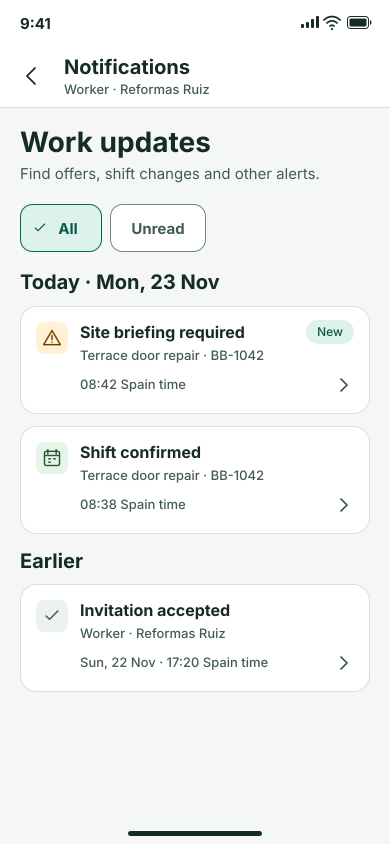

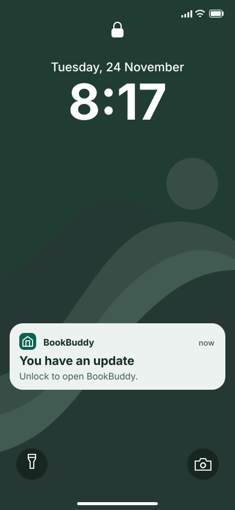

**Purpose and route.** Bell and authorised dashboard shortcuts open the active role’s in-app inbox. OS notifications can open a checked destination directly or land here as a safe fallback. This is pushed with Back, no tab bar. A notification opens a record; it never accepts, pays, acknowledges, confirms or changes a booking. Back restores the caller or a constructed authorised parent path on cold start.

**Layout and data.** In the signed-in Worker inbox, All / Unread filters sit above dated, ruled rows. Mon, 23 Nov: unread site briefing at 08:42 → S-11, previously read shift confirmation at 08:38 → W-04. Sun, 22 Nov: **Invitation accepted** at 17:20 is history shown while permitted. The row says **View current access** and opens the checked status, not the original grant or its receipt. Times use the site zone. In the alternate own-crew round, the in-app alert is issued **Tue, 24 Nov at 08:16 Spain time**, replies are due **08:31**, and the shift is **09:00–10:00**. The notice below the row explicitly separates reservation from assignment.

**Before unlock.** The separate OS fixture is an ordinary alert: BookBuddy / “You have an update” and a prompt to unlock. No Accept, Decline or other mutation; no name, street, job reference, shift time, preview, amount, reason for absence or briefing detail in the payload. “Now” is OS delivery time, not offer issue time or proof anyone read it. Render the generic copy in the recipient’s saved UI language and send only an opaque verified HTTPS destination. This alert is not S-18/S-19, requires no follow and never starts a live display.

**Interactions and states.** Tap the row (including its chevron or “Review offer” text) as one hit area; do not expose a second action. For this own-crew replacement offer, recheck Worker · Reformas Ruiz and eligibility to *view* the offer, then push W-03. Keep existing inbox/filter/scroll position on Back; on a cold worker deep link build W-01 → W-03. W-03 reviews the current offer and is the only place in this path to start responding. Only this provider’s eligible own crew receive launch offers. The first valid acceptance reserves the slot for that round; show its owner “Awaiting foreman confirmation”, not “Shift confirmed”. Other recipients see no identity or private reason. No travel, attendance, site access or chat from a reservation. The foreman’s notice opens F-12 over F-10 for the online recheck and at most one assignment. In this round Diego reserves at 08:30 and Mateo confirms at 08:34, before the 08:35 review deadline. A deadline never opens an external pool; F-11 and pool alerts are later only. If expired, filled or superseded, open read-only history only if still permitted and name why it is no longer actionable. If removed, refresh/redact details and show S-16 generically for the stale tap. Opening may mark only the authorised event read when its target is displayed; never treat this as action completion. Keep read and unread in All; when leaving Unread to open a row, restore nearby position if it has since been read. Empty All (“No updates yet”), empty Unread (“You’re caught up”, with Show all), loading, partial paging and offline states are distinct. Offline shows last confirmed list where authorised, no active response and no claim that an expired-looking cached offer has changed without a fresh read. New notification counts update without auto-scrolling or stealing focus.

**Link handling.** Retain a single opaque destination while signed out; resolve after verified identity, required setup and invite checks. Check role/business, record grant and freshness even for an in-app row. If a different granted context is required, ask in S-07; if none can open it, use S-16 without revealing anyone else’s record. Consume the destination once; duplicate delivery cannot reopen confirmation or replay an action. A still-authorised updated target can show its current version with “This item changed”.

An **accepted-membership alert** opens the recipient’s current grants in read-only S-05, or S-16 if restricted. In the authorised Provider admin context, it opens the current scoped **P-03 member**. After revocation show generic unavailability and clear stale detail; neither branch opens the invitation form or accepts the link again. Back restores the permitted inbox with its filter and position. P-04 is for business eligibility and P-02 for handoffs, not membership status.

Route customer quotes/changes/schedules to C-06/C-15/C-08, sign-off/crew/receipts/issues to C-10/C-09/C-11/C-16, foreman intake/gap/shift to F-03/F-10/F-16 and worker offers/shifts/instructions to W-03/W-04/S-11. A published customer visit update opens C-18; a private worker check-in cannot create that alert. An already-followed S-18/S-19 deep link checks the account, scope and record after unlock before C-18 or W-10 (W-06 for a checkout review); it cannot opt in or commit an action. A message alert opens S-10 at the authorised audience and message; if the message is gone but the thread is allowed, open the thread with a plain explanation.

**Platform, access and language.** Both iOS and Android use their system notification entry and permission model; suppress sensitive previews in the payload itself, not only via user settings. Use native Up/Back and system settings from S-06, not a custom permission dialog. Traverse back/title/context, filters, time-group headings, then rows in visible order with event, subject, urgency/status, time and unread announced as one target. Reading and unread-count labels use local plural rules. In larger text, the expiry and shift time each wrap separately; append optional local equivalents and keep the primary zone explicit in accessible row descriptions. In RTL headings and chevrons mirror; times and job identifiers stay in their own logical order.

## Open design questions

- Who will review European Portuguese onboarding, field terminology, accessible names and private push copy on the supported phones? Which authored-language → reading-language pairs have passed quality and privacy review? Keep Original only available independently.
- Can the enrolled-passkey recovery and the privileged step-up be completed accessibly on the supported devices and owner web? Until verified, use the independently verified operations route for privileged changes, not weaker email or phone proof.
- The drawings mark an alert read on opening its authorised target, and each conversation read independently through its displayed messages. How should a second device present those read positions while it is offline? An inbox preview, transport receipt or elapsed time cannot count as a read or acknowledgement.

## Navigation

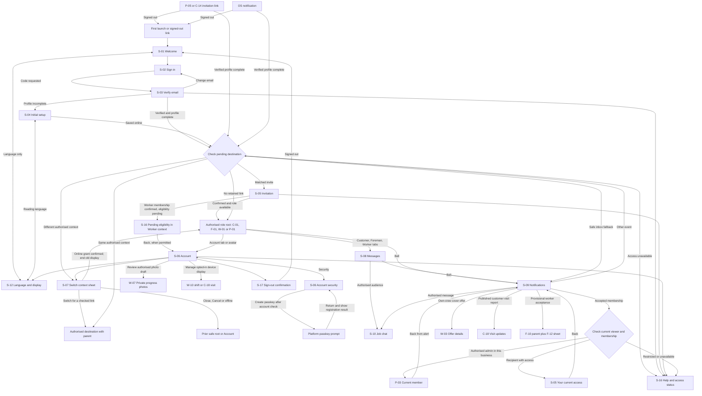

## Review responses

- S-01 shows both launch choices before sign-in; the Portuguese fixture uses the same controls and route. S-02/S-03 use the agreed challenge limits and lost-mailbox rules, not account-disclosing recovery hints.
- S-05 distinguishes accepting a scoped invitation from an assignment or eligibility decision. A Worker with pending eligibility goes to restricted S-16, not an empty offers list.
- S-06/S-07 distinguish private drafts from unacknowledged operations and ordinary alerts from an opted-in shift display. An offline or cancelled switch changes nothing; a confirmed switch ends the old display before opening the new scope.
- S-08 separates read state by conversation audience. S-09 opens a checked current record, never an action. Reading the briefing alert does not clear the hold: the foreman must verify teach-back in a language the worker understands, and that worker must acknowledge the same current instruction online. A cover reply reserves; foreman confirmation assigns.
