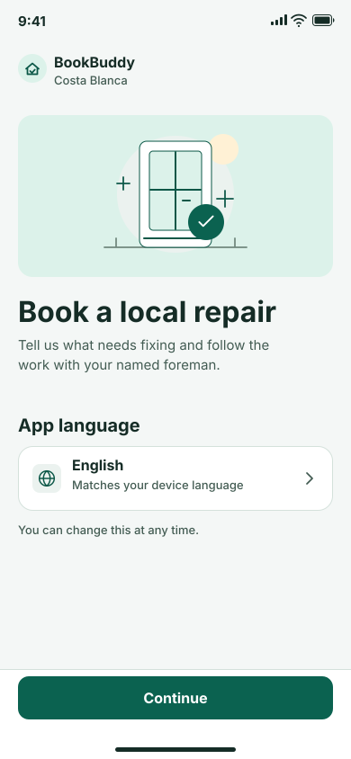
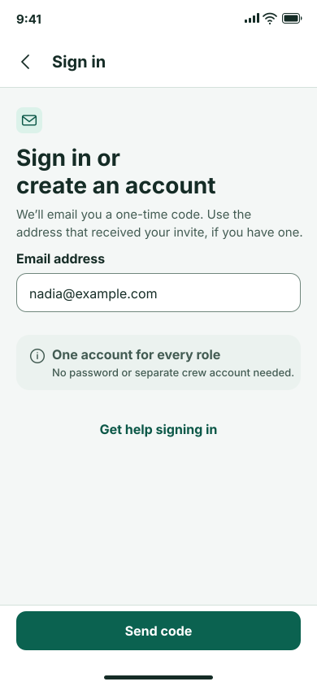
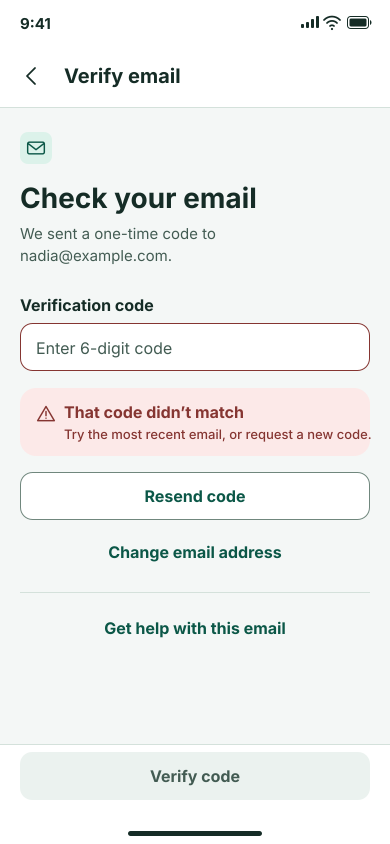
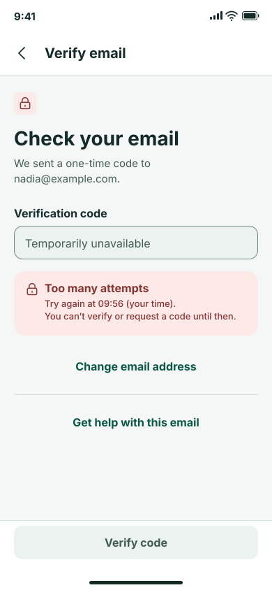
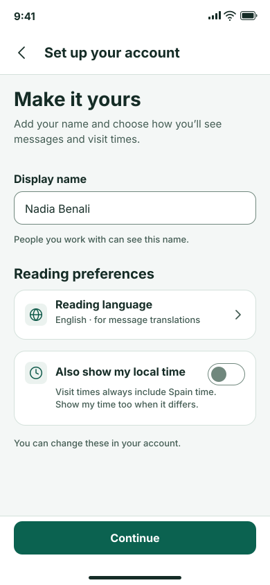
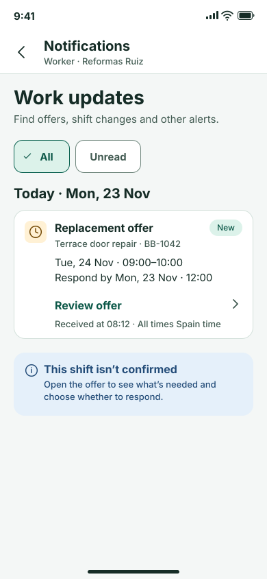
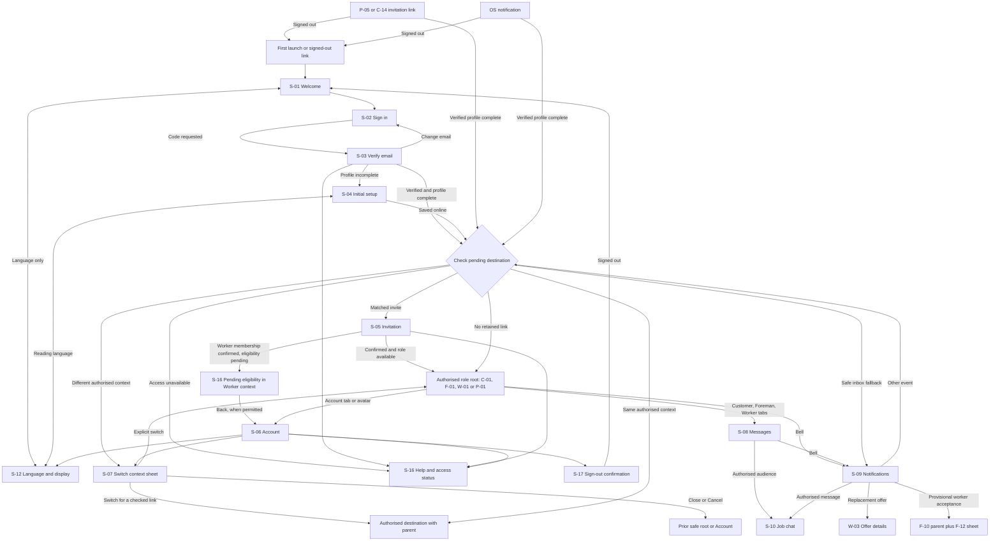

# Shared screens S-01–S-09: access, account and inboxes

This slice gets people into the right role, lets them change preferences without changing what they are allowed to do, and takes them from an alert or a conversation to the underlying record. It follows the [information architecture](../../foundation/information-architecture.md), [role and grant rules](../../foundation/personas-and-roles.md), [core flows](../../foundation/core-flows.md) and [design system](../../system/design-system.md). The artboards are separate scenarios, not consecutive screenshots. In the confirmed-shift scenario, Nadia is already assigned to BB-1042; in the replacement-offer scenario, she has not yet joined that crew.

## Rules used on every screen

- **Navigation and feedback:** iOS uses native Back and edge swipe on the stack; Android handles system Back in order: keyboard, transient surface, then one route. Android also provides Up on pushed screens and uses predictive Back where available. Keep forms, filter selections and list scroll positions on ordinary Back. Use native safe areas and keyboard insets, including Android's three-button navigation. Respect Reduce Motion and disabled vibration. Selection haptics are optional for a deliberate choice and completion haptics are reserved for confirmed outcomes; neither replaces visible or spoken feedback.
- **Accessible layout:** controls are at least 44 pt on iOS and 48 dp on Android, including small icons and text actions. Use native roles, headings, field labels, selected/disabled semantics and polite status announcements. Allow Dynamic Type and Android font scaling to wrap headings and rows, stack adjacent actions and scroll the body at the largest setting. Back, Close and any pinned primary action stay reachable; nothing essential is conveyed by colour or an icon alone. The focus sequences below describe screen-reader traversal, not forced keyboard focus.
- **Localisation:** the illustrations are English fixtures; launch UI is designed for English and Spanish. Keep full translatable strings, plural rules and 30–40% expansion room. For Arabic/RTL layouts, mirror leading/trailing alignment, chevrons and tab placement without reversing reading order or the characters inside job IDs, email addresses, codes and times. Isolate mixed-direction spans. App language changes UI copy, reading language changes requested translations, and work languages are profile capabilities. Neither preference changes a source message, approved quote, version or booking. Visit windows and offer deadlines use site time, with the user’s time alongside when different and enabled.
- **Access and connectivity:** verify account, role/business and the record’s specific grant before showing details. Do not render old scope content during a refresh or switch. Already-authorised cached content, where allowed, is read-only for consequential operations and shows its last confirmed time. No offline invitation response, offer response or grant. Structural loaders keep titles and navigation available; progress and errors are announced and stay visible long enough to act on. A transport failure is not proof a write was rejected: recheck status before allowing another attempt.

## S-01 · Welcome and app language

**Purpose and route.** First launch and signed-out re-entry, including a pre-auth invitation or notification. Continue → S-02. Language row → S-12, in language-only mode → return here. No tabs and no implied role.

**Layout and data.** Brand header (BookBuddy / Costa Blanca), decorative door illustration, display heading and short explanation, **List** row with the selected UI language and device-language hint, then a fixed primary **Button**. The illustrated device language is English.

**Interactions and states.** If supported, initially choose the device UI language; otherwise show the English fallback with “Your device language isn’t available in the app yet.” Save an explicit language choice on the device and apply it immediately on return, without sending anything. Later OS language changes affect the default only if the user has not overridden it. On an incoming link, show “Sign in to open your invitation” or “Sign in to open your update”; keep only the opaque reference and do not preview its sender, recipient, business or subject. Selecting language or continuing works offline; S-02 explains why a code cannot be requested. An iOS root has no fabricated Back control; Android’s system Back at the welcome root follows platform exit behaviour.

**Access and language.** Traverse brand, heading, description, “App language, English”, hint, Continue; skip the illustration. After returning from S-12, focus the language row with its new value. Spell language names in their own language where appropriate (`English`, `Español`); no flags. Wrap the device-language hint in the row, not over its chevron.

## S-02 · Sign in or create account

**Purpose and route.** Verify one email for new and returning users. Enter from S-01, session expiry, or the pre-auth link path. Send code → S-03 for the submitted address; Get help signing in → S-16 → return with email intact. Back returns to the preceding safe screen; a first signed-out deep link cannot pop into private content.

**Layout and data.** Stack title, mail icon and display heading, explanation, **Input** with persistent Email address label, neutral **Banner**, tertiary help **Button**, pinned Send code **Button**. `nadia@example.com` is a fictional entered address; do not prefill an unverified address from an invitation link.

**Interactions and states.** Enter or paste an email; trim outer whitespace for submission, preserve what the user typed for edits and do not rewrite the address to try to match an invitation. Button and keyboard action submit once when the field passes basic email formatting validation; missing/invalid email stays inline and points focus to the field. Disable repeat submission while sending and keep the entered address. Advance on an accepted code request, not a local tap. Use the same screen and response for new and returning accounts: do not disclose account existence. Rate limit shows when retry is available without clearing the address. Offline or a send failure retains the input, distinguishes no connection from an uncertain request, and offers a safe retry when possible. An expired session uses “Sign in again to continue” rather than reopening the old restricted stack.

**Platform, access and language.** Native email keyboard on both platforms, autocapitalisation and autocorrect off; iOS Return and Android IME action use the same validation as Send code. Traverse toolbar, heading/explanation, field and its associated error, banner, help, Send code. Keep the active field and error above the keyboard. Email input always reads left to right; error and button labels can wrap.

## S-03 · Verify code and recover access

**Purpose and route.** Enter from S-02 after a code request. Verified users with incomplete profiles go to S-04; otherwise run the one-time destination check described below. Change email and Back → S-02 without losing the opaque destination. Get help with this email → S-16, not another account’s recovery data.

**One-time destination check (S-03 and S-04).** With a verified account and complete setup, check the retained opaque destination once. A matched invite opens S-05; an authorised record in the active context opens with its authorised parent; a different granted context opens S-07 for an explicit switch; an inaccessible destination opens S-16. Use the authorised role root only when there is no retained destination (C-01 for a self-serve customer).

**Layout and data.** Stack title, delivery heading and address, one labelled code **Input**, inline **Banner** or helper, Resend code, Change email address and help **Buttons**, pinned Verify code. The example uses a six-digit code but contains no usable code. Show the submitted email only within this attempt. The locked example shows a recovery time in the viewer’s local time, not Spain time.

**Interactions and states.** Paste or use OS-provided autofill if available; treat the code as one field, retaining leading zeros and allowing edit. Filling never authorises or sends by itself. Verify submits one complete value; use a processing label and disable duplicate taps. Waiting shows the resend countdown; successful resend clears the previous entry, resets cooldown and tells the user to use the newest email. Slow delivery offers the resend path at cooldown expiry and suggests checking spam or correcting the address. Wrong code clears only the submitted value, announces “That code didn’t match” and returns focus to the field; resend availability is independent until lockout. An expired code instead says “This code has expired” and points to Resend code. Temporary lock disables verification and resend until the authoritative recovery time; changing email does not clear limits for the original attempt. Offline verification does not advance, consume the link or start a substitute recovery path. For lost mailbox access, S-16 provides help; the app never transfers role or job access to another address without an approved recovery or reissue. A verified outcome may use a subtle completion haptic before transition. A crossed resend or expired session reopens only the current valid challenge; users never need to tap the destination again after valid verification.

**Platform, access and language.** Use iOS one-time-code suggestion and Android autofill where the OS can supply a code; always allow ordinary input and manual paste without reading the clipboard unprompted. Use native numeric keyboard for a numeric challenge. Traverse heading/address, code field plus error, resend/time, change email, help, Verify code. Announce when resend becomes available, not every countdown tick. Keep the code in logical order in RTL; localise digits/time presentation as appropriate without altering the submitted code. The persistent lockout copy remains readable when the IME hides.

## S-04 · Initial setup

**Purpose and route.** After first verified account, or on a return from S-05 when setup is incomplete. After a confirmed save, run the same one-time destination check as S-03, including retained non-invitation links such as jobs and messages. Back retains the setup draft with the current verified identity; leaving all the way out of that identity is explicit.

**Layout and data.** Stack title and intro, display name **Input** and audience hint, grouped **List** with reading language and two-zone time preferences, reminder, pinned Continue **Button**. Fixture: Nadia Benali, English reading language and optional local-time display off. Spain site time is always shown; the optional switch adds the viewer’s device zone when different.

**Interactions and states.** The user must supply a non-blank display name; support Unicode, spacing within names and a single name rather than forcing first/last fields. Reject blank-only input, not names unfamiliar to the default UI locale. Reading language starts at the supported device-derived choice and is editable via S-12’s reading section without losing the form. The time switch applies only to this setup draft until Continue. Optional preferences can be left at their shown defaults. Don’t request notification, microphone or camera permissions here. Incomplete setup retains input and explains what is needed. On save, remain on the screen during submission; a failed or offline save keeps a safe scoped draft and says it is not complete. Only a confirmed save resumes the retained destination without asking the user to open the link again.

**Platform, access and language.** Use native text field, switch and keyboard dismissal. Traverse heading, name and visibility helper, reading language/value, “Also show my local time” toggle and explanation, Continue. Return focus to the reading row after S-12. At large type, move the switch below the label if needed, with one accessibility element for the label and value. Reading-language choices are independent of UI and skills; resolve device time using its zone, not by inferring nationality or changing an appointment.

## S-05 · Accept an invitation

**Purpose and route.** Review an authorised provider/crew membership or a managed-property delegation. Enter from a verified link (P-05 or C-14), or from onboarding. Before verification route through S-01–S-04 as needed. After confirmed acceptance, open the granted role root unless eligibility still blocks access. For a Worker grant with eligibility pending, open S-16 in pending-eligibility mode in that Worker context, not W-01’s ordinary empty state or the offers list. Decline or Done returns to the previous safe root; if new with no provider grant, the app does not open a provider shell.

**Layout and data.** Stack title, verified email and inviter, role/scope **Card**, scope **Banner**, Use a different account text **Button**, pinned Decline invitation and Accept invitation **Buttons**. Fixture: Mateo Ruiz, business admin for Reformas Ruiz, invited verified `nadia@example.com` as Worker. A property invitation instead names the authorised property and the exact viewing or delegated permissions granted; do not imply approval, payment, sign-off or access to historic jobs unless granted. Business membership alone does not imply task eligibility, permission to travel, precise site access or an assignment.

**Interactions and states.** Signed out: no sender/scope details. Verified wrong account: generic “This invitation isn’t for this account”; show the user’s own verified identity with Use a different account and help, never disclose the intended recipient. Account change keeps only the opaque reference and uses S-06/S-17’s unsent-work guard if needed. Valid: tapping Accept asks the service to recheck the matching account, that the invite is current and the inviter can still grant that scope. Decline can go through S-17 with “This invitation will no longer be available to you”; Back/Cancel has no effect. Disable both actions during either request, navigate only on a confirmed response and recover a duplicate/reopened accepted link without creating another grant. Expired shows the variant with Get help and Done, and points the user to the person who sent the original link; no privileged reissue action for the invitee. Revoked or unrecognised uses safe unavailable copy and removes scope details; if a request races with revocation, replace the old card immediately. If offline before validity can be checked, do not show a grant or actionable invitation; keep the opaque link and offer retry when online.

**Worker membership confirmed, eligibility pending.** S-16 shows the confirmed Worker membership in Reformas Ruiz, explains that work and offers remain blocked while eligibility is pending, and gives the worker a safe contact route for help. Back returns to a permitted restricted view, such as Worker Account (S-06), not to offers or to an ordinary “no work” screen. P-04 is only available to a separately authorised Provider admin in that business context.

**Platform, access and language.** Push with native Back/Up; the decline confirmation uses the platform presentation for S-17 and restores focus to Decline on cancel. Traverse heading/email, inviter, role and scope, limits, account change, Decline, Accept; in the expired state, title, status, Get help, Done. Wrap inviter, email, property and role on separate accessible lines if needed. Localise the role/permission labels, not the person or business names. Announce accepted or declined only after confirmation; no haptic for an error or an unverified invite.

## S-06 · Account and preferences

**Purpose and route.** Customer and Provider admin: Account tab with the role’s tab bar. Foreman and Worker: header avatar opens a pushed Account with Back and no tab bar, as shown. Exit to the same role stack unless a confirmed switch or sign-out replaces it.

**Layout and data.** Header with active context, identity **Card** with display name and verified email, Active context **List** row, Preferences list, Support row and destructive Sign out **Button**. Worker fixture: Nadia Benali / `nadia@example.com`, Reformas Ruiz, app and reading English, push notifications on. A personal customer context omits a provider business name. The role is context, not an editable identity label.

**Interactions and states.** Active context opens S-07 when another granted context exists; one context is a read-only summary, not a link to grant yourself access. Language and display opens S-12. Notifications expands the settings section in place, with the OS permission status and an explicit Enable push or Open device settings action as appropriate. Grant only on the native prompt; denial leaves the in-app inbox available, and returning from system settings refreshes permission. Per-device permission is separate from any app subscription preference; do not show “on” when system permission is off. Help and access status opens S-16. Sign out opens S-17 naming this account and the device effect. If unsent work exists, choose Return to finish or explicitly Discard unsent work and sign out; do not send or clear it automatically, including on a session change. Reconcile uncertain submissions separately from discardable drafts. Until sign-out completes, display processing and prevent duplicate taps. Completion clears local account data and restricted back stacks and returns to S-01 without clearing device UI language. If offline, local settings and device permission controls remain available as applicable; show unavailable account operations with a reason and do not claim remote sign-out when only this device has been cleared.

**Platform, access and language.** iOS Settings link and Android app-notification settings may take over temporarily; restore the selected section on return. Traverse title/context, identity, active context, language/display, notifications and any expanded controls, support, then Sign out. Name the avatar trigger “Account, Nadia Benali” rather than reading its initials. On large text, list labels and current values stack and the screen scrolls. Spell out both language settings; keep role/business and address spans isolated in RTL.

## S-07 · Switch role or business [Sheet]

**Purpose and route.** From S-06 or after a link is rechecked and only a different granted context can open it. The artboard is a **Bottom sheet** over dimmed Account; the link case shows the safe prior root instead. Close, Cancel or dismissal returns without changing role. Confirm opens the new role’s root or the authorised destination over its permitted parent path.

**Layout and data.** Handle, title and Close, explanatory copy, optional safe destination summary, single-choice **List**, draft note, pinned switch **Button**. Show role plus provider business, when applicable. “Current” is separate from the prospective selection and its check. The fixture keeps Worker · Reformas Ruiz current and selects an already granted Customer context for personal jobs and properties. Customer property selection belongs in the Customer shell, not in this list.

**Interactions and states.** Tapping a row selects it without switching; an optional selection haptic may accompany the check. Continue is disabled with no alternative selected. A deep-link sheet offers only contexts that can open that link and uses a safe label (e.g. “Review a shift offer”), not job or recipient details from another context. Tap the explicit “Switch to [role]” action (include business in the confirmation label or immediately above for two businesses in the same role). Persist eligible drafts under their originating account, role and business; a switch does not send them. If a draft cannot be preserved, keep the current context and explain. While checking the new grant, keep the sheet’s processing state; no optimistic switch or exposure of records. A revoked selection is removed, explains that access changed and permits a fresh selection or S-16. If the active grant was itself revoked, return only to an authorised root or safe access screen. One-context presentation shows no switch CTA; no available authorised target routes to S-16, not a role registration flow. Cancelled switches retain the original role, drafts and scroll position; a cancelled link does not resume by surprise. On successful switch, discard restricted stack entries, rebuild the permitted stack and optionally acknowledge completion. If offline, explain that the other context cannot be verified; do not mix cached records.

**Platform, access and language.** Use an iOS native detent with explicit Close and swipe-down optional, or Android modal bottom sheet with system Back. While the result is uncertain, do not present a completed switch on swipe or reopen a second sheet. Expand for large type; hold Close and the action in view or make them reachable in the full-height presentation. Trap modal traversal; focus title, Close, cue, role options (radio semantics, spoken “Current”/“Selected”), draft note, action. Restore the caller focus on dismissal; focus the new title after success. Wrap business names/role labels without isolating them visually from current/selected status.

## S-08 · Messages

**Purpose and route.** Customer, Foreman and Worker Messages tab → a granted S-10 audience. Return to the same search/filter/scroll state. Bell → S-09; Foreman/Worker avatar → S-06. Provider admin has no Messages tab: explicitly granted job chats are entered from the authorised job link instead.

**Layout and data.** Persistent role/business header with shell actions, then the Messages page title, labelled Search jobs **Input**, Active / Archived filter **Chips**, **List** of conversation cards and the time zone note. In the Worker fixture the header matches W-01; the **Tab bar** retains the home, calendar and checked-calendar symbols and selects Messages. The fixture shows BB-1042 · Terrace door repair, Villa Mar · Xàbia. Crew only: one unread Mateo preview; Job conversation: Nadia’s same-language message from the S-10 reference. The cards are separate audience targets, not direct personal messages. Each shows the preview author, latest readable preview if any, last activity time and unread count with text. Use a content-type label for an authorised attachment instead of exposing a private thumbnail from another context.

**Interactions and states.** Search by job title, visible property or job ID within the active role’s authorised audience index only. Clear query with a labelled action when it is non-empty. Filter changes update the result list in place without clearing the query. Tap anywhere on a card to open exact S-10 audience; switching inside S-10 is available only to people with both grants. A viewed authorised thread can clear its unread count when content is presented, not on fetch, preview or merely scrolling past. Read-only archived threads remain readable while permitted; S-10 shows why sending is unavailable. First-use empty says there are no conversations yet and points back to work, while no search result offers Clear search and no archived results offers Active. Loading uses skeletons/announced wait; paging failure keeps the known rows and puts Retry at the end. Offline label gives last confirmed time and searches only permitted cached rows, indicating that results may be incomplete. On removal or a race, remove the detail/preview and show S-16 or the remaining authorised list. A foreground update never steals focus; do not reorder underneath an active tap or screen-reader traversal. No swipe-only actions, cross-role search, worker directory or automatic access from an offer.

**Platform, access and language.** Native search keyboard/clear control, tab navigation and iOS refresh gesture or Android equivalent with an accessible Retry/refresh action where relevant. Traverse context, bell/avatar if present, Messages heading, search, selected filter, section heading, conversation rows, zone note, tabs. Label each row with audience, job, property, unread count and time; avoid reading decorative icons, initials, or the same count twice. Expand row content and wrap filters/labels as type grows; only the optional preview may ellipsise at its paragraph boundary. Preview is original once if same-language, translated when available, or original with a translation-status cue; full translation and original appear in S-10. Retain source direction for Original and UI direction for product labels.

## S-09 · Notifications

**Purpose and route.** Bell and authorised dashboard shortcuts open the active role’s in-app inbox. OS notifications can open a checked destination directly or land here as a safe fallback. This is pushed with Back, no tab bar. A notification opens a record; it never accepts, pays, acknowledges, confirms or changes a booking. Back restores the caller or a constructed authorised parent path on cold start.

**Layout and data.** Stack title and role/business, explanation, All / Unread filter **Chips**, grouped event **List** with icon, event, permitted subject and time, and a text unread **Badge**. Default Worker fixture for Mon, 23 Nov: unread briefing required at 08:42 → S-11, read shift confirmation at 08:38 → W-04 (Spain time). The earlier accepted invitation opens S-05’s accepted state or current membership/status if still permitted. Separate offer variant: BB-1042 · Terrace door repair, Tue, 24 Nov · 09:00–10:00, respond by Mon, 23 Nov · 12:00, all in Spain time. “This shift isn’t confirmed” is deliberately outside the tap target. No exact street access, eligibility data, prices or message bodies in push. Minimal lock-screen example: “BookBuddy · You have a new update.” The in-app row can show more only after scope verification.

**Interactions and states.** Tap the row (including its chevron or “Review offer” text) as one hit area; do not expose a second action. For Nadia’s replacement offer, recheck Worker · Reformas Ruiz and eligibility to *view* the offer, then push W-03. Keep existing inbox/filter/scroll position on Back; on a cold worker deep link build W-01 → W-03. W-03 reviews the current offer and is the only place in this path to start responding. A worker’s provisional acceptance still requires foreman confirmation; the foreman’s acceptance notice instead opens F-12 over F-10 and leaves final confirmation to that sheet. If expired, filled or superseded, open read-only history only if still permitted and name why it is no longer actionable. If removed, refresh/redact details and show S-16 generically for the stale tap. Opening may mark only the authorised event read when its target is displayed; never treat this as action completion. Keep read and unread in All; when leaving Unread to open a row, restore nearby position if it has since been read. Empty All (“No updates yet”), empty Unread (“You’re caught up”, with Show all), loading, partial paging and offline states are distinct. Offline shows last confirmed list where authorised, no active response and no claim that an expired-looking cached offer has changed without a fresh read. New notification counts update without auto-scrolling or stealing focus.

**Link handling.** Retain a single opaque destination while signed out; resolve after verified identity, any required setup and invite checks. Check role/business, record grant and freshness even for an in-app row. If a different granted context is required, ask in S-07; if none can open it, use S-16 and never reveal that someone else has the record. Consume the destination once; a duplicate delivery cannot reopen confirmation or replay an action. A still-authorised updated target can show its current version with a “This item changed” explanation. Route Customer quotes/changes/schedules to C-06/C-15/C-08, sign-off/crew/receipts/issues to C-10/C-09/C-11/C-16, foreman intake/gap/shift to F-03/F-10/F-16, worker offers/shifts/instructions to W-03/W-04/S-11, and membership/business updates to S-05/P-04/P-02 as applicable. A message notification opens S-10 at the authorised audience and available message; if the message is gone but the thread is allowed, open the thread with a plain explanation.

**Platform, access and language.** Both iOS and Android use their system notification entry and permission model; suppress sensitive previews in the payload itself, not only via user settings. Use native Up/Back and system settings from S-06, not a custom permission dialog. Traverse back/title/context, filters, time-group headings, then rows in visible order with event, subject, urgency/status, time and unread announced as one target. Reading and unread-count labels use local plural rules. In larger text, the expiry and shift time each wrap separately; append optional local equivalents and keep the primary zone explicit in accessible row descriptions. In RTL headings and chevrons mirror; times and job identifiers stay in their own logical order.

## Open design questions

- **Email challenge and recovery policy:** Six digits and the illustrated local unlock time are review fixtures, not backend commitments. Confirm expiry, resend and lockout parameters, whether a newly issued code invalidates older codes, and what proof the service can accept for a lost mailbox. Until that recovery route exists, S-16 cannot promise an account transfer; invitation reissue stays with the authorised sender.
- **Defaults and context checks:** The artboards use English for an unsupported device locale, local-time display off by default, and online verification before switching roles. Confirm the launch fallback and time preference defaults, and whether any non-consequential offline context switches can be supported without retaining revoked information.
- **Inbox semantics:** This design marks an alert read when its authorised target is shown, not when the inbox is viewed. Confirm sync of read state across devices and whether an accepted membership should link back to an invitation receipt or to ongoing role-access status. Neither destination should allow repeat acceptance.

## Navigation

