# Worker screens · W-01–W-10

**BB-1042 · Terrace door repair.** Nadia Benali works for Reformas Ruiz. Her confirmed shift at Villa Mar, Xàbia is Tue, 24 Nov, 09:00–10:00 Spain time (`Europe/Madrid`). W-01 and the fresh W-10 show her own 09:14 arrival receipt at 09:41; Mateo’s separate 09:12 customer report is not a worker check-in. W-02 is the planning view. W-04 and W-06 show arrival review. In W-07’s cleared branch, Mateo verifies Nadia’s teach-back of version 1 at 09:45, Nadia acknowledges that version online at 09:47, and Mateo clears the door task at 09:48. The photo is taken at 09:53. The 09:56 checkout with the task still held belongs to a separate branch. W-05 and the W-03 cover round are an alternative to Nadia attending: after a dropout Mateo needs another eligible member of his crew. No worker sees customer billing or private contact details.

## Shared worker behaviour

- **Navigation and permissions.** Today, My shifts, Availability and Messages (S-08) are the four tabs; restore each authorised stack and scroll position. Re-tapping the active tab returns to its root. At worker roots the bell opens S-09 and Nadia’s avatar pushes S-06 (S-07 to switch context; S-12 for language, display and field controls). A notification opens the record, never accepts, checks in or acknowledges. Recheck the current Worker/business grant and item scope; restore the permitted parent on cold launch. Show S-16 for stale or inaccessible links without confirming another worker’s data exists. Pass only authorised context to S-10; use Crew only by default for a worker-to-foreman operational handoff, not the customer conversation. If that thread is unavailable, offer only an explicit role-scoped contact or help route.
- **Field and accessibility.** Minimum targets: 44 pt iOS / 48 dp Android (48 common); field mode uses at least 56 and 64-high primary site actions where space permits. Use solid fills, strong control boundaries and explicit statuses in sunlight. Keep primary and destructive actions separated. Nothing essential requires swiping, long-pressing, hovering or reading a map or image. Honour text scaling, Reduce Motion and haptic preferences. Grow rows and bars; let content scroll and stack actions before shrinking type. Use polite VoiceOver/TalkBack announcements for new statuses; keep critical state visible. Hide decorative icons, avatars, handles and skeletons from the reading order. Completion feedback is optional and follows a real recorded or server-confirmed outcome, never a pending or blocked response.
- **Platform navigation.** iOS uses native stack Back and edge gesture; sheets have Close and may expand to full height with the keyboard or larger text. Android supports app-bar Up and system/predictive Back (keyboard, then sheet/modal, then route); do not silently switch context at a root. Sheet focus starts at its title, stays inside the sheet and returns to the trigger on close; if the trigger no longer exists, focus the updated status. One sheet/modal at a time; action footers stay above safe area, system navigation and IME.
- **Language and time.** Choose English (default) or Português (Portugal) before sign-in. The bundled catalogs, account reading preference (including Original only), actual source and spoken briefing language are independent. Never infer comprehension from a language or a name. The site’s stored IANA zone governs shift/offer/attendance times; add the viewer’s time second only when enabled and different. Mirror leading/trailing layout and navigation in RTL; isolate names, job IDs, and each time endpoint. Allow +40% expansion and scroll at large type. Arabic is authored content or a non-shipping stress fixture, not a third UI option.
- **Network and scope.** On a locked, individually assigned handset show this active scope’s minimum snapshot for up to 72 hours from its last successful authorisation sync. No shared-device persistent cache, offline switching, or gate/alarm codes in any field, media, translation, push or cache. Use a verified live handoff if a secret is needed. Read locally without refetching on navigation. Label cached data with its last confirmed site time; a refresh is not a new source event. Expiry hides the snapshot; apply revocations before displaying anything on reconnect. Keep submitted media, uncertain sends and attendance in a separate protected outbox until acknowledged or resolved; surface seven-day unresolved items and obtain an approved disposition by day 30. Do not auto-send or silently discard on sign-out.

## W-01 · Today

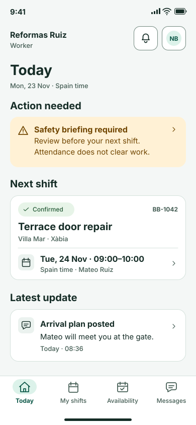

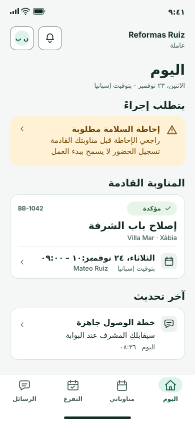

- **Purpose and routes.** Today is the Worker start tab. The first card answers whether this shift is hers and her arrival was received. **View live shift** opens W-10; **Open my briefing** opens W-09. The Mateo row opens the granted Crew only conversation (S-10); bell → S-09, avatar → S-06. A future confirmed shift opens W-04 and an offer opens W-03. A deliberate attendance action uses W-06 with a confirmed shift as parent.
- **Layout and data.** Business/role, Today and the site date → a single notched shift ticket (BB-1042, terrace door repair, Villa Mar, checked receipt at 09:14) → a separate amber stop instruction and briefing action → named foreman and Crew only contact → the four Worker tabs. The mint check means the arrival was received, not that work is clear. No customer milestone rail or payroll timer.
- **States and interaction.** When nothing is scheduled, say so and offer Availability; before arrival, show the next assigned window. Label an own-crew offer with its deadline and coarse area; a reservation has no travel or check-in action. Pending local arrival says *Saved on this device · pending sync*, and offline shows last confirmed time rather than a fresh receipt. Checkout stops elapsed treatment. Never hide the affected-work hold behind an attendance action; release requires verified teach-back and this worker’s online acknowledgement of the same current version.
- **Platform, accessibility and RTL.** Read header, day, ticket, hold, contact and tabs in that order. Announce a new receipt once, without moving focus; reduced motion swaps the mark immediately. The Arabic stress variant puts Today at the right, mirrors disclosures, and right-aligns Arabic in its own column with `text-anchor="end"`, leaving space for the adjacent icon. Names, BB-1042, arrival time and the two shift-window endpoints are separate runs. The earlier endpoint is on the left, dash in the middle, later endpoint on the right. Numerals and non-directional icons are never flipped. Static SVG does not use `direction` or `unicode-bidi`.

## W-02 · My shifts

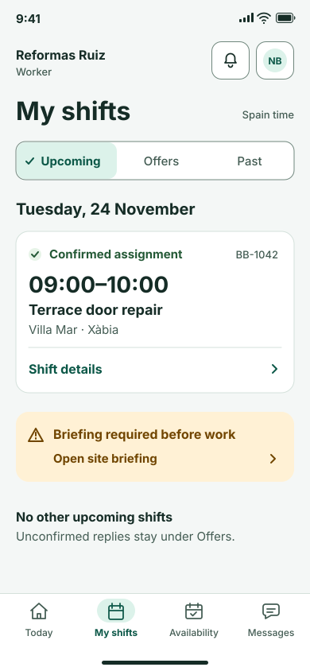

- **Purpose and routes.** Worker tab for navigating their own assignments over time. Tap Upcoming, Offers or Past to change the agenda filter. Tap a confirmed, changed, completed or authorised archived shift to open W-04; an offer or provisional acceptance opens W-03; the separate briefing row opens W-09. Returning restores the filter/day and scroll. No assignment action occurs in the list.
- **Layout and data.** Business/role → title and site zone → Upcoming / Offers / Past with a check on the selected filter → dated agenda. The upcoming assignment shows the confirmed state, reference, 09:00–10:00, job and property; Shift details opens W-04. A separate briefing cue opens W-09. The empty remainder means there are no *other upcoming* shifts, not that there are no offers.
- **States and interaction.** Offered and ‘Accepted, awaiting foreman confirmation’ stay under Offers until they resolve; terminal offers (filled, declined, expired, acceptance withdrawn, or not assigned) are read-only in Past if still authorised. Confirmed entries stay Upcoming until past, with separate attendance indicators. Changed shows the last confirmed/new window where authorised; cancelled and ‘Can’t attend’ rows never show an active attendance action. Filter-empty says what could appear there (not ‘no work’ for all filters). Cached views retain the filter and label last confirmed time; opening an item does not grant access or confirm it still exists. A newly confirmed or revoked record moves/removes only after refresh; keep focus on a meaningful heading or nearest row rather than on the removed item.
- **Platform, accessibility and RTL.** iOS/Android use their own selectable controls and scroll behaviour. Segment labels use 15-unit type, with a check for the selected segment; allow segments to wrap or stack for longer labels or larger text without scaling the labels down. The selected segment announces its name and selected state; sparing selection feedback only if enabled. Focus: heading/context → filter group → dates/rows → tabs. Use full date + site zone in accessible row names and include state once. RTL mirrors the row layout, not date/group sequence.

## W-03 · Offer details

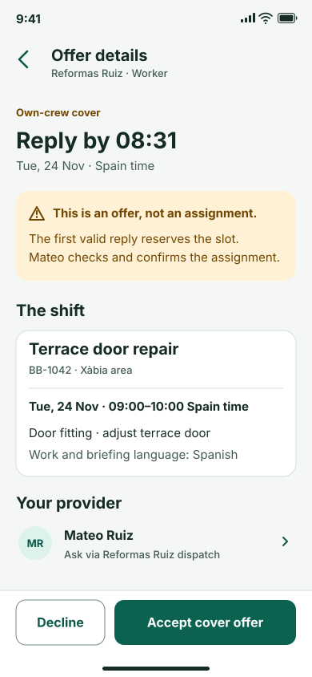

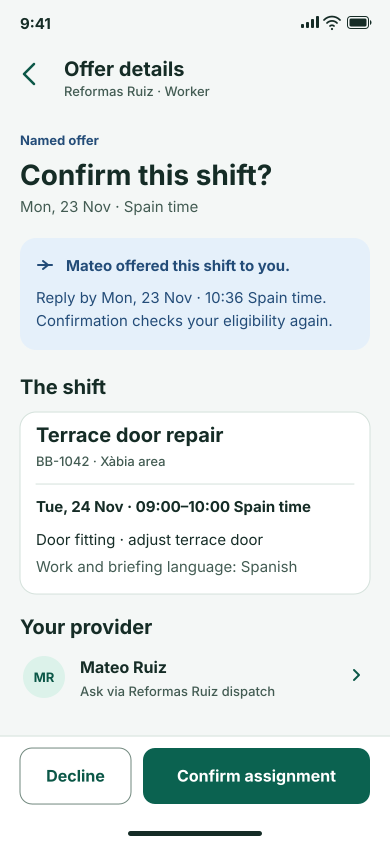

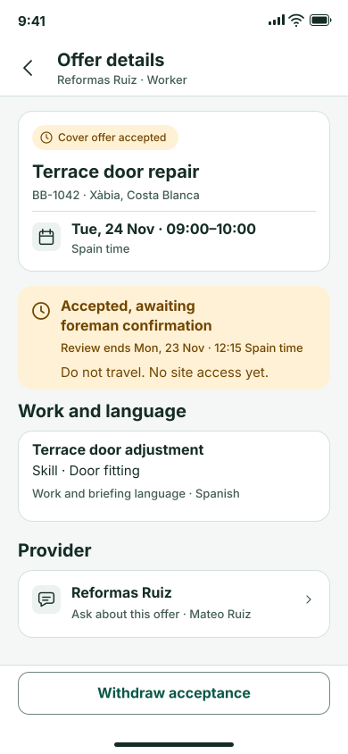

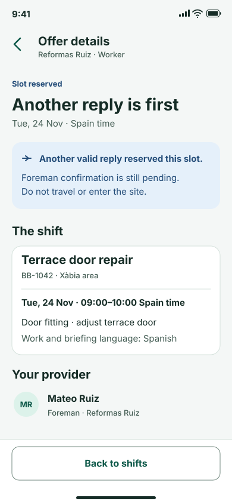

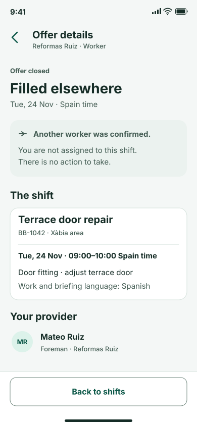

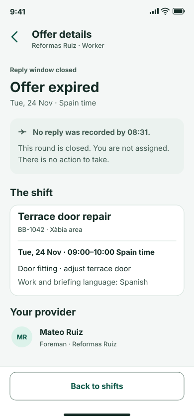

- **Purpose and routes.** Open from W-01, W-02, S-09 or a verified deep link. Confirm an ordinary named offer or provisionally accept a cover offer. Decline an open offer or withdraw a live provisional acceptance via W-05. Back returns to the authorised caller; a standalone deep link has W-01 as parent. ‘Ask about this offer’ uses the permitted provider route for the named foreman (S-16 if needed); it does not open a job thread solely because there is an offer. Time conflicts can open the relevant date in W-08 and return to W-03 for a fresh eligibility check.
- **Layout and data.** State and absolute site date → consequence/status notice → shift summary with coarse area only, date, time, task, skill and spoken language → Mateo, the provider dispatch contact → current decision. No address, job chat, private work number, attendance or access from an offer. Generic alerts carry no acceptance action. Ordinary offers name one eligible provider employee, normally for two scheduled working hours capped by the safe cutoff. Confirm assignment rechecks current availability and eligibility online; a successful named confirmation opens W-04.
- **Internal cover.** Mateo selected at most three eligible, on-duty members of Reformas Ruiz. In this F-10 round, sent Tue 08:16, replies close 08:31. Lucía’s 08:22 decline reserves nothing. Diego’s first valid server-recorded acceptance reserves the slot at 08:30. His receipt says *Awaiting confirmation* and shows the 08:35 foreman deadline. No travel, access, public roster or permission to start. Five minutes run from the recorded acceptance, capped by the safe staffing cutoff and before shift start; the 08:31 reply deadline does not release his place. A competing acceptance sees “Another worker accepted first; confirmation is pending.” It does not identify the worker holding the reservation. Only F-12’s fresh check of the foreman’s authority, current reservation, task fit, availability and overlap assigns anyone. In the confirmed branch that happens once at 08:34. At 09:41 show the checked current assignment or terminal offer result, not stale acceptance or withdrawal controls.
- A slot held for another candidate is unavailable while confirmation is pending. ‘Filled elsewhere’ means another worker was confirmed; ‘Offer expired’ means an unanswered offer’s reply window closed. Show its absolute deadline, with no Accept or Decline. If the foreman review times out or the final recheck fails, say ‘Not assigned’ and explain that review ended or confirmation could not be completed; do not recast the acceptance as declined, filled, expired at the reply deadline, or a confirmed-shift dropout. On successful withdrawal show ‘Acceptance withdrawn · not assigned’. Terminal results are read-only with a parent-aware return.
- If a response and confirmation race, reconcile the authoritative result before offering another action: confirmed → W-04 and, if still applicable, ‘Can’t attend’; withdrawal recorded → read-only receipt in W-03; unresolved → checking state with no mutation controls. Ineligible or conflicting results explain the safe reason and recovery. Stale/offline states disable acceptance and withdrawal until verified. Never identify another candidate. Updating availability does not remove a real confirmed conflict; defer to Mateo if no valid assignment remains.
- **If no one can cover.** Unanswered expiry, failed recheck, withdrawal and unresolved receipt have distinct labels. Never promote a losing reply automatically. A further own-crew round is possible only if safe; otherwise the provider calls its duty lead or agrees a revised visit. No worker-facing pool, ranking, cross-employer offer or penalty for declining.
- **Platform, accessibility and RTL.** Native Back/Up; buttons stack at larger scale with a clear gap. Read header → status/shift → deadline → task and language → provider → actions. Announce expiry once if it occurs while open; avoid continuously announcing a countdown. Speak the full date, time and site zone when reading the deadline. Allow translated CTA and working language names to wrap without changing what was offered.

## W-04 · Shift detail

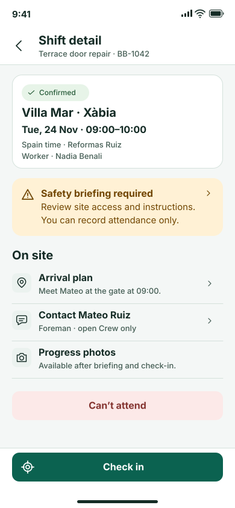

- **Purpose and routes.** Personal hub for a confirmed assignment. Open from W-01, W-02, W-08, S-09 or a successfully assigned W-03. The hold opens W-09 for the arrival plan and official safety instruction; **View live shift** opens W-10 even before arrival. Contact Mateo opens S-10 Crew only if granted. Check in/out opens W-06, eligible Progress photos opens W-07, and Can’t attend opens W-05. Back restores the caller.
- **Layout and data.** The ticket identifies the assigned job, site and visit window in Spain time. The amber terrace door hold has its own briefing action. Under one ruled list, separate Nadia’s attendance receipt, Mateo’s contact and availability of progress photos. Show one attendance action in the footer, away from the dropout action. Residential secrets are not part of the assignment; the safe arrival note in W-09 is only for this crew.
- **States and interaction.** Before arrival show *No arrival recorded*. A hold does not block attendance, but no progress capture of the affected task until cleared. A confirmed arrival links to W-10 and changes the attendance action to departure review. Local-only arrival/departure stays visibly pending, in capture order; no duplicate submit. A scheduled end never records departure. Dropped/cancelled removes access and write controls; show only permitted history. Cached data cannot clear a hold, create an assignment or silently reinstate withdrawn access.
- **Platform, accessibility and RTL.** Use native pushed controls and safe-area footer. Read status/day first, then work hold, site/foreman/progress, then separated destructive and attendance actions. Accessible names include the action and shift, e.g. ‘Check in, terrace door repair’. Grow notes, move passive status to its own line, keep the attendance footer and site context readable at field sizes. Time and identifiers remain isolated in Arabic; labels retain the same meaning.

## W-05 · Decline or drop out

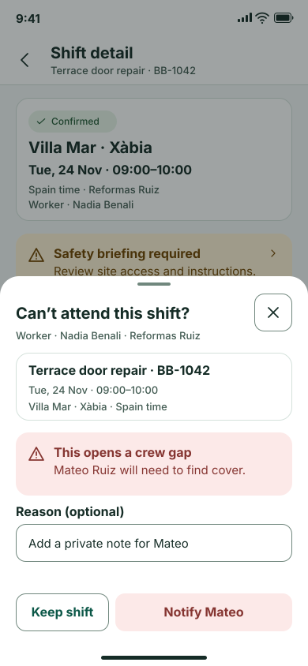

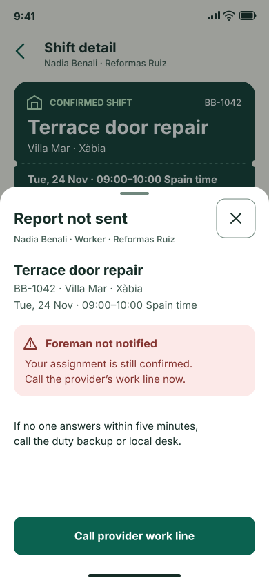

- **Purpose and routes.** One sheet over the initiating W-03 or W-04. Offer: Decline offer / Keep offer. Reserved place: Withdraw acceptance / Keep acceptance. Confirmed shift: Report dropout / Keep shift. Only this last case opens a staffing gap; the customer visit is not cancelled. A changed reservation can never silently become a dropout.
- **Layout and data.** Close, actor/business, specific job and site date/window, consequence, optional private reason, and separate Keep and report buttons. A candidate sees coarse area only. Keep/Close/Back makes no change; confirm discard only when there is a typed reason. No private reason in customer status or push.
- **Receipt, delivery and escalation.** Recheck the offer or assignment online. On a recorded dropout persist its receipt on W-04; the provider has a gap, but a queued notice or transport receipt is not proof Mateo saw it. If the report did not send, show **Foreman not notified**, retain the note and the confirmed assignment, and offer the verified provider work number without needing app data. If unanswered after five minutes, call the duty backup or local desk. A voice report becomes an event only when an authorised foreman records it under their own name. No offline queue that appears to release the shift; an unknown result is *Checking the outcome* until the original operation is reconciled.
- **Reservation race.** A confirmed withdrawal returns to W-03 with *Acceptance withdrawn · not assigned*; F-10/F-12 no longer have a live reservation. If assignment won first, show the authoritative W-04 shift and offer a new, separately reviewed dropout. If the review timed out, show Not assigned, not withdrawal success. Pre-assignment questions use provider dispatch or S-16, never residential details.
- **Platform, accessibility and RTL.** Native sheet/predictive Back and IME dismissal. Title → scope → consequence → reason → Keep → action; explicit Close remains reachable. Use destructive styling and full verbs, not icon-only confirmation. No haptic on the destructive tap; optional feedback only after confirmation is received. Large type stacks actions; validate RTL keyboard, field direction and the isolated time range independently of the shell language.

## W-06 · Check in or out

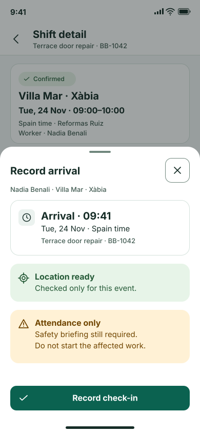

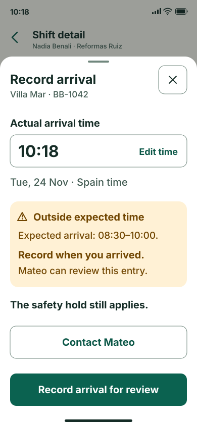

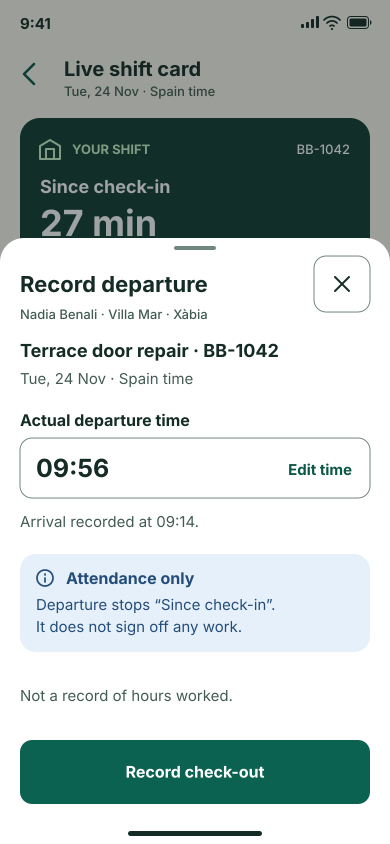

- **Purpose and routes.** W-01, W-04, W-10 or a checked OS link opens one attendance sheet for this worker’s assigned shift. A warm link restores its authorised caller; cold checkout builds Today → W-04 → W-06 after unlock and authorisation. Confirm neither arrival nor departure on open, dismissal, a reminder, a notification action, or a scheduled time. After a deliberate save/receipt show its status on the parent; W-07 is a separate, optional next step if allowed.
- **Layout and data.** Close, worker/site, task and shift reference, actual local event time, site date/zone, receipt consequence, and one large Record action. The worker reviews or edits the actual arrival/departure time; preserve event time, capture time and server receipt separately. No location sample, permission, site boundary or retry. Check-in is attendance only. It neither clears affected work nor publishes On site to the customer.
- **Outside expected time.** The window is a review prompt, not a gate. Arrival is expected from 30 minutes before through 60 minutes after booked start; departure from recorded arrival through 120 minutes after booked end. The legacy-named large-text fixture shows an actual 10:18 arrival against 08:30–10:00. **Record arrival for review** keeps 10:18 unchanged and flags it for Mateo. **Contact Mateo** is optional. Never round to the window, withhold an event or ask the worker to move or retry a boundary.
- **Offline and conflict.** On an individually assigned device with a still-usable scope, stage the event under its stable operation ID before saying *Saved on this device · pending sync*. Keep a local arrival and departure in order; a queued departure stops elapsed display at the actual departure time but is not a received check-out. Batch reconciliation rechecks grant, assignment and event order; duplicates reuse their receipt. On rejection, retain the outcome for the author with a correction/help route, not a confirmed departure against a failed arrival. Reconnection alone does not mark it received.
- **Corrections and privacy.** A worker may request an amendment or use an assisted route without a suitable phone. The authorised foreman records an assisted event as themselves. Link original and amended times, actor, reason and amendment time; notify the worker and allow dispute. Retain site events for 90 days after closure unless documented hold or shorter approved policy applies. W-06 is not the employer’s statutory working-time register; only the employer’s authorised timekeeper corrects that separate record. No automated wages, overtime or safety outcome.
- **Field behaviour.** Focus sheet title → event and time → reason/hold → Record or contact. Make time editable with a native picker and accessible typed alternative. Close stays reachable and a large sheet scrolls. The stress variant uses 64-high time and action targets. Announce saved locally and received separately. Recording never opts the worker in. Once a deliberate foreground arrival is durably saved on this device, the worker can open W-10 and choose a device display without waiting for a server receipt.

## W-07 · Add progress photos

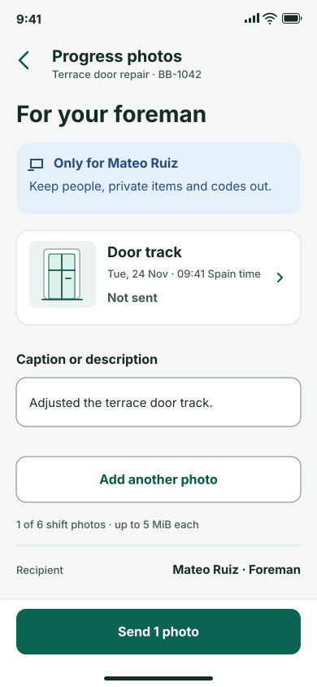

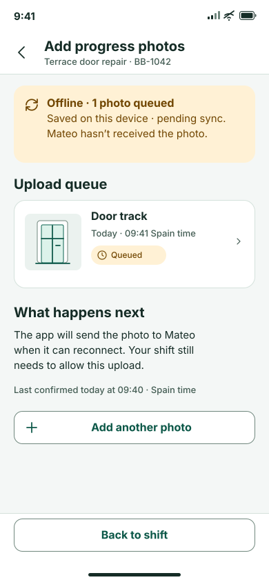

- **Purpose and routes.** W-04 or eligible post-attendance next action opens the worker’s own evidence for Mateo Ruiz. Add another photo opens S-14 with Camera / Photo library; results return to the current selection and draft. A media row opens S-15 for zoom, caption and owner actions. Back preserves the authorised draft/queue; if choosing to discard, state what is lost and confirm. Only Mateo or an explicitly authorised foreman recipient gets the upload; customer sharing is a separate foreman action from F-13.
- **Layout and data.** Pushed job header → author-facing state and notice naming Mateo → illustrative door-track preview with capture time and explicit delivery state → editable caption → Add another photo → shift count, file limit and recipient → Send 1 photo. The offline variant instead shows *1 photo queued · pending sync*, last confirmed time, what happens on reconnect, and Back to shift. No customer receives a photo from this screen.
- **Capture and retention.** Up to six photos per shift, ≤5 MiB each (JPEG, 2,048 px long edge for new captures); no W-07 voice or video. Strip location metadata. Keep people, private items and gate/alarm codes out of photos and captions. Enforce 100 MiB pending media per account per device; on low storage or over-limit files, explain which item cannot be staged and let the worker keep/remove/select another without silently deleting unresolved work. Preserve original captions. A text description is a reading alternative, not a substitute for mandatory evidence.
- **Interaction and states.** No photo → Camera or Photo library via S-14. Denial leaves the system picker and permission recovery. Review caption, legibility and audience before sending; confirm removal of an only copy. Offline, explicitly queue photos in app-owned files and commit attachment IDs and queue entries before saying Saved. Upload progress is not receipt. Keep incomplete/uncertain items, reuse IDs, reconcile scope on reconnect and resume missing bytes. Provide per-file retry on a known recoverable failure. Only acknowledged, linked photos say Received by foreman. Do not resend already received files; stop on revoked access. Ordinary unselected progress media expires 90 days after job closure unless an applicable documented hold or approved record policy applies.
- **Platform, accessibility and RTL.** Use the native camera and picker; never make zoom or swiping the only recovery path. Keep keyboard clear of caption and Save/Send controls. Focus: privacy notice → photo name/capture/status → caption → Add → recipient → send/return. Label each photo by position and caption when available; don’t announce progress on each tick. Wrap recipient, caption and status separately at large sizes. Mirror placement, not camera/thumbnail; apply independent caption direction and localised photo counts.

## W-08 · Availability

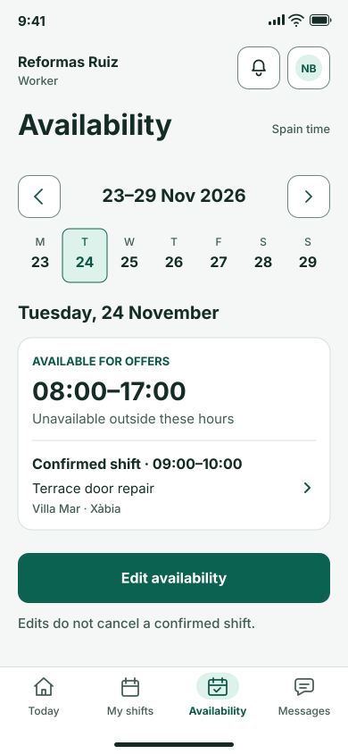

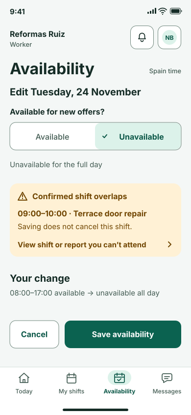

- **Purpose and routes.** Worker tab and direct date-focused entry from a W-03 conflict. Show when Nadia is available for offers and separately what is already confirmed. Tap previous/next week, a day, or an equivalent agenda row; tap confirmed shift to W-04. From the conflict route, Back returns to W-03 without changing the offer; recheck before any response. At the tab root use shell navigation, not a back action disguised as a tab.
- **Layout and data.** Business header, Availability and site zone, week controls and selected day, then one ruled panel: 08:00–17:00 available for offers; separately, the confirmed 09:00–10:00 assignment. Edit availability opens the date-focused editor; Save/Cancel appear only with a change. The overlap variant shows both the proposed all-day unavailability and the unchanged assignment, with a separate link to W-04 → W-05 for Can’t attend.
- **Interaction and states.** Workers own future offer availability, including declaring unavailability over confirmed work. Saving suppresses new offers for that interval; it neither modifies the assignment nor reports a dropout. An explicitly delegated employer scheduler may make an attributed business correction; a foreman cannot silently overwrite the worker’s declaration. Separate Unavailable from Not set; past or unauthorised scope is read-only. Validate missing times, end before start and overlaps inline. Show midnight-spanning windows as two dated intervals. Offline edits stay unsent until reviewed and confirmed; keep prior server state and draft on failure. If a business correction or shift has changed, explain and re-review before retry.
- **Platform, accessibility and RTL.** iOS native date/time controls, Android native picker with typed input where offered. Provide labelled previous/next week controls, not swipe-only navigation; narrow and large-type layout switches to an agenda list. Focus range → day selections with full spoken dates and selected state → availability → conflicts/shift → editor action → tabs. Mirror week direction and affordances for RTL, respect locale week start, validate ambiguous or skipped daylight-saving times against the site zone rather than the device zone.

## W-09 · Site briefing

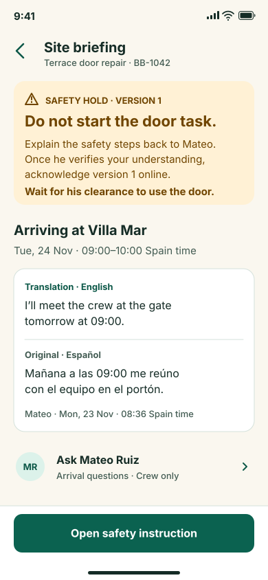

- **Purpose and routes.** Enter from W-01/W-02, W-04’s arrival plan or W-10’s hold. W-09 explains arrival and the work hold; it cannot accept an acknowledgement. Open safety instruction goes to the exact current S-11 version for this worker. General arrival questions go to Mateo in S-10 Crew only if granted, otherwise the verified work contact; keep the instruction, teach-back and clarification private.
- **Layout and data.** Amber *Safety hold · version 1* → task and required human steps → appointment in Spain time → approved non-secret arrival note, translated English then exact original Español, credited to Mateo on Mon 23 Nov at 08:36 → Mateo contact → S-11 footer. Showing appointment date separately preserves the meaning of “tomorrow” in the original. No codes or sensitive entry details in text, translation, cache, media or notifications.
- **Verification and release.** Mateo or a qualified human briefer speaks with Nadia in a language she understands. She explains or demonstrates the hazard, the control and what to do or whom to call if it changes. Record the worker, job, instruction version, verifier, language/interpreter if needed, site time and checklist outcome; no routine audio recording. Mateo’s verification alone does not release the hold. Nadia must also explicitly acknowledge that **same version online**. Keep the stop cue through transmission and any unknown result. After acknowledgement, any separate site clearance still applies; the fixture requires Mateo’s permission to use the door. Attendance remains available throughout.
- **If something changes.** On unclear wording, missing language coverage or failed teach-back, use private clarification; arrange a competent briefer/interpreter or stop the affected work. A material revision or replacement requires a new person/version-specific verification and acknowledgement. Never copy an earlier acknowledgement or treat a read receipt or translation as comprehension. Original only shows the note once; pending/unavailable translation leaves its labelled original intact. Offline shows the permitted last confirmation, not fresh clearance. Return from S-11 to the updated authoritative status.
- **Platform, accessibility and RTL.** Native navigation, no gesture or unread dot required to reach S-11. Focus title → hold → arrival/date → translation and labelled original → contact → instruction action. VoiceOver/TalkBack read each paragraph with its own language; same-language original is shown once. Grow instruction cards without truncation and preserve the hold and named contact; neither right-to-left mode nor machine reading preference changes the agreed working or briefing language.

## W-10 Live shift card

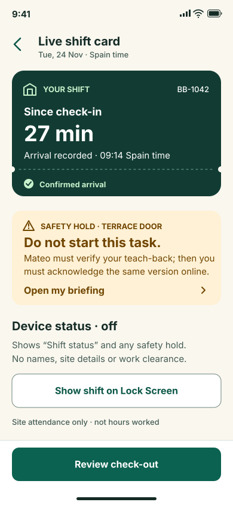

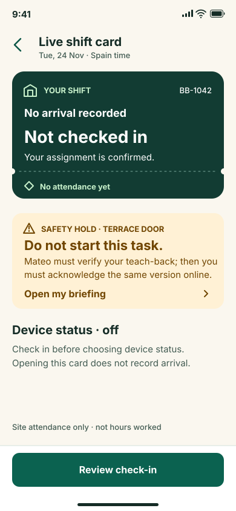

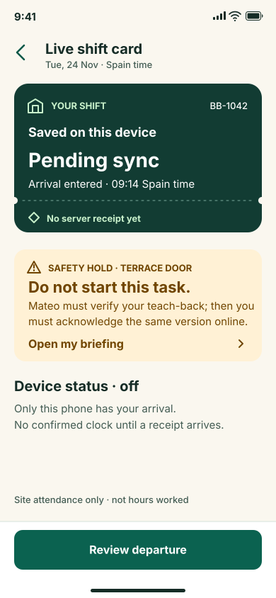

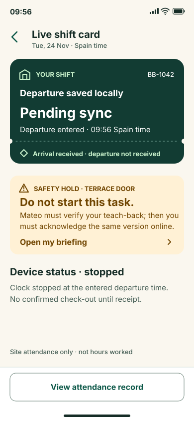

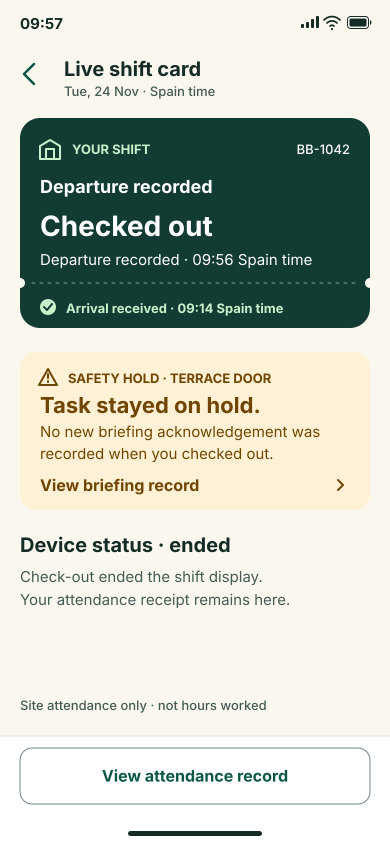

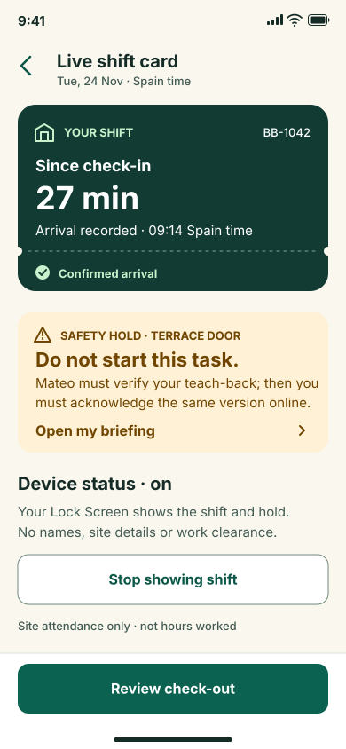

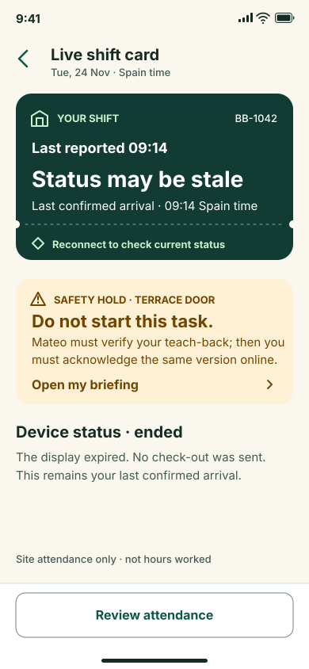

- **Purpose and routes.** W-01 and W-04 resume the worker’s own attendance card. The normal tap on S-18/S-19 opens it only after unlock and current account, business, worker and shift access checks. A checkout link opens W-06 **for review**, never a mutation. Cold entry via Today → W-04; warm Back returns to the actual caller. The briefing link goes to W-09 → S-11. A revoked/wrong-scope link ends/redacts the old display and offers the checked S-07 or generic S-16 route.
- **Layout and data.** On warm paper, one private shift ticket shows BB-1042, site date/zone, actual event time and the receipt state. Only a confirmed, fresh arrival can show **Since check-in** (09:14 to 09:41 = 27 min here). Below, a separate task-specific hold links to the briefing. The optional device display section names the permitted summary and choice. Review check-out opens W-06. The elapsed duration is not work, wages, customer progress or permission to start.
- **Receipt states.** A confirmed assignment with no arrival has no clock. A locally saved arrival shows its entered time, pending sync and no server receipt; a deliberate later departure can be staged in order. Confirmed arrival starts elapsed treatment from its event time, never the upload time. At the source stale deadline remove the timer, show the actual last reported time and reconcile on eligible foreground/reconnect; no timer-driven refetch. Local departure stops elapsed treatment at the entered departure, shows pending, and disables repeat checkout. Receipt closes the record with actual arrival/departure; an unknown/conflicting result keeps the last confirmed event and offers review/correction. Checkout does not resolve safety.
- **Opt-in and privacy.** Opening W-10, tapping Record, receiving a reminder or reconnecting never opts anyone in. After a deliberate arrival is successfully staged, W-10 shows the device display off and previews “Shift status · Pending sync” and “Safety hold · Open app” if held. **Show shift on this device** is a separate foreground choice, available to a first-time worker without signal. It starts at most one local S-18 iPhone Live Activity or ordinary S-19 Android ongoing notification for this device and shift. While the arrival is local only, show no elapsed clock or claim of receipt. A later confirmed revision updates the existing display, without starting another. After opt-in, offer Stop showing shift (Android: Stop shift notification). Use a generic shift alias, receipt/pending or fresh since-check-in, and “Safety hold · open app” in preference to a clock when applicable. No property, address, people, access details, chat, pay or safety all-clear. Hidden previews use a redacted projection, not private text under a mask.
- **Lifecycle and accessibility.** In-app status and deliberate checkout work with permission denied, Android channel off, no Island, dismissal, stale delivery, expiry or OS support unavailable. No auto-repost or automatic restart. iOS ends after at most eight active hours; a final Lock Screen snapshot can linger at most four more, **not live**. Stop showing, checkout, cancellation or loss of role/grant ends the applicable display, not another device’s attendance. No remote start at launch, background socket, polling or elapsed-minute requests. Eligibility depends on signed-device proof. Announce receipt/hold changes once; do not read elapsed ticks aloud. Reduce Motion swaps status in place. Keep the actual event, hold and next action reachable with field-sized controls.

## Open design questions

- **Signed-device display.** Which supported handsets pass locally started status, stale replacement, eight-hour expiry, redaction on role change and unlock-to-W-06? Keep the in-app card and manual checkout authoritative if a device fails.
- **Human coverage and language review.** Which named briefer and backup can verify each actual spoken language and task, and who reviews European Portuguese field copy and each reading pair? Do not enable unreviewed translations or assume Arabic/Darija coverage from the RTL fixture.
- **Field practice.** Which verified provider duty line and backup answer the missed-dropout drill, and which shift evidence needs a photo rather than a note? No receipt implies a person was reached; no queued image is received evidence.

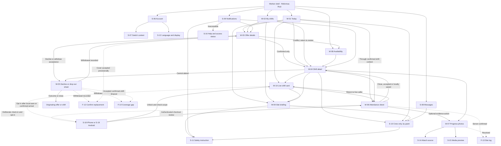

## Review responses

- **FL-12 · safety.** W-01, W-04, W-06, W-09 and W-10 keep arrival separate from work clearance. W-09 explicitly requires verified human teach-back and Nadia’s recorded acknowledgement of the same version; the original meeting note stays verbatim.
- **FL-13 · cover.** W-03 and W-05 distinguish the first valid reservation, competing reply, review cutoff, withdrawal and one foreman-confirmed assignment. No individual external offer or travel on provisional acceptance.
- **V-W-01 / V-W-02 · field presentation.** The non-shipping RTL fixture preserves numeric order with separately positioned time endpoints, mirrored disclosures, right-aligned text and Today at the right. W-02 keeps 15-unit filter labels with a visible selected check. The inherited W-06 large-text filename stays stable; its content is outside the expected **time**, never a location check.
