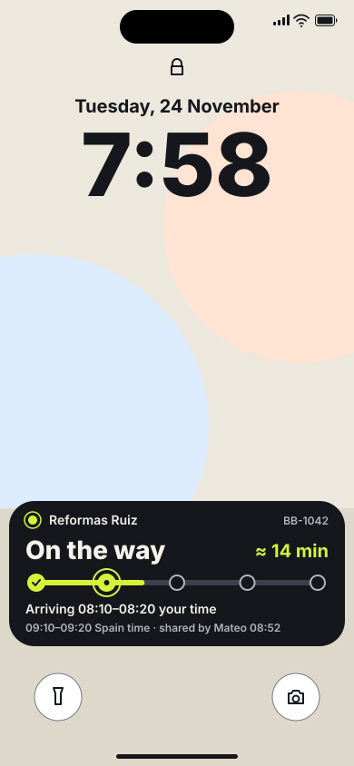
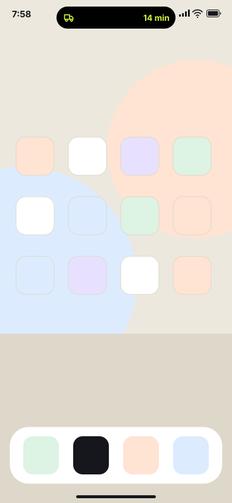
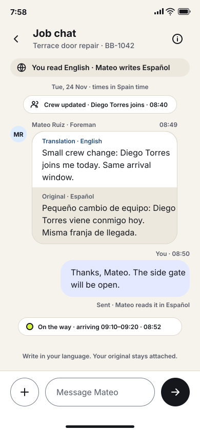

# BookBuddy app design: Beacon

A second, independent design for the BookBuddy app on iPhone and Android, for comparison with the [reference design](../design/README.md). Beacon treats every booking as one live object: a dark capsule with a lime progress line that looks the same in the app, on the Lock Screen, in the Dynamic Island and in the Android notification shade.

## Foundation

- [Concept and principles](foundation/concept-and-principles.md): the direction, the live interaction model, seven principles, and what changes from the reference.
- [Personas and roles](foundation/personas-and-roles.md): who uses the app, what each role may do, and what each side sees of a live visit.
- [Information architecture](foundation/information-architecture.md): tabs per role, system surfaces, links and navigation maps.
- [Core flows](foundation/core-flows.md): booking to live tracking to completion, replacement, multilingual chat, deliberate check-in, customer live status, and a later session booking.

## Design system and handoff

- [Design system](system/design-system.md): colour for light and dark with contrast, type, spacing, motion, signature components, Live Activity, Dynamic Island and Android layouts, accessibility and localisation.
- [Wireframe conventions and sample data](system/wireframe-conventions.md) and the [SVG template](system/wireframe-template.svg).
- [Screen inventory](screens/inventory.md): 81 surfaces in eight slices, with states, owners and the story timeline.

## Screens

Placeholder. The integration owner regenerates this section when the slices land: one gallery table per role, listing every SVG exactly once, in the same format as the reference README so `scripts/export-design-pdf.ts` can be pointed at `design-fable/`. The lead-drawn reference screens are listed now.

### Customer

Specs: `screens/customer/C-01_C-08-specs.md` · `screens/customer/C-09_C-20-specs.md` (to come)

| | | |
| --- | --- | --- |
|  C-09 Live visit |  C-19 Visit Live Activity [System] |  C-19 Visit Live Activity [System] — island compact |
|  C-19 Visit Live Activity [System] — island expanded |  |  |

### Foreman

Specs: `screens/foreman/F-01_F-09-specs.md` · `screens/foreman/F-10_F-18-specs.md` (to come)

### Worker

Specs: `screens/worker/W-01_W-12-specs.md` (to come)

| | | |
| --- | --- | --- |
|  W-01 Now |  |  |

### Shared

Specs: `screens/shared/S-01_S-09-specs.md` · `screens/shared/S-10_S-19-specs.md` (to come)

| | | |
| --- | --- | --- |
|  S-10 Job chat |  |  |

### Provider admin (P-)

Specs: `screens/shared/P-01_P-05-specs.md` (to come)

### Later categories (L-)

Specs: `screens/shared/L-01_L-07-specs.md` (to come)

## Decisions and research

- [Product brief](../docs/reports/2026-11-21-builders-company-idea.md)
- [Mobile, web and platform architecture](../docs/architecture/mobile-tech-stack.md)
- [Live Activities and attendance research](../research/tech-stack/live-activities-and-geofenced-attendance.md)
- [Reference flow review](../docs/reports/2026-11-23-design-review-flows.md) and [visual review](../docs/reports/2026-11-23-design-review-visual.md)
