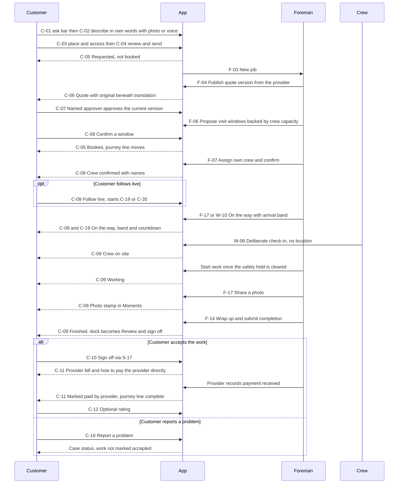
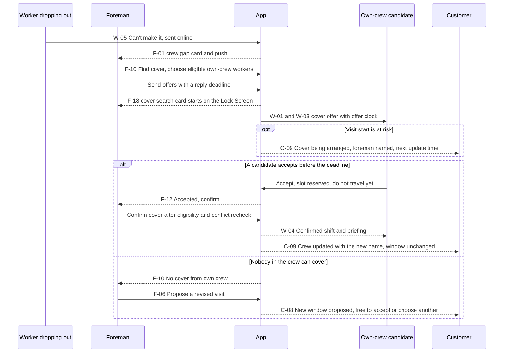
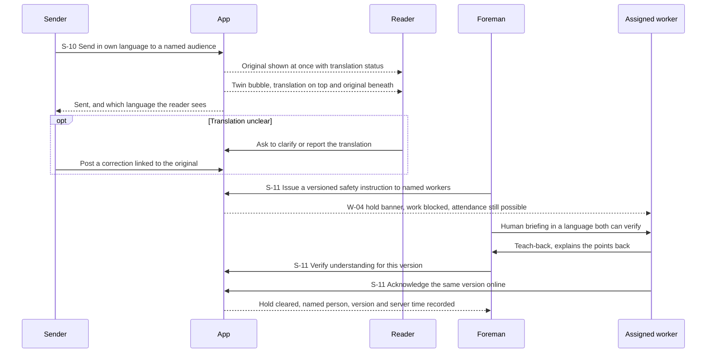
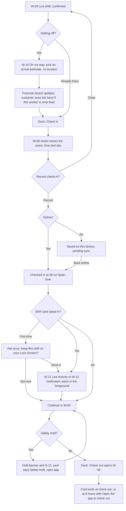
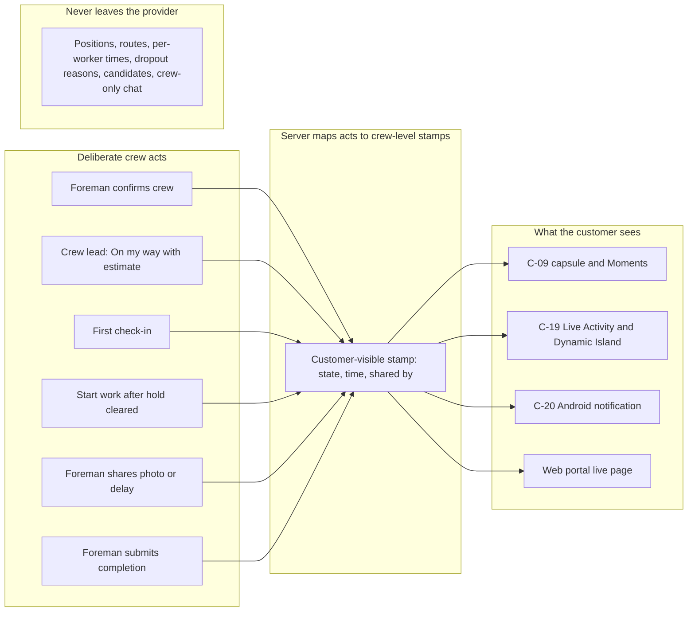
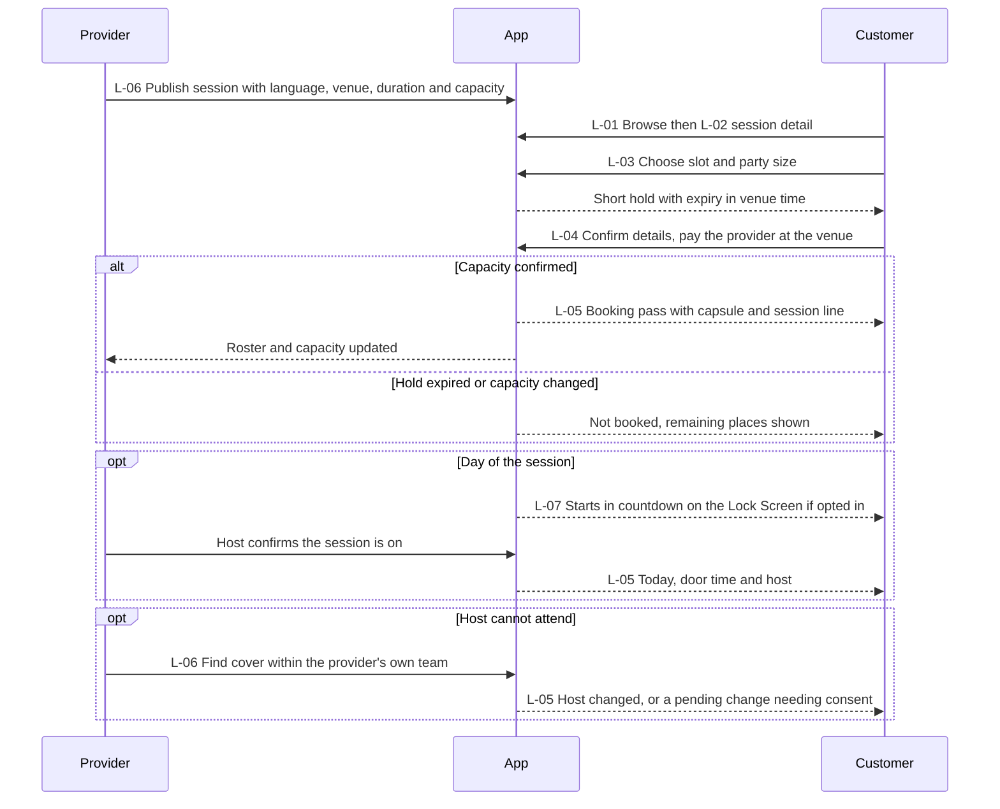

# Core flows

IDs refer to the [screen inventory](../screens/inventory.md). Where the [reference flows](../../design/foundation/core-flows.md) are right they are reused and this file says so; it redraws only what Beacon changes. Owner decisions applied: the provider contracts with and bills the customer and there is no in-app payment at launch; cover comes only from the provider's own crew; cancelling and rescheduling are free; attendance records no location.

## Shared state rules

- **Journey line (job stage):** Requested → Quoted → Booked → Visit → Signed off → Paid. Cancelled appears only after an authoritative cancellation. A crew gap, an open change, an open problem and a bill are separate flags, not stages.
- **Day line (visit):** Confirmed → On the way → On site → Working → Finished. Each step is a stamp made by a deliberate act: the foreman confirms the crew; the crew lead declares "On my way"; the first crew member checks in; the foreman or lead starts work once any safety hold is cleared; the foreman submits completion.
- **Assignment:** Offered → Accepted (slot reserved, awaiting foreman) → Confirmed. First valid acceptance reserves the slot; only the foreman's confirmation assigns the worker. Declined, Expired, Filled and Can't make it are distinct outcomes.
- **Online for consequences, offline for capture:** sending a request, approving, confirming a window, accepting or confirming cover, acknowledging an instruction and signing off need the server. Drafts, chat, photos and check-in or check-out can be saved on the device and are labelled "Saved on this device · pending sync" until accepted.
- **Live honesty:** every status shows who and when. When freshness cannot be confirmed the capsule goes quiet and says "Last confirmed …". Nothing is inferred from a clock, a place or a chat message.
- **Time:** site time first ("Spain time"), the viewer's time alongside when it differs.

## 1. Customer booking, live tracking and completion

- The request path, quote versions and window confirmation are the reference's flow 1, unchanged. Booking still needs an approved quote and a confirmed window.
- **New in Beacon:** the visit day is live. C-09 replaces the static job-day card; the Live Activity or ongoing notification carries the same capsule outside the app.
- **Bill, not checkout.** At launch C-11 shows the provider's bill, its reference and how to pay the provider directly. The provider records the payment; the app never takes or confirms money. Sign-off and payment stay separate.
- Cancelling or rescheduling (C-17) is free. The sheet says so and still explains whether the provider must agree a new window.

## 2. Last-minute replacement from the provider's own crew

- **Kept from the reference:** first valid acceptance reserves the slot; the foreman's confirmation assigns the worker; a provisional acceptance is not permission to travel; only one candidate is confirmed per gap; the customer never sees candidates or the dropout reason.
- **Owner decision:** at launch offers go only to the provider's own crew. If none can cover, the provider proposes a revised visit. The vetted pool (F-11) is a later rung of the cover ladder with no launch navigation.
- **New in Beacon:** the search is live. F-10 shows a capsule with offer clocks, and F-18 keeps it on the foreman's Lock Screen. Confirming cover always happens in F-12, never from a system surface.
- The replacement gets their own safety instruction and attendance. Nothing transfers from the worker who dropped out.

## 3. Multilingual chat and the safety briefing

- This is the reference's flow 5 and its settled rules, unchanged: the hold lasts until the foreman has verified understanding by teach-back **and** the worker has acknowledged that version online. A read receipt, a translation or a tap on a bubble never acknowledges anything. A new version needs a new acknowledgement.
- **New in Beacon:** the twin bubble, a language line under the header ("You read English · Mateo writes Español"), a sent receipt that names the reader's language, and customer-visible stamps inline in the Job conversation so the thread shows what happened as well as what was said.
- The UI ships in English and Portuguese. Message languages are not limited to UI languages. Originals are always kept and shown.

## 4. Deliberate check-in with the optional live shift card

- Check-in and check-out are deliberate, two-tap events by the assigned worker. **No location is read or stored.** A geofence, a notification or the shift card never records attendance.
- The shift card is optional and off until the worker says yes. It starts in the foreground right after the check-in tap, so it needs no background permission. It shows the job reference, a site alias, "Since check-in" with an OS timer, and one link, Check out, which opens W-06. It never shows an address, a customer name or a safety all-clear.
- iOS ends a Live Activity after 8 hours. The card then says to open the app; the shift record is unaffected. Dismissing the card or denying notifications never blocks attendance.
- Attendance during a safety hold is allowed and labelled "Attendance only".

## 5. Customer-facing live status, privacy-respecting

- The customer's live view is assembled from six kinds of deliberate act. There is no map, no coordinates and no continuous signal. The arrival band is an estimate the crew lead chose to share, shown with who shared it and when.
- **Crew-level outside:** the customer sees "Crew on site · 09:14", not which worker arrived when. Names shown are the confirmed, customer-visible crew.
- **Stale is stated:** if the band passes with no check-in, C-09 says "No arrival update yet · last update 08:52" and offers Message Mateo. The crew lead is prompted to update. The app never invents "late".
- **Follow live** is the customer's choice per device. Starting needs the app in the foreground or push-to-start on iOS 17.2 or later; it runs for at most 8 hours; updates are sent on stage changes only. S-18 explains what is shown and lets the customer hide details on the Lock Screen.
- Workers read in S-18 exactly what customers can see. Lawful basis and notice wording are [unverified] operating decisions; the design collects no location for this.

## 6. Later category: book a session and follow it on the day

- The booking mechanics are the reference's flow 8, reused. No quote, sign-off or progress-photo stage. Capacity, hold, booking, payment and staffing each have their own status.
- **New in Beacon:** the session uses the same capsule with a shorter line (Booked → Today → Doors open → In session → Done) and the same system surface. A host change follows the same honesty rules as a crew change.
- Later categories have no launch navigation. Each needs its own provider network and rules before it is switched on.

## Flows reused from the reference without change

| Reference flow | Screens | Beacon differences |
| --- | --- | --- |
| [2. Foreman accepts a job and assigns crew](../../design/foundation/core-flows.md#2-foreman-accepts-a-job-and-assigns-crew) | P-02, F-03, F-04, F-06, F-07, F-16, F-05 | Presentation only: F-05 leads with the journey line and crew dots. |
| [3. Worker confirms, declines or drops out](../../design/foundation/core-flows.md#3-worker-confirms-declines-or-drops-out) | W-01, W-03, W-05, W-04, W-09 | The offer clock, and W-01 as a single capsule with a dock. |
| [7. Changes, cancellations and disputes](../../design/foundation/core-flows.md#7-changes-cancellations-and-disputes) | F-15, C-15, C-08, C-16, C-17 | Cancelling and rescheduling are free. Bills go through the provider. Approved text is never altered. |
