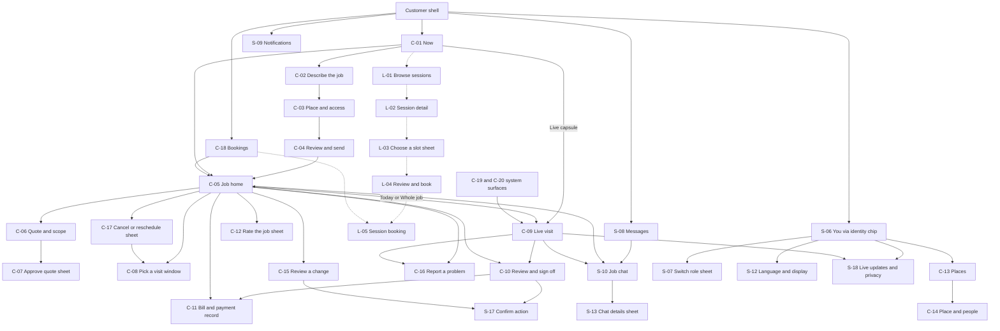
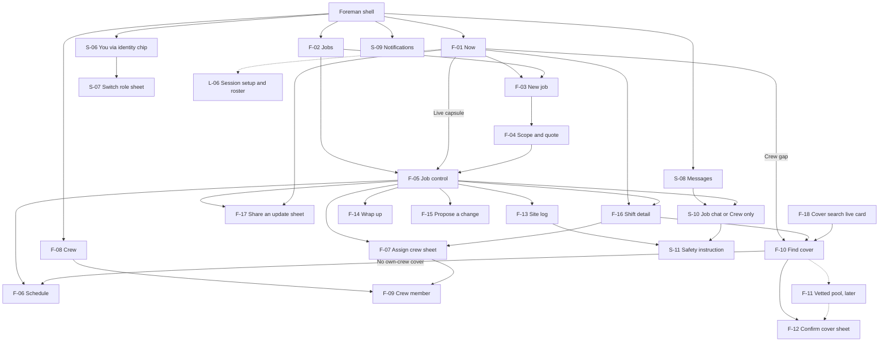
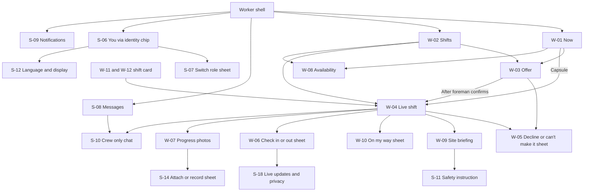
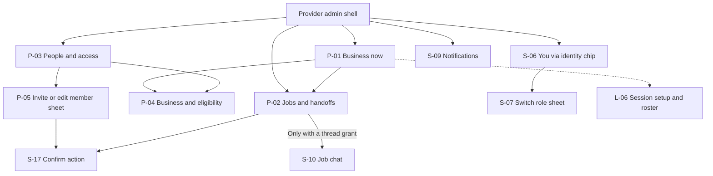

# Information architecture

## One app, scoped by role

One Android and iPhone app with a role-specific shell, as in the [reference](../../design/foundation/information-architecture.md#one-app-scoped-by-role). That decision is reused unchanged: one sign-in, one notification channel and one chat across the handoff. Owners abroad can also do everything a customer does in the web portal without installing the app; see the [accepted stack](../../docs/architecture/mobile-tech-stack.md). The portal mirrors C-05 and C-09 as responsive pages. System surfaces (Live Activity, ongoing notification) exist only in the app.

Beacon changes three things in the shell:

1. **Every role starts on Now.** Now shows what is live and the one next step. Lists move to the second tab.
2. **An identity chip replaces the Account tab.** The chip sits at the top leading corner of every tab root, shows who you are and which role and business you are acting as, and opens You (S-06) with the role switch (S-07).
3. **The live pill follows you.** When a booking, shift or cover search is live and you are on another tab root, a pill above the tab bar opens it in one tap.

## Navigation rules

| Role | Tabs (first is the start) | Header on tab roots |
| --- | --- | --- |
| Customer | Now (C-01), Bookings (C-18), Messages (S-08) | Identity chip with place, bell (S-09) |
| Foreman | Now (F-01), Jobs (F-02), Crew (F-08), Messages (S-08) | Identity chip with business, bell |
| Worker | Now (W-01), Shifts (W-02), Messages (S-08) | Identity chip with business, bell |
| Provider admin | Now (P-01), Jobs (P-02), People (P-03) | Identity chip with business, bell |

- Tab bars show on tab roots only. Pushed screens hide the bar and show Back plus the next-step dock. Returning to a tab restores its stack and scroll position; tapping the selected tab returns to its root.
- **C-05 Job home and C-09 Live visit are two views of one booking.** On the visit day the booking opens on C-09 and a two-chip switch (Today, Whole job) moves between them without adding to the back stack. On other days only C-05 exists. W-04 and F-05 follow the same rule for a shift and a job.
- Sheets are for one bounded choice or confirmation; one at a time; always with Close. Deliberate actions (accept, check in, confirm cover, approve, sign off) use a sheet or dialog that names the event, so they take two taps.
- Back closes the keyboard, then a sheet, then one route. It never switches role, signs out or discards a draft silently.
- Places (C-13, C-14), language and display (S-12) and live updates and privacy (S-18) live under You.
- The bell and inbox are scoped to the active role and business.

## System surfaces and links

Open a record, never an action. This is the reference [deep-link contract](../../design/foundation/information-architecture.md#notification-and-deep-link-contract), extended to Beacon's system surfaces. Lock-screen text is generic: no address, access detail, price, message text or worker position.

| Source | Opens | Parent on cold launch |
| --- | --- | --- |
| C-19 Live Activity, Dynamic Island, C-20 notification | C-09 after unlock | C-01 |
| W-11, W-12 shift card; its Check out link | W-04; W-06 sheet over W-04 | W-01 |
| F-18 cover search card | F-10; F-12 sheet if an acceptance is waiting | F-01 |
| L-07 session card (later) | L-05 | C-01 |
| Push: quote, change, window, sign-off, bill | C-06, C-15, C-08, C-10, C-11 | C-05 |
| Push: offer, confirmed shift, instruction changed | W-03, W-04, S-11 | W-01 |
| Push: new job, crew gap, acceptance, shift update | F-03, F-10, F-12, F-16 | F-01 |
| Push: message | S-10 in the permitted audience | S-08 |
| Invitation or eligibility | S-05, P-04 | S-01 or P-01 |

After sign-in the app checks account, role, target access and freshness. A link for another granted role shows S-07 and asks before switching. A link the account cannot open shows S-16 with reason-safe text. Offline, the cached record opens read-only and consequential actions are disabled until checked online.

## Onboarding and language

Reused from the reference, with the owner's language decision applied:

1. **S-01** starts in the device language if it is English or Portuguese, otherwise English, and offers the other before sign-in.
2. **S-02, S-03**: one email and one-time code for new and returning accounts. A link opened while signed out is kept as an opaque destination.
3. **S-04**: name, reading language for translated messages, and whether to show your time next to site time. Permissions are asked in context, never up front.
4. **S-05**: invitations for crew, business or place access; the verified account must match the invitation.
5. **S-12, S-18**: UI language, reading language, theme, Field mode, live surfaces and what others can see. Changing a language never changes an approved quote, an issued instruction or a booked time.

## Role navigation maps

Solid lines are in the construction release. Dashed lines are later capabilities with no launch navigation.

### Customer

### Foreman

### Worker

### Provider admin

## Conversation audiences and later capabilities

S-10 keeps the reference's two audiences: **Job conversation** (customer, foreman and assigned crew with a grant) and **Crew only** (foreman and assigned workers). The foreman stays the customer's named contact; there are no customer-to-worker direct messages. Stamps appear inline in the Job conversation only when they are customer-visible.

Later sessions reuse the customer shell: a browse entry on C-01 and session bookings in C-18. The vetted pool (F-11) and session screens (L-01 to L-07) have no launch navigation and no disabled placeholders.
