# Customer screens C-01–C-08: ask, approve and book

This slice takes a customer from "something is wrong" to a booked visit: Now, the three-step request, Job home, the quote, the approval sheet and the visit window. It follows the [concept](../../foundation/concept-and-principles.md), [information architecture](../../foundation/information-architecture.md), [roles](../../foundation/personas-and-roles.md), [core flow 1](../../foundation/core-flows.md#1-customer-booking-live-tracking-and-completion), [design system](../../system/design-system.md) and [wireframe conventions](../../system/wireframe-conventions.md), and applies the [owner's decisions](../../../docs/decisions/2026-11-23-open-questions.md). The access, draft and recovery rules of the [reference specs](../../../design/screens/customer/C-01_C-08-specs.md) are kept. This file describes what Beacon changes and what each drawing shows.

The artboards are snapshots of the [story](../inventory.md#story-and-clock). Claire Martin drafts and sends the request on Mon, 23 Nov before 08:05 Spain time (C-01 first use and draft, C-02, C-03, C-04). The quote arrives at 08:14 (C-01 decision due, C-05 quote ready, C-06, C-07). She approves at 08:20, picks a window (C-08) and the visit is booked at 08:36 (C-05 booked, C-01 upcoming). C-01's primary is Tue, 24 Nov at 07:58 UK time, with the crew on the way. Two artboards show an alternative branch: C-06 superseded and C-08 revised visit. Only the two artboards on the live timeline (07:58 and 07:46) show the viewer's clock; the others show 9:41. The address, the line-item split, the 0:18 voice note, the extra windows and the times 08:10, 08:14, 08:17 and 08:44 are fixture details added by this slice.

## Rules used on every screen

- **One next step.** Each pushed screen has one primary action in the dock. A dock with a context line starts at y=692 and centres the line at baseline 718, as in S-01 to S-09. An unavailable action is drawn disabled with its reason in the context line. C-01 is a tab root and has no dock; its decision card carries the action.
- **Lime means live.** In this slice lime appears only in the live capsule on C-01 and as the current bead of a journey line. Notices, badges, buttons and links never use it. No button here is lime, because none changes what other people see live.
- **Four things are never confused.** A draft is not a sent request, a request is not a booking, an approval is not a booking and nothing here is a payment. Each screen names its own state in words, and the customer pays the provider outside the app.
- **Who and when.** Every event names its actor and its time. Site time comes first and is labelled "Spain time"; the viewer's time sits beneath with "your time" when the zones differ and the setting is on.
- **Your words stay yours.** The customer writes or speaks in any language. The provider reads a translation with the original beneath it. The provider's quote is shown the same way to the customer, and its original text is never altered.
- **Online for consequences.** Send request, Approve and Confirm this window need the server and are confirmed only by its answer. Drafts and media can be saved on the device and are labelled "Saved on this device" until accepted. Nothing is sent, approved or booked by a reconnection.
- **Access.** Account, role, place grant and the record's freshness are checked on entry and again before each consequential action. A person who loses access sees S-16 without restricted detail. Gate and alarm codes are never stored. No screen shows a map or a position.
- **Languages.** The UI ships in English (`en`) and European Portuguese (`pt-PT`); see [Internationalisation](../../../docs/architecture/mobile-tech-stack.md#internationalisation). Every label is a whole catalog message with placeholders, for example "Approve {amount}", never a joined fragment. Layouts allow 40% longer text by wrapping. Dates, EUR amounts and plurals follow the UI locale without changing values.

## C-01 Now

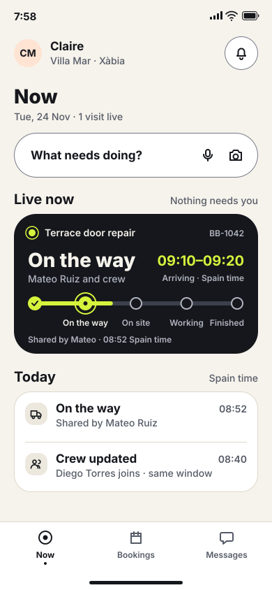

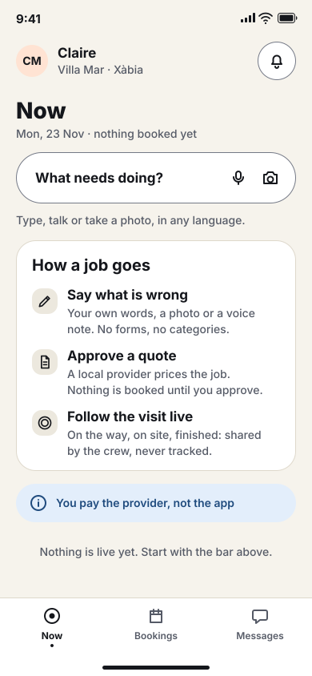

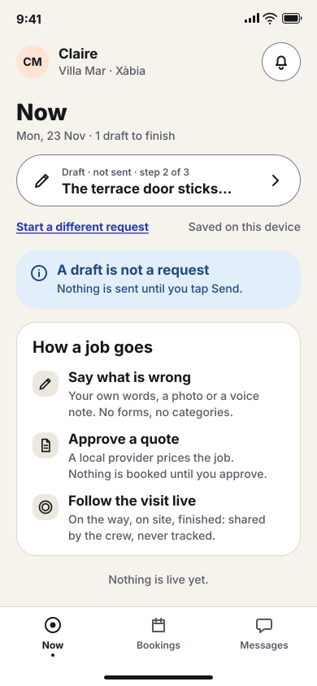

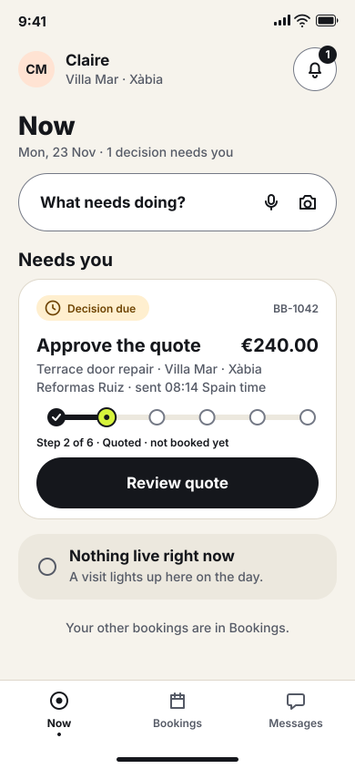

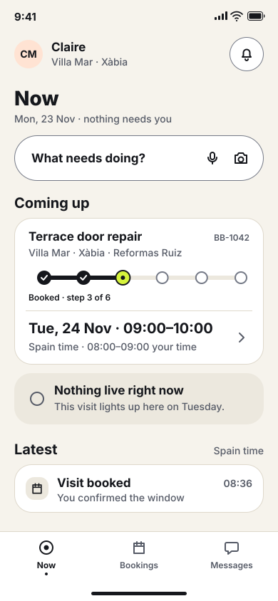

**Purpose and routes.** The customer's start tab, shown on launch and on the Now tab. It answers "is something happening, and does anything need me?" and starts a request. The ask bar opens C-02; its microphone and camera open C-02 with S-14 already open in that mode. The draft bar opens the latest unfinished step (C-02, C-03 or C-04). The live capsule opens C-09. A decision card opens the record behind it: C-06 for a quote, C-08 for windows or a revised visit, and C-15, C-10 or C-11 later in the job. A booking card opens C-05, and a moment opens its record. The identity chip opens S-06, the bell S-09, and the tabs C-18 and S-08. A later entry to L-01 has no launch navigation and no placeholder.

**Layout and data.** Root header with the identity chip (name and current place) and the bell with its unread count. The title "Now" has a context line with the site date and one summary: "1 visit live", "1 decision needs you", "1 draft to finish" or "nothing needs you". The ask bar follows. Sections then appear in a fixed order and only when they have content: **Live now** (the capsule at card size), **Needs you** (decision cards), **Coming up** (booking cards) and **Today** or **Latest** (customer-visible stamps, newest on top, with the zone named once). The capsule shows the job and reference, then the crew’s state and name. The arrival band is in lime, labelled Spain time; with “Show my time as well” enabled, Claire’s UK band appears on the line beneath. The day line and the source stamp follow. A decision card shows a "Decision due" badge, the reference, the action as its title, the amount, the job and place, the sender and sent time, a mini journey line with the stage in words, and one ink button. A booking card shows the job, the reference, place and provider, the mini journey line with the stage in words, and the confirmed window in both zones. When nothing is live a quiet card says so.

**Interactions and states.** With a visit live, one capsule leads the page and one tap on it opens C-09. The capsule shows the state, the arrival band in lime, the day line and who shared the status and when. The words "Nothing needs you" sit beside the section title while no card is waiting. Following on the Lock Screen starts on C-09, never here. Every card is one target, and pull to refresh works when online.
- First use shows no sections, only the ask bar, a hint and the card "How a job goes". On first use nothing is lime, because nothing is live. A first notice says the customer pays the provider, not the app. If no place is saved at first, the chip reads "Add your place" and C-03 opens in its new-place state.
- A draft to resume turns the ask bar into the draft bar. The draft bar shows "Draft · not sent", the step and the opening words, and lets her resume where she left off. The link "Start a different request" opens an empty C-02 and keeps the draft to resume later. With two or more drafts the bar reads "2 drafts · not sent" and opens C-18 to resume any of them. A notice says a draft is not a request, and "How a job goes" stays until a request exists.
- A decision card names the action as its title and holds one ink button. The decision card is shown only to a person who can act on it. Someone without the right sees "Waiting for Claire Martin to approve", with no decision button. Several decisions stack with the oldest on top.
- An upcoming visit is one booking card with the stage in words and the window in both zones. Upcoming cards are ordered by date, the nearest on top. Below the upcoming card a quiet card says nothing is live and when the visit will light up. The latest stamp follows the upcoming section, in Spain time.
- With several live visits the most time-critical capsule leads and the others follow at card size.
- Stale or offline, a banner under the title reads "Offline · last confirmed 08:52 Spain time". The capsule goes quiet, with no pulse, a ring for the current bead and "Last confirmed 08:52". Cards open their cached record read-only. The ask bar still works, because drafts are saved on the device.
- A loading page keeps the section layout. An empty cache is not an empty account, so a failed load shows "Can't load your bookings" with Retry and never the first-use page.

**Platform, accessibility and RTL.** The tab bar respects the home indicator or the Android navigation inset; Android Back leaves the app from this root. Reading order: identity chip, bell with its count, title and summary, ask bar, then the sections in order, then the tabs. The ask bar is one control with two named shortcuts, "Describe by voice" and "Add a photo". The capsule is read as one sentence: "Terrace door repair. Crew on the way, arriving 09:10 to 09:20 Spain time, 08:10 to 08:20 your time. Shared by Mateo at 08:52. Step 2 of 5." A decision card is read as action, amount, job, stage, then its button. At large text the crew name wraps below the state and the two arrival bands stay stacked, the price moves under the card title and the mini line keeps its beads. In RTL the layout, the job lines and the chevrons mirror; times, BB-1042 and amounts keep their own order.

## C-02 Describe the job

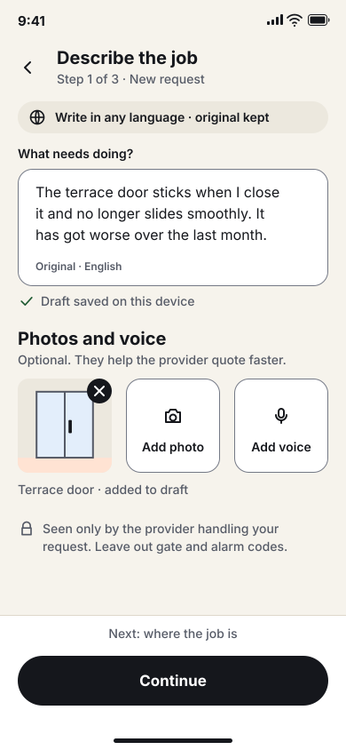

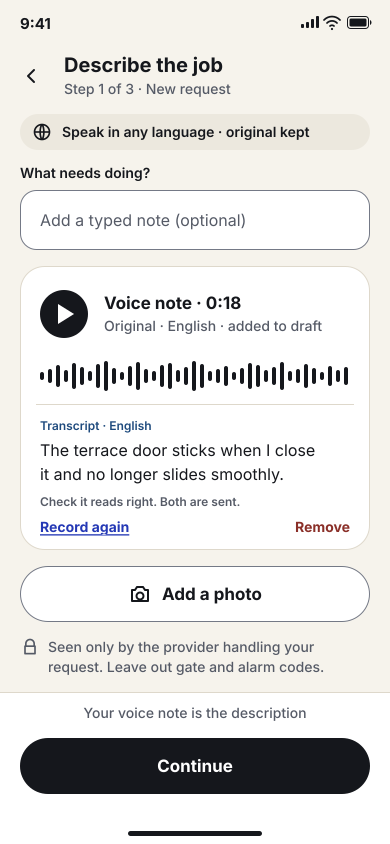

**Purpose and routes.** Step 1 of 3: say what is wrong in your own words, with a photo or a voice note if that is easier. Entered from the ask bar, the draft bar or **Edit** on C-04. **Continue** opens C-03, or returns to C-04 when the screen was opened from there. Back returns to C-01 and keeps the draft. **Add photo** and **Add voice** open S-14; a thumbnail or the voice note's title opens S-15.

**Layout and data.** Pushed header with the step. A language line says "Write in any language · original kept" ("Speak in any language" after a recording). The field "What needs doing?" holds the description, with the language badge "Original · English" once the language is known. A status line reports the draft. **Photos and voice** is a tray of 106-unit tiles: each added photo with its Remove control, then "Add photo" and "Add voice". A caption names the latest item, and a note says who will see the content and to leave out gate and alarm codes. The dock's context line names the next step. Claire's text is "The terrace door sticks when I close it and no longer slides smoothly. It has got worse over the last month." The photo tile is a drawn placeholder.

**Interactions and states.** Text or a voice note is enough to continue. A photo alone is not enough. The app never rewrites the customer's words. The status "Draft saved on this device" appears only after a real save.
- With nothing entered, the field shows an example and Continue is disabled with "Describe the job in text or a voice note".
- Once a voice note is recorded the typed note becomes optional. The recorded voice note has Play, its length, a language badge, a waveform and a transcript. **Record again** asks before replacing the recorded voice note. **Remove** warns when the recorded voice note is the only description. Play becomes Pause and nothing plays by itself. The transcript is labelled "Transcript · English", with a line that asks the customer to check it and says both are sent. While it is pending the card says "Transcript on its way". If no transcript can be made, the recording goes alone and the card says so.
- While an item uploads, its tile shows progress and "Uploading". Continue stays available, but C-04 will not send until every kept item is ready.
- Saved offline, the status line reads "Saved on this device · pending sync" and the tiles of unsent media are dashed.
- If capture is denied, S-14 explains it once and offers the photo library, text or the OS settings. The OS prompt is not repeated and no fake permission dialog is drawn.
- A failed item keeps its preview and offers Retry and Remove. Other items and the text are untouched.
- Tapping the language badge corrects a wrong language. The text itself does not change.

**Platform, accessibility and RTL.** The dock rides above the keyboard and the field grows with its content. Android Back closes the keyboard, then S-14, then the route. Photos use the system picker; camera and microphone permissions are asked at the moment of use. Reading order: Back, title and step, language line, field with its badge, draft status, each tray item with its Remove control, the two add tiles, the note, the context line, Continue. A photo is announced as "Photo 1, terrace door, added to draft"; the voice note as "Voice note, 18 seconds, English, Play". Upload progress is announced at milestones, not on every percent. At large text the tiles wrap to two per row. Authored text follows its own direction in any UI direction; durations are never reversed.

## C-03 Place and access

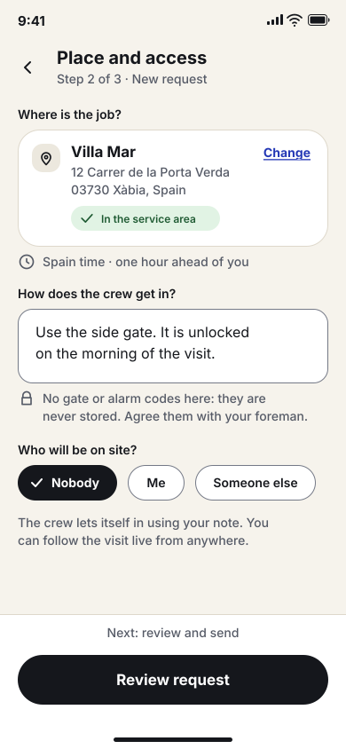

**Purpose and routes.** Step 2 of 3: confirm where the job is and how the crew gets in. Entered from C-02 or **Edit** on C-04. **Change** opens a place picker sheet, with C-13 for a long list and C-14 to add or edit a place. **Review request** opens C-04. Back returns to the previous step with every field kept.

**Layout and data.** Three labelled groups. *Where is the job?* shows the place card: name, address, a service-area badge and **Change**. A line beneath names the site's zone and its difference from the viewer's ("Spain time · one hour ahead of you"). *How does the crew get in?* is a free-text field with a note that codes are never stored. *Who will be on site?* is three chips, Nobody, Me and Someone else, with a line that states the consequence of the choice. The fixture address, 12 Carrer de la Porta Verda, 03730 Xàbia, is fictional.

**Interactions and states.** A known place is preselected, the most recently used when there are several. The badge reads "In the service area" only after an online check. Choosing Nobody suits an owner abroad, and the line explains that the crew uses the access note. Changing the place clears the access note only after the customer confirms.
- With no saved place the card is replaced by "Add your place", which opens C-14 and returns with the new place selected.
- Outside the service area the badge turns critical, reads "Outside our service area" and names what is covered. Review request is then disabled with that reason, and Change place and S-16 are offered. No request can be sent for that place.
- Offline, the badge reads "Can't check this address offline" in the attention colours. The draft can go on to C-04, where sending stays disabled.
- Choosing Me needs nothing more. Choosing Someone else opens a name field, and that person gets no access to the job.
- The access note is required when nobody is on site, and the context line then reads "Say how the crew gets in". If the note contains a run of four or more digits, a warning asks whether it is a code and offers to remove it.
- A person who manages the place for its owner sees it without Change or edit rights, with "Managed for Claire Martin".

**Platform, accessibility and RTL.** Pickers use the native sheet on each platform. The address keyboard is a text keyboard, not numeric. Reading order: Back, title and step, place with badge and Change, zone line, access field and its note, the three chips with their selected state, the consequence line, the context line, Review request. Chips are 40 high inside a 48 hit region, and the selected one has a check as well as a fill. At large text Change moves under the address and the chips stack. The address keeps its saved order and accents in every UI language and direction.

## C-04 Review and send

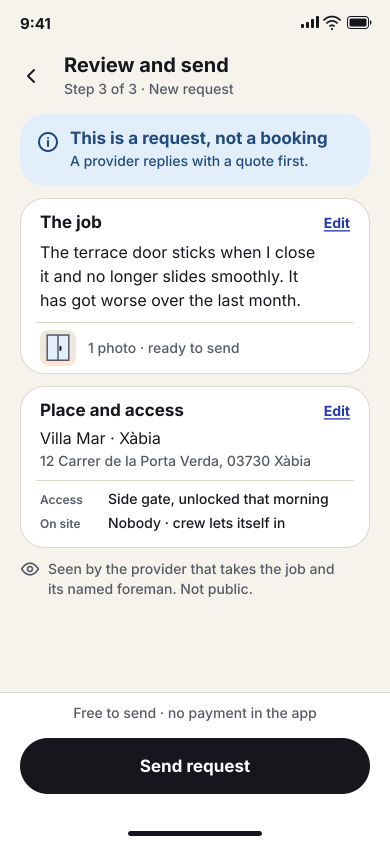

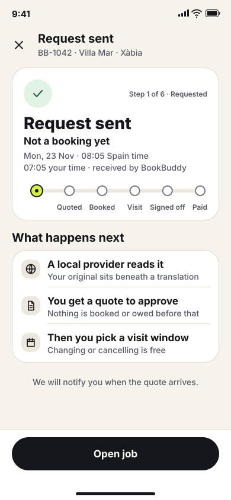

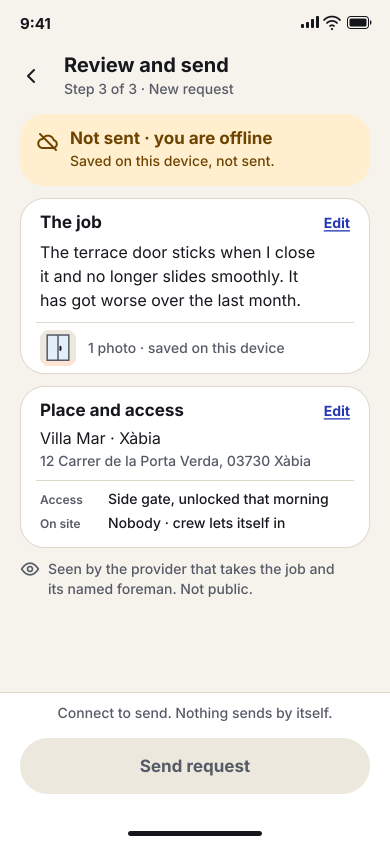

**Purpose and routes.** Step 3 of 3: check the request and send it, knowing it is not yet a booking. Entered from C-03 or from a saved draft. **Edit** on each card returns to C-02 or C-03 and comes back here. **Send request** stays on this screen until the server answers. After that **Open job** opens C-05 with C-01 as its parent, and Close returns to C-01; the request steps leave the stack.

**Layout and data.** A notice at the top states the status: "This is a request, not a booking". *The job* card repeats the description exactly as written, with a media row. *Place and access* shows the place, the address, the access note and who is on site. A line names who will see the request. The dock's context line reads "Free to send · no payment in the app". After sending, the page becomes a receipt: a success mark, "Request sent", "Not a booking yet", the time in both zones, the new reference in the header, the journey line at step 1 of 6, and three rows under "What happens next".

**Interactions and states.** There is no second confirmation dialog, because the review step is the deliberate second tap. Send request is enabled when the description is valid, the place is in the service area and every kept item is uploaded. While sending, the button keeps its label, shows progress and ignores further taps. If a photo is still uploading, Send request is disabled and the media row offers Remove.
- The sent state appears only after the server confirms the request, with one completion haptic. It shows "Request sent", "Not a booking yet" and the time in both zones. The reference BB-1042 is issued when the request is sent and never appears on a draft. Once sent, the request steps leave the stack and **Open job** leads to C-05.
- Offline, the notice reads "Not sent · you are offline" and says the request is saved on this device. Send request is disabled offline, and nothing is sent when the connection returns. Both cards stay editable offline, because a request that was not sent can still change. A photo saved offline is labelled as saved on this device, never as sent.
- A definite failure shows "Not sent" with the reason and keeps every input.
- If the outcome is unknown the screen says "Checking whether your request arrived" and offers no second try until it knows.
- If the place or the grant changed, the app returns to C-03 with an explanation before anything leaves the device.

**Platform, accessibility and RTL.** The dock respects the home indicator or the Android inset, and the scroll area ends above it. Reading order: Back, title and step, the status notice, the description, the media row, Edit, the place card, Edit, the visibility line, the context line, Send request. The reason for a disabled button is read even where the platform skips disabled controls. On the receipt, focus moves to "Request sent" and the stage is announced as "Step 1 of 6, Requested". At large text the label and value rows of the place card stack. The description keeps its own direction; the address and the reference are isolated in RTL.

## C-05 Job home

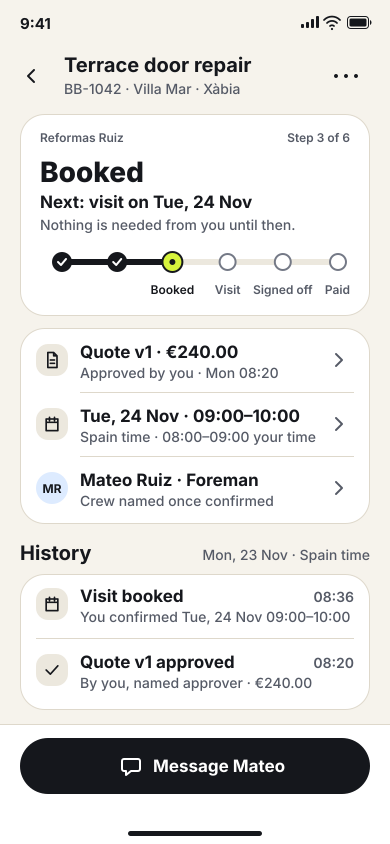

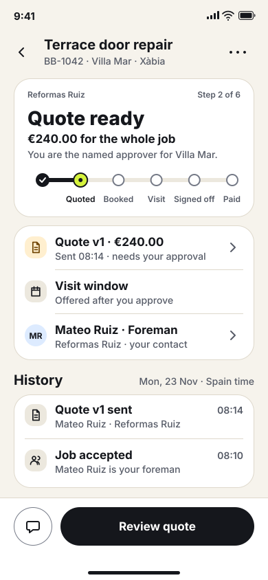

**Purpose and routes.** The whole job on one screen: the stage, the next step, the quote, the visit, the people and the history. Entered from C-01, C-18, the receipt on C-04, S-09 or a link. The quote row opens C-06, the visit row C-08, the foreman row and the chat button S-10, and a history stamp its record. **More** holds Cancel or reschedule (C-17), Report a problem (C-16) and the place (C-14). On the visit day the booking opens on C-09; a two-chip switch, Today and Whole job, then appears under the header on both screens and moves between them without adding to the back stack. On other days only this screen exists.

**Layout and data.** Pushed header with the job name, the reference and the place, and More. The stage card shows the provider, "Step n of 6", the stage as the largest text on the page, the next step, one supporting line and the journey line: Requested, Quoted, Booked, Visit, Signed off, Paid. Finished stages are ink beads with a check, the current stage is a lime bead with an ink border, later stages are rings, and captions sit under the current and later beads. A second card has three rows: the quote (version, total, approval state), the visit (window in both zones) and the foreman (avatar, name, role). **History** lists stamps newest on top, with the date and zone named once. The dock holds the next step.

**Interactions and states.** The stage changes only on a server-confirmed event. Booked reads "Next: visit on Tue, 24 Nov" and tells the customer nothing is needed until then. A change, a problem and a bill are flags beside the stage, never stages. The customer never sees a crew gap, a candidate or a dropout reason here. When the quote is ready the stage reads "Quote ready" with the total for the whole job. With a quote ready, the named approver is told that the approval is theirs. While the quote is ready the visit row says windows are offered after approval. The dock for a ready quote holds the chat button and **Review quote**. Until the crew is confirmed the foreman row reads "Crew named once confirmed". Stale data shows "Last confirmed Mon 08:36 Spain time" under the header. Actions that need the server are then disabled with that reason. Missing history pages are retried on their own without hiding the stage. The table lists every stage and flag.

| Stage or flag | Stage card | Dock |
| --- | --- | --- |
| Requested | "Requested", "Not booked. A provider will reply with a quote." The stage is written above the line; the first bead has no caption. | None. Nothing is needed. |
| Quote ready | "Quote ready", the total, and "You are the named approver for Villa Mar." | Chat button and Review quote. Without the approval right: Read quote. |
| Quote approved | "Quote approved", then "Pick a visit window" or "Waiting for windows from Mateo". | Pick a visit window, or Message Mateo. |
| Booked | "Booked", "Next: visit on Tue, 24 Nov", "Nothing is needed from you until then." | Message Mateo. |
| Visit day | "Visit today", with the capsule's state in one line. Opens on C-09. | Same action as C-09. |
| Finished | "Finished · review the work". | Review and sign off (C-10). |
| Signed off | "Signed off", with a bill row from Reformas Ruiz. | See the bill (C-11). |
| Paid | "Paid", with who recorded it and when. Every bead is ink; nothing is lime. | Rate the job (C-12) once, then none. |
| Cancelled | "Cancelled", with who and when. Later beads stay rings. | None. |
| Change proposed | An attention card above the rows: "Change proposed · +€40.00". | Review change (C-15). |
| Problem open | A critical card above the rows with the case status. The work is not marked accepted. | Open case (C-16). |

**Platform, accessibility and RTL.** More is a native menu on each platform; Android Back closes it before leaving. Reading order: Back, title and reference, More, the stage card, the three rows, History, the dock. The journey line is announced once as "Step 3 of 6, Booked"; beads and avatars are decorative. Stage changes are announced politely without moving focus. At large text "Step n of 6" moves under the provider, the two zone lines stack and the rows grow. In RTL the journey line runs right to left with the same stage order; times, the reference and amounts are isolated.

## C-06 Quote and scope

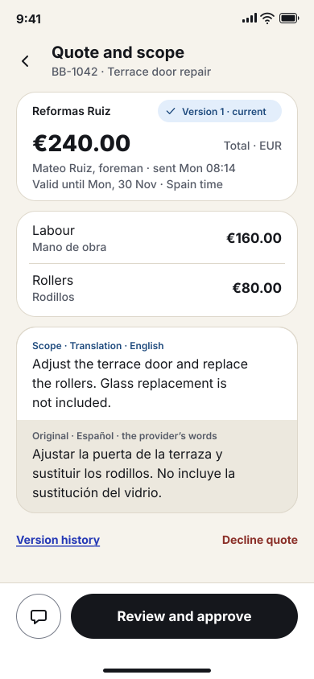

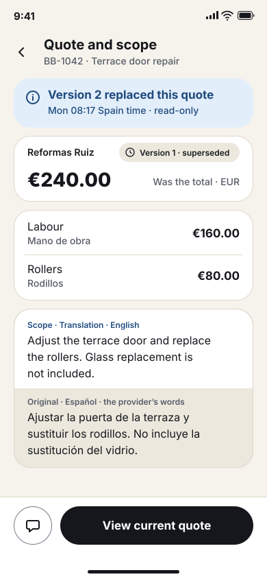

**Purpose and routes.** Read the provider's scope, exclusions and total, with the provider's original beneath the translation. Entered from C-05, a decision card on C-01, S-09 or a push. **Review and approve** opens C-07 for this exact version. The chat button opens S-10 and returns to the same version and position. **Version history** opens a sheet listing the versions the viewer may see. **Decline quote** opens S-17. A photo issued with the quote opens S-15 read-only.

**Layout and data.** The summary card shows the provider, a version badge, the total in EUR, who sent it and when in Spain time, and the validity date. The line-items card shows each item in the reader's language with the provider's original beneath it and the amount once: Labour, "Mano de obra", €160.00; Rollers, "Rodillos", €80.00. The scope twin card has the translation on top, labelled "Scope · Translation · English", and an attached strip, labelled "Original · Español · the provider's words", with the exact text: "Ajustar la puerta de la terraza y sustituir los rodillos. No incluye la sustitución del vidrio." Issued photos and the terms follow below the fold. Two quiet controls end the page, Version history and Decline quote, and the dock holds the chat button and the primary action.

**Interactions and states.** The screen always shows one issued version, never a draft. The current version carries the badge "Version 1 · current", and the named approver gets **Review and approve**. Asking Mateo a question changes nothing in the quote. Each item shows its amount once, with the provider's original beneath the translated label.
- A superseded version opens with the notice "Version 2 replaced this quote" and the time. Its badge reads "Version 1 · superseded" and its total is labelled "Was the total". Items and scope of a superseded version stay exactly as issued. A superseded version cannot be approved or declined, and the primary becomes **View current quote**.
- A viewer without the approval right reads everything. The context line then reads "Only the named approver can approve" and the primary becomes **See who approves**, which opens C-07. Decline is hidden.
- An expired quote shows its expiry in Spain time, and the primary becomes **Ask Mateo for a new quote**. An expired quote is not called superseded unless a newer version exists.
- A declined quote names who declined and when, and offers no further decision.
- An approved quote reads "Version 1 · approved" in the success colours, with "Approved by Claire Martin · Mon 08:20 Spain time". Its primary becomes **Pick a visit window** when windows exist.
- If the translation is pending or unavailable, the original moves to the top and the status takes the strip's place. The amounts are unaffected.
- An old link to a replaced version opens it read-only and never approves it.

**Platform, accessibility and RTL.** Version history is a native sheet; a long list takes the full height. Reading order: Back, title and reference, any notice, provider, version badge, total, sender and validity, each item as "Labour, original Mano de obra, 160 euros", the scope translation, then the original announced in Spanish, the quiet controls, the dock. Amounts use tabular figures and are never shortened. At large text the badge moves under the provider and amounts move under their labels. In RTL the layout mirrors while the Spanish original stays left-aligned and amounts and the reference are isolated.

## C-07 Approve quote [Sheet]

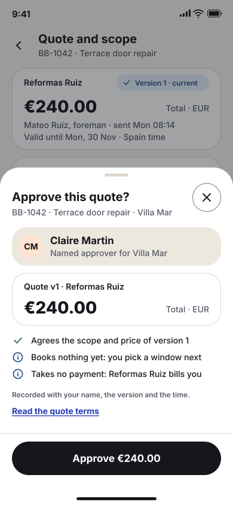

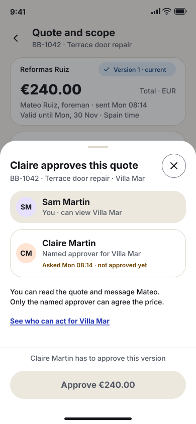

**Purpose and routes.** Record the named approver's approval of exactly the version that was read. Opened only from the dock of C-06. Close returns to C-06 at the same version and position. After approval the sheet shows the result and its primary leads to C-08 when windows exist; otherwise it closes to C-06 in its approved state. Approval never books a visit and never takes a payment.

**Layout and data.** A bottom sheet over the dimmed C-06 with a handle, the title "Approve this quote?", the reference, job and place, and Close. A tinted block names who is approving and in what capacity: "Claire Martin · Named approver for Villa Mar". A card names what is approved: "Quote v1 · Reformas Ruiz" and the total. Three lines state the effects: it agrees the scope and price of version 1, it books nothing yet, and it takes no payment because Reformas Ruiz bills the customer. A caption says the approval is recorded with the name, the version and the time, and a link opens the quote terms. The dock inside the sheet holds **Approve €240.00**.

**Interactions and states.** Approval takes two taps, the dock on C-06 and then the action in this sheet. On the second tap the server checks the person, the place right, the version, the expiry and the exact terms. It records the version that was reviewed, not whichever is newest. While processing, the button keeps its label, shows progress and ignores further taps.
- For someone who is not the named approver the title becomes "Claire approves this quote". The sheet shows the viewer's own right and then the named approver with the request's status. Two lines say what a viewer who is not the named approver can still do. Approve stays disabled, and the context line says which named approver has to act. A link, "See who can act for Villa Mar", opens C-14.
- If the quote changed since it was read, a notice says so and names version 2 as current. The primary becomes **View version 2**, and the new version must be read on C-06 before it can be approved.
- Closing the sheet during processing does not undo the request, and C-06 then shows "Checking approval".
- Once approved, the sheet shows a success mark and "Approved · Mon, 23 Nov · 08:20 Spain time · 07:20 your time". One completion haptic follows, and the primary becomes **Pick a visit window** or **Done**.
- A definite failure reads "Not approved" with the reason and offers another try while the same version is valid. An unknown outcome reads "Checking whether your approval was recorded" and offers no second attempt.
- Offline, the button is disabled with "Connect to approve".

**Platform, accessibility and RTL.** A native sheet with a detent on iOS and a Material modal sheet on Android. Close, the Android Back gesture, a swipe down and a tap on the scrim all close without approving; none of them can approve. Focus moves into the sheet at its title, stays inside it and returns to the dock button on close. Reading order: title, reference, approver, version and total, the three effects, the record caption, the terms link, the context line if any, the button. At large text the sheet grows to full height and scrolls, and the button label wraps without losing the amount. The label is one localised message, so the amount sits where the language puts it. Names, the amount and the reference are isolated in RTL.

## C-08 Pick a visit window

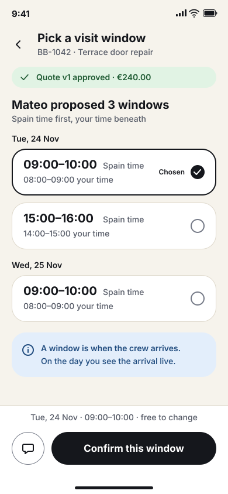

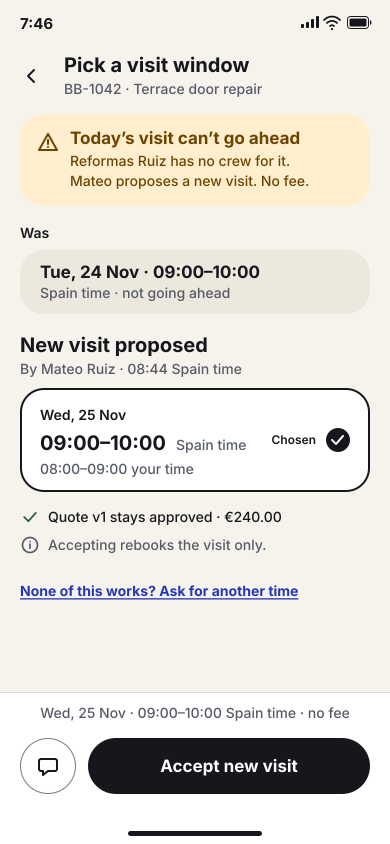

**Purpose and routes.** Choose a window the provider proposed, or accept a revised visit when its own crew cannot cover the booked one. Entered from C-05, C-07 after approval, C-17, S-09, a push, or C-09 when cover failed. **Confirm this window** returns to C-05 as Booked. The chat button opens S-10 and keeps the choice. The link "Ask for another time" opens C-17. Back changes nothing.

**Layout and data.** A success strip recalls why the customer is here: "Quote v1 approved · €240.00". The heading counts the proposals and states the time rule: "Spain time first, your time beneath". Windows are an agenda grouped by site date. Each window card shows the window in Spain time, the same window in the viewer's time and a radio; the chosen card has a 2-unit ink border, a check and the word "Chosen". A note explains that a window is when the crew arrives, and that the arrival is followed live on the day. The dock's context line repeats the chosen window and "free to change". Fixture: Tue, 24 Nov 09:00–10:00 and 15:00–16:00, and Wed, 25 Nov 09:00–10:00, each one hour earlier in Claire's time.

**Interactions and states.** Choosing a card never books it. Only the dock action books, after the server confirms the window, the approved quote and the provider's capacity. A single proposal is preselected. With several, nothing is preselected and the button is disabled with "Choose a window" until one is tapped. The drawing shows the page after Claire chose the earliest window.
- A revised visit is proposed when the provider cannot cover the agreed window with its own crew. C-08 shows both records: “Agreed window · no crew available” for Tuesday and “Proposed · waiting for Claire” for Wednesday. Both show Spain time first and Claire’s time beneath. Mateo’s 08:44 proposal neither cancels nor moves Tuesday’s booking. **Accept new visit** moves the booking only when the server confirms Claire’s acceptance; the change is free and quote v1 stays approved. Asking for another time (C-17), leaving the screen or not answering leaves the agreed booking in place. Crew names and dropout reasons are not shown.
- With no windows the page reads "No windows yet", says who will propose them and makes **Message Mateo** the primary. There is no free slot picking.
- Once confirmed, the chosen card carries "Confirmed · Mon 08:36 Spain time" in the success colours and the other windows are gone. A link, "Cancel or reschedule · free", opens C-17, and the dock holds **Message Mateo**.
- If a window is withdrawn or taken, the choice is cleared, the card reads "No longer available" and the list refreshes. Nothing is chosen in its place.
- During processing the button keeps its label and ignores further taps. An unknown outcome is checked before another attempt is offered.
- More than six windows add a strip of day chips above the agenda. The agenda stays as the readable alternative.
- In the same zone the second line is hidden. When the viewer's date differs it is written in full, for example "23:30–00:30 Mon–Tue your time".

**Platform, accessibility and RTL.** The window cards form a radio group, and each is read in full: "Tuesday 24 November, 09:00 to 10:00 Spain time, 08:00 to 09:00 your time, chosen". The context line is read before the button. Reading order: Back, title and reference, any notice, the approved-quote strip, the heading, each date and its windows, the note, the dock. At large text the two zone lines stay whole and stack, and "Chosen" moves under the times. Selection may give a light haptic; confirmation gives one completion haptic after the server answers. In RTL the radio moves to the leading side while each time range keeps its own order, and the clock glyph is not mirrored.

## Navigation

The diagram shows the routes this slice adds. The tabs, the identity chip and the bell are in the [customer map](../../foundation/information-architecture.md#customer). The chat button on C-06 and C-08 opens S-10 and returns; S-16 replaces any screen whose access is lost.

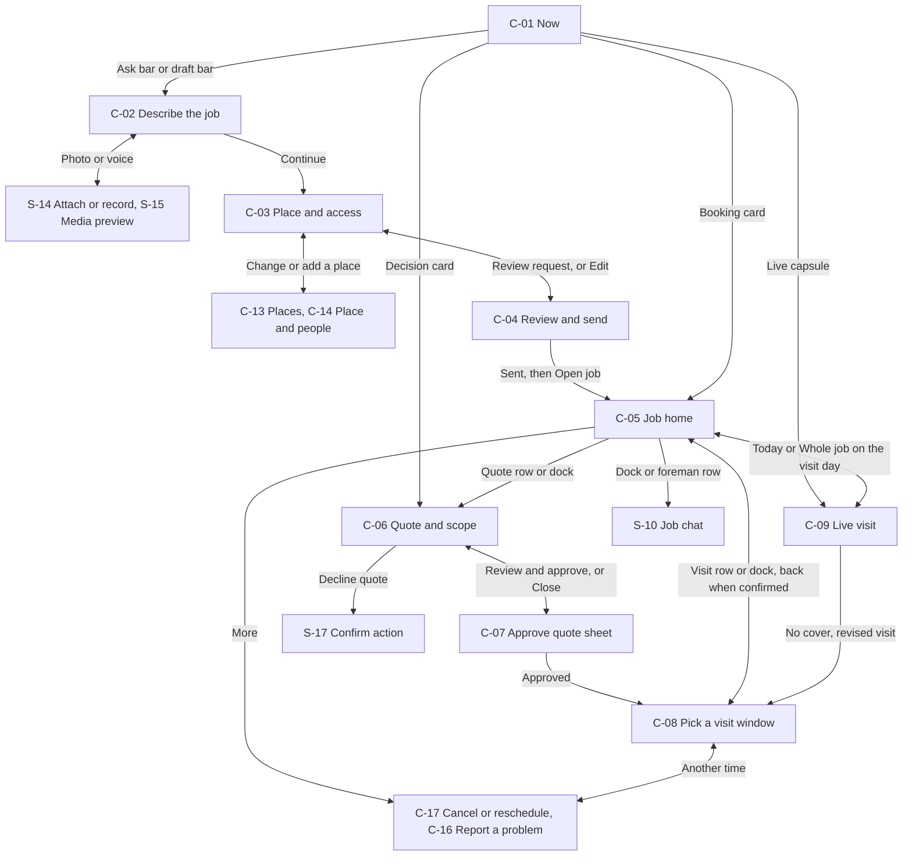

## Open design questions

- **Should the current bead of the journey line be lime when nothing is live, and may the Requested caption be left out?** This slice is the first to draw the journey line on a light card. The rail runs from x=62 to x=338 with six beads, and the current bead is lime with an ink border and no pulse. When Requested is current its caption is left out, because "Requested" and "Quoted" cannot sit side by side at 12 units, so the stage is written above the line. The lime bead puts lime on screens where nothing is live (C-05 booked, C-01 upcoming). Confirm the geometry for F-05, C-10, C-11 and C-18, or make the current bead an ink ring outside the visit day.
- **Should a sent request show a receipt on C-04, or land on C-05 directly?** Core flow 1 goes from sending straight to C-05 as Requested. The inventory lists "sent" as a state of C-04, so this slice draws a receipt with **Open job** and removes the request steps from the stack.
- **Who is the second customer in the fixtures, and may a viewer remind the named approver?** The fixtures have no second customer, so C-07 uses a fictional "Sam Martin" who can view Villa Mar. Align the name and the grant wording with C-14. The state is reached from a read-only C-06 through **See who approves**, or when the server refuses on opening.
- **What are the agreed approval wording, the quote terms and the VAT line?** The owner's decision asks for agreed terms and consent wording. The lines "Agrees the scope and price of version 1" and "Recorded with your name, the version and the time", and the "Read the quote terms" link, are placeholders until that wording exists. Decide which language version is binding and what "Total · EUR" must say about VAT.
- **How do gate and alarm codes reach the foreman if the app never stores them?** The note on C-03 tells the customer to agree them with the foreman. Confirm the approved channel, the warning on a run of four or more digits, and whether "Someone else" on site may store more than a name.
- **Is text or a voice note the right minimum for a request, and may the customer correct the transcript?** A photo alone is not enough to continue. Confirm this with intake, with limits for photos and recording length, and confirm that the customer sees the transcript before sending.
- **Do the fixture details added by this slice match the foreman slices?** The story gives 08:05, 08:20 and 08:36. This slice adds "Job accepted" at 08:10, the quote sent at 08:14, validity to Mon, 30 Nov, the €160.00 and €80.00 split, two extra windows, version 2 at 08:17 in the superseded branch and the revised visit proposed at 08:44. Align them with F-03, F-04, F-06 and F-10.
- **Is it right that C-01 puts the action on the card and that C-05 has no dock when nothing is needed?** C-01 is a tab root, so its decision card carries an ink button. C-05 shows no dock while Requested or Cancelled. Cancel or reschedule sits in More and on the confirmed C-08, not in the dock.
- **Should links in the drawings use a native underline or a drawn line?** Quick Look sets text about 5% narrower than Chromium, so a drawn underline cannot match a link in both. This slice uses `text-decoration="underline"` on the `text` element, which both renderers draw to the text's width. The lead-drawn screens use a drawn line.
