# Customer screens C-09–C-20: follow, finish and manage

This slice covers the visit day and everything after it: the live visit, sign-off, the provider's bill, the optional rating, places and people, changes, problems, cancelling or rescheduling, the bookings list, and the two system surfaces that carry the visit outside the app. It follows the [concept](../../foundation/concept-and-principles.md), [information architecture](../../foundation/information-architecture.md), [roles](../../foundation/personas-and-roles.md), [core flows 1 and 5](../../foundation/core-flows.md#1-customer-booking-live-tracking-and-completion), [design system](../../system/design-system.md#live-surfaces) and [wireframe conventions](../../system/wireframe-conventions.md), and applies the [owner's decisions](../../../docs/decisions/2026-11-23-open-questions.md) with the accepted defaults in the [commercial suggestions](../../../docs/reports/2026-11-23-open-question-suggestions/commercial.md). The primary of C-09 and three C-19 artboards are lead-drawn. This slice writes their sections and draws the other states to match. Screens C-01 to C-08 are in the [first customer slice](C-01_C-08-specs.md).

The artboards are snapshots of the [story](../inventory.md#story-and-clock). Claire Martin is in the UK, one hour behind Spain, so an artboard on the live timeline shows her clock and the others show 9:41.

| Her clock | Spain time | Artboards |
| --- | --- | --- |
| Mon, 9:41 | after 08:36 | C-17 (both), C-14 |
| Tue, 7:36 | 08:36 | C-09 cover being arranged, C-19 cover being arranged |
| Tue, 7:41 | 08:41 | C-09 crew changed |
| Tue, 7:58 | 08:58 | C-09 primary, C-18 active, C-19 Lock Screen and the three island artboards, C-20 collapsed and expanded; the later Android Live Update concept uses the same moment |
| Tue, 8:15 | 09:15 | C-09 on site, C-19 on site |
| Tue, 8:37 | 09:37 | C-09 working |
| Tue, 9:16 | 10:16 | C-09 finished, C-19 finished, C-20 finished |
| Tue, 9:38 and 9:44 | 10:38 and 10:44 | C-10 awaiting review, then C-10 signed off and C-11 bill due |
| Wed, 9:41 | after 09:05 | C-11 marked paid, C-12 (both), C-18 past |

The alternative branches are C-09 no arrival update yet and C-19 stale (the band passes without a check-in); C-19 ended (the visit outlasts the card); C-15 (a change during the visit); C-16 (a problem before sign-off); and C-11 checking a transfer (the provider corrects a payment match). C-13 and C-18 add fictional places and bookings, listed under [Open design questions](#open-design-questions).

## Rules used on every screen

- **One next step.** Each pushed screen has one primary action in the dock. A dock with a context line starts at y=692 and centres the line at baseline 718, as in C-01 to C-08. C-18 is a tab root and has no dock.
- **Lime means live.** Lime appears in the capsule, the day line, the live pill and the "Live" tag on C-18, and the current bead of a journey line. No customer button in this slice broadcasts a live operational update.
- **Confirmed by a person.** Every state on C-09, C-19 and C-20 comes from a deliberate act by the crew or the foreman, or from a server record. Nothing is inferred from a clock, a place or a chat message. When nothing new is known the surface says so and never says "late".
- **Crew level only.** The customer sees the crew's state, the names of the confirmed crew, the declared arrival time and the photos the foreman shared. No map, position, route, per-worker time, candidate or dropout reason appears anywhere.
- **Who and when, in two clocks.** In the app, site time comes first and is labelled "Spain time", with "your time" beside it. System surfaces lead with the viewer's time, because the Lock Screen clock is the viewer's, and give Spain time second.
- **Four things stay separate.** Finished is not signed off, signed off is not billed, billed is not paid, and a case changes none of them by itself. The provider bills the customer and records the payment. The app takes no money.
- **Online for consequences.** Sign off, approve or reject a change, send a report, send a rating, request a new window and cancel all need the server and are confirmed only by its answer. A report draft and its media can be saved on the device and are labelled "Saved on this device · not sent".
- **System surfaces open a record.** C-19 and C-20 never sign off, approve, cancel or message. They show no address, access detail, price, message text or position. Turning them off, dismissing them or letting them expire never changes the booking.
- **Access.** Account, role, place grant and the record's freshness are checked on entry and again before each consequential action. Sign-off and change approval belong to the named approver of the place. A person who loses access sees S-16 without restricted detail.
- **Offline access.** Only a locked, individually assigned device keeps a read-only snapshot of the already active context, for at most 72 hours from its last successful authorisation sync. Show only safe fields such as the job reference, task, site time and scoped contact route; hide the snapshot at expiry. No persistent customer job, draft or attachment cache on shared devices. On reconnect, apply revocations and remove affected copies **before** display or upload; never send under a lost grant.
- **Languages.** The UI ships in English (`en`) and European Portuguese (`pt-PT`); see [Internationalisation](../../../docs/architecture/mobile-tech-stack.md#internationalisation). Every label is a whole catalog message with placeholders, for example "Mateo will update you by {time}". Layouts allow 40% longer text by wrapping. The provider's words are shown as written, beneath their translation, and are never rewritten by a language change.

## C-09 Live visit

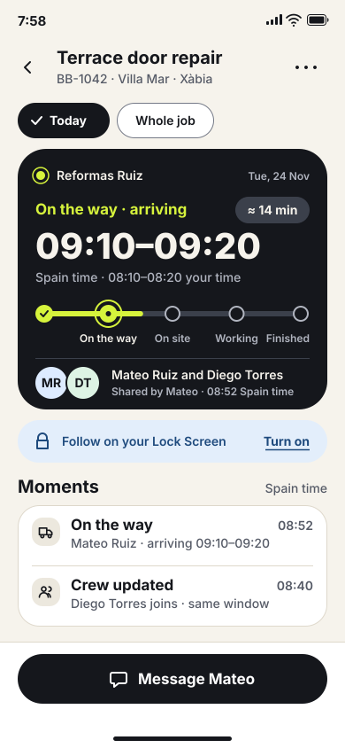

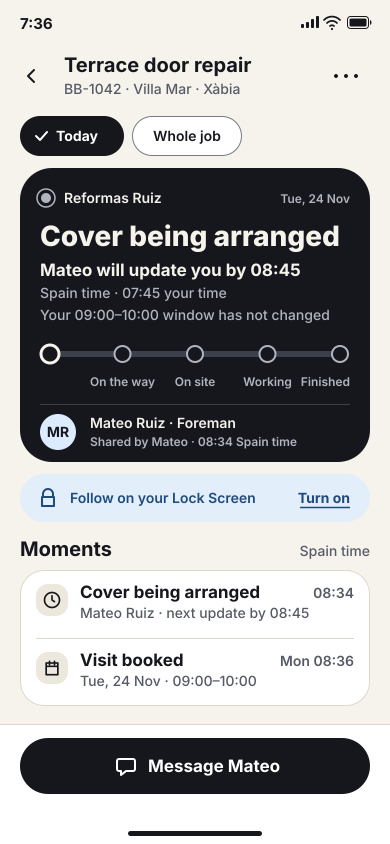

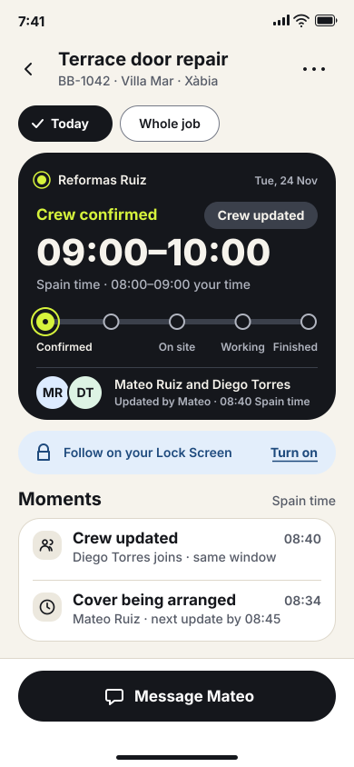

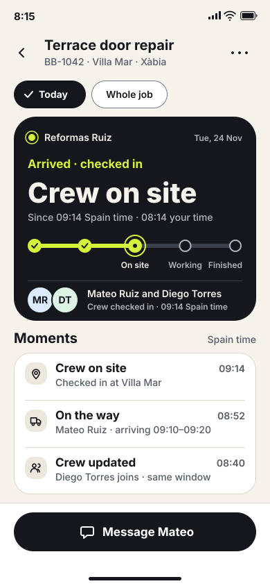

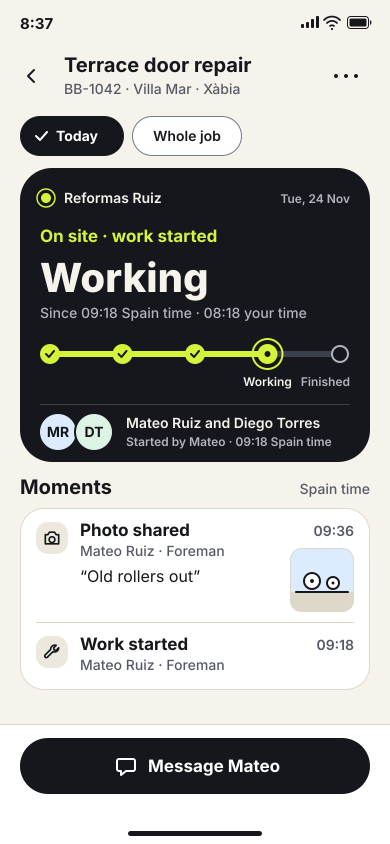

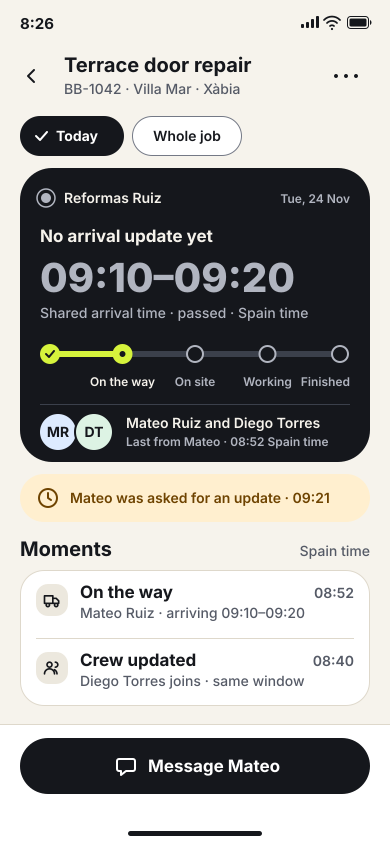

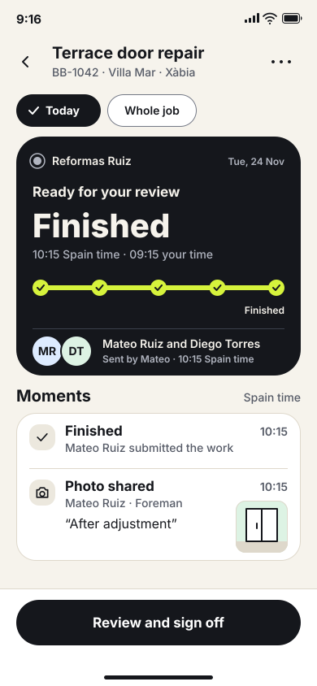

**Purpose and routes.** Follow the visit as it happens and reach the foreman. On the visit day the booking opens here from the live capsule on C-01, the live pill and the live card on C-18, a tap on C-19 or C-20 after unlock, S-09, or the Today chip on C-05. **Whole job** switches to C-05 without adding to the back stack. **Message Mateo** opens S-10 in the Job conversation. **Turn on** starts C-19 or C-20 on this device and, the first time, shows S-18 first. A photo stamp opens S-15. **More** holds Report a problem (C-16), Cancel or reschedule (C-17) and Live updates and privacy (S-18). When the visit is finished the dock opens C-10. If no cover is found, the revised visit opens in C-08. Back returns to the caller; on a cold start the parent is C-01.

**Layout and data.** Pushed header with the job, the reference and the place. Under it, the Today and Whole job switch. The hero capsule is the only dark object: the provider and the date, the state in words, one hero (the arrival time, the visit window or the state), a zone line with both clocks, the day line (Confirmed, On the way, On site, Working, Finished), the confirmed crew as avatars with names, and the provenance, for example "Shared by Mateo · 08:52 Spain time". The countdown chip beside the state is an estimate from a timer and is secondary to the arrival time. Below the capsule the Follow strip appears until following is on. **Moments** lists customer-visible stamps, newest on top, with "Spain time" named once; a photo stamp carries the caption and a 64-unit thumbnail. The dock holds one action.

**Interactions and states.** The capsule changes only when a stamp arrives, and each state names who made it and when. A new stamp fades in at the top of Moments and is announced without moving focus. Pull to refresh works when online.
- Crew confirmed shows the booked window as the hero, 09:00–10:00 Spain time with her time beside it, and bead one lit.
- Crew changed is the confirmed state after a crew update: a "Crew updated" chip, the new confirmed names and "Updated by Mateo · 08:40 Spain time". The crew changed state never shows the earlier crew member, the candidates or the reason, and it says the window is the same.
- Cover being arranged is not lit: the hero reads "Cover being arranged" and "Mateo will update you by 08:45", with both clocks. In the cover being arranged state there is no arrival time, the first bead is an open ring with no caption, and only the still-confirmed name is shown.
- If no one can cover, the old slot reads **Agreed window · no crew available** and Mateo's alternative reads **Proposed · waiting for Claire**. Open C-08 to accept or request another time. Sending or expiring a proposal does not move or cancel the agreed visit or any assignment; only its own confirmed outcome does.
- On the way shows the declared arrival time as the hero, the countdown chip and a rail that fills toward the arrival time as a labelled estimate.
- On site replaces the arrival time with "Crew on site" and "Since 09:14 Spain time · 08:14 your time". The on site stamp is at crew level: "Checked in at Villa Mar" names no person and uses no location.
- Working reads "Working" with "Since 09:18", and the newest photo is the first moment. In the working state a photo stamp shows who shared it, the caption in quotes and a thumbnail that opens S-15.
- No arrival update yet: keep the last confirmed stage, stop the estimate and label the dimmed band **Arrival window passed**. Show 09:10–09:20 Spain time with 08:10–08:20 your time underneath. The last stamp is still Mateo's at 08:52 Spain time; do not infer arrival or a delay.
- Finished stops the pulse, marks all five beads done and reads "Ready for your review" with the time Mateo submitted the work. In the finished state the dock becomes **Review and sign off**, and the Follow strip is no longer offered.
- Quiet, when freshness cannot be confirmed: no pulse, the current bead becomes a ring and the footer reads "Last confirmed 08:52 Spain time". An offline banner gives the last confirmed time. Message Mateo still works and queues the message as "Saved on this device".
- The Follow strip disappears once following is on. If notifications or Live Activities are off in the system settings, the strip says so and links to S-18 instead of offering Turn on.

**Platform, accessibility and RTL.** The capsule reads as one sentence: "On the way, arriving 09:10 to 09:20 Spain time, 08:10 to 08:20 your time, shared by Mateo at 08:52". The day line is announced once as "Step 2 of 5, On the way"; the pulse, beads and avatars are decorative. The countdown is not announced on every tick. With Reduce Motion the current bead is a static double ring and stamps cross-fade. At large text the hero wraps below the state, the zone line splits into two lines and the crew names stack. iOS uses Back and the edge swipe; Android uses Up and system Back, which closes More before leaving. In RTL the day line runs right to left with the same stage order; times, the reference and Latin names are isolated and never reversed.

## C-10 Review and sign off

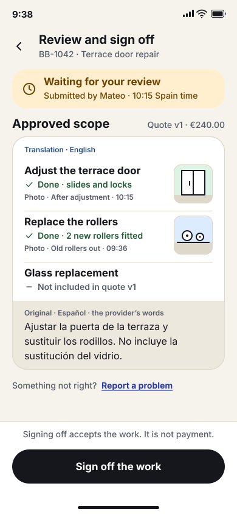

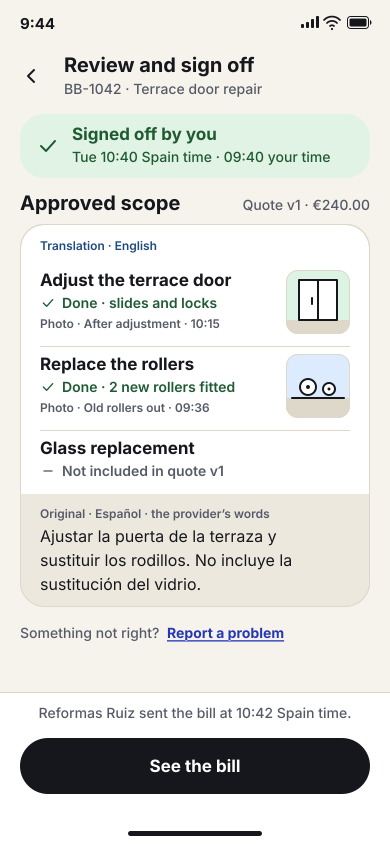

**Purpose and routes.** Compare the finished work with the approved scope and accept it, or say what is wrong. Entered from the dock of C-09 when finished, from C-05, from S-09 or from a push. **Sign off the work** opens S-17, which names the job, the approver and the effect; the server's answer returns here as signed off. **See the bill** opens C-11. **Report a problem** opens C-16 with the job attached. A photo opens S-15. Back returns to the caller.

**Layout and data.** Pushed header. A status notice says who submitted the work and when. **Approved scope** names the quote version and total. The scope is a twin card: on top, the scope items in the reader's language as a checklist; beneath, the provider's exact original with "Original · Español · the provider's words". Each completed item shows the foreman's confirmation, a short result note ("slides and locks"), and its photo with caption and time. An exclusion is listed as "Not included in quote v1" so the customer does not expect it. The problem link sits under the card. The dock's context line states the effect of the action.

**Interactions and states.** The checklist is read-only: the customer judges the whole submission and does not tick items. Sign-off takes two steps, the dock button and then S-17, and it is recorded with the approver's name, the quote version and the server time.
- Awaiting review shows "Waiting for your review" and the ink action **Sign off the work**, with "Signing off accepts the work. It is not payment."
- Signed off turns the notice green, "Signed off by you · Tue 10:40 Spain time · 09:40 your time", and the dock becomes **See the bill**. A signed off job cannot be signed off again or undone here; Report a problem stays available.
- Without the sign-off right the button is disabled and the context line reads "Claire Martin signs off for Villa Mar".
- Evidence unavailable: a photo that cannot load shows "Photo unavailable" with Retry, and a missing photo shows "No photo for this item". Sign-off stays possible and the context line says which evidence is missing.
- A problem reported instead of sign-off leaves the submission **Awaiting review · case open** and opens C-16. If the case is raised after acceptance, retain **Signed off** with the approver and time; the case does not reopen sign-off.
- If the foreman resubmits, the screen shows the new submission with "Updated by Mateo" and the time, and any earlier sign-off attempt is invalidated before S-17 can confirm.
- Offline, only the safe job summary is available. Reopen the submission and its evidence online; keep Sign off disabled with "Connect to sign off".

**Platform, accessibility and RTL.** Reading order: Back, title, the notice, the scope heading, each item as "Adjust the terrace door, done, slides and locks, photo After adjustment, 10:15", the original with its language, the problem link, the context line, the action. Thumbnails are buttons named by their caption. The original is tagged with its language so a screen reader pronounces it correctly. At large text the photo moves under its item and the dock grows. In RTL the checklist mirrors and the photo moves to the leading side; a Latin-script original stays left-aligned in its strip.

## C-11 Bill and payment record

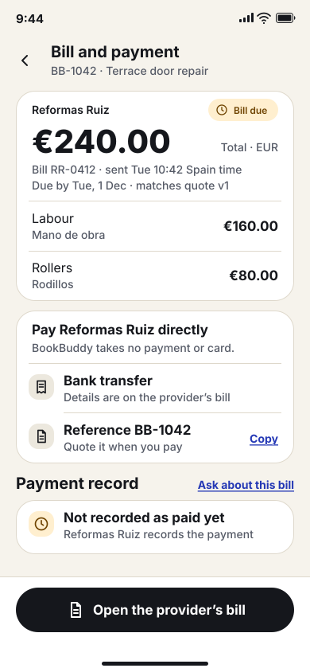

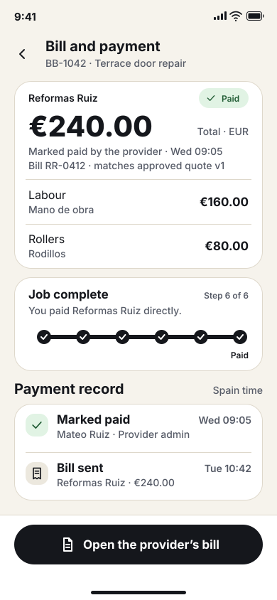

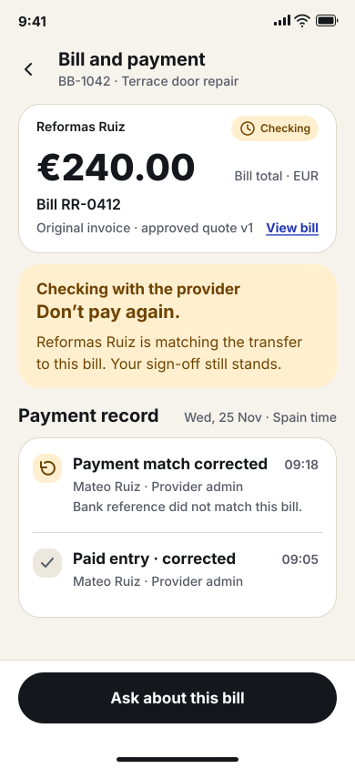

**Purpose and routes.** See the provider's bill, how to pay the provider directly, and when the provider records it as paid. Entered from C-10 after sign-off, the bill row on C-05, S-09 or a push. **Open the provider's bill** opens the provider's document in the system viewer. **Copy** copies the payment reference. **Ask about this bill** opens C-16 with the category Bill and this bill attached. Back returns to the caller.

**Layout and data.** The bill card shows the biller, a status badge, the total in EUR, the bill reference, when it was sent, when it is due and that it matches the approved quote. Line items follow, each with the provider's original label beneath the translation. The next card says how to pay: "Pay Reformas Ruiz directly", the method the provider offers and the reference to quote. **Payment record** lists stamps with actor and time. When paid, the how-to-pay card is replaced by "Job complete" with the journey line at step 6 of 6.

**Interactions and states.** There is no "I have paid" control or in-app charge. Only the provider admin in P-02 records Paid, after matching funds received by the provider to this bill. A customer message, screenshot or return from a banking app is not proof of payment.
- No bill yet, after sign-off and before the provider sends it: the card reads "Reformas Ruiz will send the bill here" and the dock has no action.
- **Bill due** shows the authorised invoice, its due date and “Not recorded as paid yet”. The fixture is due seven calendar days after delivery. Billing does not start a charge.
- Marked paid by provider shows the green "Paid" badge, "Marked paid by the provider · Wed 09:05" and a "Marked paid" stamp naming Mateo Ruiz as Provider admin. The marked paid record is the provider's statement, not a BookBuddy receipt.
- Known transfer, no confirmed match: **Checking with the provider · don’t pay again** replaces payment instructions and the copy-reference action. Keep the bill total and sign-off unchanged. **Ask about this bill** opens C-16 without creating a second payment attempt.
- Wrong paid stamp on the same invoice: append the provider admin’s correction with actor, site time and reason. In the alternative shown, Mateo corrects his 09:05 entry at 09:18 because the bank reference did not match RR-0412. The old stamp remains labelled **corrected**; the current badge is **Checking**, not Paid. Show **Bill due** only after the provider confirms no funds were received for this bill. No replacement invoice or refund is implied.
- Query raised shows "Query raised · case open" under the total and links to the case; the amount and the due date do not change unless the provider changes the bill.
- Only a change to the invoice itself produces a replacement invoice; keep the previous reference labelled "Replaced".
- Offline, show the safe job reference and a "Connect to view the provider’s bill" notice. Do not cache or reopen the invoice, bank details or payment reference, even if the document was viewed online. Open and Copy require a fresh online entitlement to the current bill.

**Platform, accessibility and RTL.** The total is read with its currency, "240 euros", and never converted. Each stamp reads as one sentence with actor, role and time. Copy confirms with a toast, "Reference copied". The provider's document opens in the platform viewer and returns here. At large text the total keeps its size and the supporting lines wrap. In RTL the layout mirrors; amounts, the bill reference and the job reference are isolated and keep their digit order.

## C-12 Rate the job [Sheet]

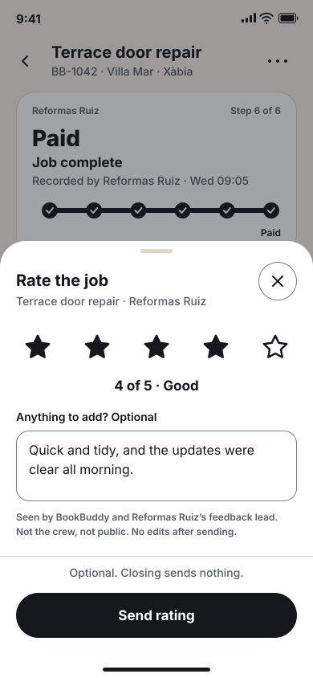

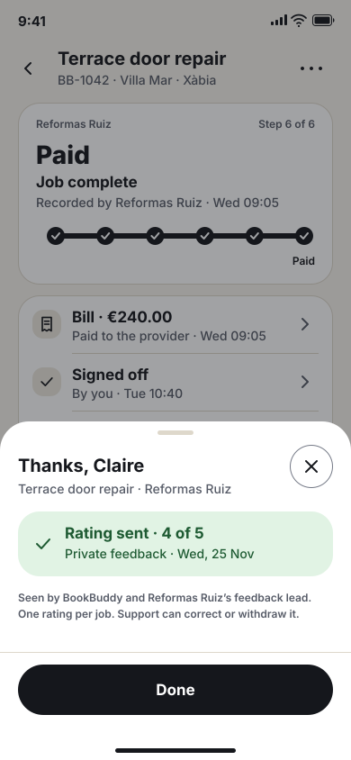

**Purpose and routes.** Give optional, private feedback once the job is closed. Opened from the dock of C-05 when the job is paid, and later from L-05. **Send rating** submits and stays on the sheet as submitted; **Done** or Close returns to C-05. Closing without sending sends nothing.

**Layout and data.** A sheet over the dimmed C-05 with a handle, the title, the job and provider, and Close. Five stars in 56-unit targets with the choice written beneath ("4 of 5 · Good"). An optional comment field. Two lines state the audience before sending: BookBuddy and the provider's feedback lead, not the crew and not the public, with no edits after sending. The dock holds the action and the line "Optional. Closing sends nothing."

**Interactions and states.** One rating per job, offered for 30 days after the service to the person who booked or approved it.
- Unrated: no star is chosen and Send rating is disabled with "Choose a rating to send".
- A chosen rating enables Send rating; the comment stays optional and is sent as written, with a translation for the reader and the original beneath it.
- Submitting keeps the label, shows progress and blocks a second send.
- Submitted shows "Rating sent · 4 of 5" with the date and who sees it. A submitted rating cannot be edited in the app; support can correct or withdraw it.
- If sending fails the stars and the comment are kept, and the context line reads "Not sent. Try again."
- After a submitted rating, or after 30 days, C-05 no longer offers the action.

**Platform, accessibility and RTL.** The stars are a single adjustable control, "Rating, 4 of 5, Good", and also five buttons for touch. Focus starts at the title, stays in the sheet and returns to the dock of C-05 on close. The keyboard lifts the dock and the sheet scrolls. iOS uses a native sheet with Close; Android Back closes the keyboard, then the sheet. In RTL the stars fill from the right and the text aligns to the right.

## C-13 Places

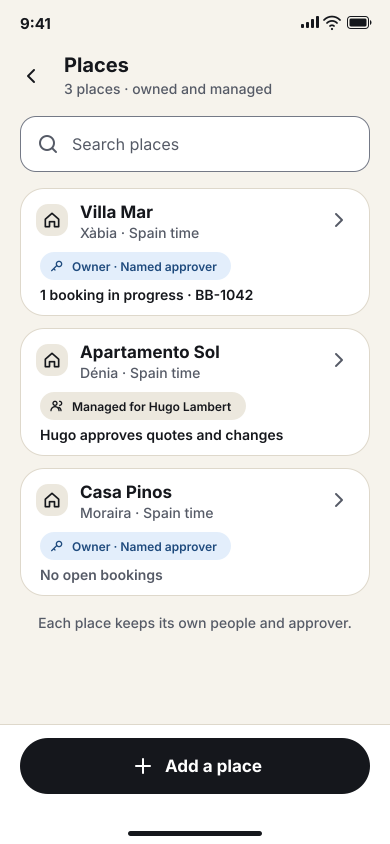

**Purpose and routes.** Find a place among those the customer owns or manages. Entered from the Places row on S-06 and from the place picker on C-03 when the list is long. A place card opens C-14. **Add a place** opens C-14 empty. Back returns to the caller.

**Layout and data.** Pushed header with the count. A search field, then one card per place: the name, the area and its time zone, a badge with what the customer is there ("Owner · Named approver" or "Managed for Hugo Lambert"), and one line about its bookings. The cards are ordered by live or open bookings first, then by name. A closing line says each place keeps its own people and approver.

**Interactions and states.** Search filters by name, area and address as the customer types, and keeps the query when returning from C-14.
- One place: the list is skipped and S-06 opens C-14 directly.
- Many places show the search field and the cards; the place shown in the identity chip is the one last used.
- Delegated places carry "Managed for" and the owner's name, and the line under the badge says who approves there, for example "Hugo approves quotes and changes".
- Empty shows "No places yet" with **Add a place**; a search with no result shows "No place matches" and a Clear link.
- Offline on an eligible personal device, show only authorised place aliases and safe job summaries. Do not search or reveal stored street addresses or access notes; Add a place requires a connection.

**Platform, accessibility and RTL.** Each card is one target read as "Villa Mar, Xàbia, Spain time, owner and named approver, 1 booking in progress". The search field has a persistent accessible label. At large text the badge wraps under the area. In RTL the icon and chevron swap sides and the chevron points left.

## C-14 Place and people

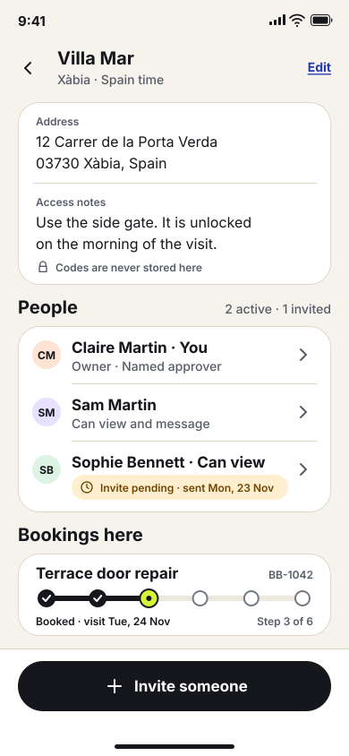

**Purpose and routes.** Maintain a place, its named approver and who else may act. Entered from C-13, from C-03, from More on C-05 and from the link "See who can act for Villa Mar" on C-07. **Edit** makes the address and access notes editable. A person row opens that person's grant. **Invite someone** opens the invitation form, and the invitee later accepts in S-05. The booking card opens C-05. Changing the named approver goes through S-17.

**Layout and data.** Pushed header with the place, its area and its time zone. The place card has the address and the access notes, with "Codes are never stored here". **People** lists each person with what they can do: the owner and named approver first, then others, then pending invitations with an "Invite pending" badge and the date sent. **Bookings here** shows a booking card with the mini journey line.

**Interactions and states.** A new person can view only, until the owner grants more. Each grant is per place and does not carry to another place.
- Edit keeps unverified changes as a draft, checks the address against the service area online and warns when a run of digits in the access notes looks like a code.
- Delegated read-only: a manager sees the address, the people and the bookings, with no Edit, no Invite and "Managed for Hugo Lambert" in the header.
- Invite pending shows who was invited, as what and when. An invite pending row opens Resend and Withdraw; a link lasts 48 hours and a resend withdraws the old link.
- There is always exactly one named approver; removing the role from one person requires naming another in the same step.
- Offline, show the place alias and safe job summary only. Hide the residential address, all entry notes (including whether a gate is unlocked), people and invitations. Reconnect and recheck the place grant before showing them or enabling Edit or Invite.

**Platform, accessibility and RTL.** Person rows read as "Sam Martin, can view and message". The badge is text, not colour alone. Address fields use the platform's address keyboard and autofill. At large text the grant moves under the name and rows grow. In RTL the layout mirrors; the address stays in its written order.

## C-15 Review a change

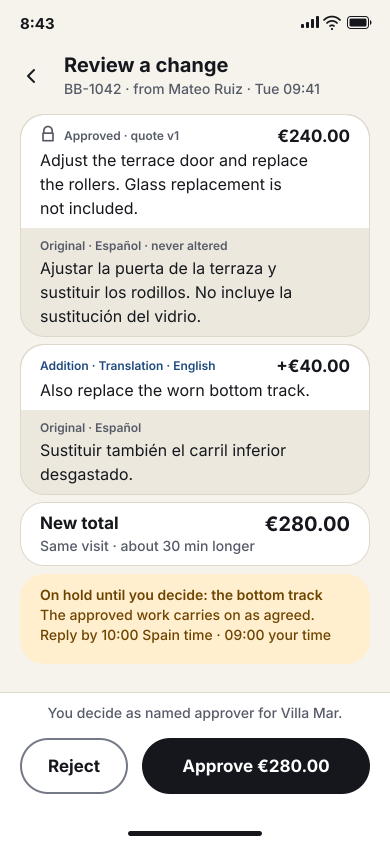

**Purpose and routes.** Compare a proposed change with what was approved, and decide. Entered from the "Change proposed" card on C-05, a decision card on C-01, S-09 or a push. **Approve** and **Reject** each open S-17, which names the change, the new total and the approver. The result returns to C-05. Back returns to the caller and decides nothing.

**Layout and data.** The header names who proposed the change and when. Two twin cards follow. The first is locked: "Approved · quote v1", its total, the translation and the provider's original, never altered. The second is the addition: its price difference, the translation and the original. A card gives the new total and the effect on timing. An amber card says what is on hold until the customer decides, that the approved work carries on, and the reply deadline in both clocks. The dock's context line names the right being used.

**Interactions and states.** Approving agrees the addition only: the approved quote text stays as it is, and the change becomes a new version beside it.
- Open shows Reject and **Approve €280.00**; the amount in the button is the new total, not the difference.
- Approved shows "Change approved by you" with the time and the new total, and the dock becomes **Back to the job**.
- Rejected shows "Change rejected by you"; the approved scope and price stand and the on-hold work is not done.
- Superseded: if Mateo replaces the proposal, this one reads "Replaced by a newer proposal" with a link to it, and it can no longer be approved.
- If the reply time passes with no decision the proposal expires, the approved terms stand and the screen says so.
- Without the approval right both buttons are disabled and the context line names the approver.
- Offline, show the safe job reference rather than the private proposal; both decisions require a current online version and grant.

**Platform, accessibility and RTL.** Reading order: the approved card, the addition, the new total, what is on hold, the deadline, the context line, Reject, Approve. Amounts are read with sign and currency, "plus 40 euros, new total 280 euros". Each original is tagged with its language. The two buttons sit 14 units apart and stack at large text with Approve first. In RTL the cards mirror and the amounts stay on the trailing side.

## C-16 Report a problem

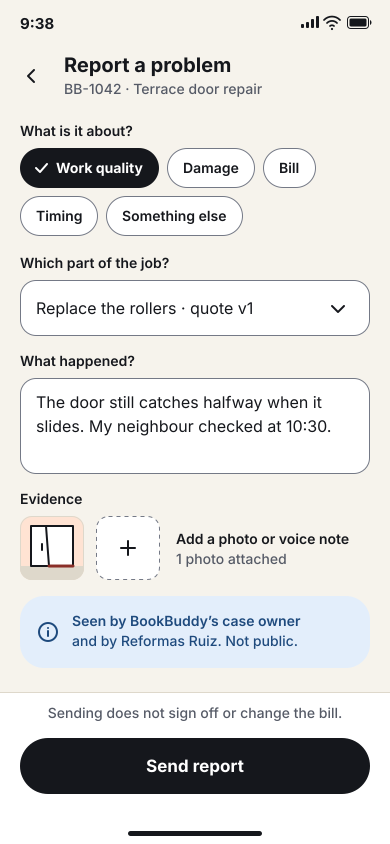

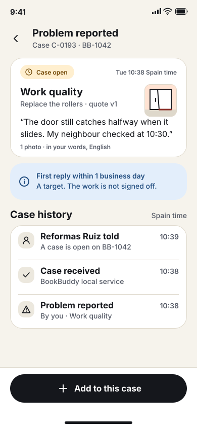

**Purpose and routes.** Send evidence to the local service and follow the case. Entered from More on C-05 and C-09, the link on C-10, and "Ask about this bill" on C-11, which preselects Bill. The add tile opens S-14; a thumbnail opens S-15. **Send report** submits and shows the case. **Add to this case** opens the same form attached to the open case. Back from a draft keeps it; Back from a case returns to the caller.

**Layout and data.** The draft asks three things: what it is about (chips: Work quality, Damage, Bill, Timing, Something else), which part of the job (a picker filled from the approved scope) and what happened (the customer's own words). **Evidence** shows attached photos and voice notes with an add tile. A notice names who will see the report. After sending, the screen shows the case reference, a "Case open" badge, the report as sent, the reply target and **Case history** as stamps.

**Interactions and states.** Nothing is sent until the customer taps Send report, and sending needs the server.
- Draft: Send report is disabled until a category and a description exist, and the context line says what is missing. The draft is saved on the device as the customer types.
- Sending keeps the label, shows upload progress per item and blocks a second send.
- Case open shows the case reference, time received and one-business-day first-reply target. The illustrated quality case was filed **before** acceptance, so it says the work is not signed off. A later bill query instead shows **Signed off Tue 10:40 Spain time (09:40 your time) · case open**. Keep the accepted version, approver, amount due and payment record intact unless there is a separate authorised decision.
- Each reply from the case owner or the provider is a new stamp, with a translation and the original beneath when languages differ.
- Resolved shows "Case closed" with the agreed outcome and who recorded it, and offers **Review and sign off** if the work is still not signed off.
- Offline, the draft reads "Saved on this device · not sent" and Send report is disabled; photos stay queued on the device.
- If a category needs urgent help the notice adds the service's contact route; the app never labels a case urgent by itself.

**Platform, accessibility and RTL.** Chips are a single-choice group with the selected chip announced; they wrap to more rows at large text. The description field keeps its label above and grows with the text. Evidence tiles are named "Photo 1 of 1" and "Add a photo or voice note". Errors appear under the field that caused them and are announced once. In RTL the chips and tiles start from the right and the description aligns to the writer's language.

## C-17 Cancel or reschedule [Sheet]

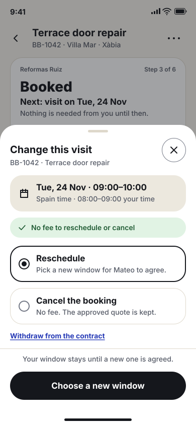

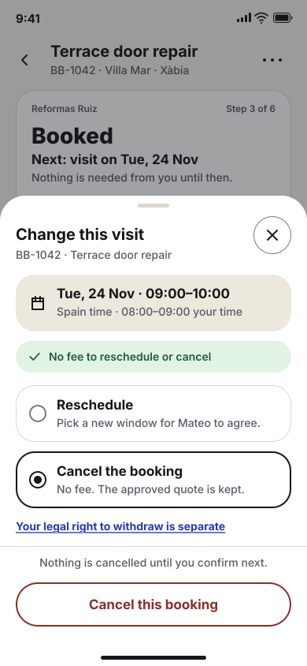

**Purpose and routes.** Cancel the appointment or change its time without a fee. Enter from More on C-05 or C-09, the links on C-08, or later L-05. **Choose a new window** opens C-08; **Cancel this booking** opens S-17. Where a statutory withdrawal right applies, **Withdraw from the contract** opens a separate confirmation for the contract with Reformas Ruiz, not appointment cancellation, a terms page or a request for permission. Close changes nothing.

**Layout and data.** A sheet over the dimmed C-05 with a handle, the title, the job and Close. The current window is shown in both clocks. A green line says "No fee to reschedule or cancel". Two choices follow as radio cards, each with its consequence in one line. The dock's context line says what happens next, and the dock holds the action for the chosen option.

**Interactions and states.** The sheet itself changes nothing: rescheduling is finished in C-08 and cancelling in S-17.
- Reschedule is chosen by default and the dock holds the ink action **Choose a new window**. The current window stays booked until a new one is agreed.
- Cancel is chosen by tapping its card: the dock holds an outlined **Cancel this booking** with a critical label, and the line "Nothing is cancelled until you confirm next." To cancel the customer confirms in S-17; the approved quote stays on record.
- Inside 24 hours, or if capacity or terms differ, a change of time needs provider agreement. At least 24 hours ahead, the customer can confirm a current provider-authorised alternative directly if the scope and price are unchanged.
- **Requested** or **Proposed** does not mean rescheduled. Keep the agreed slot until a new one is confirmed. No response or an expired proposal leaves it unchanged, even if the provider currently has no crew for it.
- Cancelled shows "Cancelled by you" with the time on C-05, the journey line stops at Booked and nothing is charged.
- Once work has started, ordinary termination goes to the provider or C-16. Starting the visit neither grants nor extinguishes a statutory withdrawal right. Determine that right separately from the applicable contract terms, period and early-start acknowledgements.
- Withdrawal: the confirmation identifies the contract, provider and customer, with **Submit withdrawal notice** and Back. Submission does not require a reason, booking change or provider approval. On confirmed receipt, show **Withdrawal notice received** with the contract reference, exact notice and timestamp; send a durable copy to the customer’s verified email. If the result is unknown, check the record before offering a retry; never show an unconfirmed receipt.
- Offline, no booking change or withdrawal is marked sent. Show how to reconnect and the provider's authorised alternative notice channel if available.

**Platform, accessibility and RTL.** The two cards are a radio group; each is read with its consequence. Focus starts at the title, stays in the sheet and returns to More on close. The destructive button is never the default focus. At large text the sheet grows to full height and scrolls. iOS uses a native sheet; Android Back closes it. In RTL the radio moves to the right and the text aligns right.

## C-18 Bookings

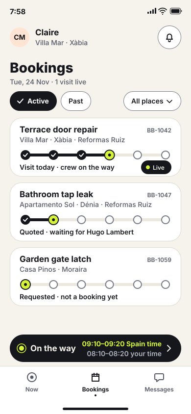

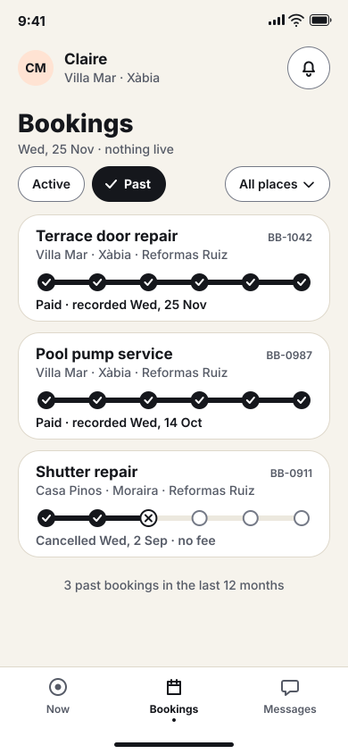

**Purpose and routes.** Find any booking, past or future. It is the Bookings tab. A booking card opens C-05, or C-09 when its visit is live. The live pill opens C-09. The place filter opens a list of places; the identity chip opens S-06 and the bell S-09. A draft row opens the step where the request was left (C-02 to C-04).

**Layout and data.** Root header with the identity chip and bell, then the date and summary, Active/Past segments and place filter. Each card shows job, reference, place, provider, journey line and stage with its next step or final date. A live booking carries a "Live" tag. The pill above the tab bar shows the crew state and arrival band: 09:10–09:20 Spain time first; 08:10–08:20 your time beneath when enabled and different.

**Interactions and states.** Each card is one target. Returning from a booking restores the segment, the filter and the scroll position.
- Active lists drafts, requests, quoted, booked and live bookings, with live first, then the nearest visit, then the newest request.
- Past lists closed bookings, newest first: paid jobs with every bead done and "Paid · recorded Wed, 25 Nov", and cancelled jobs with a crossed bead at the stage they reached and "no fee". In the past segment nothing is lime and there is no live pill.
- Filtered empty reads "No active bookings at Casa Pinos" with a link to show all places.
- With no bookings at all the tab shows "No bookings yet" and points to the ask bar on Now.
- Cached: a banner reads "Offline · last confirmed 08:52 Spain time", the live card goes quiet and cards open their cached record read-only.
- The pill shows one booking, the most time-critical, and is hidden when nothing is live.

**Platform, accessibility and RTL.** Segments are a selectable group, with a check and fill for selection. A card reads as "Terrace door repair, BB-1042, Villa Mar, step 4 of 6, visit today, crew on the way, live". The pill reads both displayed ranges and their zones, site first. At large text the pill grows or stacks its values; the reference moves below the title and the filter below the segments. Mirror navigation and rails in RTL; isolate references and times.

## C-19 Visit Live Activity [System · iOS]

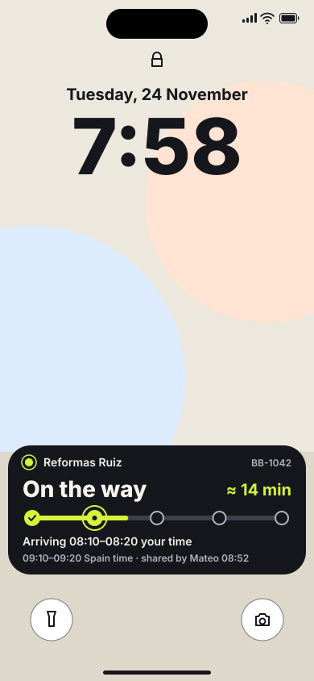

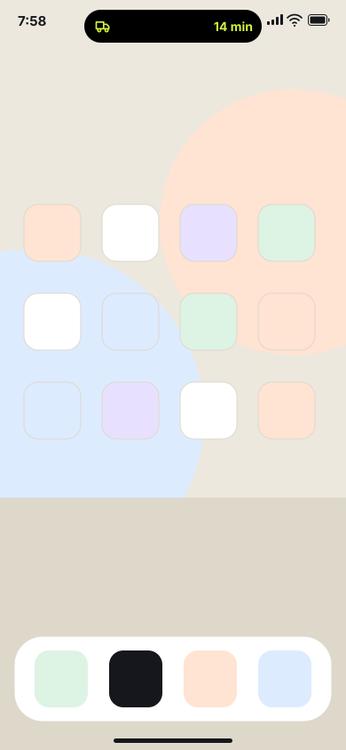

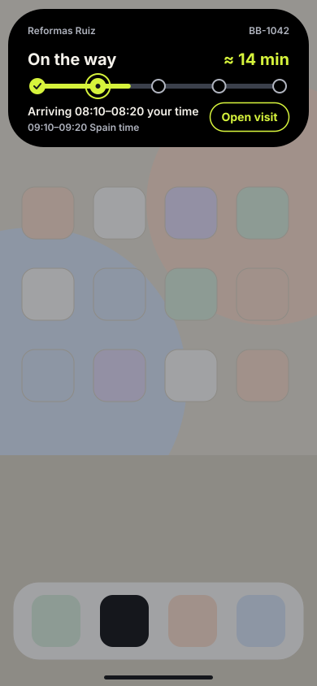

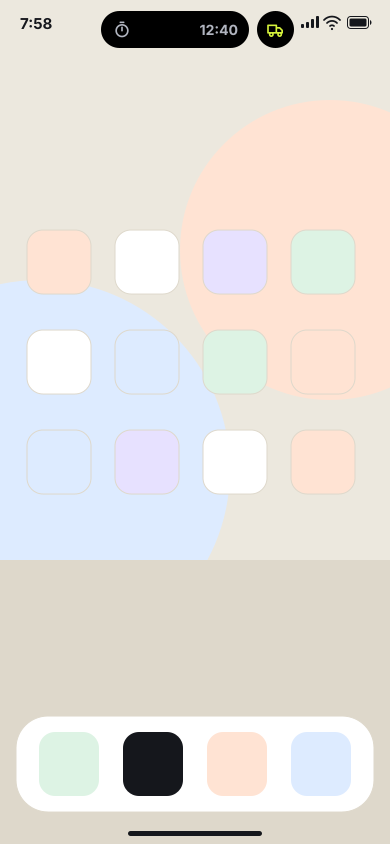

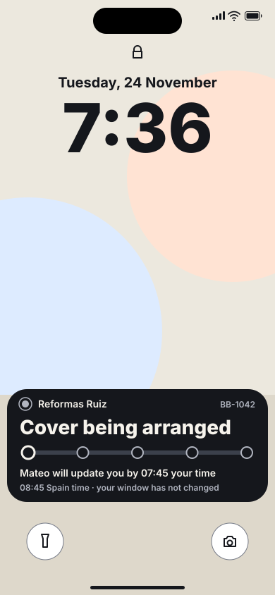

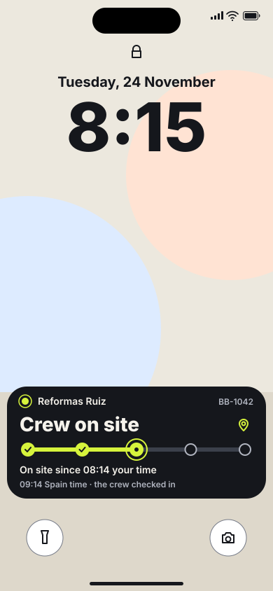

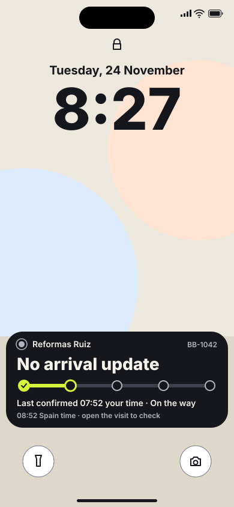

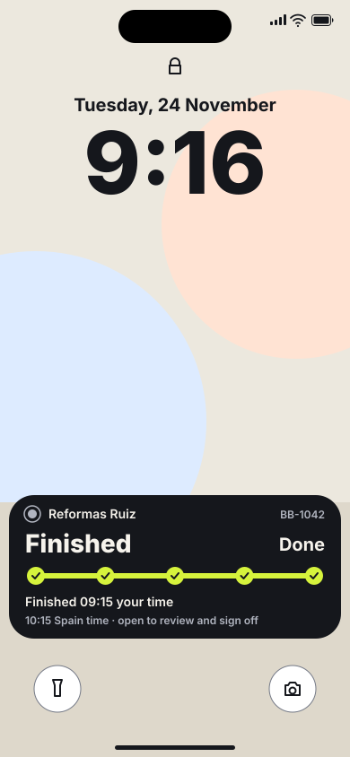

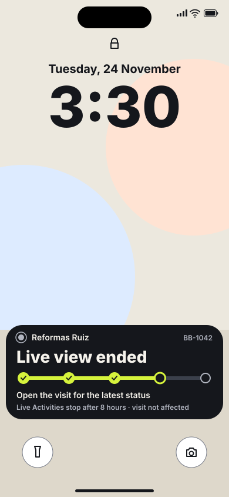

*Details allowed separately in S-18.* These detailed Lock Screen and Island previews assume Claire has permitted them and iOS allows them.

**Purpose and routes.** Follow the visit from the Lock Screen and the Dynamic Island without opening the app. It starts only when the customer taps **Turn on** in the Follow strip on C-09, with the app in the foreground. There is no push-to-start at launch. A tap on the card or the island opens C-09 after unlock, with C-01 as parent on a cold start. **Open visit** in the expanded island does the same. Nothing on this surface changes the booking.

**Layout and data.** The Lock Screen card is the capsule at 370 × 160: the provider and the reference; the state in words with a trailing countdown, glyph or "Done"; the day line without captions; then the time in the viewer's clock with "your time", and Spain time with the provenance beneath. The compact island has the stage glyph leading and at most six characters trailing ("14 min", "On site", "Done"). The minimal island is the stage glyph alone. The expanded island repeats the card and adds the one link, Open visit. The surface never shows an address, access detail, a price, message text or a position.

**Interactions and states.** The card updates on stage changes only, about six pushes per visit; the countdown and the rail fill are drawn by the system from a timer.
- On the way shows "≈ 14 min" in lime and "Arriving 08:10–08:20 your time", with Spain time and who shared it beneath.
- Island compact shows the lime van and "14 min"; island expanded adds the day line, both clocks and Open visit; island minimal shows the van alone when another activity shares the island.
- On site replaces the countdown with a lime pin and reads "On site since 08:14 your time"; on site is crew level and names no person.
- Cover being arranged is not lit: no countdown, no arrival time, the first bead an open ring, and "Mateo will update you by 07:45 your time". The cover being arranged card names no candidate and gives no reason.
- Stale: the stale date is set to the end of the arrival time. A stale card drops the countdown and the pulse, shows the current bead as a ring and reads "No arrival update" with "Last confirmed 07:52 your time". It never says "late".
- Finished shows "Finished", "Done" and five done beads. The finished card can stay for up to four hours and says to open the visit to review and sign off; it does not sign off.
- Ended at 8 hours: iOS ends a Live Activity eight hours after it started. The ended card reads "Live view ended", holds the last stage as a ring and says the visit is not affected. No new activity is started automatically; C-09 offers Turn on again.
- If the customer removes the activity or turns Live Activities off, following stops on this device only, and ordinary notifications continue as set in S-18.
- **Hide details** is on by default. Show and speak only “BookBuddy visit · On the way” or the current stage. Keep the Island stage-only too: no provider, job reference, arrival band or countdown.

**Platform, accessibility and RTL.** VoiceOver reads only visible details. When Claire allows them, announce the provider, job, stage, arrival band (her clock first, site clock second) and source once; do not announce every countdown tick. Without the Island, supported iPhones can still show the Lock Screen card. An ordinary locked push says “BookBuddy · You have an update” and opens the record only after unlock. Mirror the layout in RTL but isolate times and reference.

## C-20 Visit ongoing notification [System · Android]

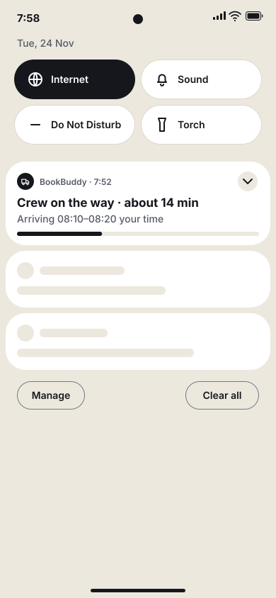

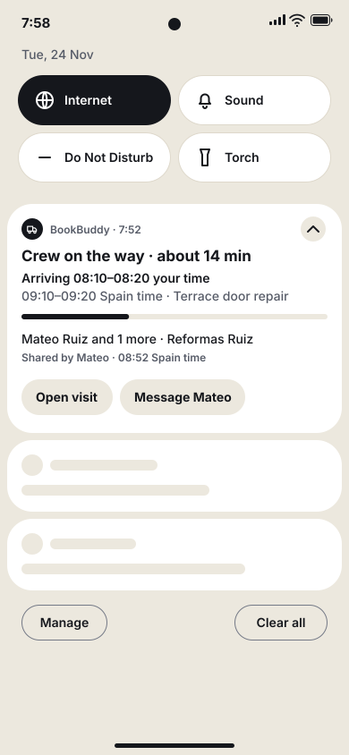

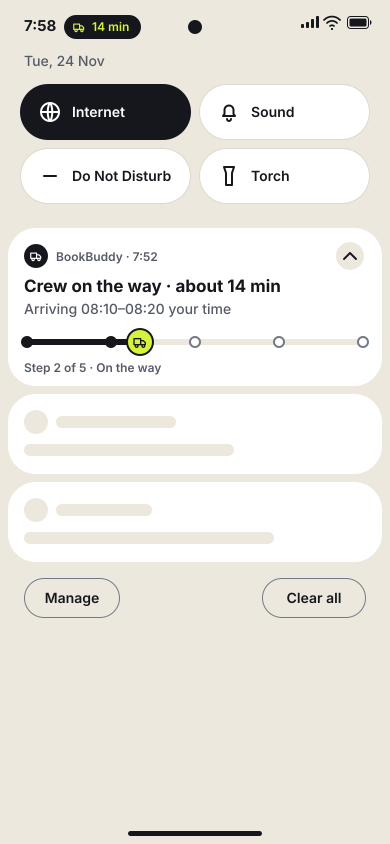

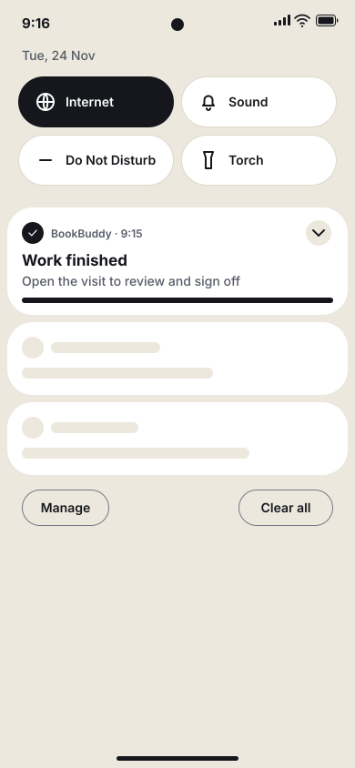

**Purpose and routes.** The same live visit on Android, as an ongoing notification. It starts when the customer taps **Turn on** on C-09; if notifications are not yet allowed, the system permission is asked at that moment and nowhere earlier. A tap opens C-09 after unlock. **Open visit** opens C-09 and **Message Mateo** opens S-10; both only open the app.

**Layout and data.** The detailed collapsed preview shows the stage glyph, BookBuddy, the last stage time, “Crew on the way · about 14 min”, the arrival band in the viewer’s clock and a progress bar. Expanded adds Spain time, the job, the crew line, provenance and the two open-app actions. *Details allowed separately in S-18.* With details hidden, the notification and its spoken label say only “BookBuddy visit · On the way”; no countdown, names, reference or named message action. Never include an address, access detail, price or message text.

**Interactions and states.** The notification is updated in place on stage changes and never reposted with sound after the first time.
- Collapsed is the default layout in the shade; expanding it does not change the privacy choice. With detailed previews allowed, the collapsed text fits the viewer's arrival band.
- The detailed expanded view adds Spain time, crew and provenance, with Open visit and Message Mateo. With details hidden, retain the stage and generic open-app route only.
- Android 16 promotion is **later**. The pilot uses the ordinary ongoing notification even on supported devices; it never requests promotion. The later illustration shows the optional status chip and segmented tracker, not launch UI.
- On site, working and cover being arranged follow C-19: "Crew on site · since 08:14 your time", "Working", and "Cover being arranged · update by 07:45 your time" with an empty progress bar.
- Finished is no longer ongoing: "Work finished", "Open the visit to review and sign off" and a full bar. The finished notification can be cleared and performs no action.
- Dismissed: on Android 14 and later the customer can swipe the notification away. A dismissed notification is not reposted for the same stage; following continues and the next stage change posts it again once, silently.
- With notifications off for the app or the channel, C-09 shows the Follow strip with a link to S-18 and the booking is unaffected.

**Platform, accessibility and RTL.** TalkBack reads the title, the text and the progress as "Step 2 of 5, On the way". The actions are labelled buttons at least 48 dp high. The notification uses its own channel, "Visit updates", which the customer can silence without losing booking decisions. Colours and shapes follow the system theme; the app supplies no custom layout, so the drawing shows a standard template. Sensitive content follows the Lock Screen setting and S-18's "Hide details". In RTL the system mirrors the template; times stay in their written order.

## Navigation

The diagram shows the routes this slice adds. Tabs, the identity chip and the bell are in the [customer map](../../foundation/information-architecture.md#customer). S-16 replaces any screen whose access is lost.

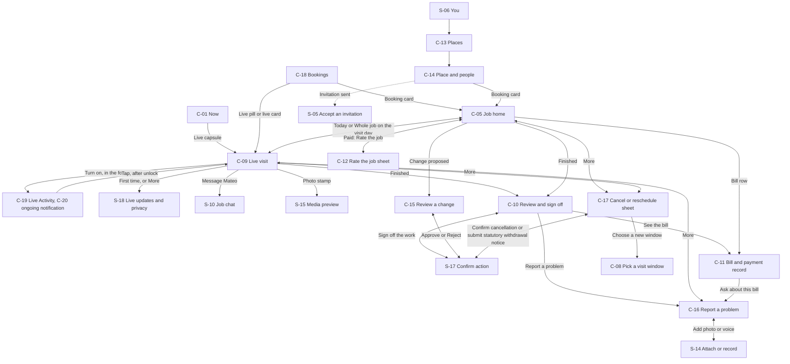

## Open design questions

- **Which act publishes "Cover being arranged", and where does the promised time come from?** Core flow 2 shows it only when the visit start is at risk. This slice draws it as a status shared by Mateo at 08:34 with "Mateo will update you by 08:45", three minutes after the offers' reply deadline of 08:42. Decide whether the foreman shares it or the server publishes it when offers go out, and how the promised time is set. The first bead is an open ring with no caption, as in the foreman's crew gap state.
- **When does "No arrival update yet" appear, and may the customer be told the foreman was asked?** The slice shows it once the shared arrival time has passed with no check-in, and adds "Mateo was asked for an update · 09:21". Confirm the delay after the arrival time, who is prompted, and whether the customer sees that prompt.
- **How early may Follow live start?** The strip is offered from the start of the visit day, so a customer can follow from "Crew confirmed" or "Cover being arranged". The eight-hour limit then runs from that tap. The alternative is to offer it only from "On the way". The ended card relies on the stale date to show "Live view ended" at eight hours; this is [unverified] on a device.
- **Should the Android text lead with the viewer's time?** The design system's sample reads "Terrace door repair · arriving 09:10–09:20". C-20 follows the two-clock rule and C-19 instead: the collapsed text is "Arriving 08:10–08:20 your time", and the job name and Spain time move to the expanded layout, so no time is ever truncated.
- **Who may sign off, and what if evidence is missing?** C-10 gives the action to the named approver and keeps it available when a photo is missing, with the gap stated. The result notes ("slides and locks") and the photo per item are fixtures for F-14. Confirm the evidence each item needs and whether a second person may hold the sign-off right.
- **What document format will each provider use?** F-14 and C-11 refer to the same authorised invoice, `RR-0412`, for €240.00. Transfer details belong on the provider's online document, not in a cached app field. A billing question opens C-16 with that invoice attached.
- **Is the rating scale and its audience right?** C-12 applies the accepted rule: one private 1 to 5 rating within 30 days, seen by BookBuddy and the provider's feedback lead, with no edits in the app. The label "Good" for 4 and the other four labels are placeholders.
- **How is a change approved while the visit is running?** C-15 gives a reply time of 10:00 Spain time, the end of the booked window, because the affected work would start in the same visit. The accepted default is 72 hours, capped at the start of the affected work. Confirm the rule and whether Reject belongs in the dock beside Approve, as drawn, or under a quiet link.
- **What may a case promise?** C-16 gives a first-reply target, not a resolution time, refund or pause in collection. The pre-sign-off quality case `C-0193`, its categories and the 10:38 and 10:39 stamps are fixtures. Confirm the named contact for each case.
- **What final consent wording should the provider use for statutory withdrawal?** Keep withdrawal separate from free appointment changes and give the customer a durable receipt; final terms and wording require review.
- **Do the added fixtures match the other slices?** C-13 and C-18 add Apartamento Sol in Dénia (managed for Hugo Lambert), Casa Pinos in Moraira and bookings `BB-1047`, `BB-1059` (requested garden gate latch), `BB-0987` and `BB-0911`. C-14 uses C-03's address, Sam Martin from C-07 as "Can view and message" and a pending invitation to Sophie Bennett. S-06 describes one place.
- **Should a journey line's current bead be lime when nothing is live?** C-14 and C-18 use the geometry of C-05, a lime bead with an ink border, so lime appears on bookings that are not live. This is the same question as in C-01 to C-08; C-18 adds a "Live" tag so the live booking still stands out.
- **Which clock do artboards after the visit show?** C-10, C-11 bill due, C-15 and C-16 follow the story minute by minute, so they show Claire's clock (9:38, 9:44, 8:43) and not 9:41. Confirm that this reading of "live artboards" is intended.
- **Should links use a native underline or a drawn line?** New links in this slice use the native underline, as in C-01 to C-08, because Quick Look sets text slightly narrower than Chromium. The Follow strip on the C-09 states keeps the lead's drawn line so that they match the primary.
