# Foreman screens F-01–F-09: now, jobs, quote, schedule and crew

This slice takes Mateo Ruiz, acting as **Foreman · Reformas Ruiz**, from a new request to a staffed, live visit: Now, Jobs, New job, Scope and quote, Job control, Schedule, the Assign crew sheet, Crew and Crew member. It follows the [concept](../../foundation/concept-and-principles.md), [information architecture](../../foundation/information-architecture.md), [roles](../../foundation/personas-and-roles.md), [core flows](../../foundation/core-flows.md), [design system](../../system/design-system.md) and [wireframe conventions](../../system/wireframe-conventions.md), and applies the [owner's decisions](../../../docs/decisions/2026-11-23-open-questions.md). Where the [reference specs](../../../design/screens/foreman/F-01_F-07-specs.md) settled access, draft and recovery rules, those rules are kept and this file describes only what Beacon changes.

The artboards are snapshots of the [story](../inventory.md#story-and-clock), in Spain time. On Mon, 23 Nov Mateo accepts the job at 08:10 (F-03), drafts quote v1 at 08:12 and sends it at 08:14 (F-04), proposes three windows after the approval at 08:20 (F-06) and assigns Nadia Benali after the booking at 08:36 (F-05 booked, F-07). On Tue, 24 Nov Nadia drops out at 08:32 (F-01 crew gap), Mateo checks Diego Torres at 08:33 (F-09), the visit is live at 08:58 (F-01, F-02, F-08) and work is under way at 09:21 (F-05). The bill follows the sign-off at 10:45 (F-05 bill sent). One artboard shows the alternative branch: nobody covers by 08:42 and Mateo proposes a revised visit (F-06 revised visit, 08:43). Artboards on the live timeline show Mateo's clock; the others show 9:41.

## Rules used on every screen

- **One next step.** Each pushed screen has one primary action in the dock. A dock with a context line starts at y=692 and centres the line at baseline 718. An unavailable action is drawn disabled with its reason in the context line. On the Now tab the dock sits above the tab bar.
- **Lime means live.** Lime appears in the live capsule, the live pill, the current bead of a line and the ring of a worker who is on the way or on site. A button is lime only when it changes what other people see live: Share an update, Send to Nadia and Propose new visit. Accept job, Review and send, Send windows and Assign crew are ink.
- **Person-level inside, crew-level outside.** The foreman sees each worker's state, time and briefing status. Every screen that shows it also says what Claire sees, so the two are never confused. The customer never sees candidates, dropout reasons, per-worker times or eligibility.
- **Who and when.** Every status names its actor and its time. Times are site time and the zone is named once per screen. Claire's time is added wherever the foreman chooses a time for her.
- **Your words stay yours.** Mateo reads and writes Español while the UI is English. Claire's request is shown as a translation with her original beneath. Mateo writes the scope in his own words and sees the English that Claire will read. An approved quote is never edited; a change is a new version.
- **Online for consequences.** Accepting a job, sending a quote, sending windows, sending an assignment and proposing a revised visit need the server and are confirmed only by its answer. Drafts are saved on the device and labelled as saved, never as sent.
- **Access.** Account, role, business and the record's freshness are checked on entry and again before each consequential action. A foreman sees only jobs offered to or owned by them. Eligibility is shown as a result with a date, never as documents. No screen shows a map or a position.
- **Languages.** The UI ships in English (`en`) and European Portuguese (`pt-PT`); see [Internationalisation](../../../docs/architecture/mobile-tech-stack.md#internationalisation). Every label is a whole catalog message with placeholders, for example "Send {count} windows to {name}", never a joined fragment. Layouts allow 40% longer text by wrapping. Reading language, working languages and a message's own language are separate from the UI language.

## F-01 Now

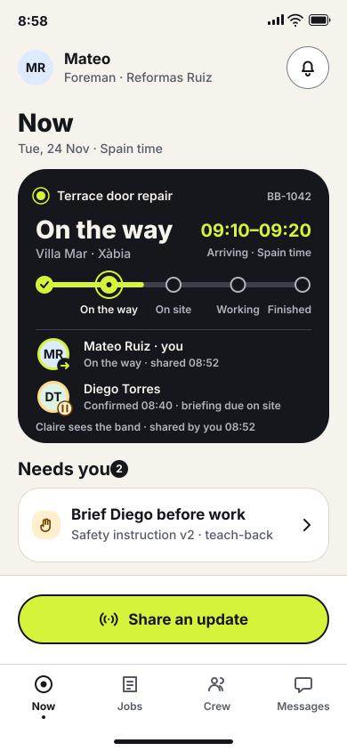

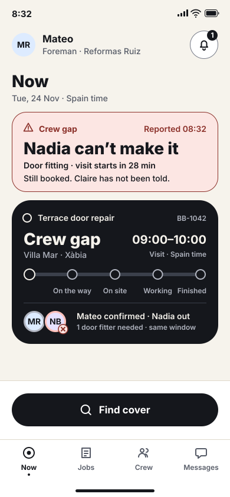

**Purpose and routes.** The foreman's start tab shows today's visits live, with gaps first and one next step. The capsule opens F-05 for that job. A gap card and the Find cover dock open F-10. A worker row opens F-16 for that shift. A needs-you card opens the record behind it: S-11 for a briefing, F-03 for a job or handoff to answer, F-12 when a cover acceptance waits. Share an update opens the F-17 sheet. The identity chip opens S-06, the bell S-09, and the tabs F-02, F-08 and S-08.

**Layout and data.** Root header with the identity chip ("Mateo", "Foreman · Reformas Ruiz") and the bell. The title "Now" has the site date and "Spain time". Sections appear in a fixed order and only when they have content: gap cards, live capsules, **Needs you** with a count, then later visits. The capsule shows the job and reference, the state, the arrival band or the booked window, the place and the day line. Under a rule it lists each worker with a status ring, a state glyph, the state in words and its time. The footer says what Claire sees. In the primary, at 08:58, the state is "On the way", the band is 09:10–09:20, Mateo is on the way since 08:52 and Diego Torres is confirmed since 08:40 with his briefing due on site. The gap card is a critical card: "Crew gap", "Reported 08:32", "Nadia can't make it", the skill, the time to the visit and "Still booked. Claire has not been told."

**Interactions and states.** With a visit live, the capsule leads and one tap opens F-05. The dock holds one lime action, Share an update, because it changes what Claire sees. A new stamp updates the capsule in place and never moves focus.
- Crew gap: the gap card comes first and nothing on the page is lime. The capsule goes quiet: the state reads "Crew gap", the first bead is an open ring and the worker who dropped out has a critical ring. The dock holds one ink action, Find cover, which opens F-10 and sends nothing. The gap card shows the dropout time but not the reason; the reason is on F-16.
- A crew gap never changes the customer's view by itself. The card says whether Claire has been told. Once offers are out, the card is replaced by the cover search capsule and F-18 can start.
- Several live visits are ordered by urgency: gap, late with no update, on the way, on site, working. One dock action applies to the first capsule and names its job when there are two or more.
- Quiet day: the page says "No visits today", shows the next visit as a booking card and keeps Needs you. There is no dock.
- Offline or stale: a banner reads "Offline · last confirmed 08:52 Spain time", the capsule stops pulsing and its footer reads "Last confirmed 08:52". Find cover and Share an update are disabled with the reason. An unknown state is never shown as "No visits today".
- Needs you lists only what the foreman can act on, oldest deadline first. The count is the number of items, and the list scrolls behind the dock.

**Platform, accessibility and RTL.** The dock and tab bar respect the home indicator or the Android navigation inset; Android Back leaves the app from this root. Reading order: identity chip, bell, title, gap cards, capsules, Needs you, dock, tabs. The capsule is read as one sentence, then each worker as "Diego Torres, confirmed 08:40, briefing due on site". The gap card is announced once, politely, when it arrives. Ring colour is never the only signal: each ring has a glyph and words. At large text the band moves under the state and worker rows grow. With Field mode on, the dock button is 64 high. In RTL the layout and the day line mirror; times, the reference and names stay left to right.

## F-02 Jobs

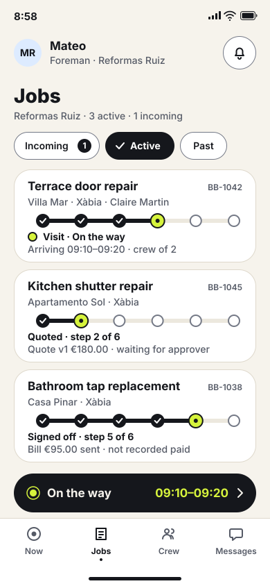

**Purpose and routes.** The Jobs tab is the foreman's pipeline from intake to closed. A card in Incoming opens F-03. A card in Active or Past opens F-05, which opens on its Today view when the visit is today. The live pill opens F-05 for the live job. The identity chip opens S-06 and the bell S-09.

**Layout and data.** Root header, the title "Jobs" and a summary line with the business and counts. Three stage segments follow in pipeline order: Incoming with its count, Active and Past. Each booking card is one target with the title, the reference, the place and customer, the journey line, the stage in words and the next step or confirmed time. The fixture shows BB-1042 Terrace door repair at "Visit · On the way", BB-1045 Kitchen shutter repair at "Quoted · step 2 of 6" and BB-1038 Bathroom tap replacement at "Signed off · step 5 of 6" with its bill not yet recorded as paid. The live pill above the tab bar reads "On the way · 09:10–09:20".

**Interactions and states.** Tapping a segment filters the list in place and keeps the scroll position per segment. Active is sorted by what is live, then by the next deadline. A live job shows a lime bead beside its stage and its arrival band as the next step.
- Incoming lists new jobs and handoffs offered to this foreman by name, each with its reply deadline. Nothing in Incoming is owned yet.
- Active runs from Quoted to Signed off. A crew gap, an open change, an open problem and an unpaid bill are flags on the card, not stages.
- Past lists paid, closed and cancelled jobs, read-only, newest first.
- An empty segment says what belongs there, for example "No new jobs. New requests offered to you appear here."
- Offline, the list shows the cached cards with "Last confirmed" and the counts are hidden rather than guessed.
- The live pill appears on this tab because the capsule is on Now. It shows one job, the most time-critical.

**Platform, accessibility and RTL.** Segments are a native segmented control on iOS and tabs on Android, each announced with its count and selected state. A card is read as title, place, "step 4 of 6, Visit, on the way", then the next step. The journey line is decorative for screen readers because the stage is in words. At large text the segments wrap and the reference moves under the title. In RTL the segments, cards and journey line mirror; references, amounts and times stay left to right.

## F-03 New job

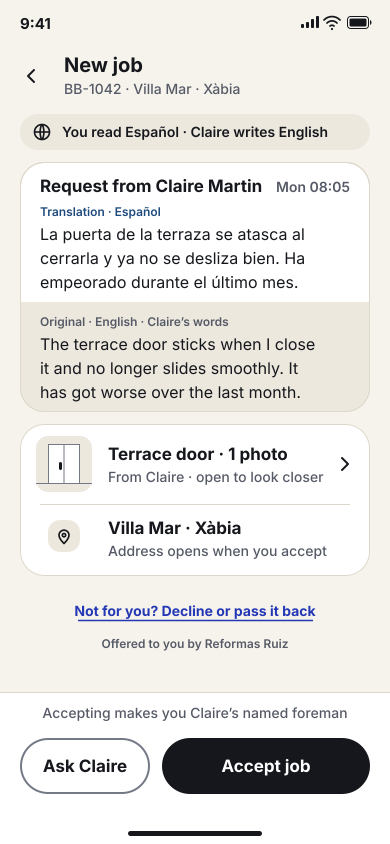

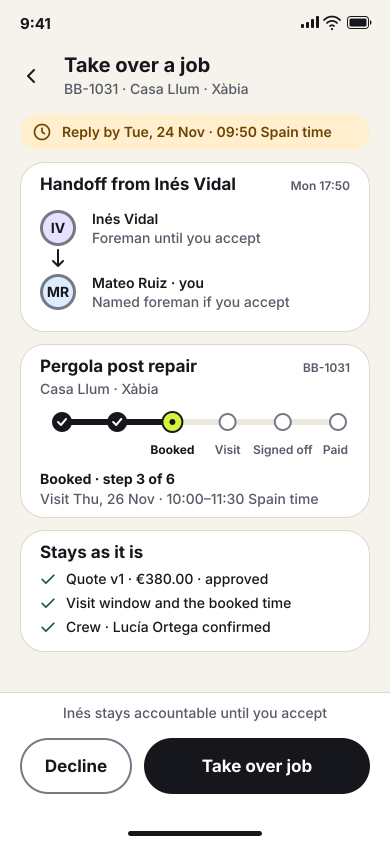

**Purpose and routes.** The foreman reads a request offered to them and accepts accountability, declines or asks the customer. It opens from F-01, F-02, S-09 or a P-02 handoff. Accept job opens S-17 and then F-04. Ask Claire opens S-10. The photo opens S-15. Decline opens a reason sheet and returns to the caller. A reassignment that is accepted opens F-05 at the job's current stage.

**Layout and data.** Pushed header "New job" with the reference and place. A language line says "You read Español · Claire writes English". The request is a twin card: author and sent time, "Translation · Español" on top, then the attached strip "Original · English · Claire's words" with her exact text. A second card holds the photo row and the place row; the place shows the town only and says "Address opens when you accept". A link offers "Not for you? Decline or pass it back", and a caption names who offered the job. The dock's context line states the effect: "Accepting makes you Claire's named foreman".

**Interactions and states.** Accept job opens S-17, which names the job, the role, the business and the effect: the foreman becomes the customer's named contact, and nothing is priced or booked. The server rechecks that the offer is still current before it answers. Ask Claire opens the job chat and sends nothing by itself.
- Reassignment: the title becomes "Take over a job" and an attention strip shows the reply deadline in Spain time. A handoff card names the current foreman, who stays accountable until the new one accepts, and the new foreman. The job card shows the real stage on the journey line, and "Stays as it is" lists the approved quote, the visit window and the confirmed crew. The actions are Decline and Take over job.
- Accepting a reassignment changes the named foreman only. The approved scope, the booked time and the crew are not reopened.
- Accepted: the dock becomes Write the quote and the address and access notes open.
- Authority missing: the dock action is disabled with "Reformas Ruiz has not given you this job type" and a link to S-16. The request stays readable.
- Translation pending or unavailable: the original is shown on top with the status in the strip position, and accepting stays possible.
- An offer that expired, was withdrawn or was taken by someone else is read-only and says which.

**Platform, accessibility and RTL.** iOS Back and edge swipe, Android Up and Back; Back never declines. Reading order: title, language line, author and time, translation, original with its language, photo, place, decline link, context line, Ask Claire, Accept job. The original is marked with its language so a screen reader switches voice. At large text the two dock buttons stack with the primary below. In RTL the layout mirrors; the English original stays left-aligned in its strip.

## F-04 Scope and quote

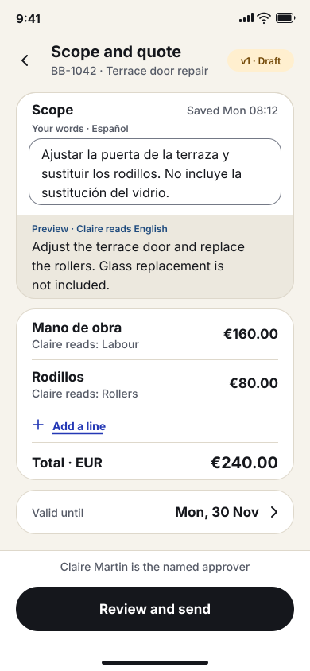

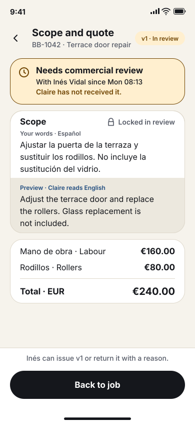

**Purpose and routes.** The foreman writes the provider's scope and price and publishes them as a numbered version. It opens from F-03 after acceptance and from F-05. Review and send opens S-17 and returns to F-05 with the quote sent; the customer reads it on C-06. A change after approval goes to F-15, never to this editor.

**Layout and data.** Pushed header with the job and a version badge, "v1 · Draft". The scope card has a labelled field, "Your words · Español", with the foreman's exact text, and an attached strip, "Preview · Claire reads English", with the translation the customer will read. The line editor lists each line in the foreman's words with "Claire reads: Labour" beneath and the amount at the trailing edge, then "Add a line" and the total in EUR. A row sets the validity date. The fixture is Mano de obra €160.00, Rodillos €80.00, total €240.00, valid until Mon, 30 Nov. The dock's context line names the approver: "Claire Martin is the named approver".

**Interactions and states.** Typing saves a draft on the device and the card shows "Saved Mon 08:12"; a draft is never visible to the customer. The preview updates when the translation returns and shows "Translation pending" until then. Review and send opens S-17 with the version, the total, the validity and the named approver, and sends only when the server answers.
- Pending business review: the badge reads "v1 · In review" and an attention card says who has it, since when, and "Claire has not received it." The scope and lines are locked and unchanged. Send to Claire is disabled with the reason "Reformas Ruiz must review before sending". A link withdraws the quote from review to edit it.
- Sent: the screen is read-only with "Sent Mon 08:14 · waiting for Claire Martin" and the dock becomes Back to job.
- Approved: the screen is read-only with "Approved by Claire Martin · Mon 08:20". The original text is frozen and the only route to a change is F-15.
- A new version after a decline keeps the old one in the history, marked superseded, and never edits it.
- Validation is inline: a line needs a description and an amount, the total must be above zero and the validity date must be in the future. Amounts accept the locale's decimal separator.
- Offline: the draft is editable and Review and send is disabled with "Connect to send".

**Platform, accessibility and RTL.** The scope field is a multiline input with a persistent label; amounts use the decimal keyboard. The dock stays above the keyboard and the focused field stays visible. Reading order: title, version, scope label and text, preview with its language, each line as "Mano de obra, Claire reads Labour, 160 euros", total, validity, context line, action. At large text amounts move under their labels. In RTL the layout mirrors and amounts stay left to right.

## F-05 Job control

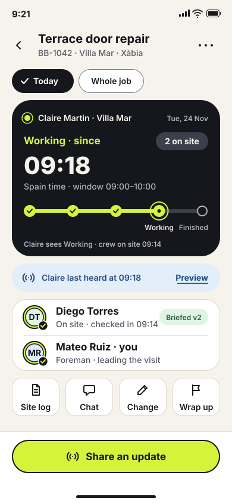

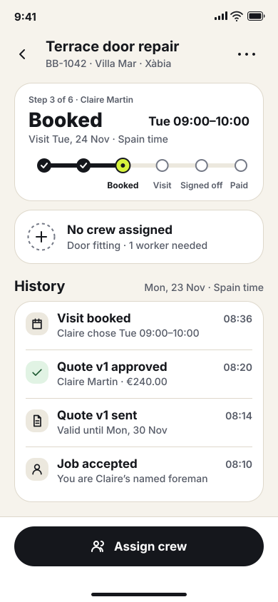

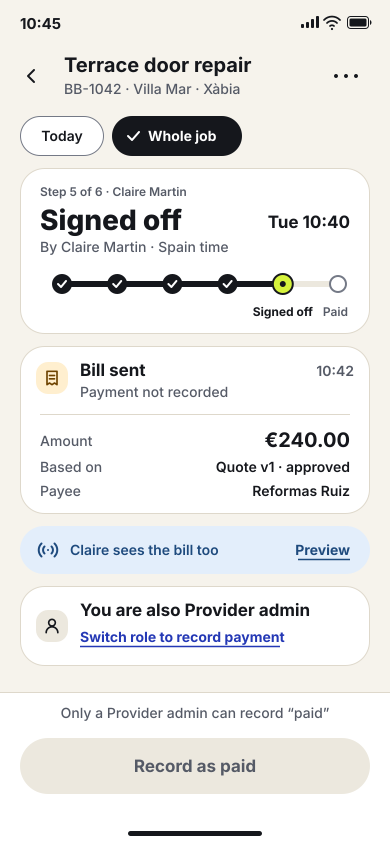

**Purpose and routes.** The foreman runs one booking here: its line, its crew, what the customer sees and its history. It opens from F-01, F-02, S-09 and F-04. On the visit day it opens on Today, and a two-chip switch moves to Whole job without adding to the back stack. The dock opens F-17, F-07 or F-14 according to the stage. Worker rows open F-16. The shortcuts open F-13, S-10, F-15 and F-14. The visit row opens F-06 and the quote row F-04.

**Layout and data.** Pushed header with the job, the reference and the place, and a More button. On Today the hero capsule shows the customer and place, the state in lime, the time it began in Display, the booked window, the day line and a footer that says what Claire sees. A share row repeats when Claire last heard and offers a preview of her view. A crew card lists each worker with a status ring, the state in words, the check-in time and the briefing status. Four shortcuts follow: Site log, Chat, Change and Wrap up. On Whole job a card shows the step, the stage in Page title size and the journey line, followed by cards for the crew, the bill and the history stamps.

**Interactions and states.** Live: the capsule reads "Working · since 09:18", the crew card shows Diego Torres on site, checked in 09:14 and briefed on v2, and the dock holds the lime Share an update. On site with a safety hold, the dock is Start work, disabled with "Diego must acknowledge v2 first". Per-worker times are shown here and never to the customer.
- Booked: the journey card reads "Booked", the crew card reads "No crew assigned" with the skill needed, and the dock is Assign crew, which opens F-07. With an assignment out, the card reads "Waiting for Nadia Benali" and the dock is quiet.
- Bill sent: the stage is "Signed off" and the bill card reads "Bill sent · not paid yet" with the amount and "Paid outside the app". Record as paid is disabled in the Foreman role, and the context line says only a Provider admin can record "paid". A link offers the role switch to a person who holds both roles.
- Paid recorded: the last bead is done, a stamp names the Provider admin and the time, and there is no dock.
- Change pending: a flag card names the open change and what is on hold; the approved scope stays in force until Claire decides.
- Awaiting sign-off: the capsule reads "Finished 10:12", the dock is Message Claire and nothing says paid or closed.
- A crew gap replaces the dock with Find cover and shows the gap in the crew card.
- Offline or stale: the capsule goes quiet with "Last confirmed" and consequential actions are disabled.

**Platform, accessibility and RTL.** The switch is a two-item segmented control and keeps Back pointing at the caller. Reading order: title, switch, capsule as one sentence, share row, each worker, shortcuts, dock. The capsule sentence is "Working since 09:18 Spain time, window 09:00 to 10:00, step 4 of 5; Claire sees Working". At large text the shortcuts become two rows and worker badges move under the name. With Field mode on, the capsule flips to ink on lime and the dock button is 64 high. In RTL the layout and both lines mirror; times and amounts stay left to right.

## F-06 Schedule

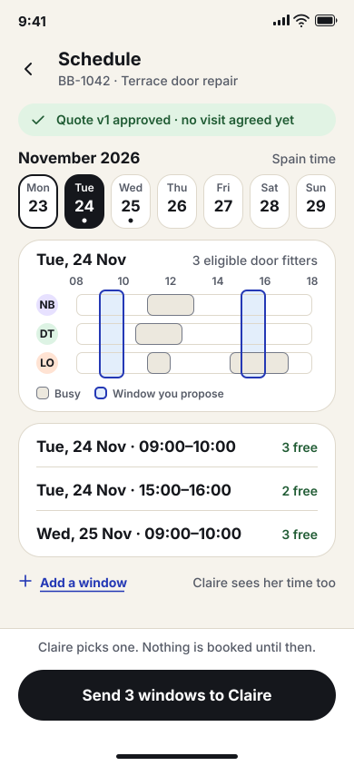

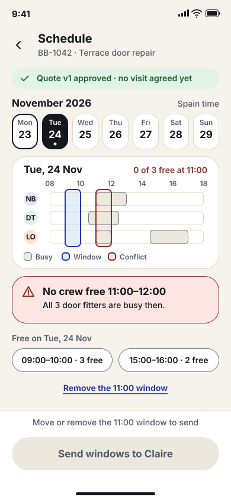

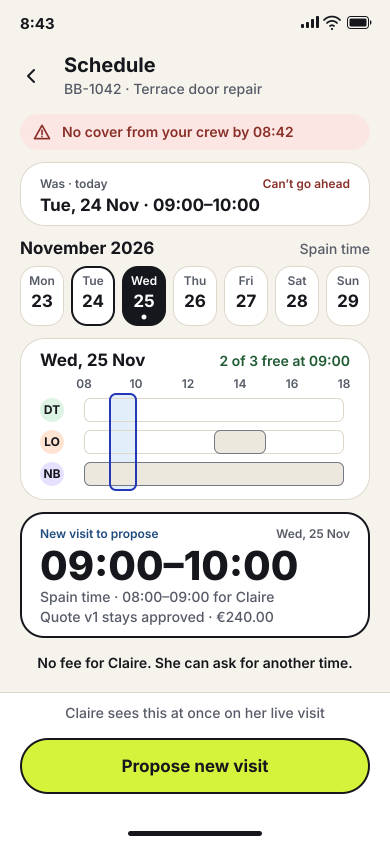

**Purpose and routes.** The foreman proposes visit windows that the crew can staff, and proposes a revised visit when cover fails. It opens from F-04 after approval, from F-05, and from F-10 when nobody in the crew can cover. Sending opens S-17 and returns to F-05; the customer chooses on C-08. A crew replacement alone belongs to F-10, not here.

**Layout and data.** Pushed header with the job. A strip states why the foreman is here: "Quote v1 approved · no visit agreed yet". A week strip names the month and "Spain time", marks today with an ink outline, fills the chosen day and dots days that hold a proposed window. The day view shows one lane per eligible worker from 08:00 to 18:00 with unnamed busy blocks, and each proposed window as a band across the lanes. A legend names the shapes. The list beneath holds the windows to propose with the count of free workers, then "Add a window". The fixture proposes Tue, 24 Nov 09:00–10:00 and 15:00–16:00 and Wed, 25 Nov 09:00–10:00.

**Interactions and states.** Tapping a day shows its lanes; tapping a free stretch or Add a window opens the native time picker and adds a band. Each window shows how many eligible workers are free, which is capacity and not an assignment. Send 3 windows to Claire opens S-17 and sends only when the server has rechecked capacity. The context line says "Claire picks one. Nothing is booked until then."
- Conflict: a window with nobody free is drawn as a critical band and the heading reads "0 of 3 free at 11:00". A critical card says "No crew free 11:00–12:00" without naming anyone's other job. Chips offer the free windows of that day, and a link removes the conflicting window. Send is disabled with "Move or remove the 11:00 window to send".
- Revised visit after no cover: a critical strip reads "No cover from your crew by 08:42" and a card keeps the old window under "Was · today" with "Can't go ahead". The new visit is one card with the time in Display, Claire's time beside it and "Quote v1 stays approved". The action is the lime Propose new visit, because Claire's live capsule changes at once. The note says there is no fee and that she can ask for another time.
- A revised visit never moves the booking by itself. The old window stays the record until Claire accepts on C-08.
- Agreed: the screen is read-only with "Booked Mon 08:36 · chosen by Claire Martin" and a link to propose a change of time.
- Proposal sent: the windows are listed as "Waiting for Claire" and can be withdrawn.
- Capacity unknown or offline: lanes show "Can't check the crew" and Send is disabled; a draft of the windows is kept.

**Platform, accessibility and RTL.** Native date and time pickers on both platforms, with typed input on Android. The lanes have an agenda alternative: each window is read as "Tuesday 24 November, 09:00 to 10:00 Spain time, 3 of 3 free". Busy blocks are announced as "busy 11:00 to 13:00" with no detail. Colour is never the only signal: a conflict has its own outline, words and a card. At large text the lanes are replaced by the agenda list. In RTL the week strip and layout mirror, while the hour axis keeps its left-to-right order and its numerals.

## F-07 Assign crew [Sheet]

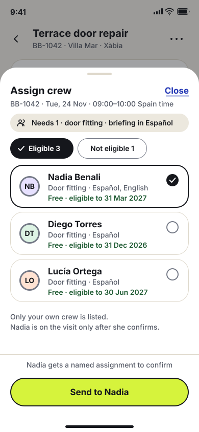

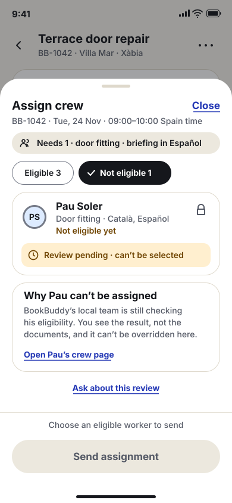

**Purpose and routes.** The foreman sends a named assignment to an eligible worker from the provider's own crew. The sheet opens over F-05 or F-16 for a shift with no dropout; a gap after a dropout goes to F-10 and F-12. A worker's row opens F-09 and returns with the selection kept. Close, Back and the scrim return to the caller and send nothing.

**Layout and data.** The dimmed caller, then a sheet with a handle, the title, Close and the shift in Spain time. A strip states the need: "Needs 1 · door fitting · briefing in Español". Two filter chips split the crew: "Eligible 3" and "Not eligible 1". Each worker card has a crew dot, the name, the skill and working languages, availability for this window and coarse eligibility with its date. The chosen card has a 2-unit ink border and a check. A note says only the provider's own crew is listed. The sheet's dock names the effect and holds the lime Send to Nadia.

**Interactions and states.** Tapping a card selects it and the button takes the worker's name; several can be selected when the shift needs more than one. Sending is confirmed by the server, which rechecks eligibility, availability and that the shift is still open. After sending, the caller shows "Waiting for Nadia Benali", never "Confirmed".
- Ineligible: a worker who fails a check is listed under Not eligible with a lock instead of a radio button. The card says "Not eligible yet" and the reason in coarse words, "Review pending · can't be selected". A second card explains that the local team is still checking, that the foreman sees the result and not the documents, and that nothing can be overridden here. Links open F-09 and S-16. Send assignment is disabled with "Choose an eligible worker to send".
- A language or skill mismatch is a reason of the same kind: "Briefing in Español needed". Machine translation never makes a worker eligible.
- Offers out: cards show "Assignment sent 08:37 · waiting", the dock becomes Withdraw assignment and nobody counts as crew until they confirm.
- Nobody eligible: the sheet says so and offers F-06 to change the window; it never offers workers outside the crew.
- A selection made stale by another change is cleared with a short explanation.
- Offline: the list is readable from cache and sending is disabled with "Connect to send".

**Platform, accessibility and RTL.** Native sheet detents on iOS and a modal sheet on Android; Back closes the sheet before the route and never sends. Focus moves to the title on opening and returns to the caller's button on closing. A card is read as "Nadia Benali, selected, door fitting, Español and English, free, eligible to 31 March 2027". A locked card is read as "not selectable" with its reason. At large text the sheet opens at full height and scrolls behind its dock. In RTL the cards mirror; dates and references stay left to right.

## F-08 Crew

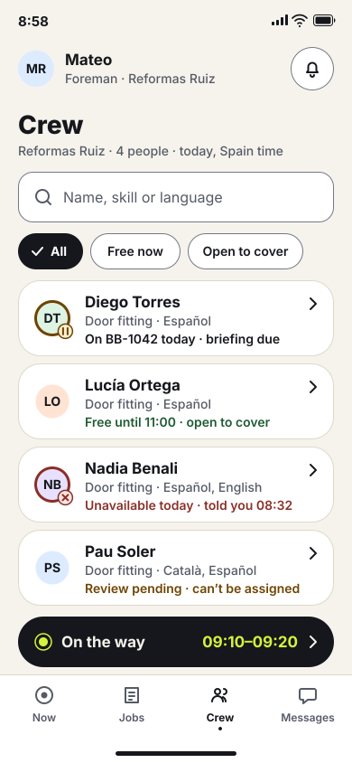

**Purpose and routes.** The Crew tab is the roster of the provider's own crew with skills, working languages and today's availability. A worker card opens F-09. The live pill opens F-05. The identity chip opens S-06 and the bell S-09. Inviting or removing a member is a Provider admin task on P-03 and is not offered here.

**Layout and data.** Root header, the title "Crew" and a line with the business, the head count and "today, Spain time". A search field covers name, skill and language. Filter chips follow: All, Free now and Open to cover. Each worker card has a crew dot with a status ring, the name, the skill and working languages, and one status line in words. The fixture lists Diego Torres on BB-1042 today with his briefing due, Lucía Ortega free until 11:00 and open to cover, Nadia Benali unavailable today since 08:32, and Pau Soler with his review pending. The live pill sits above the tab bar.

**Interactions and states.** Search filters as the foreman types and keeps the chips. Workers are ordered by what the foreman needs first: on a shift today, free, unavailable, then not assignable. A card is one target and opens F-09.
- Active: the status line names the job and the worker's state, with the same ring as on F-01.
- Unavailable: the status line says since when; the reason is not shown on the roster.
- Review pending: the worker is listed and cannot be assigned; the line says so in words.
- Filtered empty: "Nobody matches" with Clear filters. An empty crew says "Ask your Provider admin to invite crew".
- Offline: cached cards with "Last confirmed" and no availability claims newer than that time.
- The live pill shows the live visit because the capsule is on Now.

**Platform, accessibility and RTL.** The search field has the accessible name "Search crew by name, skill or language". Chips are announced with their selected state. A card is read as "Diego Torres, door fitting, Español, on BB-1042 today, briefing due". Status colour is supported by the ring glyph and the words. At large text the status line wraps and the chevron stays at the trailing edge. In RTL the layout mirrors; references and times stay left to right.

## F-09 Crew member

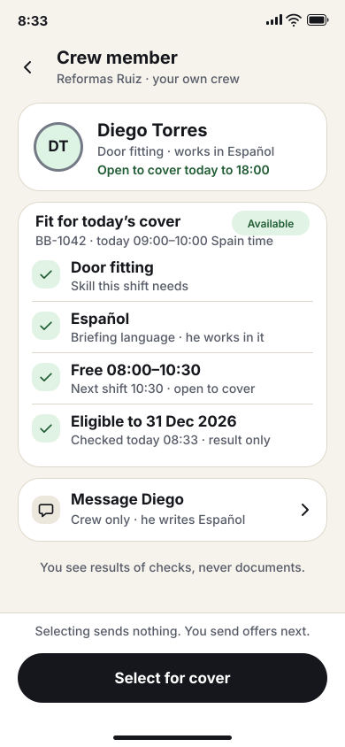

**Purpose and routes.** The foreman checks whether one worker fits a shift, without seeing raw documents. It opens from F-08, from a card on F-07 and from a candidate on F-10. With a shift in context the dock selects the worker and returns to the caller. Message opens the crew-only chat on S-10. Back returns to the caller with its state kept.

**Layout and data.** Pushed header "Crew member" with the business. A profile card shows the crew dot, the name, the skill, the working languages and the open-to-cover status. The fit card names the shift, "BB-1042 · today 09:00–10:00 Spain time", carries a result badge and lists four checks, each with a glyph, a result and a detail: skill, briefing language, availability and eligibility with its date and when it was checked. A row opens the crew-only chat and names the language the worker writes. A caption says "You see results of checks, never documents."

**Interactions and states.** Select for cover marks the worker on F-10 and returns there; it sends nothing, and the context line says so. Opened from F-07 the action reads Select for this shift. Opened from F-08 there is no shift, no fit card and no dock; the screen shows skills, languages and the week's availability.
- Available: all four checks pass and the badge reads "Available".
- Conflict: the availability check fails with "Busy 10:30–12:30" and no job detail, the badge reads "Conflict" and the action is disabled with the reason.
- Not eligible: the eligibility check reads "Review pending" or "Expired 31 Dec 2026", the badge reads "Not eligible" and the action is disabled. A link opens S-16 to ask about the review.
- A language mismatch fails the briefing-language check and cannot be waived here.
- A check older than the last change shows "Checking again" and keeps the action disabled until the server answers.
- Offline: the last results are shown with "Last confirmed" and selecting is disabled.

**Platform, accessibility and RTL.** Reading order: title, name and status, shift, result badge, each check as "Eligibility: eligible to 31 December 2026, checked today 08:33", chat row, caption, context line, action. A failed check is announced with its reason before the action. At large text each check's detail wraps under its result. In RTL the layout mirrors; dates and times stay left to right.

## Navigation

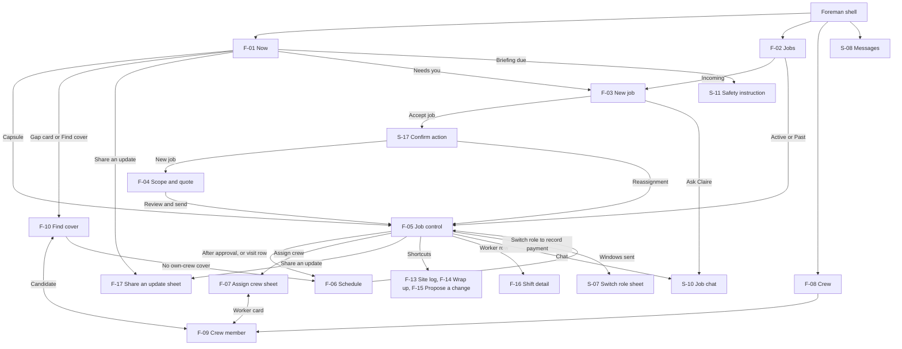

## Open design questions

- **Should a tab root have a dock?** F-01 uses the root dock from the conventions for Share an update and Find cover, so the foreman's next step is always in the same place. C-01 puts the action on a card and has no dock. Decide whether the two Now tabs should behave the same way.
- **Which ring colours mark a hold and a gap on the night capsule?** The design system gives `attention-ink` and `critical-ink` for these rings, but both are too dark on `night`. F-01 uses the dark-mode values of the same tokens, `#FFD98A` and `#FFC1BA`, inside the capsule. Confirm these or name on-night ring tokens.
- **How should the day line show a visit whose crew is not complete?** In the crew gap state the first bead is an open ring and its caption is left out, because "Confirmed" would be untrue and would run into "On the way". The state is written in the hero as "Crew gap". Align this with C-09 "cover being arranged".
- **Who reviews a quote when the foreman is also the Provider admin?** The pending review state assumes a Provider admin reviews before the customer receives anything. Mateo holds both roles in the fixtures. Decide whether he may review his own quote after switching role, what triggers a review and how long it may take.
- **Is a disabled "Record as paid" right for the Foreman role?** Only the Provider admin records "paid". F-05 shows the action disabled with the reason and offers a role switch to a person who holds both roles. The alternative is no dock at all. F-05 does not show a bill number because F-14 owns the bill reference.
- **May the foreman see each worker's busy time on F-06?** The lanes show unnamed busy blocks for named workers so that a window can be judged at a glance. Confirm this is proportionate, whether proposed windows hold capacity, and how an unknown day is drawn; Nadia is drawn as unavailable on Wed, 25 Nov.
- **Where does lime stop?** Share an update, Send to Nadia and Propose new visit are lime because a worker or the customer sees the result live. Accept job, Review and send and Send windows are ink although the customer is notified. Confirm this boundary for the foreman.
- **Do ordinary assignments have a reply deadline?** F-07 sends a named assignment with no offer clock, because only cover offers have one in the story. Decide whether an assignment expires and where the deadline is shown.
- **Are the fixtures added by this slice acceptable?** Added: BB-1045, BB-1038 and BB-1031; the handoff from the foreman Inés Vidal with a reply by Tue, 24 Nov 18:00; the crew member Pau Soler with a review pending; eligibility to 31 Mar 2027, 31 Dec 2026 and 30 Jun 2027; the busy blocks; "Saved 08:12" and "In review 08:13"; and Diego's next shift at 10:30. They follow C-01 to C-08 for 08:10, 08:14, 30 Nov and the three windows. Version 2 at 08:17 belongs to the customer's superseded branch and is not drawn here.
- **Is Spanish needed in the UI at launch?** The fixtures keep Mateo reading and writing Español in an English UI, as decided. F-03 and F-04 therefore mix English labels with Spanish content. Confirm that crews in Spain accept an English or Portuguese UI until a Spanish catalog is reviewed.
