# Foreman screens F-10–F-18: cover, site work and updates

This slice covers what Mateo Ruiz, acting as **Foreman · Reformas Ruiz**, does once a visit is staffed or loses its staff: the live cover search inside his own crew (F-10, F-12, F-18), the later vetted pool (F-11), the shift and the site record (F-16, F-13), telling the customer (F-17), wrapping up (F-14) and proposing a change (F-15). It follows the [concept](../../foundation/concept-and-principles.md), [information architecture](../../foundation/information-architecture.md), [roles](../../foundation/personas-and-roles.md), [core flow 2](../../foundation/core-flows.md#2-last-minute-replacement-from-the-providers-own-crew), [design system](../../system/design-system.md) and [wireframe conventions](../../system/wireframe-conventions.md), and applies the [owner's decisions](../../../docs/decisions/2026-11-23-open-questions.md). Where the [reference specs](../../../design/screens/foreman/F-08_F-16-specs.md) settled access, drafts, races and recovery, those rules still apply; this file says what Beacon changes.

The artboards are snapshots of the [story](../inventory.md#story-and-clock), in Spain time, on Tue, 24 Nov. Nadia Benali reports at 08:32 that she can't make it (F-16 dropped, F-10 gap). Mateo sends two offers at 08:33, tells Claire at 08:34, and watches the search at 08:36 (F-10, F-18). Diego Torres accepts at 08:38 (F-10 accepted, F-12, F-18 accepted) and Mateo confirms him at 08:40 (F-16 covered at 08:41, F-12 already filled). He shares "On the way" at 08:52 (F-17), reads the log at 09:38 (F-13) and wraps up at 10:15 (F-14). Five artboards show other branches: nobody accepts by 08:42 (F-10 no cover, F-18 no cover) and Mateo proposes a new visit at 08:44 (F-10 new visit proposed); the crew runs late at 09:06 (F-17 running late); Mateo drafts a change at 09:41 (F-15). F-11 belongs to a later release. Every artboard shows Mateo's clock. The details this slice adds to the story are listed under [Open design questions](#open-design-questions).

## Rules used on every screen

- **One next step.** Each pushed screen and sheet has one primary action in the dock. A dock with a context line starts at y=692 and centres the line at baseline 718. An action that cannot be taken yet is drawn disabled with its reason in the context line, as on F-10 while offers are out.
- **Lime means live.** Lime appears in a capsule that is live, on the current bead of a line, on the ring of a worker who holds a slot, and on a button that changes what a worker or the customer sees live: Send offers, Tell Claire, Review and confirm, Confirm, Share and Submit completion. Propose a new visit on F-10 is ink because the lime send is on F-06. Send for approval on F-15 is ink because it asks for a decision and changes no live status. A search with no offers out, or one that has ended, has nothing lime.
- **The cover line.** The cover search has its own bead line with four steps: Gap, Offers out, Accepted, Confirmed. When nobody accepts, the last two steps read No cover and New visit. It uses the bead grammar of the job line and is always written as text beside it.
- **Person-level inside, crew-level outside.** The foreman sees each candidate and worker by name, state and time. Every screen that shows this also carries a customer strip that says what Claire sees or has been told. Candidates, replies, dropout reasons, per-worker times and eligibility never reach the customer.
- **Who and when.** Every status names its actor and its time. Times are site time and "Spain time" is named once per surface. Mateo is in the site's zone, so no second clock is shown to him; Claire's time is added wherever he chooses a time for her.
- **Your words stay yours.** Mateo writes Español in an English UI. Scope lines, result notes, captions and change text are shown in his words, with "Claire reads" and the English she will see. Approved text is locked and never edited.
- **Online for consequences.** Sending or withdrawing offers, telling the customer, confirming cover, sharing an update, submitting completion and sending a change need the server and are confirmed only by its answer. Drafts on F-14 and F-15 and a captured photo on F-17 are saved on the device and labelled as saved, never as sent or shared.
- **No location.** No screen in this slice reads, shows or asks for a position. An arrival time is an estimate a person typed.
- **Access.** Account, role, business and the record's freshness are checked on entry and again before each consequential action. A foreman who loses the job sees S-16 without restricted detail. Eligibility is a result with a date, never a document.
- **Languages.** The UI ships in English (`en`) and European Portuguese (`pt-PT`); see [Internationalisation](../../../docs/architecture/mobile-tech-stack.md#internationalisation). Every label is a whole catalog message with placeholders and ICU plurals, for example "Send {count, plural, one {# offer} other {# offers}}" and "Review and confirm {name}". Layouts allow 40% longer text by wrapping. Reading language, working languages and a message's own language are separate from the UI language.

## The cover search, step by step

| Spain time | Act | What Mateo sees | What others see |
| --- | --- | --- | --- |
| 08:32 | Nadia sends "Can't make it" (W-05). | F-01 gap card, S-19 push, F-16 dropped. F-10 gap: quiet capsule, two crew members ticked. | Claire: nothing changes; the visit is still booked. |
| 08:33 | Mateo sends 2 offers, reply by 08:42. | F-10 offers out: live capsule with the offer clock. F-18 starts. | Diego and Lucía: a cover offer with the same clock (W-01, W-03). No address, no permission to travel. |
| 08:34 | Mateo tells Claire. | The customer strip turns to "Claire sees Cover being arranged". | C-09: "Cover being arranged · Mateo will update you by 08:45". No names, counts or reasons. |
| 08:38 | Diego accepts first. | F-10 accepted: "Diego accepted · confirm by 08:45". F-18 says "Cover accepted". | Diego: "Accepted · waiting for Mateo. Do not travel yet." Lucía's offer is on hold. |
| 08:40 | Mateo confirms in F-12. | F-16 covered; F-18 shows "Cover confirmed" and ends. | Diego: confirmed shift (W-04) and his own briefing. Lucía: filled. Claire: "Crew updated · Diego Torres joins · same window". |
| 08:42, other branch | Nobody accepts. | F-10 no cover: the second rung opens. F-18 shows "No cover" and ends. | Offers close. Claire still sees "Cover being arranged" with the promised 08:45. |
| 08:44, other branch | Mateo proposes Wed, 25 Nov, 09:00–10:00 on F-06. | F-05; F-10 keeps the closed search as a record. | Claire: "New visit proposed" on C-09 and C-08. Free to accept or to ask for another time. |

Kept from the reference without change: the first valid acceptance, in the order the server records it, reserves the place; only the foreman's confirmation assigns; a held place is not permission to travel; a decline closes only that worker's offer; at most one candidate is confirmed per gap; nothing transfers from the worker who dropped out.

## F-10 Find cover

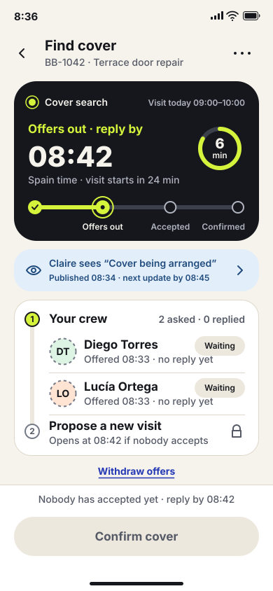

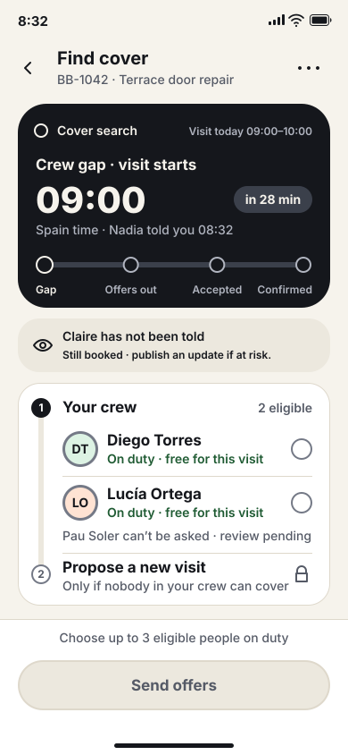

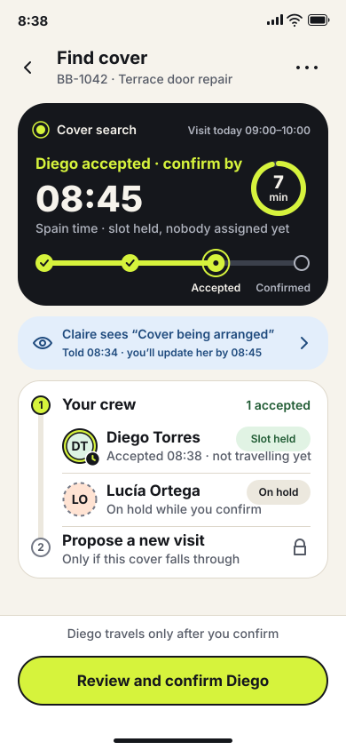

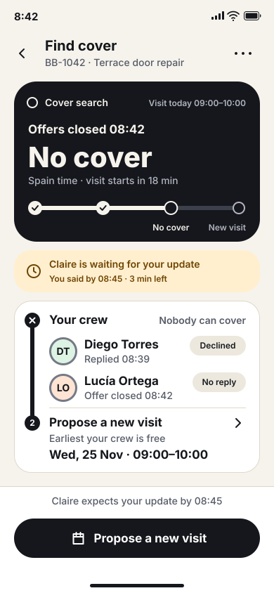

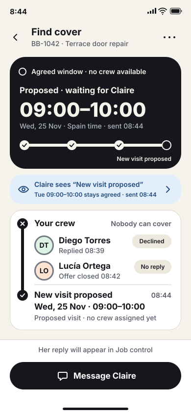

**Purpose and routes.** Run a live cover search inside the provider's own crew, and move to a new visit when nobody can cover. It opens from the gap card or dock on F-01, the dock on F-16 and F-05 while a gap is open, a gap or acceptance alert on S-09, the S-19 push and the F-18 card. Back returns to the caller and never stops offers. A candidate row opens F-09, whose Select for cover returns here with the worker ticked. Send offers, Tell Claire and Withdraw offers open S-17. Review and confirm opens the F-12 sheet. Propose a new visit opens F-06 in its revised-visit state. The customer strip opens a read-only preview of C-09 as Claire sees it. More holds Withdraw offers, Release the slot, Ask again, the crew-only chat (S-10) and help from the local team (S-16).

**Layout and data.** Pushed header "Find cover" with the job reference and More. Three blocks follow in a fixed order, so the eye learns one path: time, customer, crew.
- The capsule is the search itself, at card size. Its top row reads "Cover search" with the visit window at the trailing edge. Below are the state in words, one time in Display, a zone line and the cover line. The Display time is the one that matters now: the visit start while there is a gap, the reply deadline while offers are out, the confirm-by time once someone has accepted. An offer clock drains towards that deadline, and the deadline is always written beside it. The clock sits in the capsule and is not repeated on the rung.
- The customer strip is two lines: what Claire sees, then when she was told and what was promised. It is neutral before she is told, blue once she has been told, and amber when a promised update is close.
- The cover ladder is one card with a vertical rail and two rungs: **1 Your crew** and **2 Propose a new visit**. The rung bead is an ink number when current, lime while its offers are live, an ink cross when exhausted, an ink check when done and an outline when locked. Each candidate row has a crew dot, the name, a state with its time, and a selection circle or a badge. A dashed ring means asked but not on the visit. A lime ring with a clock glyph means accepted with the place held.
- The fixture has two crew members who can cover, Diego Torres and Lucía Ortega, both free and open to cover to 18:00. Pau Soler cannot be asked because his review is pending; he is listed in one line with that reason and cannot be ticked.

**Interactions and states.** Crew offers out: the capsule goes live with the offer clock. Each row reads Offered, Opened, Declined or No reply with its time. The dock shows **Confirm cover**, disabled, with the reason in the context line. A link under the ladder withdraws the open offers after S-17, and withdrawing every offer exhausts the rung. The second rung is locked and says when it opens. Replies update rows in place, are announced once and never move focus or reorder a row under a finger. The dock always holds the next step of the search.
- Gap: when a gap is reported the capsule is quiet and nothing is lime. A reported gap changes nothing for the customer. Everyone eligible who is open to cover is already ticked on a reported gap. The reply deadline for a reported gap is suggested ten minutes ahead, here 08:42, and is fixed when the offers are sent. A tap on the circle clears or sets a tick, and the rest of the row opens F-09. Eligible means the four checks of F-09 pass: skill, briefing language, free for the whole window and the eligibility result. **Send 2 offers** opens S-17, which names the recipients, the reply deadline and what each worker is told. The server rechecks the gap and each recipient, and sends to the list shown or not at all. With nobody ticked the action is disabled with "Tick at least one person". With nobody eligible the first rung is drawn exhausted and the second rung opens at once.
- Telling the customer is a separate, deliberate act. Sending offers never tells Claire. Until she is told, the strip reads "Claire has not been told" and, once offers are out, the dock holds the lime **Tell Claire**. S-17 shows the exact text she will get and the promised time. The text is "Cover being arranged · Mateo will update you by 08:45". The promised time defaults to three minutes after the reply deadline and can be changed. An acceptance takes the dock over at once, and telling Claire then stays available on the strip. If the promised time passes with nothing to report, the strip turns critical with "Your update to Claire is overdue". C-09 then shows its "no update since" state, and nothing is invented for her.
- Accepted: the first valid acceptance holds the place. The capsule reads "Diego accepted" with the confirm-by time in Display. The accepted row shows "Slot held", and every other open offer is on hold and cannot be accepted. The accepted worker is told not to travel. The dock becomes the lime **Review and confirm Diego**, which opens F-12. If Mateo does not confirm in time, or releases the slot from More, the place is released and the worker is told "Not confirmed". Any offer still inside its deadline then reopens.
- Confirmed: after F-12 succeeds the search is a record. The capsule reads "Cover confirmed" with the time and all four beads done. The rows read "Confirmed 08:40" and "Offer closed · filled", and the dock is the ink **View shift**, which opens F-16.
- No cover: when no cover comes from the crew, the capsule goes quiet and the Propose a new visit rung opens. With no cover, that rung names the earliest window the crew is free for a new visit, taken from F-06. No cover never cancels the visit, which stays booked until he sends the proposal on F-06. Ask again, in More, starts a new round of cover offers while the visit has not started. The first rung shows an ink cross and each outcome with its time: declined, no reply or withdrawn. The dock is the ink **Propose a new visit**, and its context line says when Claire expects the update. This screen never tells Claire the visit is off.
- New visit proposed: once the proposal is sent on F-06 the app returns to F-05 and the search closes. Reopened from F-16, F-13 or S-09, the new visit proposed state is a record of the search. It shows the proposed visit window in Display, both rungs resolved and "no crew assigned yet". When Claire accepts the proposed visit on C-08, it is staffed through F-07 like any other. The dock is the ink **Message Claire**.
- There is no vetted pool at launch and no placeholder for it. If the customer cannot move the visit, More opens S-16 so the local team can help; BookBuddy may introduce another verified business under a new agreement, outside this screen.
- A second foreman or a second device sees the same search. Two sends for one gap produce one round; the later one is told "Offers are already out".
- Offline or stale: a banner reads "Offline · last confirmed 08:36 Spain time", the capsule stops pulsing, the offer clock is replaced by the written deadline, and Send, Tell, Withdraw and Review are disabled with "Connect to continue". Replies that arrived while offline appear after one refresh.

**Platform, accessibility and RTL.** Native Back on iOS; on Android, Up and system Back return one level and never withdraw anything. Reading order: Back, title, More, the capsule as one sentence, the customer strip, the first rung with its count, each candidate, the second rung, the context line, the action. The capsule sentence is "Cover search, offers out, reply by 08:42 Spain time, 6 minutes left, step 2 of 4, visit starts 09:00". The offer clock is not announced on each tick; a new reply is announced once, for example "Diego Torres accepted. Confirm by 08:45." Each candidate is read as name, state and time, then "ticked" or "not ticked"; the selection circle sits in a 56-unit target. A ring is never the only signal: every row has words. At large text the Display time moves under the state, the offer clock moves under the time, badges move under the names and the dock grows. With Field mode on, the capsule flips to ink on lime and the dock button is 64 high. In RTL the layout, the ladder rail and the cover line mirror; times, the reference, names and the clock face stay as they are.

## F-11 Vetted pool [Later]

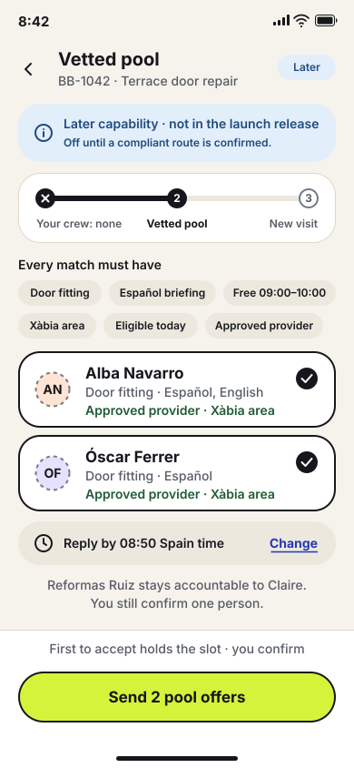

**Purpose and routes.** Later capability: choose eligible cover from approved providers outside the crew when the own crew cannot cover. It has no launch navigation and no placeholder on F-10. In a later release it is a middle rung of the cover ladder: it opens from F-10 only after the own-crew rung is exhausted or its deadline has passed, and only where a compliant route to offer work outside the crew has been confirmed. Back returns to F-10 with the search intact. The first acceptance opens F-12, as for own crew.

**Layout and data.** The header carries a "Later" badge and a notice says the capability is not in the launch release; both are annotations on the drawing, not product UI. A ladder strip shows three rungs, with Your crew resolved, Vetted pool current and New visit last. "Every match must have" lists the conditions as fixed badges, not as optional filters: the skill, the briefing language, free for the whole window, the area, eligible today and an approved provider. Match cards show a dashed crew dot, the name, the skill and working languages, and "Approved provider" with a coarse area. A strip gives the reply deadline with a Change link. The fixture ticks Alba Navarro and Óscar Ferrer with a reply by 08:50.

**Interactions and states.** Matches: ticking and sending work as on F-10. **Send 2 pool offers** opens S-17 with the recipients, the deadline, the coarse area and the accountable business. The first valid acceptance holds the place and only the foreman's confirmation in F-12 assigns.
- A pool worker sees the task, the time, the coarse area and the provider, and never the address before confirmation.
- Own-crew offers and pool offers never run at the same time.
- No match: the screen says which condition removed the last candidates, offers no way to relax a condition, and sends the foreman back to the New visit rung.
- Offers out: the list becomes rows with an offer clock, as on F-10, and the conditions are locked.
- The provider stays accountable to the customer, and the screen says so before sending.

**Platform, accessibility and RTL.** As F-10. Each condition is read as text, and each match as name, skill, languages, provider status and area, then "ticked". At large text the condition badges wrap to more rows and the match lines stack. In RTL the ladder strip and cards mirror; names and times stay left to right.

## F-12 Confirm cover [Sheet]

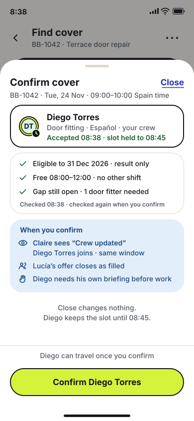

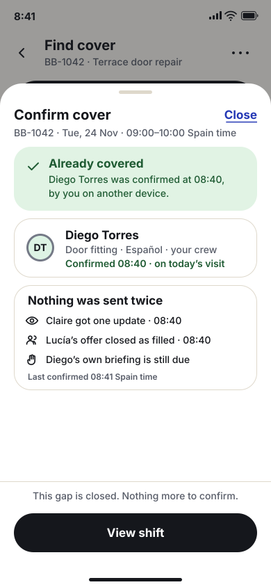

**Purpose and routes.** Assign exactly one accepted own-crew candidate to the gap, after rechecks, in a named two-tap step. It opens from Review and confirm on F-10, from an acceptance alert on S-09, from the needs-you card on F-01 and from a tap on F-18 while an acceptance waits; on a cold launch F-10 is the screen behind it. Close returns to the refreshed caller and changes nothing: the place stays held until the confirm-by time. View shift opens F-16. Back to the search returns to F-10. Nothing outside this sheet can confirm cover: no notification, no Lock Screen card, no chat message.

**Layout and data.** A bottom sheet over the dimmed caller, with a handle, the title, Close and the visit in site time. Three cards follow.
- The candidate card names the one worker who holds the place, with the skill, the briefing language, "your crew", and when they accepted and until when the place is held.
- The rechecks card lists results only: eligibility with its date, free for the whole window with no overlap, and the gap still open. A caption gives the time of the last check and says the checks run again on confirming.
- The effects card, "When you confirm", says what Claire will see, which other offers close, and that the replacement needs their own safety briefing before work.
- The dock's context line says the worker can travel once confirmed; the action names the worker.

**Interactions and states.** Ready: **Confirm Diego Torres** is the second tap of the two-tap rule and the only way to assign. The server rechecks authority, the held acceptance, the gap, eligibility and overlaps in one step. It commits at most one assignment. While it works the label stays, the button is busy and focus does not move. An interrupted answer shows "Checking…" and is reconciled before a retry is possible.
- Confirmed: the sheet reads "Diego Torres is on the visit" with the time. It adds "Claire saw Crew updated" once that update is recorded as sent, and the dock becomes **View shift**. One completion haptic follows the server's answer, never the tap.
- Already filled: if the gap was already filled, **View shift** replaces the confirm action. A banner says who already filled it, when and from where, for example "by you on another device". The already filled state never shows a second success and never reopens the search. Nothing is sent twice when the gap is already filled, and the sheet lists what was sent once.
- No longer eligible: if a recheck fails or the worker withdrew, the sheet names the safe reason, such as "Diego is no longer free for the whole window", and offers **Back to the search**. The gap stays open and Claire is told nothing.
- Hold lapsed: after the confirm-by time the sheet reads "The place was released at 08:45" and offers Back to the search.
- Offline: the action is disabled with "Connect to confirm"; the last check results stay readable with their time.

**Platform, accessibility and RTL.** A native modal sheet: a detent with Close on iOS, and on Android Back closes the sheet before leaving the screen. Swiping the sheet away neither confirms nor releases. Focus is trapped in the sheet and starts on the title; reading order is Close, the candidate, each check as "Eligibility: eligible to 31 December 2026", the effects, the context line, the named action. On closing, focus returns to the row or button that opened it. At large text the sheet takes the full height and scrolls, with Close and the action always reachable. The action is one translated message with a name placeholder. In RTL the cards mirror; names, dates and times stay left to right.

## F-13 Site log

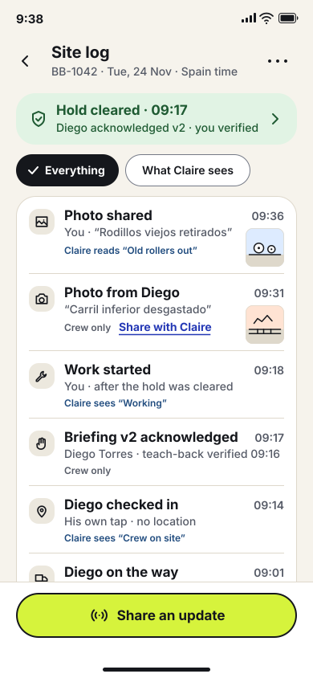

**Purpose and routes.** Read what happened on site, per worker, and see for each stamp what the customer sees. It opens from the Site log shortcut on F-05 and from the customer strip on F-16, scoped to that shift. The hold status opens S-11. A photo opens S-15. Share with Claire on a crew-only photo, and the dock, open F-17. More holds Propose a change (F-15) and, before the work is finished, Wrap up (F-14). Back returns to the caller at the same position. The log is not an attendance editor and not a chat.

**Layout and data.** Pushed header with the job, the date and "Spain time", named once. The hold status is one row: the current instruction version, whether the hold is on or cleared, who acknowledged and who verified. A two-chip switch chooses **Everything** or **What Claire sees**. The stamps follow in one card, newest on top. Each stamp has a glyph tile, a title, the time, a line that names the person, and an audience line: blue when the customer sees something, with her wording, or grey "Crew only". Photo stamps carry a thumbnail and the caption in its author's words. The fixture adds a crew-only photo from Diego at 09:31.

**Interactions and states.** Confirmed: every stamp shown has been received by the server, in the order it happened. Attendance is listed per worker here and only here; Claire's line for the same event is "Crew on site".
- What Claire sees: the switch filters the log to customer-visible stamps. It rewrites each title to her crew-level wording, so the foreman can read her Moments without leaving the log.
- The share control exists only on photos. A crew-only photo has **Share with Claire**, which opens F-17 with that photo chosen. Attendance, briefing records and crew-only notes can never be shared from here.
- Once the work is marked finished the dock changes from Share an update to **Wrap up**.
- Empty: "No stamps yet today. The log fills as the crew acts." The dock stays.
- Pending sync: the foreman's own photo taken offline is a dashed tile with "Saved on this device · pending sync" and no audience line. A worker's unsent items are not shown until the server has them.
- Conflict: two check-ins, or a check-out with no check-in, are both kept and flagged "Needs a look". The foreman cannot edit a stamp; the worker corrects it on W-06 and the correction is a new stamp.
- A stamp is never edited or deleted. A retracted update stays in the log with "Withdrawn" and its time.
- Offline or stale: a banner reads "Offline · last confirmed 09:38 Spain time" and sharing is disabled.

**Platform, accessibility and RTL.** Reading order: title, hold status, the switch with its selected state, then each stamp as "Diego checked in, 09:14, his own tap, no location; Claire sees Crew on site". The zone is read once with the title. Thumbnails are buttons named by their caption, and a caption in another language is tagged with that language. At large text the time moves under the title and the thumbnail under the text. In RTL the rows mirror and the thumbnail moves to the leading side; the order of the stamps and the numerals do not change.

## F-14 Wrap up

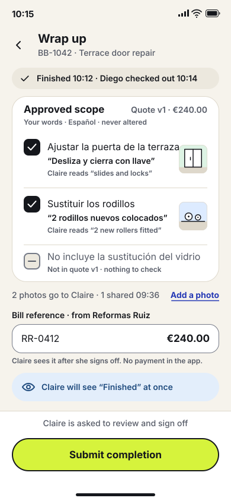

**Purpose and routes.** Submit the finished work against the approved scope, with a result note and a photo for each item, and add the bill reference. It opens from the Wrap up shortcut on F-05 and from F-13. Add a photo opens S-14 and a thumbnail opens S-15. **Submit completion** opens S-17 and, once the server confirms, returns to F-05 as awaiting sign-off. Back keeps the draft. Submitting is not a sign-off, a bill or a payment request.

**Layout and data.** A strip states when the work finished and when the crew checked out. The **Approved scope** card names the quote version and total, and lists each line of the approved text in the provider's own words, marked "never altered". A done item has a checkbox, the foreman's short result note in his words, the English Claire will read, and its photo. A line the quote excludes is listed without a checkbox as "Not in quote v1". Below are the count of photos that go to Claire with Add a photo, the bill reference field with the amount, and a customer strip that says what Claire will see. The fixture ticks both items, with the notes "Desliza y cierra con llave" and "2 rodillos nuevos colocados", and gives the bill reference RR-0412 for €240.00.

**Interactions and states.** Draft: each item is ticked deliberately; a photo upload or a check-out never ticks anything. Tapping an item opens its note and photo. The submission can only contain lines of the approved version.
- Submitting is the lime **Submit completion**, because it moves Claire's day line to Finished at once. S-17 names the job, the quote version, the ticked items, the photos and the audience, and says the customer is asked to review and sign off.
- An unticked item is submitted as "Not done" with a required reason, and the customer sees it as such.
- Uploading: a photo still uploading shows its progress, and the action is disabled with "Wait for 1 photo to upload". Offline, the draft and photos are "Saved on this device" and nothing is submitted on reconnecting.
- Submitted: the screen is read-only with "Submitted 10:15 · waiting for Claire Martin" and the dock becomes Message Claire.
- Returned: if Claire reports a problem instead of signing off, the wrap-up reopens with her words in a twin card. A new submission replaces nothing; the earlier one stays in the history.
- An open change (F-15) is listed as "Waiting for Claire · not part of this submission".
- The bill reference is optional when submitting. The bill itself is the provider's document; the app keeps only its reference and amount, shows them to the customer on C-11 after sign-off, and takes no payment. Only the Provider admin records "paid".

**Platform, accessibility and RTL.** System camera and photo picker through S-14 on both platforms, with the usual alternatives when permission is denied. Reading order: title, the finished line, the scope heading with version and total, each item as "Ajustar la puerta de la terraza, ticked, note, Claire reads slides and locks, photo", the excluded line, photos, bill reference, the customer strip, the context line, the action. Spanish text is tagged as Spanish for the screen reader. At large text the thumbnail moves under its item, the fields grow and the page scrolls behind a dock that stays reachable. In RTL the checklist mirrors; the reference and the amount stay left to right.

## F-15 Propose a change

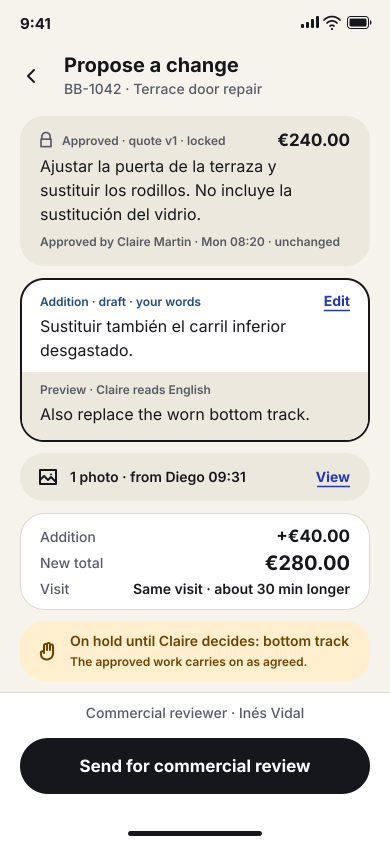

**Purpose and routes.** Propose extra work as a new version beside the locked approved text, with its price and time effect. It opens from the Change shortcut on F-05 and from More on F-13. Edit opens an input for the addition, the price and the time effect. View opens the attached photo in S-15. **Send for approval** opens S-17 and returns to F-05 with the change flagged; the named approver decides on C-15. Back keeps the draft.

**Layout and data.** Two cards are compared, as on C-15. The approved card is locked, tinted and has a lock glyph: the quote version, the total, the exact original text and who approved it and when. The addition card has an ink border because it is the thing being written: the addition in the foreman's words on top, and an attached strip beneath with "Preview · Claire reads English". An evidence row names the attached photo. A delta card gives the addition, the new total and the effect on the visit. A hold banner says what waits for the customer's decision. The fixture is "Sustituir también el carril inferior desgastado", +€40.00, new total €280.00, the same visit and about 30 minutes longer, with Diego's photo from 09:31.

**Interactions and states.** Draft: only the addition can be edited. The preview is a translation of his text and cannot be edited; to change what Claire reads he changes his own words. Amounts are entered in EUR and the new total is calculated, never typed.
- Send for approval is ink. S-17 names the change, the amount, the audience and what goes on hold. The context line names who decides.
- Sent: the screen is read-only with "Waiting for Claire Martin · sent 09:41" and a Withdraw link. Editing after sending creates a new version and withdraws the sent one.
- Approved: "Approved by Claire Martin" with the time; the addition joins the scope that F-14 lists, and the hold ends.
- Rejected: the change stays in the history as rejected, the approved scope is unchanged and the affected work is not done.
- Only the affected work is on hold. The approved work carries on, and the screen says so.
- A change to the visit time alone belongs to F-06, not here.
- The foreman cannot approve his own change by switching role.

**Platform, accessibility and RTL.** A locale-aware keyboard for EUR. Reading order: title, the approved card as "Approved, quote version 1, locked, €240.00", its text, who approved it, then the addition, the preview with its language, the photo, each delta row, the hold, the context line, the action. At large text the delta labels and values stack and both cards grow; scope text, exclusions and amounts are never truncated. In RTL the cards mirror while Spanish and English text keep their own direction; EUR amounts stay left to right.

## F-16 Shift detail

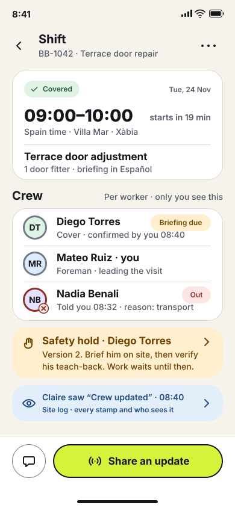

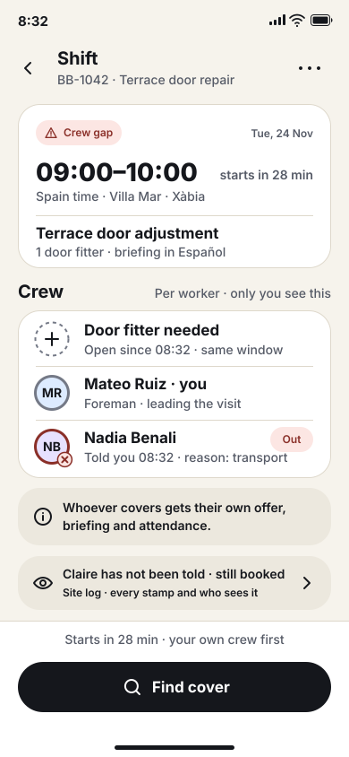

**Purpose and routes.** Show one shift: who is on it, each worker's state, the briefing hold and what the customer has been told. It opens from a worker row on F-01 or F-05, from View shift on F-12, and from a shift alert on S-09. A worker row opens F-09. The hold banner opens S-11. The customer strip opens F-13 for this shift. The chat button opens S-10 in Crew only. The dock opens F-17, F-07 or F-10 according to the state.

**Layout and data.** Pushed header "Shift" with the job. The shift card has a status badge with a glyph, the date, the window in Page title size with "starts in", the zone and place, and the task with the skill and briefing language. **Crew** is labelled "Per worker · only you see this". Each row has a crew dot whose ring matches the state, the name, a state line with its time, and a badge when something is due. A worker who dropped out stays in the list with a critical ring, "Out", the time they told the foreman and the reason category they chose. A hold banner or a note follows, then the customer strip with a second line that leads to the site log.

**Interactions and states.** Covered: the replacement reads "Cover · confirmed by you 08:40" with a "Briefing due" badge. A safety hold names the replacement and the instruction version. The dock is the lime **Share an update** with a crew chat button beside it.
- Dropped: when a worker has dropped out the badge reads "Crew gap". The open place is listed first as "Door fitter needed", and the worker who dropped out is listed as "Out". In the dropped state the dock is the ink **Find cover**, with "your own crew first" in the context line. A note in the dropped state says whoever covers gets their own offer, briefing and attendance. The customer strip says Claire has not been told.
- Unassigned: the crew card reads "No crew assigned" and the dock is Assign crew, which opens F-07.
- Confirmed: every place is filled and briefed or waiting for the briefing on site; the dock is Share an update.
- An assignment or offer that is out shows "Waiting for" the worker with the reply time, and counts nobody as on the visit.
- The dropout reason is one category the worker chose on W-05, shown to the foreman only. It never appears on F-01, on a system surface or to the customer.
- Attendance, the briefing and the customer update are separate records. A check-in is not a cleared hold; an update that is not yet recorded as sent reads "pending", never "seen".
- Cancelled: the history stays readable and there is no dock.
- Offline or stale: "Last confirmed" with its time, and every action disabled with the reason.

**Platform, accessibility and RTL.** Reading order: title, the status badge, the window with zone, the task, then each worker as "Diego Torres, cover, confirmed 08:40, briefing due", the hold, the customer strip, the chat button, the action. The reason category is read after the worker's state and marked as visible only to the foreman. At large text badges move under names and the window stacks above "starts in". In RTL the rows and the dock mirror; times stay left to right.

## F-17 Share an update [Sheet]

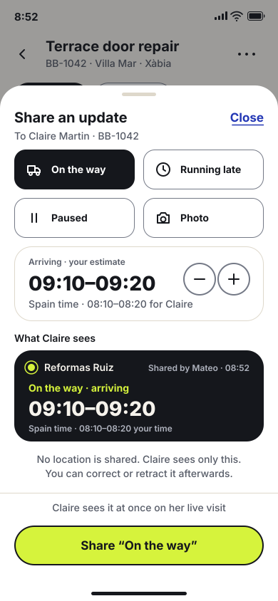

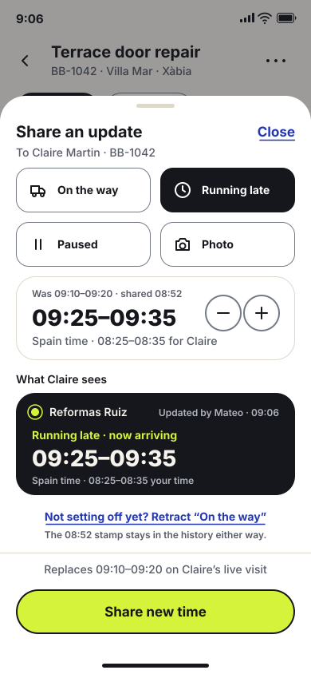

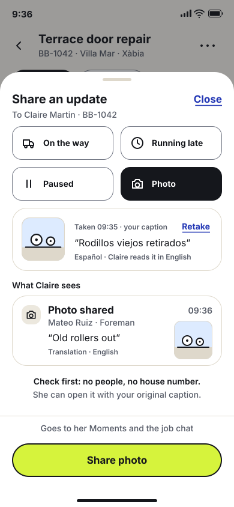

**Purpose and routes.** Tell the customer one thing in two taps: on the way, running late, paused or a photo. It opens from the lime Share an update on F-01, F-05, F-13 and F-16, and from Share with Claire on a photo in F-13. Photo opens S-14 to take or choose one, then returns. Close returns to the caller and shares nothing. Sharing closes the sheet and the caller shows the new stamp.

**Layout and data.** A bottom sheet over the dimmed caller, addressed "To Claire Martin". Four type tiles, 56 high, in two rows: On the way, Running late, Paused and Photo; the chosen one is ink. An editor for that type follows: the arrival band in Page title size with Spain time and Claire's time and two buttons that move it by five minutes; or the photo with its caption. **What Claire sees** shows the result with the customer's own component: her capsule for a status, her Moments stamp for a photo. Two quiet lines state the limits, and the dock names the share.

**Interactions and states.** On the way: the band starts at a sensible estimate and the foreman adjusts it; the preview updates as he does. **Share "On the way"** publishes the stamp with his name and the time and moves Claire's day line. If she follows live, her Lock Screen changes too. The sheet says that no location is shared and that the update can be corrected or retracted.
- The sheet opens on the type that fits the stage. A type that makes no sense now is disabled with its reason, such as On the way once the crew is on site.
- Running late: the editor keeps the earlier band and who shared it under "Was" and edits the new one. **Share new time** replaces the band on Claire's live visit, and the old stamp stays in the history. Running late is offered when a band exists and nobody has checked in.
- Retract: a link in the running late state withdraws "On the way" after S-17. Claire's capsule returns to "Crew confirmed" with a stamp "Update withdrawn by Mateo"; nothing is deleted.
- When a crew lead declares "On my way" on W-10, it reaches Claire at once without the foreman. The sheet then shows who shared it and opens on Running late, so the foreman can correct or retract it.
- Paused: a reason chip and an optional time to resume; Claire sees "Paused" with the foreman's name.
- Photo: one photo per share, with an optional caption in the foreman's own words. The photo preview shows the stamp, the translated caption and its "Translation" label. A reminder asks him to check for people and house numbers before sharing. If the translation is not ready, Claire sees his original until it is.
- Sent: the sheet closes after the server confirms, the caller's capsule and customer strip update, and a toast reads "Shared with Claire · 08:52".
- Offline: sharing is disabled with "Connect to share". A photo and caption are kept as "Saved on this device · not shared".
- This sheet never shares attendance, a position, a candidate or a reason.

**Platform, accessibility and RTL.** A native modal sheet with Close; Android Back closes it first. The type tiles are a radio group, read with their selected state. The band is read as "Arriving 09:10 to 09:20 Spain time, 08:10 to 08:20 for Claire"; the two buttons are "Five minutes earlier" and "Five minutes later", and the band also opens the native time picker. The preview is read as the sentence Claire will hear. At large text the tiles become one column and the sheet scrolls. In RTL the tiles and cards mirror, while the two ends of a time range keep their order.

## F-18 Cover search live card [System]

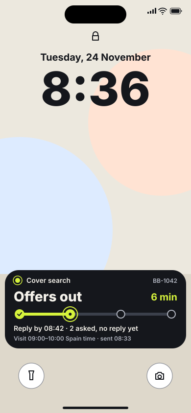

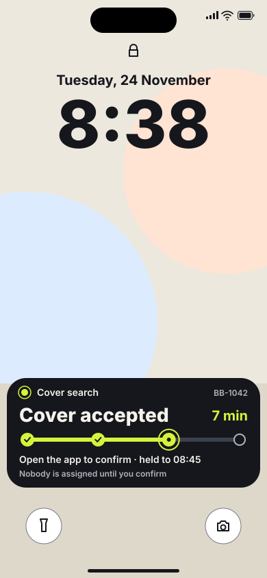

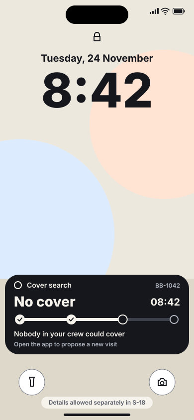

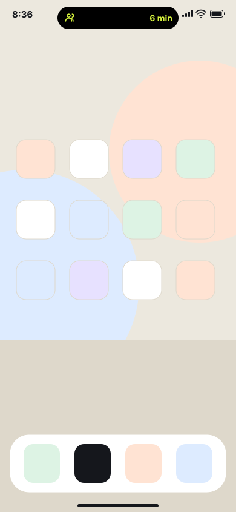

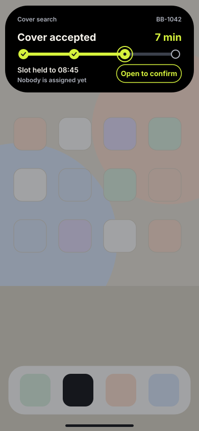

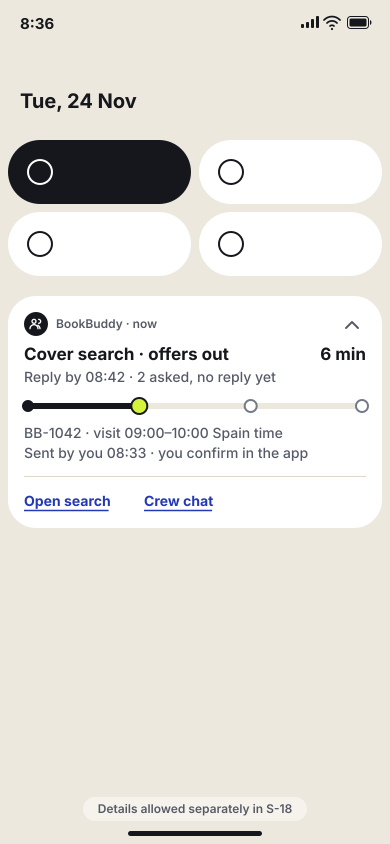

**Purpose and routes.** Keep the cover search glanceable on the foreman's Lock Screen, Dynamic Island or Android shade while offers are out. It starts on the device, in the foreground, when he sends offers on F-10, if "Cover search on the Lock Screen" is on in S-18; the app asks once, at the first send. A tap opens F-10 after unlock, or F-12 over F-10 while an acceptance waits. Nothing on this surface sends, confirms, withdraws or proposes.

**Layout and data.** The Lock Screen card follows the shared layout: "Cover search" and the job reference, the state with a countdown in lime, the cover line, then two lines of text. It shows counts, never names: "2 asked, no reply yet". It never shows an address, a price, a message or a customer name. The countdown runs to the deadline that matters: the reply deadline while offers are out, the confirm-by time once someone has accepted. The Dynamic Island shows a crew glyph and the countdown when compact, the glyph alone when minimal, and the state, the line and one link when expanded. The Android notification has the same title, text and a four-point progress bar, with actions that only open the app.

**Interactions and states.** Offers out: the card reads "Offers out" with the minutes left, the reply deadline and how many were asked. The system renders the countdown from a timer, so no push is needed while it runs. Offers out shows counts and never a name. A tap on the card opens F-10 after unlock and changes nothing.
- No cover: with no cover found, the card goes quiet and nothing on it is lime. It reads "No cover" with the time the offers closed and "Open the app to propose a new visit". The no cover card is the final state, and then the card ends.
- Accepted: a push changes the card to "Cover accepted" with the time left to confirm and "Nobody is assigned until you confirm". The accepted card says to open the app; the candidate's name appears only in the app.
- Confirmed: the card shows "Cover confirmed · 08:40" as its final state, then ends.
- Island compact: the trailing text is the countdown, at most six characters, such as "6 min". The island compact view never shows a name.
- Island expanded: it adds the cover line and one link, "Open to confirm" or "Open search", which opens the app. The island expanded view has no control that changes state.
- Android: the ongoing notification has a countdown chronometer, the progress bar and two actions. The Android actions, Open search and Crew chat, only open the app. On Android 16 it may be promoted to a Live Update where the system allows; otherwise it is a standard notification. Swiping the Android notification away does not stop the search, and it is not reposted at once.
- Updates arrive by push on an acceptance, a decline that exhausts the rung, an expiry and a confirmation. If a push cannot be delivered, the countdown ends at the deadline and the card reads "Open the app for the result"; it never guesses an outcome.
- With Hide details on in S-18 the card reads "BookBuddy · cover search" with the countdown only.
- Notifications off, a dismissed card or a denied permission never changes the search, the offers or the deadline.

**Platform, accessibility and RTL.** iOS uses a Live Activity; Android uses an ongoing notification. Both lead with Spain time because the foreman's Lock Screen clock is in the site's zone. The card is read as one sentence: "Cover search for BB-1042, offers out, reply by 08:42, 6 minutes left, 2 asked, no reply yet". The countdown is not announced on each tick; a state change is announced once. The pulse on the current bead runs only if the system allows and stops with Reduce Motion. At large text the two text lines wrap and the countdown stays on the state's row. In RTL the card and the cover line mirror; times and the reference stay left to right.

## Navigation

Solid lines are in the construction release. The dashed lines are the later pool rung. Arrows to S-17 are confirmations that return to the screen that opened them.

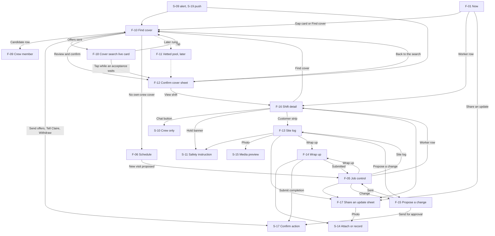

## Open design questions

- **Is the cover line a third zoom of the job line?** The design system names two lines, the journey and the day. This slice adds a four-bead cover line for the search capsule and for F-18: Gap, Offers out, Accepted, Confirmed, with No cover and New visit as the other ending. F-01 and C-09 draw the same moment on the day line with an open first bead. Confirm the cover line, its labels and that a quiet line uses `on-night` for done beads. Confirm also the rung label "Your crew" for own crew, and that the offer clock belongs in the capsule and not on the rung.
- **Should telling the customer be its own act?** C-09 shows "Cover being arranged" as shared by Mateo at 08:34, one minute after the offers. This slice therefore makes Tell Claire a separate lime step with its own confirmation and a promised time that defaults to three minutes after the reply deadline. The alternatives are a switch inside Send offers, or the server publishing it whenever the visit starts within a set time. Decide which, and what "at risk" means in minutes.
- **Which defaults should the search use?** The drawings tick every eligible crew member who is open to cover, and suggest a reply deadline ten minutes ahead of the gap screen, which S-17 can change before sending. The reference left selection empty on entry. Confirm the ticked default, the deadline rule, its lower and upper limits, and whether a second round ("Ask again") is allowed.
- **How long is an accepted place held?** F-10 and F-12 use one time, 08:45, as the confirm-by time and as the update promised to Claire. Confirm that the two are meant to be one deadline, what the worker is told when a hold lapses, and whether the foreman may release a held place without a reason.
- **May the foreman see that an offer was opened?** F-10 shows "Opened 08:35" for Diego. It helps a dispatcher and is a signal about a worker. Confirm it is proportionate and that S-18 tells workers about it; the alternative is Offered and replied only.
- **May F-18 show a first name?** The system surfaces show counts only, so "Cover accepted" does not say who. A first name would save one unlock. The generic lock-screen rule argues against it; decide whether S-18 may allow it.
- **What does the foreman do when a new visit is not enough?** The launch ladder ends at Propose a new visit. The owner's decision also allows BookBuddy to introduce another verified business under a new agreement. This slice routes that through S-16 from More and draws no third rung. Confirm, and say what the customer is offered meanwhile. Decide also whether a foreman may close a gap by going ahead with a smaller crew; the ladder has no such step.
- **When is today's shift cancelled for the crew?** After the proposal, F-10 says "no crew assigned yet" and F-06 keeps the old window as the record until Claire accepts. Decide whether Mateo's and any other worker's shift for today is cancelled when the proposal is sent or when Claire accepts, and what W-04 shows.
- **Which dropout reasons exist, and who sees them?** F-16 shows one category, "transport", to the foreman only. Align the list with W-05, keep health out of it, and confirm how long a reason is kept.
- **Is one confirm-or-retract model right for "On the way"?** Following the lead's answer, a crew lead's "On my way" reaches the customer at once and the foreman corrects it with Running late or retracts it. Confirm the customer's wording after a retraction, "Update withdrawn by Mateo", and that the first stamp stays visible to her as history.
- **What does Paused need?** The Paused type is specified but not drawn. Decide its reason chips, whether it needs a time to resume, and whether the day line shows it.
- **What must a wrap-up contain?** F-14 asks for a tick, an optional result note and a photo per done item, and treats the bill reference as optional at this point. Confirm which of these are required, whether an item may be submitted as not done, and who enters the bill reference when the foreman is not the Provider admin.
- **How long does the customer have to decide on a change?** C-15 gives 10:00, the end of the window. F-15 names only who decides. Confirm the rule and whether F-15 should show the reply time before sending.
- **Does "What Claire sees" belong in the site log?** F-13 offers it as a filter that rewrites titles to the customer's wording, and F-10 opens a preview of C-09 from the customer strip. Confirm that both are wanted, or keep one.
- **Are the fixtures added by this slice acceptable?** Added: the reply deadline shown as 08:42 from the gap onwards; Diego opening the offer at 08:35; in the no-cover branch, Diego declining at 08:39 and Lucía not replying; the second device in "already filled"; the dropout reason; Diego's crew-only photo at 09:31, "Carril inferior desgastado"; the Spanish originals "Rodillos viejos retirados", "Desliza y cierra con llave" and "2 rodillos nuevos colocados" behind the English that C-09 and C-10 show; the late branch at 09:06 with 09:25–09:35; and, for F-11, Alba Navarro, Óscar Ferrer and a reply by 08:50. The bill reference RR-0412 follows C-11, the change follows C-15 and the briefing follows S-11.
- **Are drawn underlines acceptable for links?** This slice draws the underline as a line, as the lead-drawn screens do, sized from the text width measured in Chromium. Quick Look sets text slightly narrower, so an underline can overhang its link by a unit or two there.
