# Later categories L-01–L-07: sessions [Later]

**These seven surfaces are later capabilities. None is in the construction release.** They have no launch navigation, no tab and no disabled placeholder; the entry on C-01, the session bookings in C-18 and the setup route from P-01 and F-01 appear only when a category is switched on for a market. They show how Beacon's live object carries over to classes, appointments, coaching and tours: the same capsule, a shorter line and the same system surface. They follow the [concept](../../foundation/concept-and-principles.md), [core flow 6](../../foundation/core-flows.md#6-later-category-book-a-session-and-follow-it-on-the-day), the [design system](../../system/design-system.md) and the [wireframe conventions](../../system/wireframe-conventions.md). The booking mechanics of the [reference specs](../../../design/screens/shared/L-01_L-06-specs.md) are kept; L-07 is new.

The fixture is **Mat Pilates · Estudi Mar Pilates, Xàbia**, Sat, 28 Nov, 10:00–10:45 Spain time, €16.00 per person, eight places. Claire Martin books one place from the UK and is in Xàbia on the day. Marina Serra coordinates for the studio; Elena Costa is the host and Lucía Vidal the substitute. The repair BB-1042 is a separate job and shares nothing with the session.

| Snapshot | Shows on |
| --- | --- |
| Mon, 23 Nov · 10:41 Spain time (09:41 in the UK) | L-01 to L-04: Claire browses, picks 10:00–10:45 and holds one place until 10:48 |
| Mon, 23 Nov · 10:42 | Booked as BB-S1042; L-06 counts 6 of 8 places |
| Wed, 25 Nov | L-05 upcoming and L-06 published |
| Thu, 26 Nov, alternative branch | L-05 pending change: the studio proposes 11:30–12:15 |
| Fri, 27 Nov · 18:05 to 18:15, alternative branches | L-06 cover unavailable; L-05 substitute host |
| Sat, 28 Nov · 09:20 | L-05 today and L-07, 40 minutes before the start |

## Rules used on every session surface

- **Later, and marked so.** Every heading, SVG title and description in this slice carries [Later]. Nothing here ships until a category has its own provider network and rules.
- **A shorter line.** The session line is Booked, Today, Doors open, In session, Done. Each step after Booked is a deliberate act by the host or coordinator, or a server-confirmed time. Nothing is inferred from the customer's position.
- **The provider is paid directly.** The price and its basis ("per person" or "per appointment") are shown everywhere, and the app takes no payment. This follows the launch decision for repairs.
- **Capacity, hold, booking and staffing are separate.** A full class can still need a host; a held place is not a booking; a booked place is not attendance.
- **Venue time first.** Times are Spain time, with the viewer's time beneath when the zones differ. On the day, when Claire is in Spain, only one time is shown.
- **Host changes are honest.** A substitute is named with who confirmed it and when. No reason and no candidate is shown to the customer. A change to time, place, language or a guaranteed host needs the customer's answer.
- **Languages.** The UI ships in English and European Portuguese. The language a session is taught in is a fact about the session and is never changed by the UI language.

## L-01 Browse sessions [Later]

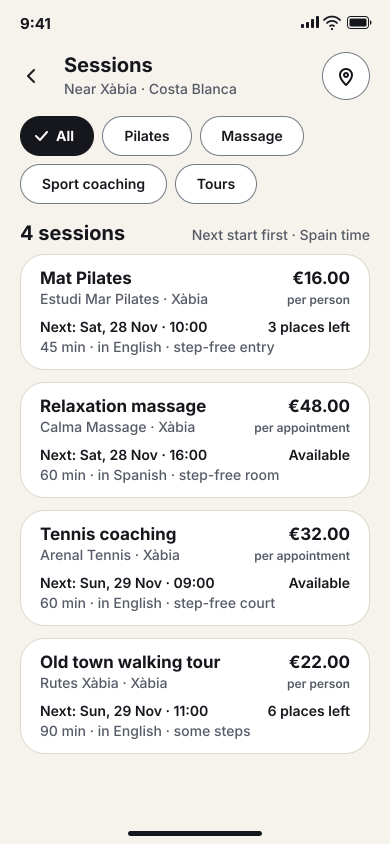

**Purpose and routes.** Find a session near a place by category. Entered from the later entry on C-01; Back returns there. A card opens L-02 and returning restores the category, place and scroll position. The pin button in the header opens a place picker; a typed locality is enough and no device location is asked for.

**Layout and data.** Pushed header "Sessions" with the place ("Near Xàbia · Costa Blanca") and the pin button. Category chips wrap onto two rows: All, Pilates, Massage, Sport coaching, Tours. A heading gives the count, the order ("Next start first") and the zone. Each session card is one target: title and price, venue and the price basis, then the line that matters most for a decision, the next start and what is left ("Next: Sat, 28 Nov · 10:00", "3 places left"), then duration, the language it is given in and the real access cue. Group sessions count places; private ones say "Available".

**Interactions and states.** Tapping a chip replaces the list and resets the scroll; All clears the category. *Results:* four cards in the fixture. *None nearby:* the chips stay, the list is replaced by "No sessions near Xàbia yet" and one action, **Change place**; a filtered empty list offers **Show all categories** instead. A category that is not switched on is not listed. While loading, the chips stay and the cards are skeletons. Cached results carry "Last checked" with the time, and a card opened offline shows L-02 read-only. A session removed between tap and load opens S-16, not an error. Nothing on this screen holds or books a place.

**Platform, accessibility and RTL.** Focus order: Back, place, chips as a selectable group, heading, cards. A card reads "Mat Pilates, 16 euros per person, Estudi Mar Pilates, next Saturday 28 November at 10:00 Spain time, 3 places left, 45 minutes, in English, step-free entry". The chips never scroll sideways, so no category depends on a swipe. At large text the price moves under the title. In RTL the cards and chips mirror; prices, times and venue names keep their order.

## L-02 Session detail [Later]

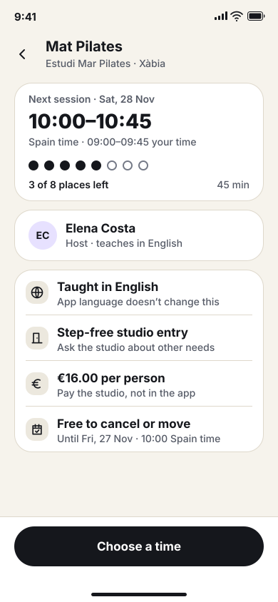

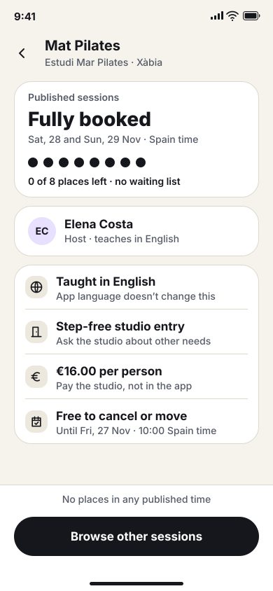

**Purpose and routes.** Decide whether this session suits: when, where, with whom, in which language, at what price and on what terms. Opened from L-01 or a valid link. **Choose a time** opens the L-03 sheet over this page. Back returns to L-01 with its filters kept.

**Layout and data.** Pushed header with the session and the venue. The **Next session** card leads with the time in the largest type on the page, the two-clock line ("Spain time · 09:00–09:45 your time"), a row of eight capacity dots (filled for taken, outlined for free) and the same fact in words ("3 of 8 places left"), plus the duration. The **host** card names the confirmed, customer-visible host and the language they teach in. A facts card has four rows: the language the session is given in, the access cue, the price with its basis and "Pay the studio, not in the app", and the cancellation terms with their absolute deadline. A private appointment replaces the dots with "Appointment available".

**Interactions and states.** *Open:* the dock holds **Choose a time**. *Fully booked:* when no published time has a place, the card's hero reads "Fully booked", all dots are filled, the line says "0 of 8 places left · no waiting list", and the dock gives the reason ("No places in any published time") above **Browse other sessions**. A fully booked session never offers a waiting list or a disabled Choose a time. If only the next time is full, the card moves to the next time that has places. *Paused:* when the studio has paused bookings, the card reads "Booking unavailable" with no internal reason. *Cancelled time:* that time is removed; a later time can still be open. Offline, the page is readable with "Last checked" and the dock is disabled with "Connect to see current places". The host's name appears only when confirmed; otherwise the row reads "Host to be confirmed".

**Platform, accessibility and RTL.** The capacity dots are decorative; the sentence beside them is what is read. Focus order: Back, title, next session as one sentence with both zones, host, the four facts, dock. A change in places is announced once, not on every refresh. At large text the time wraps before it shrinks and the dots wrap onto a second row. In RTL the rows mirror and the dots fill from the right; the time range keeps its order.

## L-03 Choose a slot [Later]

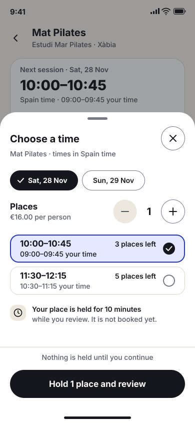

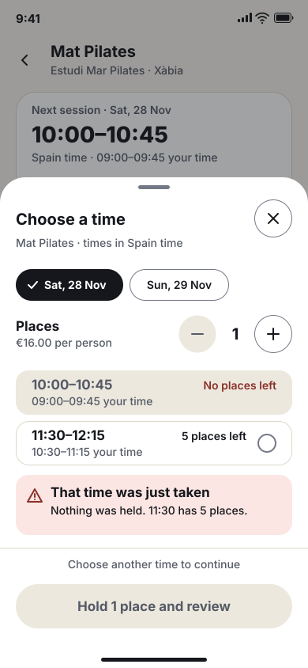

**Purpose and routes.** Pick a day, a time and a number of places, then ask the server to hold them. It is a sheet over L-02 for a new booking, and over L-05 when C-17 starts a move to another time. The dock action requests one short hold; only a confirmed hold opens L-04. Close or Back keeps the caller unchanged. Choosing a row holds nothing.

**Layout and data.** Dimmed parent, sheet with handle, title "Choose a time", Close and the zone line. Day chips ("Sat, 28 Nov", "Sun, 29 Nov"), with an agenda list as the alternative to a calendar grid. A **Places** stepper with labelled 48-unit minus and plus buttons and the unit price; a private appointment shows "1 appointment" and no stepper. Times are single-choice rows: the time in site time, the viewer's time beneath, and the places left at the trailing edge. A note explains the hold before it starts: "Your place is held for 10 minutes while you review. It is not booked yet." The dock reads "Nothing is held until you continue" above **Hold 1 place and review**; the button label carries the count.

**Interactions and states.** *Available:* choosing a time enables the button. Raising the count above the places left clears the choice and says why. On tap the button keeps its label while the hold is requested, duplicate taps are ignored, and the sheet closes into L-04 with the hold timer running. *Slot just taken:* if the request loses the race, nothing is held. The time's row turns to `subtle` with "No places left" in `critical-ink` and loses its radio, a `critical-soft` notice says "That time was just taken. Nothing was held. 11:30 has 5 places.", and the button is disabled with the reason "Choose another time to continue". The slot just taken is never replaced by another time automatically; the customer chooses. If some places remain but fewer than asked ("1 place left; you asked for 2"), the count stays and the row offers the smaller number. *Sold-out day:* every row is `subtle` and the dock offers the next day with places. *No published times:* the list says so. *Offline:* rows are read-only and the button reads "Connect to hold a place". A hold that arrives after the sheet was closed is released, not carried into a checkout nobody is looking at. In a move, the original booking stays in force until the new one is confirmed.

**Platform, accessibility and RTL.** iOS detent or Android modal sheet, each with Close; no gesture is required. Focus starts at the title, then Close, days, the stepper ("Places, 1, decrease unavailable"), the time rows as radio buttons with places left, the note and the dock. The notice is announced once and focus moves to it. No countdown runs on this sheet. At large text each row's places left moves under the time. In RTL the stepper and rows mirror; "10:00–10:45" keeps its order.

## L-04 Review and book [Later]

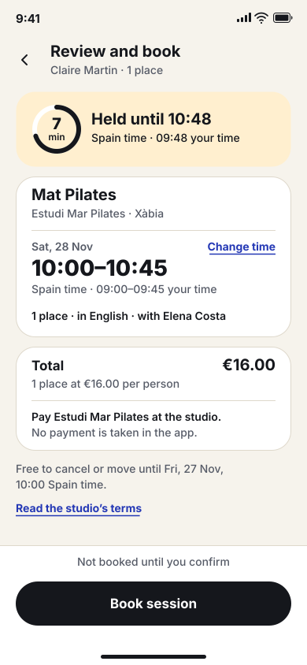

**Purpose and routes.** Confirm a held place as the named customer, against one time, one total and one version of the terms. Entered only when L-03 returns a confirmed hold. **Book session** replaces this screen with L-05, so Back can never submit twice. **Change time** and Back release the hold and reopen L-03 over the caller.

**Layout and data.** Pushed header with the booker and the count. The **hold clock** leads: the offer-clock ring on `attention-soft` with the minutes left inside, and beside it the absolute expiry in both zones ("Held until 10:48", "Spain time · 09:48 your time"). The summary card gives the session, venue, date, the time in the page's largest type, the two-clock line, the count, the language and the confirmed host. The payment card gives the total, how it is made up ("1 place at €16.00 per person") and the **Pay the provider** line: "Pay Estudi Mar Pilates at the studio. No payment is taken in the app." The cancellation terms follow with their absolute deadline and a link to the studio's terms. The dock reads "Not booked until you confirm" above **Book session**.

**Interactions and states.** *Held:* the ring drains with an OS-driven timer; the absolute time never leaves the screen. On tap the server rechecks identity, the hold, the time, the count, the price and the terms version. *Processing:* the button keeps its label with a progress mark and ignores further taps. *Booked:* L-05 opens with "Booked" and the reference BB-S1042, and one confirmation haptic follows the server result. *Not booked:* when the hold expired or the place was lost, the hold clock is replaced by a `critical-soft` notice, "Not booked. The hold ended at 10:48 Spain time.", the summary stays, and the dock becomes **Choose a time again**. If the terms or price changed, the differences are shown and a fresh confirmation is required. An unknown result reads "Checking your booking" and is reconciled before any retry. Offline before sending, the button is disabled with "Connect to book"; the hold keeps running on the server. In a move, the screen names the original booking and says it stays in force until the new time is confirmed. If a category later takes payment in the app, the action is named "Book and pay" and uses the platform's payment sheet; that is not designed here.

**Platform, accessibility and RTL.** Focus order: Back, hold ("1 place held until 10:48 Spain time, 09:48 your time, 7 minutes left"), summary, Change time, total, how to pay, terms, dock. The time left is announced at five minutes and at one minute, not continuously. Nothing in the price, deadline or terms is truncated; at large text the page scrolls and the dock stays. In RTL the ring still drains clockwise, the layout mirrors, and "€16.00" and the time range keep their order.

## L-05 Session booking [Later]

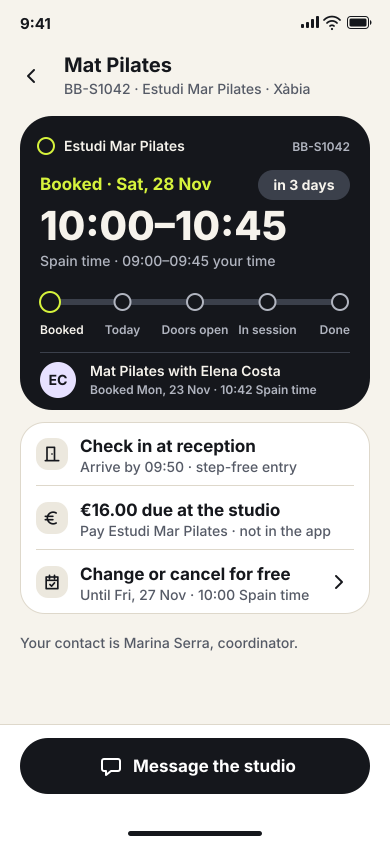

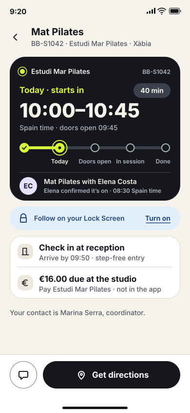

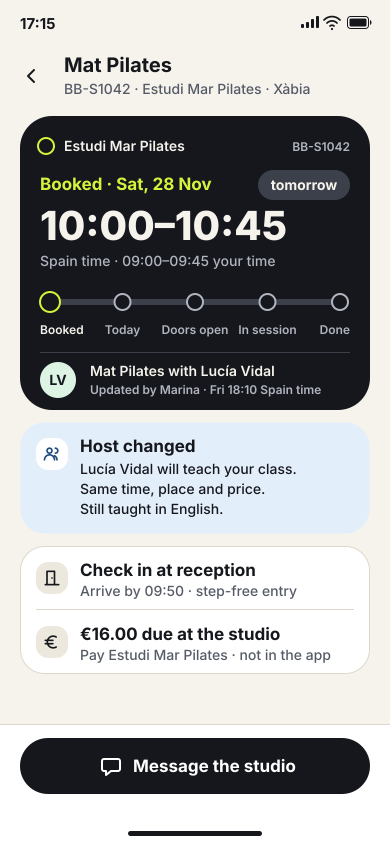

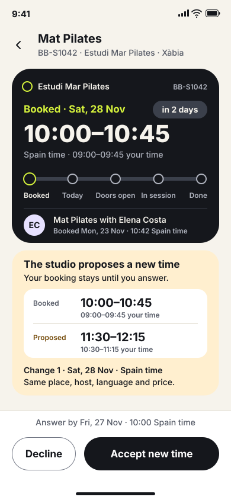

**Purpose and routes.** The booking pass, and the live view on the day. Opened from C-01, C-18, a confirmed L-04, L-07 and S-09. Back returns to the caller and never to a finished L-04. **Message the studio** opens S-10 with the coordinator as the named contact. **Change or cancel for free** opens C-17, which hands a move to L-03. **Turn on** in the follow strip starts L-07. **Get directions** opens readable directions in the app, with the platform map as an option. A proposed change is answered through S-17. After the session C-12 and C-16 are offered.

**Layout and data.** Pushed header with the session, reference and venue. The pass is a live capsule at hero size: provider and reference, the state with a chip ("Booked · Sat, 28 Nov", "in 3 days"), the time in Display, the two-clock line, the session line (Booked, Today, Doors open, In session, Done), then the host's avatar and name with the provenance of the latest fact ("Booked Mon, 23 Nov · 10:42 Spain time"). Beneath it a card of rows: where to check in and by when, with the access cue; what is due and to whom ("€16.00 due at the studio · Pay Estudi Mar Pilates · not in the app"); and the free change or cancel row with its deadline. A line names the coordinator. The pass shows no QR code in this fixture.

**Interactions and states.** *Upcoming:* the capsule is quiet: no pulse, the first bead is a ring, and the dock is **Message the studio**. *Today:* the capsule goes live. The state reads "Today · starts in" with a countdown chip, the zone line gives the door time, and the line pulses on Today once the host has confirmed the session is on ("Elena confirmed it's on · 08:30 Spain time"). A single time is shown when the viewer is in the venue's zone. The follow strip appears today only; the session card starts in the foreground when the customer turns it on. The dock changes to **Get directions**, with the message action as a 56-unit icon button beside it. Doors open and In session follow the host's check-in and start; if no confirmation has arrived, the capsule stays quiet and says "Last confirmed" with the time. *Substitute host:* the capsule names the new host and who updated it and when, and an `info-soft` notice says "Host changed. Lucía Vidal will teach your class. Same time, place and price. Still taught in English." A substitute host is information, not a decision, as long as no named host was guaranteed; no reason and no candidate is shown. While cover is still being arranged the notice reads "Host being arranged" with the coordinator's name and the time of the next update. *Pending change:* the booked time stays in the capsule. An `attention-soft` card says "The studio proposes a new time. Your booking stays until you answer.", compares Booked and Proposed in both zones, names the change version and lists what is unchanged. The dock gives the answer deadline with **Decline** and **Accept new time**; each opens S-17 online and names the booking, the version and the consequence. A pending change is never accepted by a tap in chat or from a notification. *Done:* the line is complete and the dock offers **Rate the session**. *Cancelled:* a `critical-soft` notice with who cancelled and when; no actions that imply a session. Offline, the pass is readable from cache with "Last confirmed" and the actions that need the server are disabled with the reason.

**Platform, accessibility and RTL.** The capsule reads as one sentence: "Mat Pilates, today, starts in 40 minutes, 10:00 to 10:45 Spain time, doors open 09:45, with Elena Costa, confirmed 08:30, step 2 of 5". A host change or a proposal is announced once without moving focus. In the proposal, Booked is read before Proposed, then what is unchanged, then Decline, then Accept. At large text the dock buttons stack with Accept first. In RTL the session line runs right to left and the layout mirrors; references, times and the price keep their order.

## L-06 Session setup and roster [Later]

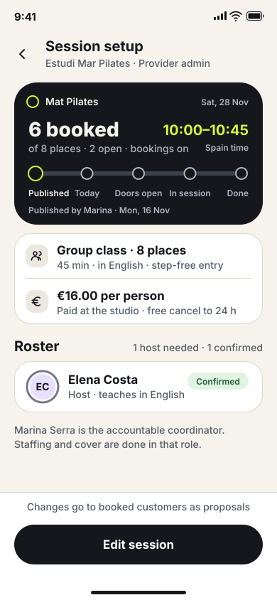

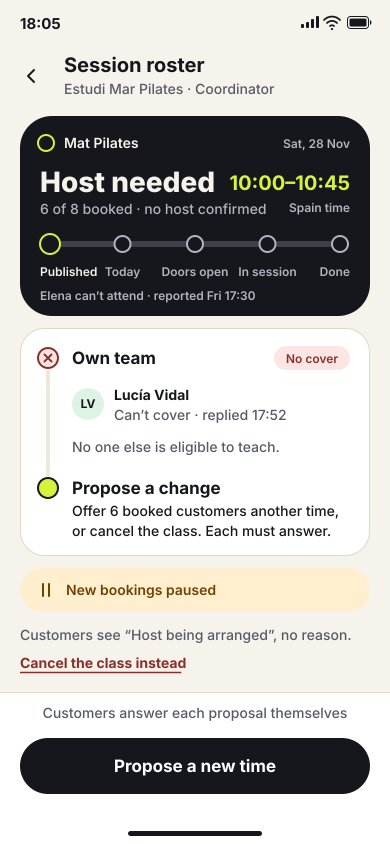

**Purpose and routes.** Publish a session, see how full it is, staff it, and find cover in the provider's own team when a host drops out. A Provider admin enters from the later row on P-01 and may publish and edit. A coordinator, which is the Foreman capability under a category label, enters from F-01 for the roster and cover. Membership alone gives neither. **Edit session** pushes the editor; **Propose a new time** and **Cancel the class instead** are confirmed in S-17. Cover offers use the patterns of F-10, W-03 and F-12. Help goes to S-16.

**Layout and data.** Pushed header with the business and the acting role. A live capsule at card size is the session: title and date, the state ("6 booked"), the time, the capacity sentence ("of 8 places · 2 open · bookings on"), the session line from the provider's side (Published, Today, Doors open, In session, Done) and its provenance. A setup card states the format and capacity, duration, the language the session is given in, the access cue, the price with its basis, how it is paid and the cancellation terms. **Roster** shows how many hosts are needed and confirmed, then each host as a crew dot with name, role, language and state. A line names the accountable coordinator. The attendee list, reached from the booked count, shows bookers' names and place counts only.

**Interactions and states.** *Published:* an admin sees **Edit session**; the dock says changes reach booked customers as proposals, because a booked time, place, language or guaranteed host is never overwritten. Capacity cannot be lowered below booked places plus active holds. *Draft* and *Needs approval* are private and say what is missing. *Full:* "8 booked" with no open places, which is not a staffing problem. *Cover unavailable:* when the host reports she cannot attend, the capsule's state becomes "Host needed" in plain text, without lime, and the provenance names who reported it and when. The **cover ladder** follows: **Own team** lists each person asked with the outcome and time ("Can't cover · replied 17:52") and says when nobody else is eligible; with cover unavailable in the own team, the second rung, **Propose a change**, opens. Its action sends each booked customer a proposal for another time, answered in L-05, or cancels the class. New bookings are paused, shown as text on `attention-soft`. Customers see "Host being arranged" and never the reason or the people asked. While offers are out, the first rung shows an offer clock and the dock is quiet. When someone accepts, the rung reads "Accepted · confirm" and the coordinator confirms one person in F-12; first acceptance reserves, confirmation assigns. There is no outside-pool rung in this design. All actions are online; cached screens are read-only.

**Platform, accessibility and RTL.** Focus order: Back, capsule as one sentence, setup, roster or ladder rung by rung ("Own team, no cover; Lucía Vidal can't cover, replied 17:52"), paused notice, dock. The ladder's glyphs are decorative; each rung's state is text. Deliberate actions take two taps through S-17. At large text the rungs stack their rows and the dock grows. In RTL the ladder's rail moves to the right edge and rows mirror; times and names keep their order.

## L-07 Session live card [Later]

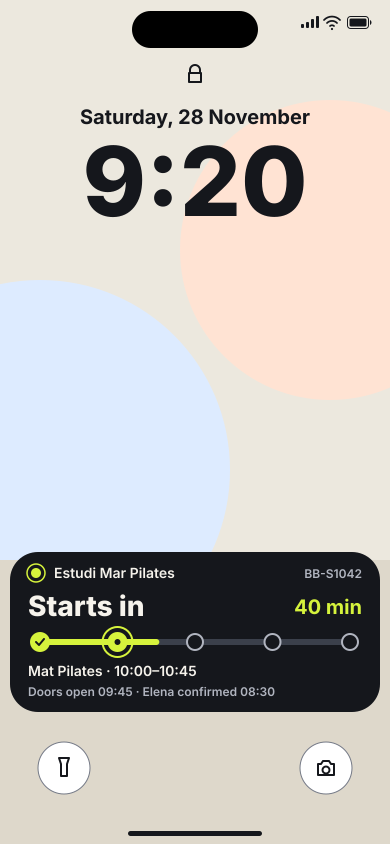

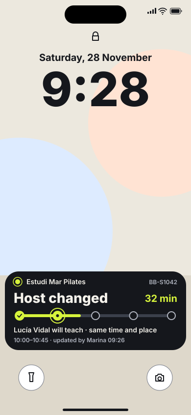

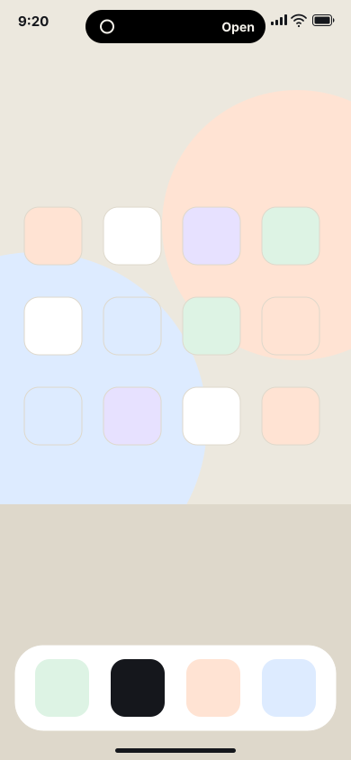

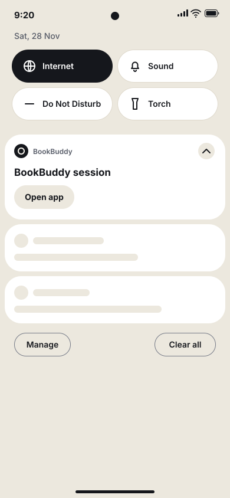

**Purpose and routes.** Keep the countdown to a booked session on the Lock Screen, in the Dynamic Island and in the Android notification shade. It is the same capsule as L-05 outside the app. It starts when the customer taps **Turn on** in the follow strip on L-05 on the day of the session, which is a foreground start; there is no push-to-start, in line with the launch decision for visits. Tapping the card, the island or **Open booking** opens L-05 after unlock, with C-01 as the parent on a cold launch. **Message the studio** on Android opens S-10. Nothing on this surface changes the booking.

**Layout and data.** *Lock Screen (iOS):* the standard 370 × 160 card on `night`: provider and reference; the state ("Starts in") with the countdown in lime; the session line without labels; then two lines, the session with its time and the door time with who confirmed and when. *Dynamic Island:* compact shows a calendar glyph in lime and the countdown, at most six characters ("40 min"); minimal shows the glyph only; expanded repeats the Lock Screen content with one link, Open booking. *Android:* an ongoing notification with the title "Mat Pilates · starts in 40 min", the time and door time, the provider and reference, a determinate progress bar, the host line, the provenance, and two actions that only open the app. The surface shows the viewer's time, which on the day is the venue's time; if the phone is in another zone it leads with the viewer's time and adds the venue's. It shows no address, price, access detail or message text. S-18 can reduce it to "BookBuddy session · starts in 40 min".

**Interactions and states.** *Starts in:* the countdown is drawn by the OS from the start time, so no push is needed for each minute; pushes are sent on stage changes only: doors open, in session, done, a host change or a cancellation. *Doors open:* the state reads "Doors open" and the line moves to step three. *In session:* "In session" with the end time. *Host changed:* the state reads "Host changed" until the next stage, the first line names the new host and says the time and place are the same, and the second gives who updated it and when. A host changed card gives no reason and asks for nothing; a change that needs the customer's answer says "Open to review a change" and is decided in L-05. *Ended:* at the session's end the card reads "Done" and leaves shortly after; a session card never reaches the 8-hour limit because it starts on the day. *Stale:* if the app cannot confirm a state after the start time, the pulse stops and the card reads "Last confirmed" with the time. *Cancelled:* "Session cancelled · open for details", then the card ends. Turning the card off, dismissing the Android notification or denying notifications never affects the booking; the Android notification is not reposted at once after a dismissal. Without the permission the follow strip explains how to turn it on and L-05 remains the live view.

**Platform, accessibility and RTL.** VoiceOver and TalkBack read the card as one sentence: "Estudi Mar Pilates, Mat Pilates starts in 40 minutes, 10:00 to 10:45, doors open 09:45, confirmed by Elena at 08:30, step 2 of 5". The countdown is not announced on every tick. A promoted Live Update on Android 16 is requested only on the day and falls back to the standard notification. On iOS versions without Live Activities an ordinary notification opens L-05. In RTL the session line and the card's rows mirror and the countdown keeps its digits' order.

## Navigation

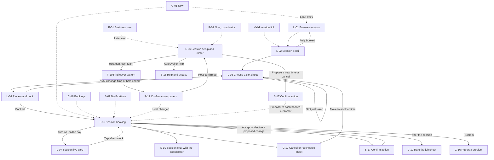

## Open design questions

- **When sessions ship.** All seven surfaces are later. Decide the first category and market, and what a provider must have approved before L-06 can publish.
- **Hold length.** Ten minutes is a fixture. Decide the real length and whether a customer may hold more than one time at once.
- **Paying the provider.** The design assumes the session is paid at the venue and the app takes no payment, as for repairs. If a category needs prepayment, L-04 needs a payment step and a refund rule before it is drawn.
- **Cancellation terms.** "Free to cancel or move until 24 hours before" is the studio's fixture term. Decide whether the fee-free rule for repairs applies to sessions or each provider sets its own cut-off.
- **Host changes.** The design treats an equally qualified substitute as information unless a named host was guaranteed. Decide who judges "equally qualified" and which changes always need the customer's answer.
- **No cover.** When the own team cannot cover, the ladder offers a new time or a cancellation; there is no outside-pool rung. Decide whether a later pool applies to sessions at all, and when new bookings are paused and resumed.
- **Starting the live card.** L-07 starts only from the follow strip on the day. Decide whether a reminder push on the morning of the session may invite the customer to open L-05 and turn it on.
- **Who confirms the day's stages.** "Today" pulses after the host confirms the session is on; Doors open and In session follow the host's check-in and start. Decide whether a coordinator may confirm for a host, and what the customer sees when nobody has.
- **Attendee data.** L-06 shows the booker's name and the number of places, not a guest list. Confirm that this is enough for each category.
- **Marking [Later].** The artboards carry [Later] in their titles and descriptions, not as a badge drawn on the screen, so that they stay true pictures of the UI. Say if a visible mark is wanted in the PDF.
