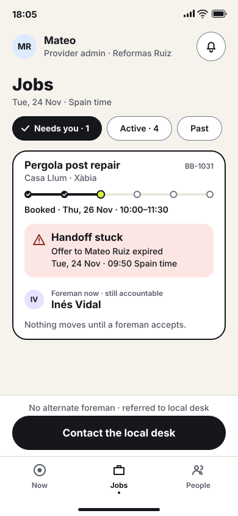
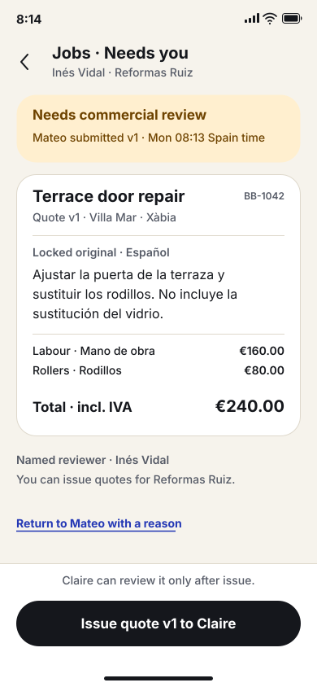
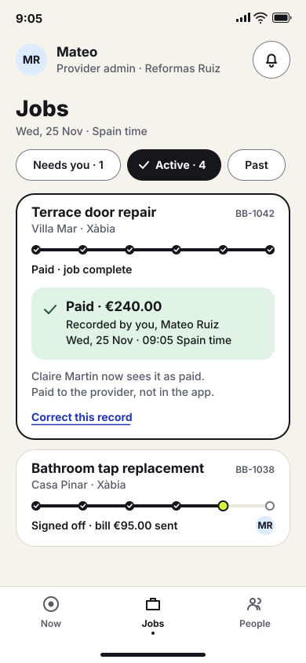
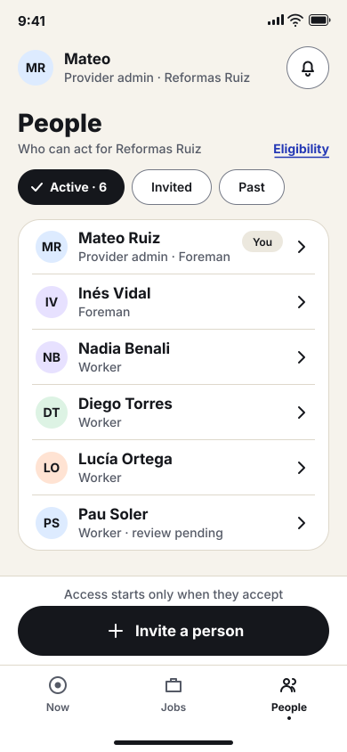
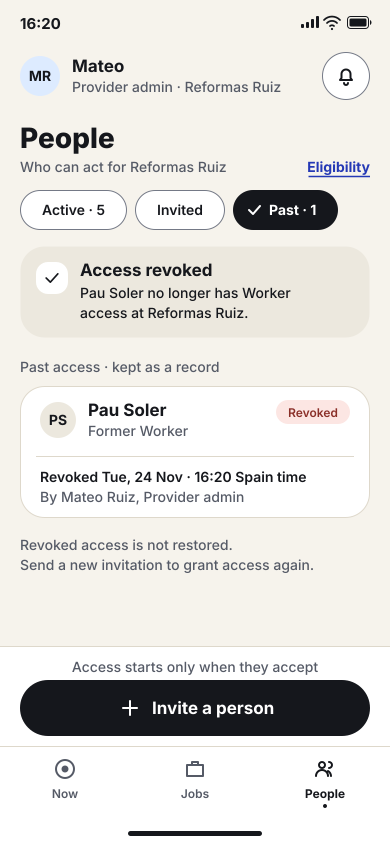
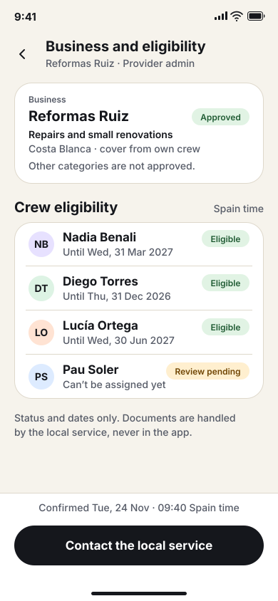
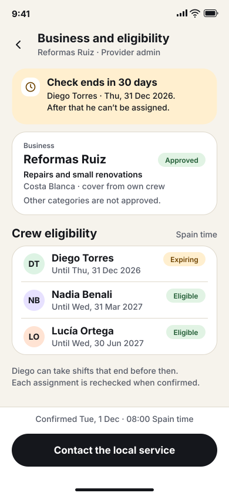
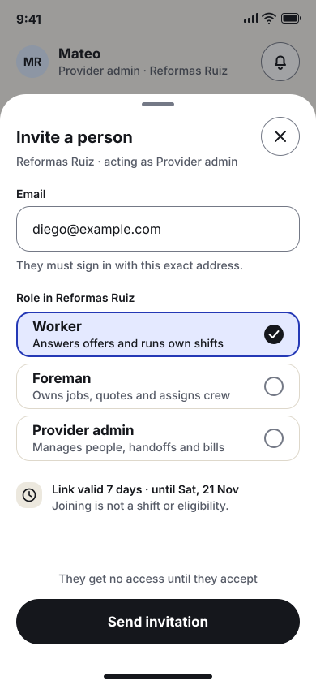
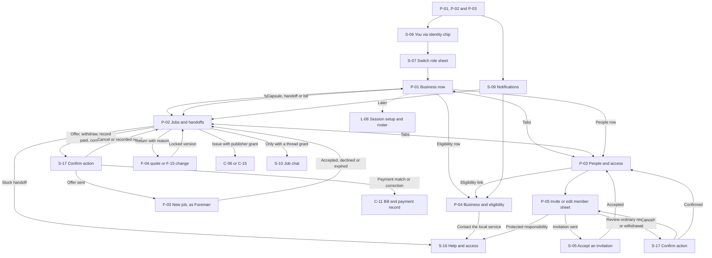

# Provider admin P-01–P-05: the business behind the live visit

These five screens are the Provider admin role for one business. They answer three questions: who is accountable for each job, who may act for the business, and which bills the business has received payment for. They follow the [concept](../../foundation/concept-and-principles.md), [information architecture](../../foundation/information-architecture.md), [roles](../../foundation/personas-and-roles.md), [core flows](../../foundation/core-flows.md), [design system](../../system/design-system.md) and [wireframe conventions](../../system/wireframe-conventions.md). The authority, freshness and privacy rules of the [reference specs](../../../design/screens/shared/P-01_P-05-specs.md) are kept; this file restates what each screen needs and what Beacon changes.

Mateo Ruiz is the provider admin and a foreman at **Reformas Ruiz**. In the commercial review branch, Inés Vidal is the provider’s named reviewer and has a separately verified publisher grant. She opens only her assigned P-02 item; her Foreman membership does not give her the People directory or the bill-recording action. The jobs BB-1031, BB-1038 and BB-1045 are shared with the [foreman screens](../foreman/F-01_F-09-specs.md). The artboards are separate snapshots of the [story](../inventory.md#story-and-clock):

| Snapshot (Spain time) | Shows on |
| --- | --- |
| Sat, 14 Nov and Sun, 15 Nov | P-05: Mateo invites Diego Torres, as accepted in S-05 |
| Mon, 23 Nov · 08:14, commercial review branch | Inés reviews Mateo’s locked €240.00 quote v1 from F-04. Claire has no offer yet. |
| Mon, 23 Nov · 17:50 | P-02: Mateo offers the BB-1031 transfer from Inés Vidal to himself as foreman. The reply is due Tue, 24 Nov at 09:50: ten staffed minutes on Monday and 110 on Tuesday. |
| Tue, 24 Nov · 09:41 | P-01, P-03 and P-04, right after the role switch in S-07; BB-1042 is at Working |
| Tue, 24 Nov · 18:05, alternative branch | P-01 action needed and P-02 handoff stuck: the offer expired unanswered |
| Tue, 24 Nov · 16:20 and Tue, 1 Dec, later outcomes | P-03 revoked and P-04 expiring |
| Wed, 25 Nov · 09:05 | P-02 paid recorded, the last event of the story |

## Rules used on every screen

- **Admin is not Foreman.** The Provider admin context moves ownership, manages access and records payment. It never accepts a job, assigns crew, confirms cover or joins a job chat. Mateo switches to Foreman in S-07 for those.
- **One next step.** P-02, P-03 and P-04 have one primary action in the dock. P-01 only routes, so it has no dock. A tab root's dock sits above the tab bar.
- **Lime means live.** Only the live capsule on P-01 and the current bead of a job line are lime. Handoffs, bills, invitations and eligibility are records, so their actions are ink buttons.
- **Who and when.** Every offer, expiry, revocation and payment record names the person and the Spain time. A deadline is an absolute time, never only a countdown.
- **Online for consequences.** Offering a job, recording a payment, inviting, editing and revoking need a server result and are confirmed in S-17. Nothing here is queued offline. Cached screens are read-only and say "Last confirmed" with the time.
- **Minimum data.** The admin sees stage, accountable foreman, bill totals and eligibility status with dates. No documents, no dropout reasons, no crew-only chat, no customer access notes.
- **Languages.** The UI ships in English and European Portuguese. Names, emails and job references are shown as entered.

## P-01 Business now

**Purpose and routes.** Show the business at a glance: what is live, which handoffs and bills are open, and whether the business and crew may work. It is the Now tab and the landing screen after choosing Provider admin in S-07. The capsule and each card or row open P-02 with that job selected, P-04 or P-03. The identity chip opens S-06 and the bell opens S-09. Nothing on this screen changes a record.

**Layout and data.** Identity chip (“Mateo · Provider admin · Reformas Ruiz”), bell, title and date in site time. **Live now** shows the job, reference, stage (“Working”), “since 09:18”, accountable foreman, crew size, day line and source. The business card links to Handoffs (“1 transfer · reply by 09:50”), Bills (“1 open bill · €95.00”) and Eligibility (“Approved · 1 review pending”). These counts include only records the admin may see. An open bill is not confirmation of payment.

**Interactions and states.** *Active* is the primary artboard: one capsule, three quiet rows. Tapping the capsule opens P-02 with BB-1042 selected; the admin has no job control. *Action needed* replaces the top of the page with a **Needs you** list, most urgent first: a stuck handoff on `critical-soft` (“Handoff stuck · since 09:50”, the job, who the offer went to and who stays accountable), then bills to record on `attention-soft` with the count and total. Each action needed card is one target and names the record it opens. With nothing live the capsule is not drawn; a row says "Nothing live right now" and gives the next visit. Items the admin cannot act on, such as a review the local service has not finished, stay in the Business rows. *Onboarding:* "Business review pending" with a link to P-04. *Cached:* an offline banner with the last confirmed time; the capsule goes quiet and reads "Last confirmed 09:36". A section that fails to load says so with Retry and never shows a zero.

**Platform, accessibility and RTL.** Reading order: identity chip, bell, title, capsule as one sentence ("Terrace door repair, working since 09:18 Spain time, foreman Mateo Ruiz, step 4 of 5"), then each card with its label, title and consequence. Status is always text plus a glyph; the red and amber cards also say "Handoff stuck" and "Record when paid". At large text the rows grow and the trailing chevron drops below the text. Android system Back leaves the app from this root. In RTL the chip, cards and chevrons mirror and the day line runs right to left; BB-1042, times and euro amounts keep their own order.

## P-02 Jobs and handoffs

**Purpose and routes.** The Jobs tab, P-01 and S-09 open the selected business record. The provider admin offers ownership to a named foreman or records a matched payment. **Needs commercial review** opens a locked quote or change for its designated reviewer. S-17 confirms the business, actor, record, version and effect; it does not confer authority. The offered foreman answers in F-03. S-16 handles stalled handoffs; S-10 requires a separate thread grant.

**Layout and data.** Identity chip, title “Jobs”, site date and three segments: **Needs you**, **Active** and **Past**. Each booking card shows the title, reference, place, mini journey line, written stage and accountable foreman. The selected card opens in place. A handoff shows **Foreman now** (Inés Vidal), **Offer to** (one eligible foreman) and the reply deadline. Its dock names the consequence and recipient: “Inés stays accountable until Mateo accepts”; **Offer to Mateo Ruiz**. A direct review link opens just the assigned queue item, not the admin shell. Only an authorised reviewer sees the locked commercial version.

**Interactions and states.** Selecting a card closes the previous one. *Unassigned:* “No foreman yet”. *Offered:* show the named recipient, the absolute site-time deadline and **Withdraw offer**. *Accepted:* show the new foreman and acceptance time. *Handoff stuck:* keep the failed offer’s outcome and the incumbent’s name; initial intake with no incumbent says “No foreman owns this job”. Expiry alone does not change the customer’s booking.

**Transfer reply deadline.** [Workforce §9](../../../docs/reports/2026-11-23-open-question-suggestions/workforce.md#9-when-does-a-foreman-intake-or-transfer-offer-expire) sets two staffed hours for ordinary handoffs: weekdays 08:00–18:00 Spain time, excluding local public holidays. P-02 previews the cutoff and F-03 uses that same confirmed deadline. BB-1031 is for Thursday, not an at-risk same-day visit. A same-day handoff at risk within four staffed hours instead allows 30 staffed minutes and requires a call; contact the provider’s duty line immediately if waiting is unsafe. Only one transfer may be open. On expiry or decline, reoffer once to an authorised alternate if there is one; otherwise refer it to the provider admin and local desk. Inés stays responsible. This is the transfer recipient’s deadline, not a worker’s offer/cover-confirmation cutoff or the commercial reviewer’s one-business-day target.

**Commercial review.** F-04 quote drafts and F-15 change drafts from foremen without publishing authority appear as **Needs commercial review** for the provider’s named reviewer or authorised backup. Show the author, submission time and locked version. The reviewer can read the full version including terms, IVA-inclusive price and exclusions; for a change, compare the immutable approved base, delta, new total, timing and affected work. **Return to Mateo with a reason** keeps the version private and gives the foreman the reason. **Issue quote v1 to Claire** (or **Issue change**) requires a separate provider publisher grant, checked again with the current locked version online. A reviewer without that grant can return or route to the authorised publisher, never issue. Aim to issue or return within one business day; timeout, intake acceptance and role switching do not publish. F-04/F-05/F-15 show the recorded “In review”, “Returned for changes” or “Issued” outcome. Only issue makes that version available in C-06/C-07 or C-15; only the named customer approver can accept it.

**Bill and payment states.** Reformas Ruiz invoices Claire directly. An open invoice offers **Check payment record**, not a second payment attempt. For invoice RR-0412, only after matching the €240.00 received by the provider to this invoice in its bank/PSP reconciliation may the provider admin **Record €240.00 as paid** via S-17. Sign-off, a screenshot, a customer report or a browser return is not proof. A reported transfer that cannot yet be matched stays **Checking with the provider · don’t pay again** in C-11; P-02 keeps it open for reconciliation. No paid stamp, completed journey line or second payment prompt while checking.

*Paid recorded:* the matched result is attributed to Mateo Ruiz, Wed 25 Nov · 09:05 Spain time. P-02 and C-11 show the same invoice, amount, actor and time. **Correct this record** appends a reason, author and server time without erasing the original. In the alternative 09:18 branch, Mateo corrects a wrong-reference match: RR-0412 reverts to Checking, its Paid bead is no longer complete, and C-11 shows both stamps and the effective status. Return to Due only when the provider confirms no funds were received. Neither correction is a refund or a replacement invoice; replace the invoice only if its contents changed. An unknown record-write result is a separate state: reconcile the existing write before retrying. Nothing here debits Claire or moves money.

**Platform, accessibility and RTL.** Segments are a native selectable group and announce their count. A card reads as one sentence: "Pergola post repair, BB-1031, Casa Llum, booked, visit Thursday 26 November 10:00 to 11:30 Spain time, step 3 of 6, selected". The candidate rows are radio buttons. Focus returns to the dock button when S-17 is cancelled and to the card's outcome block when it succeeds. At large text the stage, the deadline and the foreman each take their own line and the dock grows. In RTL the cards, avatars and chevrons mirror and the journey line runs right to left; references, times and amounts keep their order.

## P-03 People and access

**Purpose and routes.** See who can act for the business, in which role, and who has been invited or removed. It is the People tab. A member row opens P-05 to view or edit that membership; **Invite a person** opens P-05 as a blank invitation; **Eligibility** opens P-04. A revocation is confirmed in S-17 from P-05 and returns here.

**Layout and data.** Identity chip, title "People", the line "Who can act for Reformas Ruiz" with the Eligibility link, then three segments: **Active**, **Invited** and **Past**, with counts. Active is one card of rows: avatar, name, roles in this business, and a **You** badge on the viewer's own row. Mateo's two roles are two grants on one account. A role is membership only: it is neither eligibility nor an assignment, so Pau Soler reads "Worker · review pending" and stays unassignable until P-04 says otherwise. The dock holds **Invite a person** with the context line "Access starts only when they accept".

**Interactions and states.** *Active:* six rows; the viewer's own admin grant opens read-only. *Pending:* the Invited segment lists each invitation with the email, the invited role, when it was sent and when the link stops working; tapping one opens P-05 in its pending mode. An accepted invitation moves to Active once and leaves Invited. *Revoked:* after S-17 confirms, the screen shows the Past segment with a notice ("Access revoked. Pau Soler no longer has Worker access at Reformas Ruiz.") and the record: former role, a **Revoked** badge, the Spain time and who did it. The revoked row has no control and no restore; the note says a new invitation is needed. If the person held other roles, only the revoked one moves to Past. A revoked member loses the business's screens at once and sees S-16. Declined, expired and withdrawn invitations are separate records in Past. The list never reveals whether a person belongs to another business. Cached rows are read-only and marked with the last confirmed time; names are not shown from cache after the admin's own scope is lost.

**Platform, accessibility and RTL.** A row reads "Mateo Ruiz, you, Provider admin and Foreman". "Revoked" and "You" are status text, not buttons. After a revocation focus moves to the notice, which is announced once. At large text roles wrap under the name and the chevron drops below. In RTL rows, avatars and chevrons mirror; names and email addresses are shown as entered and are not reversed.

## P-04 Business and eligibility

**Purpose and routes.** Show what the business is approved for and which crew members may be assigned, with dates, so the admin can follow up in time. Pushed from P-01, from the Eligibility link on P-03 and from an eligibility notice in S-09. Back returns to the caller, or to P-01 on a cold link. The one action, **Contact the local service**, opens S-16 with a reviewed reference. Evidence travels only through that route; the app has no upload form and no review queue.

**Layout and data.** Pushed header with the business and role. The **Business** card gives the name, an **Approved** badge, the approved scope ("Repairs and small renovations"), the region and the launch rule "cover from own crew", and says that other categories are not approved. **Crew eligibility** is one card of rows: avatar, name, a status badge and the date the check is valid until. The dates match F-07 and F-09. Only status and dates appear: no document names, numbers, images or reasons. A note says documents are handled by the local service. The dock's context line gives the time the status was last confirmed.

**Interactions and states.** The page is read-only; pull to refresh asks for current records and does not start a review. *Approved:* every row carries a text status. "Review pending" means the person cannot be assigned yet, whatever their membership says on P-03. *Expiring:* an `attention-soft` notice leads the page with the lead time, the person and the absolute date ("Check ends in 30 days. Diego Torres · Thu, 31 Dec 2026. After that he can't be assigned."). The expiring row moves to the top with an **Expiring** badge, and a note says he can still take shifts that end before the date and that F-07 and F-12 recheck each assignment. *Expired:* the badge reads "Expired" and assignment is blocked from the cutoff. *Suspended:* the Business badge reads "Suspended", the notice is `critical-soft` and names the scope on hold; new jobs and offers are blocked while confirmed visits stay visible, and the only action remains the local service. Business and worker status are independent and are never merged into one badge. A record the admin may not see is omitted without a trace. Offline shows the last confirmed time and disables nothing, because the page has no mutation.

**Platform, accessibility and RTL.** Focus order: Back, title, notice when present, business card, each crew row as "Diego Torres, expiring, valid until Thursday 31 December 2026", note, dock. Badges are text with a tint, never colour alone. Dates use the UI locale's long form and Spain time; a date-only limit ends at the end of that day in Spain. At large text the badge moves under the name. In RTL rows and badges mirror; dates and names keep their order.

## P-05 Invite or edit member

**Purpose and routes.** From P-03, invite a known person to one business, manage a pending invitation, or edit an existing membership. S-05 requires the recipient’s verified address to match. S-17 confirms ordinary changes and withdrawals; neither email verification nor a confirmation dialog activates protected powers. Close returns to People.

**Layout and data.** Over the dimmed People screen, show **Email**, the named business, the acting admin and the allowed role. An approved admin can invite a Worker or a verified Foreman. **Provider admin** is locked, with “Local service verification required.” The single-use link is valid for 48 hours and bound to the verified recipient address, business and exact grants. A person joining Reformas Ruiz is not thereby assigned, eligible to work or authorised to publish, record payment, sign off, or access job or crew chats.

**Interactions and states.** Enable **Send invitation** only for a well-formed address and a grant the inviter may issue. Show the server-confirmed invitation in P-03, not a membership. *Invite pending:* Mateo issued Diego’s Worker link on Sat 14 Nov · 10:12 Spain time; it expires Mon 16 Nov · 10:12. A successful **Reissue invitation** invalidates the previous link and starts a fresh 48 hours. Allow at most one reissue per 24 hours and two per rolling seven days per address/business. At 09:41 on Sunday the button is disabled until 10:12. When either limit applies, show the next permitted time. **Withdraw invitation** is separate. A wrong mailbox requires withdrawal and a fresh invitation; never transfer or extend the link. Acceptance consumes it once. A consumed, withdrawn, expired or superseded link cannot grant access. Membership expiry is separate. Do not apply C-14’s property invitation rules here.

*Edit member:* **Save changes** stays disabled until a permitted grant changes. **Revoke access** shows the affected responsibilities before confirmation. Ordinary removal of the last admin waits until a verified successor accepts; removal of the sole accountable foreman waits until an eligible replacement accepts each open job. For a security suspension, remove access immediately and send the paused responsibilities to local operations. Every new admin, delegated publisher or emergency transfer requires independent local-service verification; activation of high-impact powers needs a recent passkey check where supported or independently verified operations. S-17 is not the verification step. No self-escalation by switching roles. For duplicates, link to an existing invitation or membership only within the viewer’s scope. Preserve input on failure; disable mutations offline.

**Platform, accessibility and RTL.** iOS sheets grow for the keyboard; Android Back dismisses the keyboard first. Focus stays inside the sheet and returns to its trigger. Read the allowed role choices as radios, the locked admin row as unavailable with its reason, and a disabled reissue with its next permitted time. At large text the sheet scrolls above the dock. Mirror the layout in RTL; isolate the address as written.

## Navigation

## Open design questions

- **Routing a new request.** In the story BB-1042 reaches Mateo's F-03 without an admin step. This design assumes a business may name a default foreman for new requests, and that P-02 is used for jobs without one and for moves between foremen. Confirm the default and who may change it.
- **An owner who is admin and foreman.** Mateo offers BB-1031 to himself and must switch to Foreman to accept it. The design keeps the two acts separate so that accountability always has an explicit acceptance. Decide whether a sole owner may accept in one confirmed step.
- **Bills in Needs you.** A sent bill is listed under Needs you at once. Decide whether it should appear only after an agreed number of days.
- **Admin view of live work.** P-01 shows the stage and the accountable foreman of a live visit, not each worker's state. Confirm that this is the minimum the admin needs.
- **Eligibility lead time and visibility.** "Expiring" at 30 days is a fixture. Decide the lead time, which statuses and dates an admin may see, and who reviews a confirmed shift that crosses an expiry.
- **Page title.** P-01 is titled "Business now" while the tab says "Now", so that a person with two roles can tell the two Now screens apart. Confirm, or use "Now" everywhere.
