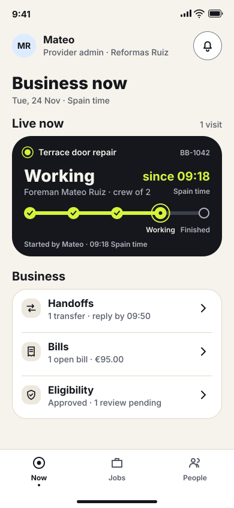
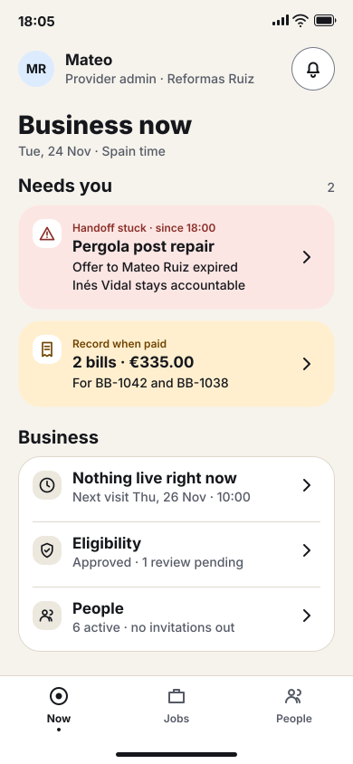
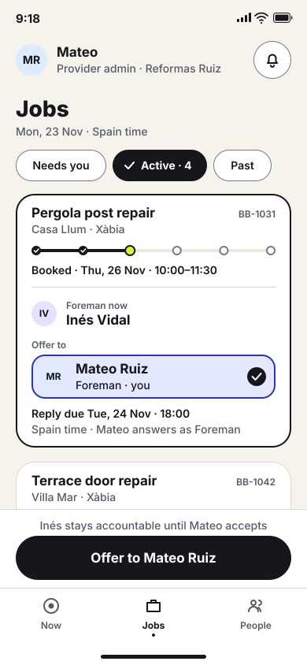
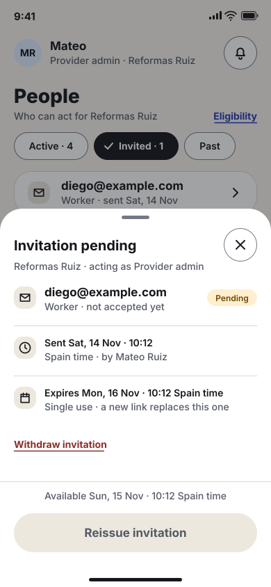
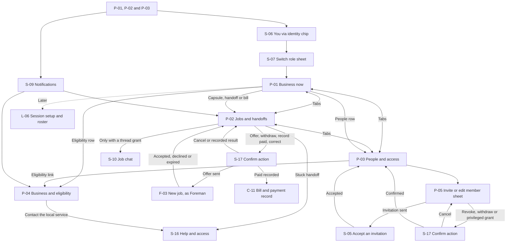

# Provider admin P-01–P-05: the business behind the live visit

These five screens are the Provider admin role for one business. They answer three questions: who is accountable for each job, who may act for the business, and which bills the business has received payment for. They follow the [concept](../../foundation/concept-and-principles.md), [information architecture](../../foundation/information-architecture.md), [roles](../../foundation/personas-and-roles.md), [core flows](../../foundation/core-flows.md), [design system](../../system/design-system.md) and [wireframe conventions](../../system/wireframe-conventions.md). The authority, freshness and privacy rules of the [reference specs](../../../design/screens/shared/P-01_P-05-specs.md) are kept; this file restates what each screen needs and what Beacon changes.

The viewer is Mateo Ruiz, who is both Provider admin and Foreman at **Reformas Ruiz**. The second foreman, Inés Vidal, and the jobs BB-1031, BB-1038 and BB-1045 are shared with the [foreman screens](../foreman/F-01_F-09-specs.md). The artboards are separate snapshots of the [story](../inventory.md#story-and-clock):

| Snapshot (Spain time) | Shows on |
| --- | --- |
| Sat, 14 Nov and Sun, 15 Nov | P-05: Mateo invites Diego Torres, as accepted in S-05 |
| Mon, 23 Nov · 09:18 | P-02: Mateo is about to offer BB-1031 from Inés Vidal to himself as foreman; the offer goes out at 09:20 with a reply due Tue, 24 Nov at 18:00 |
| Tue, 24 Nov · 09:41 | P-01, P-03 and P-04, right after the role switch in S-07; BB-1042 is at Working |
| Tue, 24 Nov · 18:05, alternative branch | P-01 action needed and P-02 handoff stuck: the offer expired unanswered |
| Tue, 24 Nov · 16:20 and Tue, 1 Dec, later outcomes | P-03 revoked and P-04 expiring |
| Wed, 25 Nov · 09:05 | P-02 paid recorded, the last event of the story |

## Rules used on every screen

- **Admin is not Foreman.** The Provider admin context moves ownership, manages access and records payment. It never accepts a job, assigns crew, confirms cover or joins a job chat. Mateo switches to Foreman in S-07 for those.
- **One next step.** P-02, P-03 and P-04 have one primary action in the dock. P-01 only routes, so it has no dock. A tab root's dock sits above the tab bar.
- **Lime means live.** Only the live capsule on P-01 and the current bead of a job line are lime. Handoffs, bills, invitations and eligibility are records, so their actions are ink buttons.
- **Who and when.** Every offer, expiry, revocation and payment record names the person and the Spain time. A deadline is an absolute time, never only a countdown.
- **Online for consequences.** Offering a job, recording a payment, inviting, editing and revoking need a server result and are confirmed in S-17. Nothing here is queued offline. Cached screens are read-only and say "Last confirmed" with the time.
- **Minimum data.** The admin sees stage, accountable foreman, bill totals and eligibility status with dates. No documents, no dropout reasons, no crew-only chat, no customer access notes.
- **Languages.** The UI ships in English and European Portuguese. Names, emails and job references are shown as entered.

## P-01 Business now

**Purpose and routes.** Show the business at a glance: what is live, which handoffs and bills are open, and whether the business and crew may work. It is the Now tab and the landing screen after choosing Provider admin in S-07. The capsule and each card or row open P-02 with that job selected, P-04 or P-03. The identity chip opens S-06 and the bell opens S-09. Nothing on this screen changes a record.

**Layout and data.** Identity chip ("Mateo · Provider admin · Reformas Ruiz") and bell, then the title and the date in site time. **Live now** holds one live capsule at card size per live visit: job, reference, stage ("Working"), "since 09:18", the accountable foreman with the crew size, the day line and its provenance. The admin sees the stage and the foreman, not each worker's state. **Business** is one card with three rows: Handoffs ("1 offer out · reply by 18:00"), Bills ("1 to record as paid · €95.00") and Eligibility ("Approved · 1 review pending"). Counts cover only records this admin may see.

**Interactions and states.** *Active* is the primary artboard: one capsule, three quiet rows. Tapping the capsule opens P-02 with BB-1042 selected; the admin has no job control. *Action needed* replaces the top of the page with a **Needs you** list, most urgent first: a stuck handoff on `critical-soft` ("Handoff stuck · since 18:00", the job, who the offer went to and who stays accountable), then bills to record on `attention-soft` with the count and total. Each action needed card is one target and names the record it opens. With nothing live the capsule is not drawn; a row says "Nothing live right now" and gives the next visit. Items the admin cannot act on, such as a review the local service has not finished, stay in the Business rows. *Onboarding:* "Business review pending" with a link to P-04. *Cached:* an offline banner with the last confirmed time; the capsule goes quiet and reads "Last confirmed 09:36". A section that fails to load says so with Retry and never shows a zero.

**Platform, accessibility and RTL.** Reading order: identity chip, bell, title, capsule as one sentence ("Terrace door repair, working since 09:18 Spain time, foreman Mateo Ruiz, step 4 of 5"), then each card with its label, title and consequence. Status is always text plus a glyph; the red and amber cards also say "Handoff stuck" and "Record when paid". At large text the rows grow and the trailing chevron drops below the text. Android system Back leaves the app from this root. In RTL the chip, cards and chevrons mirror and the day line runs right to left; BB-1042, times and euro amounts keep their own order.

## P-02 Jobs and handoffs

**Purpose and routes.** List every job of the business with its stage and accountable foreman, offer or move a job to a named foreman, and record that a bill was paid. It is the Jobs tab; P-01 and S-09 open it with a job selected. The dock action opens S-17, which names the business, the acting role, the job, the person and the effect. The offered foreman answers in F-03 after switching role; this screen never accepts for them. **Get help from the local service** opens S-16. A job conversation opens in S-10 only when the admin holds a grant for that thread.

**Layout and data.** Identity chip, title "Jobs", the date in site time, then three segments: **Needs you**, **Active** and **Past**, with counts. Each booking card shows the title, reference, place, a mini journey line (Requested, Quoted, Booked, Visit, Signed off, Paid), the stage as text and the foreman's avatar. One card is selected: it has a 2-unit ink border, opens in place and sets the **handoff dock** above the tab bar. For a handoff the open card shows **Foreman now** (Inés Vidal), **Offer to** with the eligible foremen as single-choice rows (Mateo Ruiz, "Foreman · you", selected on `brand-soft`), and the reply deadline in site time. The dock's context line states the consequence ("Inés stays accountable until Mateo accepts") and the one button names the person: **Offer to Mateo Ruiz**. Quotes, crew, chat and customer contact details are not shown here.

**Interactions and states.** Tapping a card selects it and closes the previous one; the dock follows the selection. Only people with an active Foreman grant in this business are listed; a blocked candidate shows the reason. *Unassigned:* the card reads "No foreman yet" where the foreman would be, and the dock says **Offer to …** once a person is chosen. *Offered:* "Offered to Mateo Ruiz · reply due Tue, 24 Nov · 18:00 Spain time" with an offer clock in its long form (hours, then minutes); the dock holds a quiet **Withdraw offer**. *Accepted:* the new foreman's name and time replace the offer. *Handoff stuck:* the offer expired or was declined and nobody else can take it. The job moves to Needs you, a `critical-soft` block says "Handoff stuck", who the offer went to and when it expired, and the card states who is still accountable. For a first intake that line is "No foreman owns this job". The dock offers **Offer again to Mateo Ruiz**; the help link stays outside the dock. A stuck handoff never changes the customer's booking by itself. *Bill to record:* a signed-off job with a bill sent has the dock action **Record €240.00 as paid**, with the context line "Record only money Reformas Ruiz has received". *Paid recorded:* after S-17 the card shows a `success-soft` block with the amount, "Recorded by you, Mateo Ruiz" and the time; the journey line is complete; the customer's C-11 shows the same record. The dock disappears because nothing is left to do, and **Correct this record** adds a correction stamp through S-17 without editing the first one. Foremen see the bill but cannot record it. All actions are online and single-flight; an unknown result is reconciled before retry. Cached lists are read-only.

**Platform, accessibility and RTL.** Segments are a native selectable group and announce their count. A card reads as one sentence: "Pergola post repair, BB-1031, Casa Llum, booked, visit Thursday 26 November 10:00 to 11:30 Spain time, step 3 of 6, selected". The candidate rows are radio buttons. Focus returns to the dock button when S-17 is cancelled and to the card's outcome block when it succeeds. At large text the stage, the deadline and the foreman each take their own line and the dock grows. In RTL the cards, avatars and chevrons mirror and the journey line runs right to left; references, times and amounts keep their order.

## P-03 People and access

**Purpose and routes.** See who can act for the business, in which role, and who has been invited or removed. It is the People tab. A member row opens P-05 to view or edit that membership; **Invite a person** opens P-05 as a blank invitation; **Eligibility** opens P-04. A revocation is confirmed in S-17 from P-05 and returns here.

**Layout and data.** Identity chip, title "People", the line "Who can act for Reformas Ruiz" with the Eligibility link, then three segments: **Active**, **Invited** and **Past**, with counts. Active is one card of rows: avatar, name, roles in this business, and a **You** badge on the viewer's own row. Mateo's two roles are two grants on one account. A role is membership only: it is neither eligibility nor an assignment, so Pau Soler reads "Worker · review pending" and stays unassignable until P-04 says otherwise. The dock holds **Invite a person** with the context line "Access starts only when they accept".

**Interactions and states.** *Active:* six rows; the viewer's own admin grant opens read-only. *Pending:* the Invited segment lists each invitation with the email, the invited role, when it was sent and when the link stops working; tapping one opens P-05 in its pending mode. An accepted invitation moves to Active once and leaves Invited. *Revoked:* after S-17 confirms, the screen shows the Past segment with a notice ("Access revoked. Pau Soler no longer has Worker access at Reformas Ruiz.") and the record: former role, a **Revoked** badge, the Spain time and who did it. The revoked row has no control and no restore; the note says a new invitation is needed. If the person held other roles, only the revoked one moves to Past. A revoked member loses the business's screens at once and sees S-16. Declined, expired and withdrawn invitations are separate records in Past. The list never reveals whether a person belongs to another business. Cached rows are read-only and marked with the last confirmed time; names are not shown from cache after the admin's own scope is lost.

**Platform, accessibility and RTL.** A row reads "Mateo Ruiz, you, Provider admin and Foreman". "Revoked" and "You" are status text, not buttons. After a revocation focus moves to the notice, which is announced once. At large text roles wrap under the name and the chevron drops below. In RTL rows, avatars and chevrons mirror; names and email addresses are shown as entered and are not reversed.

## P-04 Business and eligibility

**Purpose and routes.** Show what the business is approved for and which crew members may be assigned, with dates, so the admin can follow up in time. Pushed from P-01, from the Eligibility link on P-03 and from an eligibility notice in S-09. Back returns to the caller, or to P-01 on a cold link. The one action, **Contact the local service**, opens S-16 with a reviewed reference. Evidence travels only through that route; the app has no upload form and no review queue.

**Layout and data.** Pushed header with the business and role. The **Business** card gives the name, an **Approved** badge, the approved scope ("Repairs and small renovations"), the region and the launch rule "cover from own crew", and says that other categories are not approved. **Crew eligibility** is one card of rows: avatar, name, a status badge and the date the check is valid until. The dates match F-07 and F-09. Only status and dates appear: no document names, numbers, images or reasons. A note says documents are handled by the local service. The dock's context line gives the time the status was last confirmed.

**Interactions and states.** The page is read-only; pull to refresh asks for current records and does not start a review. *Approved:* every row carries a text status. "Review pending" means the person cannot be assigned yet, whatever their membership says on P-03. *Expiring:* an `attention-soft` notice leads the page with the lead time, the person and the absolute date ("Check ends in 30 days. Diego Torres · Thu, 31 Dec 2026. After that he can't be assigned."). The expiring row moves to the top with an **Expiring** badge, and a note says he can still take shifts that end before the date and that F-07 and F-12 recheck each assignment. *Expired:* the badge reads "Expired" and assignment is blocked from the cutoff. *Suspended:* the Business badge reads "Suspended", the notice is `critical-soft` and names the scope on hold; new jobs and offers are blocked while confirmed visits stay visible, and the only action remains the local service. Business and worker status are independent and are never merged into one badge. A record the admin may not see is omitted without a trace. Offline shows the last confirmed time and disables nothing, because the page has no mutation.

**Platform, accessibility and RTL.** Focus order: Back, title, notice when present, business card, each crew row as "Diego Torres, expiring, valid until Thursday 31 December 2026", note, dock. Badges are text with a tint, never colour alone. Dates use the UI locale's long form and Spain time; a date-only limit ends at the end of that day in Spain. At large text the badge moves under the name. In RTL rows and badges mirror; dates and names keep their order.

## P-05 Invite or edit member

**Purpose and routes.** Manage one membership in the active business: send an invitation, look after a pending one, or edit or revoke a member's role. It is a sheet over P-03, opened by **Invite a person**, an invitation row or a member row. The recipient accepts in S-05 with the invited email address; the admin cannot accept for them. Revoking, withdrawing and granting a privileged role are confirmed in S-17. Close returns to P-03.

**Layout and data.** Dimmed People screen, sheet with handle, title, Close and the line "Reformas Ruiz · acting as Provider admin". *New:* an **Email** field with the helper "They must sign in with this exact address", then **Role in Reformas Ruiz** as three single-choice rows, each with its effect: Worker ("Answers offers and runs own shifts"), Foreman ("Owns jobs, quotes and assigns crew") and Provider admin ("Manages people, handoffs and bills"). A line gives the link's life ("Link valid 7 days · until Sat, 21 Nov") and says that joining is not a shift or eligibility. The dock reads "They get no access until they accept" above **Send invitation**. The fixture is the invitation Diego Torres accepts in S-05.

**Interactions and states.** Send is enabled with a well-formed address and one role. The address is trimmed and never rewritten. On send the button keeps its label while processing, the sheet closes on a server result and P-03 shows the invitation under Invited. *Invite pending:* the sheet shows the address, the invited role with a **Pending** badge, when and by whom it was sent, and the absolute time the link stops working, all in Spain time. The dock offers **Resend invitation**; **Withdraw invitation** is a separate `critical-ink` link, at least 16 units from the dock, and opens S-17. Resending does not extend the end date. An invite pending sheet never shows an active role. *Edit member:* the same sheet lists the member's roles; the dock is **Save changes**, disabled with "Change a role to save" until something differs, and **Revoke access** is the separate destructive link. *Cannot grant:* a role the admin may not give is shown unselectable with the reason beneath it ("Only the local service can add a Provider admin"), and the viewer's own admin role cannot be removed. *Duplicate:* "Already invited" or "Already a member" with a link to that row, only when the admin can see it. No lookup reveals accounts or memberships elsewhere. A draft with changes asks "Keep editing" or "Discard" before closing. Offline, the fields stay and the button is disabled with "Connect to send".

**Platform, accessibility and RTL.** iOS uses a sheet detent that grows with the keyboard; Android a modal sheet where Back closes the keyboard first, then the sheet. Neither needs a swipe. Focus enters at the title, then Close, the field, the role group as radio buttons, the validity line and the dock; it is trapped in the sheet and returns to the opener. Errors are announced and focus moves to the first invalid field. At large text the sheet scrolls and the dock stays above the keyboard. In RTL the layout mirrors; the email address stays left to right as one isolated value.

## Navigation

## Open design questions

- **Routing a new request.** In the story BB-1042 reaches Mateo's F-03 without an admin step. This design assumes a business may name a default foreman for new requests, and that P-02 is used for jobs without one and for moves between foremen. Confirm the default and who may change it.
- **An owner who is admin and foreman.** Mateo offers BB-1031 to himself and must switch to Foreman to accept it. The design keeps the two acts separate so that accountability always has an explicit acceptance. Decide whether a sole owner may accept in one confirmed step.
- **Handoff deadlines and escalation.** The reply deadline (Tue, 24 Nov · 18:00) is a fixture. Decide who sets it, how often an offer may be repeated, and when a stuck handoff reaches the local service without the admin asking.
- **Recording payment.** Only the Provider admin records "paid", confirmed in S-17, and a mistake is fixed by a correction stamp, not an edit. Decide whether partial payments and a payment date different from the record time are needed before a payment provider is integrated.
- **Bills in Needs you.** A sent bill is listed under Needs you at once. Decide whether it should appear only after an agreed number of days.
- **Admin view of live work.** P-01 shows the stage and the accountable foreman of a live visit, not each worker's state. Confirm that this is the minimum the admin needs.
- **Eligibility lead time and visibility.** "Expiring" at 30 days is a fixture. Decide the lead time, which statuses and dates an admin may see, and who reviews a confirmed shift that crosses an expiry.
- **Grants and the last admin.** The design assumes an admin cannot give themselves a role, cannot add another Provider admin without the local service, and cannot remove the last admin or a foreman who still owns jobs. Confirm these rules.
- **Invitation life.** Seven days matches S-05, and the design assumes a resend keeps the original end date. Confirm both, and say how many resends are allowed.
- **Page title.** P-01 is titled "Business now" while the tab says "Now", so that a person with two roles can tell the two Now screens apart. Confirm, or use "Now" everywhere.
