# Shared screens S-01–S-09: getting in, You and the two inboxes

This slice takes a person from first launch to the right role, shows who they are acting as, and leads from a conversation or an alert to the record behind it. It follows the [concept](../../foundation/concept-and-principles.md), [information architecture](../../foundation/information-architecture.md), [roles](../../foundation/personas-and-roles.md), [core flows](../../foundation/core-flows.md), [design system](../../system/design-system.md) and [wireframe conventions](../../system/wireframe-conventions.md). The access, link and privacy rules of the [reference specs](../../../design/screens/shared/S-01_S-09-specs.md) are kept; this file restates only what a designer or developer needs per screen and what Beacon changes.

The artboards are separate scenarios from the [story](../inventory.md#story-and-clock), not consecutive screenshots. S-01 to S-04 show Claire Martin signing in for the first time. S-05 shows Diego Torres joining the crew on Mon, 16 Nov, before the story starts. S-07 and S-08 show Mateo Ruiz on Tue, 24 Nov. S-09 shows Claire at 07:58 UK time and Diego at 08:36 Spain time.

## Rules used on every screen

- **One next step.** A pushed screen has one primary action in the dock. When the action is unavailable the button is disabled and the dock's context line gives the reason. S-06, and S-09 when nothing needs the viewer, have no primary action and therefore no dock.
- **Lime means live.** None of these screens lights anything unless a visit, shift or offer is live for the viewer. The two exceptions are on S-01 and are listed under Open design questions.
- **Who and when.** Codes, invitations and alerts name their sender and time. Site events use Spain time and say so once per list; a sign-in pause uses the viewer's own time.
- **Languages.** The UI ships in English and European Portuguese. The reading language for translated messages is a separate choice with its own list. Changing either never rewrites a message, a quote, an instruction or a booked time.
- **Access.** Account, role, business and the record's grant are checked before any detail is shown. Offline, cached content is read-only and labelled with its last confirmed time; no invitation, switch or offer response is sent offline.

## S-01 Welcome and app language

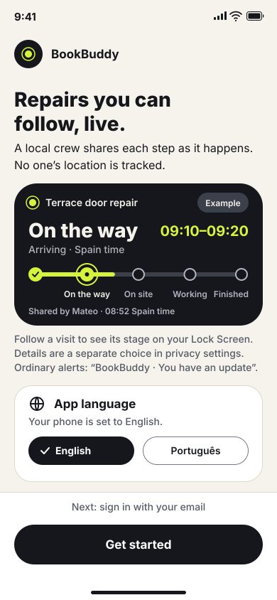

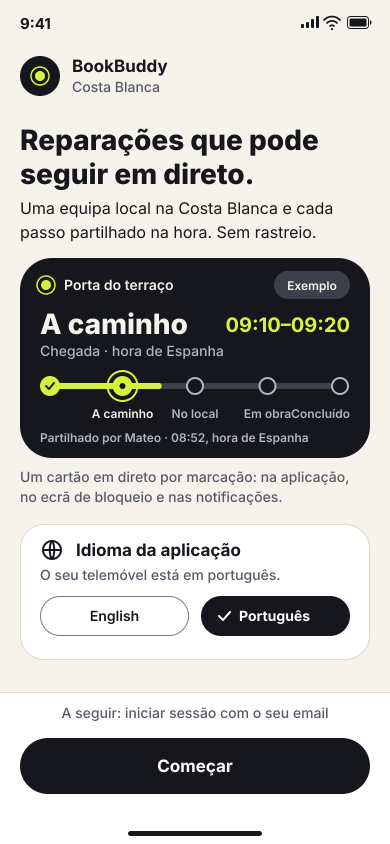

**Purpose and routes.** Explain the app in one glance before sign-in and let the person choose the app language. First launch and signed-out re-entry land here. **Get started** opens S-02. There are no tabs, no Back and no implied role.

**Layout and data.** Brand row, a two-line promise, then one example live capsule at card size: the terrace door repair, "On the way", arriving 09:10–09:20 Spain time, the day line and its provenance. The capsule carries an **Example** badge and does not pulse. A caption says the same card appears in the app, on the Lock Screen and in notifications. The **App language** card holds two chips, English and Português, each written in its own language, with a line naming the phone's language. The dock has the context line "Next: sign in with your email".

**Interactions and states.** The app starts in the device language if it is English or Portuguese (`en-*` resolves to English, any Portuguese variant to `pt-PT`). Tapping a chip switches the whole screen at once, saves the choice on the device and sends nothing. *Other device language:* English is selected and the line reads "Your phone's language isn't available yet. Choose English or Português." *Invite detected:* an `info-soft` strip above the dock reads "Sign in to open your invitation" (or "your update"); only the opaque link is kept and no sender, business or job is previewed. The screen works offline; S-02 explains why a code cannot be requested.

**Platform, accessibility and RTL.** Android system Back leaves the app at this root. Reading order: brand, promise, example (announced once as "Example: crew on the way, arriving 09:10 to 09:20 Spain time"), language chips with selected state, context line, Get started. No flags. The Portuguese artboard proves expansion: the heading wraps to two full lines, the zone label takes its own line under the state, and nothing shrinks. In a future RTL language the day line runs right to left and times stay in their own order.

## S-02 Sign in or create account

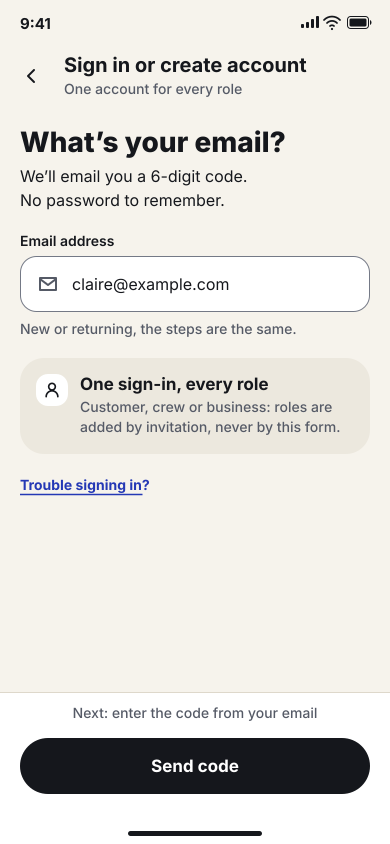

**Purpose and routes.** Verify one email for new and returning people; one identity serves every role. Entered from S-01, an expired session or a link opened while signed out. **Send code** opens S-03 for the submitted address. **Trouble signing in?** opens S-16 and returns with the email intact.

**Layout and data.** Pushed header, the question "What's your email?", one labelled email field, a helper line, and a neutral card: "One sign-in, every role. Customer, crew or business: roles are added by invitation, never by this form." The fixture address is fictional. An address is never prefilled from an invitation link.

**Interactions and states.** *New:* as drawn; the app moves on only when the server accepts the request, and it answers the same way whether or not the account exists. *Invalid:* the field gets a `critical-ink` border and "Enter a full email address" beneath it; the typed text stays. *Rate-limited:* the button is disabled and the context line reads "You can ask again at 09:46 your time". *Offline:* the button is disabled with "You're offline. A code can't be sent yet."; the address stays. A failed request is reported as uncertain and rechecked before another is allowed.

**Platform, accessibility and RTL.** Email keyboard, no autocapitalisation or autocorrect; the keyboard's Go key runs the same validation as Send code. The field and its error stay above the keyboard, and the dock rides on top of it. The address always reads left to right.

## S-03 Verify code

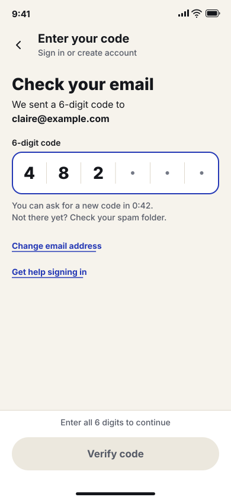

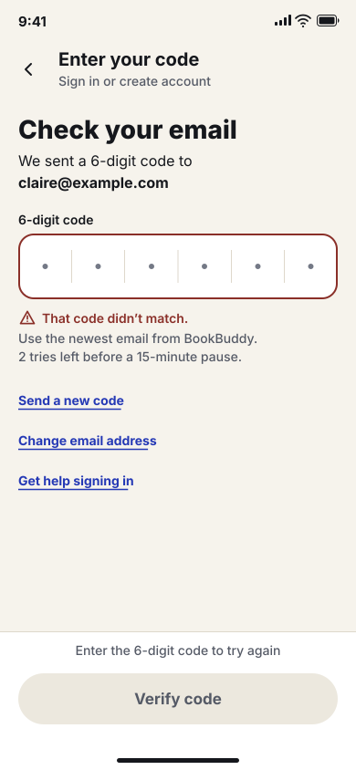

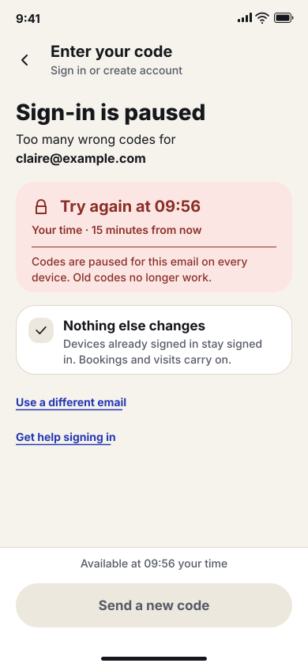

**Purpose and routes.** Finish verification or recover. Entered from S-02. A new account goes to S-04. A returning account runs the destination check once: a kept invitation opens S-05, a kept record opens under its parent, a record in another granted role opens S-07, an inaccessible one opens S-16, and with nothing kept the role's Now opens. **Change email address** and Back return to S-02 with the kept link.

**Layout and data.** Heading, the address the code went to, and one code field drawn with six positions. It is a single input. Below it: when a new code can be requested, a spam hint, and two links. The dock holds **Verify code**.

**Interactions and states.** *Waiting:* the button is disabled until six digits are present ("Enter all 6 digits to continue"); paste and the system's code suggestion fill the field but never submit it. *Wrong code:* the field is cleared and outlined in `critical-ink`, with "That code didn't match", the number of tries left, and **Send a new code** as the first link. An expired code says so instead. *Locked out:* the field is removed. A `critical-soft` card gives the time sign-in resumes in the viewer's own time ("Try again at 09:56 · 15 minutes from now") and says old codes no longer work. A second card says what does not change: devices already signed in stay signed in, and bookings and visits carry on. The dock button **Send a new code** is disabled until that time. Help opens S-16.

**Platform, accessibility and RTL.** Numeric keyboard and the system one-time-code suggestion; the clipboard is never read unprompted. The six positions are one accessible field labelled "6-digit code". Errors are announced once and focus returns to the field. The resend countdown is announced when it ends, not on every tick. Digits keep their order in RTL.

## S-04 First setup

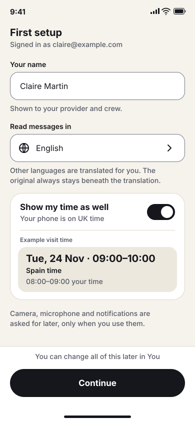

**Purpose and routes.** Three choices for a new account: name, reading language and time display. Entered from S-03, or from S-05 when setup is incomplete. **Continue** saves and runs the same destination check as S-03.

**Layout and data.** Name field ("Shown to your provider and crew"). A **Read messages in** row opening the reading-language list of S-12; the note says the original always stays beneath the translation. A card with the **Show my time as well** switch and a two-clock preview: "Tue, 24 Nov · 09:00–10:00, Spain time" with "08:00–09:00 your time" beneath, labelled as an example. A last line says camera, microphone and notifications are asked for later.

**Interactions and states.** *Defaults:* the name is empty until typed (Claire's is shown filled); the reading language starts from the device language if it is an enabled reading language; the switch is on when the phone's zone differs from Spain time, and the preview updates as it is toggled. The reading language list is not limited to the two UI languages and includes **Original only**. *Saved:* the button keeps its label while saving, then the app moves on; a failed or offline save keeps the draft and says it is not saved. A single name is accepted. No permission is requested here.

**Platform, accessibility and RTL.** No Back chevron: the account is already verified, and leaving it is an explicit choice in S-06. The switch and its label are one accessible element with its value. At the largest text sizes the switch moves below its label and the page scrolls under the dock.

## S-05 Accept an invitation

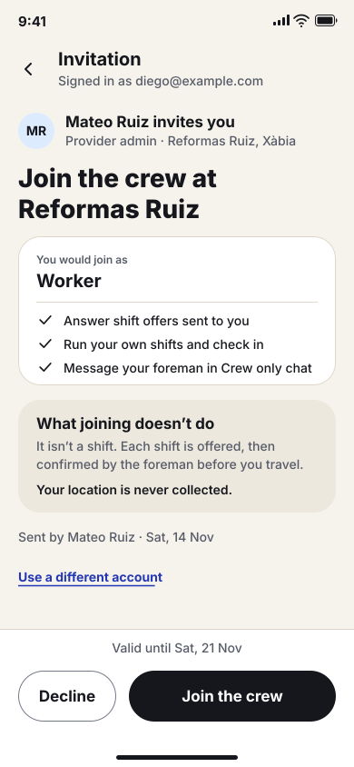

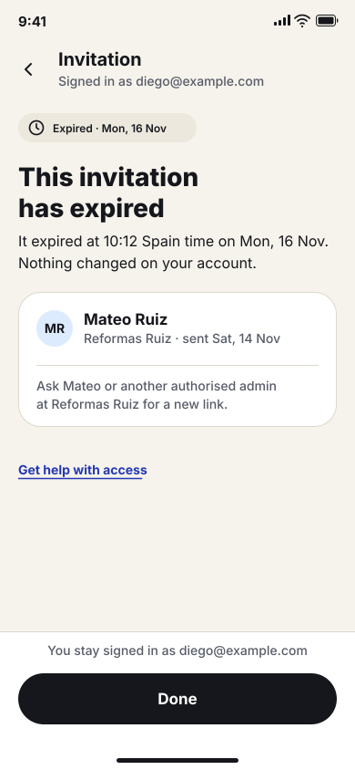

**Purpose and routes.** Confirm a crew, business or place grant sent from P-05 or C-14. Opened from a link after sign-in. **Join the crew** opens the granted role's Now, or S-16 in pending-eligibility mode if work is still blocked. **Decline** confirms through S-17 and returns to the previous root.

**Layout and data.** The inviter as a crew dot with name, role and business; the heading "Join the crew at Reformas Ruiz"; a role card ("You would join as Worker") with three things the role can do; and a `subtle` card, **What joining doesn't do**: it is not a shift, each shift is offered and then confirmed by the foreman before travel, and location is never collected. Then who sent it and when. The dock shows the expiry date, a quiet Decline and the primary action. A place invitation names the place and the exact permissions instead.

**Interactions and states.** *Valid:* both actions need a connection; the server rechecks the account, the invitation and the inviter's authority, and the app moves on only after it confirms. *Wrong account:* "This invitation isn't for this account", the viewer's own email, **Use a different account** and help; the intended recipient is never shown. *Expired:* a neutral badge with the date, "Nothing changed on your account", the sender, and the fact that only the sender can issue a new one. The dock offers **Done** only. An invitation already accepted opens the role, never a second confirmation.

**Platform, accessibility and RTL.** Signed-out visitors see none of this; they pass through S-01 to S-03 first. Role names and permissions are localised; people and business names are not. Join is an ink button: it changes access, not anything others see live.

## S-06 You

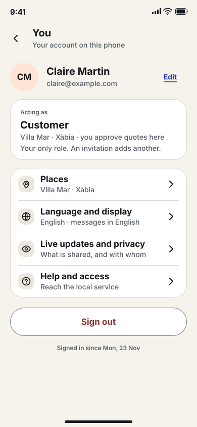

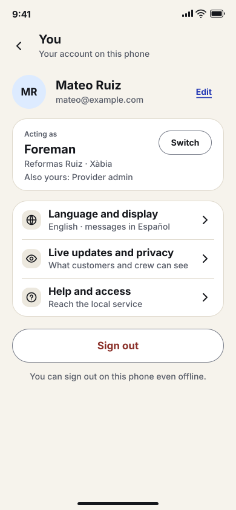

**Purpose and routes.** Identity, the active role, places and settings in one place. Opened from the identity chip on every tab root; Back returns to that root. Rows open C-13 (customers), S-12, S-18 and S-16. **Switch** opens S-07. **Sign out** confirms through S-17.

**Layout and data.** Avatar, name, verified email and an Edit link. The **role card** says what the person is acting as, where, and what that means here ("Customer · Villa Mar · Xàbia · you approve quotes here"). The settings card has one row per destination with its current value. Sign out is a quiet outlined button with a `critical-ink` label, well apart from the rows. The screen has no dock.

**Interactions and states.** *Single role:* the card says "Your only role. An invitation adds another." and has no Switch. *Multi-role:* the card names the other roles ("Also yours: Provider admin") and shows Switch. *Pending work:* an `attention-soft` banner above the settings reads "2 items saved on this device · pending sync", and Sign out first asks whether to stay and send them. Places appears only for customers. Edit changes the display name; the email changes only through support (S-16).

**Platform, accessibility and RTL.** The identity chip is announced as "You, Claire Martin, Customer". Row labels and values stack at large text. The role and place names are isolated in RTL and chevrons mirror.

## S-07 Switch role [Sheet]

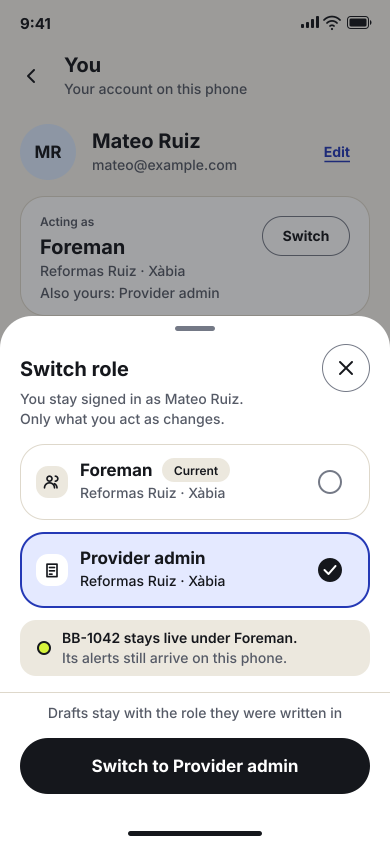

**Purpose and routes.** Move to another granted role or business without signing out. Opened from S-06, or when a link needs a role other than the active one. **Switch to Provider admin** opens that role's Now, or the linked record under its parent. Close leaves everything as it is.

**Layout and data.** A sheet over the dimmed S-06: handle, title and Close, "You stay signed in as Mateo Ruiz. Only what you act as changes.", then one row per role and business. **Current** is a badge on the active row; the radio marks the role about to be chosen. If something is live in the current role, a note with the live bead says so: "BB-1042 stays live under Foreman. Its alerts still arrive on this phone." The dock names the target role.

**Interactions and states.** *Multiple:* tapping a row selects it; nothing switches until the dock button is pressed and the server confirms the grant. The button is disabled while the current role is the selection. *Pending draft:* the context line becomes "1 draft stays under Foreman. It is not sent." A draft that cannot be kept blocks the switch and says why. A link-driven sheet lists only the roles that can open the link and describes it safely ("Open a shift offer"). Switching needs a connection. A live visit, shift or cover search is never ended by a switch.

**Platform, accessibility and RTL.** Native sheet with Close always visible; Android Back closes it. Rows are radio buttons announced with "current" and "selected". Focus returns to Switch on S-06 after closing and moves to the new root's title after a switch.

## S-08 Messages

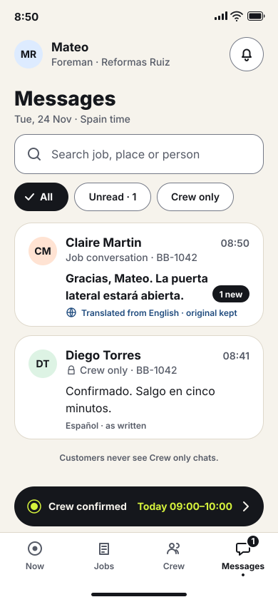

**Purpose and routes.** Find a conversation. It is the Messages tab for customers, foremen and workers. A thread row opens S-10 in that audience. The bell opens S-09, the identity chip S-06, the live pill the live record.

**Layout and data.** Root header, title with date and zone, search, filter chips, then one card per conversation: the other party as a crew dot, the audience and job ("Job conversation · BB-1042", "Crew only · BB-1042" with a lock), a two-line preview, the time, and a **language line**. The fixture is Mateo at 08:50: Claire's message appears in Español, his reading language, with "Translated from English · original kept"; Diego's appears once with "Español · as written". A note under the list says customers never see Crew only chats. The live pill reads "Crew confirmed · Today 09:00–10:00".

**Interactions and states.** *Unread:* bold preview, a "1 new" badge on the row and a count on the tab; the count clears when the thread is shown, not when the list loads. *Empty:* "No conversations yet. Each job opens one with your foreman." with the role's route to work (the ask bar for a customer). *Cached:* an offline banner with "Last confirmed 08:50" and the pending count; rows open their cached thread read-only. A pending or unavailable translation shows the original with that status in the language line. Customers have one Job conversation per booking and never see a Crew only row.

**Platform, accessibility and RTL.** A row is one target: "Claire Martin, Job conversation, BB-1042, 1 new, 08:50, translated from English". Previews keep the direction of their language. The pill sits above the tab bar and is not repeated on Now.

## S-09 Notifications

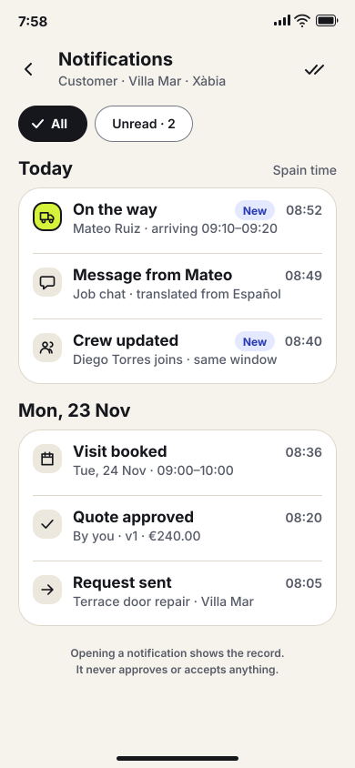

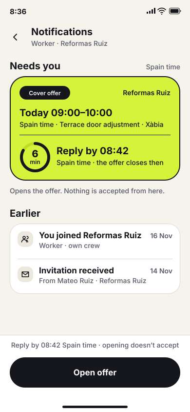

**Purpose and routes.** Resume from an event. Opened from the bell, scoped to the active role and business. A row opens its record: C-09, S-10, C-08, C-06 and C-05 for the customer rows drawn; W-03 for the offer. Opening never approves, accepts, checks in or acknowledges.

**Layout and data.** The inbox uses **stamps** grouped by day, with the zone named once ("Spain time"). Each stamp has a glyph tile, what happened, who did it and the time; unread stamps carry a **New** badge. The stamp for the live stage wears the lime tile, so the list shows at once what is happening now. Filter chips: All and Unread. A closing line says that opening a notification shows the record and changes nothing. The header's one action marks all as read.

**Interactions and states.** *Unread:* as drawn for Claire at 07:58 her time; a stamp is marked read when its record is shown. *Cover offer:* under **Needs you** the offer appears as the offer capsule at card size with the offer clock and "Reply by 08:42 Spain time", and the dock becomes **Open offer**, an ink button because it only opens W-03. The line beneath says nothing is accepted from here. *Expired:* the capsule is replaced by a plain stamp, "Offer closed · 08:42" or "Filled by someone else", with a static glyph and no lime; it opens W-03 read-only and the dock disappears. A record the account can no longer open leads to S-16 without saying who holds it.

**Platform, accessibility and RTL.** Each row is one target with event, subject, time and unread state. The offer clock's ring is decorative; the deadline is read as text and not on every tick. The worker artboard is in Field mode, so the dock button is 62 high. Lock-screen pushes for the same events are S-19 and stay generic.

## Navigation

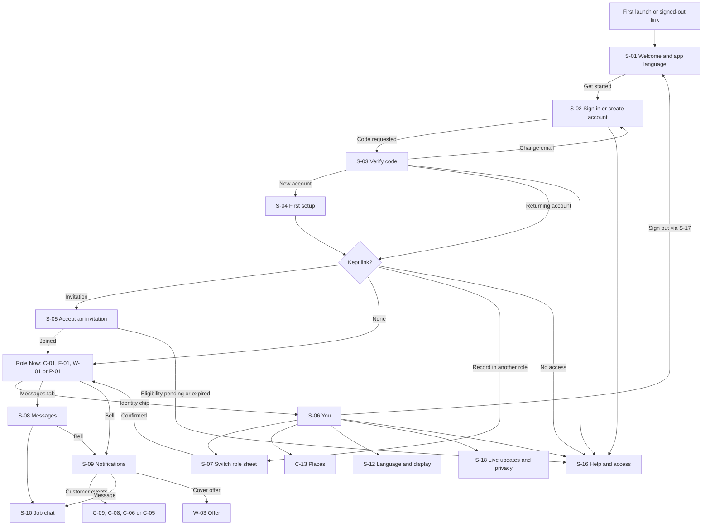

## Open design questions

- **Lime before sign-in.** S-01 uses lime in the brand glyph and in the example capsule although nothing is live. The capsule is labelled Example and does not pulse. The stricter alternative is to draw it in the quiet state. Confirm which reading of "lime means live" applies before sign-in.
- **Screens without a dock.** S-06, and S-09 when nothing needs the viewer, have no primary action, so they show no dock. S-09 gains one only for an item under Needs you. Confirm that "one next step" does not require an invented action on these screens.
- **Dock with a context line.** The conventions fix the dock at y=724 but give no geometry for the context line. This slice grows the dock upward to y=692 (686 in Field mode) and keeps the button at its usual position. Other slices should match or the lead should set the rule.
- **Sign-in policy fixtures.** Six digits, the 0:42 resend wait, "2 tries left" and the 15-minute pause are drawings, not backend commitments. Confirm the real values, and whether showing the number of tries left is acceptable.
- **Time and reading defaults in S-04.** The drawing turns "Show my time as well" on when the phone's zone differs from Spain time. Confirm the default, and which reading languages are enabled at launch beside English and Português.
- **Foreman and crew UI language.** S-08 shows Mateo with an English UI and Español as his reading language, so the chrome is English and the previews are Spanish. This follows the owner's decision that Spanish is not a launch UI language. Confirm that list previews show the translation and not the original.
- **Alerts across roles.** S-07 tells Mateo that BB-1042's alerts still arrive while he acts as Provider admin. That assumes pushes are sent for every granted role while the in-app bell stays scoped to the active one. Confirm, and decide whether the identity chip should show a mark for unread items in another role.
- **Offer capsule in the inbox.** S-09 draws the cover offer as a card-size capsule, the same object as on W-01. Confirm this does not break "one capsule per shift", or replace it with a stamp row.
- **Invitation fixture.** The story has no invitation event. S-05 uses Diego Torres, invited by Mateo on Sat, 14 Nov with seven days' validity. Align the recipient and the validity with P-05.
- **Short Portuguese stage labels.** The day line fits in `pt-PT` only with short labels ("A caminho", "No local", "Em obra", "Concluído"). Add a length note to the catalog context and have a native speaker review them.
