# Shared screens S-10–S-19: chat, safety, settings, confirmation and system pushes

This slice covers what people say to each other, what the app translated, and what a named person confirmed. It keeps those three things visibly apart. It follows the [concept](../../foundation/concept-and-principles.md), [information architecture](../../foundation/information-architecture.md), [roles](../../foundation/personas-and-roles.md), [core flows](../../foundation/core-flows.md), [design system](../../system/design-system.md) and [wireframe conventions](../../system/wireframe-conventions.md). The access, audience and safety rules of the [reference specs](../../../design/screens/shared/S-11_S-17-specs.md) are kept; this file restates what a designer or developer needs per screen and what Beacon changes.

The artboards are separate moments of the [story](../inventory.md#story-and-clock), not consecutive screenshots. Claire Martin's screens show UK time in the status bar and Spain time in the content. Diego Torres's screens are in Field mode. S-10 Job chat is the lead-drawn reference screen; its other states are drawn here to match it.

## Rules used on every screen

- **Three kinds of content.** A person's own words (the original), the app's translation, and stamps (what happened, written by the app in the UI language). A translation never replaces an original. A stamp is never a message and cannot be edited or answered.
- **One next step.** A pushed screen has one primary action in the dock. Surfaces that only inform or apply a setting at once (S-12, S-13, S-18 and a read-only S-15) have no primary action and no dock.
- **Lime means live.** In this slice lime appears only on the bead of a live stamp in S-10 and on the Lock Screen preview in S-18 while a visit is being followed. Push banners (S-19) are plain.
- **Languages.** The UI ships in English and European Portuguese. The reading language is a separate setting, and people write in any language. Language names are written in their own language and in full. A right-to-left original is right-aligned inside its strip whatever the UI direction.
- **Online for server decisions.** Verifying a teach-back, acknowledging an instruction and confirming a change to a shared record need the server and are never queued. Locking or signing out of this device works offline (S-17). Chat messages and media can wait on the device and are labelled "Saved on this device · pending sync" until the server accepts them.
- **Access.** The audience, role and record are checked again on entry, on return from the system and on refresh. When access has ended the content is cleared and S-16 opens without saying who holds the record.
- **Field mode.** Worker artboards use 62-unit controls and the dock grows to hold them. Nothing else changes.

## S-10 Job chat

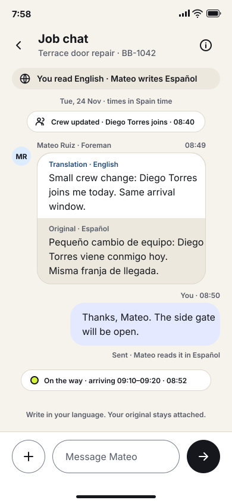

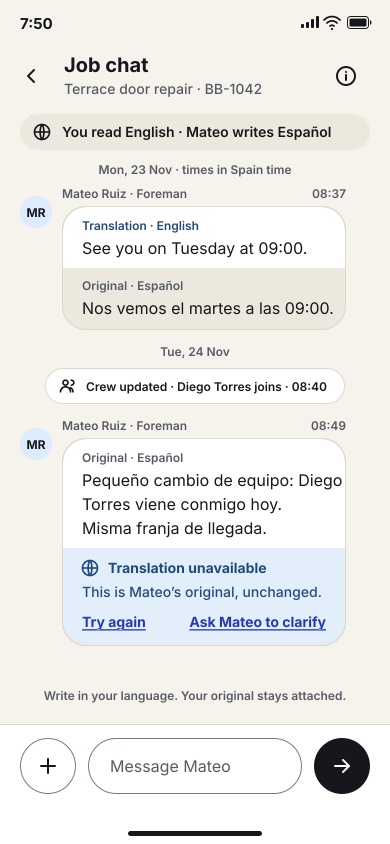

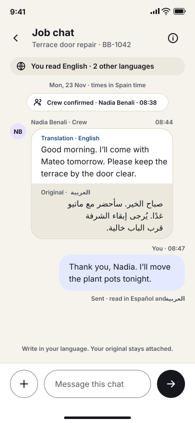

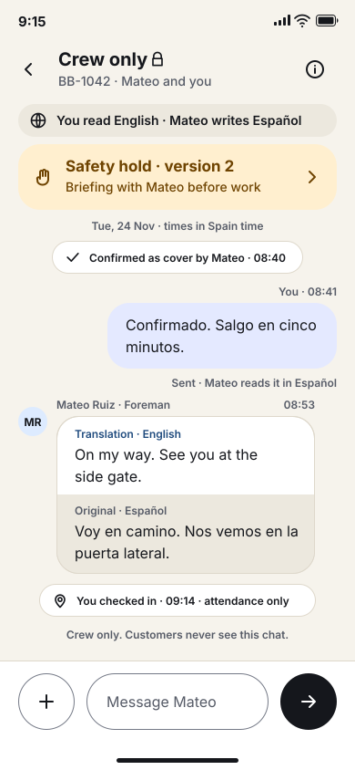

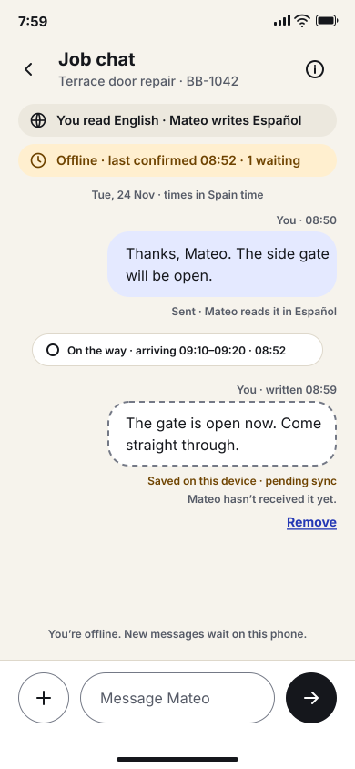

**Purpose and routes.** Let the people on a job talk across languages, with the foreman as the customer's named contact. Entered from C-05, the **Message Mateo** dock on C-09, F-05, W-04, a thread row on S-08, a message row on S-09 and a message push (S-19). The header's info button and the language line open S-13. Attach opens S-14. A photo or voice bubble opens S-15. The hold banner opens S-11. A stamp opens its record (C-09 for a customer, W-04 or F-05 inside the provider). Back returns to the origin; a cold link builds S-08 as the parent. Nothing in the thread approves, accepts or acknowledges anything.

**Layout and data.** Pushed header with the audience as title ("Job chat" or "Crew only" with a lock) and the job beneath. Under it the **language line**: "You read English · Mateo writes Español". The thread has a day separator that names the zone once, then three kinds of row:

- **Twin bubble** for a message in another language. The reader's language is on top with "Translation · English"; the exact original sits in the attached `subtle` strip with "Original · Español". Author, role and time are outside the bubble.
- **Single bubble** for a message in the reader's own language, and for the viewer's own messages on `brand-soft`. Under a sent message the receipt names the reader's language: "Sent · Mateo reads it in Español". It says "Sent" on server receipt and never "read".
- **Stamp pill** for an event: "Crew updated · Diego Torres joins · 08:40", and "On the way · arriving 09:10–09:20 · 08:52" with the lime bead because that stage is live. The Job conversation shows only customer-visible stamps. An "On the way" declared by the crew lead appears here as soon as it is recorded. If the foreman corrects or withdraws it, a new stamp says so ("Arrival updated · 09:20–09:30 · 09:05"); the earlier stamp stays and loses its bead.

A caption above the composer says "Write in your language. Your original stays attached." The composer keeps **Attach**, the field and **Send** as three separate controls. The placeholder names the audience: "Message Mateo", or "Message this chat" when crew have been added.

**Interactions and states.**

- *Translated* (primary, Claire at 07:58 her time): as described above.
- *Translation unavailable* (Claire at 07:50): the original moves to the top and the strip turns `info-soft` with "Translation unavailable · This is Mateo's original, unchanged", **Try again** and **Ask Mateo to clarify**. The status belongs to that message only; Monday's message above it is still translated. Stamps stay readable because the app writes them. Try again sends one request; there is no retry loop. Ask Mateo to clarify puts a reference to the message in the composer and sends nothing. *Pending* uses the same layout with "Translating…" and no links.
- *RTL original* (Claire, Monday thread): Nadia is assigned to this job and has a separate grant to its Job conversation. Her Arabic original is right-aligned beneath the English translation. She is writing to the group, not directly to Claire. The receipt lists the reading languages: "Sent · read in Español and العربية".
- *Crew only* (Diego at 09:15, Field mode): the title is "Crew only" with a lock and the context line names who is in it. The **hold banner** opens S-11. Stamps here are internal: "Confirmed as cover by Mateo · 08:40", "You checked in · 09:14 · attendance only". The caption above the composer reads "Crew only. Customers never see this chat." Diego has Crew only for this shift. Job conversation requires a separate grant for that thread.
- *Two audiences* (when granted both; not drawn): **Job conversation** and **Crew only** chips sit under the header. Each thread keeps its own scroll position, unread mark, draft and attachments. Send names the selected audience; neither chip opens a customer–worker direct message.
- *Queued* (Claire at 07:59, offline): an `attention-soft` line reads "Offline · last confirmed 08:52 · 1 waiting". The live stamp goes quiet: its bead becomes an unlit ring, because the status can no longer be confirmed as current. The waiting message has a dashed outline, "Saved on this device · pending sync", "Mateo hasn't received it yet." and **Remove**. It is sent once when the connection returns, after the audience is checked again. *Failed* keeps the text and offers Try again and Remove; an uncertain result is checked before a second attempt.
- *Read-only* (not drawn): a closed job or an open-only grant replaces the composer with one line that gives the reason, such as "This job is closed. You can still read the chat."
- *Same language*: one bubble and no strip. *Correction*: the author posts a new message linked to the original; the original is never rewritten. *Empty*: "No messages yet. Write to Mateo in your own language."
- Tapping a bubble opens its actions: Ask to clarify, Report this translation, Copy original. No action depends on a long press or a swipe.

**Platform, accessibility and RTL.** The composer rides above the keyboard and the safe area; Return adds a line and never sends. Reading order: Back, title and context, Chat details, language line, hold banner, then rows in time order, then the composer. A twin bubble is read as author, time, "translated from Español", the translation, then "original" and the original as a separate language span. A stamp is read as one sentence with its time and zone. New rows are announced politely without moving focus. In a right-to-left UI the bubbles swap sides and the directional icons mirror; times, job references and each message's own direction do not change.

## S-11 Safety instruction

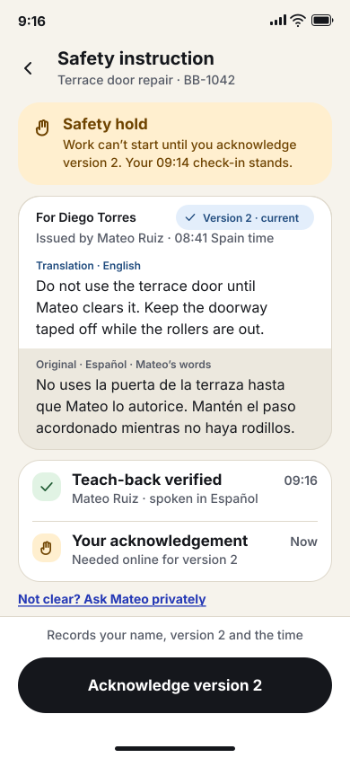

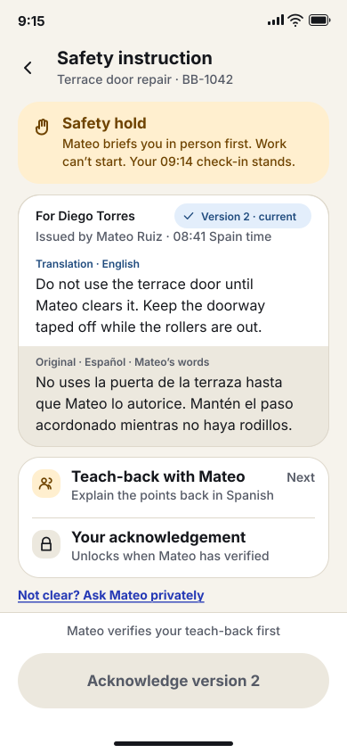

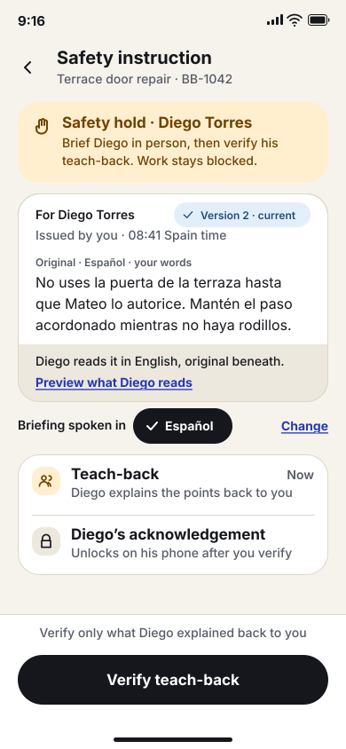

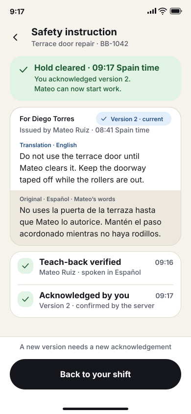

**Purpose and routes.** Issue a versioned safety instruction to a named worker, record that a person briefed them and checked their understanding, and record the worker's acknowledgement of that version. Entered from the hold banner in S-10 Crew only, from W-09 (which the hold banner on W-04 opens), from F-13, and from an "instruction changed" alert on S-09. Only the issuing foreman and the named worker can open it. The customer never sees it. Back returns to the caller.

**Layout and data.** The **hold banner** states what is blocked and who must act. The instruction card carries the recipient, a version badge, the issuer and the issue time in Spain time. For the worker it is a **twin card**: "Translation · English" on top and "Original · Español · Mateo's words" in the strip. For the foreman the text appears once in his own words, with "Diego reads it in English, original beneath." and **Preview what Diego reads**. The **teach-back record** is a card with the two steps that clear the hold, each with its state, actor and time. The fixture is version 2, issued to Diego Torres at 08:41: "Do not use the terrace door until Mateo clears it. Keep the doorway taped off while the rollers are out."

**Interactions and states.** The hold has two keys and both are needed, in this order:

1. *Acknowledgement pending* (Diego at 09:15, after check-in): the record reads "Teach-back with Mateo · Next" and "Your acknowledgement · Unlocks when Mateo has verified". The dock button is disabled with the reason "Mateo verifies your teach-back first". Reading the text, a translation or a chat reply unlocks nothing.
2. *Foreman verifies* (Mateo at 09:16): he briefs Diego in person. **Briefing spoken in** records a language both can check, here Español. **Verify teach-back** opens S-17, which names Diego, version 2 and the language, and records the verification online. The context line says "Verify only what Diego explained back to you". After verifying, the foreman's screen shows "Teach-back verified · 09:16 · by you" and "Diego's acknowledgement · Waiting"; the dock keeps only its context line, because he has nothing to do until Diego acknowledges.
3. *Ready* (primary, Diego at 09:16): the record shows "Teach-back verified · Mateo Ruiz · spoken in Español · 09:16". **Acknowledge version 2** is enabled and the context line says what it records: his name, the version and the time.
4. *Acknowledged* (Diego at 09:17): the banner turns `success-soft`, "Hold cleared · 09:17 Spain time", and the record shows both steps with their times. The time is the server's. The dock becomes **Back to your shift**. The hold is shown as cleared only inside the app.

*Superseded*: when the foreman issues version 3 the old screen locks, the banner reads "Replaced by version 3" and the dock becomes **Open version 3**. Earlier acknowledgements remain as history and clear nothing. A replacement worker gets their own instruction; nothing transfers from the worker who dropped out. *Offline or uncertain*: verification and acknowledgement are not queued. The screen says "Not confirmed. You're offline." or "Checking…", and the first attempt is resolved before another is allowed. Attendance is unaffected and stays labelled "attendance only". **Not clear? Ask Mateo privately** opens a note to the issuing foreman about this version. It is not posted where other crew can read it.

**Platform, accessibility and RTL.** The page scrolls; the dock stays fixed. Reading order: title, hold banner, recipient and version, translation, then the original as its own language span, the record, the clarification link, the action or the reason it is disabled. A haptic follows the server's confirmation, not the tap. At large text the version badge drops under the recipient and the button label wraps to two lines; the version number is never truncated. In a right-to-left UI the layout mirrors and the hand glyph, version numbers and times do not.

## S-12 Language and display

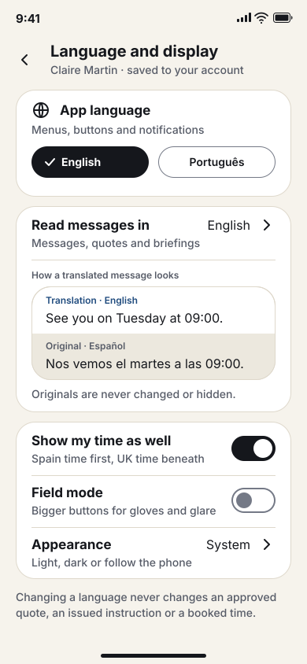

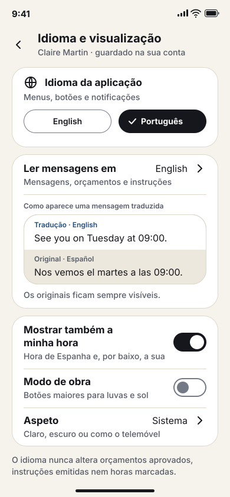

**Purpose and routes.** Choose the app language, the reading language for translated content and the display options. Entered from S-06, from the row on S-13, and before sign-in from S-01. Back returns to the caller and restores a chat's position and draft.

**Layout and data.** Three cards and no dock; each change applies at once.

- **App language**: two chips, English and Português, each in its own language. It covers menus, buttons and notifications.
- **Read messages in**: the current reading language with a chevron, "Messages, quotes and briefings", and a preview twin bubble that shows a translated message with its original. "Originals are never changed or hidden."
- **Display**: **Show my time as well** (on for Claire: Spain time first, UK time beneath), **Field mode** ("Bigger buttons for gloves and glare") and **Appearance** (System, Light or Dark).

A closing line says that changing a language never changes an approved quote, an issued instruction or a booked time.

**Interactions and states.** Tapping a chip switches the whole app at once from the bundled catalog, with no network request, and saves the choice to the account in one request. If that save fails the choice stays on this phone with "Not saved to your account yet". **Read messages in** opens a single-choice list of the enabled reading languages plus **Original only**. A new reading language applies to translations that already exist and to new content; it does not re-translate old messages. *Portuguese* (drawn): the app language is Português and the reading language is still English, which shows that the two are separate. "Mostrar também a minha hora" wraps to two lines and its row grows; nothing shrinks. *Pre-auth*: only the App language card is shown, stored on the device, with an app-owned sample instead of the preview. *Field mode on*: the switch is on, primary actions become 64 high, rows 64 and the live capsule flips to ink on lime; it is on by default for the Worker role. The reading-language list and the appearance choices are not drawn.

**Platform, accessibility and RTL.** Chips are radio buttons and the display rows are native switches with their label and state. A language change is announced once and focus stays on the chip. Text size follows the device and is not a setting here. The preview is read as an example, not as a message. When a future language changes the layout direction, the app saves the choice and drafts and asks for one restart; switches between left-to-right languages are immediate.

## S-13 Chat details [Sheet]

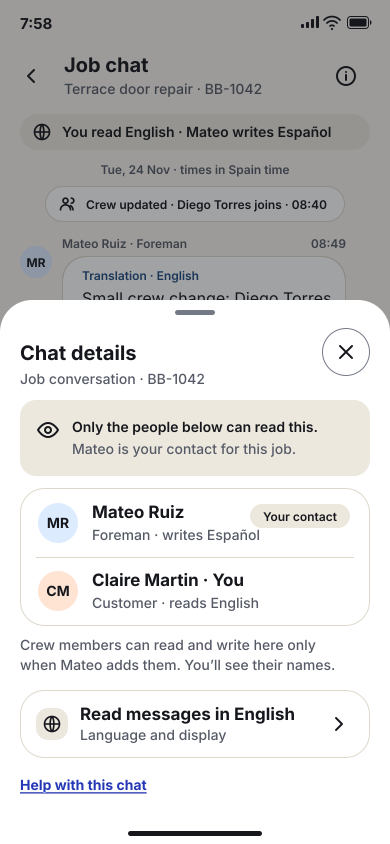

**Purpose and routes.** Say who can read this conversation and in which languages. Opened from the info button or the language line on S-10. Close returns to the same message and draft. The reading-language row closes the sheet and opens S-12. **Help with this chat** opens S-16.

**Layout and data.** A sheet over the dimmed chat: handle, title, the audience and job, and Close. An audience note: "Only the people below can read this. Mateo is your contact for this job." Then the people in this audience, each with role and language: "Mateo Ruiz · Foreman · writes Español" with a **Your contact** badge, and "Claire Martin · You · Customer · reads English". A line explains that crew members can read and write here only when Mateo adds them. The last row shows the viewer's reading language.

**Interactions and states.** The sheet only informs, so it has no dock. Rows are not buttons: no phone numbers, no profiles, no direct messages, no adding or removing people. *Job* (drawn). *Crew only*: the title context is "Crew only · BB-1042", the note reads "Only Mateo and the crew assigned to this job. Customers never see it.", and the list holds the foreman and the assigned workers. A closed job adds "Read-only" with the reason. The list shows current members only; it does not say who left or how many others exist. If the viewer's access ends while the sheet is open, the sheet closes and S-16 replaces the thread.

**Platform, accessibility and RTL.** Native sheet; Close is always visible and Android Back closes it. Focus starts on the title and returns to the info button. Initials are decorative. At large text the sheet scrolls and the badge moves under the name. Names and language names keep their own direction.

## S-14 Attach or record [Sheet]

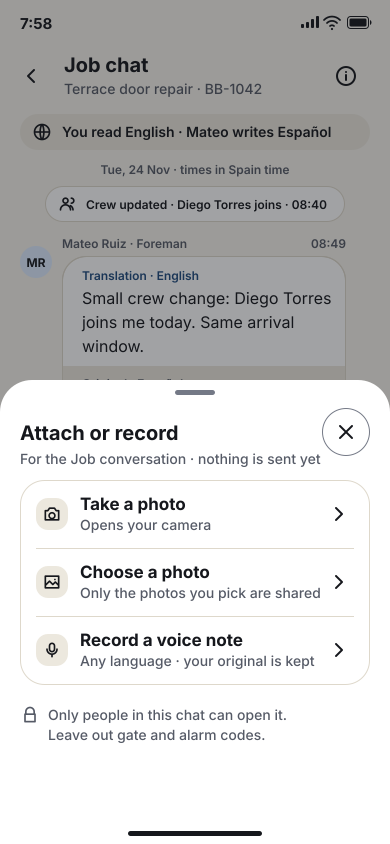

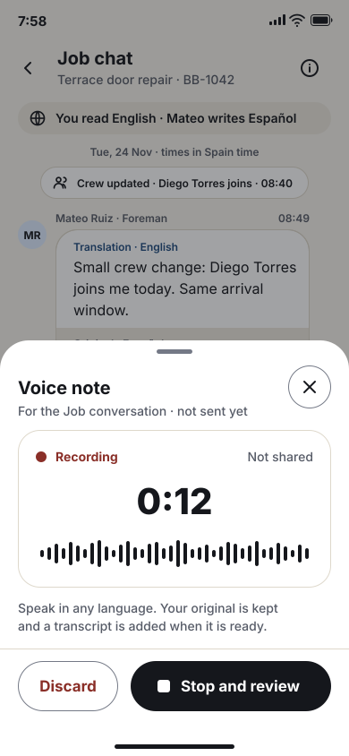

**Purpose and routes.** Pick a photo or record a voice note for the caller's draft. Opened from Attach on S-10 and from C-02, W-07, F-14 and C-16. The sheet never sends: a chosen photo or a stopped recording goes to S-15 for review, and the caller sends it.

**Layout and data.** A sheet over the dimmed caller: title, a line naming the destination ("For the Job conversation · nothing is sent yet") and Close. Three rows of 68 units: **Take a photo**, **Choose a photo** ("Only the photos you pick are shared") and **Record a voice note** ("Any language · your original is kept"). A privacy note names who can open the media and asks people to leave out gate and alarm codes. The recording state replaces the rows with a card: a dot and the word "Recording", "Not shared", the elapsed time in Display and a level trace. Its dock has two separate full-size buttons, **Discard** and the primary **Stop and review**.

**Interactions and states.** *Ready* (drawn): a row opens the system camera or photo picker, or starts the recorder. Permission is requested by the system only when a row is chosen. *Recording* (drawn, 0:12): recording starts on a tap and never needs a held press. **Stop and review** opens S-15. **Discard** asks once before deleting. Close, Back, a phone call or leaving the app stop the recording and keep it for review or discard; nothing is lost or sent silently. *Denied*: the row stays and its second line reads "Microphone is off for BookBuddy" with **Open settings**; the other rows keep working. A caller that takes photos only (W-07, F-14) hides the voice row. Upload progress and "Saved on this device · pending sync" belong to the caller, not to this sheet.

**Platform, accessibility and RTL.** System camera, picker and permission prompts on both platforms; no fake permission dialog. Focus order: title, Close, destination, the rows, the note. The elapsed time is read on focus and not on every tick; the trace and the dot are decorative. The trace and the digits do not mirror in a right-to-left UI.

## S-15 Media preview [Modal]

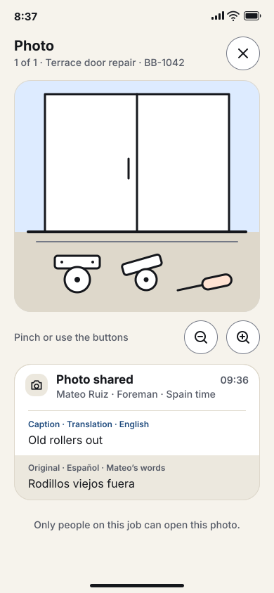

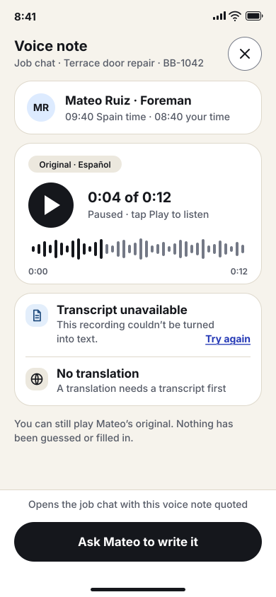

**Purpose and routes.** Look closely at one photo or listen to one voice note without losing the place in the record behind it. Opened from a photo stamp (C-09, C-10, F-13), a chat attachment (S-10), a draft tray (C-02, W-07, F-14, C-16) and from S-14 after a capture. Close returns to the same row.

**Layout and data.** Full-screen modal with the title at the leading edge and Close at the trailing edge.

- *Photo* (Claire at 08:37 her time): the picture, **Zoom out** and **Zoom in** buttons beside "Pinch or use the buttons", and the stamp that shared it: "Photo shared · 09:36 · Mateo Ruiz · Foreman · Spain time". The caption is a twin: "Old rollers out" in English with "Rodillos viejos fuera", Mateo's words, in the strip. No text sits on the picture.
- *Voice note* (Claire at 08:41): sender and both times, an "Original · Español" badge, Play, "0:04 of 0:12", a level trace with the played part in ink, and a status card.

**Interactions and states.** *Preview* (drawn): read-only for a viewer, so no dock. For the owner of an unsent draft the dock is **Use photo** or **Use recording**, with **Remove** as the quiet action; using it adds the item to the caller's draft and sends nothing. *Transcript unavailable* (drawn): two statuses on separate rows, "Transcript unavailable" with **Try again**, and "No translation · A translation needs a transcript first". The original stays playable and nothing is guessed. The dock, **Ask Mateo to write it**, opens S-10 with the voice note quoted; it appears only when the voice note came from a chat the viewer can write in. *Transcript ready*: a twin card with the translated transcript on top and the original transcript beneath, marked as machine-made. *Loading* keeps the frame and shows progress; a failed download offers Try again. A gallery shows "2 of 3" and labelled Previous and Next buttons as well as swipe. If access ends during playback, playback stops and the content is cleared.

**Platform, accessibility and RTL.** Focus stays inside the modal: title, Close, the picture's description, zoom buttons, the stamp, then the caption in both languages. Zoom and seeking work with single taps. A photo is described by its caption and author, not by a guess at its content. Playback progress is not announced on every tick. The trace and the times run left to right in every UI direction.

## S-16 Help and access

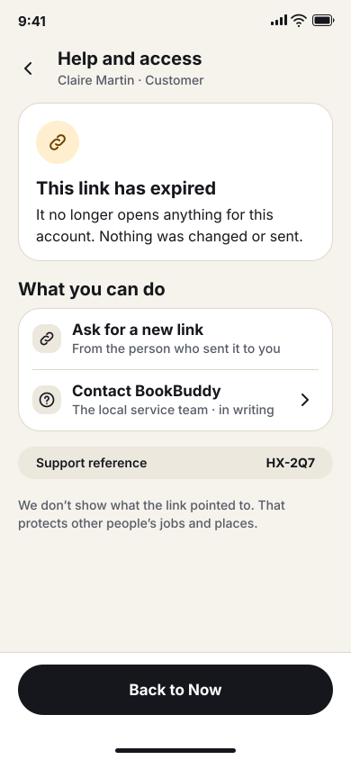

**Purpose and routes.** Recover from a link that no longer opens anything, or from access that has ended, and reach the service. Entered from a gated or stale link, from S-06, from **Trouble signing in?** on S-02 and S-03, from S-13 and when access ends while a record is open. The dock goes to a safe parent, here **Back to Now**.

**Layout and data.** A reason card: "This link has expired. It no longer opens anything for this account. Nothing was changed or sent." Under **What you can do**: **Ask for a new link** ("From the person who sent it to you") and **Contact BookBuddy** ("The local service team · in writing"). A **Support reference** pill gives an opaque code to quote. A closing line explains that the destination is not shown, to protect other people's jobs and places. The screen never names the job, the place or who holds the record.

**Interactions and states.** *Expired* (drawn). *Removed*: "You no longer have access to this. Your own bookings are unchanged." with the same two options. *Pending eligibility* (crew): "Your crew access is being checked. Last confirmed Mon, 16 Nov." It makes no statement about permission to work, and a provider admin gets a link to P-04. A link that belongs to another role the account holds opens S-07 instead. Contact BookBuddy opens a form that shows exactly what will be sent; no chat, photo or job detail is attached automatically. Signed out, the dock returns to S-01.

**Platform, accessibility and RTL.** Reading order: title, reason, options, reference, the dock. The reference is read letter by letter and can be copied. Back never retries the hidden destination. Copy wraps and the reference stays left to right.

## S-17 Confirm action [Modal]

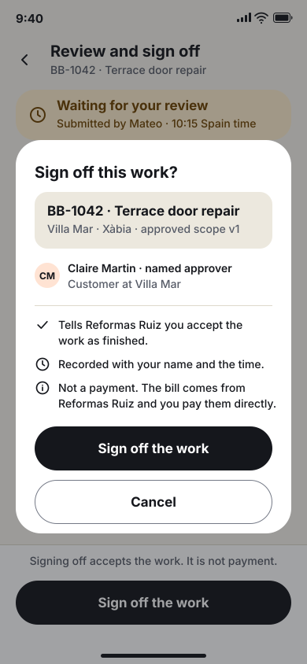

**Purpose and routes.** Confirm one consequential action on the record just reviewed, in the role that may take it. Opening the dialog does nothing. Approving a quote (C-07), confirming cover (F-12), accepting an offer (W-03), check-in (W-06), "On my way" (W-10) and sharing an update (F-17) keep their own sheets and do not use S-17.

**Layout and data.** A dialog over the dimmed caller, here C-10 at 09:40 Claire's time. It states the question ("Sign off this work?"), the item ("BB-1042 · Terrace door repair · Villa Mar · Xàbia · approved scope v1"), who is acting and in which role ("Claire Martin · named approver · Customer at Villa Mar"), and the effects as short lines: it tells Reformas Ruiz she accepts the work, it is recorded with her name and the time, and it is not a payment because the bill comes from Reformas Ruiz and she pays them directly. Then the named action and **Cancel**.

| Caller | Named action | Result shown on the caller |
| --- | --- | --- |
| C-10 | Sign off the work | "Signed off · 10:40 Spain time"; C-11 follows |
| C-15 | Approve change / Decline change | The change's new state; the approved text is untouched |
| S-11 | Verify teach-back | "Teach-back verified · 09:16 · by you" |
| P-02 | Offer handoff; Record bill as paid | Awaiting the foreman; "Paid · recorded by Mateo Ruiz" |
| P-05 | Revoke access | The membership ends in P-03 |
| S-06 | Sign out of this device | The previous account and role are hidden immediately, even offline; no pending work is sent or silently discarded |

These are the callers in the navigation maps. Other consequential actions kept from the reference use the same dialog if their slices route them here: declining a quote (C-06), accepting or returning a job (F-03), publishing a quote (F-04), submitting completion (F-14), sending or withdrawing a change (F-15) and declining an invitation (S-05). Only the provider admin can record a bill as paid; in the fixtures Mateo holds that role as well as Foreman.

**Interactions and states.** *Ready* (drawn). Cancel, Back and Close change nothing and return focus to the caller's button. For an action on a shared record, the server rechecks the actor, role, grant and version. *Processing*: keep the named action visible and prevent duplicate submission. *Invalidated*: “This changed while you were reading” leads to **Review the latest**; earlier consent does not carry over. *Failed or uncertain*: keep the review and resolve the original attempt before enabling retry. *Offline*: disable the server action with “Needs a connection. Nothing was sent.” Show a confirmed result and its time on the caller. An account cannot approve its own quote from another role.

**Local lock or sign-out from S-06 is different.** Sign-out warns about unsent work; the author may stay, keep drafts or explicitly discard drafts. Local lock and confirmed sign-out both hide the previous context immediately, including app-switcher and Lock Screen previews. Neither waits for the server, sends pending work or changes attendance. Pending attendance, submitted uploads and sends with unknown outcomes are **not drafts**: isolate them in the originating account and role’s protected outbox. Resume sync only after the same person authenticates and their grant is checked online. Other accounts cannot view, send or discard these items. Local sign-out makes no claim about other devices.

**Platform, accessibility and RTL.** Native dialog. A tap outside does nothing. Focus starts on the title; the reading order is question, item, actor, effects, the action, Cancel. At large text the dialog becomes full height and scrolls with the buttons stacked; amounts and versions are never truncated. For a server action, the confirmation haptic follows the server’s answer.

## S-18 Live updates and privacy

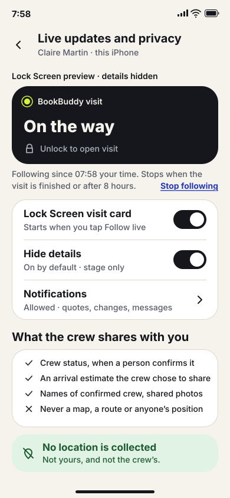

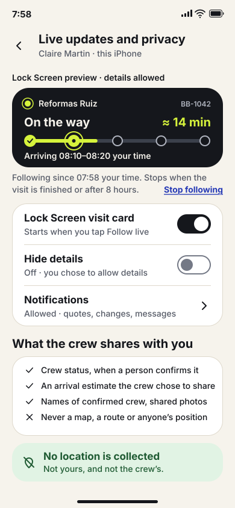

*Details allowed separately in S-18.*

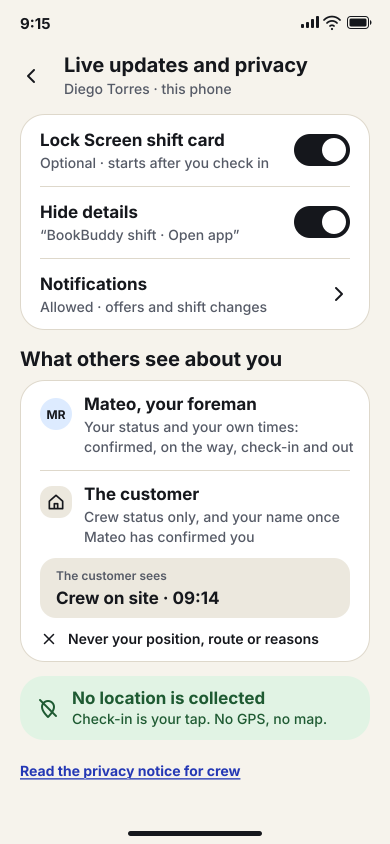

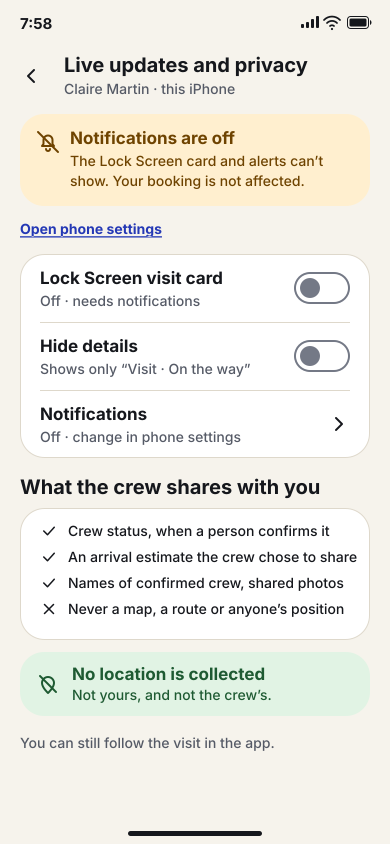

**Purpose and routes.** Choose what appears on this phone's Lock Screen and read plainly what is shared with whom. Entered from S-06, from the Follow strip on C-09 and from the opt-in on W-06. It is also the notice surface for crew. Each switch applies at once, so there is no dock.

**Layout and data.**

- *Customer, default* (Claire at 07:58 her time): she tapped **Follow live** on C-09 for this visit on this iPhone. **Hide details** is still on. Her Lock Screen preview says “BookBuddy visit · On the way”, with no name, job reference, arrival estimate, countdown or photo. **Stop following** ends the card, not the visit. Below the switches, **What the crew shares with you** describes her view *inside the app*: crew-level stamps, the estimate the crew chose to share, confirmed names and shared photos. No location is collected.
- *Customer, details allowed* (same visit, alternative choice): Claire separately turned **Hide details** off. The preview shows Reformas Ruiz, BB-1042 and the declared arrival estimate. This variant and the detailed Lock Screen, Island and ongoing-card illustrations elsewhere assume the OS also allows previews. They are not what a first **Follow live** tap shows.
- *Worker* (Diego at 09:15): his shift card started locally in the foreground after deliberate check-in and his opt-in. **Hide details** remains on: “BookBuddy shift · Open app”. The optional detailed shift-card fixtures require a second choice to allow the reference, site alias and timer. Inside S-18, the two audience blocks distinguish Mateo’s per-worker attendance view from the customer’s “Crew on site · 09:14” stamp. **Read the privacy notice for crew** opens the notice, not a consent prompt.

**Interactions and states.** Only **Follow live** on C-09, tapped in the foreground, starts the card for this visit on this phone. Opening C-09 from a notification, changing **Hide details**, receiving a push or enabling alerts never starts it. A stage-change push can refresh an already running card. **Stop following** or Finished ends it; on iOS the active card also ends at eight hours and is not chained. Turning **Hide details** back on redacts a running card immediately; it does not unfollow. The OS may hide more, never less.

A crew lead sees what their deliberate **On my way** shares: the crew’s state and declared arrival estimate, not a position. The foreman may correct or withdraw it. A foreman who opted into the cover card starts it by sending offers in the foreground on F-10, not by receiving a gap or acceptance alert. *Notifications off* (drawn): iOS alerts are off and Claire is not following this visit. **Open phone settings** manages alert permission separately from the visit card. Returning from settings neither starts a card nor changes a booking. Dismissing an Android ongoing notification does not stop following or record attendance.

**Platform, accessibility and RTL.** Announce each switch’s name and current value. The preview reads as one sentence using only the visible fields: “BookBuddy visit, On the way” by default; provider and arrival estimate only in the detailed state. Never expose redacted fields through accessibility labels. On Android the first row reads “Ongoing notification”. The lists use ticks, crosses and “Never” rather than colour alone.

## S-19 Push notifications [System]

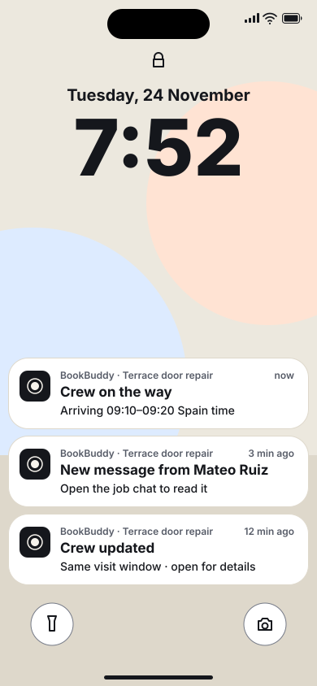

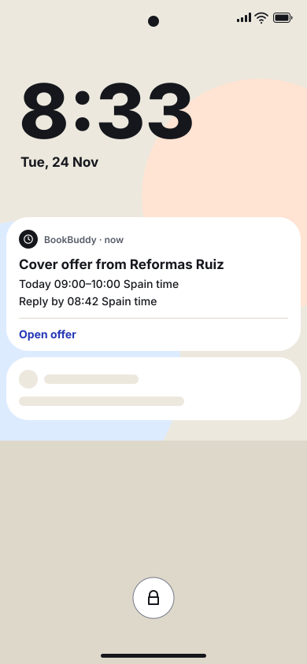

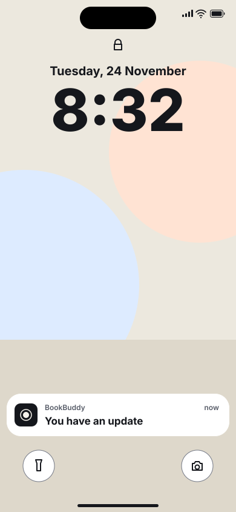

**Purpose and routes.** Prompt the viewer to open a changed record. The server sends the generic alert in the recipient’s saved UI language and an opaque HTTPS destination. Receipt does not start a live card, change the record or mark it read. A tap opens the record after unlock, sign-in and a fresh access check.

**Layout and data.** Each ordinary locked banner reads “BookBuddy · You have an update”. The system can add the age or hide the preview entirely. There is no sender, job, business, deadline, message text or action that gives the event away. The optional richer S-18 live card is a different surface; allowing its details does not put private data in an ordinary push. The event names below describe the destinations, not the locked banner copy.

| Fixture | Event revealed after unlock | Opens (parent on cold launch) |
| --- | --- | --- |
| Claire, 07:52 her time | Crew on the way; shared arrival band | C-09 (C-01) |
| Claire, 3 minutes earlier | Message from Mateo in the Job conversation | S-10 (S-08) |
| Claire, 12 minutes earlier | Crew updated; visit window unchanged | C-09 (C-01) |
| Diego, 08:33, Android | Cover offer; reply by 08:42 Spain time | W-03 (W-01) |
| Mateo, 08:32 | Crew gap needing cover | F-10 (F-01) |

**Interactions and states.** *Customer:* three generic alerts before Claire follows the visit. Opening the arrival alert lands on C-09; she must still tap **Follow live** there. *Worker offer:* tapping the generic Android notification opens W-03, which shows whether the offer is still open and, if so, the deadline. No acceptance, decline or check-in is available on the Lock Screen. *Foreman gap:* the banner opens F-10 without assigning anyone, sending offers or starting the cover card. A wrong but granted role goes through S-07; an inaccessible destination goes to S-16 without disclosing what changed. A language change does not resend alerts.

**Platform, accessibility and RTL.** Use system notification chrome and honour OS preview and channel settings. Grouping, expansion, accessibility announcements and action labels must not reveal the event when the visible copy is generic. On both platforms the safe action is to open the app; the meaningful next action is on the checked record. The system handles RTL placement and relative age.

## Navigation

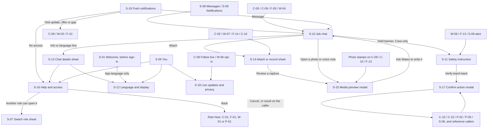

## Open design questions

- **Reading languages.** Which source–target pairs have passed the language and field review for launch? Enable those pairs in S-12; do not infer coverage from the two UI catalogs.
- **Crew notice.** Which lawful basis and worker-facing wording will the provider and its adviser approve for the attendance record and customer-visible stamps? Choosing a Lock Screen preference is not consent to an employer’s processing.
