# Worker screens W-01–W-12: from offer to check-out

Diego Torres works for Reformas Ruiz. On Tuesday 24 November he receives an offer to cover Nadia Benali’s shift, waits for Mateo Ruiz to confirm him, then checks himself in and out at Villa Mar. Lucía Ortega sees the same offer close. Times follow the [shared story](../inventory.md#story-and-clock) in Spain time. The [navigation](../../foundation/information-architecture.md#worker), [cover and attendance flows](../../foundation/core-flows.md), [design system](../../system/design-system.md) and [owner decisions](../../../docs/decisions/2026-11-23-open-questions.md) apply throughout.

The later screens cover the rest of Diego’s shift: send progress photos to the foreman, say when he can work, read the site briefing, declare "On my way", and keep the shift on his Lock Screen after check-in (the iOS Live Activity with its Dynamic Island, and the Android ongoing notification). These screens follow the [concept](../../foundation/concept-and-principles.md), [information architecture](../../foundation/information-architecture.md), [roles](../../foundation/personas-and-roles.md), [core flows](../../foundation/core-flows.md), [design system](../../system/design-system.md) and [wireframe conventions](../../system/wireframe-conventions.md), apply the [owner's decisions](../../../docs/decisions/2026-11-23-open-questions.md) and keep the limits in the [Live Activities and attendance research](../../../research/tech-stack/live-activities-and-geofenced-attendance.md). Where the [reference specs](../../../design/screens/worker/W-01_W-09-specs.md) settled a rule it is reused: availability never cancels a shift, photos go to the foreman first, and the briefing screen is not an acknowledgement.

## Conventions for W-07–W-12

- **One next step.** Each pushed screen has one primary action in the dock. Worker artboards are in Field mode: the dock button is 62 units high at y=732. A dock with a context line starts at y=686 and centres the line at baseline 712, as on S-11 and W-04. An unavailable action is drawn disabled with its reason in the context line.
- **Lime means live.** On W-07–W-12 lime appears on the shift capsule behind a sheet, on **I'm on my way** in W-10 and in the lit parts of the shift card. **I'm on my way** is lime because it changes what Mateo sees live and, for a crew lead, what the customer sees. Send photos, Save and Open safety instruction are ink.
- **Deliberate, with no location.** On my way, check-in and a photo are the worker's own acts. None of these screens reads or stores a position. The shift card starts only after a check-in recorded with the app in the foreground.
- **Person-level inside, crew-level outside.** What Diego sends goes to Mateo. The customer sees the crew's state, and a photo only when Mateo shares it. W-10 says in plain words who sees the estimate.
- **System surfaces open a record.** W-11 and W-12 never check out, acknowledge or message. They show no address, place name, customer name, instruction text or message text, and they never say that a safety hold was cleared. Turning them off, dismissing them or letting them expire changes nothing in the shift or the attendance record.
- **Your words stay yours.** Diego reads English and writes Español to Mateo, as on S-11. His captions are sent as he wrote them. Mateo's briefing is shown as a translation with the Spanish original beneath it.
- **Online for consequences, offline for capture.** Photos can wait on the device and are labelled "Saved on this device · pending sync". "On my way" is a live status and is never queued; a late estimate would be untrue. Availability is saved only by the server's answer.
- **Access.** Account, role, business, the assignment and the record's freshness are checked on entry and again before each send. When a shift is cancelled or reassigned, its screens turn read-only and say which.
- **Languages.** The UI ships in English (`en`) and European Portuguese (`pt-PT`). Every label is a whole catalog message with placeholders, for example "Since check-in {time}". Layouts allow 40% longer text by wrapping.

## W-01 Now

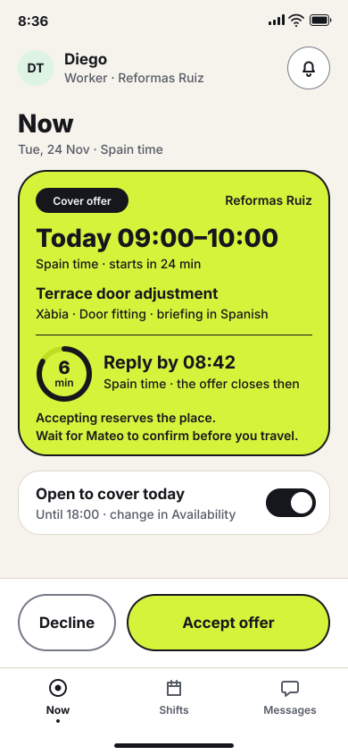

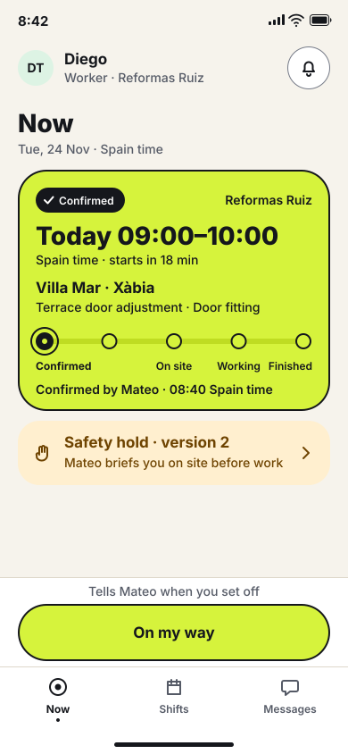

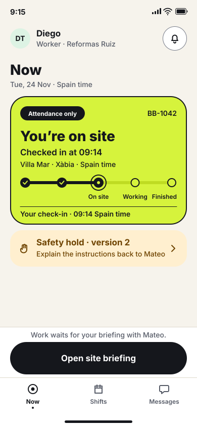

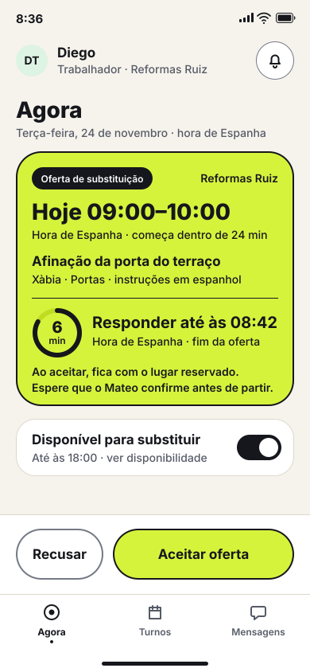

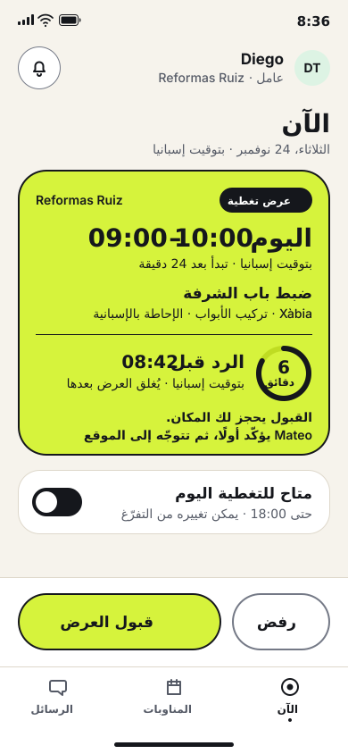

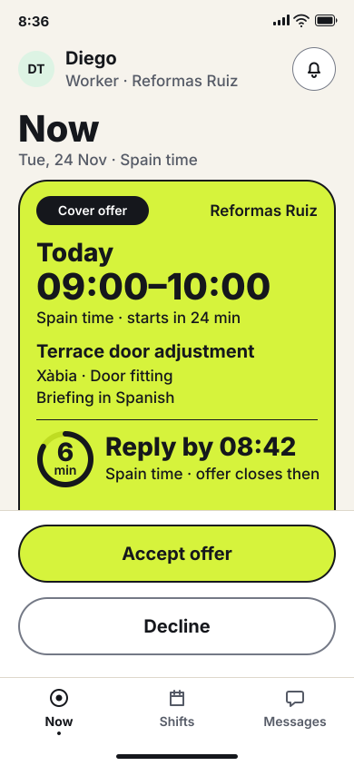

**Purpose and routes.** The Worker start tab answers “What do I do next?” The identity chip opens S-06; the bell opens the worker’s S-09 inbox at this business. The other tabs are Shifts (W-02) and Messages (S-08). Tapping an offer capsule reads the offer in W-03. **Accept offer** opens W-03’s accept sheet; **Decline** opens W-05. Neither first tap answers the offer. A confirmed shift capsule opens W-04. The availability row opens W-08 to change cover hours without answering or cancelling any existing offer.

**Layout and data.** At 08:36 the lead artboard shows the worker, provider and site date above one lime Field-mode capsule. Today’s shift is 09:00–10:00; the clock beside **Reply by 08:42 Spain time** shows six minutes to reply, not six minutes to travel. The offered task, skill, town and briefing language are enough to judge the offer without exposing a customer, site or access note. The consequence sits beside the decision: acceptance reserves the place; Mateo must confirm before travel. “Open to cover” is on until 18:00. It does not put Diego on duty, select him for a round or assign him.

**Interactions and states.** Show the worker’s immediate next step rather than a second agenda. If an active shift needs attendance or a briefing, keep it and its hold visible; additional offers remain available in W-02 and S-09. A new event updates the existing capsule without relocating focus.

- **Accepted:** show “Accepted · waiting for Mateo”, the confirmation cutoff and “Do not travel yet”. Withdraw opens W-05. No address, travel, chat or attendance control appears before the server confirms assignment.
- **Shift today:** at 08:42 the offer is gone. The capsule gives Mateo’s 08:40 confirmation, site alias and the shift’s day line. Version 2 needs a briefing before *work*, not before travelling. **On my way** opens W-10; **Already on site?** in the shift opens W-06 directly. After departure, **Check in** opens W-06. No timer or location change advances the line.
- **On site:** Diego’s 09:14 receipt stands while the safety hold is active. At 09:15 **Open site briefing** leads to W-09 and S-11. Check-out remains available in W-04. Once briefed and working, Now leads with the recorded check-in and a **Check out** dock for when he leaves.
- **Nothing scheduled:** an authoritative empty response says “No shifts or offers today” and offers **Set availability**. Offline is not empty: show “Offline · last confirmed {site time}”, the cached record without a pulse, and the count of local events waiting. No offline acceptance, withdrawal or new departure claim. Deliberate attendance on an already confirmed shift can be saved locally in W-06.

**Platform, accessibility and RTL.** The dock stays above the tab bar and respects the system inset. Focus runs from identity and notifications through date, capsule, hold or availability, dock and tabs. Announce the deadline with its full date and zone on focus, not on every tick; Reduce Motion leaves a stationary ring. Field mode is the Worker default. With larger type, times wrap onto a line of their own and the content scrolls behind stacked 64-unit buttons, 16 units apart. The effect is repeated in the confirmation sheet even if the worker hasn’t scrolled. The European Portuguese fixture translates the interface, not the provider or the spoken briefing language. Arabic is a layout test, not a launch catalog: the bell, identity, clock position, switch, actions and tab order mirror. Each Latin name and both endpoints of the range are positioned separately so neither time nor name reverses.

## W-02 Shifts

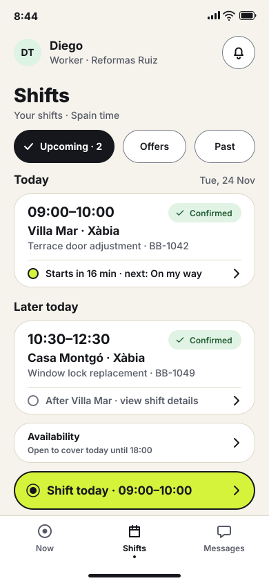

**Purpose and routes.** The second tab lists only this worker’s work at the active provider. Upcoming or historical assignments open W-04; offers, including provisional acceptances, open W-03. **Availability** opens W-08. The live pill returns to the most urgent live record without changing its state. Back restores the segment, date and scroll position.

**Layout and data.** Diego sees **Upcoming · 2**, Offers and Past. A checked chip identifies the selected segment. At 08:44 the first card gives today’s visit at Villa Mar, the booked window 09:00–10:00 Spain time, task, reference and next action. The second card is the existing 10:30–12:30 assignment from W-08. Its later start is why the first visit fits; the cover acceptance did not replace this other shift. The tabs and live pill stay pinned; the agenda scrolls.

**Interactions and states.** Upcoming sorts by start time. Offers sorts open offers by the issued reply deadline and distinguishes “waiting for Mateo” from a confirmed shift. Only authoritative confirmation moves a card to Upcoming. A filled, expired, declined or withdrawn offer is read-only in Past while the worker retains access. Past shows the newest outcomes first and keeps cancelled visits distinct from completed work. An empty segment explains what belongs in it. Offline, keep permitted cached rows and “Last confirmed {time}”, but hide counts that can’t be confirmed. A failed next page has a retry below the loaded rows, not an empty agenda.

**Platform, accessibility and RTL.** Each shift is one target: read date and site time, task, state and next step, then leave the card. The agenda works without a calendar gesture. The segments use native selection semantics and grow or stack at larger sizes. When a record moves, announce the change once and keep focus on the nearest remaining row or segment heading. RTL mirrors the segments, reading order and disclosure arrows, never the chronological order or the digits in a window.

## W-03 Offer

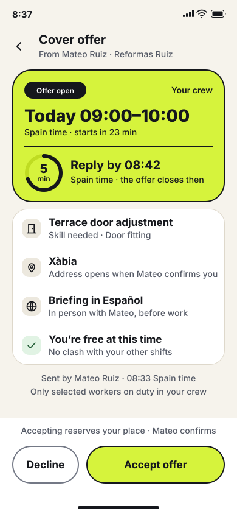

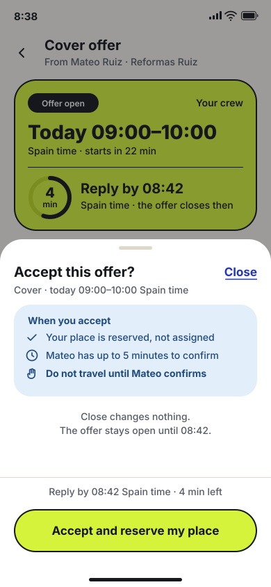

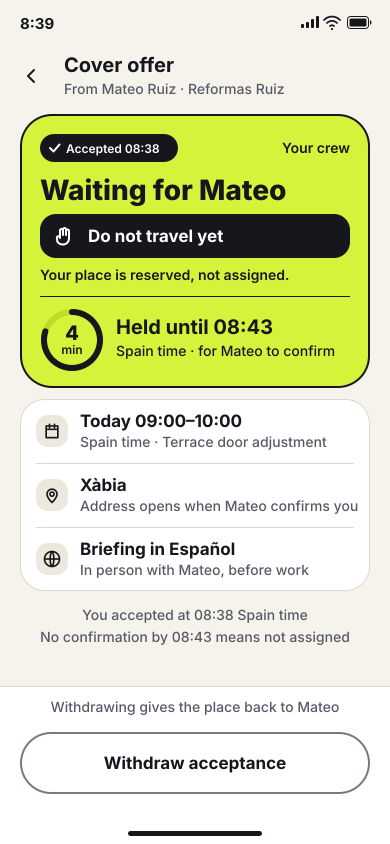

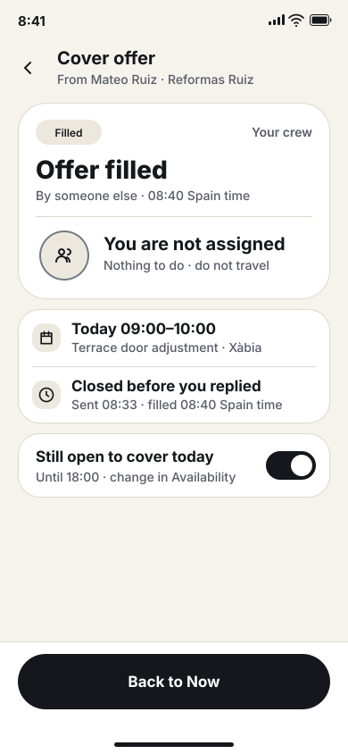

**Purpose and routes.** Read a named offer from W-01, W-02, S-09 or an unlocked S-19 link. A cold link restores W-01 as parent. Opening is never a reply. The current worker, provider, offer recipient and freshness are checked before private details or an action appear. If the signed-in person needs another granted role, ask via S-07; if they cannot open the record, show S-16 without identifying the holder. A conflict may open W-08 to review availability; changing a preference does not cancel an existing shift.

**Layout and data.** At 08:37 Diego sees a shift starting in 23 minutes and an offer closing in five. The absolute site-time deadline sits beside the ring. Mateo sent the offer at 08:33. He selects at most three eligible workers already on duty in his own crew per urgent round; Diego sees only his own offer. Town, task, skill, working and briefing language and a conflict result are visible; the place alias, address, customer, other candidates, crew chat and access instructions are not. The app language is not a qualification to receive a spoken briefing.

**Interactions and states.**

- **Open:** **Accept offer** opens its own sheet, not S-17. From the W-01 dock this sheet opens directly over the reviewed W-03 record. Its action **Accept and reserve my place** makes one online request; Close makes none. The server checks the gap is still open, the named worker is eligible and free, the offer is still valid and no other acceptance holds the slot. When a reply is uncertain, show “Checking your reply” and resolve it before enabling another submit.
- **Awaiting confirmation:** Diego’s first valid acceptance, recorded by the server at 08:38, reserves one place; it does **not** assign him. Mateo or his authorised backup has at most five minutes to confirm, less if the safe staffing cutoff comes sooner, never at or after shift start. For this visit the review ends at 08:43: the ring at 08:39 shows four minutes. Neither the 08:42 worker reply deadline nor Claire’s 08:45 update changes that cutoff. “Do not travel yet” stays visible. **Withdraw acceptance** opens W-05. No customer stamp or site access is produced by the acceptance. Other candidates see “On hold” without a name and cannot accept while it is held.
- **Confirmed:** Mateo rechecks and confirms a single person in F-12 at 08:40. Only then does Diego get W-04 with the site, travel controls and his own briefing. Claire sees “Crew updated”, not replies or reasons. Lucía sees **Offer filled / You are not assigned**: static glyph, closure time, no timer and no Accept/Decline. Return to the authorising caller; a cold link returns to Now.
- **Other endings:** an unanswered offer closes at its own deadline as **Expired**. A foreman review that lapses or fails leaves the accepting worker **Not confirmed · not assigned**, not “declined” or “filled”. A held offer can reopen for another candidate only on a fresh server state within its reply window. If there is too little safe time to reply and confirm, Mateo calls the provider duty line or proposes a revised visit; he neither extends the hold nor opens an external pool. A worker who withdraws gets **Acceptance withdrawn** only after receipt.
- **Ordinary named assignment:** Nadia’s original offer from F-07 says **Confirm assignment** and explains that success assigns her, unlike provisional cover. Show a reply clock only if a deadline was issued. Offline or stale: keep coarse details and the last confirmed stamp; disable accept, decline and withdraw and explain why. No reply is sent later from an offline queue.

**Platform, accessibility and RTL.** The clock is decorative beside a spoken absolute deadline; announce closure or a new assignment once rather than reading ticks. The consequences come before the final action in sheet focus order. Close/Back returns focus to the trigger or, if the offer changed, the resulting status. Stack controls at large type. In RTL the card, sheet and dock mirror while references and site-time ranges remain intact.

## W-04 Live shift

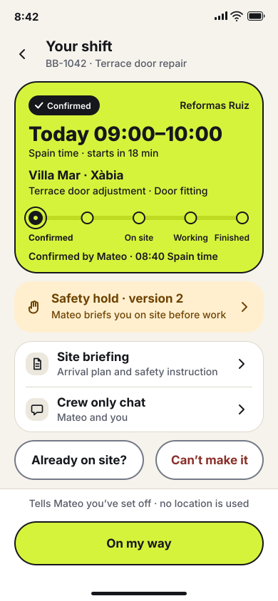

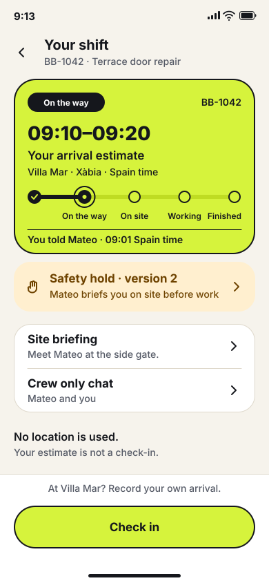

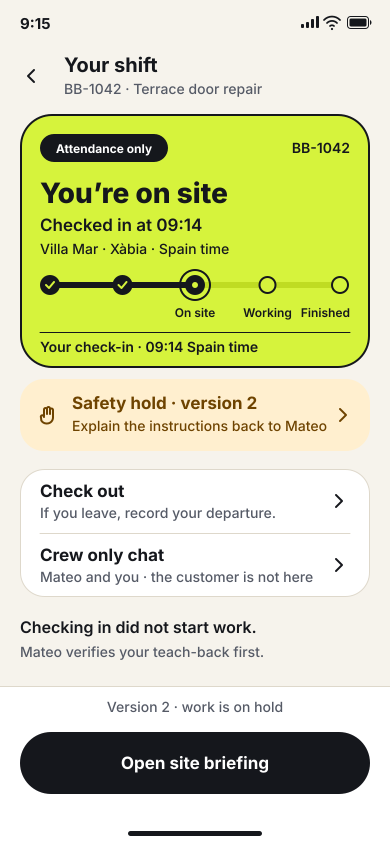

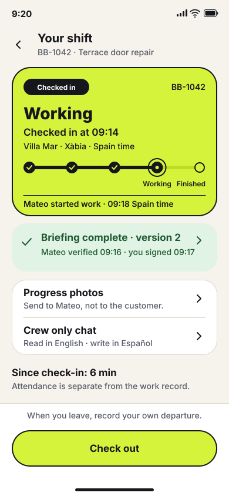

**Purpose and routes.** This is the assigned worker’s shift, not the foreman’s whole-job record. Open from Now, the agenda, a confirmed offer, a shift alert, W-08’s confirmed row or the unlocked W-11/W-12 card. Before the visit, the same record gives the schedule and briefing; on the day it opens on live status. W-09 holds the site plan and the link to S-11. W-07 sends photos to the foreman; S-10 opens Crew only for this shift. Never open a customer direct message or expose another worker’s attendance.

**Layout and data.** The Field-mode capsule replaces the offer clock with a five-bead day line and a source stamp. The before-travel view gives the booked window, task and assigned site. After a departure it shows the worker’s declared band; after check-in it shows the attendance receipt. The additional “Working” stage comes from Mateo starting work, not a timer. Every view retains the applicable hold or its receipt and a single dock action. No gate or alarm codes are kept.

**Interactions and states.**

- **Confirmed:** Mateo confirms Diego at 08:40 and issues his own version 2 at 08:41. **On my way** opens W-10; **Already on site?** opens the W-06 arrival sheet without inventing a departure. **Can’t make it** opens W-05 before attendance starts. Seeing or opening a briefing doesn’t acknowledge it.
- **On the way:** Diego declares a 09:10–09:20 estimate to Mateo at 09:01. In this visit Mateo is crew lead; Claire’s band is the one Mateo shared at 08:52. Where the worker *is* the designated lead, their deliberate W-10 send publishes the crew-level estimate to the customer and the foreman can correct or withdraw it. Other workers’ departures are private to the foreman. Neither a passed estimate nor a message changes attendance. **Check in** opens W-06.
- **Hold:** the first accepted check-in at 09:14 gives Claire “Crew on site”; Diego sees his personal time and **Attendance only**. At 09:15 W-09 → S-11 asks him to explain the safety points back in Español to Mateo. Mateo verifies at 09:16, Diego acknowledges that same version online at 09:17. Reading English, translating the original, a chat reply and checking in clear nothing. Until both receipts exist, do not enable affected work or progress capture. Check-out remains available. A new instruction reopens the hold; Nadia’s version and attendance never transfer.
- **Checked in and working:** after Mateo starts work at 09:18, Diego may send progress photos to Mateo. Only the foreman can choose to share them with the customer. The worker can inspect the briefing receipt in app; a Lock Screen card never says “all clear”. From check-in onward, **Check out** opens W-06; **Can’t make it** is no longer a way to erase attendance.
- **Check-out due:** finishing the task, the end of the booked hour and the iOS activity limit are not departure events. Keep the last accepted check-in and the explicit check-out action. After checkout show the departure receipt and remove the action. A cancellation, dropout or expired grant removes site access and live controls on authoritative update; preserve only authorised history. A proposed new customer window is not by itself a cancellation. If an event is queued when access changes, keep a reason-safe local result and route the worker to Mateo or S-16 rather than posting it to another shift.

**Platform, accessibility and RTL.** Read the capsule as state, step, site time, source and time of source. A disabled action has its reason in text; a hold remains visible, not just an amber bead. With large text, stack the stamp beneath the state and let the rows scroll. Native Back or Up returns to the caller without undoing a declaration. In RTL the day line begins on the right, in the same semantic stage order. Never mirror the time or infer position from the rail.

## W-05 Decline or can’t make it [Sheet]

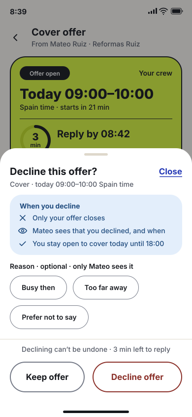

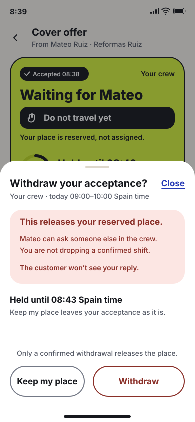

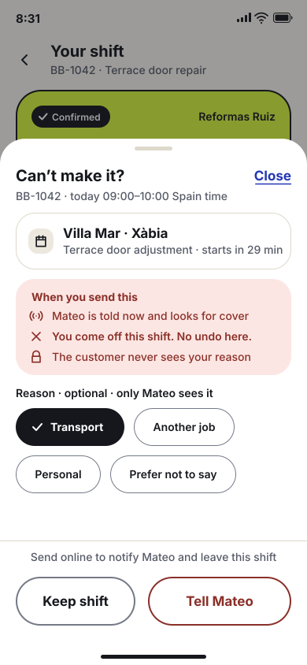

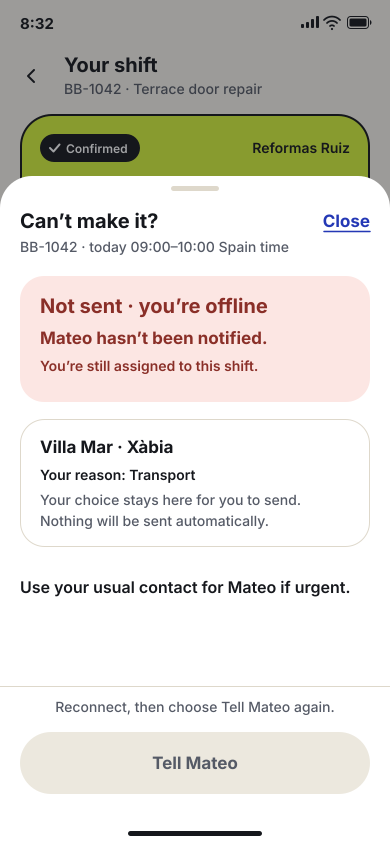

**Purpose and routes.** One sheet explains three different consequences. W-03 opens it to decline an unanswered offer or withdraw a held place; W-04 opens it for a confirmed worker before check-in. Close, Back, and the named keep action leave the offer or shift alone. After a receipt, return to the caller and keep the result there.

**Layout and data.** Keep the real offer or shift visible behind a scrim. Show the title, worker’s shift and site-time window, the effect on Mateo and the worker, and one named confirm action separated from Keep. Offer views name only the coarse area; only an assigned person gets the site alias. Reasons are optional, coarse, single-choice and visible to the authorised foreman alone. **Prefer not to say** and no selection both send no reason category. No free-text medical explanation is requested.

**Interactions and states.**

- **Decline:** in the alternative no-cover branch, Diego declines his open offer at 08:39. Success closes *his* offer. It does not cancel the booking, stop other offers or change his availability. There is no customer notice from this reply.
- **Withdraw:** **Keep my place** preserves a provisional acceptance. **Withdraw** asks the server to release that reservation, not to cancel a confirmed shift. If Mateo already confirmed him, say so and open W-04; do not interpret the old tap as a dropout. If the hold ended first, show “Not confirmed”, not a successful withdrawal.
- **Dropout:** Nadia confirmed Monday at 08:38. On Tuesday at 08:31 she chooses Transport; **Tell Mateo** sends her decision at 08:32. Only the receipt takes her off BB-1042 and raises the gap in F-01/F-16. F-16 shows the category; the customer, notifications and candidates never do. Mateo can now seek own-crew cover through F-10. The replacement receives a separate assignment, instruction and attendance record.
- **Offline before send:** “Not sent · you’re offline”, “Mateo hasn’t been notified”, and “You’re still assigned”. Preserve the choice; nothing is queued. Give a provider contact route for an urgent call and let Nadia send after reconnection. A lost *reply* is different: show “Checking the outcome” rather than telling her it failed or asking her to send twice. Disable repeat submissions until the authoritative state is known.

**Platform, accessibility and RTL.** Trap focus in the sheet: title, Close, job and time, effects, optional reason, Keep and confirm. Describe the selected reason with words and a tick. Don’t make the worker swipe to keep a shift. Use a critical outline and named action rather than colour alone. Larger text stacks the actions with a full 16-unit gap. Back closes the keyboard before the sheet; no exit gesture submits. Mirror action placement in RTL, not the date, deadline or reference.

## W-06 Check in or out [Sheet]

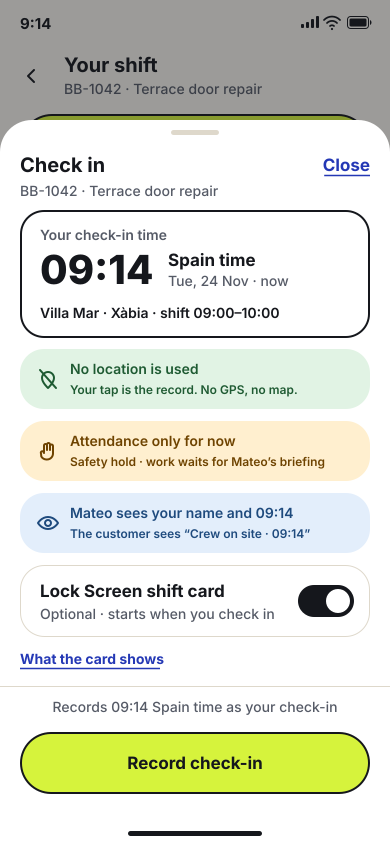

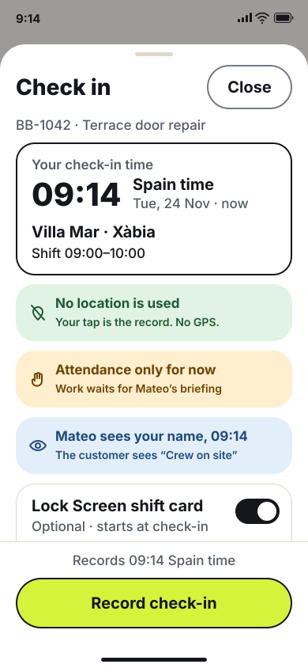

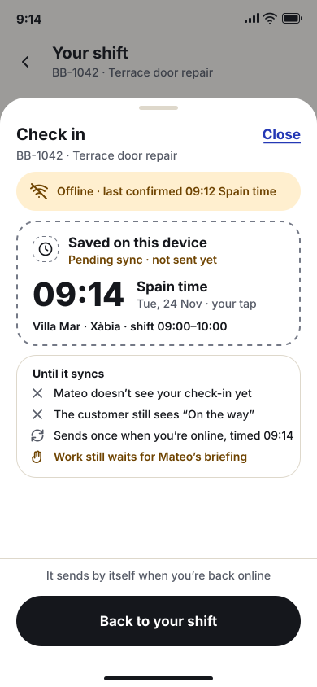

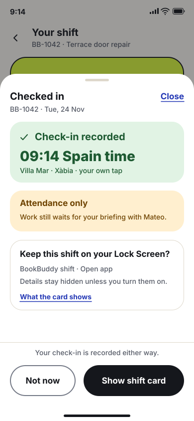

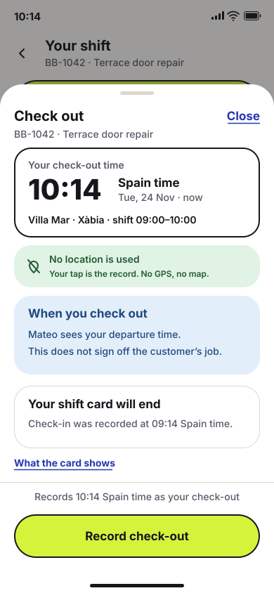

**Purpose and routes.** Record one deliberate attendance event on one confirmed assignment. **Check in** or **Check out** on W-01/W-04 opens the sheet; **Record check-in** or **Record check-out** is the second tap. The default W-11/W-12 **Open app** cue opens W-04 after unlock. Only a detailed card can offer the check-out link that opens this sheet after the worker and shift have been checked. Neither link records attendance. Close returns to the same record. **What the card shows** opens S-18 and preserves the pending choice; inspect the current event again on return.

**Layout and data.** The top card names the event, job, site alias, date and site time. The displayed time is a preview; capture the actual time of the deliberate final tap. No location permission, foreground fix, coordinates, boundary or map is involved. At Villa Mar the foreman sees Diego’s check-in. Claire sees only **Crew on site · 09:14** when the server accepts the first crew arrival; later workers’ arrivals add no customer stamp. An amber notice says **Attendance only** while version 2 is on hold. This receipt is neither permission to work nor the employer’s statutory working-time register.

**Interactions and states.**

- **Ready:** confirm that the worker is assigned, the event is in order for that shift and there is no existing receipt for it. On the online path at 09:14, keep the action busy until the server answers. “Checked in” requires a receipt. Preserve that receipt in W-04 when the sheet closes, alongside the hold. Show a separate check-out sheet when Diego leaves at 10:14. Checkout records his departure, not job completion or customer sign-off.
- **Saved on device:** if offline with an authorised cached assignment, save the event once, scoped to worker, shift and business, with capture time and a stable operation ID. Show the dashed card **Saved on this device · pending sync**. At 09:14 in the alternate branch, last confirmed at 09:12, neither Mateo nor the customer has received a new stamp from Diego. Do not start a confirmed shift timer or suggest that the hold cleared. If storage fails, say “Not saved” and give a foreman/help route; do not show a pending receipt.
- **Reconciliation:** preserve both tap time and server receipt time. A later check-out can queue behind a locally saved check-in; replay in capture order, rechecking assignment and event order. A repeat tap, lost reply or second device must resolve to the existing receipt, never two arrivals. If an arrival is rejected, flag it and the dependent departure for resolution rather than confirming a departure without an arrival. Keep the author’s reason-safe outcome and a route to Mateo; corrections are new, attributed stamps and never edits to the original F-13 history.
- **Optional shift card:** this is a per-device display preference, off until the worker opts in. The ready and large-text drawings show a worker who already chose **on**; a switch alone starts nothing. On first use, the recorded-state drawing asks **Not now / Show shift card** after the server receipt. Do not ask again after a choice unless the worker opens S-18. Both routes leave the attendance event intact. Start locally, in the foreground, only after confirmed check-in and opt-in. If a pending check-in syncs in the background, wait for a foreground action; never push-to-start.
- **Lock Screen privacy:** the card opt-in does not allow details. With **Hide details** on, visual and spoken previews say only **BookBuddy shift · Open app**: no time, elapsed timer, status or check-out action. Details stay hidden unless the worker separately allows them in S-18. Device settings may hide even an allowed preview.
- **System limits:** the opted-in card is W-11 on iOS and W-12’s ongoing notification on Android. With details allowed, its timer shows *Since check-in*, not hours worked. Neither preview shows an address, customer or safety all-clear. End the card at check-out. At the iOS eight-hour limit, stop the timer and direct the worker to the app: no chaining and no automatic check-out. Dismissal, notification denial or unsupported hardware changes only the display. W-04 and W-06 remain available throughout. See the [platform research](../../../research/tech-stack/live-activities-and-geofenced-attendance.md) for lifecycle limits; the [owner’s no-location decision](../../../docs/decisions/2026-11-23-open-questions.md) governs attendance.

**Platform, accessibility and RTL.** Keep the sheet within the safe area, scroll the content and grow controls instead of truncating the time, hold or effect. At large text the sheet expands, Close has a visible 56-unit target and the 64-unit record action is reachable without dragging. Read title, worker’s event and site time, location notice, hold, audience, optional card and action. Never announce each minute of the clock. A confirmed result permits completion feedback; a draft, pending stamp or blocked tap does not. In RTL, mirror layout and navigation but isolate the job reference and each time value.

## W-07 Progress photos

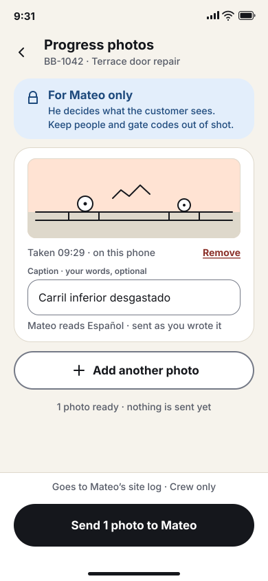

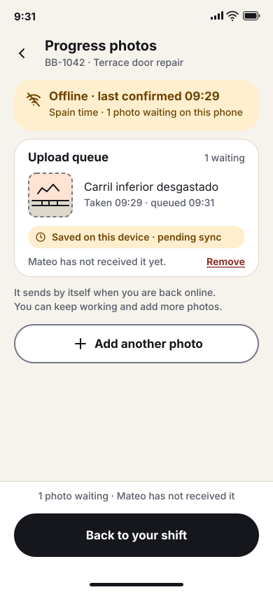

**Purpose and routes.** Send a progress photo of this shift to the foreman. **Progress photos** on W-04 opens W-07. **Add another photo** opens S-14 with two choices, Take a photo and Choose a photo; there is no voice option. Either choice goes through the native camera or picker to S-15 for review and back to W-07. Tapping a thumbnail reopens S-15. Back returns to the same shift with the draft or queue intact. Nothing is sent when Diego takes a photo, opens its preview or leaves the screen.

**Layout and data.** The header identifies the job. The notice, **For Mateo only**, names the recipient before Diego takes a photo and asks him to leave people and access codes out of the frame. A review card has a large preview, capture time, delivery state, **Remove** and an editable caption. The fixture shows the bottom track of the terrace door, taken at 09:29. Diego writes “Carril inferior desgastado”; Mateo reads Español, so no translation is needed. The dock gives the destination, “Goes to Mateo’s site log · Crew only”, and the count in **Send 1 photo to Mateo**. The customer sees no photo or caption unless Mateo separately shares it from F-13/F-17.

**Interactions and states.**
- **Review.** With no media, the dock offers **Add a photo**. After a capture it becomes **Send 1 photo to Mateo**. Diego can change the caption or select another photo without losing the first one. If the app cannot use a file, identify which one and keep the rest. Camera denied: offer the system picker and a route to device settings; dismissing the picker leaves the draft alone.
- **Queued offline.** If the connection is already down, the dock reads **Queue 1 photo**. After the tap, show the last confirmed site time, the queued count and a row for each photo with a dashed thumbnail, caption, capture time, queue time and “Saved on this device · pending sync”. Mateo has not received it. In the branch drawn, the 09:29 capture was queued at 09:31. **Remove** cancels a still-local send after confirmation; **Back to your shift** leaves it in the queue. Nothing in the queue counts as completion evidence.
- **Uploading or uncertain.** Recheck assignment, job and recipient before resuming the *same* queued send; do not redirect a private photo to a new foreman silently. Show each item's progress and retry only unfinished items. If the server may already have received a photo, resolve its receipt before retrying or claiming it was removed. A change of access stops the upload and hides the restricted material.
- **Sent.** On the main timeline Mateo's site log records the photo at 09:31. The row now says “Received in Mateo’s site log · 09:31 Spain time”; the time of receipt is separate from capture and does not claim Mateo viewed it. **Back to your shift** returns to W-04. Mateo's own “Old rollers out” at 09:36 is a separate customer-visible stamp.

**Platform, accessibility and RTL.** Only the selected attachment is used; strip location metadata before upload. VoiceOver and TalkBack read the destination notice, photo number, caption, capture time and delivery state, then the controls. A photo without a caption is still identified by number and time. Announce receipt or failure once, not every percentage. Caption editing keeps the focused field above the keyboard. At large type the metadata, status and remove control stack; no text sits on a photo. In RTL the rows and buttons mirror but the picture and camera glyph do not; the caption keeps its own language and direction.

## W-08 Availability

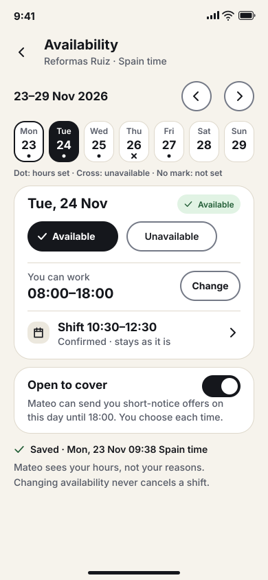

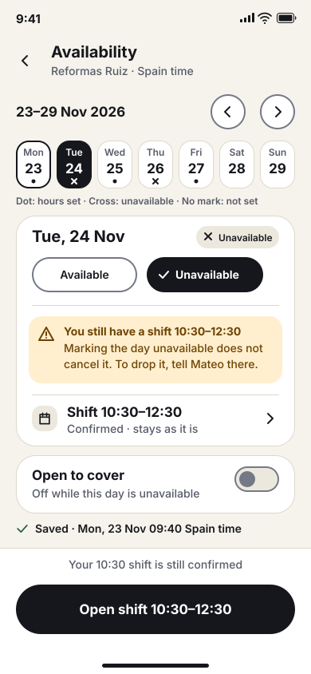

**Purpose and routes.** Tell Reformas Ruiz when Diego can work and, separately, whether he wants short-notice cover offers from his own crew. This is a pushed screen, not a fourth worker tab. Open it from W-02 Shifts, the availability row on W-01, or a conflict on W-03 (already focused on the offer date). A confirmed-shift row opens W-04. Back returns to the caller; returning to an offer checks its deadline and availability again and does not accept it.

**Layout and data.** A week strip in Spain time has previous and next controls, today's outlined date and one selected day in ink. The legend distinguishes hours set, unavailable and not set. The selected day has two choices, **Available** and **Unavailable**, availability hours with **Change**, and a separate list of confirmed shifts. On Monday 23 November the fixture shows Tuesday's hours, 08:00–18:00; Diego's next shift is already booked for 10:30–12:30. His hours are not a claim that he is free for that entire interval. **Open to cover** invites offers only in his remaining free hours, here until 18:00. Its receipt applies to this day and business. Nobody outside the provider sees his availability or reasons.

**Interactions and states.**
- **Available.** Selecting a day only opens its details. **Change** edits the start and end in site time, with **Save hours** and **Cancel**. Check missing endpoints, overlapping intervals and ambiguous local times before saving. Split an overnight interval across the two labelled dates. Until the server accepts the change, the saved hours stand. A day with no hours set says “Not set”; it is not silently marked unavailable. The unchanged overview has no dock.
- **Open to cover** applies immediately on a confirmed save. Turning it off stops new short-notice offers; it does not withdraw a reply already sent, accept an offer, reserve a slot, prove eligibility or change a shift. W-01 reflects the same saved setting. The foreman still checks availability and eligibility before confirming any assignment.
- **Unavailable.** The switch is off and labelled “Off while this day is unavailable”. With no assigned shift there is no conflict and no dock. Returning to Available requires a time window and an explicit choice to reopen cover.
- **Conflict** (drawn). Marking Tuesday unavailable affects *new* offers only. The existing 10:30–12:30 shift stays confirmed. The warning names the overlap and **Open shift 10:30–12:30** takes Diego to W-04, where he can use W-05 to tell Mateo if he cannot attend. The same rule applies if an edited time range excludes only part of the shift. Turning availability back on does not resolve someone else's cover search.
- **Offline or changed elsewhere.** Show the last saved hours with their site timestamp and keep edits as unsent input. The foreman's board does not change until confirmed online. If the schedule has changed meanwhile, show the confirmed shift alongside the proposed hours and let Diego decide again; do not overwrite the saved value silently.

**Platform, accessibility and RTL.** Use native time pickers with a typed alternative. Provide explicit previous/next controls and a vertical date list when enlarged text no longer fits the week strip. A date reads, for example, “Tuesday 24 November, selected, hours set”; the shift row reads its confirmed state separately. The switch announces on/off, the date and expiry, not just its colour. Read any conflict before the shift link. In RTL, week navigation follows the locale; names, start/end pairs and references retain their written order. Use the site calendar even when the phone is in another zone.

## W-09 Site briefing

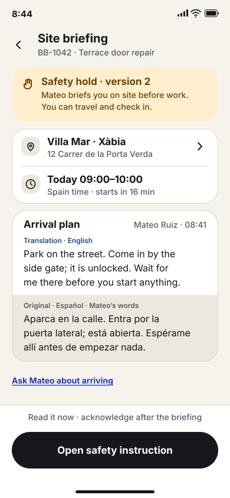

**Purpose and routes.** Read the arrival plan for a confirmed assignment and open the current safety instruction. Enter from W-01 or the briefing row or hold banner on W-04. The place row opens the assigned site's address details, not a live map. **Ask Mateo about arriving** opens the authorised S-10 Crew only conversation; it is not a private safety response. **Open safety instruction** goes to the current S-11 for Diego. Safety questions stay private to that version and its issuer in S-11. Back restores the caller. Neither opening this screen nor opening S-11 acknowledges anything.

**Layout and data.** In the 08:44 snapshot Mateo has confirmed Diego as cover at 08:40 and issued him version 2 at 08:41. The amber hand banner says “Safety hold · version 2” and explains that he can travel and check in, but not start work. The address and booked window (09:00–10:00 Spain time) are visible only after assignment. A twin card names Mateo Ruiz and the time he posted the arrival plan. Diego reads the English translation first and Mateo's Spanish original directly beneath it: “Aparca en la calle. Entra por la puerta lateral; está abierta. Espérame allí antes de empezar nada.” Both are visible without a tap. There are no gate or alarm codes. The arrival note is not the issued safety instruction: the dock goes to S-11 for the exact wording and its record.

**Interactions and states.**
- **Readable.** The assignment carries Diego's own instruction, not Nadia's earlier instruction or receipt. Mateo briefs Diego in person in Español, a language in which both can verify understanding. Diego explains the instruction back; Mateo verifies that teach-back on version 2 at 09:16. Only then can Diego acknowledge the *same* version online, at 09:17 in the fixture. S-11 records both people, version and times. Check-in at 09:14 is **Attendance only** and clears nothing.
- The hold remains until both receipts exist. Returning from S-11 refreshes the record; show “Hold cleared” **inside the app only** on a confirmed result. The separate instruction not to use the terrace door until Mateo clears it still applies. Clearing the hold does not itself start work.
- **Changed.** If Mateo replaces the instruction, mark the old version “Superseded”; “Briefing changed · review version {version}” links to the replacement. The earlier receipt remains in history, not as verification or acknowledgement of the new text. A read receipt, chat reply or machine translation never proves understanding.
- **Offline.** Label permitted cached context with the last confirmed site time. Withhold private access details when assignment cannot be checked. Do not present a cached “cleared” as current; the work gate stays closed until confirmed online. No queued safety acknowledgement. If a translation is unavailable, show the authorised original and “Translation unavailable”; use S-11 for clarification and arrange a human briefing in a language both can verify.

**Platform, accessibility and RTL.** Read the hold and what it blocks before place, window and arrival plan. Read the translated and original paragraphs with their own language tags. If the reader's language matches the original, show the paragraph once; the launch UI remains English or pt-PT. The hold does not rely on colour, and the action names the safety record. Content scrolls at large sizes without clipping the original or covering the dock. In RTL mirror the navigation, not the address, times or Spanish text; right-align an RTL original within its own strip.

## W-10 On my way [Sheet]

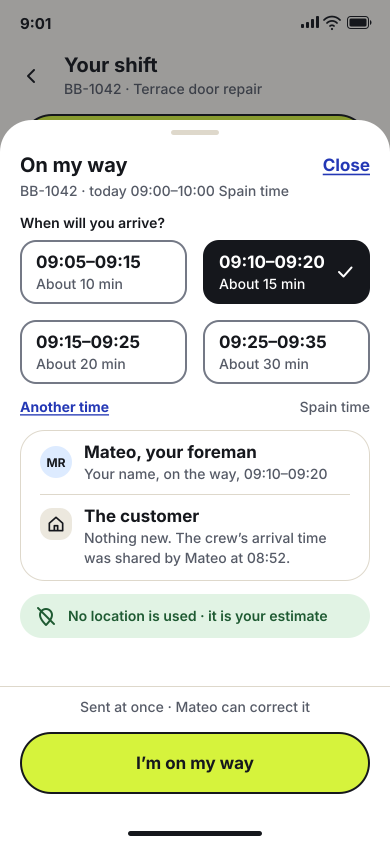

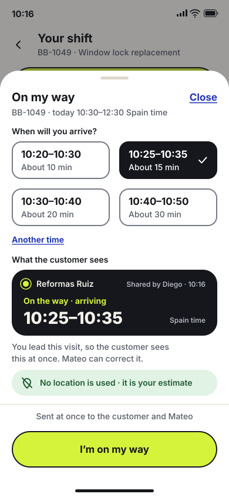

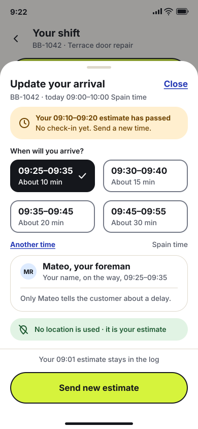

**Purpose and routes.** Declare departure with an arrival estimate chosen by the worker. The W-01 or W-04 dock opens this sheet for the worker's confirmed shift. After departure, **Update your arrival** on W-04 opens it again. Close returns to the caller without sending. A confirmed send returns to the live shift with its new stamp and check-in as the next attendance action. No declaration is needed to check in if the worker is already there.

**Layout and data.** Over the dimmed shift, the sheet names the job, booked window and site zone. Each arrival choice shows an *absolute band*, then a rough duration; the selected chip has a check. **Another time** opens a time picker. The preview is bound to the selected band and the worker's actual role *on this visit*. The green strip says “No location is used · it is your estimate”. No route, position, distance or automatic ETA lies behind the choices.

**Interactions and states.**
- **Ready, crew member.** Diego is confirmed cover on BB-1042; Mateo leads the visit. At 09:01 Diego chooses “09:10–09:20 · About 15 min”. Mateo sees Diego's name, “On the way” and the estimate. The customer sees *nothing new*; the crew-level band already on C-09 is Mateo's 08:52 update. **I’m on my way** sends only the per-worker stamp to the foreman's board and site log. Neither opening the sheet nor choosing a chip sends it.
- **Ready, crew lead.** The second artboard uses Diego's later 10:30–12:30 shift to show the other audience. He is the designated lead on this visit. At 10:16 he selects 10:25–10:35. The preview shows exactly what the customer will see: provider, “On the way”, band and shared-by name and time. His deliberate send publishes the crew-level update directly to the customer **without a second foreman approval**. The per-worker stamp still goes to Mateo. Use site and viewer clocks where they differ.
- **Sent.** Show “You told Mateo · 09:01 Spain time” (or the crew lead's “Shared with the customer and Mateo”) only after the server records it. A foreman correction or withdrawal from F-17 is a new attributed stamp, not an edit to the worker's words or attendance. Changing the reported arrival never changes the booked window.
- **Late update.** If the band passes without a check-in, state the last estimate and “No check-in yet”, not “Late” or “Arrived”. In the alternate 09:22 branch Diego picks 09:25–09:35 and **Send new estimate**. His 09:01 stamp remains. As a crew member he still tells only Mateo; a lead sees the customer preview again. Close and check in from W-04 if already there. An accepted check-in supersedes a departure estimate.
- **Offline, uncertain or invalidated.** Do not broadcast or queue an estimate while offline. Keep the selection visible with “Not sent · connect and check the time again”; the dock is disabled. Resolve an outstanding send before allowing another. Before publication recheck the same assignment, lead role, shift state and band. If the role or audience changed, show the new preview for a fresh deliberate choice; if already checked in or no longer assigned, close the send path. A schedule, clock or push can never publish this stamp or start the shift card.

**Platform, accessibility and RTL.** The sheet has a visible Close control, and the action stays above the home indicator or Android navigation inset. The screen reader encounters the selected band, duration, zone, recipients and privacy notice before the send action. Another time uses the platform picker with typed entry where supported. At large sizes the two-column choices stack and the preview scrolls. The directional controls mirror, not the digits within a band. Reduce Motion removes any pulse in the preview; give a haptic only after a confirmed send.

## W-11 Shift Live Activity [System · iOS]

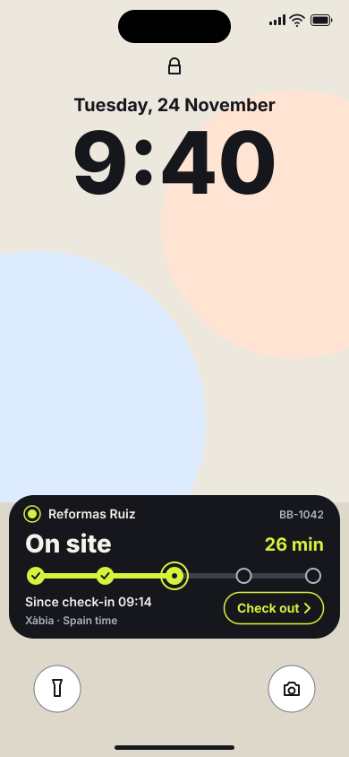

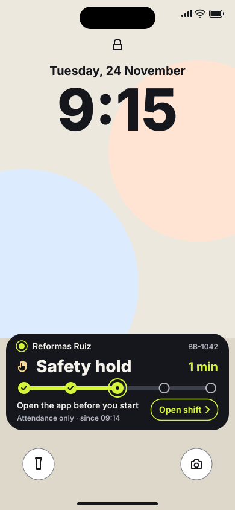

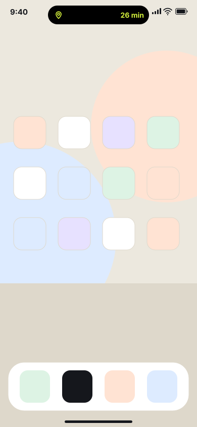

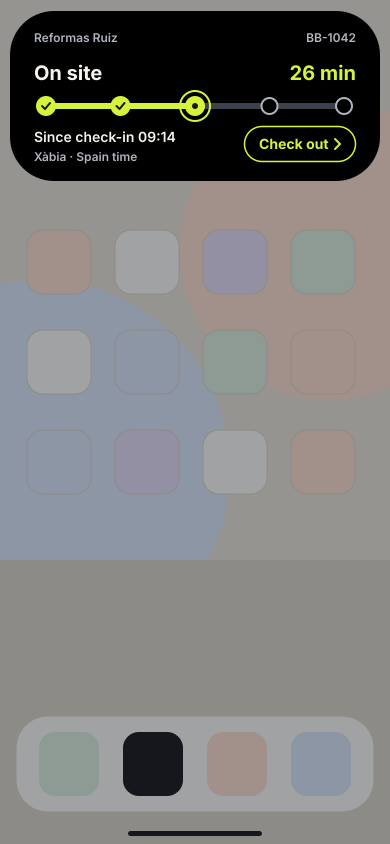

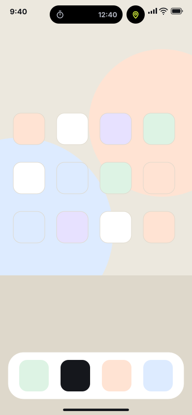

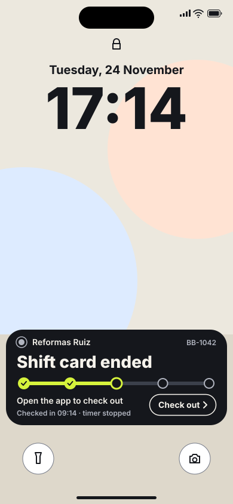

**Purpose and routes.** Keep the shift on the Lock Screen and in the Dynamic Island after Diego deliberately checks in on W-06. Start locally, in the foreground, only with a confirmed check-in and his opt-in for this phone. W-06 asks once; S-18 holds the preference. Nothing starts at assignment, departure, scheduled arrival, background sync or on receipt of a push. Tapping the body opens W-04 after unlock, with W-01 as parent on cold launch. **Check out** opens the W-06 sheet over W-04; it is a link, not a direct attendance action. Resolve the current account, Worker grant, business, shift and attendance state before offering confirmation. Wrong granted role: S-07, never silent switching. No access: S-16, with no restricted detail.

All W-11 artboards show the detailed preview, after the worker separately allows details in S-18 and the device permits them.

**Layout and data.** The Lock Screen card is the capsule at 370 × 160, laid out as C-19: the provider and the job reference; the state "On site" with a system timer in lime; the day line without captions at step three of five; then "Since check-in 09:14" with the coarse area and the zone, "Xàbia · Spain time", and the link. The site alias is the town only. The compact island has the pin glyph leading and the timer trailing, at most six characters ("26 min"). The minimal island is the pin alone. The expanded island repeats the card with the same link. The timer counts from the recorded check-in and is drawn by the system; it is labelled "Since check-in" and is never called hours worked.

**Interactions and states.** The card is updated by the app on the phone, on a change of state only. Nothing is sent for timer ticks.
- Since check-in (drawn at 09:40): "On site", "26 min", "Since check-in 09:14".
- Safety hold (drawn at 09:15): the state reads "Safety hold" with a hand glyph, the line says "Open the app before you start" and "Attendance only · since 09:14", and the link becomes **Open shift**, which opens W-04 and its hold banner. The compact island shows the hand and "Hold" in place of the pin and the timer. Check-out stays available in the app.
- When the hold ends, the card returns to "On site". Diego acknowledges on S-11 with the app open, so the app updates the card then. Nothing on the card says "cleared", "safe" or "start work".
- The card stays at "On site" from check-in to check-out. It does not move to Working or Finished: work starts only after a hold is cleared, so a "Working" card would be an all-clear in other words. W-04 shows the work stage.
- A new instruction while the phone is locked can trigger an ordinary alert opening S-11. A local Activity update depends on the app getting runtime; absence of a warning is never evidence of clearance. If freshness is uncertain, stop the animated timer and pulse, show the last confirmed check-in with “Open shift for current status”, and keep any known hold warning. Check the current instruction in the app.
- Offline check-in remains “Saved on this device · pending sync” on W-06; it does **not** start a card that says “On site”. After reconciliation Diego can open the confirmed shift in the foreground and choose to show the card, using the original accepted check-in time for the elapsed display.
- **Check out** only opens W-06. At confirmed check-out, end and dismiss the card promptly. A check-out pending sync stops the live timer without claiming a receipt; the unresolved event is visible on W-06.
- **Ended at 8 hours** (17:14 in the long-shift branch). The iOS cap is measured from the activity's start, not the end of the booked window. The final presentation has a static open ring, no elapsed timer, “Shift card ended” and “Open the app to check out”. It leaves the Island; iOS can retain the final Lock Screen snapshot for up to four more hours. This is not a 12-hour timer. Do not chain or restart the activity. No attendance event results from expiry, and W-06 remains available without the card.
- If Diego removes the card, turns Live Activities off or never opts in, nothing else changes. W-06 and W-04 work the same.
- With **Hide details** on by default in S-18, the locked presentation says “BookBuddy shift · Open app”. It shows no provider, job reference, site, check-in time, elapsed timer or shift status. The Dynamic Island also reveals no shift details. Respect any stricter device setting.

**Platform, accessibility and RTL.** With details allowed, VoiceOver reads the card as one sentence: "Reformas Ruiz, BB-1042, on site, since check-in 09:14, 26 minutes", then the link. The generic preview announces only the generic copy and link. The timer is not announced on every tick. The hold is carried by the hand glyph and the words; the amber is not the only signal. iPhones without a Dynamic Island show the Lock Screen card only. iOS versions without Live Activities show no card and lose nothing else. The system draws the card in its own light or dark treatment. At large text the area line is dropped before anything else; the state, the check-in time and the link label are never cut. In RTL the rows and the day line mirror; the time and the reference are isolated.

## W-12 Shift ongoing notification [System · Android]

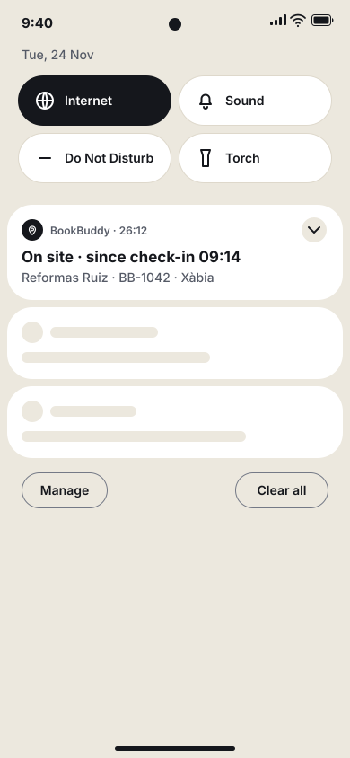

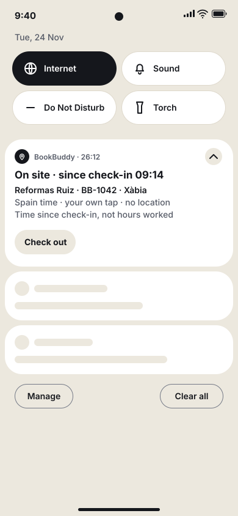

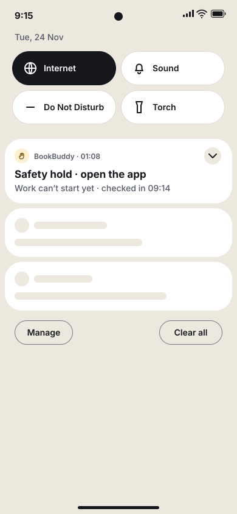

**Purpose and routes.** The same shift status on Android, as an ongoing notification. The app posts it when a check-in is recorded on W-06 in the foreground and the worker has said yes to it. If notifications are not yet allowed, the system permission is asked at that opt-in and nowhere earlier. A tap opens W-04 after unlock. **Check out** opens the W-06 sheet over W-04.

All W-12 artboards show the detailed preview, after the worker separately allows details in S-18 and the device permits them.

**Layout and data.** Collapsed: the pin as the small icon, "BookBuddy", a system chronometer that counts up from the check-in, the title "On site · since check-in 09:14" and one line of text, "Reformas Ruiz · BB-1042 · Xàbia". There is no progress bar, because time since check-in is not progress. Expanded adds "Spain time · your own tap · no location", "Time since check-in, not hours worked" and the one action. The notification uses the standard template, so the drawing shows no custom layout.

**Interactions and states.** The notification is posted silently, because the check-in was the worker's own tap a moment before. It is updated in place on a change of state.
- Collapsed (drawn at 09:40 with details allowed) is the standard format in the shade and on the Lock Screen. In the detailed preview the title carries the check-in time in words, because the chronometer alone ("26:12") can be read as a clock time.
- Expanded (drawn) shows the provenance line and **Check out**, which only opens the app.
- Hold (drawn at 09:15): the icon becomes an amber hand, the title "Safety hold · open the app" and the text "Work can't start yet · checked in 09:14". Expanded, the action is **Open shift**. When the hold ends the notification returns to "On site" and says nothing about clearance.
- Do not post a live chronometer for an offline check-in pending reconciliation. Show its pending state in W-06. A later receipt can support a foreground opt-in on the confirmed shift; a background sync does not start W-12.
- At confirmed check-out remove the notification. Stop the chronometer on a pending local check-out without presenting it as confirmed. W-06 owns the receipt and recovery.
- **Dismissed.** On Android 14 and later most ongoing notifications can be swiped away while unlocked. That neither checks Diego out nor changes his preference. Do not immediately repost. Instruction alerts are independent of the attendance channel and of the card's visibility.
- Use an OS timeout to retire the routine shift display (eight hours in this design, a product bound, not an Android platform limit). Expiry removes a display, not attendance; W-04 and W-06 stay available. Do not post a second notification claiming “still checked in” without a fresh record.
- No Android 16 Live Update is requested. A routine shift clock is not a short, time-critical phase, so the standard notification is the whole design.
- With notifications off for the app or the channel, nothing is posted; W-06 says so once and check-in is not blocked.
- With **Hide details** on by default in S-18, the locked notification says “BookBuddy shift · Open app”. It shows no provider, job reference, site, check-in time, chronometer or shift status. Respect any stricter lock-screen setting on the device. Unlock and recheck access for all links, including **Check out** when shown. A stale or inaccessible target never records attendance.

**Platform, accessibility and RTL.** TalkBack reads only the generic copy and link in the generic preview. With details allowed, it reads the title, the text and then the elapsed time once on focus. The action is a labelled button at least 48 dp high. The notification has its own channel, "Shift status", which the worker can silence without losing offers or instruction alerts. Colours and shapes follow the system theme. In RTL the system mirrors the template; times stay in their written order.

## Navigation

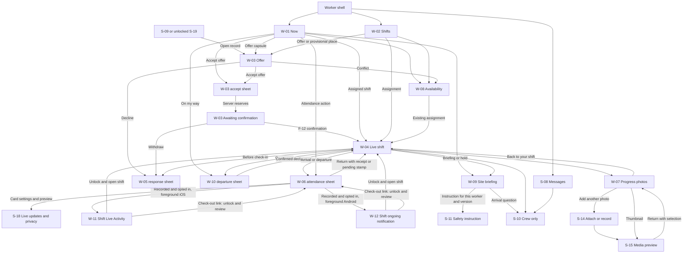

## Open design questions

- **Reservation outcome:** what wording best distinguishes a foreman releasing the place from the five-minute review expiring? Neither outcome is a worker dropout.
- **Dropout reasons:** Transport is the F-16 example, not a required disclosure. Which optional categories are useful to the provider and for how long should it retain them? Is no reason sufficient instead of a “Prefer not to say” chip?
- **Attendance exceptions:** which named provider contact handles a rejected event, a worker without a usable phone or a disputed time? Who may authorise a correction? No path should require location or overwrite the original stamp.
- **Field and language review:** test the stacked controls with real workers in daylight and review “oferta de substituição” with a pt-PT speaker. Arabic is a mirrored-layout tolerance fixture only, not an enabled interface language.
- **Glance vocabulary.** Can workers distinguish “On site · since check-in” from time worked without reading the expanded explanation? Test it alongside the hold presentation; never replace it with a payroll clock or a Lock Screen all-clear.
- **Cover hours.** Do workers need an open-to-cover end time earlier than their last available hour? The fixture uses 18:00 for both. Neither setting should change an existing assignment.
- **Arrival choices.** Are four ten-minute bands plus **Another time** useful for crews travelling between nearby jobs? Test the choices with the actual time and recipient visible; do not infer the estimate from location.
