# Customer screens C-09–C-17

Claire Martin follows **BB-1042 · Terrace door repair** at **Villa Mar · Xàbia**. Reformas Ruiz is the provider; Mateo Ruiz is Claire’s named foreman and contact. The booked work visit is **Tue, 24 Nov · 09:00–10:00 Spain time** (`Europe/Madrid`); Claire’s optional UK display is **08:00–09:00 your time**. Approved quote v1 is **€240.00**; C-15 and the open case show separate branches, not changes already applied to the signed-off and paid examples.

## Rules for this slice

- **Navigation.** C-13 is a Customer tab root (Jobs, Properties, Messages, Account); the other screens are pushed or presented over a caller, without duplicate tab bars. iOS uses native navigation Back/edge swipe and sheet detents; Android uses Up and system/predictive Back (keyboard, then sheet, then route). Sheets have explicit Close, trap accessibility focus and return it to the trigger. Never stack overlays. On cold links, verify access and rebuild the authorised C-05, C-13 or Jobs parent; S-16 explains invalid or inaccessible links without revealing the underlying record.
- **Authority and connection.** Viewing a property or job does not grant approval, sign-off, payment, booking changes or inviting. Check the particular capability and the exact version immediately before submitting. If the same account authored the commercial proposal, do not allow it to approve it in Customer context. On revoked access, remove restricted content and actions immediately on recheck; don't expose hidden records in search, history, notifications or drafts. Show last confirmed time on cached records; no offline approval, checkout, change to booking or new grant. Check the result after an interrupted request before offering a retry. Differentiate draft, sending, pending reconciliation, failed and confirmed.
- **Interaction and accessibility.** Use native focus, at least 44 × 44 pt iOS / 48 × 48 dp Android targets (48 common), Dynamic Type/font scaling, and text plus icon for meaningful statuses. At larger text sizes, stack actions and let pinned regions grow or move into scroll; never truncate dates, grant limits, amounts or consequences. Focus a new route’s heading, keep focus during background refresh, announce meaningful updates politely, and focus the first invalid field on an explicit submit attempt. Buttons show pressed/focused states and keep their intent while processing. No haptic for merely opening a route, pending sync, failure or ordinary taps; one optional platform success cue follows verified completion of a consequential action. Platform motion, vibration and accessibility settings always apply.
- **Language and dates.** Localise whole phrases, dates, plurals and currency formats, keep EUR and stable identifiers, and isolate mixed-direction values and names. Localise explicit status and error copy; never machine-translate a receipt’s official values or replace agreed source text. On differing content languages show labelled translation first and the readable original immediately below; show same-language content once or the original with translation status on failure. Allow expansion and RTL mirroring of chrome/leading order, without reversing digits, names, times, media controls or identifiers. Display the site zone first; optional local time may use a different date and never changes a booking.

## C-09 · Job day

**Purpose and entry.** C-05’s booked visit and S-09 day/crew events open this record. Back returns to C-05; after completion the next action can lead to C-10. The booking and the crew assigned to deliver it are separate facts.

**Layout.** Stack header with job reference; Calendar/day card with the agreed arrival window and both zones in the abroad fixture; update Banner/Status badge; confirmed arrival roster List, with initials, names and roles; bordered Report an issue and pinned primary Message Mateo. Scheduled roster: Mateo Ruiz (Foreman, Reformas Ruiz) and Nadia Benali (Crew, confirmed). Replacement: Alba Navarro takes the confirmed crew place; Mateo, provider and timing stay the same. Rows aren’t worker profiles or contact links.

**Interactions.** Message Mateo pushes S-10 in the Job conversation; no Crew only option or worker DM. Report an issue pushes C-16 with job/visit context but doesn’t notify anyone until sent. If the provider proposes a different window, show it as proposed and link to C-08 while keeping the agreed one labelled. If an approved-scope decision is needed, link to C-15; neither a chat nor a cover confirmation changes the price or visit. Scroll the roster and updates; refresh the record by the native refresh gesture or a named retry button on stale/error, without resetting focus. No confirmation or haptic for consulting the roster.

**States and edge cases.** Scheduled: agreed window, not a live countdown or check-in. Delayed: show the reported delay separately from the original window and the next update only if known. Cover being arranged: show delivery risk and a foreman contact; show only still-confirmed names, no candidate, dropout reason or staffing detail. Crew updated: publish only the new confirmed roster, with update time/date and whether the window changed. On site: show only a customer-visible confirmed arrival, never infer it from GPS, clock or chat. Completed: route to completion evidence once submitted; show neutral completion/submission status accurately. Empty roster, loading and cache are distinct (e.g. “No confirmed crew to show yet” versus “Last confirmed …”); if a record can’t be verified, don’t retain visible inaccessible details. Contact can save an eligible chat draft offline but a queued message isn’t delivered.

**Platform, focus and locale.** iOS native Back/refresh; Android Up/Back and equivalent refresh with a button fallback on errors. Read header → visit/date/zone → update → foreman and crew rows → issue → message. Announce “Crew updated. Alba Navarro confirmed. Arrival window unchanged” without moving focus. Skip initials and calendar illustration; let names and roles reflow independently. Read arrival as a range with both zones named; in RTL mirror card icon placement but preserve the chronological window.

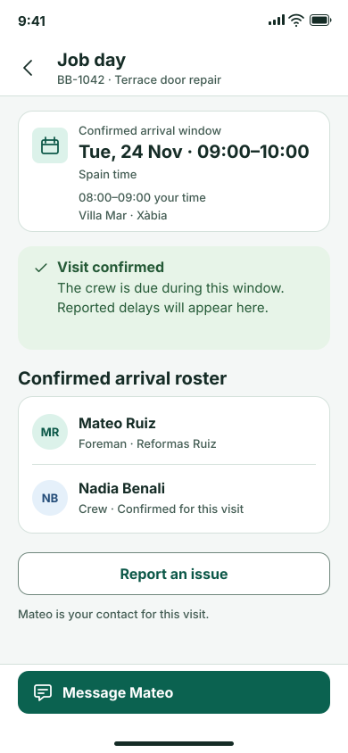
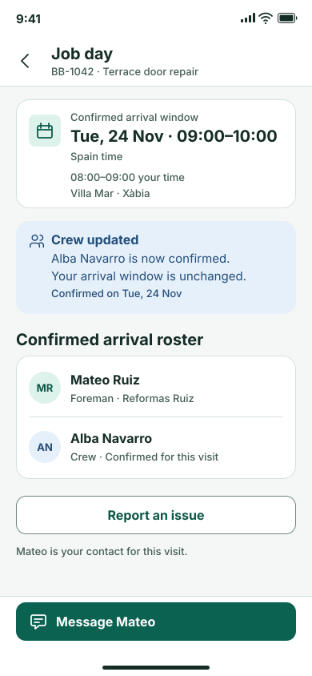

## C-10 · Completion and sign-off

**Purpose and entry.** C-05 or an S-09 completion event pushes the foreman’s submitted completion. The customer compares it with the approved scope, not with the latest proposed change. Back returns to C-05; after confirmed sign-off, View payment opens C-11 when authorised. Report an issue opens C-16 without accepting the work.

**Layout.** Stack header; Awaiting sign-off Status badge and provider; Approved work section with quote version and total; completed-item List with passive checks; Shared evidence heading and media preview row; note card; decision explanation and pinned secondary Report an issue and primary Review sign-off. Approved v1 includes terrace door adjustment and roller replacement; glass replacement is excluded. Mateo reports “Terrace door adjusted” and “Rollers replaced,” publishes one photo captioned “After adjustment,” and notes “The door slides and closes smoothly with the new rollers.” The SVG drawing depicts the sample thumbnail, not additional evidence.

**Interactions.** Photo row opens S-15 with the caption, media gestures and native Close; return to that row. Review sign-off opens S-17 naming Claire in Customer context, the property, submitted completion and approved version(s). It says “Sign off work,” not “Pay” or “Close job.” Confirm online against the reviewed completion and grant; Cancel returns without changes. Persist confirmed actor, version and time on C-10/C-05; confirmation never submits a payment. Report an issue passes the relevant completion item to C-16, which retains its own draft. Checklist rows are evidence, not checkboxes; partial sign-off is not offered on this surface.

**States and edge cases.** Awaiting sign-off with reviewed evidence; evidence unavailable distinguishes still uploading, not shared, deleted, retrieval failure and no attachment. Retry only unavailable media; don't imply its contents prove completion. If evidence is required but unreceived, or completion changes during review, block confirmation with the reason and surface the new record rather than applying consent. Current record may be accepted (read-only history and next step), issue open (link to case; distinguish affected item and status), or unauthorised (explain missing sign-off grant, no active CTA). A withdrawn submission or disputed item should not appear accepted. Offline shows authorised cached evidence where available, sign-off disabled and issue draft entry if eligible.

**Platform, focus and locale.** S-15 uses platform full-screen modal/back/gesture behavior with a labelled Zoom alternative, S-17 uses the platform confirmation presentation with the same copy and safe focus. Read heading → status → approved version and completed items → captioned photo → Mateo’s note → consequences → actions. Checks are read as “Reported complete,” not as selected controls. Evidence and notes wrap, actions stack, and translated notes and captions retain their Spanish original when present; checklist status labels are localised UI text.

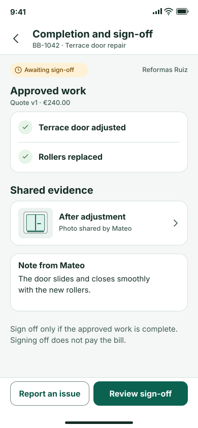

## C-11 · Payment and receipt

**Purpose and entry.** C-05, confirmed sign-off on C-10, or an S-09 bill/receipt event opens the authorised bill. Sign-off and payment are independent. Back returns to the caller; checkout and share return to this same bill; Get payment help opens C-16 with the bill/payer’s permitted context or S-16 if the bill cannot be accessed.

**Layout.** Header; bill summary Card (biller Reformas Ruiz, amount due, currency EUR); outcome Banner; bill details or receipt List; support and pinned action. Due fixture: approved v1, €240.00; no receipt yet. Failed fixture: confirmed failed attempt, no charge for that attempt, €240.00 still due. Paid fixture: €240.00 paid, no remaining balance, receipt ready; View receipt and Share receipt replace all pay actions. Do not show partial card details unless supplied by the authorised record and useful to identify the transaction.

**Interactions.** Pay €240.00 opens authorised processor checkout after a fresh bill and payer-grant check; the processor collects payment details and handles authentication. Returning, cancelling or losing the connection doesn’t establish settlement: reconcile against the bill on return or first re-open, keep a single in-flight attempt and suppress duplicate checkout. Show Try payment again only once a final no-charge outcome is known and confirm the current balance before a new attempt. View receipt opens the confirmed document; Share receipt opens the native chooser after explicit tap; no auto-share and no exporting an inaccessible record. Use a persistent help route for discrepancies. A verified outcome can announce completion, not the processor’s animation or redirect.

**States and edge cases.** No amount due yet: say why if known, without an invented zero-value bill. Due: show current amount, biller and permitted payment action. Checkout cancelled without a charge returns to Due only after reconciliation. Processing, uncertain, partial response or stale record: no retry/pay; show “Checking payment” or timestamped status with retry-status check, not a new charge. Failed: do not assert no charge for an ambiguous result. Paid but receipt pending: paid status stays, document is absent with a reason/status. Amount on hold: identify affected amount, remaining payable amount if authorised, and case link; no claim of escrow. Adjusted, partially refunded or refunded: show confirmed signed amounts, date and balance from official records, with original and amended receipt availability as recorded. A later adjustment is not a new authorisation to charge; stale or changed total requires fresh review. Read-only/no payer grant or offline: no checkout; preserve authorised read-only bill/receipt without exporting restricted content.

**Platform, focus and locale.** iOS system payment/authentication/share surface when supported; Android equivalent provider or native handoff; a system return must restore the bill without losing history. Read biller → due/paid amount and EUR → outcome → bill/receipt details → help/action. Update outcome with a polite announcement; don’t auto-open the receipt. Use full locale currency formatting with EUR retained; screen readers read the currency and amount once per field, not the visual symbol as a separate action.

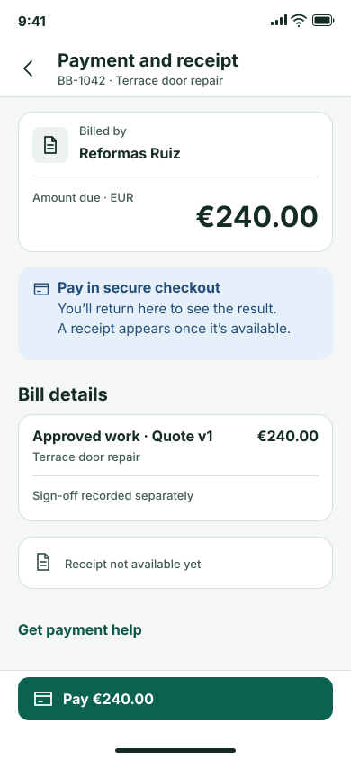
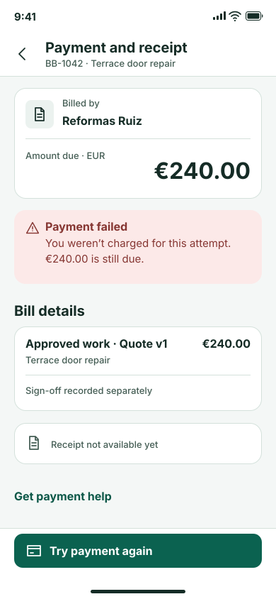
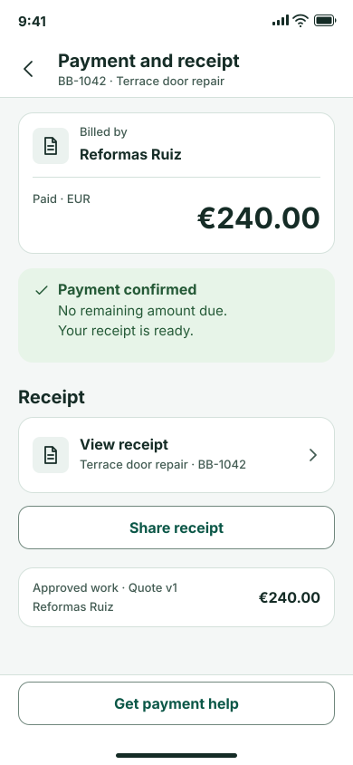

## C-12 · Leave a review [Sheet]

**Purpose and entry.** Optional feedback from C-05 after service closure or its post-closure prompt; later from L-05 after attendance if eligible. The drawing opens over the closed job. Close, swipe-to-dismiss and Android Back return to the same parent; a review does not affect payment, case handling or closure.

**Layout.** Dimmed parent; Bottom sheet with handle, title and Close; job, property and named provider; five adjustable rating choices with visible numbers and endpoint meanings; persistent optional Comments label and multiline Input; helper and Send review. Unrated is shown, with disabled Send. The stars are discrete choices, not a slider.

**Interactions.** Tap 1–5 to choose or change the rating, with a checked state and optional selection feedback. Submitting never happens on a star tap. Optional text opens native IME and expands the sheet; it can be cleared independently. Save an eligible local draft on normal dismissal; reopening restores it while access remains. If saving the draft is unavailable, ask before discarding using a replacement confirmation, not a stacked modal. Validate selection, keep comments on a retry, and only close on server-confirmed success, with a persistent “Review submitted” state on the parent. Don’t use review as the primary way to report an issue.

**States and edge cases.** Unrated, draft (including offline, not sent), submitting, submitted (repeat opens confirmed status instead of a new submission), retry, and ineligible. Explain expired eligibility, unavailable account or revoked role generically and don’t leak details. If status is unknown after dismissal, reconcile before allowing another review. If authorship, audience or editable period depend on programme rules, disclose the actual audience and terms before submission; no assumed public posting, anonymity, star cutoff, review edits or moderation outcome.

**Platform, focus and locale.** Native detents and drag on iOS; Material modal sheet/IME first Back on Android. Focus title → Close → provider/service context → a single named Rating group (“1 of 5, very poor” through “5 of 5, excellent,” with selected state) → comments → helper → Send. At large sizes replace the tight row with an accessible wrapping list/radio group as needed. In RTL mirror leading layout and arrange options in reading order while announcing the actual rating value; never depend on star direction.

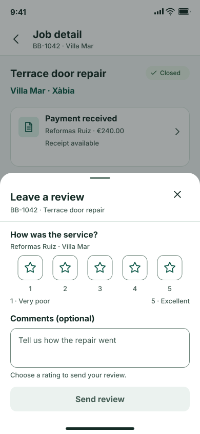

## C-13 · Properties

**Purpose and entry.** Customer Properties tab or C-03 property shortcut. Find a site, open C-14, or create a new eligible property. A C-03 entry is a selection flow without the tab bar; Back restores the request draft. The root artboard shows one active, owned site and its active-job count.

**Layout.** Root BookBuddy/Costa Blanca header and bell, page title, Search Input, Active/Archived filter Chips, property List with result count and single-target rows, Add property panel and fixed Customer Tab bar. Villa Mar · Xàbia, Owner, one active job. A delegated property shows the actual access label, e.g. “Managed · View only”; never infer ownership from “Site contact.”

**Interactions.** Type/clear search; filter only visible properties by display name, locality or authorised address; never index private access instructions. Select a chip to change the listing while keeping query text; tapping a property pushes C-14, or returns the ID into C-03 when picking an eligible request property. Add property opens C-14 New. From C-03 only a confirmed eligible property can populate the request; saving a property is not sending a job. Bell opens S-09 in Customer context. Tab taps restore authorised scroll and stack per the IA; a second tap on the selected tab returns to its root. No haptic on navigation or search.

**States and edge cases.** First use: add if eligible or explain how authorised access arrives. One/many and delegated; count, access and status can wrap. Archived selection shows only visible archived entries with no availability implied. Filtered empty names the filter or query and offers Clear; loading preserves headings, list error offers retry, offline shows Last confirmed and any permitted cached rows, not a false empty list. Create/edit can start as eligible drafts offline; cannot publish before verification. Refresh removes revoked access and clears invalid selections in C-03; never auto-pick another property with a similar name.

**Platform, focus and locale.** iOS uses the native search field and tab safe area; Android uses its search/IME and navigation insets. Focus header/Bell → page title → search and clear → filters (announce selected) → result count/rows → Add → tabs. Announce completed count changes, not each keystroke. Wrap address, role and job count; preserve “Xàbia,” compare search using locale-aware normalisation, and mirror tab order as defined by the design system.

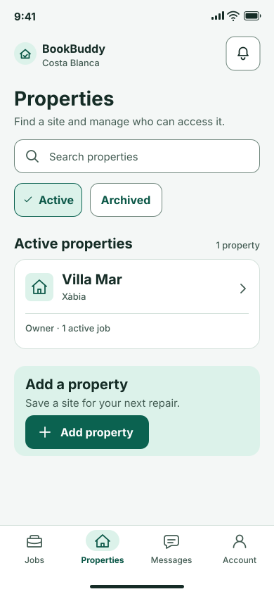

## C-14 · Property detail and people

**Purpose and entry.** C-13 site or Add property, C-03 add/edit and C-05 site link. Maintain the authorised site and its access; select a permitted job to C-05 or return a confirmed property to C-03. Closing stays within Customer context. No provider membership or worker assignment can be managed here.

**Layout.** Header; property Card with display name, authorised service address/locality and site contact; Edit details; access-notes Card with audience label; scoped Job card/List; People and permissions section with role/status rows, Permission details and pinned Invite someone. The fixture shows Villa Mar in Xàbia, Claire Martin as site contact and owner, the gate handoff note, and the booked terrace door repair. The artboard omits any street address or code; a real saved address is shown only to authorised readers.

**Interactions.** Edit details opens a local edit mode with persistent labels for property name, required address fields, contact and separately labelled access notes. Save validates required fields, shows inline errors, and revalidates address/service area and grants before persisting. No notes are sent to a crew offer or stored as an offline secret. Back keeps eligible unsaved edits; if they cannot be saved, present a discard-or-return decision. Job rows open permitted C-05 details; a newly added property has no job history. Permission details and any member row open readable scoped grants; only a permitted manager sees editing/revocation controls. Invite someone opens a bounded editor (full height with keyboard or large text): verified recipient entry, property, explicit permissions and a review of what can be seen or done. Validate destination and allowable grants; invite receipt is pending, not access. Verified invitee accepts through S-05. Resend/revoke only for the current grant or pending invite; show a confirmation with actor/property and effect before revocation. Return confirmed status to People; an open draft does not take effect.

**States and edge cases.** New/edit and unsaved changes; duplicate or unverified address/error; archived view with no new work or new delegation unless separately permitted; delegated read-only hides edit, invite and sensitive notes if not granted. Pending invitation is scoped and revocable; accepted counts only after verified acceptance; expired or revoked no longer grants access and cannot be “accepted” by opening an old link. Independent capabilities distinguish viewing jobs from sign-off, payment, quote/change decisions and delegating. Don’t let a manager escalate beyond their own grant or revoke the only authorised owner without a valid handoff; refresh on grant conflict and keep nonsecret permitted draft inputs. Do not assume creating a property settles ownership or assignments.

**Platform, focus and locale.** Use native edit keyboards, save/close and pending-invite confirmation, with equivalent Android IME/Back behavior. Focus heading → address/contact/Edit → access note → jobs → People/grant states → Invite; focus the first validation error, and restore focus to the changed row after a confirmed update. Label invite status in text. Allow address lines and permission descriptions to wrap; use country-aware address format and bidi isolation for identifiers and contact values without altering originals.

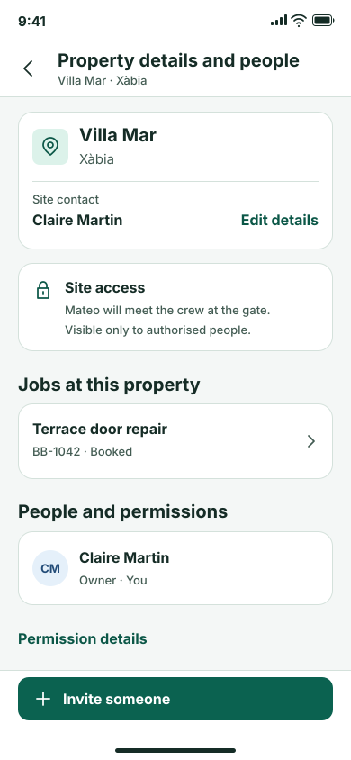

## C-15 · Review a job change

**Purpose and entry.** C-05 or S-09 change event pushes the current version or its permitted history. Back returns to C-05; an authorised timing revision goes to C-08 as a separate booking decision. This is commercial scope approval, not a chat reply or sign-off.

**Layout.** Header; Approval needed Status badge, provider, author and change version; stacked before/after comparison with Language badges and readable originals; approved total, signed delta, proposed total; calendar Banner for arrival impact; Decline change and Ask Mateo text buttons; pinned Review approval. The sample retains the approved door adjustment and rollers, excludes glass replacement, and proposes replacing the worn latch plate for **+€40.00** (new total **€280.00** versus **€240.00** approved). The booked arrival window is unchanged. Additions are labelled, not indicated only by green ink.

**Interactions.** Ask Mateo opens S-10 with a reference to the version; sending a question leaves it open. Review approval opens S-17 with item, author, Claire’s Customer/property context, original and proposed totals, version, scope/timing effect and an explicit “Approve change” action. Decline change opens a separate S-17 confirmation: proposed work is not authorised; any optional reason does not approve other work or cancel the visit. Both actions recheck open version, permissions and relevant records online; only a server-confirmed decision updates C-05 history. If a new window is required, route to C-08 with the existing booking still labelled current until confirmed. A hold links to C-16 if there is an authorised case; only explicitly affected work is held.

**States and edge cases.** Open, superseded/withdrawn/expired (read-only history with safe link to current proposal if authorised), approved, rejected, offline/read-only and issue on hold. Approved and rejected show recorded actor/date/versions. An obsolete notification or mid-confirmation revision must not approve a newer proposal, reuse an old price or silently dismiss a refusal; explain and reload the comparison. No same-author self-approval, implicit translation consent, or approving one part of a proposal by tapping a checklist row. In the absence of a valid approval, existing scope stays in force and uncertain/scope-dependent work remains held as appropriate. Missing translation leaves original and status readable; Ask Mateo stays the clarification route.

**Platform, focus and locale.** Native S-17 dialog on iOS/Android; Back/Cancel restores the exact decision trigger. Read status/proposer → approved translation/original → proposed translation/original → previous amount/delta/new total → timing impact → Decline/Ask/Review. At larger sizes or in RTL keep this order rather than comparing parallel columns; wrap with the signed adjustment and currency intact. Set original text language for speech synthesis; apply optional local-time display if the zones differ.

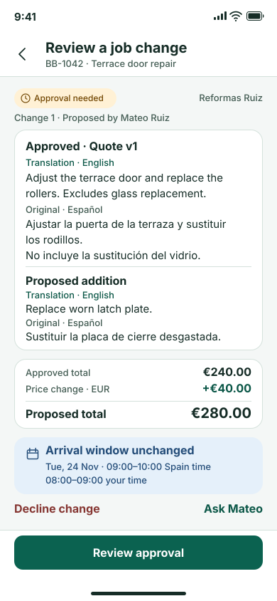

## C-16 · Report an issue or follow a case

**Purpose and entry.** Open from C-05, C-09, C-10, C-11, C-15 or S-16 through an authorised job; S-09 issue replies open the case, not a new report. Show an existing matching case when found rather than silently duplicating it. Back returns to the caller; View affected job/payment may reopen the authorised target from the case’s details.

**Layout.** Report mode: header, who handles the report, labelled category and affected item selectors, narrative field, optional evidence via S-14/S-15, audience Banner, pinned Send to local support. Case mode: Case open Status badge and reference, issue summary, case owner and next response if known, explicit effects, Timeline, View submitted report, pinned Add a case message. Example: Claire reports that the terrace door catches after the adjustment; BookBuddy local support acknowledges the case. The job isn’t signed off, there’s no amount due in this branch, and no response time is set. The case doesn’t create a hold by itself.

**Interactions.** Choose category (e.g. work quality, visit, bill) and an authorised affected item; offer Whole job / Not sure when exact item isn’t known. Enter narrative and optional evidence; show what will be sent and who can see it. S-14 opens the camera/library/audio paths as allowed, S-15 previews and permits removal of the user’s own unsent attachments. Do not send a report referring to still-pending media; wait, retry or explicitly remove it and send text. Send validates category, affected context and nonblank description; explicit send submits online, only a confirmed result creates a case and replaces the form. View submitted report opens read-only detail with original text and confirmed attachments. Add a case message opens a labelled, scoped composer in this record; no bleed into Job conversation or Crew only. Mark its success only after accepted. Route users needing another support channel to S-16 if an approved route is available, without guessing contact details or sharing extra job context.

**States and edge cases.** Draft, submitting, submitted, acknowledged, awaiting response, resolved, failed, cannot submit offline. Preserve safe eligible drafts with “Saved on this device · not sent”; no local support notification or case ID until receipt. On uncertain send, reconcile before enabling retry. Timeline records actual actor/date/zone, support updates and confirmed effects; no resolution by elapsed time or chat. Resolved shows the official outcome and recorded affected work/payment only; if replies are closed, offer authorised help instead of a reply box. State and explain a bill hold only when recorded; an issue does not sign off, cancel, settle or promise a refund. Scope changed/deleted: show safe explanation, revalidate impacted items and authorship; keep authorised nonsecret draft data when possible. Reporting from S-16 does not bypass the job grant.

**Platform, focus and locale.** Use iOS/Android native pickers and keyboard, with equivalent selection and denied-permission recovery via text or other media. Report focus: heading → category → affected item → message → evidence → visibility → Send; move to case title on confirmed submission. Case focus: reference/status → owner/expected response → effects → chronological timeline → report/reply. Append updates without moving focus. Per-paragraph direction for authored text and labels for translations; never convert case reference or promise a deadline when localising dates.

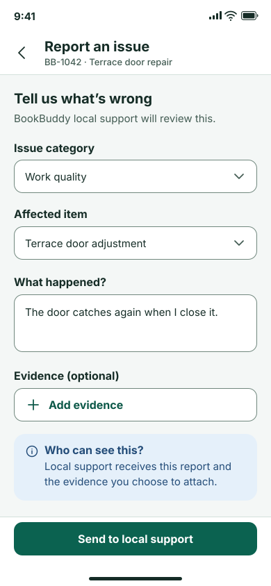
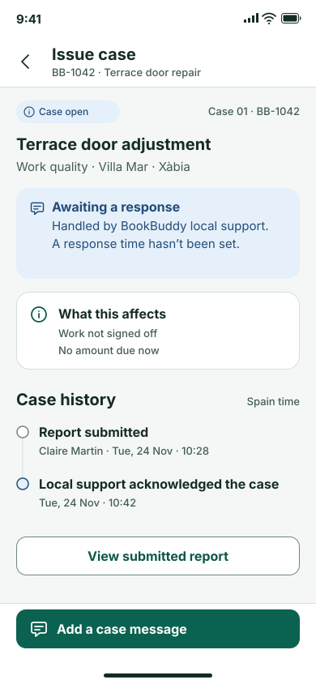

## C-17 · Cancel or reschedule [Sheet]

**Purpose and entry.** Open from C-05 or C-08 for an existing visit; later L-05 reuses the decision pattern with its own category terms and time picker. The fixture is over the booked C-05 parent. Close or Back leaves the booking unchanged and returns to the trigger.

**Layout.** Bottom sheet on dimmed parent; title, Close and job context; Calendar/day card with current site-time window and provider; Banner stating current booking and confirmation rule; primary Choose another time and destructive-styled Review cancellation. No amount is shown in this choice state: the contractual fee or no-fee outcome belongs to current verified terms shown before any request is sent. The first button never chooses a time for the customer, the second never cancels by tap.

**Interactions.** Choose another time dismisses the sheet and pushes C-08 (L-03/L-04 later), shows only current proposed times and keeps the existing window until confirmed replacement. If a provider needs to respond, surface “Reschedule requested,” the old window and next step; no available windows is not a cancellation. Review cancellation replaces the sheet content with the current approved terms, deadline/fee/payment consequences, provider-confirmation requirement and the exact item/role. The final action is “Request cancellation” if a response is required, or “Confirm cancellation” only if the product is authorised to cancel immediately. If a fee cannot be verified, block the submission rather than implying no fee. The safe action is Keep booking; Close preserves verified outcome and doesn’t discard/withdraw an already submitted request. Recheck slot, terms and authority online; changed terms require fresh review and consent.

**States and edge cases.** Eligible, provider confirmation needed, fee or terms changed, unavailable/restricted, submitting/unknown, requested, rejected and confirmed cancelled. Requested leaves the booking and its time visible; show provider decision and timestamp only when known. A past/started visit, missing grant, unresolved offline state or conflicting request disables the affected action and provides the right foreman/support route. If cancellation is confirmed by another authorised actor during review, reflect it and prevent duplicate submission. Never imply automatic refund, new booking or cancelled worker shifts until authorised state is received; billing adjustments appear separately in C-11 once verified.

**Platform, focus and locale.** iOS detent with explicit Close, Android sheet and Back with the same safe dismissal. Focus title → Close → current booking and rules → choose time → cancellation; replace focus with review heading or safe “Keep booking”; after return, announce the verified booking status. Drag is optional. In larger text, expand and scroll without hiding Close or terms; do not split figures from currency. Localise fee and deadline wording and show the service zone first, with local zone when enabled and different.

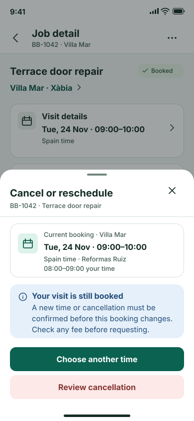

## Open design questions

- **Cancellation policy:** Who can confirm cancellation or rescheduling, and what contractual fee/response terms apply? Design decision: the sheet routes to an explicit verified terms step; the fixture does not invent a fee, instant cancellation or refund.
- **Reviews:** Who can see submitted ratings and comments, and can customers amend them? Design decision: one submission after eligibility and verified closure; disclose the configured audience before sending, with no public badge or edit promise in the artboard.
- **Property delegation:** Confirm address-validation and invitation limits, and who can archive a property or hand off its last manager. Design decision: show capability-scoped grants, preserve unverified form entries as drafts, and treat archived properties as read-only unless an authorised restore is available.
- **Cases and billing:** Confirm response targets, evidence visibility, billing hold scope and release rules. Design decision: display only known response timing and independently confirmed effects; no implied hold, acceptance, categorisation as urgent, or refund based on filing a case.

## Navigation

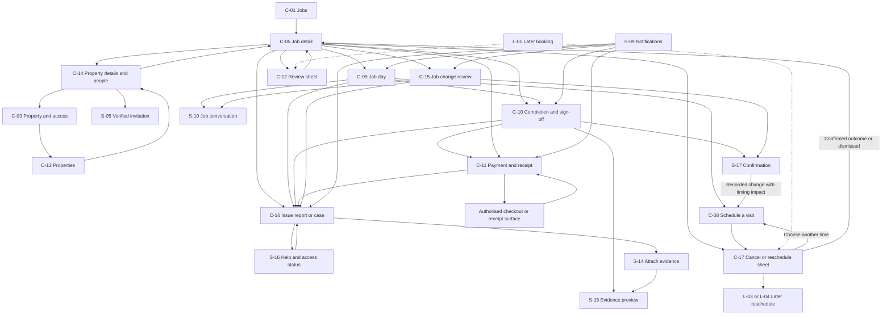
