# L-01–L-06 · Later-category sessions

These six surfaces extend BookBuddy to appointment and group services once a category is active for the selected market. They are not in the construction release. Do not add a tab, change a role’s shell or show a disabled Browse entry at launch. Later, C-01 links to Browse and shows authorised session bookings alongside repairs; P-01 and a designated coordinator’s F-01 lead to session operations. All six screens are pushed and have no tab bar; L-03 is a sheet over its caller. The repair `BB-1042 · Terrace door repair` stays a separate Reformas Ruiz job; no property, estimate, construction stages or crew records carry into these sessions.

## Fixtures and shared rules

| Category and listing | Capacity and price | Delivery, arrival and staffing |
| --- | --- | --- |
| Mat Pilates · Estudi Mar Pilates, Xàbia | Eight places per class, €16.00/person; 45 min | English; step-free studio entry, check in at reception. Named coordinator Marina Serra; confirmed instructor Elena Costa or confirmed, equally qualified substitute Lucía Vidal. |
| Relaxation massage · Calma Massage, Xàbia | One private booking, €48.00/appointment; 60 min | Spanish; step-free treatment room. Confirm the treatment and provider capabilities; the solo fixture has no cover action. A future team offering would need appropriately qualified cover and must respect any practitioner-specific terms. No medical notes in browse, the booking pass or the shared roster. |
| Tennis coaching · Arenal Tennis, Xàbia | One private booking, €32.00/appointment; 60 min | English; step-free court access, check in at the courts. A team can offer a coach with current sport, participant-level and language eligibility. Private coaching in this fixture has no quantity stepper. |
| Old town walking tour · Rutes Xàbia, Xàbia | Multiple places, €22.00/person; 90 min | English; show the confirmed meeting point, steps and uneven paving. A team can offer a guide with the appropriate route, delivery language and category eligibility. |

The four categories use the same Chips, Job cards with service-specific labels, Calendar and day view, Buttons, Bottom sheet, Status badges and Timeline. Group slots count people; private appointments count bookings. The attendee list isn’t the staffing roster. A full group and a covered class can both be true: capacity, holds, booking, payment, attendance and staffing each have their own status. No step automatically implies the next. Maintain authorisation by role, provider and record. Use generic lock-screen text and opaque links via S-09; after sign-in recheck scope and freshness, route an authorised role mismatch through S-07, and use S-16 with reason-safe copy when unavailable.

**Through-line:** Claire Martin chooses one place for Sat, 28 Nov 2026, 10:00–10:45 Spain time (`Europe/Madrid`; 09:00–09:45 in the UK if shown). Saturday’s 11:30–12:15 class and Sunday are alternatives. L-04 shows a server-issued hold expiring Mon, 23 Nov at 09:46 Spain time. Claire’s confirmed booking is `BB-S1042`; it is one of six booked places in L-06. She arrives by 09:50, pays €16.00 at the studio and can cancel for free until Fri, 27 Nov at 10:00 Spain time. The fully booked, slot conflict and no-cover drawings are alternative snapshots, not extra events that simultaneously affect this booking.

**Interaction and platform baseline.** Use 48-unit tap targets (at least 44 pt iOS and 48 dp Android); accessible reading order follows visual order and decorative graphics are skipped. Long pages scroll, pinned bars never conceal the final field and safe areas follow the platform. In field mode use at least 56-unit targets. iOS uses navigation Back or edge swipe, Android Up and system Back (including predictive Back where supported). Dismiss IME, active sheet or provider UI before popping; return focus to the prior control. Use native date, maps and payment surfaces where applicable. Transitions honour Reduce Motion; haptics are optional native selection or confirmed success feedback, never a signal for a network request in flight. With Dynamic Type or Android font scaling, rows grow, price/status can take their own line and action bars/sheets expand or scroll. Keep Back, Close, status and the next available action usable.

**Language and time baseline.** Allow 30–40% copy expansion. Mirror reading alignment, Back and directional chevrons in Arabic RTL, not clocks, checkmarks, times or digits. Isolate names, prices, dates and booking references in bidirectional text. Localise dates, counts, plurals and EUR display; never convert the currency or turn a translated date or title into a new booking. Show venue time first and optional device time with its own date if different; recalculate display, not the reservation, if the traveller’s zone changes. Spell out the language actually spoken. UI language, a translated listing, preferred chat translation language and a host’s ability to teach or brief are separate. Provider descriptions/access notes show labelled original and translation when different; only original with pending/unavailable status when translation cannot be delivered. Standardised terms display the exact current approved version that the booking records; if no understandable approved terms are available, don’t take consent on unverified machine translation.

## L-01 · Browse sessions

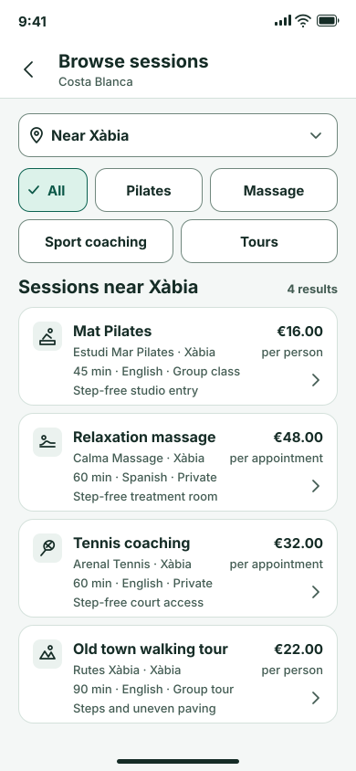

- **Purpose and navigation.** Find an active listing by locality and category. Enter from C-01’s later Browse entry; Back restores Jobs. Tap a card once to push L-02; Back from L-02 restores category, location, result position and card focus. A valid detail link does not change the browse filters.
- **Layout and data.** Stack title and region; outlined Location control; wrapping category Chips (All, Pilates, Massage, Sport coaching, Tours); results heading/count; a List of service-adapted Job cards. Each card is one target. Read title, price/basis, venue/locality, duration, advertised language, group/private type and actual access cue; the attached chevron is decorative. Do not imply all venues are accessible or hide steps.
- **Actions and validation.** Tap a category to replace the results and reset scroll; All clears that category. Tap the location to choose a supported locality from a searchable list sheet; apply replaces the location, Close leaves it unchanged. Manual locality is sufficient, with no device location permission. Pull to refresh or use an accessible Refresh/Retry action; ignore an earlier response if filters have changed. Selection feedback on the chosen chip is optional; opening a card does not need haptics.
- **States and edge cases.** Initial loading preserves filters and uses non-focusable skeletons with a polite status. Results update with a count. Filtered empty retains the filters with Clear category; no local supply offers Change location. A closed category is omitted from normal choices; if closed while selected, explain it and offer All rather than suggesting bookings remain available. Cached results include last checked time and explain online availability checks; an initial network failure has a separate Retry. A listing removed between tap and fetch gets its appropriate safe L-02/S-16 state, not an apparent booking error.
- **Access, platform and locale.** Focus: Back → location → selected category/result filters → results heading → cards. Announce the filter selection and count once; don’t send focus to the list on refresh. At large text chips wrap and card content/price stack. The location chooser is a native-style detent on iOS and a Material bottom sheet on Android; keyboard Back never commits a location. Mirror layout in RTL but keep provider/locality names as entered and format each price with its actual billing unit.

## L-02 · Session detail

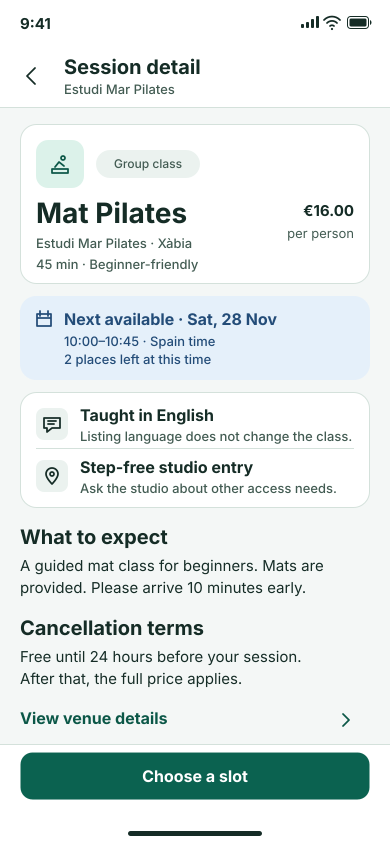

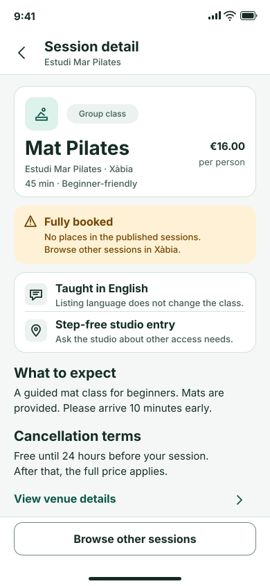

- **Purpose and navigation.** Evaluate a group or private service before choosing a time. Open from L-01 or an authorised current link after market and listing checks. Back returns to the saved list or a permitted Jobs → Browse parent path. Choose a slot opens L-03 without leaving page context; close restores the trigger. The venue details row expands or opens the full venue/access and meeting directions in context (use a pushed view for long text); map handoff is optional and readable directions remain in app.
- **Layout and data.** Header and provider, session-adapted Job card with format, service, price per person or appointment, duration and level; availability banner with next start/end and distinct capacity label; language and access List; description, practical arrival instructions and current cancellation terms; one pinned action. Advertise language and any agreed host-specific terms from the published listing, not profile guesses. Only display a host’s name as confirmed/current and customer-visible; it isn’t an endorsement or a permanent assignment.
- **States and edge cases.** Private, class or group use the same sections, but private copy says “Appointment available,” not “1 place left.” Full means no open published times: persistent “Fully booked” and Browse other sessions; do not promise a waitlist. Paused for staffing says “Booking unavailable” with no internal details. Unpublished is not offered; authorised legacy bookings resolve through L-05 and do not expose an unpublished listing. Cancelled listing/slot explains the cancellation without showing a Book button; an unaffected later time can still be available for its own slot. Offline cached details are labelled with the last check; selection cannot start until current online availability returns. A refresh that removes the next available slot updates the banner without losing reading position.
- **Access, platform and locale.** Focus Back → title/summary → availability → language/access → description → terms → venue details → pinned action. Announce a changed availability message politely; do not announce on every refreshed count. At large text let status/action labels and time wrap, without reducing type. Use common Back/Up rules; expanded venue content is reachable without requiring an OS map app. Format any second zone on its own line, keep source descriptions readable and never equate a translation with an interpreted service.

## L-03 · Choose a slot [Sheet]

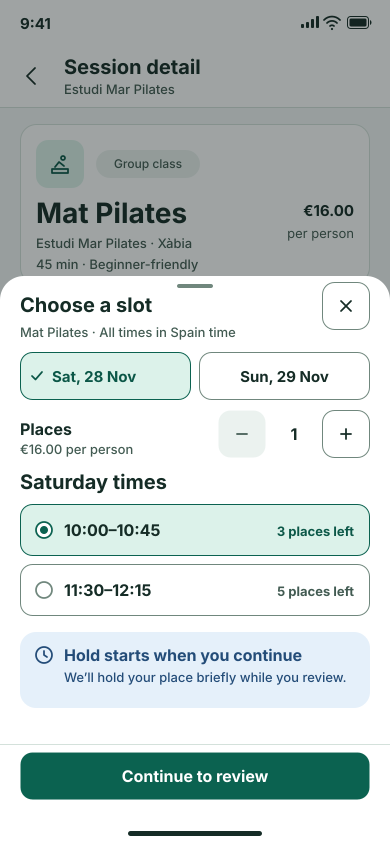

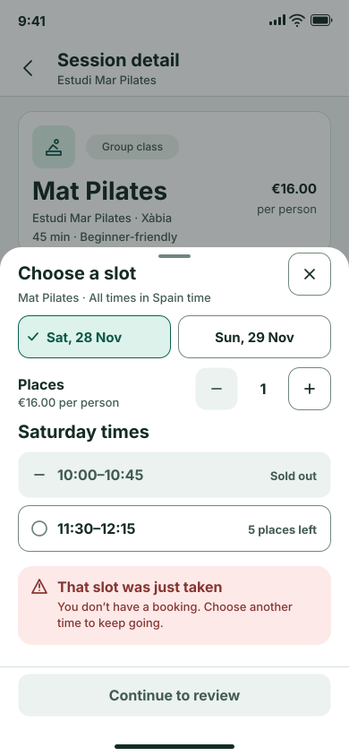

- **Purpose and navigation.** Choose a start/end time and, for groups, place count. Open over L-02 for new bookings, over L-05 after eligible reschedule terms in C-17; transition between sheets without stacking. “Change slot” in L-04 returns to the caller and reopens this picker. Confirmed hold → dismiss the sheet and push L-04. Close, downward dismissal or Android Back keep the caller and original booking; a selection alone reserves nothing.
- **Layout and data.** Dimmed parent; sheet handle, title, Close, service and default venue zone; date Chips (Calendar and day view with chronological agenda alternative); named Places stepper for groups, fixed “1 appointment” for private services; single-select times with text for remaining inventory, selected status and sold out; hold guidance or inline error, pinned Continue. In reschedule mode preserve the existing party size and identify the original time separately. If party-size changes are allowed later, use an explicit booking change, not an accidental rebook.
- **Actions and validation.** Tap a date to load its times; tap an enabled time to select it. Plus/minus update count using confirmed bounds; disable at bounds with understandable text. Changing day clears invalid choices; increasing count past a selected time’s capacity clears the selection and explains why. Continue requires a current time, positive permitted count and online access. It requests one short server hold, locks duplicate submits and preserves input while waiting. No hard claim before confirmed hold. When a request loses the race, mark that time Sold out, clear the choice, say “You don’t have a booking” (or “Your original booking is unchanged” on reschedule), keep date/count and show alternatives; never select a different time automatically.
- **States and edge cases.** Default/available, loading day, no published times, completely sold-out day, held with exact venue-zone expiry, expired/conflict, and no connection are distinct. If a hold arrives after dismissal, release it or let it expire without auto-opening checkout. Before retrying a lost hold response, reconcile its status; a leftover hold cannot be used to make a second booking. Reopening after timeout shows refreshed inventory and an expiry explanation. For a DST ambiguity, show a disambiguating zone/offset; do not generate nonexistent local times or conflate slots with the same wall time.
- **Access, platform and locale.** On open, focus sheet title; next Close, venue time, dates, Decrease/Increase places and value, time rows, guidance and Continue. Trap focus inside the sheet; name times with selected/sold-out/remaining status and read the invalidation once. Avoid live announcements every countdown second. Restore focus upon dismissal, or focus L-04 title after success. iOS detents expand or dismiss with native gestures; Android modal sheet supports Back. Explicit Close remains reachable and both can expand to full height for font scaling. Mirror stepper/navigation position, not the arithmetic meaning or focus sequence; localise dates, party count and capacity.

## L-04 · Review and book

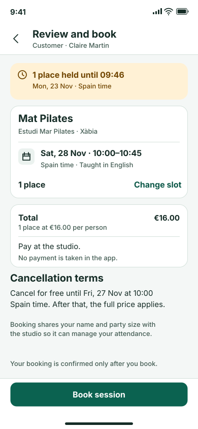

- **Purpose and navigation.** Make the commitment as the named Customer against a particular slot, hold, total and terms version. Enter only after L-03 returns a confirmed hold. On authoritative confirmation, replace checkout with L-05, not a back stack that can resubmit. Back or Change slot releases the hold on a deliberate exit and returns to L-03 under the intended parent; show the loss of the hold inline or ask before discarding if review inputs would be lost. Leaving during unresolved submission never claims cancellation.
- **Layout and data.** Stack title + acting customer, Attention banner showing seat count and exact expiry, summary card (service, provider, place, service date/time, zone, delivery language and places), Change slot row action, total and payment schedule, cancellation terms with calculated deadline, roster data disclosure and pinned named commit. The fixture is pay at studio, so “Book session” is the only commit; it does not launch checkout. For approved prepayment, disclose who takes payment and the exact currency/total, then use “Book and pay” with native/provider UI. Do not store credentials. Reschedule replaces new-booking copy with a comparison of original and proposed time, any price/terms difference and an explicit “Confirm reschedule.”
- **Actions and validation.** On commit, recheck identity, capability, current slot, unexpired hold, party size, approved terms, price and any payment requirement. Block duplicate taps for the same attempt and reconcile uncertain results rather than repeating a payment. If terms change, show the differences and require a fresh explicit confirmation; never charge or apply a higher price under old consent. The original booking remains valid during a replacement hold or pending reschedule until the change is confirmed. Entering system payment freezes the attempt, not the on-screen clock; after return, recheck authoritative outcome.
- **States and edge cases.** Active hold; processing with persistent action label; confirmed (L-05); expired or capacity changed (“Not booked”, return to slots); pending payment (“Checking payment · booking not confirmed”, no retry until safe); definitive failure or checkout cancelled (“No booking confirmed”, retry against the still-valid hold or refresh choices); connection lost before send vs unknown response. If payment clears but booking cannot be confirmed, state both facts, provide support and show any refund only once confirmed. A device clock discrepancy doesn’t extend the server hold. No haptic while processing; one optional success cue after a confirmed booking/change.
- **Access, platform and locale.** Focus Back → hold status → details/Change slot → total/payment → terms → primary. Announce approaching expiry at meaningful thresholds, not each second, and announce definitive status without moving focus from reader-selected content. Use OS payment UI on iOS or Android only when required; system dismissal returns to the same attempt. Stack the button and review fields as needed for scaling, and never shrink or crop payment and consent text. Read both time zones and full totals with their currency, and use fixed provider terms instead of substituting a different translated version.

## L-05 · Session booking

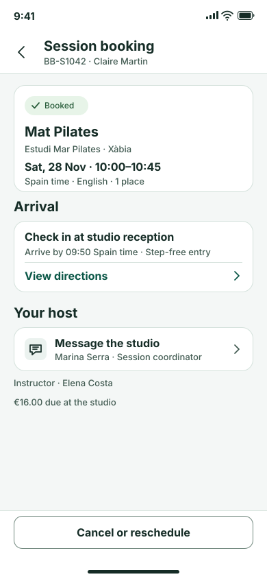

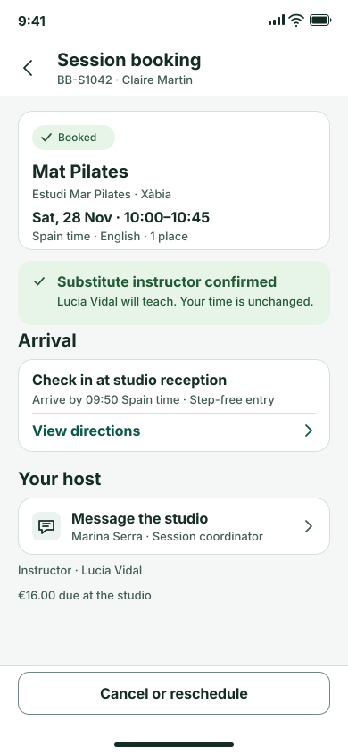

- **Purpose and navigation.** Return to an authoritative pass, see how to arrive and handle changes. Enter from C-01, successful L-04, or a valid S-09 notification. Back returns to Jobs or the authorised origin, never to a finished checkout. Link to C-17 for changes (then L-03/L-04 if needed), C-12 after eligible attendance/closure, C-16 for unresolved service problems and S-10 for the authorised session conversation.
- **Layout and data.** Header with reference and booking holder; pass card with exact stage, date/start–end, service/venue, venue zone, spoken language and party size; persistent update banner where applicable; Arrival card and directions; host contact row; confirmed instructor, payment due/receipt status and pinned management action. No QR is needed for this studio fixture. For a tour the Arrival card gives the actual meeting point, not a generic town pin. It opens full text directions and optionally the native map. Keep an in-app alternative when maps are missing, denied or offline.
- **Actions and states.** Upcoming displays “Booked,” with only current confirmed data. Message the studio opens S-10’s session audience with Marina as accountable contact; label source and translated messages, show originals even when pending/unavailable and apply explicit audience grants (no direct worker numbers). A confirmed, equivalent substitute changes only the instructor field and adds the persistent named notice; price, venue, language and timing stay unchanged. Unresolved cover shows only if relevant to delivery: “Instructor cover being arranged” with coordinator and next update if known; no candidate, reason or promise. Venue, advertised language, time or guaranteed host changes require an explicit change decision instead of silent substitution; show current vs proposed details and which action is needed. A pending reschedule keeps the original time, while authoritative cancellation shows who cancelled, when, any confirmed cost and then hides arrival actions. Attendance may be recorded without implying payment. Attended/closed enables C-12 only when eligible and not already reviewed. If no management action is allowed, replace it with the reason and contact option, not a dead button.
- **Offline and edge cases.** Booked details may be shown to an authorised reader from cache with last confirmed time; never show cached roster-sensitive details after scope loss. Indicate stale host/time and block cancel/reschedule until online. Link to the authorised host/contact when known; never reveal a different account’s booking by ID lookup. Push opens the latest permitted record and consumes the destination once; switching roles saves permitted drafts and discards unauthorised navigation history.
- **Access, platform and locale.** Focus Back → pass/date/status → confirmed update → Arrival and directions → studio contact → instructor/cost → manage button. Announce material changes once, without moving focus; open C-17/C-12 with focused sheet title and restore focus on close. Use iOS Maps/Android map intents optionally, with accessible arrival text always available. At large text the bookings badge and support rows stack; use an exact venue date/time and preserve reference in RTL. Don’t translate staff names or mislabel the spoken language when the user changes reading preference.

## L-06 · Session setup and roster

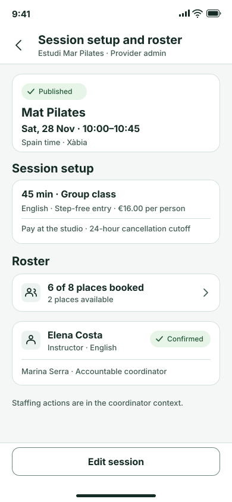

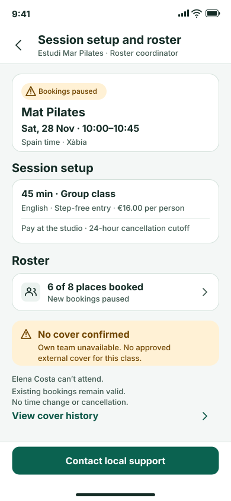

- **Purpose, roles and navigation.** Publish available sessions and separate attendance capacity from staffing. Enter from later P-01 scoped to the provider, or from F-01 as a designated coordinator (Foreman capability with a category-appropriate label) for their assigned session. Back restores the correct caller. Publishing belongs to an authorised Provider admin; the coordinator needs explicit operations, audience and roster grants. Membership alone, even as an admin, never permits shift confirmation on behalf of someone else. Use S-07 to switch only when granted; use P-04/S-16 for category gates or support. Solo providers with applicable access see their calendar and booked count but no crew action or external pool by default.
- **Layout and data.** Header role + business, session/status card with time and zone, setup summary (format, duration, capacity unit, language, access, price/payment and cutoff), separate roster count/list and staffing Worker/Shift cards with named accountable coordinator, then role-specific pinned action. Tap the booked count to open an authorised attendee list (limited to names/places and arrival status needed for delivery); no customer payment credentials or raw eligibility evidence. In the roster context, tap the staff row to see a scoped shift (F-16 pattern); fill an open role from F-07/F-10 patterns, not by editing a display name. Cover history lists outcomes and times, not reasons given privately to the coordinator. Contact local support opens S-16; record help requested only after confirmation.
- **Setup and validation.** Edit session opens a pushed editor within L-06 with persistent inputs, helper/errors, Calendar and day view, source language and translated preview. Capture service/category, group or private capacity, approved venue/meeting point and access information, actual delivery language, durations and non-overlapping publishable slots, price/currency/basis, payment path, cancellation terms, accountable host and staffing requirements. Validate required values, positive seat count (fixed one private booking), positive duration, unambiguous venue time, provider/service capability and host/resource conflicts before online publish. Don’t lower capacity below confirmed bookings plus active holds. Explain how changes affect existing bookings before saving; material changes use a proposed update or S-17 with explicitly authorised consequences, not revision of accepted history. A pause can prevent new bookings without cancelling or moving any existing booking. Keep drafts on ordinary Back; use a single discard confirmation only when at risk of losing unsaved work. Offline, save eligible drafts as on-device only; cached rosters clearly show last checked time and cannot be used to book, publish, cancel or confirm staffing.
- **Cover flow.** Elena reports “Can’t attend” through W-05; confirmed dropout opens an instructor gap, not a cancellation for Claire. Marina opens F-10, checks her eligible available team first and offers Lucía a timed W-03 cover shift with category-specific instructor, safeguarding/briefing if applicable, actual spoken English and availability requirements. An offer (or a chat response) isn’t an assignment. If Lucía accepts, show “Accepted · confirmation required” to Marina; F-12 rechecks authority, category-specific eligibility, conflicts and unchanged delivery terms before confirming one person online. Close other offers and give Lucía only the necessary scoped access (W-04; her own briefing/acknowledgement if required). No old acknowledgement or attendance transfers. Once she is confirmed, issue generic S-09 update and show her in L-05 only as an approved customer-facing instructor. Marina remains the point of contact. A team massage, tennis or tour business uses the same shift states with its own requirements; construction vetting and its pool do not carry over.
- **No cover and other states.** If no eligible own-team option remains or the cutoff is recorded, resolve outstanding internal offers before opening F-11, and only if the later category has an approved external provider route. Otherwise retain the gap with “No cover confirmed,” explain the block and escalate. Pause new bookings if delivery is at risk; existing confirmed bookings remain visible and are not represented as cancelled. If unresolved, send an accurate delay/risk or cancellation update only when its policy and outcome are known. Other states: Draft is private; Needs approval exposes the gate without pretending it’s published; Published shows current capacity; Full shows zero places without implying a gap; Cancelled removes new booking actions, records affected bookings and displays notification status; role-restricted and stale views show only permitted information and a recovery action. Failed publish or cover confirmation preserves the draft/gap, shows the actual reason and does not mark staff confirmed. Approaching deadlines are text and time, not just colour.
- **Access, platform and locale.** Focus Back → session/role/status → setup → attendee count/list → staffing/cover status → recovery/commit. Announce definitive changes politely; focus first invalid field on failed validation. Access and briefing controls have explicit names; use large targets and stacked rows for outdoor coaching/tours. On iOS use native date/time entry and detents for narrow choices; on Android use platform picker and Up/Back, with text alternatives where available. Long editors push; S-17 confirmation restores focus to its trigger. Keep schedule, count and status labels adaptable for RTL/plurals and preserve formal provider names and verified language/eligibility fields unchanged.

## Open design questions

- **Hold and payment policy.** The short hold and studio payment are fixture choices. Choose supported payment modes, actual hold length, late-cancellation collection and the payment/hold reconciliation policy before offering prepayment. A hold or timeout must not become an implied charge or a second booking.
- **Coverage gate and host changes.** Use opt-in category/market approval, unilateral substitution only for equivalent delivery without a host-specific guarantee, and pause new bookings for unresolved delivery risk in the drawn state. Confirm who grants the category credentials and external route, when pause/release triggers, when customers must consent, and what options apply if they decline.
- **Attendance and listing publication.** Start with the booker’s name and party size, not a named list of guests, until a category documents a need. Confirm who may mark attendance, when a review becomes eligible and what approved venue/access and original-terms fields are required for publication in each category.

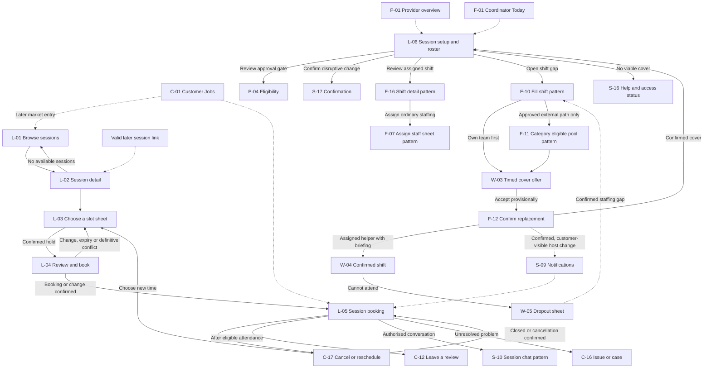
