# Shared screens: job chat, safety, settings and confirmation

These screens keep three things distinct: what someone said, what the app translated, and what an authorised person actually confirmed. The repair fixture is `BB-1042 · Terrace door repair` at Villa Mar · Xàbia. Nadia Benali is the assigned worker, Mateo Ruiz is the foreman at Reformas Ruiz, and Claire Martin is the customer. The artboards show different points in that repair, not one simultaneous app state.

[Design system](../../system/design-system.md) · [Navigation](../../foundation/information-architecture.md) · [Core flows](../../foundation/core-flows.md) · [Screen inventory](../inventory.md)

## Shared interaction rules

- Open only the permitted audience, item and role/business. Recheck grants on navigation, return from a system surface and refresh. If access was revoked, clear restricted content and open S-16; do not leave the content visible in the old back stack, a draft preview, or the app-switcher snapshot. A known but wrong active context goes to S-07 only if another context is already granted.
- On iOS, pushed screens use native Back and edge swipe; sheets and modals have explicit Close or Cancel. On Android, use Up and system Back (keyboard, transient surface, then one route), with predictive Back where available. A dismissal never sends a message or confirms an action. Open only one transient surface at a time. When moving from a sheet to a screen or preview, dismiss the sheet first and retain only the authorised return state.
- Give controls 44 × 44 pt minimum on iOS and 48 × 48 dp minimum on Android; shared control targets are generally 48 × 48. Field mode increases targets to at least 56 × 56 and prioritises critical work controls. Support Dynamic Type and Android font scaling, including scrolling sheets, expanding rows and stacking actions. Preserve Back/Close and the current decision. Use native feedback sparingly for deliberate selection or confirmed completion; no haptic is the only feedback. Respect Reduce Motion and platform vibration settings.
- Labels may expand by 30–40% or more. Mirror leading/trailing controls in RTL, not clocks, microphones, playback indicators or numbers. Use per-message direction and language independently of the UI locale; isolate job IDs, names, time ranges, currency amounts and addresses. Preserve exact original content, meaning and transaction currency. Use site time for official visits, deadlines and records; show local time alongside only where different and enabled.

## S-10 Job chat

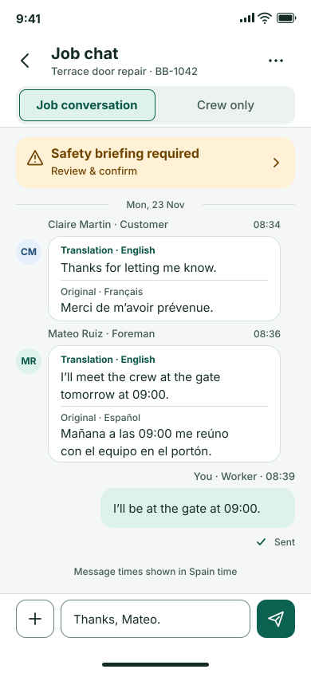
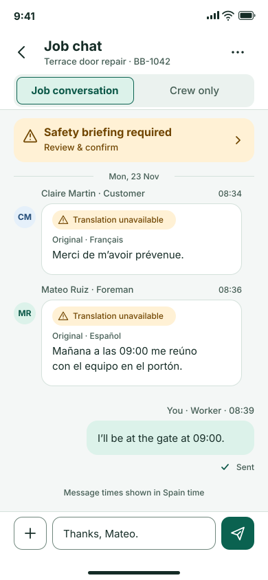

**Purpose and routes.** Let authorised participants talk to the named foreman across languages. Enter from S-08, S-09, an authorised message link or job/shift detail (C-05, F-05, W-04; P-02 only with an explicit job-thread grant). Back returns to the permitted origin, or an authorised parent built for a cold link. Header overflow opens S-13; the private briefing cue opens S-11; Attach opens S-14; a media message opens S-15. None of these routes marks a change approved, a shift accepted, or an instruction acknowledged.

**Layout and fixture.** Pushed header with Back, `Job chat`, repair and ID, and overflow. The audience control selects **Job conversation**; **Crew only** is available because this fixture viewer is an assigned worker with both grants. Nadia sees a private **Safety briefing required** cue, then the Mon, 23 Nov day separator. Incoming **Translation bubbles** show Claire Martin · Customer at 08:34 (English, then French) and Mateo Ruiz · Foreman at 08:36 (English, then Spanish); English source/target matches for Nadia’s 08:39 message, so it appears once with **Sent**. A site-time label precedes the fixed **Composer**: separate Attach, text field containing the unsent `Thanks, Mateo.`, and Send. No tab bar. The unavailable variant keeps the originals, authors, times, audience, briefing cue and draft; replace the translated text with a clear status on each affected bubble.

**Interactions.** Tap a granted audience to switch its scroll position, unread marker and separate draft. Never move the draft, an attachment or recipient reference across audiences silently. If only one audience is available, show its name as a static label above the message list. Scroll chronologically, preserve position when older messages load, and offer a named jump to unread/latest if away from the bottom. A deep link scrolls to a permitted message; if it cannot be displayed, show a generic explanation without quoting it. The text input grows, then scrolls; validate nonblank text or eligible attachment and show actionable file errors before Send. There is no send-on-navigation or send-on-return-key default. Send always uses the labelled audience, preserves the original and suppresses duplicate submissions. Acknowledged server receipt yields **Sent**, not “read”.

Use a message actions menu (including a screen-reader action, not long press alone) for appropriate actions: ask for clarification with a source reference inside the same audience, report a translation, or correct a source-language label if permitted. An author can post a linked correction; neither a new language label nor a correction rewrites the original. Open-only grants never get a composer. Keep safety discussion/acknowledgement private to the people entitled to see it.

**States.** First-use empty names the audience and invites a message if authorised; loading preserves composer and thread layout; pagination failure retries only the missing older messages. Show original immediately for a translation that is pending, unavailable, or has an unknown source. **Original only** is an explicit S-12 preference, not an error; same-language text appears once. Translated and corrected status belongs to the affected message, not everyone in the thread. On safe offline send, state **Saved on this device · pending sync** and preserve the original and attachments; recheck the audience before upload. Show upload progress and offer targeted Retry or Remove when eligible; never call a queued upload attached for recipients. A failed or uncertain send retains content and reconciles the original attempt before retry. On permission loss, do not auto-send to another scope; suppress unauthorised content and recover via S-16. An authorised archive is read-only and explains why; an authorised stale cache names the last confirmed time. The briefing cue appears only for relevant crew and changes with S-11’s authoritative state.

**Platforms and accessibility.** Keep Attach and Send separately reachable above the native IME and safe area. VoiceOver/TalkBack order: Back, title/context, **Chat details**, audience/selection, private briefing cue if applicable, day, author/time and bubble content in time order, composer. Avatar and checkmark art is decorative; announce the delivery state as text. Label field **Message to [audience]** and action **Send to [audience]**. Announce incoming/sync status politely without stealing focus; don't announce the entire conversation after a language change. Read the English translation and exact original as separate language spans with labelled separators. At larger text, audience buttons can stack and author/time can wrap; the scrollable list retains room above the composer.

## S-11 Safety instruction and acknowledgement

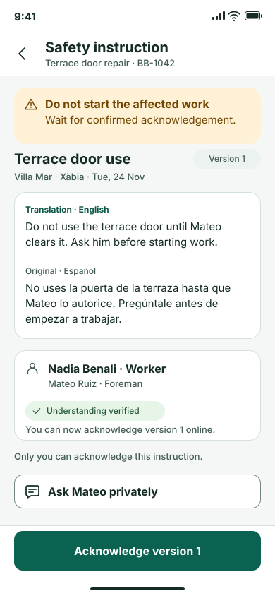
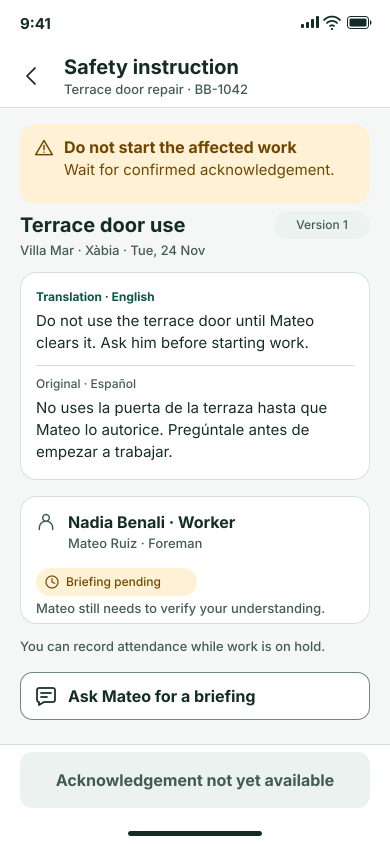

**Purpose and routes.** Issue and review the current private instruction for a named shift/capability. Enter from S-10’s private cue, W-09 Site briefing, F-13 Site log or an authorised changed-instruction alert via S-09. Back returns to the correct crew surface. **Ask Mateo for a briefing** or **Ask Mateo to clarify** opens a contact/clarification draft for the permitted crew audience in S-10; do not post it to the customer's conversation. When unavailable, preserve safe draft text and point to the authorised contact path without implying Mateo was notified.

**Layout and data.** Pushed header; persistent **Attention banner** names the affected work hold. Show instruction title, version badge, Villa Mar · Xàbia and Tue, 24 Nov; a versioned original/translation card; named recipient and foreman card; briefing status; clarification action; fixed version-specific acknowledgement. In this fixture, Mateo instructs Nadia not to use the terrace door until he clears it and to ask him before starting work. Ready means Mateo verified understanding of version 1; pending means he has not. Neither state is a confirmed acknowledgement. The successful record shows worker, exact instruction version and server time (site time, with zone) rather than the device time. It is never a qualification record or blanket site clearance.

**Interactions.** In Foreman mode, create/edit the instruction draft with an original source language, affected task, shift and eligible named assigned recipients. Validate required original, task and recipients; preview any translated copy separately. Issue only online; the confirmation record binds text and recipients to the issued version. A material edit is a newly issued version, not an overwrite. Foreman arranges a briefing as needed and verifies the individual can explain the points back in a language both can verify; the verify action records who, when and which version, not an impression inferred from translation, read state or a chat reply. Assigned worker can request clarification at any stage; if understanding cannot be verified, do not enable acknowledgement. After verification, **Acknowledge version 1** is the deliberate, named confirmation. Recheck assignment, version, verification and online authority, then keep the pending label until server confirmation. A repeat tap cannot create multiple records. Foreman cannot act as the worker here; a foreman who is assigned to work uses their authorised Worker context for their own acknowledgement.

**States and edges.** Draft (foreman only), issued/awaiting human briefing, verified/ready, sending, acknowledged, superseded and offline blocked are distinct. Missing/suspect translation shows source and briefing route; do not use a translated sentence as evidence of understanding or infer comprehension from a profile language. On loss of connection before or during acknowledgement, show **Not confirmed** or **Checking acknowledgement** if outcome unknown; do not queue an acknowledgement. Reconcile before retry. When reissued while open, disable the old action and route to the current version; show old acknowledgements as history only. On changed assignment, recheck access; replacement has a separate instruction and acknowledgement. A hold is scoped to the affected work and does not block recording attendance in W-06. No cue/text for unauthorised viewers.

**Platforms and accessibility.** Native Up/Back and a scrollable reading view; use the large field target for the acknowledgement. Announce an explicit completion haptic only after confirmed receipt and an accessible textual result. Focus order: title, hold and scope, version/shift, translation then labelled source with native-language spans, recipient/verification, clarification, acknowledgement or its disabled reason. Announce a changed version or blocked outcome without moving focus off the content. Keep version and named recipient in view before a large-text confirmation; wrap rather than shrink and make the footer scroll-safe. Isolate job/version/site-date tokens in RTL and do not mirror the warning icon.

## S-12 Language and display

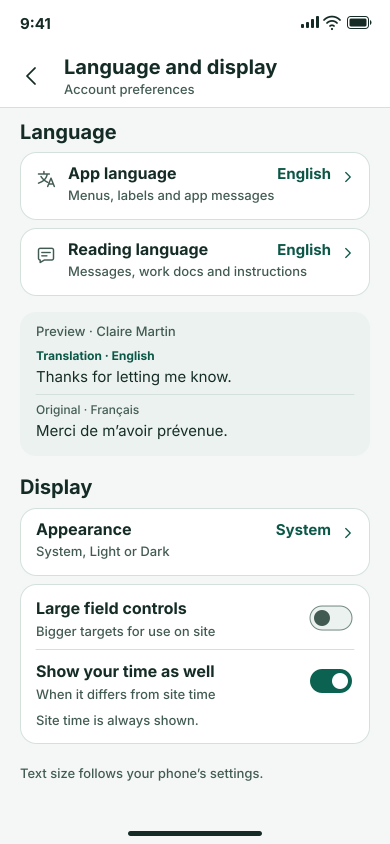

**Purpose and routes.** Change app language, preferred translation language and display settings. Enter from S-01 (language only), S-04 setup, S-06 Account or S-13 Chat details. Return to the same permitted caller, restoring the previous field, message position or draft. S-13 dismisses before pushing settings; returning takes the user back to the thread, not to an open overlay.

**Layout and data.** Pushed **Language and display** header, **Language** section with two list controls, preview of Claire Martin’s short English translation and original French, then **Display** with Appearance (System by default), Large field controls (off in fixture), Show your time as well (on in fixture) and a note that text size follows the device. In pre-auth mode show only supported UI choices and preview; no account, conversation, field or time preferences. Use an app-owned sample, never a signed-in chat read from cache for a signed-out preview.

**Interactions.** App language opens a single-select list of supported UI languages (English and Español in this launch design). Chat translation opens a single-select list with full language names; choosing **Original only** clears the automatic translation target, while a language choice preserves both original and translation when available. Selection is deliberate, immediately reflected in the preview, and confirmed with a selected state and a polite announcement. Back without choosing makes no change. Appearance offers System/Light/Dark and applies the chosen design tokens immediately, with System following the phone. Toggle rows update target size or dual-zone display without changing a booking, an instruction, a translation source or a work-language declaration. Device text-size guidance points to native settings; there is no app override that reduces the user’s chosen system scale.

**States and edges.** Supported device language may seed first run; unsupported device language falls back to a supported default and exposes the selector. Source-language support is independent: unsupported source/target pair shows original with **Translation unavailable** and can offer another target; a saved target that is no longer supported is shown as unavailable until replaced, not silently changed. If the preview is pending or unavailable, show original and status; same-language and explicit originals-only modes preview a single source. Preserve selected device appearance and size if the connection is lost; report any account preference that cannot yet be saved as pending/failed and do not claim it applied on another device. Two-time display appears only when zones differ; Spain time remains primary on this job (`Tue, 24 Nov · 09:00–10:00`, optionally `08:00–09:00 your time` for a UK viewer). Large text grows rows and may place values beneath labels. Pseudo-localise for RTL before assuming launch UI language availability; unsupported UI languages are not selectable just because they are supported for translation or message input.

**Platforms and accessibility.** Use accessible native radio selection and switch semantics (checked/unchecked), with row label and current value. On iOS respect Dynamic Type and system appearance; Android respects font scale, dark theme, and Up/system Back. Announce locale/theme change once and restore focus to the changed row, without forcing a restart or losing the draft. Read the preview as labelled demonstration text in display order, not as another preference. Mirror control layout in RTL while preserving each language name’s own direction and exact samples.

## S-13 Chat details [Sheet]

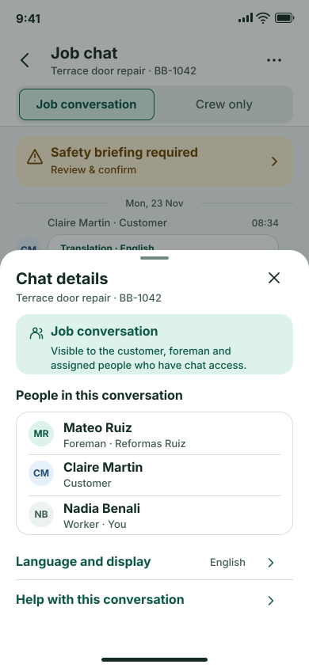

**Purpose and routes.** Explain who can read the current conversation and where its language preference comes from. Tap S-10 header overflow; dismiss back to the exact thread and scroll/cursor, push S-12 from **Language and display**, or S-16 from **Help with this conversation**. No thread switching or participant management here.

**Layout and data.** **Bottom sheet** over the dimmed Job conversation. Handle, title and Close; job context; labelled audience card; visible participant roles; language row (current target English) and help link. The fixture lists Mateo Ruiz · Foreman · Reformas Ruiz, Claire Martin · Customer and Nadia Benali · Worker · You. Names reflect the permitted thread, not the job’s full roster. In Crew only use a private audience label and description, and show only allowed foreman/crew. The named foreman remains the route to coordinate the job; participant rows are passive, with no phone numbers, profile links, private direct message, invite button or list of candidate replacements.

**Interactions and states.** Close, downward swipe or outside tap can dismiss this informational sheet; no interaction on the dimmed background. Tapping a link dismisses before navigating. In an authorised archive show **Read-only** and the reason; no constructive-sounding wording like “send to” if sending is unavailable. Partial identity access shows permitted names/roles only; do not reveal hidden counts or who was removed. If Nadia is removed during the session and no retained history is permitted, close the sheet and replace the thread with S-16. If authorised read-only history remains, show just that scope. Preserve an offline draft on ordinary dismissal; never surface inaccessible membership from a stale response. Loading or a failed participant refresh cannot imply nobody else can read the conversation; label available last-confirmed data and offer retry when scoped and safe.

**Platforms and accessibility.** iOS sheet with detents; Android modal bottom sheet/system Back. Initial focus title, then Close, audience explanation, allowed people, language value and help. Return focus to **Chat details** unless redirected away after revocation. Decorative initials/handle are skipped; participant role text is read once. Expand on larger text, stack the language value if needed, and make the links scrollable. Mirror chevrons and reading alignment; isolate names, language names and job IDs.

## S-14 Attach a photo or record audio [Sheet]

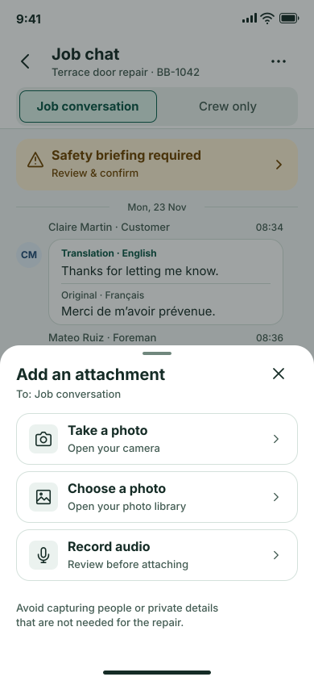
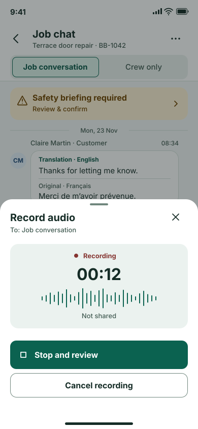

**Purpose and routes.** Choose, capture and review media without sending it from the sheet. Entry: C-02 request, S-10 composer, W-07 progress photos, F-14 completion, or C-16 issue evidence. Use the caller’s allowed media types and explicit destination (Job conversation, Crew only, request draft, foreman-only progress, or the appropriate review/case). Close restores the unsent parent draft; accepted capture opens S-15 as a replacement surface, not another sheet stacked over it.

**Layout and data.** **Bottom sheet** with handle/Close, source choices (Take a photo, Choose a photo, Record audio) and a privacy note. In the recording state, replace choice rows with textual **Recording**, elapsed time, decorative level trace, **Not shared**, large **Stop and review** and separate **Cancel recording**. Fixture: 00:12 for Nadia’s Job conversation, no media submitted or sent. Photo-only callers do not show Record audio. If nobody can attach in this audience or context, do not present a misleading picker; show the restriction where the composer/source action would be.

**Interactions.** Take/Choose invoke the native camera/photo picker, only requesting applicable permission when chosen. Dismiss either without media and return to the source choices. Record requests microphone access, then starts only after a deliberate tap and applicable system permission; make the active recording state visible. Stop ends capture and opens preview for playback, re-record/removal or attachment. Cancel, Close, swipe or Back during recording must not silently capture or discard: stop live capture, offer review of a usable recording or explicit discard. Back from preview returns to the parent draft or source choices with that capture outcome preserved as permitted. Nothing is auto-sent, including recordings stopped by a call, interruption, backgrounding or a duration limit.

**States and edges.** If denied, explain which permission is off, offer an allowed photo picker or text alternative, and link to device settings when appropriate without pretending to re-prompt. Preserve a usable unsent capture if interrupted; if empty, corrupt, unsupported, too large or rejected by the caller’s limits, give a specific error and let the user choose again. Don't expose progress photos to the customer by default. Upload progress after attachment separates local capture, **Saved on this device · pending sync**, uploading, confirmed upload and failure; transcript or translation status is separate from file delivery. Keep permitted drafts on temporary failure; Retry/Remove belongs to the owner. Recheck role, thread and upload scope after any picker/permission return; if changed, stop and don't attach to another destination. Never promise a photo was received before an authoritative response.

**Platforms and accessibility.** Use native iOS photo/camera and microphone permission surfaces; Android system picker/camera and runtime permission with settings recovery. Focus title, Close, labelled destination, then source rows and privacy note. During recording announce start/stop/cancel once and expose elapsed time on focus; don't speak every tick. Stop and Cancel are full-size and separate, with no press-and-hold requirement and no mandatory swipe. Swiping to expand is optional. Larger text and keyboard (if captioning in preview) grow the surface; mirror controls in RTL without reversing waveform time or the displayed digits. Treat the trace and recording dot as decorative, not status by themselves.

## S-15 Media and original audio preview [Modal]

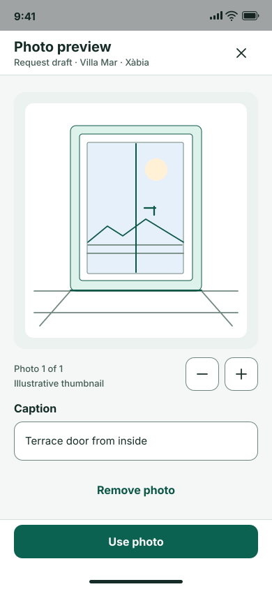
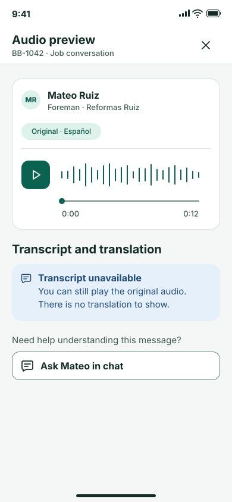

**Purpose and routes.** Examine an attachment without losing the originating screen/draft. Enter from C-02, C-10, S-10, S-14, F-13 or W-07. Exit to the authorised parent and restore focus to the initiating attachment (or to the parent media tray if newly captured/removed). When started from S-14, close or transition away from the sheet first; never expose an interactive layer beneath the modal.

**Layout and data.** Full-screen modal with title/context and Close. Photo layout: media, index, zoom buttons, caption, owner-only Remove and fixed **Use photo** in draft preview. Claire’s C-02 draft uses an illustrative terrace door thumbnail, not completion evidence. Audio layout: sender/role, original language, play/pause and seek, elapsed/total time, separate transcript and translation status, clarification route. The audio variant is a 0:12 original from Mateo Ruiz in the Job conversation; Nadia can play it but not remove it. On shared completion/media sources present caption and author if authorised, not draft actions for the viewer.

**Interactions.** Pinch or double tap to zoom; provide explicit Zoom in and Zoom out, allow pan when zoomed, and reset zoom on close. If a gallery exists, show the index and labelled previous/next actions in addition to swipe; preserve media order and avoid switching photos mid-pan. A permitted draft owner can edit the caption, review what the media shows, then use **Use photo** or **Use recording** to add it to the caller’s draft. This does not send a message or request. Validate caption and file against caller limits; show inline errors and keep the draft. Removing an unsent attachment is explicit; if it would destroy the only draft copy, confirm discard with Cancel. Closing never silently loses edits or sends anything. Play only on tap, provide accessible pause/seek, and stop playback on exit, interruption, loss of access or a role switch. **Ask Mateo in chat** closes preview and starts a clarification draft referencing the original in the same authorised audience.

**States and edges.** Loading or partly uploaded lists owner-safe status and Retry/Remove where allowed rather than a blank image or falsely ready player. An unauthorised recipient sees no thumbnail, caption, clip metadata or transcript; open S-16 if appropriate. Read-only shows only delivered media and playback/zoom. Separately show transcript generating, unavailable/unsupported or ready and, if produced, translation pending/unavailable/ready. Never synthesise replacement “original audio”; label original and translated transcript segments and keep playable source whenever available. Distinguish no transcript from an unsupported/corrupt audio file and explain recovery. If authorisation changes during playback, stop, clear view and restrict file actions immediately on detecting the change.

**Platforms and accessibility.** iOS has explicit Close with appropriate modal dismissal and native media/IME behaviour; Android Back closes IME before modal. Trap focus inside; order: title/context, Close, photo alternative then zoom controls, caption and permitted actions; for audio, speaker/original language, Play/Pause, adjustable seek with duration, transcript/translation status, clarification. Provide an alt equivalent without converting speculative image contents into evidence; captions may be read or edited separately. Seek and zoom must work without multi-touch; retain readable controls at large text and avoid announcements on every progress tick. Preserve playback flow and timestamps left-to-right independently of UI RTL; render transcript/source using its own language and direction.

## S-16 Help and access status

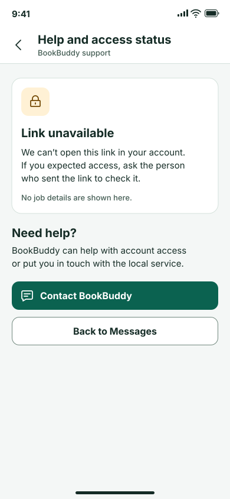

**Purpose and routes.** Recover from a stale, unavailable or gated destination and reach BookBuddy/local support safely. Entry from S-03 recovery, S-06 Help, a gated link, S-13 help or F-10 no cover; can route an authorised job issue to C-16. Use the true permitted parent on Back: Messages for this fixture, auth for a signed-out recovery entry, the account or the foreman’s permitted job view for other entry points.

**Layout and data.** Pushed header and reason-safe status card, next-step text, **Contact BookBuddy**, and return action. Default fixture: link unavailable from Messages, no job reference or participant names. Only include the optional reference/action details when the active role has authority to know and share them. Separate neutral help, account recovery, access state and operational support; do not expose local operations queue or raw eligibility documents.

**Interactions and states.** **Contact BookBuddy** opens or reveals a configured contact channel, and if it is a form, asks for deliberate send after review of the message and any permitted context attached. No automatic transcript, photo, access code or job disclosure. **Back to [safe parent]** returns without checking a hidden item again. Only when existence and prior access can be disclosed: known expired invite can route to ask for reissue; removed granted access can explain removal without hidden resource details; pending eligibility can state the gate and last confirmed status (P-04 if authorised), not assert work authorisation. Unknown and inaccessible share generic wording and no metadata. For a legitimately entitled wrong-role route, offer S-07 using only a safe destination label. A known, accessible F-10 escalation may include the gap reference and next step but never claim replacement cover. Offline distinguishes inability to check from denial; show retry, permitted cached help details or **Can’t contact support offline**, never a fictitious delivered case. Ready contact shows the available channel without inventing service hours or response timelines. Loading leaves a neutral shell before the reason is known; error on sending preserves a permitted message draft and makes clear it was not sent or is being checked.

**Platforms and accessibility.** Back/Up returns to a permitted route; if no safe ancestor exists, build a route to an authorised role root or sign-in, not a loop. External contact surfaces use the native system handoff and return without altering the job. Reading order: title, reason, safe next step, contact, return. Announce failure/retry result and label contact by channel when known. Use short sentence-based copy that wraps; isolate any authorised job reference/phone number, preserve valid contact formatting, and leave RTL sequence logical.

## S-17 Confirm consequential action [Modal]

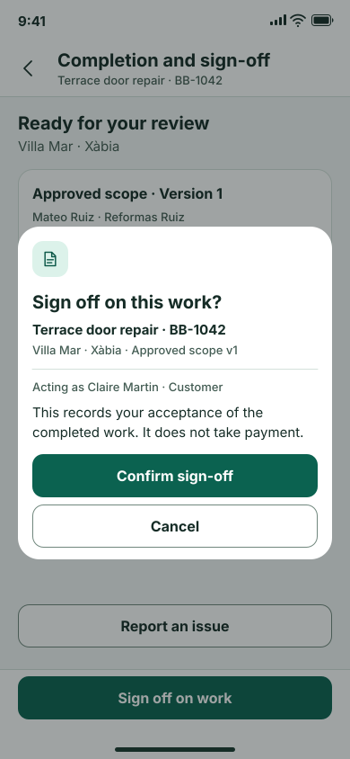

**Purpose and routes.** Confirm a specific material action in the right role, on the current item. Opening the dialog does nothing. Entry from C-10 sign-off, C-15 change approval, P-02 foreman handoff, P-05 revoke and S-06 sign-out. Return to the caller for definitive outcome or let the user review a newer version. C-07 remains the dedicated quote approval; this dialog does not replace payment checkout, the quote review or safety acknowledgement.

**Layout and data.** **Confirmation dialog** over dimmed C-10 in the fixture. Named decision, repair `BB-1042`, Villa Mar · Xàbia, approved scope v1, Claire Martin · Customer, acceptance consequence, **Confirm sign-off** and **Cancel**. The copy distinguishes sign-off from payment. For change approval show the proposed version and price impact (`+€40.00`, `€280.00` new total from the €240.00 quote fixture), plus timing/hold impact and any separate scheduling decision. For a handoff, name business, outgoing/incoming foreman as applicable, scope and whether the result is offered or assigned; don't imply an acknowledgement from the incoming foreman. For revocation, name member, scoped role, Reformas Ruiz and immediate access impact. Sign-out names the account, explains local unsent work if present, and distinguishes **Return to finish** from **Discard drafts and sign out**; never send or discard in the background. Use destructive treatment only when the action really revokes/discards.

**Interactions and validation.** Cancel (or Back/Close where appropriate) leaves records and drafts untouched and restores focus to the trigger. Confirm rechecks current actor/business or property, action-specific grant, record/version, and readiness. Reject self-approval even when the account has another role. Consequential server actions require online confirmation. **Confirm sign-off** retains its label while processing, prevents duplicate submission, and cannot be mistaken for an immediately successful outcome. If system Back is allowed during an unresolved request, the parent must continue to show **Checking outcome**; closing cannot cancel a request already sent. On success apply confirmed state and timestamp on the parent (C-10: **Signed off**; separate C-11 route if appropriate); never rely on a toast alone.

**States and edges.** Ready, blocked (offline, missing capability, conflict), running, invalidated, failed and confirmed parent outcome. Explain why disabled and show a safe exit. If newer version/terms arrive or a competing actor changes the record, replace stale confirmation with **Review latest**; require a fresh confirmation after review, never migrate old consent. If result is uncertain, reconcile the original attempt before permitting Retry; if definitively failed, preserve current review and give targeted retry only if still valid. Role switched or access revoked clears inaccessible details and moves to S-16 or an authorised parent. Local sign-out has its own explicit discard path; do not mistake an unresolved server request for a local draft or represent server sign-out status that wasn't verified.

**Platforms and accessibility.** Use native modal/dialog semantics and Android system Back; on iOS provide explicit Cancel and do not treat a tap outside as confirmation. Announce title, record/version, acting role and consequence before actions; focus title or safer action first and trap focus while shown. Keep the exact consequence readable at maximum text scale via scroll/full-height treatment without shrinking prices or titles; stack actions. Mirror layout and directional icons, preserve ID, names, EUR currency and dates. Completion haptic is optional after verified success, not when the confirm button is tapped.

## Open design questions

- **Original only:** The design treats this as an explicit account reading preference, separate from an unavailable translation. S-13 links to that preference, not a second per-thread override. Confirm whether thread-level overrides are needed at launch.
- **Briefing verification:** The design separates the foreman’s per-person, per-version verification from the worker’s explicit acknowledgement. Local operations must define what briefing record and permitted languages count for each task; the UI does not invent a certification.
- **Support and media limits:** Confirm supported contact channels/coverage and approved media size, duration and retention limits. Until defined, avoid fixed promises, contact hours or limits in the drawings; show actual caller restrictions at runtime.

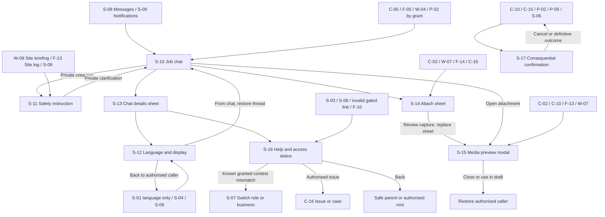
