# Worker screens · W-01–W-09

Nadia Benali is a Worker in **Reformas Ruiz**; Mateo Ruiz is the named foreman. The base story is **BB-1042 · Terrace door repair**, **Villa Mar · Xàbia**, **Tue, 24 Nov · 09:00–10:00 Spain time** (`Europe/Madrid`). W-01 and W-02 are the day-before planning views. W-04, W-06 and W-07 show stages of the scheduled day; W-07 assumes the affected work has been cleared and Nadia can submit evidence. W-05 is the separate scenario where the original assignee cannot attend. W-03 is a separate cover-offer branch for the same job, not a second offer on Nadia’s own active shift. Claire Martin is the customer; workers do not see the customer’s billing, contact directory or €240.00 quote.

## Shared worker behaviour

- **Navigation and permissions.** Today, My shifts, Availability and Messages (S-08) are the four tabs; restore each authorised stack and scroll position. Re-tapping the active tab returns to its root. At worker roots the bell opens S-09 and Nadia’s avatar pushes S-06 (S-07 to switch context; S-12 for language, display and field controls). A notification opens the record, never accepts, checks in or acknowledges. Recheck the current Worker/business grant and item scope; restore the permitted parent on cold launch. Show S-16 for stale or inaccessible links without confirming another worker’s data exists. Pass only authorised context to S-10; use Crew only by default for a worker-to-foreman operational handoff, not the customer conversation. If that thread is unavailable, offer only an explicit role-scoped contact or help route.
- **Field and accessibility.** Minimum targets: 44 pt iOS / 48 dp Android (48 common); field mode uses at least 56 and 64-high primary site actions where space permits. Use solid fills, strong control boundaries and explicit statuses in sunlight. Keep primary and destructive actions separated. Nothing essential requires swiping, long-pressing, hovering or reading a map or image. Honour text scaling, Reduce Motion and haptic preferences. Grow rows and bars; let content scroll and stack actions before shrinking type. Use polite VoiceOver/TalkBack announcements for new statuses; keep critical state visible. Hide decorative icons, avatars, handles and skeletons from the reading order. Completion feedback is optional and follows a real recorded or server-confirmed outcome, never a pending or blocked response.
- **Platform navigation.** iOS uses native stack Back and edge gesture; sheets have Close and may expand to full height with the keyboard or larger text. Android supports app-bar Up and system/predictive Back (keyboard, then sheet/modal, then route); do not silently switch context at a root. Sheet focus starts at its title, stays inside the sheet and returns to the trigger on close; if the trigger no longer exists, focus the updated status. One sheet/modal at a time; action footers stay above safe area, system navigation and IME.
- **Language and time.** Interface language, translation reading preference, actual source and agreed working/briefing languages are separate. Arabic, Romanian, Spanish and other preferences never imply what language Nadia understands on site. Keep the site zone (Spain time) on appointment, deadline, attendance and availability values; show local time as separately labelled secondary text if enabled and different. Localise date order, numerals and pluralisation. Isolate job IDs, Latin names, machine references and times as bidi runs, mirror directional arrows, layout and tab order in RTL, not camera/clock icons or the numeric order within a time. Allow at least 30–40% expansion and wrap further at large type.
- **Network and data.** Show loading without inventing rows, then retained partial/cached data with last confirmed site timestamp, and an explicit offline, empty or recoverable error message as applicable. Keep drafts scoped to the assigned worker, business and record. Remove restricted content on grant change; never cache private access secrets. A draft, ‘Saved on this device · pending sync’, a server receipt and a rejection are different states. While a mutation is outstanding, suppress duplicate submits; if the response is unknown, check its outcome before retry. Send sensitive details neither in push copy nor to unrelated audiences. Use shared pending-work policy before sign-out; do not discard or send drafts silently.

## W-01 · Today

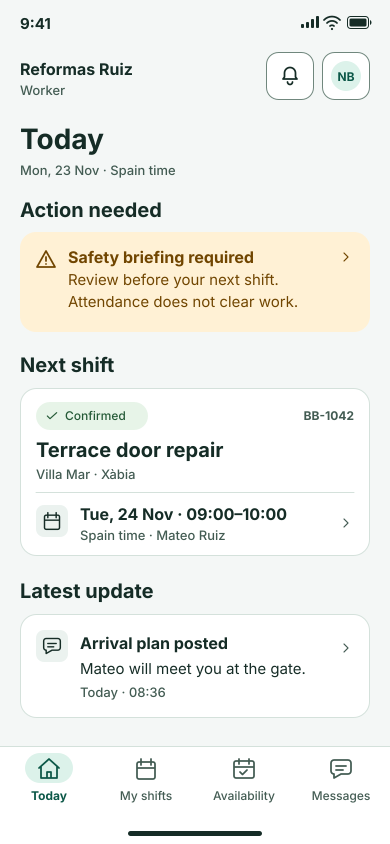

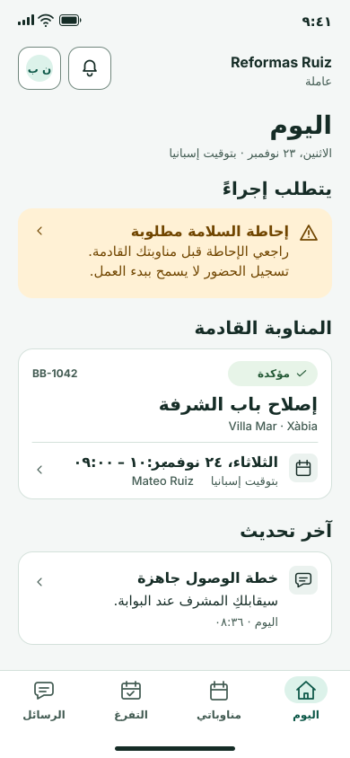

- **Purpose and routes.** First Worker destination at launch and Today tab. Resume one urgent next action: tap the action cue for W-09 (briefing), W-03 (offer review), or W-06 (attendance); W-06 presents over the authorised W-04 parent. Tap the **Next shift** card for W-04; **Latest update** opens the relevant permitted record—in this fixture W-09’s arrival plan. Back returns to Today or the originating stack. Tab and header actions follow the shell rules.
- **Layout and data.** Business/role header and title, day in site time, attention notice with destination, next **Shift card** (state; BB-1042; task; property only if assigned; date/time and foreman), latest **List** row with update time, fixed **Tab bar**. A status and its action are worded separately; the banner and shift card are each one target, not a cluster of buttons. Rank live time-sensitive offers, attendance and unresolved briefing by actionable urgency; for an imminent shift do not hide a work hold behind an attendance action. If there is no actionable cue, lead with the next confirmed shift.
- **States and interaction.** With no shifts or offers, say so and link to W-08. An offer shows ‘Offer’ and the deadline with coarse area; a provisional response says ‘Accepted, awaiting foreman confirmation’ and has no arrival action. A confirmed shift without holds links to the next stage. The briefing hold persists after check-in until the server records the worker’s acknowledgement of the verified current instruction; any separate site clearance is still required. Once checked in, show the recorded status and next action (e.g. check-out due). When cached, distinguish the last confirmed status and any local events; do not show a stale offer as actionable. Refresh retains scroll and delivers focus only when the user follows a cue, not when a cue changes in place. If the shift changed, open its current version; if inaccessible, use S-16.
- **Platform, accessibility and RTL.** Native tab semantics; read title/date → action → shift → update → tabs, after the named header controls ‘Notifications’ and ‘Account, Nadia Benali’. Announce the action and its reason as a single cue. The Arabic artboard mirrors the layout including leading Today on the right; names/ID remain isolated and the site time range retains its order. At large sizes wrap card copy and move status to its own row; keep the first action before updates.

## W-02 · My shifts

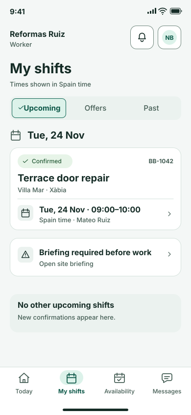

- **Purpose and routes.** Worker tab for navigating their own assignments over time. Tap Upcoming, Offers or Past to change the agenda filter. Tap a confirmed, changed, completed or authorised archived shift to open W-04; an offer or provisional acceptance opens W-03; the separate briefing row opens W-09. Returning restores the filter/day and scroll. No assignment action occurs in the list.
- **Layout and data.** Business/role header → title and site-zone caption → selected **Chips** with a check → chronological **Calendar/day-view** headings → **Shift cards** (exact status, reference, task, time, appropriate site precision, named foreman) → relevant briefing **List** row → contextual empty message → **Tab bar**. Upcoming sorts by first work time; Offers prioritises the next response deadline; Past groups most recent first. Paging errors stay inline below already loaded records with ‘Retry’.
- **States and interaction.** Offered and ‘Accepted, awaiting foreman confirmation’ stay under Offers until they resolve; terminal offers (filled, declined, expired, acceptance withdrawn, or not assigned) are read-only in Past if still authorised. Confirmed entries stay Upcoming until past, with separate attendance indicators. Changed shows the last confirmed/new window where authorised; cancelled and ‘Can’t attend’ rows never show an active attendance action. Filter-empty says what could appear there (not ‘no work’ for all filters). Cached views retain the filter and label last confirmed time; opening an item does not grant access or confirm it still exists. A newly confirmed or revoked record moves/removes only after refresh; keep focus on a meaningful heading or nearest row rather than on the removed item.
- **Platform, accessibility and RTL.** iOS/Android use their own selectable controls and scroll behaviour. Segment labels use 15-unit type, with a check for the selected segment; allow segments to wrap or stack for longer labels or larger text without scaling the labels down. The selected segment announces its name and selected state; sparing selection feedback only if enabled. Focus: heading/context → filter group → dates/rows → tabs. Use full date + site zone in accessible row names and include state once. RTL mirrors the row layout, not date/group sequence.

## W-03 · Offer details

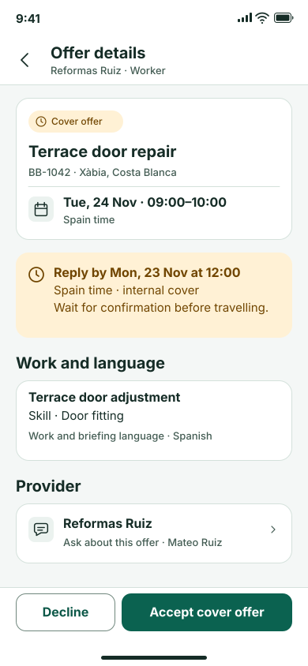

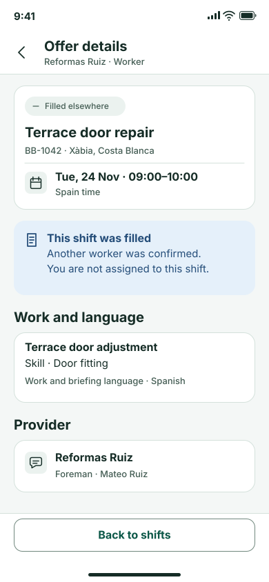

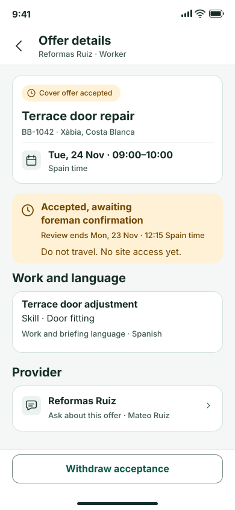

- **Purpose and routes.** Open from W-01, W-02, S-09 or a verified deep link. Confirm an ordinary named offer or provisionally accept a cover offer. Decline an open offer or withdraw a live provisional acceptance via W-05. Back returns to the authorised caller; a standalone deep link has W-01 as parent. ‘Ask about this offer’ uses the permitted provider route for the named foreman (S-16 if needed); it does not open a job thread solely because there is an offer. Time conflicts can open the relevant date in W-08 and return to W-03 for a fresh eligibility check.
- **Layout and data.** Pushed header with business and role → **Shift card** with offer type, job reference/title, coarse Xàbia area and site-time window → **Status badge/notice** with absolute response deadline and consequence → work section with task, skill and actual working/briefing language → provider/foreman contact row → pinned secondary Decline and one primary action. The cover sample is internal to Reformas Ruiz, deadline **Mon, 23 Nov · 12:00 Spain time**, task Terrace door adjustment, skill Door fitting, work and briefing in Spanish. External cover identifies the authorised provider relationship but no private property or customer data. An ordinary named offer’s button says ‘Confirm assignment’; cover says ‘Accept cover offer’ and ‘Wait for confirmation before travelling.’
- **States and interaction.** On tap, keep the action label and show processing, rechecking the reply deadline, slot, conflict, eligibility and scope online. Ordinary success opens W-04 only once assigned. A valid cover acceptance reserves a provisional place and keeps the worker on W-03: ‘Accepted, awaiting foreman confirmation’. Show the recorded foreman review cutoff in site time if supplied (Mon, 23 Nov · 12:15 in the internal-offer variant); it is separate from the worker’s 12:00 reply deadline. Passing the reply deadline does not expire a live acceptance. Say ‘Do not travel. No site access yet.’ Do not show arrival, attendance or job-chat access. Replace Accept/Decline with ‘Withdraw acceptance’ while the provisional place is live.
- A slot held for another candidate is unavailable while confirmation is pending. ‘Filled elsewhere’ means another worker was confirmed; ‘Offer expired’ means an unanswered offer’s reply window closed. Show its absolute deadline, with no Accept or Decline. If the foreman review times out or the final recheck fails, say ‘Not assigned’ and explain that review ended or confirmation could not be completed; do not recast the acceptance as declined, filled, expired at the reply deadline, or a confirmed-shift dropout. On successful withdrawal show ‘Acceptance withdrawn · not assigned’. Terminal results are read-only with a parent-aware return.
- If a response and confirmation race, reconcile the authoritative result before offering another action: confirmed → W-04 and, if still applicable, ‘Can’t attend’; withdrawal recorded → read-only receipt in W-03; unresolved → checking state with no mutation controls. Ineligible or conflicting results explain the safe reason and recovery. Stale/offline states disable acceptance and withdrawal until verified. Never identify another candidate. Updating availability does not remove a real confirmed conflict; defer to Mateo if no valid assignment remains.
- **Platform, accessibility and RTL.** Native Back/Up; buttons stack at larger scale with a clear gap. Read header → status/shift → deadline → task and language → provider → actions. Announce expiry once if it occurs while open; avoid continuously announcing a countdown. Speak the full date, time and site zone when reading the deadline. Allow translated CTA and working language names to wrap without changing what was offered.

## W-04 · Shift detail

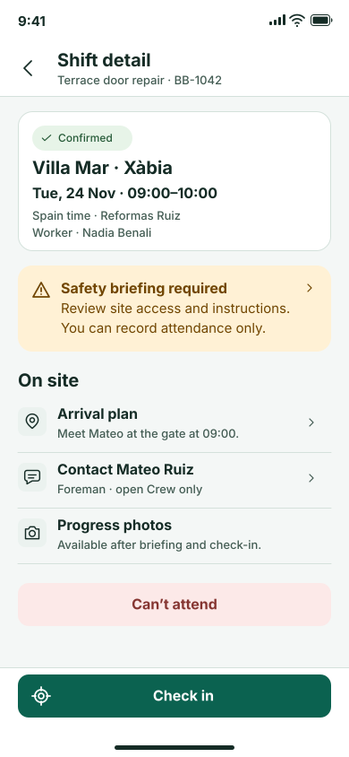

- **Purpose and routes.** Personal hub for a confirmed shift. Open from W-01, W-02, W-08’s linked confirmed shift, S-09 or W-03 after confirmation. The arrival and safety cue open W-09; contact opens S-10 Crew only if granted. Check in / Check out opens the corresponding W-06 sheet, Progress photos opens W-07 when available, and Can’t attend opens W-05. Back returns to the origin with the same selection and scroll.
- **Layout and data.** Pushed title and job reference → confirmed **Shift card** with site, date/time and zone, worker and business → attention **Status notice** or briefing completion → site-arrival, contact and progress **List** rows → separate destructive action → pinned next attendance CTA. Show Nadia, Mateo, Villa Mar and the 09:00 gate meeting only in the assigned scope. An arrival instruction is not a freely shared address or an access code. Show a **Timeline** of attendance statuses once events exist; pair each with capture time, zone and receipt status.
- **States and interaction.** In ‘Confirmed’, show a briefing/arrival action and offer check-in only within the relevant attendance conditions. ‘Briefing required’ still allows recording attendance but blocks starting affected work and explains why site progress capture is unavailable in this view. Once checked in, replace action with Check out or the appropriate pending state; never alternate both actions on screen. ‘Check-out due’ does not log departure. If check-in is pending offline, show it as pending and allow deliberate departure only under W-06’s event-ordering rules. If dropped or cancelled, remove attendance, drop-out, site access and other write controls; show only permitted history and authoritative outcome. Cached details show last confirmed time; redact secrets and offer scoped contact. After attendance starts, do not use dropout to erase attendance; keep checkout and foreman/help path for early departure or error. If assignment or briefing changes while on site, keep existing receipts and show the new hold or availability rather than replaying a mutation.
- **Platform, accessibility and RTL.** Use native pushed controls and safe-area footer. Read status/day first, then work hold, site/foreman/progress, then separated destructive and attendance actions. Accessible names include the action and shift, e.g. ‘Check in, terrace door repair’. Grow notes, move passive status to its own line, keep the attendance footer and site context readable at field sizes. Time and identifiers remain isolated in Arabic; labels retain the same meaning.

## W-05 · Decline or drop out

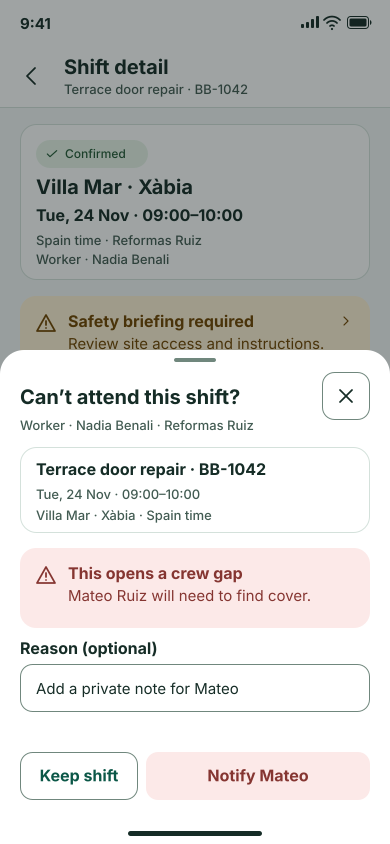

- **Purpose and routes.** Bounded **Bottom sheet** over W-03 or W-04. For an open offer use ‘Decline this offer?’ / ‘Decline offer’ with ‘Keep offer’. For a live provisional place use ‘Withdraw your acceptance?’ / ‘Withdraw acceptance’ with ‘Keep acceptance’. For a confirmed shift use ‘Can’t attend this shift?’ / ‘Notify Mateo’ with ‘Keep shift’; this is the pictured scenario before check-in. On server confirmation dismiss to the caller, announce the outcome and keep it visible there; if a grant changes, return safely via S-16.
- **Layout and data.** Sheet handle, title and Close → worker/business context → **Shift card** with title/reference, date and site zone (only coarse area for an offer, including provisional) → consequence **Status notice** → optional persistent-label reason **Input** → two explicit actions. Decline closes an unanswered offer. Withdrawal releases a provisional place, removing it from confirmation review without dropping an assigned shift. Dropout notifies Mateo and opens a confirmed-shift gap, not a job cancellation. Reason is optional and private to the authorised foreman; retain it on failure, accept non-Latin text and trim whitespace-only input to no reason. Keep/Close, native dismiss or Back make no change; clarify before discarding a typed note without stacking another sheet.
- **States and interaction.** Recheck the current offer or assignment and that Nadia can respond online; for withdrawal also recheck that her provisional place is still live. Guard repeat submissions. When withdrawal succeeds, return to W-03 with ‘Acceptance withdrawn · not assigned’ and refresh F-10/F-12 so Mateo sees the updated gap and cannot confirm that place. If confirmation won the race, do not convert the submission to a dropout: reconcile, show the confirmed assignment in W-04, and allow a separately reviewed ‘Can’t attend’ only if still applicable. If review timed out or the final recheck failed, show the W-03 ‘Not assigned’ result, not withdrawal success. If the outcome is unknown, say ‘Checking the outcome’ before offering any next action. Offline withdrawal is not sent or queued. ‘Offer declined · Mateo notified’ and ‘Can’t attend · Mateo notified’ appear only after confirmed success. An offline or rejected dropout says ‘Foreman not notified’ and offers the authorised contact route; the shift is not released by a phone attempt, unsent response or cached status.
- **Platform, accessibility and RTL.** Native sheet/predictive Back and IME dismissal. Title → scope → consequence → reason → Keep → action; explicit Close remains reachable. Use destructive styling and full verbs, not icon-only confirmation. No haptic on the destructive tap; optional feedback only after confirmation is received. Large type stacks actions; validate RTL keyboard, field direction and the isolated time range independently of the shell language.

## W-06 · Check in or out

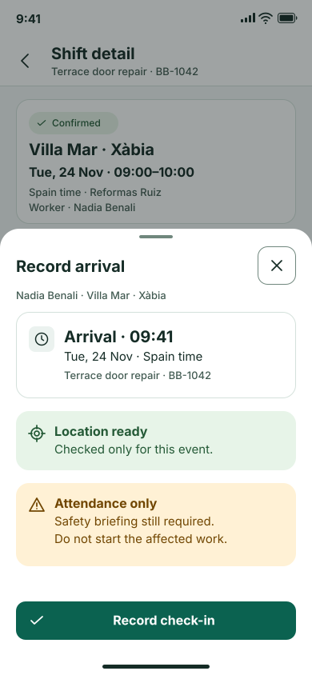

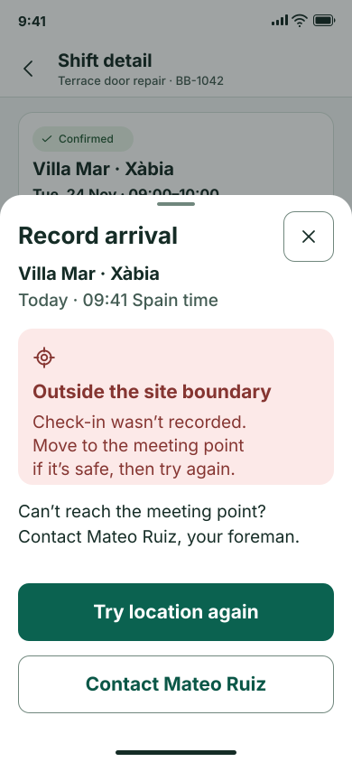

- **Purpose and routes.** Deliberately record Nadia’s attendance from W-04 or the W-01 site action. Open the sheet over W-04 and keep one event type in focus: ‘Record arrival’ / ‘Record check-in’ or ‘Record departure’ / ‘Record check-out’. Close without recording returns to the verified parent; success or locally queued result returns with persistent status. If asked to add evidence after the event, make it an optional next action to W-07 only where permitted; never record evidence by closing the sheet.
- **Layout and data.** **Bottom sheet** title and Close → worker/site context → event type, proposed capture time with site date/zone and job ID → location **Status notice** → briefing/attendance-only copy if relevant → explicit confirmation. Use the location sample only for the named event, never track in the background. Explain the purpose before native permission prompt. Recheck current scope, schedule, event order and usable location; the durable capture time is taken at the deliberate event, not when the sheet opened. Keep the proposed time current without announcing every refresh. A usable reading is not a receipt. An authoritative success says ‘Checked in at …’ or ‘Checked out at …’ with site time; keep capture and server receipt distinct on reconciliation.
- **Geofence, large text and recovery.** Outside a configured boundary, no record is made by that attempt. Say ‘Outside the site boundary’ and ‘Check-in wasn’t recorded’; offer ‘Try location again’ or ‘Contact Mateo Ruiz’. Advise moving to the meeting point only if safe; do not force walking to a pin, map use or repeat retries. Low accuracy, denied permission and unavailable GPS are distinct from ‘outside’: explain, provide a fresh explicit location action or OS Settings as appropriate, and leave foreman/help visible. Retry takes a fresh sample, not a duplicate attendance send. For outside schedule, show the site-time window and route to Mateo if no allowed event can be recorded; do not move the shift or invent a grace period. An authorised correction, if supported, is a separate visible event, not a rewritten time. Field variant shows 19–26-unit text, 56-unit Close and 64-high actions spaced 16 units apart; no unsafe override appears, and the screen cannot promise physical glove compatibility.
- **Offline, duplicate and conflict.** If local evidence is allowed and sufficient, explicit confirmation shows ‘Saved on this device · pending sync’; never call it synced, cleared or permission to start. Queue both arrival and later departure in capture order. On reconnection reconcile event identity and assignment/order once; keep capture and receipt times, marking late upload. Already-recorded events show the original result and no duplicate write. A rejected, reordered or permission-conflicted record remains visible to its author as ‘Not accepted’, with reason and next action; never create a confirmed departure against a rejected arrival. If local recording is not allowed or location cannot be verified sufficiently, say so and offer contact. Attendance can be recorded while briefing is outstanding if otherwise allowed, but the ‘Do not start affected work’ notice remains.
- **Platform, accessibility and RTL.** Use OS location permissions, not a simulated OS dialog. Focus title → event and site/time → blocking reason or readiness → primary recovery/record → contact/Close. Announce blocking state promptly; give a completion haptic only for the confirmed record. At very large scaling expand to full-height and let context/status scroll instead of hiding Close or actions. Time/location labels mirror; the crosshair remains unmirrored and decorative.

## W-07 · Add progress photos

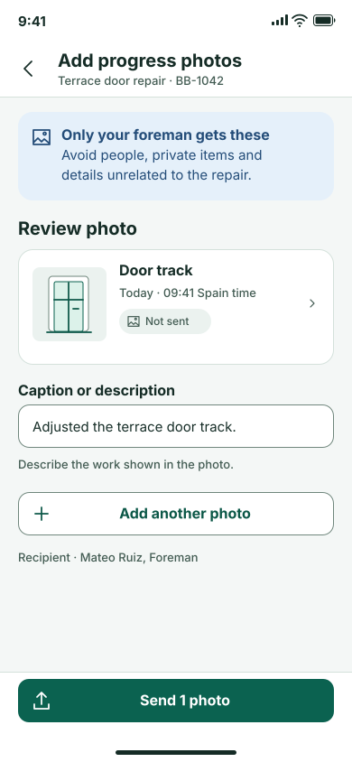

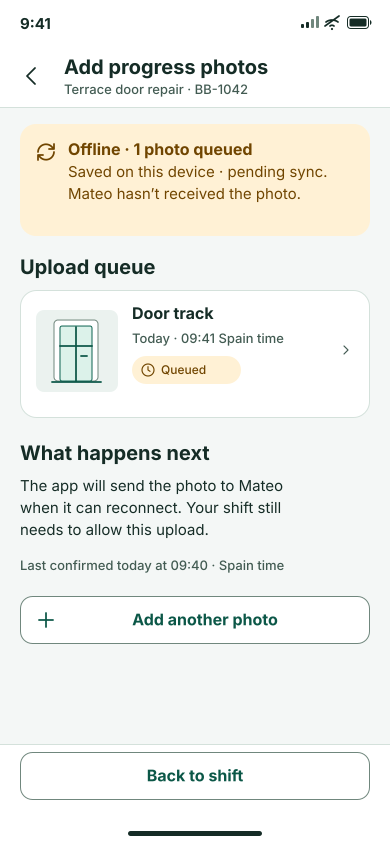

- **Purpose and routes.** W-04 or eligible post-attendance next action opens the worker’s own evidence for Mateo Ruiz. Add another photo opens S-14 with Camera / Photo library; results return to the current selection and draft. A media row opens S-15 for zoom, caption and owner actions. Back preserves the authorised draft/queue; if choosing to discard, state what is lost and confirm. Only Mateo or an explicitly authorised foreman recipient gets the upload; customer sharing is a separate foreman action from F-13.
- **Layout and data.** Pushed job header → privacy **Notice** naming the audience and asking workers to exclude people/private or identifying details → review **List** with thumbnail, editable caption or description, capture time and delivery state → add-photo **Button** and recipient → fixed Send *n* photos. The thumbnail in the artboard is a diagram, not documentary evidence. In the offline variant replace review with explicit **Upload queue** and pending notice, last confirmed time, Add another photo and Back to shift. Do not require image recognition: an editable text description provides a reading alternative, and where a photo is optional a text report via the authorised contact path remains available. A description cannot satisfy a policy that requires a photo; explain that requirement if it applies.
- **Interaction and states.** No photo prompts Camera / Photo library via S-14; cancel OS picker preserves the draft. Denied camera offers system picker and permission recovery instead of a dead end. Review before sending; show per-item remove with confirmation if that destroys the only app copy. Captions may be empty where policy permits; preserve their original language. Validate unsupported files, size limits and inaccessible assets before enqueueing; identify the affected item. If offline when Send is tapped, explicitly label the action ‘Queue *n* photos’ when known, then ‘Saved on this device · pending sync’. If connection drops mid-send, distinguish items with receipts from the pending and uncertain. While uploading show progress per item; do not present pending photos as received. Reconnect automatically for queued sends after permission/shift recheck; reuse the same event identity. On confirmed sync announce ‘Received by Mateo’ and keep the server receipt distinct from local capture time. On retryable failure show inline Retry and Remove for local items; retry only incomplete items. If scope changes, stop upload and remove restricted details; do not silently publish, retarget the draft or leave a false received badge. Removing a queued item stops its unreceived send only; reconcile an uncertain delivery before claiming removal.
- **Platform, accessibility and RTL.** Use the native camera and picker; never make zoom or swiping the only recovery path. Keep keyboard clear of caption and Save/Send controls. Focus: privacy notice → photo name/capture/status → caption → Add → recipient → send/return. Label each photo by position and caption when available; don’t announce progress on each tick. Wrap recipient, caption and status separately at large sizes. Mirror placement, not camera/thumbnail; apply independent caption direction and localised photo counts.

## W-08 · Availability

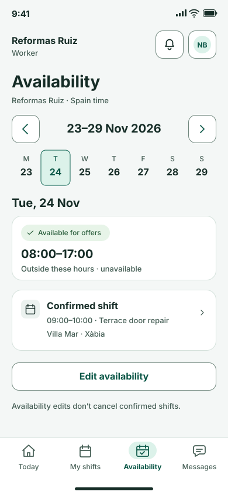

- **Purpose and routes.** Worker tab and direct date-focused entry from a W-03 conflict. Show when Nadia is available for offers and separately what is already confirmed. Tap previous/next week, a day, or an equivalent agenda row; tap confirmed shift to W-04. From the conflict route, Back returns to W-03 without changing the offer; recheck before any response. At the tab root use shell navigation, not a back action disguised as a tab.
- **Layout and data.** Business/role header → title/site zone → **Calendar/day view** with week navigation and selected day → **Status badge** and availability intervals (sample Tue 24 Nov 08:00–17:00 in Spain time) → **Shift card** for the separate confirmed 09:00–10:00 shift → Edit availability and effect note → **Tab bar**. Edit expands the selected day into a focused editor with available/unavailable choice, one or more authorised windows and a change summary, followed by Save/Cancel; keep unsaved values when changing presentation. A clean read-only view has no Save action.
- **Interaction and states.** Edit start/end with native inputs. Reject a missing endpoint, end before start and overlapping intervals with plain-language inline errors. For windows over midnight show the two date-bound intervals before saving. Availability is not a reservation. If an edit overlaps confirmed work, show the conflict against that exact shift and maintain the booking; explicitly say ‘Availability changes don’t cancel shifts’ and offer W-04 or Mateo. Mark ‘Unavailable’ independently of ‘No availability set’; for read-only policy explain why editing is not available and whom to ask. Save shows pending or confirmed, not a silent change to availability. Offline input may be retained as an unsent draft; restore and recheck current date/rules before submission rather than treating the draft as known capacity. On failure retain input, explain why and retry only the save. On concurrent edits show confirmed vs entered choices, then let the worker review and apply rather than silently overwrite.
- **Platform, accessibility and RTL.** iOS native date/time controls, Android native picker with typed input where offered. Provide labelled previous/next week controls, not swipe-only navigation; narrow and large-type layout switches to an agenda list. Focus range → day selections with full spoken dates and selected state → availability → conflicts/shift → editor action → tabs. Mirror week direction and affordances for RTL, respect locale week start, validate ambiguous or skipped daylight-saving times against the site zone rather than the device zone.

## W-09 · Site briefing

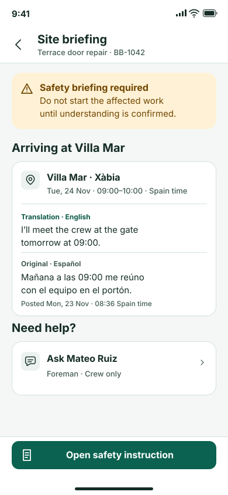

- **Purpose and routes.** Open from W-04 arrival or safety cue, W-01 action/update or W-02 briefing row. W-09 is the arrival context, not a safety acknowledgement. ‘Open safety instruction’ opens the exact current S-11 record, including private instruction-specific clarification. ‘Ask Mateo Ruiz’ is for general arrival questions through authorised S-10 Crew only or a scoped contact/help route; never include the private instruction or explain-back in a wider thread. Returning from S-11 shows its latest outcome; Back returns to the caller.
- **Layout and data.** Pushed header → **Status notice** for work hold or latest confirmation → arrival **List/Card** with property, booking time/zone and Mateo’s approved meeting note → stacked **Language badges** and translation/original text → named contact → pinned S-11 action. Translated English and original Spanish are immediately readable. The sample note is from Mon 23 Nov at 08:36 Spain time; show the posted time and separately the Tues 24 Nov appointment so ‘tomorrow’ in the preserved quote is unambiguous. Exact access instructions are displayed only in the assigned scope and fetched online where sensitive; no code or private access secret in the fixture or cache.
- **States and interaction.** The hold says: ‘Do not start the affected work. Mateo must verify your understanding and you must acknowledge the current instruction online.’ Verification alone is not enough. Keep the hold until the server records Nadia’s online acknowledgement for the same version Mateo verified. Show the receipt timestamp after confirmation, and continue to show any separate instruction to wait for Mateo’s site clearance; in this fixture, wait for his clearance to use the terrace door. Eligible attendance can still be recorded; it does not clear work. If briefing or translation is pending, show the permitted original and explain what’s missing. If Nadia does not understand, use S-11 for private clarification or human briefing and explain-back in a language both can verify; pending messages and read receipts are not clearance. On material change show ‘Briefing updated · review required’ and keep the previous acknowledgement only in history. Offline show authorised non-sensitive cached text and last confirmed time, redact secrets, and say online acknowledgement is unavailable. Route withdrawn access or unresolved safe clarification to S-16.
- **Platform, accessibility and RTL.** Native navigation, no gesture or unread dot required to reach S-11. Focus title → hold → arrival/date → translation and labelled original → contact → instruction action. VoiceOver/TalkBack read each paragraph with its own language; same-language original is shown once. Grow instruction cards without truncation and preserve the hold and named contact; neither right-to-left mode nor machine reading preference changes the agreed working or briefing language.

## Open design questions

- **Geofence and exception policy.** Confirm which sites use a boundary, acceptable accuracy and schedule windows, what location evidence is retained and who can record a correction. Design decision: a failed boundary check gives a fresh sample action and safe contact, not a bypass; no location is sampled outside explicit attendance use.
- **Foreman contact when offline or before confirmation.** Confirm which direct contact channel can be provisioned for the assigned worker and which safe provider-mediated route is offered for an unconfirmed candidate. Design decision: never expose private numbers by default or label an unsent dropout ‘notified’.
- **Availability and evidence policy.** Confirm business editing authority, whether workers may declare unavailability over already-confirmed work, and when evidence is required rather than optional. Design decisions: availability never cancels an assignment; photos go to Mateo first and local queues never count toward a completed evidence requirement.
- **Language rollout.** Launch support and human briefing coverage for Arabic, Romanian and other preferred languages are unverified. The Arabic design shows full RTL behaviour; it is not a claim that the launch language set or safe mediation coverage has been approved.

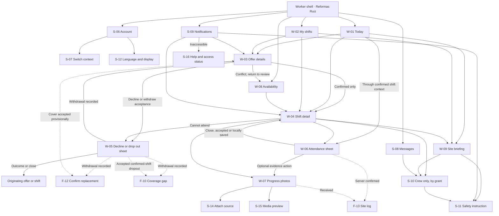
