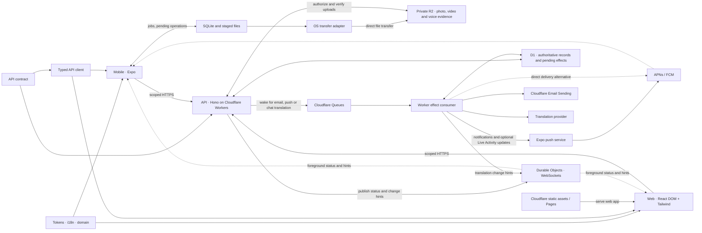

# BookBuddy mobile, web and platform architecture

**Status:** Accepted on 2026-11-23, decided by the owner.

**Scope:** This architecture covers the iPhone and Android app, the public web pages and signed-in owner portal, the API that serves both clients, and the platform services for persistence, realtime updates, evidence storage, asynchronous work and push delivery.

**Research:** [Tech stack research](../../research/tech-stack/)

## Context

BookBuddy has one role-scoped mobile app designed first for foremen and crews, with provider-admin and customer views as needed. Owners abroad can go from their first booking link through quote review, job updates, sign-off and payment in a browser without installing the app. These boundaries follow the [product brief](../reports/2026-11-21-builders-company-idea.md#teams-and-foremen) and [role-based information architecture](../../design/foundation/information-architecture.md#one-app-scoped-by-role).

## Decision

- **Mobile:** React Native with Expo for iPhone and Android. Expo Router handles navigation and verified HTTPS links. Use Expo development builds and config plugins to integrate native code, such as a future Live Activity extension. Use OS camera and microphone controls, one foreground location fix per explicit check-in, and optional biometric unlock of an existing session. Style native views with `StyleSheet` and shared semantic design tokens. NativeWind is not in use: it maps only a subset of Tailwind utilities to native styles, adds tooling and compatibility overhead, and the required Expo SDK combination is unverified. [React family: Expo, native styling and feature limits](../../research/tech-stack/react-family.md#1-react-native-with-expo)
- **Web:** React DOM with Tailwind, React Router and Vite in one app. Prerender localized public service and booking-entry pages as semantic HTML; use live API data for availability or a submitted request. Public markup makes no job API call on render. The signed-in owner portal uses responsive HTML, keyboard-friendly quote comparisons and tables, ordinary HTTPS links, and hosted payment checkout. Load scoped data once and reuse it on hydration.
- **Backend:** Hono on Cloudflare Workers serves both clients through the shared API contract and typed client. D1 holds authoritative records and pending effects. Durable Objects with WebSockets relay live job status and change hints to foreground clients, including active chat threads. R2 holds private photo, video and voice evidence; clients upload directly with scoped grants. Cloudflare static assets / Pages serve the web app. Cloudflare Queues wake a Worker consumer to dispatch replacement-offer and assignment notices and translate chat messages with missing target locales.
- **Push:** The Worker sends push notifications and, when enabled, Live Activity updates through the Expo push service first (APNs on iOS, FCM on Android for notifications; APNs for Live Activities). Direct APNs/FCM is the alternative if operational evidence warrants owning delivery or Expo cannot support the required updates. Confirm support for Live Activity payloads and tokens in the push spike; see the [Live Activities and attendance research](../../research/tech-stack/live-activities-and-geofenced-attendance.md).
- Email: Cloudflare Email sending binding, chosen 2026-11-24 to minimise external providers.
- **Tooling:** Bun manages the workspace and scripts. Expo/Metro and the native toolchains build the app; Wrangler deploys the Worker. EAS Build and EAS Update are optional.

## Alternatives considered

The research documents viable approaches and shipping examples, not BookBuddy device results. The three scorecards use different rubrics; their totals are not a cross-stack ranking.

| Option | What it buys | Decision |
| --- | --- | --- |
| **Expo/React Native + native adapters** | One mobile UI and TypeScript contracts shared with a separate HTML portal | **Accepted.** Validate transfer recovery and push on devices; own the native boundaries. |
| **Flutter** | Mature shared mobile UI, credible SQLite and native transfer options | Runner-up. Dart adds a separate client stack, and a Flutter plugin still has to prove the same OS lifecycle cases. Keep public pages HTML. |
| **KMP + Compose Multiplatform** | Shared Kotlin logic and UI; iOS UI is stable | Revisit with strong Kotlin/Swift staffing. More platform wiring for this pilot; Compose Web is not the public-page plan. |
| **KMP + SwiftUI/Compose** | Shared sync and domain code with platform-specific UI | Worth revisiting only if distinct native UIs earn their ongoing cost. |
| **Two native apps** | Most direct OS control and UI conventions | Don’t start here. Two feature implementations won’t change OS push or force-quit rules. |
| **Capacitor / pure PWA** | Most reuse of real HTML and Tailwind | Consider Capacitor if crew work becomes mainly foreground forms. Use the web for owners, not as the sole dispatch client: iPhone web push requires Home Screen installation and Safari lacks general background sync. |

[Flutter/KMP: native feature fit](../../research/tech-stack/flutter-and-kmp.md#native-feature-fit) · [Portal trade-offs](../../research/tech-stack/flutter-and-kmp.md#languages-accessibility-and-the-customer-portal) · [Native: when to specialize](../../research/tech-stack/native-two-apps.md#when-to-choose-native-and-how-to-keep-options-open) · [React family: field feature comparison](../../research/tech-stack/react-family.md#native-features-and-failure-modes)

## System overview

Clients share contracts and portable logic, not UI. The API authorizes access; the realtime channel signals changes without replacing scoped reads.



## Repository layout

```text
apps/
  mobile/        Expo Router; role screens, SQLite, sync and OS transfer adapter
  web/           React DOM + Tailwind; public pages and signed-in portal
  api/           Hono Worker; jobs, offers, media, chat and provider adapters
packages/
  design-tokens/ Semantic palette, type and spacing → native values and CSS variables
  i18n/          ICU catalogs per locale and surface, typed keys, locale config, FormatJS formatters
  domain/        IDs, statuses and pure rules shared by clients and server
  api-contract/  Wire schemas, inferred DTOs, errors and canonical link shapes
  api-client/    Typed transport; injected session credentials, no hidden refetches
```

Keep only portable, deterministic logic in `domain`, such as status mapping and site-time rules. Mobile reads its SQLite repository; web owns its route state. Neither client imports Worker or D1 internals. Do not share page layouts, navigation, widgets or platform permission UI.

## Critical data paths and call budgets

These are design budgets for an eligible, signed-in invocation, not measurements from an implementation. A D1 call is one binding query or transactional batch, not one billed row; batch work must still be scoped and bounded. Local SQLite and file work is not a network call. Unlisted external API, object-store, queue, Durable Object and application-cache calls are zero.

### 1. Offline jobs and attendance

Open SQLite immediately. Show when the record was last confirmed. Save safe drafts and attendance in a local transaction with stable operation IDs; record capture time and location accuracy when available, with a clearly marked manual path if a fix isn’t available. Don’t cache property access secrets or imply that attendance clears a safety hold.

- **Cached open or offline action:** zero network calls. No job refetch on navigation.
- **Initial sync, stale foreground/reconnect or explicit refresh:** **one API request and one D1 call per bounded page**. Send the cursor and a batch of pending operations together. In the same D1 batch, apply eligible operations idempotently, return their outcomes and read authorized changes and removals. An empty outbox uses a delta read only. Apply the reply and advance the cursor in one local transaction. An expired cursor gets a scoped snapshot, not one request per job.

Keep one sync in flight per account/role scope. On failure, keep the cursor and pending IDs; try again on the next eligible sync, not in a tight loop. Apply revocations on reconciliation and distinguish conflicts from unsent work. Quote approval, booking, cover and payment remain online confirmations. [Core flows: shared state and offline rules](../../design/foundation/core-flows.md#shared-state-and-offline-rules)

### 2. Durable media transfer

Before reporting “saved on this device,” stage the photo, video or voice file in app-owned storage and commit its attachment ID and queue entry to SQLite. Give the transfer adapter a file path and persist its task/session identity and completed parts. Use file-backed background `URLSession` on iOS; on Android use WorkManager for deferred transfers or an eligible user-initiated transfer job for a long visible upload. Don’t move media bytes through JavaScript or the API.

| Step | Normal calls |
| --- | --- |
| Capture and stage | **Zero network calls.** |
| Prepare a batch that needs upload grants | **One API + one D1 batch** to authorize and reserve IDs and return scoped grants. For \(m\) new multipart uploads, **\(m\) R2 session creates + one D1 batch** to save their session IDs. Sign part grants together, not one API call per part. |
| Transfer | **One R2 PUT** per small file or **\(k\) R2 part PUTs** for a large file of \(k\) parts. No API, database or queue call per part or progress update. |
| Settle a completed batch | **One API + one D1 status/authorization batch**; skip already-ready IDs. For each remaining file, **one R2 metadata check** for a small upload or **one multipart completion** that returns verified metadata. **One D1 write batch** if any files become ready. Return their acknowledgements in the same response. |

Reattach to known OS tasks instead of scheduling duplicates. Query parts or object status only if their outcome is unknown; resume missing parts and refresh only expired grants. Keep the file until the server acknowledges it. Ordinary suspension can allow transfer to continue; force-quit can prevent it. Recover on the next permitted run without claiming an unsent attachment arrived. [React family: upload limitations](../../research/tech-stack/react-family.md#native-features-and-failure-modes) · [Native lifecycle APIs](../../research/tech-stack/native-two-apps.md#what-the-two-native-apps-buy)

### 3. Push → offer → single acceptance

Issue an expiring offer to eligible internal candidates first; use the vetted local pool only through the approved route. Push contains a generic alert and opaque HTTPS destination, never property details or an accept action. Push is a prompt, not a receipt. The foreman sees unresolved cover and uses the agreed escalation route at the deadline.

- **Issue:** **one API + one D1 transaction** to check scope and eligibility and write offers and dispatch work. No eligible recipient means no push or queue send. Otherwise use the dispatch budget below.
- **Open:** **one API + one scoped D1 read** for a cold or stale offer, including its current expiry/state and permitted details. Reuse an already-current view; offline, show authorized last-known data and don’t submit an acceptance.
- **Accept:** **one API + one D1 transaction** with an operation ID and offer round. Atomically require the intended worker, current eligibility, server-side expiry and an open gap. Only one candidate can move that gap to `accepted_pending_confirmation` in a round. A duplicate returns its recorded outcome; a competing worker gets the current safe result, with no write or follow-up fetch.
- **Confirm:** **one API + one D1 transaction** to recheck foreman authority, eligibility, availability and the still-current provisional acceptance, then commit at most one assignment. Derive competing offer states from the gap rather than writing every sibling offer closed. Only newly committed changes may schedule notices; only confirmed crew are visible to the customer.

A provisional acceptance is not permission to travel, access a property or start work. Keep an ambiguous response pending until the same operation ID is reconciled. [Core flows: last-minute replacement](../../design/foundation/core-flows.md#4-last-minute-replacement-own-team-then-vetted-pool) · [Deep-link contract](../../design/foundation/information-architecture.md#notification-and-deep-link-contract)

### 4. Chat and stored translation

Append the immutable original first, with a stable client message ID. In the same transaction, identify the distinct needed target locales from authorized readers’ saved preferences. Create work only for missing `(message ID, revision, target locale)` keys; skip same-language targets. Store the result and provenance beside the original. Show the original even when translation is pending or unavailable. Corrections preserve history; safety instructions still need human confirmation.

- **Send:** zero network calls to queue offline; **one API + one D1 batch** to append a bounded batch online. Publish **one Durable Object hint per changed active-thread topic**; enqueue translation only when work is new.
- **Translate:** after the common effect claim below, **one provider call per required language-pair batch**, split only by provider limits, and persist the results in the effect result batch. Publish **one hint per changed thread** after committing results. Duplicates and readers never call the translation provider. If provider success is ambiguous, don’t blindly repeat a paid call; preserve and show the original.
- **Read:** a cached read costs zero. Opening a live thread costs **one WebSocket upgrade + one Durable Object route + one scoped D1 catch-up read**. Coalesce subsequent hints into **one API + one D1 read per needed cursor page**, returning original and stored preferred translation together. Hints carry no message text; the data read checks access. On disconnect, catch up by cursor rather than polling or maintaining a background socket.

[React family: language and translation guidance](../../research/tech-stack/react-family.md#languages-translation-and-accessibility) · [Core flows: multilingual chat](../../design/foundation/core-flows.md#5-multilingual-chat-and-safety-critical-confirmation)

**Common effect budget.** Commit mail, push or translation work with the state change. Send **one queue wake-up per nonempty committed batch**. The consumer makes **one D1 claim/read batch**, returning the inputs it needs, and **at most one D1 results batch**. Each claim selects at most 32 intents, including at most 16 emails at one binding call per message. For push, read stored installation tokens in the claim and send \(\lceil t/b\rceil\) Expo requests for \(t\) eligible device notices and provider batch limit \(b\). Check due tickets in batches: **one D1 read, provider-sized receipt requests, and at most one D1 result write**; no per-ticket polling. A receipt is a transport result, not a human acknowledgement. A bounded due-work sweep costs **one D1 claim batch** even if empty and recovers missed wake-ups without re-enqueueing claimed work. Duplicate work claims, expired offers and terminal failures do not fan out. No screen polls these dependencies.

## Sources of truth

- **D1:** Stable IDs, role grants, jobs, shift and offer state, saved property address and pin, site time zone, preferences, and push installation tokens. Geocode or register an installation only when its source data changes. The API alone authorizes work, confirms assignments and records payment outcomes. The verified payment provider outcome, not the browser return, updates payment state.
- **SQLite and app-owned files:** SQLite owns unsent device operations and a scoped copy of last-confirmed data; it does not grant access or reserve a shift. App-owned files hold evidence pending acknowledgement.
- **R2:** The private bucket holds received bytes; D1 determines whether an attachment is ready and linked.
- **Copy and language:** UI catalogs are bundled copy, not translated chat. Keep UI locale, reading preference, declared work languages and actual message language separate. [Design system: localisation and original content](../../design/system/design-system.md#localisation-and-original-content)

## Internationalisation

Ship English (`en`) as the source and default, and European Portuguese (`pt-PT`) as the second UI locale. Use Portuguese spelling and terminology suited to the European service context, not Brazilian Portuguese. This supersedes the provisional Spanish UI in the design drafts. UI language does not determine a job’s location, time zone or currency.

### Catalogs and runtime

Use ICU MessageFormat with the [FormatJS core (`@formatjs/intl`)](https://formatjs.github.io/docs/intl/) on mobile, web and the Worker. The same `createIntl` formatter handles ICU plurals, ordinals and `select` for grammatical gender, without shipping React to the Worker or introducing a resource loader. Use `other` for unspecified gender; never infer it from a name. Reuse formatter instances by locale and surface, not a mutable global current locale.

- `packages/i18n/catalogs/<locale>/{shared,mobile,web,push}.json` contains flat, namespaced keys such as `push.offer.title`. Web keys distinguish public pages and the owner portal. Keep translator notes in `catalogs/context.json`: where the copy appears, what placeholders mean and any length or tone constraints.
- A Bun/TypeScript build step uses the [FormatJS ICU parser](https://formatjs.github.io/docs/icu-messageformat-parser/) to emit compiled ASTs. It generates `MessageKey<Surface>` and placeholder types from English for `createTranslator(surface, locale).t(key, values)`. Ship only the relevant namespaces, compiled messages and formatter, not source catalogs, notes or the runtime parser.
- `locales.json` owns enabled tags, autonyms, direction and language defaults. Try each requested tag in order: exact match, then an enabled parent or configured language default, then the next request. Fall back to `en`. At launch, `en-*` resolves to `en`, and `pt` and unsupported Portuguese variants resolve to `pt-PT`. An unexpected missing message falls back to the bundled English message with English plural rules; it never triggers a fetch.
- To add a language, copy the namespace set into a new locale directory, translate it, and get native-language review including field terminology and push copy. Then enable the tag in `locales.json`. The build derives imports, routes and Expo supported locales from that file. No application code or D1 migration changes; updating OS language declarations requires a new mobile binary.

### Locale selection and persistence

- **Mobile:** Before sign-in, use the explicit local choice, then the ordered `expo-localization.getLocales()` language tags, then English. Keep the selector available before sign-in. Re-read device settings on Android foreground only when following the device; iOS returns a stable value for the running app. After sign-in, the saved account choice wins, with an account-scoped local copy for offline use. Seed it in the normal onboarding save, not on every sign-in.
- **D1 and API:** Store `ui_locale TEXT NULL` (unset before setup) and `reading_locale TEXT NULL` (`NULL` means **Original only**) on account preferences. Use an additive migration if the table already exists, not a SQL enum of launch tags. Return `LocalePreferences` with existing session/bootstrap payloads and accept changed fields through the typed account-settings mutation. Validate UI writes against enabled tags; an older build must accept a newer saved tag on the wire and fall back locally without overwriting it. The typed client sends the effective UI tag as `Accept-Language` on existing requests. It is a presentation hint, not a write or an authorisation input; API codes and domain values stay locale-neutral.
- **Web:** The explicit public URL prefix (`/en/…`, `/pt-PT/…`) wins. Only unprefixed entry points negotiate from a saved browser choice, then weighted `Accept-Language`, then `en`. Mark that redirect private and non-cacheable. Prerender each enabled prefix with its own `lang` and `dir`; hydrate with that same locale. The signed-in portal uses the account preference. A public locale link does not change account settings or invalidate job data.
- **Push:** The existing D1 dispatch claim returns each recipient’s saved UI locale with the stored installation tokens. Pass it to the Worker renderer, defaulting to English if unset or unsupported. Send the rendered generic title and body with the opaque HTTPS destination. Never use the sender’s locale, look up a preference per token or resend an alert because the preference changed.

### Formatting and site time

Use `Intl.DateTimeFormat` for dates and times, `NumberFormat` for numbers and EUR, `RelativeTimeFormat` for secondary cues such as sync age, `PluralRules` for ICU plurals, and `ListFormat` for lists. Keep monetary values and currency unchanged; formatting is not conversion.

Store instants in UTC and the verified IANA zone once on the D1 site record. Include that zone in the existing job projection and use it explicitly in `formatSiteDateTime(instant, siteZone, locale)`. Show an absolute site date, time and zone for visits, deadlines and records. If **Show your time as well** is enabled and zones differ, show viewer time second, with its date if different. Test DST transitions and midnight crossings. Never substitute the device zone for missing site data; show that site time is unavailable.

[Expo SDK 58](https://expo.dev/changelog/sdk-58) uses React Native 0.88. Its [pinned Hermes Intl implementation](https://github.com/facebook/hermes/blob/hermes-v260318099.0.5/lib/VM/JSLib/Intl.cpp) registers basic `DateTimeFormat`, `NumberFormat` and `getCanonicalLocales` on iOS and Android, but not `PluralRules`, `RelativeTimeFormat`, `ListFormat` or `Locale`. Bundle the corresponding FormatJS polyfills on mobile, loading `intl-locale` before `intl-pluralrules`, then relative time and lists, with only the required locale data. Use native date and number formatting unless a required case fails; if date formatting needs a polyfill, bundle IANA data for the supported site zones. Use native `Intl` on supported web and Worker runtimes. Exact output on signed pilot devices and the deployed Worker is [unverified]; gate release on both locales, including EUR, Portuguese plurals and site-zone/DST fixtures.

### Direction and quality gates

- Use logical start/end tokens and styles in native views and CSS. On web, use `dir="auto"` for authored passages and `<bdi>` for embedded values. Isolate IDs, prices, times and mixed-direction names in native text too. Mirror Back/Next arrows and leading/trailing navigation; do not mirror clocks, playback or text.
- Generate Expo’s RTL configuration from enabled locales; launch is LTR even on an Arabic device. Use the selected UI direction for the app root and Expo Router. [React Native `I18nManager`](https://reactnative.dev/docs/i18nmanager) persists `allowRTL`/`forceRTL` changes, which take effect on the next app start. When a future switch changes direction, save the choice and drafts, reconcile the native direction, and prompt for one full restart. Same-direction switches are immediate. Verify the direction change in signed builds, not Expo Go.
- CI extracts literal key references from typed call sites using the TypeScript AST and checks them against English. Fail on missing, duplicate or unused keys, enabled-locale parity gaps, invalid ICU and incompatible placeholders. Allow locale-specific plural branches. Ban dynamic IDs, hard-coded UI copy and concatenated sentence fragments; translate whole messages, including accessibility labels. Require human approval before enabling a catalog.
- In CI, derive `en-XA` and `ar-XB` pseudo-catalogs from ICU literal text, preserving placeholders and selectors. Exercise **+40%** expansion and RTL in critical flows at narrow widths and maximum text scaling. Fail on clipped or unreachable controls. Never ship pseudo-locales in production.

### User content and call budgets

Catalogs never contain authored chat, job descriptions or quote text. Use the [stored translation path](#4-chat-and-stored-translation) for eligible text: preserve the immutable original and store one authorised result with provenance per content ID, revision and target language. Show the labelled original alongside the translation, or alone with a status if the translation is pending or unavailable. Same-language content appears once. Reading preference selects a stored result; changing it does not translate on read or backfill history. Translations do not change approved quote terms or replace human safety confirmation.

| Invocation | Launch budget relative to the existing data path |
| --- | --- |
| Render or switch language in a loaded app, including hydrated web | **Zero catalog requests.** A local, offline or unchanged selection makes zero API or D1 calls. Bundle both launch locales per surface; an unhydrated public language link needs only its normal static page load. |
| Save a changed account preference | **One API request and one D1 write/ack batch** when standalone; no extra request when included in an existing settings or onboarding save. On failure keep the local choice marked pending and the last confirmed server value in force. No read-back, retry loop or job refetch. |
| Bootstrap, existing API calls and site-time display | **Zero added calls.** Read preferences and site metadata in existing scoped queries and pass them through. No locale endpoint, geocoding or application Cache API. |
| Push and user-content translation | **Unchanged effect budget:** one queue wake-up per nonempty committed batch, one D1 claim/read and at most one D1 result batch. Push uses provider-sized token batches; translation uses one provider call per required language-pair batch, subject to provider limits. Existing receipt and changed-thread hint budgets stay unchanged. Duplicate work and ambiguous paid results do not fan out. |

Do not build a runtime catalog service or on-device translation. The owner still needs to name the Portuguese copy and field reviewers and approve the launch reading-language pairs, eligible content and provider/privacy rules. Those decisions do not block the two UI catalogs.

## Risks and accepted trade-offs

- Expo lets a small TypeScript team implement the mobile workflow once and share contracts and validation with web and API. Development builds give it access to the OS APIs the workflow needs, but the team owns two signed binaries, two real-device test lanes, and a named release owner with access to Swift and Kotlin expertise.
- Tailwind styles real HTML; it does not style native views. Separate platform components let each use its own accessibility conventions. Shared tokens are not evidence of parity: test RTL, text scaling and screen readers on both surfaces. [React family: languages and accessibility](../../research/tech-stack/react-family.md#languages-translation-and-accessibility)
- OS lifecycle and network conditions limit transfer and push. There is no promise of uninterrupted transfers or a push delivery SLA. A managed realtime service remains an alternative to Durable Objects if operations warrant it.
- Payments for in-person services use a hosted payment provider, not App Store IAP or Play Billing. [React family: distribution and store rules](../../research/tech-stack/react-family.md#distribution-testability-and-costs)
- This decision does not specify DDL, migrations, provider selection, settlement models or capacity. It does not add universal UI, continuous GPS tracking, on-device translation or automatic voice transcription. Rust is out unless a measured bottleneck or security boundary calls for it.

## Validation milestones

Run these implementation spikes with signed builds, the actual plugins and credentials, a supported pilot iPhone and a modest pilot Android device. The criteria below are targets, not measured results or conditions of accepting the stack.

| Milestone | Time box | Validation criteria |
| --- | --- | --- |
| **Background upload recovery** | **3 working days** | Queue one photo, one short video at the proposed pilot size cap and one voice note in airplane mode. On both OSes prove a file transfer can progress during ordinary suspension without JS. Interrupt the network mid-transfer, distinguish OS termination from force-quit, and recover on the next allowed run. No lost files, duplicate attachments, retransmission of acknowledged parts or “sent” state before server acknowledgement. |
| **Push and race-safe acceptance** | **2 working days** | On each OS, at least **19 of 20** unique alerts appear within **15 seconds** on connected, permission-enabled phones across foreground, suspended and cold-launch cases. Taps reach the right role and valid or clearly expired offer. Race two eligible devices, then replay a request: one provisional acceptance, at most one confirmed assignment. Denied or missed delivery leaves an actionable unresolved gap. The threshold is for pilot readiness, not a field SLA. Verify the Expo path for Live Activity updates. APNs requires HTTP/2; whether a Worker's outbound `fetch` can reach APNs directly is `[unverified]` and will be settled in this spike. |
| **Arabic RTL and accessibility** | **2 working days** | Complete job, offer and chat actions with VoiceOver and TalkBack at maximum text size; complete the web booking path by keyboard at 200% zoom. No blocked or clipped critical control. Mixed Arabic and Latin names, IDs, times and prices stay legible and ordered; original and translation are separately labeled and reachable. |
| **Offline jobs and sync** | **3 working days** | Cold-open cached jobs without signal, queue check-in/out and a draft, restart, and reconnect after a remote edit or revocation. Ordered events apply once despite replay, or show an explicit conflict. No stale access or false confirmation after reconciliation. A cached open makes zero network calls; a normal reconnect uses one request and one D1 batch per page. |

**Fallbacks:** If the Expo upload integration misses the recovery criteria but the direct OS APIs pass, use an isolated native transfer module and keep the shared UI. If Expo cannot meet push requirements, validate direct APNs/FCM before switching; keep the human escalation route for missed offers and retain locally updated Live Activity status if remote updates are not proven. If shared controls fail RTL or accessibility checks, fix or replace the affected platform controls and rerun those flows. If offline sync fails, retain unsent work and require a connection for the affected action until reconciliation passes, without displaying a false confirmation.

Use direct native adapters where a wrapper falls short. Reopen the framework decision only for a demonstrated framework-specific blocker across critical paths or a substantial change in team skills. [React family: device validation criteria](../../research/tech-stack/react-family.md#decision-gates-and-scored-summary) · [Native: when to revisit the framework decision](../../research/tech-stack/native-two-apps.md#what-would-change-this-recommendation-in-the-pilot)

## Open questions

- Which phones, OS versions and maximum media sizes represent the first crews? What offline retention is acceptable on personal or shared devices?
- Who can confirm replacement cover and through which legally approved provider route? What deadline and human escalation channel apply when nobody responds?
- Which UI and reading languages launch, who reviews field terminology, and what rules apply to translation providers, location and media retention, and safety-critical confirmation?
- Who contracts with the owner, charges the customer and handles refunds or provider settlement? Keep that decision separate from the app-store payment classification.