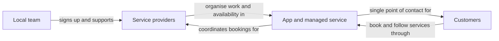
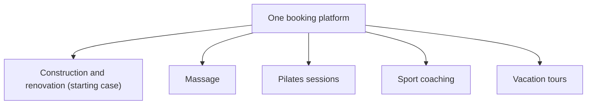
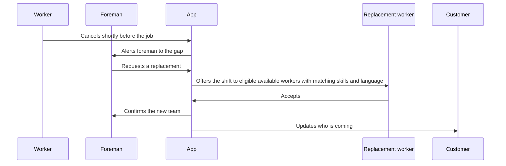
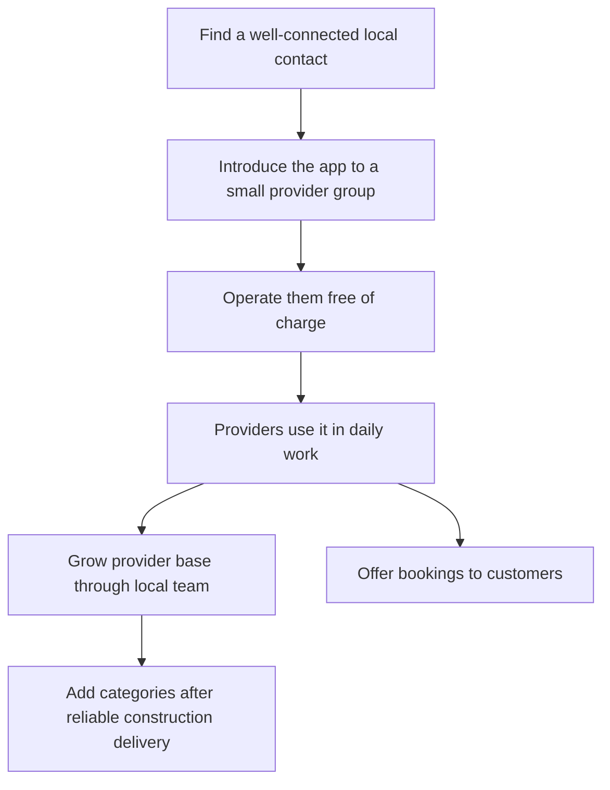
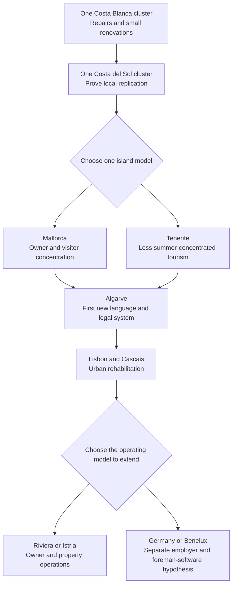

# A booking and work-organising service for local service providers

A booking app and locally managed service through which independent service businesses organise their work and take bookings, while customers have a single point of contact. It starts with repairs and small renovations for property owners and managers. Its advantage is an accountable handoff from customer to foreman and crew, with communication in each person's preferred language and access to eligible replacement capacity. Massage, pilates, sport coaching and vacation tours are later categories, each requiring its own operating case.

## Problem

An owner who needs local repairs may lack the language, presence or trusted provider network to arrange them. Providers may have fragmented schedules, job information and team availability. Public evidence supports looking for places where these conditions overlap, but does not measure how many foreign owners cannot hire tradespeople or how often a customer, foreman and worker share no language. [Market evidence and limits](../../research/markets/markets.md#2-what-the-evidence-does-and-does-not-measure)

The initial customer is an owner or property manager with recurring repair and small-renovation needs, including an owner abroad. The initial supply should be legitimate local trade businesses and foremen with identifiable crews, rather than an informally interchangeable pool of individual freelancers. [Recommended operating model](../../research/markets/markets.md#beachhead-a-compact-costa-blanca-service-not-launch-spain) · [ELA contracting-chain evidence](https://www.ela.europa.eu/sites/default/files/2025-06/Third_country_nationals_report.pdf)

## Thesis

| Thesis | Consequence for the company |
| --- | --- |
| Foreign-owner concentration, seasonal homes and language friction make a plausible initial customer channel, not proof of paid demand | Start in a compact Costa Blanca catchment and validate repeat bookings before expanding. [Market selection](../../research/markets/markets.md#10-scoring-and-ranked-shortlist) |
| Booking, team assignment, translated messages and staffing already exist in overlapping products | Do not position a calendar or translation feature as novel. Compete on the accountable operational handoff and reliable local fulfilment. [Jobber](https://www.getjobber.com/features/online-booking/) · [Connecteam](https://help.connecteam.com/en/articles/15013840-translating-messages-in-the-chat) · [Airbnb](https://www.airbnb.com/help/article/280) |
| Replacement is a supply and compliance problem as well as a software workflow | Establish qualified, legally deployable local capacity before promising a response time. [ELA](https://www.ela.europa.eu/sites/default/files/2025-06/Third_country_nationals_report.pdf) · [Replacement evidence limits](../../research/competitors/competitors.md#10-evidence-gaps-and-limits) |
| Owner-facing coordination and foreman/team software address different acquisition channels and legal risks | Lead with the owner service; evaluate employer software as a separate expansion hypothesis. [Market-model sensitivity](../../research/markets/markets.md#103-sensitivity-what-could-change-the-answer) |
| Several categories share booking mechanics, but not necessarily provider networks, qualifications or economics | Prove construction delivery first; make each later category earn its own operational case. [Cross-category requirements](../../research/competitors/competitors.md#what-would-make-the-gap-real-rather-than-a-bundle-of-features) |

## Product

An app providers use to organise their work and receive bookings, operated by the company as a service: the company brings providers onto the platform and runs their bookings through it.

## Services covered

Construction is the starting case. The other categories are candidates for the same booking model, subject to separate provider networks and service rules.

| Category | Provider | What the customer books |
| --- | --- | --- |
| Construction and renovation | Builders and other construction workers | A job or a renovation project |
| Massage | Massage therapists | A session |
| Pilates | Pilates instructors | A session or class |
| Sport coaching | Coaches and trainers | A coaching session |
| Vacation tours | Tour guides and operators | A tour |

## Teams and foremen

Many services are delivered by teams, not by individuals. Construction crews are often run by a foreman who speaks the workers' language, organises them and is the customer's main contact. The customer may share no language with the crew, and sometimes not with the foreman. The app treats the foreman as a user in their own right and gives them the tools to run their team.

| Feature | What it does |
| --- | --- |
| Team roster | The foreman keeps their workers in one list with skills, languages and availability |
| Job assignment | The foreman assigns workers to jobs and shifts, and each worker sees their own schedule |
| Availability and confirmation | Workers confirm or decline assignments, so gaps show up early |
| Last-minute replacement | When a worker drops out, the foreman seeks cover first from their own team, then from a vetted local pool with the required skills, language and legal eligibility; speed depends on available supply |
| Communication in each person's language | Customer, foreman and workers read and write in their preferred languages, with the original instruction retained alongside its translation |
| Customer view | The customer sees who is coming and when, without managing the crew |

These are target capabilities, not a guarantee of instant cover. The same capabilities may help other team-based services, but each needs its own provider pool, qualifications and operating rules:

| Service | Team lead | Typical last-minute gap |
| --- | --- | --- |
| Construction and renovation | Foreman | A worker does not turn up for the day |
| Cleaning | Team leader | A cleaner drops out of a scheduled job |
| Tours | Tour operator | A guide cancels before a departure |
| Fitness and pilates studios | Studio manager | An instructor cannot teach a class |
| Massage and wellness at hotels or events | Coordinator | A therapist cancels a booked slot |

## Who it serves

| Party | Situation | What the service gives them |
| --- | --- | --- |
| Local trade businesses and foremen | Need to organise jobs, availability and named crews | One place to organise work and receive bookings, free at the start |
| Property buyers who renovate | Need work across repeated projects | An accountable contact for scope, scheduling and provider coordination |
| Owners abroad or otherwise absent | Cannot be present for each repair | Local coordination and job information in their preferred language |
| Property managers | Arrange recurring maintenance and cleaning/turnovers | A potential repeat-booking channel, subject to reliable local delivery |
| Workers | Need clear assignments and job instructions | Their own schedule, preferred-language communication and assignment confirmation |
| Residents and visitors, in later categories | Want a session, coach or tour | A local booking offer once the category's provider network and operating case are established |

## Getting started

Signing up providers needs local people on the ground. Without a legitimate initial provider network, there is no reliable service to offer customers.

The way in is a small group of local trade businesses and foremen reached through introductions, about five crews or workers, operated free of charge at first. Once they use the service in their daily work, the company has a base to grow from. Acquisition cost and conversion are still to be measured.

## Reaching property customers

Use owners and property managers as the initial customer channel. Foreign-purchase flows help locate potential acquisition channels; seasonal and absentee housing is more relevant to recurring maintenance than new purchases alone. Neither measure establishes willingness to pay or the number of renovation jobs. Local provider access and observed paid demand should decide the first service radius. [Banco de Portugal](https://www.bportugal.pt/sites/default/files/documents/2024-08/ref_05_2024_en.pdf) · [Spain's housing census](https://ine.es/en/prensa/censo_2021_jun_en.pdf) · [Beachhead recommendation](../../research/markets/markets.md#11-beachhead-and-expansion-sequence)

## Markets

### Where the disconnect is most plausible

There are distinct customer and workforce opportunities; they should not be collapsed into a single language-barrier score.

| Disconnect | Strongest supported candidates | What the evidence does, and does not, establish |
| --- | --- | --- |
| **Owner ↔ local provider** | International property pockets of Spain, Portugal, France and Italy | Buyer/seasonal-home evidence and national language proxies support a language-and-accountability hypothesis. Spain has the strongest verified concentrated purchase evidence in this comparison. National language ability is not a test of local tradespeople, and foreign nationality does not imply absence or a language barrier. [Registradores](https://www.registradores.org/inicio/-/asset_publisher/bgheTCCXRtfo/content/estadistica-registral-inmobiliaria-anuario-2024) · [Banco de Portugal](https://www.bportugal.pt/sites/default/files/documents/2024-08/ref_05_2024_en.pdf) · [LanguageKnowledge](https://languageknowledge.eu/languages/english) |
| **Foreman ↔ crew / site contractor** | Germany, Austria, Benelux and Switzerland | International workforces and cross-border contracting support a separate team-coordination proposition. Posting flows are not an immediately deployable replacement pool; the employer's country, worker's nationality and preferred language are different fields. Switzerland needs a separate legal model. [Destatis](https://www.destatis.de/DE/Presse/Pressemitteilungen/2024/03/PD24_081_125.html) · [Posting data](https://employment-social-affairs.ec.europa.eu/posting-workers-collection-data-prior-declaration-tools-reference-year-2023_en) · [ELA](https://www.ela.europa.eu/sites/default/files/2025-06/Third_country_nationals_report.pdf) |

Ireland, the Netherlands and Scandinavia have international customers but more widely available English, weakening a translation-only customer proposition. Reliability and availability may still matter. The language comparison is a secondary reprocessing of Eurobarometer data, not a measured probability of customer–foreman–worker communication failure. Regional hiring-failure rates and actual crew/customer language mixes remain **[unverified]**. [LanguageKnowledge](https://languageknowledge.eu/languages/english) · [Language-evidence limits](../../research/markets/markets.md#6-language-skills-evidence-for-the-mismatch-with-an-important-definition-trap)

### Ranked shortlist

These are research judgements for a construction-first, locally managed owner service, not observed market statistics. The scoring weighs reachable international property demand and likely language mismatch most heavily, alongside renovation, crew coordination, adjacent demand and delivery practicality. Scores are out of [100](../../research/markets/markets.md#101-method-and-weights); scores within a few points should be treated as ties until local evidence separates them.

Spain's foreign-purchaser measure is based on nationality and includes foreign residents. Portugal's non-resident measure uses tax domicile; the percentages are not directly comparable. Accommodation nights indicate visitor exposure, not independent-service booking revenue. [Registradores](https://www.registradores.org/inicio/-/asset_publisher/bgheTCCXRtfo/content/estadistica-registral-inmobiliaria-anuario-2024) · [Banco de Portugal](https://www.bportugal.pt/sites/default/files/documents/2024-08/ref_05_2024_en.pdf) · [Eurostat](https://ec.europa.eu/eurostat/statistics-explained/index.php?title=Tourism_statistics_at_regional_level)

| Rank | Candidate operating area | Score | Key evidence | Reason / main constraint |
| ---: | --- | ---: | --- | --- |
| 1 | **Costa Blanca: one Alicante coastal cluster** | [89](../../research/markets/markets.md#102-ranked-table--12-candidate-operating-areas) | **43.8% foreign dwelling purchases in 2024**, Alicante province; **32.6 million accommodation nights in 2024**. [Registradores](https://www.registradores.org/inicio/-/asset_publisher/bgheTCCXRtfo/content/estadistica-registral-inmobiliaria-anuario-2024) · [Eurostat](https://ec.europa.eu/eurostat/statistics-explained/index.php?title=Tourism_statistics_at_regional_level) | Strongest verified provincial buyer concentration, with seasonal-housing evidence; exact catchment and language mix still need validation. [INE](https://ine.es/en/prensa/censo_2021_jun_en.pdf) |
| 2 | **Costa del Sol: one Málaga coastal cluster** | [88](../../research/markets/markets.md#102-ranked-table--12-candidate-operating-areas) | **32.4% foreign dwelling purchases in 2024**, Málaga province; **30.5 million accommodation nights in 2024**. [Registradores](https://www.registradores.org/inicio/-/asset_publisher/bgheTCCXRtfo/content/estadistica-registral-inmobiliaria-anuario-2024) · [Eurostat](https://ec.europa.eu/eurostat/statistics-explained/index.php?title=Tourism_statistics_at_regional_level) | Near-equal owner/visitor opportunity; provider access and delivery economics can reverse the order. |
| 3 | **Mallorca: one island catchment** | [85](../../research/markets/markets.md#102-ranked-table--12-candidate-operating-areas) | **32.6% foreign dwelling purchases in 2024** across the **Balearics**, not Mallorca alone; Mallorca had **55.3 million accommodation nights in 2024**. [Registradores](https://www.registradores.org/inicio/-/asset_publisher/bgheTCCXRtfo/content/estadistica-registral-inmobiliaria-anuario-2024) · [Eurostat](https://ec.europa.eu/eurostat/statistics-explained/index.php?title=Tourism_statistics_at_regional_level) | Exceptional owner/visitor overlap; seasonality, island geography and housing pressure reduce first-entry practicality. |
| 4 | **Tenerife: one island catchment** | [80](../../research/markets/markets.md#102-ranked-table--12-candidate-operating-areas) | **33.1% foreign dwelling purchases in 2024** in **Santa Cruz de Tenerife province**, which includes other islands; Tenerife had **35.8 million accommodation nights in 2024**. [Registradores](https://www.registradores.org/inicio/-/asset_publisher/bgheTCCXRtfo/content/estadistica-registral-inmobiliaria-anuario-2024) · [Eurostat](https://ec.europa.eu/eurostat/statistics-explained/index.php?title=Tourism_statistics_at_regional_level) | Less summer-concentrated tourism; separate island supply and mismatched statistical boundaries warrant caution. |
| =5 | **Algarve: one coastal cluster** | [78](../../research/markets/markets.md#102-ranked-table--12-candidate-operating-areas) | Received **29.9% of Portugal's non-resident purchases in 2023**: a distribution of those purchases, **not** a foreign share of Algarve sales. [Banco de Portugal](https://www.bportugal.pt/sites/default/files/documents/2024-08/ref_05_2024_en.pdf) | Strong owner/tourism channel; new Portuguese operating system and weaker workforce evidence than Spain. [Eurostat](https://ec.europa.eu/eurostat/statistics-explained/index.php?title=Tourism_statistics_at_regional_level) · [IMPIC](https://www.impic.pt/impic/faqswww/popup_construcao_ii.php) |
| =5 | **French Riviera / Provence: one local basin** | [78](../../research/markets/markets.md#102-ranked-table--12-candidate-operating-areas) | France had **3.733 million second/occasional homes, 1 January 2024**, excluding Mayotte; this is national stock, not a Riviera foreign-owner count. [INSEE](https://www.insee.fr/fr/statistiques/8251576) | Large maintenance base and language hypothesis; current regional buyer evidence and managed-contractor obligations are concerns. [Qualifications](https://entreprendre.service-public.gouv.fr/vosdroits/F39041) · [Insurance](https://entreprendre.service-public.gouv.fr/vosdroits/F2034) |
| 7 | **Lisbon / Cascais** | [77](../../research/markets/markets.md#102-ranked-table--12-candidate-operating-areas) | Non-residents made **33% of dwelling transactions in 2023** in the **Lisbon urban rehabilitation area**, not the metropolitan area or Cascais. [Banco de Portugal](https://www.bportugal.pt/sites/default/files/documents/2024-08/ref_05_2024_en.pdf) | Urban rehabilitation opportunity; Portuguese-speaking foreign customers weaken a simple nationality-to-language inference. |
| 8 | **Istria** | [73](../../research/markets/markets.md#102-ranked-table--12-candidate-operating-areas) | Strong visitor concentration and Croatian German/Slovenian buyer channels, but recent foreign-property purchases declined. [Eurostat](https://ec.europa.eu/eurostat/statistics-explained/index.php?title=Tourism_statistics_at_regional_level) · [Lider / Tax Administration](https://en.lider.media/2025/10/14/foreigners-withdraw-from-the-market-dramatic-decline-in-real-estate-purchases-in-2025/) | Seasonal peaks and migrant-permit logistics; Istria's foreign-owner share remains **[unverified]**. |
| =9 | **Paphos, then Limassol separately** | [71](../../research/markets/markets.md#102-ranked-table--12-candidate-operating-areas) | Paphos received **32% of Cyprus's foreign-buyer sale contracts in 2024**, not a foreign share of all Paphos transactions. [PwC / DLS](https://www.pwc.com.cy/en/publications/assets/real-estate-market-year-in-review-24.pdf) | International demand and labour, but common English weakens the language wedge; labour-only contracting is regulated. [LanguageKnowledge](https://languageknowledge.eu/languages/english) · [Contractor rules](https://www.businessincyprus.gov.cy/business-sectors/contractor/) |
| =9 | **Berlin** | [71](../../research/markets/markets.md#102-ranked-table--12-candidate-operating-areas) | Germany's migrant-workforce evidence supports crew coordination rather than an absentee-home beachhead. [Destatis](https://www.destatis.de/DE/Presse/Pressemitteilungen/2024/03/PD24_081_125.html) | Strong foreman/team hypothesis; weaker owner-model fit and demanding craft/employment boundaries. [Craft requirements](https://www.make-it-in-germany.com/en/working-in-germany/starting-business/requirements) |
| 11 | **Tuscany / Umbria: one province** | [70](../../research/markets/markets.md#102-ranked-table--12-candidate-operating-areas) | Italian housing redevelopment: **−22% in real terms, 2024**; this is national, not a regional repair-market figure. [FIEC](https://fiec-statistical-report.eu/2025/italy) | Language and visitor fit, but a weakly verified completed-purchase denominator, renovation retrenchment and site compliance. [Site requirements](https://www.ispettorato.gov.it/files/2024/09/INL-Circ.-n.-4_2024-patente-a-crediti_signed.pdf) |
| 12 | **Crete: one city/coastal catchment** | [65](../../research/markets/markets.md#102-ranked-table--12-candidate-operating-areas) | Owner/tourism overlap is plausible; regional completed-buyer, workforce and renovation evidence is insufficient for a higher-confidence entry. [Evidence gaps](../../research/markets/markets.md#12-remaining-evidence-gaps-and-confidence) | Separate island catchments and unresolved trade-specific rules; do not label the market lightly regulated. [Licensed electrical work](https://www.gov.gr/en/upourgeia/upourgeio-anaptuxes/anaptuxes/metroo-elektrikon-egkatastaseon) |

### Beachhead and expansion

**Start with one compact Costa Blanca catchment.** Alicante province has the best evidenced intersection of international purchases, seasonal housing and visitor exposure in this comparison. The evidence does not establish whether Dénia–Jávea–Calpe is better than Torrevieja–Orihuela Costa: the choice needs an accessible, legitimate provider network and observed paid demand. Municipality-level customer and crew language mixes remain **[unverified]**. [Registradores](https://www.registradores.org/inicio/-/asset_publisher/bgheTCCXRtfo/content/estadistica-registral-inmobiliaria-anuario-2024) · [INE](https://ine.es/en/prensa/censo_2021_jun_en.pdf) · [Local-entry limits](../../research/markets/markets.md#11-beachhead-and-expansion-sequence)

**Costa del Sol is a near-tied runner-up.** Its international buyer and visitor base supports the same model. The small score gap is judgement-based, and giving adjacent tourism demand more weight reverses the order in the research sensitivity check. A reliable local operator and contractor network should outweigh that gap. [Scoring sensitivity](../../research/markets/markets.md#103-sensitivity-what-could-change-the-answer)

**Mallorca ranks next, not because demand is weak.** Its tourism exposure is especially strong, but island delivery and seasonality need a dedicated supply plan. Average Balearic dwelling purchase prices were **€380,166 in 2024**, against **€198,407 nationally**; the region also had the highest mortgage-payment-to-wage ratio in the cited comparison. These are housing-pressure warnings, **not measured operating costs**. An exceptional compliant provider network could justify starting there despite the ranking. [Registradores](https://www.registradores.org/inicio/-/asset_publisher/bgheTCCXRtfo/content/estadistica-registral-inmobiliaria-anuario-2024) · [Eurostat](https://ec.europa.eu/eurostat/statistics-explained/index.php?title=Tourism_statistics_at_regional_level) · [Network sensitivity](../../research/markets/markets.md#103-sensitivity-what-could-change-the-answer)

This is a recommended sequence, not a forecast or a promise that providers, licences or legal relationships transfer between markets. Each step needs a local operator and compliant supply; choose an island only once dedicated availability and seasonal economics are understood. [Expansion gates, full scoring and sources](../../research/markets/markets.md)

## Competitive landscape

Competition spans customer acquisition, provider software, internal workforce scheduling and external staffing. A local website or translated interface is not proof of provider liquidity, local support, payroll coverage or translated conversations. The countries below are verified minimums or explicitly dated evidence, not exhaustive current coverage lists. [Full competitor research](../../research/competitors/competitors.md)

### Groups, coverage and localisation

| Group | Leading players | What they cover | Where they are localised / evidence limits |
| --- | --- | --- | --- |
| Home-services and trades marketplaces | Instapro national brands; Checkatrade / Rated People | Discovery, job requests, quotations and paid introductions; these are not generally confirmed bookings with foreman dispatch | MyHammer: Germany/German; MyBuilder and Checkatrade / Rated People: UK/English; Werkspot: Netherlands/Dutch; Travaux.com: France/French; Instapro: Italy/Italian. Instapro's national brands share a group; Checkatrade and Rated People form another group. [Instapro Group](https://instapro.group/about) · [MyBuilder terms](https://www.mybuilder.com/terms-conditions) · [Werkspot](https://www.werkspot.nl/over-ons) · [Travaux.com](https://www.travaux.com/qui-sommes-nous) · [Instapro Italy](https://www.instapro.it/) · [Checkatrade](https://www.checkatrade.com/about) |
| Broad local-service marketplaces | Cronoshare, Habitissimo, Fixando, Oferteo, Daibau; Taskrabbit and Yoojo for booked household tasks/services | Cross-category requests or household booking; Yoojo also documents replacement-provider assistance, not a guaranteed construction-worker pool | Spain/Spanish: Cronoshare, Habitissimo; Portugal/Portuguese: Habitissimo, Fixando; Poland/Polish: Oferteo; France/French: Yoojo. Daibau documents a Central/Southeastern European network in **[2025](https://www.daibau.de/artikel/540/neue_chancen_fur_ihr_unternehmen_-_profitieren_sie_von_der_grossten_plattform_der_region)**; continuation of every market is **[unverified]**. Taskrabbit's full current European footprint is **[unverified]**. [Cronoshare](https://www.cronoshare.com/ofertas-trabajo/empleo) · [Habitissimo Spain](https://www.habitissimo.es/acercade) · [Portugal](https://www.habitissimo.pt/sobre) · [Fixando](https://www.fixando.pt/packages) · [Oferteo](https://www.oferteo.pl/o-nas) · [Yoojo](https://yoojo.fr/confiance-securite) |
| Construction and field-service operations | PlanRadar, Fieldwire, Capmo, Jobber, Fergus, ServiceM8 | Project/site collaboration or trade quoting, job management and dispatch; Jobber also takes customer self-bookings | Capmo targets DACH and supports German, English, Polish, Czech and Italian interfaces. Jobber has English/Spanish with role/platform limits; complete European rollout **[unverified]**. ServiceM8 has UK/EU offers but supports only English. Multilingual UI is not translated chat. [Capmo](https://www.capmo.com//) · [Capmo languages](https://support.capmo.com/wie-kann-ich-die-sprach-in-capmo-%C3%A4ndern) · [Jobber](https://help.getjobber.com/en/articles/spanish-language-in-jobber-faq/) · [ServiceM8](https://support.servicem8.com/help-center/tips-trick-more/more/which-languages-are-supported) |
| Internal workforce scheduling and cover | Connecteam, Planday, Deputy, Quinyx, When I Work, Sling | Employee schedules, manager approvals, open shifts and eligible-colleague swaps; Connecteam adds translated internal chat | Multilingual worker interfaces exist, with different manager/mobile/web language sets. This is software access, not a verified Europe-wide staffing or local employment-compliance network. [Connecteam languages](https://help.connecteam.com/en/articles/5365277-configure-your-preferred-language) · [Planday](https://help.planday.com/en/articles/30399-open-shifts-shift-requests-and-shift-swaps-for-schedule-managers) · [Deputy](https://help.deputy.com/hc/en-au/articles/4621854798223-Manage-different-languages-in-the-workplace-with-Deputy) |
| External staffing | Coople, Zenjob, Indeed Flex, Brigad, StaffMe, Job&Talent | Recruited labour pools, missions or temporary employment; not household service booking | Coople: Switzerland, with activity documented in **[2026](https://www.coople.com/ch/blog/neue-coople-plattform)**; its UK platform went offline on **[1 January 2026](https://www.coople.com/en/)**. Zenjob: Germany; Indeed Flex: UK; StaffMe: France. Brigad has French/UK-English sites, but exact active scope is **[unverified]**; Job&Talent's exact current country list is **[unverified]**. Trade-specific cover and replacement guarantees need separate checks. [Zenjob](https://www.zenjob.com/en/jobs) · [Indeed Flex](https://indeedflex.co.uk/jobseeker-help/) · [StaffMe terms](https://www.staffme.fr/fr/conditions-generales) · [Brigad](https://www.brigad.co/en-gb/about-us) |
| Beauty and wellness booking | Treatwell, Fresha, Booksy, Planity | Customer acquisition/booking and provider business tools or staff calendars | Planity has France, Belgium and Germany storefronts; French and German customer UI are verified. Booksy lists France, Ireland, Netherlands and Poland. Full current country/UI lists and role parity remain **[unverified]** across the group. [Planity Belgium](https://www.planity.com/fr-BE) · [Germany](https://www.planity.com/de-DE/friseur) · [Booksy](https://help.booksy.com/hc/en-us/articles/21594778319122-Can-I-use-Booksy-outside-of-my-country) · [Treatwell](https://www.treatwell.ch/en/info/about-us/) · [Fresha](https://www.fresha.com/pricing?country=GB&currency=GBP) |
| Fitness/studio software and access memberships | Mindbody, Eversports Manager, ClassPass, Wellhub / Urban Sports Club | Studio operations or consumer/corporate access to partner venues; membership access does not establish individual employee management | Urban Sports Club's **[January 2025](https://urbansports.zendesk.com/hc/en-us/articles/24330331028114-In-Which-Countries-Is-Urban-Sports-Club-Available)** list names Germany, France, Spain, Netherlands, Belgium and Portugal, with corporate-only qualifications for Austria. Full current country/app lists are **[unverified]**. Wellhub and Urban Sports Club belong to the same group. [Acquisition](https://wellhub.com/en-us/blog/press-releases/wellhub-and-usc-unite) · [Mindbody](https://support.mindbodyonline.com/s/article/How-to-change-the-language-used-for-the-Mindbody-business-app) · [Eversports](https://www.eversportsmanager.com/press) |
| Cross-category consumer services | Airbnb Services / Experiences | Booked services including massage, spa and personal training; translated messages, service co-hosts and simultaneous-booking capacity | Multilingual platform, but complete current European city/category coverage is **[unverified]**. Co-hosts are not construction-foreman tooling or a vetted emergency labour pool. [Services](https://news.airbnb.com/en-uk/2025-summer-release-now-you-can-airbnb-more-than-an-airbnb) · [Translation](https://www.airbnb.com/help/article/280) · [Co-host capacity](https://www.airbnb.com/help/article/4153) |
| Tours: consumer distribution | GetYourGuide, Viator, Civitatis, Headout, TUI Musement | Experience discovery and bookings; supplier distribution is not the supplier's workforce management | Multilingual traveller interfaces and international destination catalogues include Europe. Complete destination-by-destination coverage and provider UI parity are **[unverified]**. [GetYourGuide fact sheet](https://cdn.prod.website-files.com/637b6b9b9e498752e18dca14/69a6907d1eff0f0621165f67_GetYourGuide%20Fact%20Sheet_Updated%20January%202026.pdf) · [Viator](https://www.viator.com/about) · [Civitatis](https://itravel.civitatis.com/en/madrid) · [Headout](https://www.headout.com/about-us/) |
| Tours: operator systems | FareHarbor, Bókun, Regiondo | Operator checkout/distribution; FareHarbor and Bókun allocate existing guides, crew or resources | Multilingual booking content and shops are documented, but exact European contracted-country and dashboard/checkout language sets are **[unverified]**. Product translation is not translated operational chat. [FareHarbor](https://help.fareharbor.com/hc/en-us/articles/40897623777947-Introduction-to-resources) · [Bókun](https://docs.bokun.io/en/articles/409-how-to-create-an-experience-using-new-product-creation-flow) · [Regiondo](https://support.regiondo.com/hc/en-us/articles/20179447249436-Multi-language) |

### Condensed capability matrix

**Yes** means positively documented; **Part** means a related but incomplete capability; **ND** means not documented in the reviewed sources, **not a verified absence**. Translation means translated messages or job text, not merely a localised interface. Internal cover uses an employer's existing workforce; external supply does not establish a guaranteed replacement. Multiple categories does not imply a shared construction–wellness–tour operating model.

| Player / family | Customer booking | Foreman / team management | Multilingual translation | Last-minute replacement | Multiple service categories |
| --- | --- | --- | --- | --- | --- |
| Instapro national brands | Leads/introductions, not guaranteed bookings | ND | ND | ND | Primarily trades. [Group](https://instapro.group/about) · [MyBuilder](https://www.mybuilder.com/terms-conditions) |
| PlanRadar / Fieldwire | ND | Yes: project/task teams | ND | Part: task reassignment, not cover proof | Construction, not cross-category booking. [PlanRadar](https://www.planradar.com/product) · [Fieldwire](https://help.fieldwire.com/hc/en-us/articles/202632084-How-to-change-the-language-that-displays-in-Fieldwire) |
| Capmo | ND | Yes: site work | Part: defect text, not live chat | ND | Construction. [Translation](https://www.capmo.com/loesungen/mangel) |
| **Jobber** | **Yes: self-booking and assignment** | **Yes** | ND | Part: existing-team availability/assignment; emergency cover ND | Part: field-service trades. [Booking](https://www.getjobber.com/features/online-booking/) |
| **Connecteam** | ND: consumer marketplace not established | **Yes** | **Yes: internal chat, [2026](https://help.connecteam.com/en/articles/15013840-translating-messages-in-the-chat)** | **Yes: internal**; external pool ND | Cross-industry workforce tool, not a consumer category marketplace. [Shift replacements](https://help.connecteam.com/en/articles/6444737-user-shift-replacements) |
| Planday / Deputy / When I Work / Sling | ND | Yes: employee schedules | ND | Yes: internal swaps/open shifts; external pool ND | Cross-industry employers. [Planday](https://help.planday.com/en/articles/30399-open-shifts-shift-requests-and-shift-swaps-for-schedule-managers) · [Deputy](https://www.deputy.com/features/shift-swapping) · [When I Work](https://help.wheniwork.com/articles/giving-your-team-schedule-flexibility/) · [Sling](https://support.getsling.com/en/articles/12824084-available-shifts-shift-swaps-and-shift-offers) |
| Yoojo | Yes | ND | ND | Part: replacement-provider assistance; guarantee/vetting scope ND | Part: household services. [Replacement assistance](https://yoojo.fr/confiance-securite) |
| Coople / Zenjob / Indeed Flex / StaffMe | Business staffing, not household booking | Part: staffing/shift administration | ND | Part: external supply; precise vetting/replacement service levels **[unverified]** | Selected staffing sectors/missions. [Coople](https://www.coople.com/ch/blog/neue-coople-plattform) · [Zenjob](https://www.zenjob.com/en/about-us/) · [Indeed Flex](https://indeedflex.co.uk/jobseeker-help/) · [StaffMe](https://www.staffme.fr/fr/conditions-generales) |
| Treatwell / Fresha / Booksy / Planity | Yes | Yes/Part: staff calendars, not a construction foreman | ND | Part: appointment availability; external pool ND | Beauty/wellness, not construction. [Treatwell](https://www.treatwell.ch/en/info/about-us/) · [Fresha](https://www.fresha.com/pricing?country=GB&currency=GBP) · [Booksy](https://help.booksy.com/hc/en-us/articles/21594778319122-Can-I-use-Booksy-outside-of-my-country) |
| **Airbnb Services / Experiences** | **Yes** | Part: co-hosts and capacity | **Yes: platform messages** | Part: own hosts/co-hosts; external emergency pool ND | **Yes: multiple booked-service categories, not construction**. [Services](https://news.airbnb.com/en-uk/2025-summer-release-now-you-can-airbnb-more-than-an-airbnb) · [Translation](https://www.airbnb.com/help/article/280) · [Capacity](https://www.airbnb.com/help/article/4153) |
| FareHarbor / Bókun | Yes: operator checkout/distribution | Yes/Part: guides, crew/resources | ND for operational conversations | Part: own resource assignment; external pool ND | Tours/activities. [FareHarbor](https://help.fareharbor.com/hc/en-us/articles/40897623777947-Introduction-to-resources) · [Bókun](https://docs.bokun.io/en/articles/409-how-to-create-an-experience-using-new-product-creation-flow) |

### Closest overlaps and the remaining hypothesis

**Jobber** is the closest booking-to-team overlap: it already consults availability and assigns an available team member. **Connecteam** is the closest multilingual internal-operations overlap: worker interfaces, translated internal chat and internal shift replacement are documented. **Airbnb Services** is the strongest cross-category adjacency: booking, translated customer/provider messages and delegated service co-hosts already overlap. FareHarbor and Bókun also show that assigning guides and resources is established in tours. [Jobber](https://www.getjobber.com/features/online-booking/) · [Connecteam translation](https://help.connecteam.com/en/articles/15013840-translating-messages-in-the-chat) · [Internal cover](https://help.connecteam.com/en/articles/6444737-user-shift-replacements) · [Airbnb](https://news.airbnb.com/en-uk/2025-summer-release-now-you-can-airbnb-more-than-an-airbnb) · [FareHarbor](https://help.fareharbor.com/hc/en-us/articles/40897623777947-Introduction-to-resources) · [Bókun](https://docs.bokun.io/en/articles/409-how-to-create-an-experience-using-new-product-creation-flow)

The gap must be stated narrowly:

> The reviewed incumbents cover booking, crew organisation, multilingual communication and external staffing in overlapping pieces. Public documentation did not establish a European product combining all of them for multilingual construction crews, with a demonstrable last-minute replacement service and later cross-category expansion.

This is a bounded finding from public documentation, **not proof that nobody offers it**. The business hypothesis is an accountable operating service that carries a scoped customer job through foreman/crew coordination and preferred-language instructions to a qualified, legally deployable replacement when needed. Whether a local pool can deliver that service, and at what notice and cost, remains unproved. [Full capability matrix, gap analysis and sources](../../research/competitors/competitors.md)

## Scaling

Grow geographically only after the first compact operation demonstrates paid demand and reliable delivery. The Markets sequence first tests replication within Spain, then another language/legal system in Portugal; later expansion depends on whether the owner service or employer/foreman product has earned the stronger case. A second operation should stand without founders manually resolving every booking. These are proposed management gates, not measured performance benchmarks. [Expansion gates](../../research/markets/markets.md#11-beachhead-and-expansion-sequence)

Grow by category in this order: **property maintenance → cleaning/turnover coordination → selected wellness and coaching → tours**. Reuse local customer channels only where they genuinely work; do not assume the same provider pool, permissions or service team transfers. Care remains outside the initial expansion because safeguarding, qualifications and continuity are a different undertaking. [Category recommendation](../../research/markets/markets.md#8-extension-categories-where-the-same-geography-helps-and-where-it-does-not) · [Separate operational cases](../../research/competitors/competitors.md#what-would-make-the-gap-real-rather-than-a-bundle-of-features)

Each market needs local-language operations, a legitimate provider network and a defined contractual role. Spain's national REA framework helps replication, but specialist authorisations, project permits and regional administration still matter; Portuguese construction onboarding needs the appropriate IMPIC title. Cross-border dispatch is not a substitute for local capacity. [Spain REA](https://expinterweb.mites.gob.es/rea/pub/preguntasdetalle.htm) · [Portugal IMPIC](https://www.impic.pt/impic/faqswww/popup_construcao_ii.php) · [Posting requirements](https://europa.eu/youreurope/business/hiring-managing-staff/cross-border-posted-workers/posting-staff-abroad/index_en.htm)

## Risks

| Risk | Detail |
| --- | --- |
| Demand proxies mistaken for product–market fit | Foreign purchases, seasonal homes and tourist nights do not measure hiring failure, paid conversion or booking spend. Local acquisition cost and willingness to pay remain unproved. [Market evidence limits](../../research/markets/markets.md#12-remaining-evidence-gaps-and-confidence) |
| Cold start and qualified capacity | Provider acquisition is local, and a scheduling tool cannot create a missing qualified tradesperson. Do not guarantee instant cover before measuring legally deployable supply by trade and notice period. [ELA](https://www.ela.europa.eu/sites/default/files/2025-06/Third_country_nationals_report.pdf) · [Shortage evidence](https://www.ela.europa.eu/sites/default/files/2025-06/EURES_Report_on_labour_shortages_and_surpluses_2024.pdf) |
| Incumbents add the missing links | Jobber, Connecteam and Airbnb already cover substantial pieces; staffing platforms already recruit external pools. Adding or partnering for adjacent capabilities could narrow the gap. This is a competitive risk, not evidence of an announced roadmap. [Jobber](https://www.getjobber.com/features/online-booking/) · [Connecteam](https://help.connecteam.com/en/articles/15013840-translating-messages-in-the-chat) · [Airbnb](https://news.airbnb.com/en-uk/2025-summer-release-now-you-can-airbnb-more-than-an-airbnb) · [StaffMe](https://www.staffme.fr/fr/conditions-generales) |
| Translation and safety | Worker nationality does not establish preferred language. Keep original instructions, confirm scope and do not substitute translation for qualifications, safety induction or understanding. Accuracy and safety-critical workflows remain unproved. [ELA](https://www.ela.europa.eu/sites/default/files/2025-06/Third_country_nationals_report.pdf) · [Translation requirements](../../research/competitors/competitors.md#what-would-make-the-gap-real-rather-than-a-bundle-of-features) |
| Platform Work Directive | Directive **[(EU) 2024/2831](https://eur-lex.europa.eu/eli/dir/2024/2831/oj/eng)** addresses employment status, algorithmic management and transparency; transposition is due by **[2 December 2026](https://eur-lex.europa.eu/eli/dir/2024/2831/oj/eng)**. National implementation is not verified. Setting pay, allocation and performance conditions raises different questions from independent-business scheduling software. |
| Bogus self-employment and agency work | Contractor labels do not override actual direction/control or national employment, tax and social-security rules. Supplying people to a customer who directs them can trigger agency-work obligations. Foreman-led crews must not become informal labour supply. [ELA](https://www.ela.europa.eu/sites/default/files/2025-06/Third_country_nationals_report.pdf) · [Directive](https://eur-lex.europa.eu/eli/dir/2024/2831/oj/eng) |
| Posted-worker rules and replacements | Host-country mandatory pay, working-time and safety conditions apply from the outset. Broader conditions apply after **12 months**, or **18 months** with a motivated notification; A1 social-security coverage normally lasts up to **24 months**, a separate clock. Declarations and change notifications may be needed for replacements; A1 is not a trade licence or universal immigration permission. [Your Europe](https://europa.eu/youreurope/business/hiring-managing-staff/cross-border-posted-workers/posting-staff-abroad/index_en.htm) |
| Trade licensing and contractor liability | Legal obligations depend on work and contractual role. Spain's sole self-employed REA exemption does not generally permit onward subcontracting; Portugal requires the appropriate construction title; broader managed contracting can add qualification and insurance obligations. [REA](https://expinterweb.mites.gob.es/rea/pub/preguntasdetalle.htm) · [IMPIC](https://www.impic.pt/impic/faqswww/popup_construcao_ii.php) · [France qualifications](https://entreprendre.service-public.gouv.fr/vosdroits/F39041) · [Insurance](https://entreprendre.service-public.gouv.fr/vosdroits/F2034) |
| Seasonality, islands and housing pressure | Visitor peaks need local capacity planning, and mainland backup is not an established solution to island dropouts. Housing-pressure indicators must not be presented as measured staffing or operating costs. [Eurostat](https://ec.europa.eu/eurostat/statistics-explained/index.php?title=Tourism_statistics_at_regional_level) · [Registradores](https://www.registradores.org/inicio/-/asset_publisher/bgheTCCXRtfo/content/estadistica-registral-inmobiliaria-anuario-2024) · [Island expansion gate](../../research/markets/markets.md#11-beachhead-and-expansion-sequence) |
| Loss of focus and false cross-category economies | Construction jobs, wellness appointments and tours need different provider operations and service rules. Shared acquisition channels and unit economics have not been established. [Competitive operating requirements](../../research/competitors/competitors.md#what-would-make-the-gap-real-rather-than-a-bundle-of-features) |

## Open questions

- Which contiguous Costa Blanca catchment offers a legitimate provider/foreman network, reachable repeat customers and a workable service radius? Would materially better provider access favour Costa del Sol or Mallorca instead?
- Which repair and small-renovation workflows are most painful, and who scopes, quotes, approves changes, resolves disputes and remains accountable when the foreman or crew changes?
- What languages do actual customers, foremen and workers prefer? How often does language prevent hiring or correct execution, and how much willingness to pay comes from translation versus reliability and accountability?
- Who pays after the free start, for what, and at what price? What are observed acquisition cost, repeat demand and local delivery economics?
- What eligible local replacement capacity exists by trade, credential, location and notice period? How will skills, right to work, insurance and employer identity be verified; how will replacements be contracted and paid; what attendance and fulfilment can actually be demonstrated?
- What legal role does the company take in each service: introducer, booking agent, software provider, staffing agency, employer, subcontractor or managed-service principal? What national platform-work implementation, employment-status, posting, trade and insurance rules follow from the actual control exercised?
- How should original messages, translations, corrections, scope confirmations and role permissions be retained? What human confirmation is required for safety-critical instructions?
- What do product trials establish about competitors' customer/provider, manager/worker and mobile/web differences? What local provider liquidity, support and replacement service levels do they actually offer in the chosen catchment?
- Can a second local operation deliver reliably without founders resolving every booking? Does evidence eventually favour replicating the owner service or a separate compliant-employer/foreman-software business?
- Which later category genuinely shares customer acquisition and service operations? What distinct qualifications, safeguarding, guide/sports/health rules and provider economics apply?
- What comparable regional foreign-owned second-home stocks and completed-purchase data support later markets, especially Italy, Greece, Croatia, Malta and the Alps? Can Cyprus's foreign contracts be compared with a like-for-like transaction denominator?
- What comparable country/sector workforce data and local repair, independent tour, coaching and massage booking spend can be established without substituting total construction investment, tourist nights, club memberships or wellness-tourism expenditure?

These questions follow the [market evidence gaps](../../research/markets/markets.md#12-remaining-evidence-gaps-and-confidence) and [competitor evidence gaps](../../research/competitors/competitors.md#10-evidence-gaps-and-limits); the research does not establish local demand, replacement performance or a legally cleared operating model.
