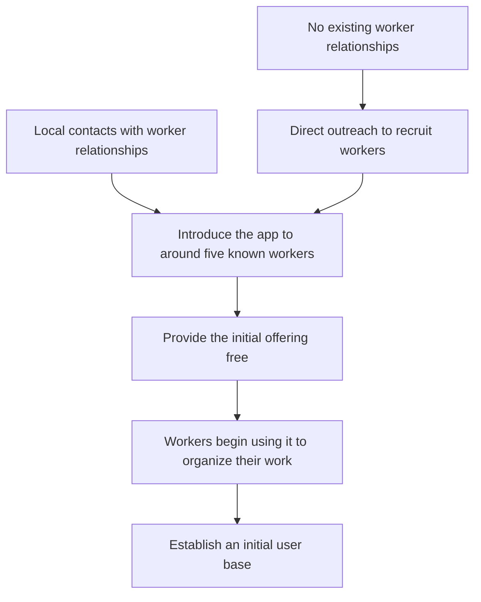

# Company idea: a local app for builders and construction workers

## Concept and problem

Build a locally focused app that helps builders and construction workers organize their work. The opportunity is a familiar, practical construction-sector problem rather than a technically elaborate product with uncertain demand. The exact underlying problem beyond work organization is not specified (unclear in source).

The problem is considered widespread across markets. An informal illustration suggests that 19 out of 20 people would recognize it, although the wording also mentions asking five people (unclear in source). This is an expression of perceived familiarity, not a measured demand estimate.

## Customers and other stakeholders

| Segment or stakeholder | Role and need |
| --- | --- |
| Builders and construction workers | Initial app users; the explicit use case is organizing their work. Workers must be recruited locally. |
| Property buyers and renovators | Deal with construction workers while buying, repairing, and reselling houses; a potential demand-side segment. Whether they would directly use or pay for the app is unanswered. |
| Wealthy property owners | Already have access to various apps and may prefer not to deal directly with workers. Their role in the proposed service is not defined. |
| Local contacts | Provide trusted introductions to workers and help establish an initial user base. |
| Potential investors with property-sector experience | A possible source of funding and introductions through existing networks. No investment is committed. |

## Product and technology

| Element | Proposed scope or qualification |
| --- | --- |
| Core product | An app for organizing construction workers' work. No detailed feature set is specified. |
| Initial offer | Start with around five known workers and provide the offering free at first. Whether this means free app access, hands-on help organizing their work, or both is unclear in source. |
| Technical complexity | The app is considered straightforward and relatively simple to build. |
| AI opportunity | Practical, relatively simple AI applications in the physical economy are considered attractive. No particular AI feature or implementation is defined. |
| Local adaptation | The offering needs to be highly localized and comply with relevant laws. This complicates expansion even if the software is simple. |

### Initial adoption path

This describes the proposed starting approach, not a specified in-app workflow. Access to initial users is essential; without existing relationships, recruitment would require approaching workers directly.

## Market and existing alternatives

### Geographic scope

| Market | Position in the idea |
| --- | --- |
| Germany | An existing, unnamed comparable business is described as successful and operating only in Germany. |
| Majorca and Spain | Possible target markets outside Germany. |
| Italy | Another possible target market. |
| Madeira | A tentative additional market. |

The geographic opportunity is framed around Mediterranean destinations, with Madeira also suggested. The underlying problem is considered present more broadly, but no market size is provided.

### Alternatives and competitive concerns

| Existing alternative or concern | Implication |
| --- | --- |
| An unnamed comparable business in Germany | Provides an example of the idea already working. Its product, pricing, and business model are not detailed. |
| Apps already available to wealthy customers | Existing access to apps may limit the appeal of another app for that segment. No products are named. |
| Direct dealings with construction workers | Some wealthy customers prefer to avoid these interactions; the proposed service's exact role in reducing them is not specified. |
| Replicating an existing idea | A concern is whether an established business would object to the idea being copied. Targeting different geography is the response offered, not a resolved competitive or legal conclusion. |

## Go-to-market and operations

### Worker recruitment

Start through trusted local contacts rather than relying solely on cold outreach. An initial group of approximately five workers could receive the offering free and begin using it to organize their work. Recruiting workers is considered difficult, and local people are needed to make it happen.

### Property-sector relationships and positioning

Property-sector networks could provide access to people who work with construction crews and to potential investors in similar companies. Exploring an introduction and presenting the idea are proposed next steps, not established partnerships.

A luxury-property sales example illustrates the importance of matching the presentation to the audience: renovated houses are marketed through an experience for real-estate agents, including cocktail-style events, standing tables, champagne, music, and glamorous staging, rather than only conventional agent-led visits. The luxury market is described as highly saturated, with presentation and experience used to differentiate the offer. This is a positioning analogy, not a proposed app feature or a committed sales channel for the company.

### Company setup and initial pricing

| Item | Detail |
| --- | --- |
| Initial user pricing | Free at the beginning for the initial workers. |
| Company formation option | Stripe Atlas is mentioned as a way to form a company in another country for $500. |
| Formation-cost offset | A separate reference to €500 in bonuses or credits suggests that benefits might offset the formation cost; the currency, benefits, and effective net cost are unclear in source. |
| Permitted operations | A foreign company is suggested as a possible way to enable local operations. The applicable jurisdiction and legal basis are unclear in source. |

## Figures mentioned

| Figure | Meaning and limitation |
| --- | --- |
| Approximately five workers | Illustrative size of the initial free user group, not a fixed launch commitment. |
| 19 out of 20 people; also a reference to five people | Informal illustration of problem recognition. The inconsistent phrasing is unclear in source; it is not survey evidence. |
| $500 | Stated Stripe Atlas company-formation price, not product pricing. |
| €500 | Amount associated with possible formation-related bonuses or credits; the relationship to the dollar price is unclear in source. |
| Three million or five million | Illustrative sale values of luxury houses in the property-market example. Currency is not specified; these are not company revenue projections. |
| Six minutes | Appears in an incomplete statement about building the app for different places. The intended claim is unclear in source and cannot be treated as a build-time estimate. |

## Risks, objections, and responses

| Risk or objection | Response or qualification |
| --- | --- |
| No initial users or worker relationships | Begin with known workers and trusted introductions; otherwise direct outreach is necessary. |
| Worker sign-up is difficult | Local people and contacts are needed. No complete recruitment process is defined. |
| Existing apps already serve wealthy customers | The objection is raised, but no clear product differentiation is established. |
| Wealthy customers do not want to deal directly with workers | This is a relevant customer preference, but how the service would handle those interactions is not defined. |
| An existing company may object to imitation | Expansion into markets outside Germany is suggested as a distinction. The concern remains unresolved. |
| The business may not scale across locations | The opposing view is that it could scale, but localization and compliance with different laws are acknowledged constraints. No expansion model is settled. |
| A technically polished product may attract little use | Favor a recognizable real-world problem and secure initial users. Technical simplicity is presented as an advantage. |
| Legal ability to operate locally | Foreign incorporation is proposed as an option, but its suitability is not established. |

## Open questions

| Question | Unresolved detail |
| --- | --- |
| What exact construction-sector problem does the app solve? | Work organization is the only explicit function; the broader problem is assumed rather than described. |
| Who is the paying customer? | Workers and property-side stakeholders are relevant, but the commercial relationship is not defined. |
| What is the business model after free onboarding? | No paid pricing, revenue stream, or transition from the free initial offer is specified. |
| What does the free initial service include? | App access versus hands-on work organization is unclear in source. |
| What distinguishes the product from existing apps and the German comparable business? | No feature-level comparison is provided. |
| How would the service reduce direct customer dealings with workers? | The customer preference is identified, but no operating model is described. |
| Which market should come first? | Several destinations are suggested without a launch order. |
| How would localization and legal compliance work across markets? | The need is acknowledged, but laws, jurisdictions, and operational requirements are not identified. |
| Is foreign incorporation suitable, and what would it actually cost? | The legal scope, currencies, and formation-benefit claims are unclear in source. |
| What would AI do in the product? | AI is part of the opportunity framing, not a defined capability. |
| What does the fragment about building the app in six minutes mean? | The intended technical claim is unclear in source. |
| Would potential investors be interested? | An introduction and pitch are possibilities; no funding terms or commitments are given. |
| Would the existing business object to a geographically separate offering? | Geographic separation is suggested, but no answer is established. |

## Proposed next steps

- Explore local contacts who can introduce an initial group of workers.
- Present the idea through a possible property-sector investor connection, subject to interest.
- Plan the initiative and continue developing the idea; no execution timetable is settled.
