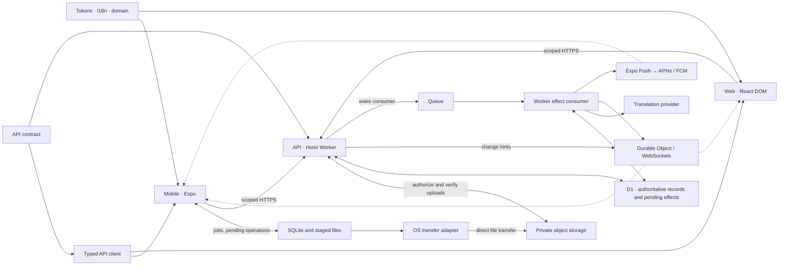

# BookBuddy mobile and web technology decision

**Choose Expo/React Native for iPhone and Android, and React DOM + Tailwind for web. Commit to the mobile stack after the four device spikes pass.** Ship one role-scoped mobile app, designed first for foremen and crews, with provider-admin and customer views as needed. Give owners abroad a browser path from their first booking link through quote review, job updates, sign-off and payment. They should never need to install the app. This follows the [product brief](2026-11-21-builders-company-idea.md#teams-and-foremen) and [role-based information architecture](../../design/foundation/information-architecture.md#one-app-scoped-by-role).

## Why Expo, and where Tailwind fits

Expo lets a small TypeScript team implement the mobile workflow once and share contracts and validation with the web and API. Native development builds give it access to the OS APIs that matter. Use Expo Router and verified HTTPS links, OS camera and microphone controls, one foreground location fix per explicit check-in, and optional biometric unlock of an existing session. Budget for two signed binaries, two real-device test lanes and a named release owner with access to Swift and Kotlin expertise. Use an isolated native transfer module if the Expo integration fails the upload spike; don’t rewrite the app around one integration.

**React with Tailwind is a yes on web, but not literally on native.** Tailwind styles real HTML in the portal. React Native renders native views, so NativeWind maps a subset of Tailwind utilities to native styles. The React research found an extra tooling and compatibility burden, with the required Expo SDK combination unverified. Start with `StyleSheet` and semantic tokens; keep native and browser components separate. Test RTL, text scaling and screen readers on both surfaces rather than assuming shared styling buys parity. [React family: Expo, native styling and feature limits](../../research/tech-stack/react-family.md#1-react-native-with-expo) · [Languages and accessibility](../../research/tech-stack/react-family.md#languages-translation-and-accessibility)

The research documents viable approaches and shipping examples, not BookBuddy device results. The three scorecards use different rubrics; their totals are not a cross-stack ranking.

| Option | What it buys | Decision |
| --- | --- | --- |
| **Expo/React Native + native adapters** | One mobile UI and TypeScript contracts shared with a separate HTML portal | **Choose.** Prove transfer recovery and push on devices; own the native boundaries. |
| **Flutter** | Mature shared mobile UI, credible SQLite and native transfer options | Runner-up. Dart adds a separate client stack, and a Flutter plugin still has to prove the same OS lifecycle cases. Keep public pages HTML. |
| **KMP + Compose Multiplatform** | Shared Kotlin logic and UI; iOS UI is stable | Revisit with strong Kotlin/Swift staffing. More platform wiring for this pilot; Compose Web is not the public-page plan. |
| **KMP + SwiftUI/Compose** | Shared sync and domain code with platform-specific UI | Choose only if distinct native UIs earn their ongoing cost. |
| **Two native apps** | Most direct OS control and UI conventions | Don’t start here. Two feature implementations won’t change OS push or force-quit rules. |
| **Capacitor / pure PWA** | Most reuse of real HTML and Tailwind | Consider Capacitor if crew work becomes mainly foreground forms. Use the web for owners, not as the sole dispatch client: iPhone web push requires Home Screen installation and Safari lacks general background sync. |

[Flutter/KMP: native feature fit](../../research/tech-stack/flutter-and-kmp.md#native-feature-fit) · [Portal trade-offs](../../research/tech-stack/flutter-and-kmp.md#languages-accessibility-and-the-customer-portal) · [Native: when to specialize](../../research/tech-stack/native-two-apps.md#when-to-choose-native-and-how-to-keep-options-open) · [React family: field feature comparison](../../research/tech-stack/react-family.md#native-features-and-failure-modes)

## Web and workspace boundaries

Use one React Router/Vite web app: prerender localized public service and booking-entry pages as semantic HTML, then use live API data for availability or a submitted request. The signed-in portal uses responsive HTML, keyboard-friendly quote comparisons and tables, ordinary HTTPS links, and hosted payment checkout. Public markup needs no job API call on render. For signed-in views, load the scoped data once and reuse it rather than fetching it again on hydration. Don’t share page layouts, navigation, widgets or platform permission UI.

```text
apps/
  mobile/        Expo Router; role screens, SQLite, sync and OS transfer adapter
  web/           React DOM + Tailwind; public pages and signed-in portal
  api/           Hono Worker; jobs, offers, media, chat and provider adapters
packages/
  design-tokens/ Semantic palette, type and spacing → native values and CSS variables
  i18n/          Human-reviewed JSON UI catalogs; keys, plurals and locale helpers
  domain/        IDs, statuses and pure rules shared by clients and server
  api-contract/  Wire schemas, inferred DTOs, errors and canonical link shapes
  api-client/    Typed transport; injected session credentials, no hidden refetches
```

Bun manages the workspace and scripts; Expo/Metro and the native build toolchains still build the app. Keep only portable, deterministic logic in `domain`, such as status mapping and site-time rules. The API alone authorizes work, confirms assignments and records payment outcomes. Mobile reads its SQLite repository; web owns its route state. Neither client imports Worker or D1 internals.



**Sources of truth.** D1 owns stable IDs, role grants, jobs, shift/offer state, saved property address and pin, site time zone, preferences and push installation tokens. Geocode or register an installation only when its source data changes. SQLite owns unsent device operations and a scoped copy of last-confirmed data; it does not grant access or reserve a shift. App-owned files hold pending evidence; private object storage holds received bytes, while D1 determines whether an attachment is ready and linked. UI catalogs are bundled copy, not translated chat. Keep UI locale, reading preference, declared work languages and actual message language separate. [Design system: localisation and original content](../../design/system/design-system.md#localisation-and-original-content)

## Critical data paths and call budgets

**Before:** no implemented paths or measured baseline. **After:** the counts below are design budgets for an eligible, signed-in invocation. A D1 call is one binding query or transactional batch, not one billed row; batch work must still be scoped and bounded. Local SQLite and file work is not a network call. Unlisted external API, object-store, queue, Durable Object and application-cache calls are zero.

### 1. Offline jobs and attendance

Open SQLite immediately. Show when the record was last confirmed. Save safe drafts and attendance in a local transaction with stable operation IDs; record capture time and location accuracy when available, with a clearly marked manual path if a fix isn’t available. Don’t cache property access secrets or imply that attendance clears a safety hold.

- **Cached open or offline action:** zero network calls. No job refetch on navigation.
- **Initial sync, stale foreground/reconnect or explicit refresh:** **one API request and one D1 call per bounded page**. Send the cursor and a batch of pending operations together. In the same D1 batch, apply eligible operations idempotently, return their outcomes and read authorized changes and removals. An empty outbox uses a delta read only. Apply the reply and advance the cursor in one local transaction. An expired cursor gets a scoped snapshot, not one request per job.

Keep one sync in flight per account/role scope. On failure, keep the cursor and pending IDs; try again on the next eligible sync, not in a tight loop. Apply revocations on reconciliation and distinguish conflicts from unsent work. Quote approval, booking, cover and payment remain online confirmations. [Core flows: shared state and offline rules](../../design/foundation/core-flows.md#shared-state-and-offline-rules)

### 2. Durable media transfer

Before reporting “saved on this device,” stage the photo, video or voice file in app-owned storage and commit its attachment ID and queue entry to SQLite. Give the transfer adapter a file path and persist its task/session identity and completed parts. Use file-backed background `URLSession` on iOS; on Android use WorkManager for deferred transfers or an eligible user-initiated transfer job for a long visible upload. Don’t move media bytes through JavaScript or the API.

| Step | Normal calls |
| --- | --- |
| Capture and stage | **Zero network calls.** |
| Prepare a batch that needs upload grants | **One API + one D1 batch** to authorize and reserve IDs and return scoped grants. For \(m\) new multipart uploads, **\(m\) storage session creates + one D1 batch** to save their session IDs. Sign part grants together, not one API call per part. |
| Transfer | **One storage PUT** per small file or **\(k\) storage part PUTs** for a large file of \(k\) parts. No API, database or queue call per part or progress update. |
| Settle a completed batch | **One API + one D1 status/authorization batch**; skip already-ready IDs. For each remaining file, **one storage metadata check** for a small upload or **one multipart completion** that returns verified metadata. **One D1 write batch** if any files become ready. Return their acknowledgements in the same response. |

Reattach to known OS tasks instead of scheduling duplicates. Query parts or object status only if their outcome is unknown; resume missing parts and refresh only expired grants. Keep the file until the server acknowledges it. Ordinary suspension can allow transfer to continue; force-quit can prevent it. Recover on the next permitted run without claiming an unsent attachment arrived. [React family: upload limitations](../../research/tech-stack/react-family.md#native-features-and-failure-modes) · [Native lifecycle APIs](../../research/tech-stack/native-two-apps.md#what-the-two-native-apps-buy)

### 3. Push → offer → single acceptance

Issue an expiring offer to eligible internal candidates first; use the vetted local pool only through the approved route. Push contains a generic alert and opaque HTTPS destination, never property details or an accept action. Push is a prompt, not a receipt. The foreman sees unresolved cover and uses the agreed escalation route at the deadline.

- **Issue:** **one API + one D1 transaction** to check scope and eligibility and write offers and dispatch work. No eligible recipient means no push or queue send. Otherwise use the dispatch budget below.
- **Open:** **one API + one scoped D1 read** for a cold or stale offer, including its current expiry/state and permitted details. Reuse an already-current view; offline, show authorized last-known data and don’t submit an acceptance.
- **Accept:** **one API + one D1 transaction** with an operation ID and offer round. Atomically require the intended worker, current eligibility, server-side expiry and an open gap. Only one candidate can move that gap to `accepted_pending_confirmation` in a round. A duplicate returns its recorded outcome; a competing worker gets the current safe result, with no write or follow-up fetch.
- **Confirm:** **one API + one D1 transaction** to recheck foreman authority, eligibility, availability and the still-current provisional acceptance, then commit at most one assignment. Derive competing offer states from the gap rather than writing every sibling offer closed. Only newly committed changes may schedule notices; only confirmed crew are visible to the customer.

A provisional acceptance is not permission to travel, access a property or start work. Keep an ambiguous response pending until the same operation ID is reconciled. [Core flows: last-minute replacement](../../design/foundation/core-flows.md#4-last-minute-replacement-own-team-then-vetted-pool) · [Deep-link contract](../../design/foundation/information-architecture.md#notification-and-deep-link-contract)

### 4. Chat and stored translation

Append the immutable original first, with a stable client message ID. In the same transaction, identify the distinct needed target locales from authorized readers’ saved preferences. Create work only for missing `(message ID, revision, target locale)` keys; skip same-language targets. Store the result and provenance beside the original. Show the original even when translation is pending or unavailable. Corrections preserve history; safety instructions still need human confirmation.

- **Send:** zero network calls to queue offline; **one API + one D1 batch** to append a bounded batch online. Publish **one Durable Object hint per changed active-thread topic**; enqueue translation only when work is new.
- **Translate:** after the common effect claim below, **one provider call per required language-pair batch**, split only by provider limits, and persist the results in the effect result batch. Publish **one hint per changed thread** after committing results. Duplicates and readers never call the translation provider. If provider success is ambiguous, don’t blindly repeat a paid call; preserve and show the original.
- **Read:** a cached read costs zero. Opening a live thread costs **one WebSocket upgrade + one Durable Object route + one scoped D1 catch-up read**. Coalesce subsequent hints into **one API + one D1 read per needed cursor page**, returning original and stored preferred translation together. Hints carry no message text; the data read checks access. On disconnect, catch up by cursor rather than polling or maintaining a background socket.

[React family: language and translation guidance](../../research/tech-stack/react-family.md#languages-translation-and-accessibility) · [Core flows: multilingual chat](../../design/foundation/core-flows.md#5-multilingual-chat-and-safety-critical-confirmation)

**Common effect budget.** Commit push or translation work with the state change. Send **one queue wake-up per nonempty committed batch**. The consumer makes **one D1 claim/read batch**, returning the inputs it needs, and **at most one D1 results batch**. For push, read stored installation tokens in the claim and send \(\lceil t/b\rceil\) Expo requests for \(t\) eligible device notices and provider batch limit \(b\). Check due tickets in batches: **one D1 read, provider-sized receipt requests, and at most one D1 result write**; no per-ticket polling. A receipt is a transport result, not a human acknowledgement. A bounded due-work sweep costs **one D1 claim batch** even if empty and recovers missed wake-ups without re-enqueueing claimed work. Duplicate work claims, expired offers and terminal failures do not fan out. No screen polls these dependencies.

## Backend direction and non-goals

Use Hono on Cloudflare Workers with D1 for transactional state and the shared typed client. Prefer Durable Objects with WebSockets for foreground chat hints; a managed realtime service is an alternative if operations warrant it. Start with APNs/FCM via Expo Push; use direct APNs/FCM if operational evidence justifies owning delivery. Use a hosted payment provider for in-person services, not App Store IAP or Play Billing; the verified provider outcome, not the browser return, updates payment state. [React family: distribution and store rules](../../research/tech-stack/react-family.md#distribution-testability-and-costs)

Backend implementation details are out of scope: no DDL, migrations, provider selection, settlement model or capacity claims. Don’t build universal UI, continuous GPS tracking, on-device translation or automatic voice transcription for this decision. Don’t add Rust unless a measured bottleneck or security boundary calls for it. Don’t promise uninterrupted transfers or a push delivery SLA.

## Spikes required before commitment

Use signed builds with the actual plugins and credentials on a supported pilot iPhone and a modest pilot Android device. These are proposed pass criteria, not measured results.

| Spike | Time box | Pass criteria |
| --- | --- | --- |
| **Background upload recovery** | **3 working days** | Queue one photo, one short video at the proposed pilot size cap and one voice note in airplane mode. On both OSes prove a file transfer can progress during ordinary suspension without JS. Interrupt the network mid-transfer, distinguish OS termination from force-quit, and recover on the next allowed run. No lost files, duplicate attachments, retransmission of acknowledged parts or “sent” state before server acknowledgement. |
| **Push and race-safe acceptance** | **2 working days** | On each OS, at least **19 of 20** unique alerts appear within **15 seconds** on connected, permission-enabled phones across foreground, suspended and cold-launch cases. Taps reach the right role and valid or clearly expired offer. Race two eligible devices, then replay a request: one provisional acceptance, at most one confirmed assignment. Denied or missed delivery leaves an actionable unresolved gap. The transport threshold is a pilot gate, not a field SLA. |
| **Arabic RTL and accessibility** | **2 working days** | Complete job, offer and chat actions with VoiceOver and TalkBack at maximum text size; complete the web booking path by keyboard at 200% zoom. No blocked or clipped critical control. Mixed Arabic and Latin names, IDs, times and prices stay legible and ordered; original and translation are separately labeled and reachable. |
| **Offline jobs and sync** | **3 working days** | Cold-open cached jobs without signal, queue check-in/out and a draft, restart, and reconnect after a remote edit or revocation. Ordered events apply once despite replay, or show an explicit conflict. No stale access or false confirmation after reconciliation. A cached open makes zero network calls; a normal reconnect uses one request and one D1 batch per page. |

If a wrapper fails but its direct native API passes, change that adapter and keep the shared UI. Reopen the framework decision only for a demonstrated framework-specific blocker across critical paths or a substantial change in team skills. [React family: device decision gates](../../research/tech-stack/react-family.md#decision-gates-and-scored-summary) · [Native: what would change the recommendation](../../research/tech-stack/native-two-apps.md#what-would-change-this-recommendation-in-the-pilot)

## Decisions to settle with the owner

- Which phones, OS versions and maximum media sizes represent the first crews? What offline retention is acceptable on personal or shared devices?
- Who can confirm replacement cover and through which legally approved provider route? What deadline and human escalation channel apply when nobody responds?
- Which UI and reading languages launch, who reviews field terminology, and what rules apply to translation providers, location and media retention, and safety-critical confirmation?
- Who contracts with the owner, charges the customer and handles refunds or provider settlement? Keep that decision separate from the app-store payment classification.