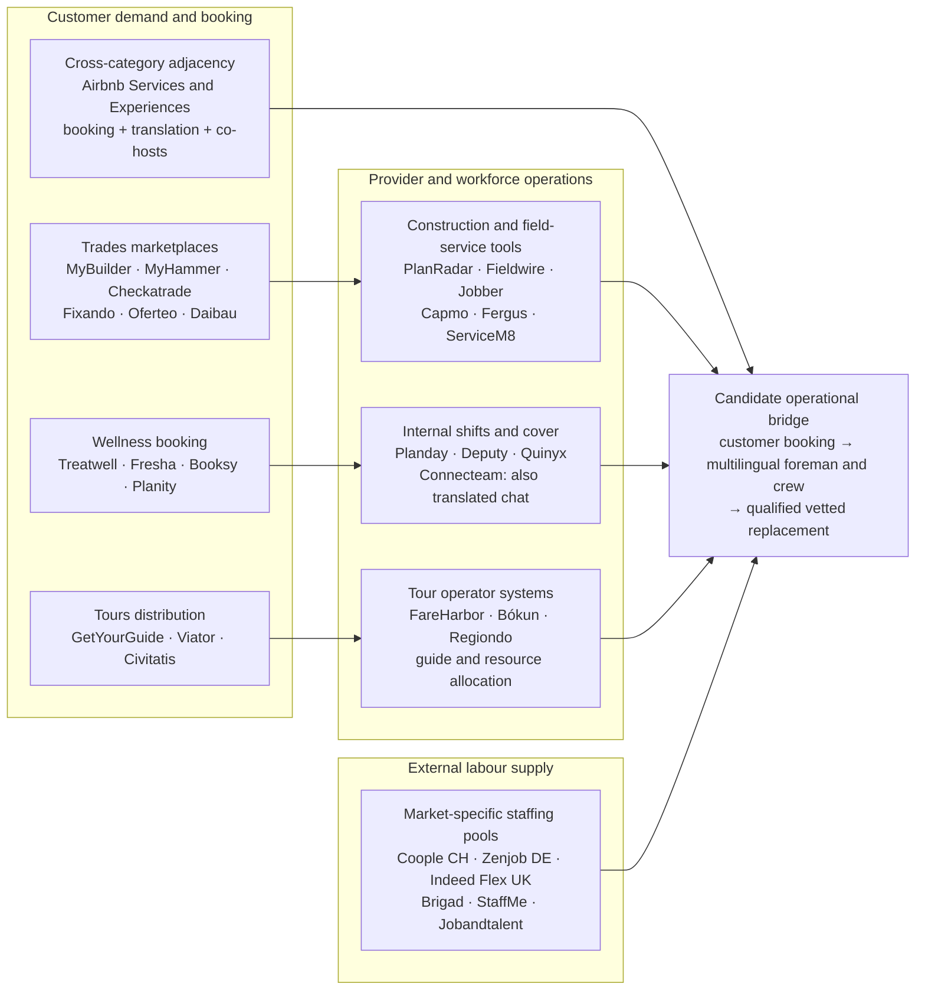

# European competitors and localisation

## Executive findings

**The defensible gap is not “booking plus work organisation.”** Jobber already combines customer self-booking, team availability and automatic assignment; appointment software combines booking and staff calendars; tour systems allocate guides and equipment. Connecteam already combines multilingual employee interfaces, translated internal chat and internal shift replacement. Airbnb Services is an especially important adjacent competitor: its service categories include massage and personal training, its platform translates messages, and service hosts can use co-hosts. These are substantial overlaps, not marginal exceptions. [1](https://www.getjobber.com/features/online-booking/) [2](https://help.connecteam.com/en/articles/15013840-translating-messages-in-the-chat) [3](https://help.connecteam.com/en/articles/6444737-user-shift-replacements) [4](https://news.airbnb.com/en-uk/2025-summer-release-now-you-can-airbnb-more-than-an-airbnb) [5](https://www.airbnb.com/help/article/280) [6](https://www.airbnb.com/help/article/4153)

**No reviewed source documents the entire proposed combination:** customer acquisition and booking; a foreman managing a multilingual construction crew; automatic translation along customer–foreman–worker conversations; and rapid replacement from an external vetted labour pool, extended across construction, wellness, coaching and tours. This is a bounded finding from public documentation, **not proof that nobody offers it**. The components are already distributed across strong incumbents. The most consequential missing link is the operational bridge from a booked customer job to an appropriately qualified, legally deployable replacement worker, rather than another multilingual booking calendar. See the capability matrix and evidence limits below. [1](https://www.getjobber.com/features/online-booking/) [2](https://help.connecteam.com/en/articles/15013840-translating-messages-in-the-chat) [7](https://www.instawork.com/business) [8](https://www.staffme.fr/fr/conditions-generales)

**European competition is organised around national marketplaces and overlapping software and staffing networks.** Instapro uses different national brands; Checkatrade and Rated People address the UK; Planity has French, Belgian and German storefronts; Booksy includes Poland; Daibau's historical country network reaches Central and Southeastern Europe. Conversely, an app-store listing, translated website or euro price is not evidence of local provider liquidity, local payroll or local support. [9](https://instapro.group/about) [10](https://www.checkatrade.com/about) [11](https://www.ratedpeople.com/) [12](https://www.planity.com/fr-BE) [13](https://www.planity.com/de-DE/friseur) [14](https://help.booksy.com/hc/en-us/articles/21594778319122-Can-I-use-Booksy-outside-of-my-country) [15](https://www.daibau.de/artikel/540/neue_chancen_fur_ihr_unternehmen_-_profitieren_sie_von_der_grossten_plattform_der_region)

**Stale competitor lists materially mislead.** Coople's UK site says its platform went offline on **1 January 2026**; Swiss activity remains documented in **2026**. UALA has an official migration-to-Treatwell help article dated **2025**, and should not be counted as an independent additional marketplace. Wellhub completed its Urban Sports Club acquisition in **2025**, so the two brands are not independent competitive groups. [16](https://www.coople.com/en/) [17](https://www.coople.com/ch/blog/neue-coople-plattform) [18](https://propartnercare.treatwell.com/s/article/From-UALA-to-Treatwell-what-changes-you-need-to-know-about?language=en_US) [19](https://wellhub.com/en-us/blog/press-releases/wellhub-and-usc-unite)

## Scope and evidence rules

Research snapshot: **21 November 2026**. This is a public-source desk scan, not a product trial or an audit of commercial contracts. Primary company, support, legal and app-store sources take priority. Several direct page retrievals timed out; where only indexed primary-source extracts were available, the report uses the narrower fact visible in those extracts. Search-provider summaries alone are not treated as proof of additional countries or features.

- **Countries are verified minimums unless explicitly labelled historical or complete.** Countries not named are not automatically unserved. `Other Europe [unverified]` means that a complete current list was not established.
- **UI language is not message translation.** A local storefront proves that storefront's language, not the provider mobile app's entire localisation. An iOS language list does not establish Android or web parity.
- **Customer/provider:** `C` means an end customer can search, request or book; `P` means provider/employer operations; `W` means worker-facing access. A quote-request lead is explicitly distinguished from a confirmed appointment.
- **Cover:** `internal` means colleagues or the employer's existing workforce; `external` means a separately recruited labour/provider pool. A cancellation flow, reassignment button or open shift is not a guaranteed replacement service.
- **ND** means **not documented in the sources reviewed**, not “the product does not have it.” `[unverified]` marks a fact or precise current scope not established. Do not interpret ND as a competitive moat.
- Prices are live/indexed pages observed in **2026**, unless another year is given. They are not guaranteed quotes; tax, billing term, region, payment processing, messaging and commission may change the effective price. No single-country rate is extrapolated to Europe.
- Scale figures are publisher-reported, not independently audited, unless stated otherwise. A funding round, registered worker count, active workforce and paid provider count are different measures. “Not established” is preferable to a fabricated comparable number.
- Headquarters are distinguished from operational markets. A city followed by `[unverified]` is a commonly reported location that this scan did not independently substantiate; it should not be used for legal diligence.

## 1. Home-services and trades marketplaces

The important distinction is between **paid introductions** and **transactional booking with operational fulfilment**. MyBuilder, Werkspot and Travaux.com describe charging for a contact/introduction, whereas Taskrabbit explicitly describes choosing a task and finding an available Tasker. Neither mechanism, by itself, proves foreman-level management of the tradesperson's employees. [20](https://www.mybuilder.com/terms-conditions) [21](https://www.werkspot.nl/vakman/registreren/architect) [22](https://www.travaux.com/blog/faq) [23](https://assets.ctfassets.net/vwt5n1ljn95x/4QBxY2SaZhipxcRNu0W9yI/5b3238f76002c57e33780b5d1460380f/2025_Fact_Sheet_UK.pdf)

| Player; HQ | European countries and localisation established | Customer/provider and team/foreman scope | Last-minute cover; built-in translation | Business model / price evidence | Scale signal and sources |
|---|---|---|---|---|---|
| **MyHammer**; HQ city [unverified] | Germany/German national product; Austria's current scope [unverified]. Full app language list [unverified]. | C/P trades marketplace within Instapro's brand family; detailed crew management ND. | Vetted worker cover ND; translated chat ND. | Provider lead/introduction model [unverified] for current tariff; do not transfer a sister brand's exact fee. | Separate current users/revenue not established. Group relationship: [9](https://instapro.group/about). |
| **Checkatrade**; **London, UK** | UK; English customer site. Barcelona office is **not** evidence of a Spanish marketplace. Other Europe [unverified]. | C/P discovery, profiles, reviews, quote requests and direct contact; crew/foreman workflow ND. | External crew cover ND; translated chat ND. | Paid trade membership; exact current plan/lead prices [unverified]. | Official company page places **Checkatrade and Rated People in the same group**; no comparable current user number established. [10](https://www.checkatrade.com/about) [24](https://www.checkatrade.com/blog/trade/grow-business/checkatrade-membership-roi/) |
| **MyBuilder**; London [unverified] | UK/English; other European national marketplaces under this brand [unverified]. | C/P job posting and shortlisting, not a verified crew-dispatch system. | External worker cover ND; translated chat ND. | Tradesperson pays a variable **shortlist fee** when contact details are shared; payable even without winning the job; amount shown before the relevant action, excluding VAT. | Comparable current scale not established. Terms are stronger evidence than third-party “average lead cost” articles. [20](https://www.mybuilder.com/terms-conditions) |
| **Rated People**; London [unverified] | UK: official regional list covers England, Wales and Scotland; English. | C/P job posting and quotes; team management ND. | External crew cover ND; translated chat ND. | Provider-paid lead/membership arrangement [unverified] for current tariff; customer job posting advertised free. | Official London page advertises **10,000+ tradespeople** and **3 million+ homeowners**, undated, observed **2026**; these are not active monthly counts. Same group as Checkatrade. [11](https://www.ratedpeople.com/) [25](https://www.ratedpeople.com/local-handyperson/london) [10](https://www.checkatrade.com/about) |
| **Bark**; **London, UK** | UK established; official country-list help page identified, but complete European list not extractable. Ireland, Germany and France current scope [unverified] here. English seller page; other UI languages [unverified]. | C/P broad professional-service requests; not limited to construction. Crew management ND. | External employee cover ND; translated chat ND. | Professional introductions; exact credit/lead tariff [unverified]. | Official seller page says **millions of people worldwide**, undated, observed **2026**; not a European active-user figure. [26](https://www.bark.com/en/gb/about-bark) [27](https://help.bark.com/hc/en-au/articles/29257214319132-Which-countries-and-regions-does-Bark-operate-in) [28](https://www.bark.com/en/gb/how-it-works/sellers) |
| **Instapro**; **Amsterdam, Netherlands**, shared operating team with Werkspot | Italy/Italian storefront verified. Do not confuse the Italian site with the separately indexed US Instapro site. Other European country versions under this brand [unverified]. | C/P trades matching; crew management ND. | External crew cover ND; translated chat ND. | Professional registration advertised free; charge event and price [unverified]. | Italian about page describes a shared Werkspot/Instapro team of **120+ people**, undated, observed **2026**; staff, not providers. [29](https://www.instapro.it/) [30](https://www.instapro.it/chi-siamo) |
| **Werkspot**; **Amsterdam, Netherlands** | Netherlands/Dutch; Belgium current scope [unverified]. Provider app's complete language list [unverified]. | C/P local trade jobs and leads; employee/foreman scheduling ND. | External crew cover ND; translated chat ND. | Registration page describes **lead costs when a customer shares contact details**; no uniform amount established. | Shared team of **120+**, undated, observed **2026**, not platform supply. [31](https://www.werkspot.nl/over-ons) [21](https://www.werkspot.nl/vakman/registreren/architect) |
| **Travaux.com**; **Aix-en-Provence, France**, operating origin stated | France/French; other Europe under this brand [unverified]. | C/P trades quotation matching; crew scheduling ND. | External crew cover ND; translated chat ND. | Signup and initial message free; professional pays after customer accepts sharing contact details; project-specific price, normally invoiced monthly. | Company states founded **2006** and membership of Instapro Group; current transactional scale not established. [32](https://www.travaux.com/qui-sommes-nous) [22](https://www.travaux.com/blog/faq) |
| **ProntoPro**; Milan [unverified] | Italy/Italian verified; historical Austria/Switzerland footprint is **not reconfirmed for 2026**. Full provider-app language list [unverified]. | C/P cross-category services; categories on official blog include home, personal wellbeing and classes. Foreman controls ND. | External employee cover ND; translated chat ND. | Professional lead acquisition; current charge mechanism and tariff [unverified]. | Official **2025** performance release reports **44% growth**; headline alone does not establish absolute revenue or comparable booking volume. [33](https://blog.prontopro.it/blog/prontopro-crescita-2025-dati-piattaforma) |
| **Cronoshare**; Valencia [unverified] | Spain/Spanish verified; Brazilian and Chilean local sites also found outside Europe. Italy/Portugal current operational scope [unverified] in this scan. | C/P broad categories: domestic work, building, events and training. Crew management ND. | External crew cover ND; translated chat ND. | Professional lead/credit economics [unverified] for current tariff. | Current paid-provider/user count not established. A foreign country named as an international-moving destination does **not** prove a local marketplace. [34](https://www.cronoshare.com/ofertas-trabajo/empleo) [35](https://www.cronoshare.com.br/) [36](https://www.cronoshare.cl/comunidad/comparativas/cronoshare-vs-habitissimo-chile) |
| **Habitissimo**; Palma, Spain [unverified] | Spain/Spanish and Portugal/Portuguese company pages verified; Italy and other historical markets current scope [unverified]. | C/P renovation and repairs; contractor discovery and quotations. Crew management ND. | External crew cover ND; translated chat ND. | Provider acquisition/listing/lead charges [unverified] for current package and tariff. | Current scale not established. A **2025** regional press report describes restructuring/crisis; old multinational scale claims should not be assumed current. [37](https://www.habitissimo.es/acercade) [38](https://www.habitissimo.pt/sobre) [39](https://www.diariodemallorca.es/mallorca/2025/01/31/crisis-habitissimo-auge-caida-gigante-113873914.html) |
| **StarOfService**; Paris/Courbevoie [unverified] | France/French verified; a complete current European country list was not established. Historical “global” reach is not confirmation of local liquidity. | C/P home, weddings, events, wellbeing and lessons. Foreman/team operations ND. | External crew cover ND; translated chat ND. | Current professional subscription/lead tariff [unverified]. | No current comparable scale established. [40](https://www.starofservice.com/) |
| **Taskrabbit**; San Francisco, US [unverified] | UK **2025** fact sheet and Italy **2021** launch verified. Current complete European footprint [unverified]; France, Germany, Spain and Portugal require current confirmation. iOS listing: **English + 6 other languages**, observed **2026**; full language set not extracted. | C/P booked tasks and customer–Tasker chat. Do not equate selecting multiple Taskers with a foreman employing and managing a crew. | Same-day/task availability is distinct from guaranteed replacement. Chat documented; native auto-translation **ND**, not disproved. | Transactional service marketplace; exact current country-specific platform fees [unverified]. | Italy launch: **3,000 registered Taskers in 2021**, not current active supply. [23](https://assets.ctfassets.net/vwt5n1ljn95x/4QBxY2SaZhipxcRNu0W9yI/5b3238f76002c57e33780b5d1460380f/2025_Fact_Sheet_UK.pdf) [41](https://www.taskrabbit.com/press/release/taskrabbit-launches-in-italy) [42](https://apps.apple.com/app/id374165361) [43](https://support.taskrabbit.com/hc/en-us/articles/46260491617691-How-Do-I-Contact-My-Tasker) |
| **Helpling**; Berlin [unverified] | European retained markets reported as Germany and France in **2025** research; complete **2026** footprint [unverified]. Italy changed ownership in **2025** according to that research; Netherlands continuation [unverified]. Country/app language parity [unverified]. | C/P household and office cleaning, with local service operations; foreman workflow ND. | Current replacement promise and conditions [unverified]; translated chat ND. | Booking/managed-cleaning economics depend on country; exact tariff [unverified]. | Group's indexed site says **100,000+ satisfied customers**, undated, observed **2026**; geographic and active-customer scope unclear. [44](https://hlpgroup2.helpling.com/) [45](https://origamiproject.it/reports/d3.3_twelve-reports-on-the-case-study-of-the-digital-platforms-in-the-home-care-sector.pdf) |
| **Fixando**; HQ [unverified] | Portugal/Portuguese; other current European country operations and English provider UI [unverified]. | C/P broad local-service quote requests; team/foreman management ND. | External worker cover ND; translated chat ND. | Providers buy **credit packs** to answer quote requests; Xpress and Premium packages also listed; exact price not established. | Current comparable scale not established. Material Portuguese-market competitor, not evidence Portugal is unserved. [46](https://www.fixando.pt/packages) [47](https://help.fixando.com/hc/pt/articles/115000921705-Como-compro-cr%C3%A9ditos) |
| **Yoojo**; HQ [unverified] | France/French verified; complete country list [unverified]. Insurance territories are **not** a sufficient proxy for operating countries. | C/P multi-service platform, including cleaning; full provider-crew management ND. | **Managed replacement assistance documented**: customer service can suggest providers available at the same time after cancellation. No guaranteed construction-worker pool established; translated chat ND. | Customer/provider booking charges and current exact tariff [unverified]. | Current comparable scale not established. More direct fulfilment overlap than a pure lead directory. [48](https://yoojo.fr/menage) [49](https://yoojo.fr/confiance-securite) |
| **Oferteo**; **Wrocław, Poland**, office stated | Poland/Polish verified; complete cross-border operating scope [unverified]. | C/P service requests and provider matching; detailed team controls ND. | External crew cover ND; translated chat ND. | Professional lead model/current tariff [unverified]. | About page records a historical **first million enquiries** milestone; milestone year [unverified], so not a current annual volume. Founded **2008**. [50](https://www.oferteo.pl/o-nas) |
| **Daibau**; **Maribor, Slovenia**, company contact address | **2025 company article:** Germany, Austria, Switzerland, Poland, Czechia, Slovakia, Hungary, Slovenia, Croatia, Serbia, Bulgaria, Romania, Bosnia and Herzegovina, North Macedonia; also Nigeria/Vietnam outside Europe. Current homepage has a shorter list: **2026 continuation of every market [unverified]**. German and English sites verified; each provider app's language set [unverified]. | C/P construction/renovation contractor matching; foreman-level workforce operations ND. | External employee replacement ND; translated chat ND. | Provider acquisition model/current tariff [unverified]. | Company claimed **16 countries in 2025**: **14 European**, not 16 European countries. Important Central/Southeastern European incumbent. [15](https://www.daibau.de/artikel/540/neue_chancen_fur_ihr_unternehmen_-_profitieren_sie_von_der_grossten_plattform_der_region) [51](https://www.daibau.com/) |

### Localisation implications for this group

- **Do not count sister brands as independent networks.** Instapro/Werkspot share an Amsterdam team, Travaux.com identifies itself as an Instapro Group subsidiary, and Checkatrade identifies Rated People as a group company. National branding and language are part of the competitive architecture. [30](https://www.instapro.it/chi-siamo) [32](https://www.travaux.com/qui-sommes-nous) [10](https://www.checkatrade.com/about)
- **No evidence supports treating Portugal, Poland or the Balkans as blank space.** Fixando provides Portuguese-language professional lead purchasing; Oferteo is a Polish service-matching business; Daibau documents a historical Balkan and Central European network. Current local supply density still requires measurement. [46](https://www.fixando.pt/packages) [50](https://www.oferteo.pl/o-nas) [15](https://www.daibau.de/artikel/540/neue_chancen_fur_ihr_unternehmen_-_profitieren_sie_von_der_grossten_plattform_der_region)
- **Language bridging remains less well evidenced than country localisation.** The Taskrabbit support source establishes chat, not automatic translation; the marketplace sources above generally establish discovery or quotation rather than multilingual worker coordination. That is a documentation gap, not a verified universal product absence. [43](https://support.taskrabbit.com/hc/en-us/articles/46260491617691-How-Do-I-Contact-My-Tasker)

## 2. Construction and field-service crew management

This group must be split conceptually: construction-project collaboration is not the same product as small-trade quoting, invoicing and dispatch. Both compete with the proposed provider work organiser, but only some also take customer bookings. Jobber's documented online-booking assignment is a concrete overlap; PlanRadar's translated interface is not evidence of translated customer conversations. [1](https://www.getjobber.com/features/online-booking/) [52](https://help.planradar.com/en/supported-languages)

| Player; HQ | European localisation and language evidence | Customer/provider and team scope | Last-minute cover; translation | Model / pricing | Scale signal and sources |
|---|---|---|---|---|---|
| **PlanRadar**; **Vienna, Austria** | International construction product; exhaustive European contracted-country list [unverified]. Official help lists **25 UI languages**, including Arabic, Azerbaijani, Bulgarian, Croatian, Czech, Dutch, English, French, Georgian, German, Greek, Hungarian, Italian, Norwegian and Polish; Romanian and Turkish also verified. Complete remaining set [unverified]; Ukrainian is not listed in the reviewed language source. | P/W multi-team construction documentation, tickets and process management; consumer acquisition/booking ND. | Reassigning work is not an external worker pool. Chat auto-translation ND. | Per-user monthly/annual SaaS; subcontractors/watchers included free according to pricing page; current amount [unverified]. | Product page advertises **170,000+**, but the extracted passage did not establish the unit, so no user count is asserted here. [53](https://www.planradar.com/contact/) [52](https://help.planradar.com/en/supported-languages) [54](https://www.planradar.com/product) [55](https://www.planradar.com/pricing/) |
| **Fieldwire by Hilti**; San Francisco, US [unverified] | Multilingual construction app: official **July 2026** help says **20+ languages**; its German version says **25**. English, German, French, Spanish and Dutch help versions verified; complete current language list [unverified]. European project adoption is not an exhaustive service-country list. | P/W construction task/project collaboration; consumer marketplace ND. | External worker cover ND. Help discusses browser Google Translate; that must not be called native multilingual chat. | Free Basic and paid per-user/project tiers; precise caps and paid rates [unverified]. | Hilti announced acquisition for approximately **US$300 million in 2021**. [56](https://help.fieldwire.com/hc/en-us/articles/202632084-How-to-change-the-language-that-displays-in-Fieldwire) [57](https://fieldwire.com/pricing/) [58](https://www.hilti.group/content/hilti/CP/XX/en/company/media-relations/media-releases/Hilti_Fieldwire.html) |
| **Procore**; Carpinteria, US [unverified] | Official support says web app available in **13 languages**, undated, observed **2026**; company/project/user language settings can differ. Exact country and language list [unverified] here. | P/W construction platform; specific foreman labour allocation and customer self-booking [unverified]. | External labour replacement ND; native translated conversations ND. | Enterprise SaaS; current quote/pricing metric [unverified]. | Current revenue/user scale not established in this scan; no recycled private-company funding comparison. [59](https://support.procore.com/faq/what-languages-are-available-in-procore?mt-view=f1) [60](https://support.procore.com/faq/can-i-change-the-language-of-my-company-project-or-user-in-procore) |
| **Capmo**; Munich [unverified] | Explicit DACH positioning. Official app UI: **German, English, Polish, Czech, Italian**. These worker languages do not imply a Polish/Czech customer marketplace. | P/W site/project management and defect documentation; customer acquisition ND. | External replacement ND. **AI translation of defect text is advertised**; language pairs and live three-way chat [unverified]. | B2B software; price page exists, exact tariff [unverified]. | Current paid companies/user scale not established. [61](https://www.capmo.com//) [62](https://support.capmo.com/wie-kann-ich-die-sprach-in-capmo-%C3%A4ndern) [63](https://www.capmo.com/loesungen/mangel) [64](https://www.capmo.com/de/preise) |
| **Craftnote**; HQ [unverified] | Construction/trades product at **craftnote.de**, not the unrelated AI meeting-notes product at craftnote.com. Official mobile UI: **German and English**. DACH-oriented; complete countries [unverified]. | P/W office–site coordination and in-app project chat; consumer discovery ND. | External worker cover ND; native chat translation ND. | Paid packages for office/field use; exact current per-seat price [unverified]. | Current comparable active-user/company scale not established. [65](https://hilfe.mycraftnote.de/hc/en-gb/articles/8852600419100--How-do-I-change-the-language-from-German-to-English-in-the-Craftnote-app) [66](https://craftnote.de/preise/) [67](https://craftnote.de/erfolgsgeschichten/fortmann-haustechnik-gmbh-mit-digitalen-strukturen-zu-nachhaltigem-erfolg/) |
| **123erfasst / 123onsite**; HQ [unverified] | German construction product; language help verifies **Polish, Romanian and Croatian**, with English fallback if device language unsupported. **2022** release announced seven Eastern European additions; current complete list [unverified]. | P/W construction-site data/time recording; precise foreman permissions and dispatch [unverified]. | External labour pool ND; translated conversation ND. Localised controls ≠ translation of a worker's free text. | Module/subscription tariff [unverified]. | Current comparable paid-company/user scale not established. Naming in current help includes **123onsite**; legal/product rebrand boundaries [unverified]. [68](https://123erfasst.de/123erfasst-nun-mehrsprachig) [69](https://feedback.123erfasst.de/de/help/articles/9908634-verfugbare-sprachen-der-123erfasst-app) |
| **Connecteam**; New York/Tel Aviv [unverified] | Country-independent employee SaaS, not a verified pan-European staffing network. Dashboard/mobile language sets differ. Verified European dashboard languages include **English, Spanish, French, Portuguese, Russian, Greek, German, Swedish, Dutch, Italian, Danish, Polish**; mobile adds further worker languages, including Bosnian/Croatian/Slovenian grouping. | P/W scheduling, worker communication and internal organisational roles; public consumer marketplace ND. | **Internal** open shifts, qualified-colleague offers/swaps and approval. **Native chat translation introduced in 2026**, documented July **2026**. No external vetted replacement pool established. | SaaS; exact current tier limits and prices [unverified]. | No comparable current customer/user count established. This is a strong functional incumbent, not merely an adjacent calendar. [70](https://help.connecteam.com/en/articles/5365277-configure-your-preferred-language) [2](https://help.connecteam.com/en/articles/15013840-translating-messages-in-the-chat) [3](https://help.connecteam.com/en/articles/6444737-user-shift-replacements) [71](https://help.connecteam.com/en/articles/6441778-how-to-create-open-shifts) |
| **Jobber**; Edmonton, Canada [unverified] | UK and Ireland have country-specific payment documentation, but payment/texting availability differs by feature. **English plus Spanish**: Spanish web for all roles; mobile Spanish for eligible **non-admins**, with untranslated areas; admin mobile remains English. Complete European rollout [unverified]. | C/P/W customer online booking, team bookable hours and **automatic available-team-member assignment**. Multiple available workers may be selected randomly. | Existing-team allocation, not evidence of externally recruited cover. Native customer–crew translation ND. | SaaS plans; indexed pricing advertises **from US$29/month in 2026**; region, term and team limits must be checked. | Current comparable European customer count not established. [1](https://www.getjobber.com/features/online-booking/) [72](https://help.getjobber.com/en/articles/online-booking/) [73](https://help.getjobber.com/en/articles/spanish-language-in-jobber-faq/) [74](https://www.getjobber.com/pricing/) |
| **Tradify**; Auckland, New Zealand [unverified] | UK regional relevance established by help/pricing; Ireland and complete European country support [unverified]. Provider UI language list [unverified]. | P/W trades job management; exact current online self-booking and foreman permissions [unverified]. | External worker cover ND; translated chat ND. | Official help describes **Lite, Pro, Plus** and price varying with region, users and add-ons; current amounts [unverified]. | Current comparable scale not established. [75](https://help.tradifyhq.com/hc/en-us/articles/24745641627033-FAQ-Tradify-Pricing) [76](https://help.tradifyhq.com/hc/en-us/articles/360036351493-How-Much-Does-Tradify-Cost) |
| **Fergus**; Auckland, New Zealand [unverified] | Dedicated UK campaign verified; other European localisations and full UI language list [unverified]. | P/W shows booked/unassigned jobs and team availability; explicitly assigns team members to jobs. Customer acquisition marketplace ND. | Existing-team dispatch; external vetted cover ND; translated chat ND. | B2B job-management software; current UK tariff [unverified]. | Current comparable European scale not established. [77](https://get.fergus.com/campaign/running-your-trades-business-uk) |
| **ServiceM8**; Darwin, Australia [unverified] | Dedicated **UK and EU** product/pricing pages, but no exhaustive supported-country list. Official help explicitly says **only English supported**. A euro page therefore does not solve multilingual crew onboarding. | P/W trades/service job management; detailed self-booking/crew permission parity [unverified] in this scan. | External labour pool ND; native multilingual chat ND. | Subscription plans; UK/EU price pages exist, exact amounts and limits [unverified]. | UK page says **£25 billion+ in jobs**, EU page **€21 billion+**, undated, observed **2026**; cumulative managed job value, **not revenue**, and not a consistent conversion basis. [78](https://www.servicem8.com/uk/pricing) [79](https://www.servicem8.com/eu/pricing) [80](https://support.servicem8.com/help-center/tips-trick-more/more/which-languages-are-supported) |
| **Simpro**; Brisbane, Australia [unverified] | UK customer case study established; exhaustive European sales/support and UI language list [unverified]. | P/W field-service/trades operations; specific current crew and customer-booking controls [unverified]. | External vetted cover ND; native translated chat ND. | B2B field-service software; exact current regional pricing [unverified]. | Current comparable revenue/customer figure not established. Naming: **Simpro**, rather than treating historical “simPRO” casing as a different company. [81](https://www.simprogroup.com/case-studies/crannis-technology-services) |

## 3. Workforce scheduling, internal cover and on-demand staffing

**Two different products must not be conflated.** Planday's shifts can be swapped, handed over or sold to colleagues in the same employee group/department, with confirmation requirements. StaffMe instead contracts access to labour and distinguishes freelance commissioning from temporary employment. The former can fill a gap only if an eligible colleague exists; the latter has labour-supply and employment obligations. [82](https://help.planday.com/en/articles/30399-open-shifts-shift-requests-and-shift-swaps-for-schedule-managers) [8](https://www.staffme.fr/fr/conditions-generales)

### 3A. Scheduling and cover within an existing workforce

| Player; HQ | European localisation / languages | Sides and team controls | Replacement and translation | Model / pricing | Scale and sources |
|---|---|---|---|---|---|
| **Planday**; Copenhagen, Denmark [unverified] | Multilingual app; iOS listing has **18 languages**, including Danish, observed **2026**. Help navigation verifies Danish, English, French, German, Norwegian and Swedish; help languages are not a full UI list. Complete European commercial-country list [unverified]. | P/W employee groups, departments, managers and shift approvals; consumer booking ND. | **Internal** swaps, handover, shift selling/open shifts; not an external vetted pool. Native message translation ND. | Per-user SaaS; UK page advertises **from £2.99**, **minimum five users**, observed **2026**; term/tax caveats apply. | Current comparable customer count not established. [82](https://help.planday.com/en/articles/30399-open-shifts-shift-requests-and-shift-swaps-for-schedule-managers) [83](https://apps.apple.com/us/app/planday-employee-scheduling/id518598166) [84](https://www.planday.com/pricing) |
| **Quinyx**; Stockholm, Sweden [unverified] | iOS listing: **26 languages**, including English; Czech, Danish, Dutch, Estonian, Finnish, French, German, Greek, Italian, Latvian, Lithuanian, Norwegian Bokmål/Nynorsk, Polish, Portuguese, Slovak, Spanish, Swedish, Turkish and Ukrainian, plus non-European languages. Country-by-country employment configuration [unverified]. | P/W frontline workforce management and communication; consumer booking ND. | Detailed current cover/approval rules [unverified]; external vetted supply ND; native conversational translation [unverified]. | Enterprise SaaS; current list price [unverified]. | Official about page says **millions** use its frontline platform, undated, observed **2026**; no precise active-user comparison. [85](https://apps.apple.com/us/app/quinyx-mobile/id484097475?platform=watch) [86](https://quinyx.com/about/) |
| **Deputy**; Sydney, Australia [unverified] | iOS: **English, French, German, Italian, Spanish, Portuguese, Simplified/Traditional Chinese, Japanese, Korean, Thai, Indonesian, Vietnamese**. Official workplace-language guide distinguishes interfaces; do not assume manager-web parity. Full European country list [unverified]. | P/W employee scheduling and qualified-colleague matching; consumer booking ND. | **Internal** shift swapping/trading; external worker pool ND. Native translated employee chat [unverified]. | Workforce SaaS; current regional tier prices [unverified]. | Current comparable European scale not established. [87](https://help.deputy.com/hc/en-au/articles/4753094339215-How-to-change-the-language-on-the-Deputy-iOS-app) [88](https://help.deputy.com/hc/en-au/articles/4621854798223-Manage-different-languages-in-the-workplace-with-Deputy) [89](https://www.deputy.com/features/shift-swapping) |
| **Shiftbase**; HQ [unverified] | English and Dutch public product presence verified. **App Store lists English only**, observed **2026**; this metadata alone cannot settle in-app localisation, so full language set [unverified]. Complete European country list [unverified]. | P/W scheduling, time tracking and absence management; consumer booking ND. | Precise internal replacement workflow [unverified]; external staffing pool ND; chat translation ND. | SaaS; exact current plan price [unverified]. | Current comparable scale not established. [90](https://www.shiftbase.com/) [91](https://apps.apple.com/us/app/shiftbase/id1460800224?platform=ipad) |
| **When I Work**; **Minneapolis, US**, contact office stated | English product/support verified; current Spanish UI and exhaustive European country support [unverified]. USD-priced remote SaaS access is not local labour-law coverage. | P/W schedule management and eligible employee selection; consumer booking ND. | **Internal “Find replacement,” shift swaps and OpenShifts** documented as distinct workflows. External vetted pool ND; translated chat ND. | Paid workforce SaaS; current prices [unverified]. | Current comparable European scale not established. [92](https://wheniwork.com/pricing/) [93](https://help.wheniwork.com/articles/giving-your-team-schedule-flexibility/) |
| **Sling by Toast**; standalone HQ [unverified]; parent relationship explicit | English support; complete UI languages and active European support-country list [unverified]. | P/W employee scheduling, communication and manager approvals; consumer booking ND. | **Internal** available shifts, offers and swaps; responsibility remains until accepted/approved. External pool ND; native translated chat ND. | **Free, Premium and Business** tiers; current paid prices [unverified]. | Current comparable European scale not established; “by Toast” is current branding. [94](https://getsling.com/pricing/) [95](https://support.getsling.com/en/articles/12824084-available-shifts-shift-swaps-and-shift-offers) |
| **Crewmeister**; **Munich, Germany** | German-language product/support explicit; other UI languages and countries [unverified]. No inference that an English landing page provides local payroll everywhere. | P/W time recording and shift planning; employer publishes schedules to workers via app/email. | Exact self-serve cover rules [unverified]; external labour pool ND; translated chat ND. | B2B workforce software; current tariff [unverified]. | Company facts page **2026**: **20,000+ companies**; legal provider ATOSS Aloud GmbH, parent ATOSS Software SE. [96](https://crewmeister.com/de/fakten) [97](https://crewmeister.com/de/schichtplaner) [98](https://crewmeister.com/de/dienstplaner) |

### 3B. On-demand staffing and external labour pools

These are potential **competitors or supply partners**, not evidence that the same legally employed worker can be moved frictionlessly between countries or professions. Contracted role, skills, authorisations and market terms remain market-specific. StaffMe's distinct freelance and interim terms illustrate the distinction directly. [8](https://www.staffme.fr/fr/conditions-generales)

| Player; HQ | European service geography and languages | Sides / team use | Replacement, vetting and translation | Business model / price | Scale and sources |
|---|---|---|---|---|---|
| **Coople**; Zurich, Switzerland [unverified] | **Switzerland active in 2026**; German Swiss page verified, complete app language set [unverified]. **UK platform offline from 1 January 2026** according to official UK notice. Do not list UK as currently served. | P/W employer staffing and worker shifts, not a household-booking marketplace. | External flexible workforce; exact replacement SLA and vetting standard [unverified]; native translation ND. | Employer staffing charges; current Swiss rate/markup [unverified]. | Indexed platform page says **7,500+ businesses**, undated, observed **2026**, but geography/snapshot is unclear. Historical UK registered-worker totals must not be presented as current available supply. [16](https://www.coople.com/en/) [17](https://www.coople.com/ch/blog/neue-coople-plattform) [99](https://www.coople.com/en/platform) |
| **Zenjob**; Berlin, Germany [unverified] | Official worker page: **42+ German cities**, observed **2026**. iOS app **German and English**; roles may require German or English. Other countries current operation [unverified]. | P/W digital temporary staffing, particularly student/part-time work; consumer appointment booking ND. | External labour matching; precise last-minute replacement guarantee and construction-skill pool [unverified]. Native translated chat ND. | Temporary-employment staffing; employer rates/markup [unverified]. | **42+ cities** is geographic reach, not staffed shifts or active workers. [100](https://www.zenjob.com/en/jobs) [101](https://www.zenjob.com/en/about-us/) [102](https://apps.apple.com/de/app/zenjob-studentenjobs/id1141020680) |
| **Indeed Flex**; London/Austin operational HQ distinction [unverified] | Official UK FAQ says jobs **nationwide across the UK**. US expansion documented separately; continental European operations [unverified]. English UK pages; app language set [unverified]. | P/W business staffing and jobseeker shifts; consumer household booking ND. | External workforce; exact provider/worker vetting and emergency replacement SLA [unverified] here. Company vetting in jobseeker FAQ is **not proof of worker skills vetting**. Translation ND. | Employer temporary staffing; current rate [unverified]. | **Eight new US markets announced December 2025** is not European scale. Current UK active workers not established. [103](https://indeedflex.co.uk/jobseeker-help/) [104](https://www.prnewswire.com/news-releases/indeed-flex-launches-8-new-us-markets-expanding-access-to-high-quality-temporary-workers-302640191.html) |
| **Instawork**; San Francisco, US [unverified] | US/Canada-oriented location resource identified; **no European operating market verified**. Do not count it as an established European supply network. Full current country/language set [unverified]. | P/W shifts, temp-to-hire and permanent staffing; consumer booking ND. | **External pool with background checks and skills verification** advertised; specific time-to-replacement guarantee [unverified]. Translation ND. | Employer staffing charges; European pricing not applicable without a verified European market. | Company business page advertises **9 million+ workers**, undated, observed **2026**; global/registered network, not a European available workforce. [7](https://www.instawork.com/business) [105](https://help.instawork.com/en/articles/2100756-instawork-locations) |
| **Brigad**; Paris [unverified] | French and UK-English company/support sites verified; exact active-city/country scope **2026 [unverified]**. Hospitality and healthcare are the evidenced sectors. | P/W establishments recruit qualified independent professionals; not a general construction/customer-booking platform. | **External pool**. Withdrawal help says the business can seek a replacement or cancel: this is **not a guaranteed automatic replacement**. Translated chat ND. | Mission-based intermediation; current fee and tax basis [unverified]. | Official **2025 mission report** is signposted; no comparable current active-professional count established. [106](https://www.brigad.co/) [107](https://www.brigad.co/en-gb/about-us) [108](https://help.brigad.co/en/articles/177846-how-can-i-withdraw-from-a-mission-before-it-starts) |
| **StaffMe by NowJobs**; **Paris, France**, entity-dependent registered offices | Terms establish **France**; candidate coverage describes metropolitan France. French interface verified; other countries/UI languages [unverified]. | P/W both **freelance missions and temporary employment**; distinct contracts. Consumer self-booking ND. | External workforce access; precise vetting and last-minute replacement SLA [unverified]; native translation ND. | Current terms, observed **2026**: freelance **20% commission paid by the business**, free to independent worker. Interim price uses a coefficient over salary/employment costs; **not the same 20% fee**. | House of HR acquisition announced **2022**; no current active-worker total established. [8](https://www.staffme.fr/fr/conditions-generales) [109](https://www.staffme.fr/fr/mentions-legales) [110](https://houseofhr.com/news/house-of-hr-expands-france-germany-and-netherlands) |
| **Job&Talent**; Madrid, Spain [unverified] | European/international staffing operator; exact current country list and worker-app language set [unverified] in this scan. Do not equate funded expansion with live local supply. | P/W high-volume employer workforce/staffing; consumer service booking ND. | External staffing model; emergency replacement SLA and relevant skilled-trade coverage [unverified]; native translation ND. | Employer staffing contracts; current fees [unverified]. | Company announced **€92 million funding in 2025** and mobilisation of **120,000 workers for peak season 2025**; the latter is a campaign claim, not an annual European active count. [111](https://www.jobandtalent.com/news/series-f) [112](https://www.jobandtalent.com/news/peak-season-2025) |

## 4. Wellness, fitness and coaching booking

This group already undermines a generic “one calendar for many practitioners” claim. It contains three different businesses: **provider operating software**, **consumer acquisition marketplaces**, and **multi-venue/corporate access memberships**. A venue membership aggregator does not necessarily manage the venue's individual employees. Treatwell's salon software plus marketplace is not equivalent to Urban Sports Club's member access network. [113](https://www.treatwell.ch/en/info/about-us/) [114](https://urbansports.zendesk.com/hc/en-us/articles/24330331028114-In-Which-Countries-Is-Urban-Sports-Club-Available)

| Player; HQ | European countries / UI localisation | Customer/provider and team scope | Cover / translation | Business model / pricing | Scale and sources |
|---|---|---|---|---|---|
| **Treatwell**; London [unverified] | Verified country evidence includes Switzerland/English local page, Belgium/English pricing and UK/Portuguese app-store listings. Complete operating-country and UI list [unverified]; an App Store territory alone does not prove local salons. | C/P beauty booking marketplace plus salon-management software. Exact staff permissions/foreman analogue [unverified]. | External practitioner replacement pool ND; native customer–staff translation ND. | Tailored salon software plans and marketplace acquisition; official pricing page advertises **0% on repeat clients**; new-client rate/current subscription [unverified]. | Company about page advertises **75,000+ salon partners**, undated, observed **2026**; not monthly active practitioners. [113](https://www.treatwell.ch/en/info/about-us/) [115](https://www.treatwell.be/en/partners/pricing) [116](https://apps.apple.com/gb/app/treatwell-beauty-bookings/id814443140) |
| **Fresha**; London [unverified] | Multilingual consumer app: Canadian iOS indexed snapshot says **English + 29 languages**, observed **2026**; another territory/version differs, so no cross-platform fixed total asserted. Exact active European provider countries [unverified]. | C/P booking and salon/team calendars; pricing explicitly charges per **bookable team member**. | Internal availability is not external replacement; external pool ND; automatic customer–worker translation ND. | **Do not describe it as universally free software.** Indexed **2026** page displays independent plan **US$19.95/month** and team-member charging. Country/currency query returned a USD display, so this is **not a verified UK quote**. Current new-client commission [unverified]. | Current comparable European venue/user scale not established. [117](https://www.fresha.com/pricing?country=GB&currency=GBP) [118](https://apps.apple.com/ca/app/fresha-for-customers/id1297230801) |
| **Booksy**; San Francisco/Warsaw operational distinction [unverified] | Official customer help lists **France, Ireland, Netherlands and Poland** among available countries; complete European list not extracted, including Portugal/Spain/UK current detail [unverified] here. Customer iOS lists **English + 7 languages**, observed **2026**; full set [unverified]. | C/P customer bookings and provider business tools; exact staff-role/current plan parity [unverified]. | External practitioner pool ND; native conversational translation ND. | Provider subscription/optional acquisition economics; exact subscription and Boost fees [unverified]. | App-store ratings are not users: no current comparable active-user figure established. [14](https://help.booksy.com/hc/en-us/articles/21594778319122-Can-I-use-Booksy-outside-of-my-country) [119](https://apps.apple.com/us/app/booksy-for-customers/id723961236) |
| **Planity**; Paris [unverified] | **France, Belgium, Germany** verified through live local storefronts. **French and German** customer UI verified; Belgian Dutch/provider app parity [unverified]. | C/P salon discovery/booking and professional offer; exact team permissions [unverified]. | External practitioner replacement ND; native multilingual chat ND. | Provider software subscription; current country-specific price/commission terms [unverified]. | Official announcement: **€45 million Series C, February 2024**. [12](https://www.planity.com/fr-BE) [13](https://www.planity.com/de-DE/friseur) [120](https://www.planity.com/institut-de-beaute/france) [121](https://newsroom.planity.com/homepage/vi6r9xptp0zrmww9fk2phd26jsf9ag) |
| **UALA**; historical Milan [unverified] | **Do not count as an independent current national platform.** Treatwell's **January 2025** migration article documents the UALA-to-Treatwell transition, with changes beginning **2023**. Historical countries/languages do not establish a separate **2026** service. | Historical C/P beauty booking; current team operations must be assessed under Treatwell. | No separate current external pool/translation evidence. | Current standalone price not applicable without evidence of continuing separate product. | Consolidation signal, not an extra independent competitor. [18](https://propartnercare.treatwell.com/s/article/From-UALA-to-Treatwell-what-changes-you-need-to-know-about?language=en_US) |
| **Mindbody**; San Luis Obispo, US [unverified] | Business-app and branded-app language-support articles exist, but full current language lists and European contracted-country list were not extractable. **Different app products need separate checks.** | P/W wellness/fitness business operations and booking; specific instructor-cover workflow [unverified]. | External instructor pool ND; native customer–instructor translated chat ND. | Business SaaS; current regional price/booking/payment charges [unverified]. | Current comparable European business count not established; do not substitute ClassPass membership reach. [122](https://support.mindbodyonline.com/s/article/How-to-change-the-language-used-for-the-Mindbody-business-app) [123](https://support.mindbodyonline.com/s/article/205250368-Which-languages-is-the-MINDBODY-Engage-app-available-in) |
| **ClassPass**; New York, US [unverified] | Global city-based membership; official location directory includes European destinations, but complete country list/languages not extracted. A membership can be used at participating destinations while travelling; access remains venue/plan dependent. | C/P consumer credits across fitness/wellness partners; studio employee management is not established by membership functionality. | External instructor cover ND; customer–worker translation ND. | Consumer credit subscriptions and partner arrangements; price varies by location/plan, exact quote [unverified]. | Official help **November 2025**: **2,500+ locations worldwide**; ambiguous city/market unit, **not 2,500 countries**. Brand comparison page advertises **88,000+ businesses**, undated, observed **2026**, not an active European count. [124](https://classpass.com/locations) [125](https://help.classpass.com/hc/en-us/articles/204992155-Where-can-I-use-ClassPass) [126](https://classpass.com/gym/classpass-vs-urban-sports-club) |
| **Eversports / Eversports Manager**; **Vienna, Austria**, office stated | European studio network/software; Austria office verified. Complete current country roster and exact consumer/provider UI languages [unverified]. Do not infer availability from multinational staff. | C/P studio/sports-facility management plus discovery network; instructor-specific cover controls [unverified]. | External vetted instructor pool ND; native translated chat ND. | Business management subscription; current plan and marketplace terms [unverified]. | Company careers page says **200+ people**, **25 nationalities**, **three European offices**, undated, observed **2026**; these are staff signals, not booked sessions. [127](https://www.eversportsmanager.com/career) [128](https://www.eversportscorporate.com/imprint) [129](https://www.eversportsmanager.com/press) |
| **Urban Sports Club**; Berlin [unverified] | Official **January 2025** support list: **Germany, France, Spain, Netherlands, Belgium, Portugal**. Austria has corporate-only qualifications in the same source; do not count it as unrestricted consumer availability. Complete **2026** app-language list [unverified]. | C/P membership/venue network and corporate benefits, not verified staff-level crew management. | External instructor replacement ND; translated worker chat ND. | Consumer/corporate membership tiers; country-specific current rates [unverified]. | Wellhub/USC transaction announced as **US$600 million, September 2025**; not two independent groups. [114](https://urbansports.zendesk.com/hc/en-us/articles/24330331028114-In-Which-Countries-Is-Urban-Sports-Club-Available) [19](https://wellhub.com/en-us/blog/press-releases/wellhub-and-usc-unite) |
| **Wellhub**, formerly Gympass; New York, US [unverified] | **2023** report maps UK, Ireland, Germany, Italy, Spain and Portugal in its global network. **This is historical, not a complete 2026 country list.** USC acquisition adds a European brand/network; app-language and unified-market entitlement details [unverified]. | Employer-sponsored wellbeing access; end-user venue bookings and partner network, not a verified foreman/instructor staffing system. | External practitioner cover ND; native customer–worker translation ND. | Employer contract plus eligible-user plan; not unrestricted consumer signup everywhere. Current prices [unverified]. | **US$600 million USC transaction in 2025**; do not sum overlapping brand networks without deduplication. [130](https://assets-cdn.wellhub.com/docs/Lead-Magnets/UK/ROW23/return_on_wellbeing_study_2023_report_uk_b76232a6f8.pdf) [19](https://wellhub.com/en-us/blog/press-releases/wellhub-and-usc-unite) |
| **Airbnb Services / Experiences**; San Francisco, US [unverified] | **2025 launch:** Services in **260 cities**, across **10 categories**; global figure, not 260 European cities. Complete current European city/category coverage and UI-language count [unverified]. | C/P multi-category consumer marketplace; services include massage, spa, personal training, chefs and beauty. Service **co-hosts** and simultaneous-booking capacity are documented; not construction-foreman tooling. | **Automatic message translation** documented. Verified hosts/co-hosts are not an externally dispatched emergency worker pool; cross-provider replacement SLA ND. | Transaction marketplace; exact current service/experience host fee [unverified]. | Strong adjacent incumbent because category breadth, translation and delegated hosting already overlap. The **2025** launch count is not current available supply. [4](https://news.airbnb.com/en-uk/2025-summer-release-now-you-can-airbnb-more-than-an-airbnb) [5](https://www.airbnb.com/help/article/280) [6](https://www.airbnb.com/help/article/4153) [131](https://www.airbnb.com/help/article/1536) |

## 5. Tours and activities

Separate **consumer distribution marketplaces** from **operator reservation systems**. GetYourGuide/Viator bring demand; FareHarbor/Bókun/Regiondo provide operator booking infrastructure. The latter can already allocate guides and resources, but this is not evidence of a vetted external guide replacement pool. Bókun explicitly supports different language options for experiences and translated product content; those features do not establish translated operational chat. [132](https://www.viator.com/about) [133](https://help.fareharbor.com/hc/en-us/articles/40897623777947-Introduction-to-resources) [134](https://docs.bokun.io/en/articles/409-how-to-create-an-experience-using-new-product-creation-flow)

| Player; HQ | European countries / language localisation | Customer/provider / crew scope | Cover and translation | Model / pricing | Scale and sources |
|---|---|---|---|---|---|
| **GetYourGuide**; Berlin [unverified] | Global destination marketplace, including Europe; complete European destination/country inventory [unverified]. Official FY**2025** fact sheet: **37 traveller languages** and **37 currencies**; provider UI parity not established. | C/P experience search/booking and supplier distribution; operator's foreman/guide-employee administration ND. | External guide cover ND; translated listings/UI do not establish three-way translated crew chat. | Supplier commission; current market/category rates [unverified]. | FY**2025**: **18,000 cities, 200,000 experiences, 50,000 supply partners**, per company fact sheet updated **January 2026**. These are global catalogue/network figures. [135](https://cdn.prod.website-files.com/637b6b9b9e498752e18dca14/69a6907d1eff0f0621165f67_GetYourGuide%20Fact%20Sheet_Updated%20January%202026.pdf) |
| **Viator**; HQ/legal-company distinction [unverified], Tripadvisor group | Global destination marketplace; Europe included, exhaustive European list [unverified]. Supplier support in **six languages**, observed **2026**, is **not a consumer UI-language count**. | C/P travel experiences and supplier distribution; supplier team's internal scheduling ND. | External guide replacement ND; native customer–crew translation ND. | Commission on completed bookings, rates vary by location; **Accelerate** allows higher commission for extra visibility. No universal percentage established. | Company about page advertises **400,000+ experiences**, undated, observed **2026**; not annual bookings. [132](https://www.viator.com/about) [136](https://supplier.viator.com/signup-listing-type) [137](https://supplier.viator.com/accelerate) |
| **Civitatis**; Madrid [unverified] | International tours with strong Spanish-language positioning; verified menu languages **English, Spanish, French, Italian, Portuguese**, with regional Spanish/Portuguese variants. Complete European destinations and provider UI [unverified]. | C/P destination activities; exact guide-team tools [unverified]. | External guide replacement ND; multilingual tour descriptions/guide language are not proof of translated chat. | Activity distribution/commission; exact provider tariff [unverified]. | Current comparable users/revenue/supplier scale not established. [138](https://www.civitatis.com/en/madrid) [139](https://itravel.civitatis.com/en/madrid) |
| **Musement / TUI Musement**; historical Musement Milan; current divisional HQ [unverified] | TUI **February 2025** release: experiences in **100+ countries**. Complete European-country and interface-language list [unverified]. “TUI Musement” includes broader operations than the consumer Musement site. | C/P experiences distribution; TUI also operates a wider destination-services business, but exact employee/guide allocation features [unverified]. | External emergency guide pool/guarantee [unverified]; translated operational chat ND. | B2B distribution and consumer activity sales; current commission [unverified]. | **100+ countries in 2025** is a coverage signal, not users or bookings. [140](https://www.tuigroup.com/en-en/media/press-releases/2025/2025-02-13-tui-musement-becomes-global-tours-and-activities-partner-for-travel-councellors) |
| **Headout**; New York [unverified] | Global city/attraction marketplace including European cities visible in search navigation, e.g. Rome and Paris. Verified public UI menu: **English, Spanish, French, Italian, German, Portuguese, Dutch**. Complete destination/provider UI list [unverified]. | C/P attractions and tours; precise operator guide-team administration [unverified]. | External guide replacement ND; native three-way translated chat ND. | Distribution/booking economics; provider commission/current price [unverified]. | Current comparable European scale not established. [141](https://www.headout.com/about-us/) [142](http://headout.com/things-to-do-city-new-york) |
| **FareHarbor**; HQ [unverified] | International operator software; exact contracted European countries and dashboard/checkout languages [unverified]. App-store presence does not prove local-language implementation/support. | P/W plus customer checkout. Official resources documentation covers **guides, crew, vehicles/equipment**, capacity and scheduling conflicts; crew user and resource are distinct concepts. | Existing operator crew/resources can be allocated; an **external vetted guide pool is ND**. Native multilingual operational chat ND. | Booking-system/transactional charges; current exact regional fee and who bears it [unverified]. Avoid comparison-site fee claims without contract confirmation. | Current operator/user count not established. [133](https://help.fareharbor.com/hc/en-us/articles/40897623777947-Introduction-to-resources) [143](https://help.fareharbor.com/hc/en-us/articles/58503563127707-Resources-overview) [144](https://apps.apple.com/us/app/fareharbor/id1053611279) |
| **Bókun**; Reykjavík, Iceland [unverified] | International tour reservation software; English, Spanish and Italian pricing/help surfaces verified. Product content can be translated and experiences configured by language; exhaustive dashboard/checkout language sets [unverified]. | P/W plus consumer booking widgets and distributor connectivity. Resource types include **guides, drivers and vehicles**. | Existing resources, **not** a verified emergency external guide pool. Product translation ≠ translated staff/customer chat. | **2026 indexed pricing:** FREE for basic Viator/manual booking management; START **US$49/month + 1.5% on applicable bookings**, up to **five users**. Other tiers/fee exemptions require current terms. | Current active operator scale not established. [145](https://www.bokun.io/pricing) [134](https://docs.bokun.io/en/articles/409-how-to-create-an-experience-using-new-product-creation-flow) |
| **Regiondo**; Munich [unverified] | European tour/activity software; official **January 2026** help documents multilingual ticket shops/widgets/buttons and separate multilingual site configuration. Exact supported languages and country-by-country service [unverified]. | P plus customer checkout; precise guide/team assignment controls [unverified]. | External guide cover ND. Translated websites/content are documented; operational multilingual chat ND. | Booking software subscription/transaction economics; exact current local price [unverified]. | Current comparable operators/users/revenue not established. [146](https://support.regiondo.com/hc/en-us/articles/20179787955356-Which-languages-are-available) [147](https://support.regiondo.com/hc/en-us/articles/20179447249436-Multi-language) [148](https://www.regiondo.com/) |

## 6. Capability comparison matrix

**Legend:** `Yes` = positively documented; `Part` = materially related but not the complete capability; `ND` = not documented in reviewed sources, not a verified absence. `Internal` is the employer's own workforce; `External` is a recruited provider/labour network. “Broad categories” means relevant cross-category reach, **not** proof that construction, wellness and tours share one operational workflow.

| Player / family | Customer booking or acquisition | Team / foreman operations | Multilingual worker UI | Native translated conversation | Last-minute internal cover | External vetted replacement pool | Broad service categories |
|---|---|---|---|---|---|---|---|
| Instapro national brands | Yes: leads, not guaranteed bookings | ND | National storefronts; app scope ND | ND | ND | ND | Primarily trades [9](https://instapro.group/about) [20](https://www.mybuilder.com/terms-conditions) |
| Checkatrade / Rated People | Yes: discovery/quotes | ND | English customer UI | ND | ND | ND | Home trades [10](https://www.checkatrade.com/about) [24](https://www.checkatrade.com/blog/trade/grow-business/checkatrade-membership-roi/) |
| Bark / ProntoPro / StarOfService | Yes: requests/leads | ND | National customer interfaces; worker parity ND | ND | ND | ND | Yes: broad professional services [28](https://www.bark.com/en/gb/how-it-works/sellers) [33](https://blog.prontopro.it/blog/prontopro-crescita-2025-dati-piattaforma) [40](https://www.starofservice.com/) |
| Taskrabbit | Yes: task booking | Part: individual Tasker delivery, not verified foreman crew | Part: multilingual consumer app | ND | ND | ND: task supply ≠ worker-cover guarantee | Part: household tasks [23](https://assets.ctfassets.net/vwt5n1ljn95x/4QBxY2SaZhipxcRNu0W9yI/5b3238f76002c57e33780b5d1460380f/2025_Fact_Sheet_UK.pdf) [43](https://support.taskrabbit.com/hc/en-us/articles/46260491617691-How-Do-I-Contact-My-Tasker) |
| Yoojo | Yes | ND | ND | ND | ND | Part: replacement-provider assistance; vetting/SLA scope ND | Part: household services [48](https://yoojo.fr/menage) [49](https://yoojo.fr/confiance-securite) |
| PlanRadar / Fieldwire | ND: project collaboration, not consumer acquisition | Yes: project/task teams | Yes | ND | Part: task reassignment, not shift-cover proof | ND | No cross-category booking documented [54](https://www.planradar.com/product) [56](https://help.fieldwire.com/hc/en-us/articles/202632084-How-to-change-the-language-that-displays-in-Fieldwire) |
| Capmo | ND | Yes: construction/site work | Yes | Part: defect-text translation, not chat | ND | ND | Construction [62](https://support.capmo.com/wie-kann-ich-die-sprach-in-capmo-%C3%A4ndern) [63](https://www.capmo.com/loesungen/mangel) |
| Craftnote / 123erfasst | ND | Part: site communication/time/data | Yes, differing language sets | ND | ND | ND | Trades/construction [65](https://hilfe.mycraftnote.de/hc/en-gb/articles/8852600419100--How-do-I-change-the-language-from-German-to-English-in-the-Craftnote-app) [69](https://feedback.123erfasst.de/de/help/articles/9908634-verfugbare-sprachen-der-123erfasst-app) |
| **Connecteam** | ND: no public consumer marketplace established | **Yes** | **Yes** | **Yes: internal chat, 2026** | **Yes** | ND | Yes: workforce tool across industries, not consumer category marketplace [70](https://help.connecteam.com/en/articles/5365277-configure-your-preferred-language) [2](https://help.connecteam.com/en/articles/15013840-translating-messages-in-the-chat) [3](https://help.connecteam.com/en/articles/6444737-user-shift-replacements) |
| **Jobber** | **Yes: self-booking and assignment** | **Yes** | Part: English/Spanish, role limits | ND | Part: availability/assignment; emergency cover ND | ND | Part: field-service trades [1](https://www.getjobber.com/features/online-booking/) [73](https://help.getjobber.com/en/articles/spanish-language-in-jobber-faq/) |
| Fergus / ServiceM8 | Part: jobs/customer operations; booking scope not fully checked | Yes / Part | Limited: ServiceM8 English-only | ND | Part: internal availability/assignment | ND | Field services [77](https://get.fergus.com/campaign/running-your-trades-business-uk) [80](https://support.servicem8.com/help-center/tips-trick-more/more/which-languages-are-supported) |
| Planday / Deputy / When I Work / Sling | ND | Yes: employee schedules | Yes for some; platform differences | ND | **Yes: swaps/open shifts** | ND | Yes: employers across industries [82](https://help.planday.com/en/articles/30399-open-shifts-shift-requests-and-shift-swaps-for-schedule-managers) [89](https://www.deputy.com/features/shift-swapping) [93](https://help.wheniwork.com/articles/giving-your-team-schedule-flexibility/) [95](https://support.getsling.com/en/articles/12824084-available-shifts-shift-swaps-and-shift-offers) |
| Coople / Zenjob / Indeed Flex | ND: business staffing, not household booking | Part: staffing/shift administration | Part; market-specific | ND | Part: staffing workflows | Part: external supply; precise vetting/replacement SLA varies or unverified | Selected staffing sectors [17](https://www.coople.com/ch/blog/neue-coople-plattform) [101](https://www.zenjob.com/en/about-us/) [103](https://indeedflex.co.uk/jobseeker-help/) |
| Brigad / StaffMe | ND: missions for businesses | Part | National interfaces | ND | Part | Part: external talent; guaranteed rapid cover ND | Hospitality/healthcare or broader temporary missions [106](https://www.brigad.co/) [108](https://help.brigad.co/en/articles/177846-how-can-i-withdraw-from-a-mission-before-it-starts) [8](https://www.staffme.fr/fr/conditions-generales) |
| Instawork | ND: employer staffing | Part | ND for Europe | ND | Part | **Yes: advertised checked/skills-verified pool; Europe ND** | Staffing sectors, not general consumer booking [7](https://www.instawork.com/business) |
| Treatwell / Fresha / Booksy / Planity | **Yes** | Yes/Part: staff calendars; foreman analogy limited | Part: country/app-dependent | ND | Part: existing appointment availability | ND | Beauty/wellness, not construction [113](https://www.treatwell.ch/en/info/about-us/) [117](https://www.fresha.com/pricing?country=GB&currency=GBP) [14](https://help.booksy.com/hc/en-us/articles/21594778319122-Can-I-use-Booksy-outside-of-my-country) |
| Mindbody / Eversports Manager | Yes/Part: business booking | Yes/Part: studio operations | Product-specific, incompletely verified | ND | ND | ND | Fitness/wellness [122](https://support.mindbodyonline.com/s/article/How-to-change-the-language-used-for-the-Mindbody-business-app) [129](https://www.eversportsmanager.com/press) |
| ClassPass / USC / Wellhub | **Yes: partner access/bookings** | ND: employee workforce management | Country/app-dependent | ND | ND | ND | Fitness/wellbeing access [125](https://help.classpass.com/hc/en-us/articles/204992155-Where-can-I-use-ClassPass) [114](https://urbansports.zendesk.com/hc/en-us/articles/24330331028114-In-Which-Countries-Is-Urban-Sports-Club-Available) |
| **Airbnb Services / Experiences** | **Yes** | **Part: service co-hosts/capacity** | Part: multilingual platform; crew roles not verified | **Yes: platform messages** | Part: own hosts/co-hosts | ND: no vetted emergency cross-provider labour pool established | **Yes: multiple booked-service categories; not construction** [4](https://news.airbnb.com/en-uk/2025-summer-release-now-you-can-airbnb-more-than-an-airbnb) [5](https://www.airbnb.com/help/article/280) [6](https://www.airbnb.com/help/article/4153) |
| GetYourGuide / Viator / Civitatis / Headout | **Yes** | ND: supplier distribution ≠ supplier workforce | Customer localisation; worker parity ND | ND | ND | ND | Tours/attractions [135](https://cdn.prod.website-files.com/637b6b9b9e498752e18dca14/69a6907d1eff0f0621165f67_GetYourGuide%20Fact%20Sheet_Updated%20January%202026.pdf) [132](https://www.viator.com/about) [139](https://itravel.civitatis.com/en/madrid) [142](http://headout.com/things-to-do-city-new-york) |
| **FareHarbor / Bókun** | **Yes: operator checkout/distribution** | **Yes/Part: guides, crew/resources** | Part: multilingual product/checkout; staff UI differs | ND | Part: own guide/resource assignment | ND | Tours/activities [133](https://help.fareharbor.com/hc/en-us/articles/40897623777947-Introduction-to-resources) [134](https://docs.bokun.io/en/articles/409-how-to-create-an-experience-using-new-product-creation-flow) |
| **Candidate combination** | Required | Required: foreman and crew | Required by actual worker languages | Required: customer ↔ foreman ↔ workers | Required | Required: vetted external cover, with explicit service level | Construction first; later categories require proof |

## 7. Positioning diagram

The diagram is a qualitative synthesis of the documented product boundaries above, not a measured market-share map. Arrows show overlap or the operational handoff the candidate would need to own; they do not imply existing integrations.

## 8. Localisation: where competition is established and what remains unproved

### Country and language are different layers

| Layer | What counts as evidence | Observed competitive examples | What it does not establish |
|---|---|---|---|
| Consumer discovery | A national service storefront with relevant local supply/category | Italy: Instapro; France: Travaux.com; Poland: Oferteo; Portugal: Fixando. [29](https://www.instapro.it/) [32](https://www.travaux.com/qui-sommes-nous) [50](https://www.oferteo.pl/o-nas) [46](https://www.fixando.pt/packages) | Province/city liquidity, availability this week, foreign-language customer support. |
| Provider administration | Local language, tax/payment integrations and operational support | Jobber's Spanish role limitations; ServiceM8's UK/EU pages but English-only interface. [73](https://help.getjobber.com/en/articles/spanish-language-in-jobber-faq/) [79](https://www.servicem8.com/eu/pricing) [80](https://support.servicem8.com/help-center/tips-trick-more/more/which-languages-are-supported) | A full local operating stack merely because a price is denominated in euros. |
| Worker interface | The actual mobile app and role-specific supported-language list | Capmo: German/English/Polish/Czech/Italian; 123erfasst includes Polish/Romanian/Croatian; Quinyx includes Baltic and Ukrainian languages. [62](https://support.capmo.com/wie-kann-ich-die-sprach-in-capmo-%C3%A4ndern) [69](https://feedback.123erfasst.de/de/help/articles/9908634-verfugbare-sprachen-der-123erfasst-app) [85](https://apps.apple.com/us/app/quinyx-mobile/id484097475?platform=watch) | Translation of a customer's instruction, an attached drawing or a safety-critical verbal discussion. |
| Conversation translation | Explicit native translation of messages | Connecteam internal chat in **2026**; Airbnb message translation. [2](https://help.connecteam.com/en/articles/15013840-translating-messages-in-the-chat) [5](https://www.airbnb.com/help/article/280) | Customer–foreman–worker permissions, glossary accuracy, audio translation, safety assurance or legal acceptance. |
| Replacement fulfilment | A live, legally deployable local pool plus an explicit matching/replacement process | Swiss Coople activity; German Zenjob reach; UK Indeed Flex; French StaffMe contracts. [17](https://www.coople.com/ch/blog/neue-coople-plattform) [100](https://www.zenjob.com/en/jobs) [103](https://indeedflex.co.uk/jobseeker-help/) [8](https://www.staffme.fr/fr/conditions-generales) | Suitable certified builders, border portability, emergency response time or guaranteed attendance. |

### Europe-wide coverage assessment

| European area | What the evidence establishes | What cannot be concluded |
|---|---|---|
| **UK and Ireland** | Dense established UK trade discovery, UK field-service software offers and UK staffing. Jobber has feature-specific UK/Ireland documentation; Booksy lists Ireland. **Coople UK is closed**, despite historical scale claims. [10](https://www.checkatrade.com/about) [11](https://www.ratedpeople.com/) [20](https://www.mybuilder.com/terms-conditions) [103](https://indeedflex.co.uk/jobseeker-help/) [14](https://help.booksy.com/hc/en-us/articles/21594778319122-Can-I-use-Booksy-outside-of-my-country) [16](https://www.coople.com/en/) | Ireland is not automatically served by every UK trade/staffing product; UK is not evidence of EU labour deployment. |
| **DACH** | Substantial construction software competition; Capmo explicitly targets DACH; Swiss Coople active; multilingual field interfaces exist. [61](https://www.capmo.com//) [62](https://support.capmo.com/wie-kann-ich-die-sprach-in-capmo-%C3%A4ndern) [17](https://www.coople.com/ch/blog/neue-coople-plattform) | Germany, Austria and Switzerland are not one payroll, contract or labour market. A DACH product does not prove each proposed category has local supply. |
| **France and Benelux** | Travaux.com, Werkspot, Planity's Belgian storefront, Booksy's Netherlands/France listing, and French StaffMe establish multiple competing layers. [32](https://www.travaux.com/qui-sommes-nous) [31](https://www.werkspot.nl/over-ons) [12](https://www.planity.com/fr-BE) [14](https://help.booksy.com/hc/en-us/articles/21594778319122-Can-I-use-Booksy-outside-of-my-country) [8](https://www.staffme.fr/fr/conditions-generales) | “Belgium served” does not imply equal Dutch/French/German support; Luxembourg was not established in the reviewed marketplace/staffing evidence. |
| **Spain, Portugal and Italy** | Cronoshare's Spanish service requests, Habitissimo Spain/Portugal, Fixando Portugal, Instapro Italy and ProntoPro Italy establish incumbent supply-acquisition products. [34](https://www.cronoshare.com/ofertas-trabajo/empleo) [37](https://www.habitissimo.es/acercade) [38](https://www.habitissimo.pt/sobre) [46](https://www.fixando.pt/packages) [29](https://www.instapro.it/) [33](https://blog.prontopro.it/blog/prontopro-crescita-2025-dati-piattaforma) | No island-level provider density, last-minute supply or foreign-owner language support was established for Mallorca, Madeira or any other island. Country presence cannot answer that question. |
| **Nordics** | Planday/Quinyx demonstrate strong Scandinavian-language worker localisation; Quinyx also includes Finnish. [83](https://apps.apple.com/us/app/planday-employee-scheduling/id518598166) [85](https://apps.apple.com/us/app/quinyx-mobile/id484097475?platform=watch) | This scan did not establish a complete current Nordic household-trades marketplace or external construction-cover map. It is a research gap, not absence. |
| **Central/Eastern Europe and Baltics** | Oferteo in Poland; Daibau's **2025** country list includes Poland, Czechia, Slovakia, Hungary, Bulgaria and Romania; Quinyx includes Estonian/Latvian/Lithuanian/Polish/Ukrainian interfaces. [50](https://www.oferteo.pl/o-nas) [15](https://www.daibau.de/artikel/540/neue_chancen_fur_ihr_unternehmen_-_profitieren_sie_von_der_grossten_plattform_der_region) [85](https://apps.apple.com/us/app/quinyx-mobile/id484097475?platform=watch) | Translated workforce UI is not an active local labour pool. Current national marketplace coverage for the Baltics and Ukraine remains unverified. |
| **Balkans and Southeastern Europe** | Daibau documents **2025** operations including Slovenia, Croatia, Serbia, Bosnia and Herzegovina and North Macedonia. [15](https://www.daibau.de/artikel/540/neue_chancen_fur_ihr_unternehmen_-_profitieren_sie_von_der_grossten_plattform_der_region) | The same document does not establish Albania, Kosovo, Montenegro, Greece, Cyprus, Malta or Türkiye as unserved; the scan lacks a complete current national competitor inventory there. |
| **Tours across Europe** | Large global catalogues and multilingual traveller interfaces create competition well beyond a handful of southern destinations. GetYourGuide reports **37 traveller languages for FY2025**. [135](https://cdn.prod.website-files.com/637b6b9b9e498752e18dca14/69a6907d1eff0f0621165f67_GetYourGuide%20Fact%20Sheet_Updated%20January%202026.pdf) [132](https://www.viator.com/about) | No complete European destination-by-destination coverage or guide-language inventory was established; tourist booking coverage is not a construction labour network. |

**Where Europe is positively not served or restricted in the evidence:** Coople's UK platform is explicitly offline from **January 2026**; Urban Sports Club's **2025** support statement qualifies Austria rather than offering the same unrestricted consumer product; Instawork has **no verified European operating market in this scan**, which is weaker than proof of non-operation. ServiceM8's English-only interface is a language limitation, **not a claim that non-English European countries cannot subscribe**. Other empty cells are unknowns, not white space. [16](https://www.coople.com/en/) [114](https://urbansports.zendesk.com/hc/en-us/articles/24330331028114-In-Which-Countries-Is-Urban-Sports-Club-Available) [105](https://help.instawork.com/en/articles/2100756-instawork-locations) [80](https://support.servicem8.com/help-center/tips-trick-more/more/which-languages-are-supported)

## 9. Gap analysis

### What is already covered

1. **“Customers book and providers organise their staff.”** Already covered in meaningful form by Jobber: customer booking consults team calendars and assigns an available team member. Beauty/studio software and tour reservation systems cover analogous category-specific workflows. A calendar plus dispatch is not a unique proposition. [1](https://www.getjobber.com/features/online-booking/) [117](https://www.fresha.com/pricing?country=GB&currency=GBP) [133](https://help.fareharbor.com/hc/en-us/articles/40897623777947-Introduction-to-resources)
2. **“A multilingual team swaps work and translates messages.”** Connecteam explicitly documents supported worker languages, translated chat and internal shift replacements. The proposed advantage must therefore include the end-customer interface and/or external labour fulfilment, not merely foreman-to-worker chat. [70](https://help.connecteam.com/en/articles/5365277-configure-your-preferred-language) [2](https://help.connecteam.com/en/articles/15013840-translating-messages-in-the-chat) [3](https://help.connecteam.com/en/articles/6444737-user-shift-replacements)
3. **“Find somebody quickly when the original person cannot attend.”** Internal cover is routine in Planday, Deputy, When I Work and Sling; Yoojo documents replacement-provider assistance; Brigad documents seeking a new professional after withdrawal. None of these citations establishes guaranteed availability of a correctly qualified builder at a specified notice period. [82](https://help.planday.com/en/articles/30399-open-shifts-shift-requests-and-shift-swaps-for-schedule-managers) [89](https://www.deputy.com/features/shift-swapping) [93](https://help.wheniwork.com/articles/giving-your-team-schedule-flexibility/) [95](https://support.getsling.com/en/articles/12824084-available-shifts-shift-swaps-and-shift-offers) [49](https://yoojo.fr/confiance-securite) [108](https://help.brigad.co/en/articles/177846-how-can-i-withdraw-from-a-mission-before-it-starts)
4. **“Cross-category services with automatic customer–provider translation and delegated hosts.”** Airbnb combines substantial parts of this proposition: its services launch spans massage, spa and personal training among other categories; messages translate; service co-hosts support simultaneous delivery. What is not established is construction project/foreman tooling and emergency access to an external labour pool. [4](https://news.airbnb.com/en-uk/2025-summer-release-now-you-can-airbnb-more-than-an-airbnb) [5](https://www.airbnb.com/help/article/280) [6](https://www.airbnb.com/help/article/4153) [131](https://www.airbnb.com/help/article/1536)
5. **“Use a vetted pool rather than existing colleagues.”** External staffing platforms already own this part of the chain. Instawork explicitly advertises background checks and skill verification, although European operation is unverified; StaffMe documents real contracting/employment economics in France. Building a reliable pool is an operational and contractual undertaking, not an unoccupied software feature. [7](https://www.instawork.com/business) [8](https://www.staffme.fr/fr/conditions-generales)

### The specific combination not established in any reviewed incumbent

The unresolved combination is **one accountable operating service** that carries a customer request into a scoped construction job, gives a foreman control over named crew members and language-specific instructions, translates the relevant customer/foreman/worker exchanges, and replaces a missing qualified worker from a vetted local pool without losing customer accountability. Extending this to wellness and tours adds separate service rules rather than proving a single generic workflow. This is an inference from the boundaries in the capability matrix, not a claim of proven global novelty.

A defensible competitive statement is:

> The reviewed incumbents cover booking, crew organisation, multilingual communication and external staffing in overlapping pieces. Public documentation did not establish a European product combining all of them for multilingual construction crews, with a demonstrable last-minute replacement service and later cross-category expansion.

An indefensible statement is:

> Nobody offers this, so any European country without a documented full-stack competitor is open.

### What would make the gap real rather than a bundle of features

These are **research-derived operating requirements**, not verified demand or proposed acceptance numbers:

| Requirement | Why the competitive evidence makes it necessary | What remains to demonstrate |
|---|---|---|
| **Replacement means a qualified person actually arrives**, not an alert or open shift | Internal cover tools already broadcast requests; Brigad's withdrawal flow permits searching rather than guaranteeing replacement. [82](https://help.planday.com/en/articles/30399-open-shifts-shift-requests-and-shift-swaps-for-schedule-managers) [108](https://help.brigad.co/en/articles/177846-how-can-i-withdraw-from-a-mission-before-it-starts) | Local pool density by trade, location, notice period and credential; measured fulfilment and attendance. No response-time claim is established here. |
| **The service owns the handoff between customer and foreman** | Jobber already automates booking-to-available-team assignment; a marketplace lead alone does not add that operational accountability. [1](https://www.getjobber.com/features/online-booking/) [20](https://www.mybuilder.com/terms-conditions) | Who scopes, quotes, approves changes, resolves disputes and remains accountable if the foreman or worker changes. |
| **Translation is part of the job record and role model** | Native translation exists in Connecteam and Airbnb, and translated defect text exists in Capmo. Translation by itself is not unique. [2](https://help.connecteam.com/en/articles/15013840-translating-messages-in-the-chat) [5](https://www.airbnb.com/help/article/280) [63](https://www.capmo.com/loesungen/mangel) | Actual customer/worker language pairs, original-message retention, correction/confirmation workflow, permissions and treatment of safety-critical instructions. No translation-accuracy claim established. |
| **The local operating model is explicit** | StaffMe separates freelance commission from interim employment costs, and Coople's UK withdrawal shows that historical platform presence is not permanent local service availability. [8](https://www.staffme.fr/fr/conditions-generales) [16](https://www.coople.com/en/) | Whether the business is an introducer, staffing agency, employer, subcontractor, booking agent or managed-service principal in each market/category. |
| **Each additional category earns its own operational case** | Salon software allocates bookable staff; tours allocate guides/vehicles; construction tools handle projects/defects. These are related but distinct operating models. [117](https://www.fresha.com/pricing?country=GB&currency=GBP) [134](https://docs.bokun.io/en/articles/409-how-to-create-an-experience-using-new-product-creation-flow) [63](https://www.capmo.com/loesungen/mangel) | Whether the same acquisition channel, provider pool and service team can genuinely serve the next category. No shared unit economics established. |

## 10. Evidence gaps and limits

The tables deliberately preserve gaps rather than invent complete localisation lists or tariff comparisons.

- **Exact HQ/legal-entity verification remains incomplete** for many players and is marked in the tables. No personal contact details are included.
- **Complete current country and interface-language inventories remain incomplete** for Bark, ProntoPro, Cronoshare, Habitissimo, StarOfService, Taskrabbit, Helpling, several field-service platforms, and most wellness/tour brands. National sites establish minimum presence, not exhaustive availability. Source retrieval limits prevented stronger claims.
- **Role/platform differences require product trials:** customer versus provider app, manager versus worker, iOS versus Android versus web. Jobber, Deputy and the Shiftbase metadata example demonstrate why a single app-store language count is insufficient. [73](https://help.getjobber.com/en/articles/spanish-language-in-jobber-faq/) [88](https://help.deputy.com/hc/en-au/articles/4621854798223-Manage-different-languages-in-the-workplace-with-Deputy) [91](https://apps.apple.com/us/app/shiftbase/id1460800224?platform=ipad)
- **No replacement service-level comparison is verified.** Public “flexible staffing,” “same-day,” cancellation or shift-swap descriptions are not evidence of attendance guarantees, suitably licensed trade supply or an emergency fill rate.
- **Most current prices and comparable revenue/user metrics remain unverified.** Verified numeric prices are deliberately few; do not fill the gaps with affiliate comparison tables or historical free-plan claims.
- **The scan is Europe-wide in scope, not an exhaustive national census.** It covers Polish, Central/Southeastern European and Portuguese competitors, but still lacks a complete inventory for Nordic household trades, the Baltics, Greece, Cyprus, Malta, Türkiye and several Balkan markets. Iceland, Ukraine and other European markets also require country-specific investigation. None is labelled unserved.
- **No city/island liquidity, language-friction demand, pricing willingness or local regulatory suitability is established.** Those questions require a separate market-specific evidence set. This competitor map cannot justify a launch-market ranking by itself.

## Numbered source list

All undated pages below were identified/reviewed through accessible page text or indexed extracts on **21 November 2026**. Publication/report years are stated where visible. A source being listed does not imply that every field on that company's product was verified.

1. Jobber, [Online Booking System for Field Services](https://www.getjobber.com/features/online-booking/), company product page, undated.
2. Connecteam, [Translating Messages in the Chat](https://help.connecteam.com/en/articles/15013840-translating-messages-in-the-chat), help article, **19 July 2026**.
3. Connecteam, [User Shift Replacements](https://help.connecteam.com/en/articles/6444737-user-shift-replacements), help article, undated.
4. Airbnb, [2025 Summer Release: Now you can Airbnb more than an Airbnb](https://news.airbnb.com/en-uk/2025-summer-release-now-you-can-airbnb-more-than-an-airbnb), company release, **2025**.
5. Airbnb, [Automatic translation / language preferences](https://www.airbnb.com/help/article/280), help article, undated.
6. Airbnb, [Simultaneous bookings for services](https://www.airbnb.com/help/article/4153), help article, undated.
7. Instawork, [Business staffing product](https://www.instawork.com/business), company page, undated.
8. StaffMe, [Conditions générales](https://www.staffme.fr/fr/conditions-generales), legal terms, current indexed version.
9. Instapro Group, [About](https://instapro.group/about), company page, undated.
10. Checkatrade, [About us](https://www.checkatrade.com/about), company page, undated.
11. Rated People, [National homepage and regional locations](https://www.ratedpeople.com/), undated.
12. Planity, [Belgian storefront](https://www.planity.com/fr-BE), undated.
13. Planity, [German hairdresser marketplace](https://www.planity.com/de-DE/friseur), undated.
14. Booksy, [Can I use Booksy outside of my country?](https://help.booksy.com/hc/en-us/articles/21594778319122-Can-I-use-Booksy-outside-of-my-country), customer help, undated.
15. Daibau, [Neue Chancen für Ihr Unternehmen](https://www.daibau.de/artikel/540/neue_chancen_fur_ihr_unternehmen_-_profitieren_sie_von_der_grossten_plattform_der_region), company country-network article, **2025** material.
16. Coople, [UK platform closure notice](https://www.coople.com/en/), states offline from **1 January 2026**.
17. Coople Switzerland, [Die neue Coople Plattform](https://www.coople.com/ch/blog/neue-coople-plattform), **19 August 2026**.
18. Treatwell, [From UALA to Treatwell: what changes you need to know about](https://propartnercare.treatwell.com/s/article/From-UALA-to-Treatwell-what-changes-you-need-to-know-about?language=en_US), **23 January 2025**.
19. Wellhub, [Wellhub and Urban Sports Club unite in US$600M deal](https://wellhub.com/en-us/blog/press-releases/wellhub-and-usc-unite), **5 September 2025**.
20. MyBuilder, [Terms and conditions](https://www.mybuilder.com/terms-conditions), legal terms.
21. Werkspot, [Professional registration: architects](https://www.werkspot.nl/vakman/registreren/architect), lead-cost explanation, undated.
22. Travaux.com, [FAQ](https://www.travaux.com/blog/faq), contact-sharing charging mechanism, undated.
23. Taskrabbit, [UK fact sheet](https://assets.ctfassets.net/vwt5n1ljn95x/4QBxY2SaZhipxcRNu0W9yI/5b3238f76002c57e33780b5d1460380f/2025_Fact_Sheet_UK.pdf), **2025**; direct retrieval unavailable, indexed extract only.
24. Checkatrade, [Is Checkatrade worth it?](https://www.checkatrade.com/blog/trade/grow-business/checkatrade-membership-roi/), company description of customer and trade workflow, undated.
25. Rated People, [London handyperson page](https://www.ratedpeople.com/local-handyperson/london), publisher scale claims, undated.
26. Bark, [About Bark](https://www.bark.com/en/gb/about-bark), headquarters/operating hubs, undated.
27. Bark, [Countries and regions](https://help.bark.com/hc/en-au/articles/29257214319132-Which-countries-and-regions-does-Bark-operate-in), help article; complete list not extractable.
28. Bark, [How it works for professionals](https://www.bark.com/en/gb/how-it-works/sellers), undated.
29. Instapro Italy, [National homepage](https://www.instapro.it/), undated.
30. Instapro Italy, [Chi siamo](https://www.instapro.it/chi-siamo), operating team and location, undated.
31. Werkspot, [Over ons](https://www.werkspot.nl/over-ons), operating team and location, undated.
32. Travaux.com, [Qui sommes-nous?](https://www.travaux.com/qui-sommes-nous), founding and group relationship, undated.
33. ProntoPro, [Crescita 2025: dati di piattaforma](https://blog.prontopro.it/blog/prontopro-crescita-2025-dati-piattaforma), **23 January 2026**, reporting **2025**.
34. Cronoshare, [Ofertas de trabajo](https://www.cronoshare.com/ofertas-trabajo/empleo), Spanish coverage and categories, undated.
35. Cronoshare, [Brazilian national site](https://www.cronoshare.com.br/), undated.
36. Cronoshare Chile, [Comparison with Habitissimo](https://www.cronoshare.cl/comunidad/comparativas/cronoshare-vs-habitissimo-chile), company-authored; used only as evidence of a Chilean local surface, not neutral competitive performance.
37. Habitissimo Spain, [Acerca de](https://www.habitissimo.es/acercade), undated.
38. Habitissimo Portugal, [Sobre](https://www.habitissimo.pt/sobre), undated.
39. Diario de Mallorca, [Crisis de Habitissimo](https://www.diariodemallorca.es/mallorca/2025/01/31/crisis-habitissimo-auge-caida-gigante-113873914.html), **31 January 2025**, secondary press.
40. StarOfService, [French homepage](https://www.starofservice.com/), categories and local listings, undated.
41. Taskrabbit, [Launch in Italy](https://www.taskrabbit.com/press/release/taskrabbit-launches-in-italy), **24 March 2021**.
42. Apple App Store, [Taskrabbit](https://apps.apple.com/app/id374165361), listing snapshot, **2026**.
43. Taskrabbit, [How do I contact my Tasker?](https://support.taskrabbit.com/hc/en-us/articles/46260491617691-How-Do-I-Contact-My-Tasker), help article, undated.
44. Helpling Group, [Group company site](https://hlpgroup2.helpling.com/), undated; indexed customer-scale claim.
45. ORIGAMI research project, [Twelve reports on digital platforms in the home-care sector, D3.3](https://origamiproject.it/reports/d3.3_twelve-reports-on-the-case-study-of-the-digital-platforms-in-the-home-care-sector.pdf), **2025** sector research; secondary account of Helpling country changes.
46. Fixando Portugal, [Credit packages and extras](https://www.fixando.pt/packages), undated.
47. Fixando Portugal, [Como compro créditos?](https://help.fixando.com/hc/pt/articles/115000921705-Como-compro-cr%C3%A9ditos), help article, undated.
48. Yoojo, [Ménage services](https://yoojo.fr/menage), replacement-provider explanation, undated.
49. Yoojo, [Confiance et sécurité](https://yoojo.fr/confiance-securite), cancellation/replacement assistance, undated.
50. Oferteo, [O nas](https://www.oferteo.pl/o-nas), office and historical milestones, undated.
51. Daibau, [Company homepage](https://www.daibau.com/), company contact and current country links, undated.
52. PlanRadar, [Supported languages](https://help.planradar.com/en/supported-languages), help article, undated.
53. PlanRadar, [Contact](https://www.planradar.com/contact/), Vienna headquarters, undated.
54. PlanRadar, [Product overview](https://www.planradar.com/product), undated.
55. PlanRadar, [Pricing](https://www.planradar.com/pricing/), undated.
56. Fieldwire, [How to change the displayed language](https://help.fieldwire.com/hc/en-us/articles/202632084-How-to-change-the-language-that-displays-in-Fieldwire), **17 July 2026**; indexed translated versions differ on count.
57. Fieldwire, [Pricing](https://fieldwire.com/pricing/), undated.
58. Hilti, [Fieldwire acquisition announcement](https://www.hilti.group/content/hilti/CP/XX/en/company/media-relations/media-releases/Hilti_Fieldwire.html), **16 November 2021**.
59. Procore, [What languages are available?](https://support.procore.com/faq/what-languages-are-available-in-procore?mt-view=f1), help article, undated.
60. Procore, [Company, project and user language settings](https://support.procore.com/faq/can-i-change-the-language-of-my-company-project-or-user-in-procore), help article, undated.
61. Capmo, [DACH product homepage](https://www.capmo.com//), undated.
62. Capmo, [Wie kann ich die Sprache ändern?](https://support.capmo.com/wie-kann-ich-die-sprach-in-capmo-%C3%A4ndern), help article, undated.
63. Capmo, [Defect documentation](https://www.capmo.com/loesungen/mangel), AI translation/text improvement, undated.
64. Capmo, [Pricing](https://www.capmo.com/de/preise), undated.
65. Craftnote, [German/English mobile-app setting](https://hilfe.mycraftnote.de/hc/en-gb/articles/8852600419100--How-do-I-change-the-language-from-German-to-English-in-the-Craftnote-app), help article, undated.
66. Craftnote, [Pricing](https://craftnote.de/preise/), undated.
67. Craftnote, [Fortmann Haustechnik case study](https://craftnote.de/erfolgsgeschichten/fortmann-haustechnik-gmbh-mit-digitalen-strukturen-zu-nachhaltigem-erfolg/), project communication example, undated.
68. 123erfasst, [Multilingual app announcement](https://123erfasst.de/123erfasst-nun-mehrsprachig), published **6 June 2022**, updated **2 November 2026**.
69. 123erfasst/123onsite, [Available app languages](https://feedback.123erfasst.de/de/help/articles/9908634-verfugbare-sprachen-der-123erfasst-app), help article, undated.
70. Connecteam, [Configure your preferred language](https://help.connecteam.com/en/articles/5365277-configure-your-preferred-language), dashboard/mobile differences, undated.
71. Connecteam, [Create open shifts](https://help.connecteam.com/en/articles/6441778-how-to-create-open-shifts), help article, undated.
72. Jobber, [Online booking help](https://help.getjobber.com/en/articles/online-booking/), assignment and availability settings, undated.
73. Jobber, [Spanish language FAQ](https://help.getjobber.com/en/articles/spanish-language-in-jobber-faq/), role/platform limitations, undated.
74. Jobber, [Pricing](https://www.getjobber.com/pricing/), indexed **2026** snapshot.
75. Tradify, [Pricing FAQ](https://help.tradifyhq.com/hc/en-us/articles/24745641627033-FAQ-Tradify-Pricing), **24 June 2024**.
76. Tradify, [How much does Tradify cost?](https://help.tradifyhq.com/hc/en-us/articles/360036351493-How-Much-Does-Tradify-Cost), **12 July 2022**; older structure description, not current numeric quote.
77. Fergus, [Running your trades business in the UK](https://get.fergus.com/campaign/running-your-trades-business-uk), team availability/assignment, undated.
78. ServiceM8, [UK pricing](https://www.servicem8.com/uk/pricing), undated.
79. ServiceM8, [EU pricing](https://www.servicem8.com/eu/pricing), undated.
80. ServiceM8, [Which languages are supported?](https://support.servicem8.com/help-center/tips-trick-more/more/which-languages-are-supported), English-only support statement, undated.
81. Simpro, [Crannis Technology Services customer example](https://www.simprogroup.com/case-studies/crannis-technology-services), UK field-service evidence, undated.
82. Planday, [Open shifts, requests and swaps for schedule managers](https://help.planday.com/en/articles/30399-open-shifts-shift-requests-and-shift-swaps-for-schedule-managers), help article, undated.
83. Apple App Store, [Planday Employee Scheduling](https://apps.apple.com/us/app/planday-employee-scheduling/id518598166), **2026** snapshot.
84. Planday, [Pricing](https://www.planday.com/pricing), UK indexed price, **2026** snapshot.
85. Apple App Store, [Quinyx Mobile](https://apps.apple.com/us/app/quinyx-mobile/id484097475?platform=watch), **2026** snapshot.
86. Quinyx, [About](https://quinyx.com/about/), company positioning, undated.
87. Deputy, [iOS language settings](https://help.deputy.com/hc/en-au/articles/4753094339215-How-to-change-the-language-on-the-Deputy-iOS-app), help article, undated.
88. Deputy, [Manage different workplace languages](https://help.deputy.com/hc/en-au/articles/4621854798223-Manage-different-languages-in-the-workplace-with-Deputy), help article, undated.
89. Deputy, [Shift swapping](https://www.deputy.com/features/shift-swapping), product page, undated.
90. Shiftbase, [Product homepage](https://www.shiftbase.com/), undated.
91. Apple App Store, [Shiftbase](https://apps.apple.com/us/app/shiftbase/id1460800224?platform=ipad), **2026** metadata snapshot.
92. When I Work, [Pricing and company contact](https://wheniwork.com/pricing/), **2026** snapshot.
93. When I Work, [Giving your team schedule flexibility](https://help.wheniwork.com/articles/giving-your-team-schedule-flexibility/), replacement/swap/OpenShift help, undated.
94. Sling by Toast, [Pricing](https://getsling.com/pricing/), undated.
95. Sling, [Available shifts, swaps and offers](https://support.getsling.com/en/articles/12824084-available-shifts-shift-swaps-and-shift-offers), updated **24 March 2026**.
96. Crewmeister, [Company and product facts](https://crewmeister.com/de/fakten), **2026**.
97. Crewmeister, [Schichtplaner](https://crewmeister.com/de/schichtplaner), German support and planning, undated.
98. Crewmeister, [Dienstplaner](https://crewmeister.com/de/dienstplaner), schedule publication, undated.
99. Coople, [Platform](https://www.coople.com/en/platform), undated; indexed business-count claim with geography caveat.
100. Zenjob, [Worker jobs and city coverage](https://www.zenjob.com/en/jobs), undated.
101. Zenjob, [About us](https://www.zenjob.com/en/about-us/), undated.
102. Apple App Store, [Zenjob student jobs](https://apps.apple.com/de/app/zenjob-studentenjobs/id1141020680), **2026** snapshot.
103. Indeed Flex UK, [Jobseeker FAQ](https://indeedflex.co.uk/jobseeker-help/), undated.
104. Indeed Flex via PR Newswire, [Eight new US markets](https://www.prnewswire.com/news-releases/indeed-flex-launches-8-new-us-markets-expanding-access-to-high-quality-temporary-workers-302640191.html), **16 December 2025**; company-issued release.
105. Instawork, [Locations](https://help.instawork.com/en/articles/2100756-instawork-locations), **2 December 2025**.
106. Brigad, [French company homepage](https://www.brigad.co/), includes **2025** mission-report reference.
107. Brigad, [UK-English about page](https://www.brigad.co/en-gb/about-us), undated.
108. Brigad, [Withdrawing from an accepted mission](https://help.brigad.co/en/articles/177846-how-can-i-withdraw-from-a-mission-before-it-starts), replacement/cancellation options, undated.
109. StaffMe, [Legal notice](https://www.staffme.fr/fr/mentions-legales), undated.
110. House of HR, [European acquisitions including StaffMe](https://houseofhr.com/news/house-of-hr-expands-france-germany-and-netherlands), **5 September 2022**.
111. Job&Talent, [€92 million funding announcement](https://www.jobandtalent.com/news/series-f), **2025**.
112. Job&Talent, [Peak season 2025 workforce mobilisation](https://www.jobandtalent.com/news/peak-season-2025), **2025**.
113. Treatwell Switzerland, [About us](https://www.treatwell.ch/en/info/about-us/), undated.
114. Urban Sports Club, [Countries of availability](https://urbansports.zendesk.com/hc/en-us/articles/24330331028114-In-Which-Countries-Is-Urban-Sports-Club-Available), **31 January 2025**.
115. Treatwell Belgium, [Partner pricing](https://www.treatwell.be/en/partners/pricing), undated.
116. Apple App Store, [Treatwell UK](https://apps.apple.com/gb/app/treatwell-beauty-bookings/id814443140), **2026** snapshot.
117. Fresha, [Pricing with GB/GBP query](https://www.fresha.com/pricing?country=GB&currency=GBP), **2026** indexed snapshot; displayed currency differs from requested region.
118. Apple App Store, [Fresha for customers](https://apps.apple.com/ca/app/fresha-for-customers/id1297230801), **2026** snapshot.
119. Apple App Store, [Booksy for Customers](https://apps.apple.com/us/app/booksy-for-customers/id723961236), **2026** snapshot.
120. Planity, [French beauty institutes](https://www.planity.com/institut-de-beaute/france), undated.
121. Planity newsroom, [€45 million Series C](https://newsroom.planity.com/homepage/vi6r9xptp0zrmww9fk2phd26jsf9ag), **20 February 2024**.
122. Mindbody, [Business-app language settings](https://support.mindbodyonline.com/s/article/How-to-change-the-language-used-for-the-Mindbody-business-app), **15 April 2025**.
123. Mindbody, [Branded-app supported languages](https://support.mindbodyonline.com/s/article/205250368-Which-languages-is-the-MINDBODY-Engage-app-available-in), help page; exact list not extractable.
124. ClassPass, [Location directory](https://classpass.com/locations), undated.
125. ClassPass, [Where can I use ClassPass?](https://help.classpass.com/hc/en-us/articles/204992155-Where-can-I-use-ClassPass), **November 2025**.
126. ClassPass, [Comparison with Urban Sports Club in Germany](https://classpass.com/gym/classpass-vs-urban-sports-club), company marketing, undated; not independent comparative research.
127. Eversports, [Careers](https://www.eversportsmanager.com/career), team/office figures, undated.
128. Eversports Corporate, [Imprint](https://www.eversportscorporate.com/imprint), Austrian office, undated.
129. Eversports Manager, [Press and media](https://www.eversportsmanager.com/press), company/product identification, undated.
130. Wellhub/Gympass, [Return on Wellbeing study, UK report](https://assets-cdn.wellhub.com/docs/Lead-Magnets/UK/ROW23/return_on_wellbeing_study_2023_report_uk_b76232a6f8.pdf), **2023**, historical country footprint only.
131. Airbnb, [Primary hosts and service co-hosts](https://www.airbnb.com/help/article/1536), help article, undated.
132. Viator, [About](https://www.viator.com/about), company catalogue claim, undated.
133. FareHarbor, [Introduction to resources](https://help.fareharbor.com/hc/en-us/articles/40897623777947-Introduction-to-resources), help article, undated.
134. Bókun, [Experience creation: resources and languages](https://docs.bokun.io/en/articles/409-how-to-create-an-experience-using-new-product-creation-flow), help article, undated.
135. GetYourGuide, [Fact sheet, updated January 2026](https://cdn.prod.website-files.com/637b6b9b9e498752e18dca14/69a6907d1eff0f0621165f67_GetYourGuide%20Fact%20Sheet_Updated%20January%202026.pdf), FY**2025** metrics.
136. Viator, [Supplier signup](https://supplier.viator.com/signup-listing-type), supplier model; indexed related signup information describes support languages and variable commission.
137. Viator, [Accelerate](https://supplier.viator.com/accelerate), supplier advertising/commission programme, undated.
138. Civitatis, [Madrid destination](https://www.civitatis.com/en/madrid), undated.
139. Civitatis, [Partner-labelled Madrid page and language selector](https://itravel.civitatis.com/en/madrid), undated.
140. TUI Group, [TUI Musement and Travel Counsellors partnership](https://www.tuigroup.com/en-en/media/press-releases/2025/2025-02-13-tui-musement-becomes-global-tours-and-activities-partner-for-travel-councellors), **13 February 2025**.
141. Headout, [About](https://www.headout.com/about-us/), undated.
142. Headout, [Destination page with language selector](http://headout.com/things-to-do-city-new-york), undated.
143. FareHarbor, [Resources overview](https://help.fareharbor.com/hc/en-us/articles/58503563127707-Resources-overview), help article, undated.
144. Apple App Store, [FareHarbor](https://apps.apple.com/us/app/fareharbor/id1053611279), **2026** snapshot.
145. Bókun, [Pricing](https://www.bokun.io/pricing), **2026** indexed snapshot.
146. Regiondo, [Which languages are available?](https://support.regiondo.com/hc/en-us/articles/20179787955356-Which-languages-are-available), **20 January 2026**.
147. Regiondo, [Multi-language sites](https://support.regiondo.com/hc/en-us/articles/20179447249436-Multi-language), **15 January 2026**.
148. Regiondo, [Company/product homepage](https://www.regiondo.com/), undated.

## 11. German, local and search-only comparison set

### German and local products remain relevant benchmarks

Local products are useful comparisons for a specific job, language or operational workflow; their geographic limits do not establish that the rest of Europe lacks competition. The comparison set must include both local specialists and international platforms. Germany itself has several distinct competitive layers: trades acquisition, construction collaboration, worker-language interfaces and employee scheduling. [Instapro Group](https://instapro.group/about) [Capmo](https://www.capmo.com//) [Craftnote](https://craftnote.de/preise/) [123erfasst](https://123erfasst.de/123erfasst-nun-mehrsprachig) [Crewmeister](https://crewmeister.com/de/fakten)

| Benchmark | Retained finding | Limit of the comparison |
|---|---|---|
| MyHammer | German trades-marketplace benchmark in the Instapro brand family. | A national trades lead network is not evidence of foreman-level crew administration or vetted replacement workers. [Instapro Group](https://instapro.group/about) |
| Capmo | DACH construction positioning; German, English, Polish, Czech and Italian interfaces; defect-text AI translation advertised. | Worker UI and translated defect text do not establish customer–foreman–worker chat or an external cover pool. [Language help](https://support.capmo.com/wie-kann-ich-die-sprach-in-capmo-%C3%A4ndern) [Defect documentation](https://www.capmo.com/loesungen/mangel) |
| Craftnote | German/English construction-app interface and project communication. | The unrelated AI meeting-notes product at craftnote.com claims 80+ transcription languages; those must not be attributed to construction Craftnote. [Construction-app language help](https://hilfe.mycraftnote.de/hc/en-gb/articles/8852600419100--How-do-I-change-the-language-from-German-to-English-in-the-Craftnote-app) [Separate AI product](https://craftnote.com/faq/ai-features/what-languages-are-supported-for-transcription) |
| 123erfasst / 123onsite | German construction-site product with Polish, Romanian and Croatian among evidenced worker languages, plus English fallback. | A multilingual time/data interface is not translated free-text conversation or a labour marketplace. [Available languages](https://feedback.123erfasst.de/de/help/articles/9908634-verfugbare-sprachen-der-123erfasst-app) |
| Crewmeister | Munich-based legal provider; 2026 company page claims more than 20,000 companies; German support and shift planning. | Existing-workforce scheduling is not consumer acquisition or external labour fulfilment. [Company facts](https://crewmeister.com/de/fakten) [Shift planner](https://crewmeister.com/de/schichtplaner) |
| BMapp | A Swiss-domain construction-software comparison surface published a PlanRadar-alternatives article. | BMapp's own live feature set, countries, languages, price and scale are unknown in the retained evidence; the article is a lead, not a product trial. [Comparison article](https://bmapp.ch/en/7-inexpensive-plan-radar-alternatives) |
| WerkTakt | German-language construction-management comparison published in June 2026. | Product identity, actual app availability, current features and tariff remain unknown. [Comparison](https://werktakt.com/baumanagement-software-im-vergleich-funktionsbersicht.html) |
| Plan@Job | German-language comparison of contractor-portal costs, including MyHammer. | Own software capabilities and commercial scope are unknown; comparison estimates are not verified platform tariffs. [Article](https://planajob.com/blog/handwerkerportale-vergleich-kosten-myhammer-check24-de) |

No uniquely identified small Berlin construction app appears in the retained source set. Its company identity, actual functionality, countries, languages, pricing and scale are therefore **unknown**. A named company or feature comparison cannot be reconstructed from an unidentified benchmark.

### Broader benchmarks for the same combination

The strongest documented cross-category comparison is Airbnb Services/Experiences: customer bookings, translated messages and service co-hosts already overlap. The strongest documented internal-workforce comparison is Connecteam: translated chat and internal shift replacements already coexist. Jobber already connects consumer online booking to available-team-member assignment. A small or local construction-app comparison must sit alongside these overlapping capabilities, not substitute for them. [Airbnb Services](https://news.airbnb.com/en-uk/2025-summer-release-now-you-can-airbnb-more-than-an-airbnb) [Airbnb translation](https://www.airbnb.com/help/article/280) [Airbnb co-host capacity](https://www.airbnb.com/help/article/4153) [Connecteam translation](https://help.connecteam.com/en/articles/15013840-translating-messages-in-the-chat) [Jobber booking](https://www.getjobber.com/features/online-booking/)

The country-level comparison also includes smaller or nationally focused networks: Fixando in Portugal, Oferteo in Poland, Yoojo in France and Daibau's historical Central/Southeastern European network. Their presence does not establish local island/city liquidity, but it rules out inferring empty markets solely from one app's country list. [Fixando](https://www.fixando.pt/packages) [Oferteo](https://www.oferteo.pl/o-nas) [Yoojo](https://yoojo.fr/confiance-securite) [Daibau](https://www.daibau.de/artikel/540/neue_chancen_fur_ihr_unternehmen_-_profitieren_sie_von_der_grossten_plattform_der_region)

## 12. Complete retained evidence and discovery leads

- [player-profiles.md](player-profiles.md) contains **63 core profiles and 59 additional adjacent, search-only, corporate or context-only entity profiles**. It preserves weak and conflicting claims with their qualifications instead of promoting them to verified facts. Founding dates and other missing fields remain `unknown`.
- [sources.md](sources.md) contains **425 distinct URL entries**, including **421 encountered result/request URLs** and **four report-only exact citation variants**. Tracking/protocol variants remain distinct. All **eight direct fetch timeouts** are marked.
- [search-log.md](search-log.md) contains all **114 exact search queries**, short yield notes and retained factual result text. Generated search answers, third-party comparison prices and irrelevant results remain distinguishable from verified company evidence.
- Additional discovery leads include TrustATrader, Trustoo, Easyfeel, AroFlo, Rezdy, Klook, Tiqets, PaperDrop, Karya Falak, FIGA, Bookinbeautiful and other names preserved in the profiles. Their presence in a result is not evidence of a verified current European operating footprint.
- No previously unknown founding year, price, service-level guarantee or country rollout has been filled from memory. No source was refetched to create this evidence collection.

