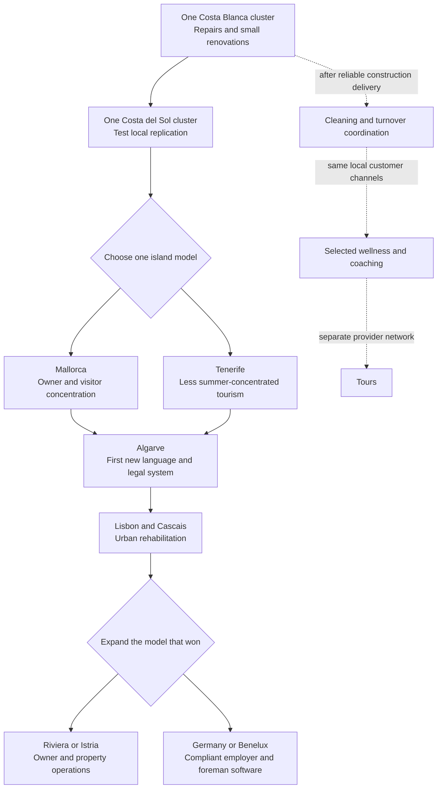

# European markets for a multilingual booking and work-organising service

**Research date: 21 November 2026.** Figures retain their reference years; publication dates are not substituted for data years. This is a market-selection study, not a legal opinion or a forecast of revenue.

## 1. Recommendation

**Start on Spain’s Costa Blanca, in one compact operating area rather than across a country.** Alicante province has the strongest directly verified foreign-homebuyer concentration in this comparison: **43.8% of registered dwelling purchases in 2024**, against **14.6% nationally**. It also recorded **32.6 million tourist accommodation nights in 2024**. This combines an unusually concentrated international property customer base with a separate channel into cleaning, maintenance and visitor services. These are indicators of potential demand, not a measurement of customers unable to find a builder. [1][2]

**Costa del Sol is a close alternative, not a distant second.** Málaga province’s corresponding foreign-purchase share was **32.4% in 2024**, with **30.5 million accommodation nights**. The final choice between these two should turn on access to a reliable local operator and legitimate contractor network. A real provider network is more valuable than the one-point difference in the judgement-based score below. [1][2]

**Mallorca is strongly supported by evidence, but is not automatically the best beachhead.** The Balearics had **32.6% foreign dwelling purchases in 2024**, and Mallorca alone had **55.3 million accommodation nights**, including **51.2 million international nights**. However, the average Balearic dwelling purchase price was **€380,166**, against **€198,407 nationally**, and the region had the highest mortgage-payment-to-wage ratio in the Registradores comparison. These are warnings about local housing pressure, not measured operating costs. The inference is to enter Mallorca after proving local delivery, unless an exceptional founding provider network is already there. [1][2]

The strongest **owner-facing language mismatch** is likely in international property pockets of Spain, Portugal, France and Italy. The strongest **foreman–crew coordination opportunity** need not be in the same places: Germany, Austria, Benelux and Switzerland combine international labour with cross-border contracting. Ireland, the Netherlands and Scandinavia should not be chosen simply because they have many expatriates: English is much more widely available there, weakening a translation-only proposition. These are comparative inferences from the workforce, population and language evidence below. [3][4][5][6][7]

**Recommended sequence:** Costa Blanca → Costa del Sol → Mallorca or Tenerife → Algarve → Lisbon/Cascais → one new-language market. Keep the German/Benelux foreman product as a separate expansion hypothesis rather than assuming that an owner-concierge business and a labour-supply business are interchangeable. [1][2][8][9]

## 2. What the evidence does, and does not, measure

The opportunity is the intersection of:

- a customer who needs local work but lacks the language, presence or trusted network;
- providers whose scheduling, job information and team availability are fragmented;
- enough recurring work within a practical service radius to support a local managed service.

**There is no verified Europe-wide statistic for “foreign owners who cannot hire local trades”, nor for the probability that a client, foreman and worker share no language.** The tables therefore use observable proxies. Claims that a particular percentage of expatriates struggles to hire a builder are **[unverified]** and are not used in the ranking.

Important distinctions:

| Measure | What it establishes | What it cannot establish |
|---|---|---|
| Foreign-national purchaser share | Transactions involving citizens of another country | Absence from the country, language difficulty, second-home use or wealth. Spain’s register measure includes foreign residents. [1] |
| Non-resident purchaser share | Purchasers with a tax domicile/residence abroad | Foreign nationality: a returning national or an emigrant may be included. Portugal explicitly uses tax domicile. [8] |
| Second/occasional-home stock | A stock of properties potentially requiring remote maintenance | Foreign ownership. Most second homes may belong to domestic households. National classifications differ. [10][11][12] |
| Foreign-born worker share | Workers born outside the destination country | Citizenship, current language ability or migration generation. [6] |
| Foreign-national worker share | Workers without destination-country citizenship | All migrant workers: naturalised workers disappear from this measure. [3][4] |
| Migration background/history | A broader first-/second-generation category | A directly comparable foreign-born share. Germany’s cited definition includes people whose two parents immigrated. [5] |
| A1 documents, postings and work permits | Administrative flows or episodes | Unique people, resident workforce stocks or immediately available replacement workers. [9][13] |
| Tourist nights, gym memberships and wellness expenditure | Adjacent-category activity | Bookable independent tours, personal coaching or massage revenue. These categories must not be added together as a platform TAM. [2][14][15] |

The screening covers Mediterranean coasts and islands, Alpine destinations, Western/Northern European international cities and Central/Eastern European labour hubs. The shortlist favours the initial construction-and-owner service; it is not a ranking of Europe’s largest economies.

## 3. Foreign owners, non-resident buyers and second homes

### 3.1 Where international property demand is concentrated

| Country / region | Best verified evidence and year | Buyer origins / languages | Implication and limitation |
|---|---|---|---|
| **Spain: national benchmark** | Foreign citizens made **14.6%** of registered dwelling purchases in **2024**, approximately **93,000 purchases**, up from approximately **87,400 in 2023**. [1] | The **2024** annual report identifies British, German, Moroccan and Romanian buyers among leading nationalities. Exact nationality percentages are not reproduced because the full annual PDF could not be retrieved directly. [16] | A large actual transaction flow, not just website enquiries. Nationality includes resident migrants, so this is not a non-resident holiday-home count. [1] |
| **Costa Blanca / Alicante province** | **43.8% foreign purchases, 2024**, the highest provincial figure in the official summary. [1] | Do not transplant national nationality shares to Dénia, Jávea, Calpe or Torrevieja. Municipality-level buyer-language mix remains **[unverified]**. [16] | Best evidenced concentrated starting area. Choose one cluster; Alicante province is too broad to be the first service radius. This is an operating recommendation, not a registry finding. |
| **Costa del Sol / Málaga province** | **32.4%, 2024**. Andalucía overall was **14.0%**, illustrating why a country or autonomous-community average can hide a much stronger local opportunity. [1] | Local nationality ranking **[unverified]** in the sources retrieved. | Near-equal beachhead candidate with a large visitor economy. Provincial data are a proxy for a selected coastal cluster, not a Marbella-only statistic. [1][2] |
| **Balearics / Mallorca** | **32.6% foreign purchases, 2024**. This covers all Balearic islands, not Mallorca alone. [1] | German- and English-language service is a plausible commercial starting hypothesis, but the precise local buyer split is **[unverified]** here. | Strong owner and visitor overlap; avoid presenting regional purchase data as island-specific. [1][2] |
| **Canary Islands** | **27.2% foreign purchases, 2024**; Santa Cruz de Tenerife province **33.1%**, Las Palmas province **22.3%**. [1] | Island-specific nationality ranking **[unverified]**. | Strong candidate, especially for combining property work and less summer-concentrated visitor services. Santa Cruz province also includes other islands; it is not a Tenerife-only purchase figure. [1][2] |
| **Murcia, Girona / Costa Brava, Almería** | Foreign-purchase shares in **2024**: Murcia **23.6%**, Girona **27.1%**, Almería **19.8%**. [1] | Local language/customer mixes **[unverified]**. | Credible second-tier clusters. Girona’s figure is materially higher than Cataluña’s **16.3%**. [1] |
| **Portugal: Algarve** | Non-residents accounted for **8% of dwelling transactions nationally and 13% of value in 2023**. The Algarve received **29.9% of all Portugal’s non-resident purchases**. This is a distribution of non-resident purchases, **not a 29.9% foreign share of Algarve sales**. [8] | A comparable national completed-purchase nationality ranking was not established. UK/US/Chinese/French shares in the Bank’s wider real-estate FDI discussion are money flows, not homebuyer counts. [8] | Strong foreign-owner concentration, but do not compare its non-resident measure directly with Spain’s nationality measure. A reported **23.8% regional non-resident purchase share for 2024** remains **[unverified]** here because the BPI PDF did not yield readable tables. [17] |
| **Portugal: Lisbon / Cascais** | Lisbon metropolitan area received **15.6% of Portugal’s non-resident purchases in 2023**. In the **Lisbon urban rehabilitation area**, non-residents accounted for **33% of dwelling transactions and 41% of value in 2023**. These boundaries are different. [8] | Among foreign-citizen purchases in that rehabilitation area: US **16%**, France **13%**, UK **9%**, China **8%**, Brazil **6%**, Germany **5%**, **2023**. This is not a Portugal-wide buyer ranking. [8] | Strong urban rehabilitation case. Brazilian/Portuguese-language customers show why foreign nationality does not automatically imply a language barrier. |
| **Portugal: Porto/Norte, Madeira** | Norte received **17.5% of non-resident purchases in 2023**, ahead of Lisbon metropolitan area in that measure. A comparable Madeira foreign-owner/purchase share was not verified. [8] | Madeira completed-purchase nationality ranking **[unverified]**. | Porto/Norte merits screening before assuming Madeira is Portugal’s natural next market. Madeira should not receive a top rank on the strength of expatriate anecdotes. |
| **France: Riviera/Provence, Alps and other second-home areas** | Foreign non-residents made **1.8% of existing-home transactions in metropolitan France in 2022**; Paris **3.4%**. Nationally, foreign non-resident purchases were led by **Belgians, 19%, and British buyers, 17%**, within that buyer group. [18] | Belgian nationality does not determine French versus Dutch language. Do not assume every Belgian purchase requires translation. [18] | Large second-home stock supports maintenance, but France’s national non-resident transaction share is much lower than a superficial comparison with Spain suggests. Current Riviera/Alpine transaction shares were not verified. |
| **Italy: Tuscany, Umbria, lakes, Liguria, Puglia, Sicily** | An official national foreign/non-resident share of completed residential purchases was not verified. Gate-away-based **2024** reporting places the US, UK and Germany among leading sources of **enquiries**, not completed purchases. [19] | Enquiry origin is a lead-generation clue only. Province-level completed-buyer nationality ranking **[unverified]**. | Real language and renovation potential, but weaker evidence of a concentrated foreign-owner acquisition channel than Spain. Do not use portal demand as a registry market share. |
| **Greece: Athens, Crete, Ionian and Aegean destinations** | Bank of Greece figures reported by To Vima put foreign real-estate investment inflows at **€2.75 billion in 2024**. This is capital flow, not a foreign share of home transactions. [20] | A national or Crete completed-purchase buyer-nationality ranking was not verified. Golden Visa nationality data would cover only one programme, not all buyers. | Attractive hypothesis; weaker transaction comparability and dispersed island delivery argue against first entry. Press claims of very high foreign shares in resort locations are professional estimates, not used as registry facts. [20] |
| **Croatia: Istria, Kvarner, Dalmatia** | Tax Administration data reported by Lider show **6,592 foreign property purchases in January–September 2025**, approximately **22% fewer** than the same period of **2024**. The series includes property, not just dwellings. [21] | For **January–September 2024**, Slovenia **2,617**, Germany **1,928**, Austria **829** purchases in the cited reporting. [21] | Strong German-/Slovenian-facing coastal proposition, but do not mistake weaker recent transaction flows for a new boom. Istria’s ranking uses tourism concentration as a separate proxy; its foreign-owner share remains **[unverified]**. [2] |
| **Cyprus: Paphos, Limassol, Larnaca** | PwC’s DLS-based report records **6,228 foreign-buyer sale contracts in 2024**, down **10%** from **6,900 in 2023**. Paphos received **32%**, Limassol **29%**, of foreign contracts; **69%** of foreign contracts involved non-EU buyers. [22] | A reliable individual-nationality ranking was not retrieved; non-EU is not a language. | High international concentration, but **do not divide 6,228 contracts by PwC’s 23,900 total property transactions**: contracts filed and transfers/transactions are different universes. A like-for-like foreign percentage is not supplied here. [22] |
| **Malta** | The **2021** census counted **81,613 secondary, seasonally used or vacant dwellings** in a combined category. This is not 81,613 second homes or foreign-owned homes. [23] | Buyer nationality ranking/share **[unverified]**. | Compact market, but widely available English reduces the owner-language wedge. A foreman/crew scheduling proposition could still matter. [7] |
| **Alps: French, Austrian, Swiss and Italian resorts** | Bolzano-Bozen recorded **37.0 million tourist nights in 2024**; Alpine destinations also feature strongly in Eurostat’s international-tourism concentration measures. A harmonised Alpine foreign-owned second-home stock was not established. [2] | National language and ownership restrictions vary across borders; “the Alps” is not one operating jurisdiction. | Potentially attractive premium maintenance and wellness markets, but should be evaluated resort by resort. Swiss foreign-non-resident ownership is subject to Lex Koller authorisation rules; that constrains a new-owner funnel but does not remove the existing maintenance stock. [24] |

### 3.2 Second-home stock: do not confuse absence with nationality

| Geography | Stock evidence | Interpretation |
|---|---|---|
| Spain | **2,514,511 occasional-use dwellings, 2021**, classified using electricity consumption. Guardamar del Segura had only **26.7% main residences**, Torrevieja **30.0%**, Santa Pola **32.6%**, **2021**. [10] | Concrete support for absentee/seasonal-property service on the Costa Blanca. Non-main residences include other uses and empty homes; the complement is not a foreign-owner share. |
| Portugal | **1,104,881 seasonal/secondary-use dwellings, 2021**, reported in INE census material. [12] | National stock, not foreign-owned stock. Regional ownership and nationality cross-tabs remain a gap. |
| France | **3.733 million second/occasional homes**, **9.8%** of housing stock, **1 January 2024**, excluding Mayotte; metropolitan France **3.668 million**. [11] | A very large maintenance base even though the non-resident purchase-flow share is modest. |
| Malta | Combined secondary/seasonal/vacant category **81,613, 2021**. [23] | Not comparable with France’s second/occasional-only category. |
| Italy, Greece, Croatia, Cyprus and the Alps | A comparable current foreign-owned second-home stock by region was **not verified**. Official dwelling-use, vacant-home and property-transfer datasets do not automatically provide that cross-tab. [22][23][24] | Do not substitute all vacant dwellings, Golden Visa permits, property enquiries or overseas-investment flows. No stock-based numeric ranking is claimed for these markets. |

**Commercial inference:** existing absentee-owner stock is more useful to a recurring repair business than annual foreign purchases alone. The transaction flow is an acquisition-channel proxy; it is not the annual number of renovation jobs. [8][10][11]

## 4. Migrant labour, crew languages and posted workers

### 4.1 Country evidence: keep definitions visible

**NV = [unverified]: no defensible sector-specific percentage established in this study.** It does not mean zero. Foreign-born, foreign citizenship, migration history, domestic employment and business-sector employment must not be blended into a single comparable index.

| Country | Construction workforce | Cleaning / household services | Care | Hospitality |
|---|---|---|---|---|
| **Spain** | **20.9% foreign-national social-security affiliates in construction, May 2024**. [4] | **45% foreign nationals in the Special Household System, May 2024**; this includes household services, not cleaning alone. [4] | Standalone care share NV; do not label the household-system number as care. | **27.8% foreign-national affiliates, May 2024**. [4] |
| **Germany** | **36% migration history in building/civil-engineering occupations**, **40% in building occupations**, **34% in interior-finishing occupations**, **2022**. These are occupations, not all NACE construction. [5] | **60% with migration history in cleaning occupations, 2022**. [5] | **30% with migration history in elderly-care occupations, 2022**. OECD’s separate **2024 foreign-born LTC** measure also places Germany around **30%**, but is a different definition. [5][6] | **36.7% foreign nationals, 2022**, ELA/EU-LFS; Destatis’s broader migration-history measure was **46% in gastronomy occupations, 2022**. [3][5] |
| **Italy** | **16.9% foreign nationals, 2024**. [25] | **30.9% foreign nationals in “other collective and personal services”, 2024**; too broad to call a cleaning share. [25] | Approximately **33% foreign-born LTC workers, 2024**, OECD Figure 10.20; rounded chart value. [6] | **18.5% foreign nationals in hotels/restaurants, 2024**. [25] |
| **France** | DARES’s older **2017** occupational estimates: immigrants **27% of unskilled structural-construction workers**, **25% of skilled structural-building workers**. These were located in indexed extracts; a current all-construction share was not verified. [26] | **39% immigrants among domestic employees, 2017**, an occupational measure, not cleaning-company employees; current share NV. [26] | Current country share NV in the extracted evidence. | Current exact share NV; ELA’s **2022** cross-country chart is the comparable starting source. [3] |
| **Portugal** | Current share NV. ELA’s **2025** study directly documents construction posting involving Brazilian workers recruited through Portugal. [13] | Sector-specific share NV. | Current share NV. | Exact share NV; ELA identifies hospitality as a leading employment sector for Ukrainian refugees in Portugal in its reviewed evidence, not as a nationality share of all workers. [3] |
| **Austria** | A Eurofound **2025** construction report cites roughly **30% migrant/foreign workers**; underlying country-series reference year/definition was not verified, so this estimate is **[unverified] for numeric comparison**. [27] | Share NV. | Approximately **34% foreign-born LTC workers, 2024**, rounded OECD chart value. [6] | **40% foreign nationals, 2022**, ELA/EU-LFS. National administrative **2024** figures show only **41.3% Austrian citizens** among tourism employees; **35.8% EU citizens** and **22.7% third-country nationals**. Different datasets/populations explain why these must not be treated as a clean time series. [3][28] |
| **Cyprus** | Eurofound **2025** report cites **more than 50% migrant/foreign workers**, but underlying year/definition was not established: **[unverified] as a comparable sector share**. [27] | Share NV. | Share NV. | **38.5% foreign nationals, 2022**, ELA/EU-LFS. [3] |
| **Malta** | Eurofound **2025** report cites approximately **30% migrant/foreign workers**; underlying reference year/definition NV. [27] | Share NV. | Share NV. | **More than 50% foreign nationals, 2022**; third-country nationals alone **35.2%**. [3] |
| **Luxembourg** | Exact all-construction share NV; important receiving country for postings. [9] | Share NV. | Approximately **four in ten foreign-born LTC workers, 2024**. [6] | **More than 75% foreign nationals, 2022**, ELA/EU-LFS. [3] |
| **Switzerland** | Exact sector share NV; EU resident/LFS shares can also miss cross-border commuters. | Share NV. | Approximately **41% foreign-born LTC workers, 2024**, rounded OECD chart value. [6] | Exact share NV. |
| **Ireland / Sweden** | Exact construction shares NV. | Exact cleaning shares NV. | Approximately **four in ten foreign-born LTC workers in each country, 2024**. [6] | Exact shares NV in the extracted evidence. [3] |
| **Croatia** | **75,071 residence/work permits issued for construction in 2024**. This is not a workforce share or a count of unique workers. [29] | Separate share NV. | Separate share NV. | **56,228 residence/work permits issued for tourism/hospitality in 2024**; a flow, not a workforce share. ELA suppresses the **2022** foreign-national hospitality estimate for low reliability. [29][3] |
| **Czechia / Poland / Netherlands / Denmark / Greece** | No harmonised current construction foreign-born share verified here. Do not infer one from total foreign residents. [27][30] | Sector-specific percentages NV. | Exact country shares NV in the extracted chart. | ELA’s **2022** source is available, but precise values were not reliably extracted; Poland’s estimate has low reliability. [3] |

At EU level, ELA finds **19.0% foreign-national workers in hospitality in 2022**, against **8.7% across the economy**. OECD finds the foreign-born share of LTC workers across **26 European OECD countries** rose from **14% in 2014 to 21% in 2024**. These support the extension beyond construction, but not a claim that all service categories share the same workforce or regulation. [3][6]

### 4.2 Languages: design for the actual crew, not a nationality stereotype

| Labour corridor / market | Evidence of origins | Language implications — analytical, not measured dominance |
|---|---|---|
| Poland/Lithuania → Germany, Benelux, Austria | ELA documents Ukrainian and Belarusian workers entering posting chains through Poland/Lithuania; around **80% of third-country nationals posted from Poland were Ukrainian in 2021**. [13] | Polish, Ukrainian and sometimes Russian may matter, alongside German/Dutch/French. Russian must be offered by preference, never imposed on Ukrainian workers. A Polish employer does not imply a Polish-speaking crew. |
| Portugal → France, Belgium, Germany and other destinations | ELA’s **2024 fieldwork**, published **2025**, includes Brazilian construction workers posted through Portugal. [13] | Portuguese is valuable; Brazilian workers may already share the foreman’s language. The gap may be with the client or site contractor rather than inside the crew. |
| Slovenia → Austria/Germany | ELA documents workers from Bosnia and Herzegovina as the largest third-country group in its Slovenian posting case. [13] | Bosnian/Croatian/Serbian language support may be more relevant than Slovenian for a particular subcontractor. |
| Spain | The social-security release names Morocco, Romania, Colombia, Italy, Venezuela and China as leading foreign-affiliate origins overall in **May 2024**, not construction-only. [4] | Spanish, Romanian and Arabic/Darija are plausible onboarding priorities to test; Latin American migrants often already speak Spanish. Portuguese and Ukrainian should be selected from actual supply, not assumed universal. |
| Austria | Among **all hospitality employees in 2024**, Hungary accounted for **11.5%**, Germany **4.8%**, Romania **3.7%**, Turkey **2.9%**, Bosnia and Herzegovina **2.2%**, Ukraine **2.0%**. [28] | Hungarian, German, Romanian, Turkish, Bosnian/Croatian/Serbian and Ukrainian have a direct evidence basis in hospitality. This is not a construction nationality table. |
| Germany / Vienna | Destatis documents migration-history concentration in construction/cleaning/care; Vienna’s leading foreign-origin groups include Serbia, Turkey, Germany and Syria in **2025**. [5][31] | German, Turkish, Arabic and Balkan languages are relevant recruitment hypotheses. City origins are not proof of construction-crew language shares. |
| Croatia | **2024** permit totals, across sectors, were led by Bosnia and Herzegovina (**38,100**) and Nepal (**35,635**). [29] | Croatian/Bosnian/Serbian plus Nepali and English may be needed. A product restricted to European languages would miss part of the emerging labour supply. |

**Product inference:** ask each worker and foreman for preferred spoken/written language; retain the original instruction alongside any translation. Translation cannot replace a qualified person, safety induction, or explicit confirmation that a job’s scope was understood. ELA documents information, language and contracting-chain problems; it does not establish that an AI translation layer alone resolves them. [13]

### 4.3 Posted workers: substantial coordination demand, not instant replacement capacity

| Measure | Evidence | Meaning for entry |
|---|---|---|
| Receiving countries | National declaration tools recorded approximately **1.5 million posted workers and 4 million postings in 2023**, across data available for **25 member states**. The leading receivers were **Germany, Belgium, France and Austria**; other important receivers included Sweden, Luxembourg, Netherlands, Italy and Denmark. [9] | Germany/Benelux/Austria are strong foreman-software candidates. The same person can appear in multiple postings and across countries. |
| Sending countries | Germany and Poland are major A1 issuers; a **2023** country report puts their combined share above half of issued A1s. This broad A1 measure includes multi-state activity and is not a construction-only sending ranking. [32] | Do not describe Germany’s business-travel/multi-state A1 volume as outgoing construction crews. |
| Construction-specific sending | ELA’s construction report, published **2023**, identifies Poland as the principal sender using mainly **2021** posting data; Portugal→France/Belgium are also significant corridors. [33] | An older but sector-relevant signal. A current fully ranked construction sending-country table remains a gap. |
| Third-country supply chains | ELA’s **2025** study covers Poland, Portugal and Slovenia; workers interviewed in **2024** included Ukrainians, Brazilians and Bosnians. [13] | The legal employer’s country, worker’s nationality and working language are separate fields. |

**Do not launch by promising cross-border same-day replacements.** A substitute needs the correct right to work, contract/employer relationship, trade competence, safety access, insurance and, where relevant, posting notification. ELA documents intermediaries behaving like labour suppliers without the appropriate agency structure. That is a risk to avoid, not a model to copy. [13][34]

## 5. International city populations: a different customer-acquisition model

The following is an international-population screen, **not a survey of difficulty hiring trades**. Foreign citizenship, birthplace and migration background are identified separately. Figures with unlike boundaries/definitions should not be ranked as if interchangeable.

| City / boundary | Evidence, reference year | Market-selection interpretation |
|---|---|---|
| **Amsterdam municipality** | **59% migration background, 2023**; **79% Dutch nationality**, so approximately **21% non-Dutch nationality**; **174 nationalities**. The city says over **60%** of residents with migration background were themselves born abroad. [35] | Large international base, but Dutch English capability is high. Sell reliability, access and coordination, not merely translation. [7] |
| **Berlin** | **24.4% non-German citizenship at 31 December 2023**, official statistical-office release. [36] | Strong urban test for German-language trade procurement and migrant-crew coordination. [5] |
| **Munich** | **30.6% non-German citizenship, 31 December 2024**, municipal population table. [37] | Plausible higher-value urban alternative to Berlin. The study does not establish that the higher foreign share means higher unmet trade demand. |
| **Lisbon municipality** | AIMA’s **2024** municipality count is reported as **202,430 foreign residents**. **[unverified at table level]**: the report was located, but the municipality table was not independently extracted. Do not use the Lisbon district count as city population. [38] | Existing rehabilitation-area transaction evidence is a firmer immediate entry signal than a loose “digital nomad” narrative. [8] |
| **Barcelona municipality** | City Council’s indexed **2025** release states **26.4% foreign nationals**; the article is now unpublished, so the current accessible-page verification is **[unverified]**. [39] | Strong international/tourism overlap, but owner versus renter and municipal restrictions need separate assessment. Barcelona province recorded **41.2 million tourist nights in 2024**. [2] |
| **Madrid municipality** | Municipal register reporting: **19% foreign nationals, 1 January 2024**; the municipal **2025** population release is the source for the subsequent year. [40] | Larger year-round local-services hypothesis; not the same absentee-home proposition as a coastal resort. |
| **Dublin county, with Dublin City detail** | **17% non-Irish citizens, Census 2022**, county boundary. Dublin City received **22,475 movers from outside the state** in the preceding year. [41] | Large internationally mobile population, but English is not the obvious client-side obstacle. Scarcity, accountability and availability are better hypotheses. |
| **Brussels-Capital Region** | **36.9% non-Belgian citizens, 1 January 2023**; **23.2% of all residents** held another EU nationality. Largest EU-national groups: French, Romanian and Italian. [42] | Compelling multilingual city and labour hub. French/Dutch/English and crew languages matter; “expat” does not mean English-only. |
| **Luxembourg city** | **70.13% foreign nationals**, **95,522 people**, **31 December 2024**; total population **136,208**. Leading EU groups include France, Portugal and Italy. [43] | Exceptional international density, but a small absolute population and widespread multilingualism. Strong potential for a narrow premium service, not proof of a large standalone platform. |
| **Zurich city** | City reporting puts foreign nationality at **33.7% at end-2024**; **33.9% refers to 2025**, not 2024. [44] | Attractive international city, but Switzerland requires its own operating/legal model. Do not apply EU platform or posting law automatically. |
| **Vienna** | **36.4% foreign citizenship**, **40.9% born abroad**, **1 January 2025**. Main foreign origins include Serbia, Turkey, Germany and Syria. [31] | Stronger evidence for a multilingual team-service business than for an absentee-second-home beachhead. |
| **Copenhagen** | Nordregio reports **21% foreign-born, 2022**, using national-statistics sources. [45] | International demand exists; high Danish English capability weakens translation as differentiation. [7] |
| **Stockholm municipality** | Nordregio reports approximately **26% foreign-born, 2022**; Stockholm county was **27%**, a different boundary. [45] | Large international base; reliability and team logistics are stronger hypotheses than an English-to-local-language concierge alone. [7] |
| **Prague** | IPR Prague reports **345,000 foreign residents in 2022**, up from **61,000 in 2001**; principal origins Ukraine, Slovakia and Russia, with Vietnam also substantial. [46] | Strong combined customer/crew language case, although disposable income, pricing and owner/renter mix have not been measured here. |
| **Warsaw** | The **2024** city report contains foreign permanent/temporary-stay registrations. A deduplicated foreign-resident stock/share comparable with the other cities was **not verified**. [47] | Ukrainian/Polish labour coordination is plausible, but registration totals and wartime mobile populations are not a clean expatriate-owner market estimate. |

**City prioritisation, conditional on choosing the urban model:** Berlin/Munich, Vienna and Brussels deserve the first comparisons; Luxembourg and Zurich suit a narrower premium operation. Amsterdam, Dublin, Copenhagen and Stockholm need a proposition that wins without language friction. Prague and Warsaw merit a labour-organisation experiment, not an unsupported claim that western expatriates are their main market. This is an inference from the table and language/workforce evidence, not a measured conversion ranking. [3][5][7][31][35][41][42][43][45][46]

## 6. Language skills: evidence for the mismatch, with an important definition trap

The European Commission’s **Special Eurobarometer 540**, published **May 2024**, was fielded in **September–October 2023** among **26,523 people aged 15+**. **59%** said they could converse in at least one language other than their mother tongue; **28%** in more than one. **47%** reported English as a foreign language. This is self-reported ability in the general population, not a construction-worker test. [48]

A secondary reprocessing of those data, LanguageKnowledge, counts **native speakers plus foreign-language speakers rating their competence “good” or “very good”**. This stricter series reports EU English reach at **36%**, not the Commission’s **47% foreign-language** headline. **Do not present the two as the same indicator.** The country screen below uses only the secondary series consistently; its calculation has not been independently reproduced. [7][48]

| Country | English: native + good/very-good foreign competence, 2023 fieldwork / 2024 publication | Interpretation for the initial service |
|---|---:|---|
| Spain | **26%**; ages 55+ **10%** [7] | Strong owner–provider language hypothesis; older-provider/client cohorts may differ substantially. |
| Portugal | **29%**; ages 55+ **8%** [7] | Strong potential mismatch outside international-facing firms. |
| France | **25%** [7] | Strong general-population mismatch proxy; tourist-trade workers may be more multilingual. |
| Italy | **28%** [7] | Strong potential mismatch, but property-customer concentration is less well verified. |
| Greece | **35%** [7] | Moderate national proxy; do not assume every resort has the national average. |
| Croatia | **34%** [7] | Moderate proxy with additional German/Slovenian customer languages. |
| Germany / Austria | **42% / 38%** [7] | Client-local-language and foreman-crew gaps can both matter. |
| Czechia / Poland / Romania | **32% / 22% / 16%** [7] | English cannot be presumed to bridge every east–west subcontracting chain. |
| Belgium / Luxembourg | **49% / 60%** [7] | Multilingual market; French, Dutch, German and Portuguese can be more relevant than English alone. |
| Cyprus / Malta | **67% / 79%** [7] | High foreign ownership/labour does not imply high English-language friction. |
| Netherlands / Denmark / Sweden | **86% / 73% / 76%** [7] | Weaker translation-only customer proposition. |
| Ireland | **93%**, including native English [7] | Not comparable with “English as a foreign language”; weak client-side English-translation wedge. |

**What can be concluded:** southern European foreign-owner clusters are a better starting hypothesis for a multilingual managed service than simply selecting the cities with the most expatriates. **What cannot:** multiplying national English deficits by foreign-buyer or migrant-worker shares does not produce the probability of a three-way language failure. These populations are selected, multilingual skills correlate, and tourist/foreman roles are not random samples. [1][3][7][48]

## 7. Renovation, repairs and labour scarcity

### 7.1 Scale and trend

The Commission’s **2020 Renovation Wave** aims to renovate **35 million buildings by 2030** and at least double the annual energy-renovation rate. This is a policy ambition, not booked work. The Commission also explicitly identifies renovation/heating skills shortages as an implementation constraint. [49]

FIEC’s **2025 key-figures leaflet**, covering **2024**, puts EU27 construction investment at **€1,821 billion**, with **27.0% in housing renovation**. Multiplication gives an indicative **€492 billion housing-renovation segment in 2024**. This is an **author calculation**, approximate because both published inputs are rounded; it is not small-job repair GMV or an addressable booking-platform market. The same leaflet reports **95% of construction enterprises have fewer than 20 workers**, supporting a small-team organising proposition. [50]

**Source consistency caution:** some FIEC country web pages show different headline investment levels from its key-figures leaflet, and some headline fields appear erroneous. This study uses the leaflet consistently for national investment levels and uses country narratives only for their explicitly described segment trends. It does not mix the different headline series. [50][51][52][53][54][55]

| Country | Total construction investment, 2024 — context, not renovation TAM | Specific renovation/repair signal | Shortage and delivery implication |
|---|---:|---|---|
| Germany | **€464bn** [50] | Construction investment **−3.3% in real terms, 2024**; existing-housing investment was forecast stable in **2025**. Energy refurbishment is identified as a medium-term growth area. [51] | **56% of construction firms** in an early-**2025** survey identified skilled-labour shortage as a business risk; **62%** cited demand risk. Scarcity and weak demand can coexist. [51] |
| France | **€258bn** [50] | Housing rehabilitation/maintenance **+0.2% in volume, 2024**, with **+0.6% forecast for 2025** in FIEC’s country narrative. This is not a claim of a rapid renovation boom. [52] | EURES identifies building/related trades among recurring shortage groups in its **2024** labour-market information. [56] |
| Italy | **€223bn** [50] | Housing redevelopment **−22% in real terms, 2024**; approximately **40% of construction investment** in the country narrative. A further **−30% in extraordinary housing maintenance was forecast for 2025** after incentive reductions. Forecast, not verified 2025 outturn. [53] | A huge market can be a poor immediate entry timing choice. Do not sell the Superbonus period as a continuing growth rate. |
| Spain | **€165bn** [50] | Renovation-related technical approvals, “visados”, **+7% in 2024**. This is approvals, not completed renovation output. [54] | Construction employment **1.4m in 2024**; only **10.3% under 30**, approximately **22% over 55**. The ageing workforce is a documented constraint, not evidence that every locality lacks every trade. [54] |
| Netherlands | **€116bn** [50] | Comparable current renovation-only amount not established here. | Important posting receiver; candidate for workforce coordination rather than a high-language-friction beachhead. [9][7] |
| Austria | **€52bn** [50] | Comparable renovation-only amount not established. | International labour and Alpine tourism are evidenced, but the foreman product and premium property service are separate entry cases. [28][2] |
| Portugal | **€30bn** [50] | Licensed rehabilitation works **+6.0% in 2024**; construction gross production **€22.1bn, +3.0% real**, a different measure from investment. [55] | Country narrative identifies skilled-labour shortage and bureaucracy; authorised construction businesses approximately **69,400 in 2024**. [55] |
| Greece | **€14bn** [50] | FIEC’s EU narrative describes approximately **10% construction growth in 2024**; this includes infrastructure and must not be labelled repair-market growth. [57] | Regional renovation demand and trade-specific shortage rates remain **[unverified]** here. |
| Croatia | **€11bn** [50] | Renovation-only amount not verified; a reconstruction/infrastructure pipeline is not automatically villa-maintenance demand. | EURES lists building/related trades among prominent shortage groups for **2024**. [58] |
| Cyprus / Malta | **€4bn / €2bn** [50] | Comparable renovation-only amounts not verified. | Small national markets despite high international exposure; avoid confusing high foreign shares with large absolute scale. |
| Switzerland | **€64bn**, FIEC leaflet’s euro comparison [50] | Not EU Renovation Wave jurisdiction; renovation-only amount not verified. | Requires separate labour, licensing and cross-border-service analysis. [24] |

ELA’s **2024 shortages report**, published **2025**, highlights persistent shortages in construction, healthcare and hospitality. It is an occupation-by-country compilation using different national methods, **not a harmonised percentage shortage index**. Spain also has occupation surpluses; it would be incorrect to infer that its higher unemployment makes every construction trade readily available. [30][59]

**Implication for last-minute replacement:** the service can reduce coordination delay and discover idle qualified capacity. It cannot create a missing qualified electrician. The initial replacement pool should be local and legally deployable; cross-border pools add legal and practical constraints. [13][34]

## 8. Extension categories: where the same geography helps, and where it does not

### 8.1 Tourism and tours

Eurostat records **3.02 billion nights in EU tourist accommodation in 2024**, **+2.7% versus 2023**; international nights grew **5.5%**, domestic nights **0.2%**. Accommodation nights exclude owner-occupied second homes and same-day visitors, and do not directly count tour bookings. [2]

| Market / region | Activity evidence, 2024 | Extension hypothesis — not measured market share |
|---|---|---|
| Mallorca | **55.3m nights**, of which **51.2m international** [2] | Strongest shortlist overlap for tours, massage, pilates and independent coaches serving visitors and owners. Severe seasonal concentration still needs local capacity planning. |
| Tenerife | **35.8m nights**, **31.3m international** [2] | Strong candidate for a second Spanish operating model; Canarias led international nights among NUTS2 regions in **January–April and October–December 2024**. [2] |
| Costa Blanca / Costa del Sol | Alicante **32.6m**, Málaga **30.5m nights** [2] | Owner work and visitor services can share distribution through property managers, but require different provider networks. |
| Algarve | Portugal’s most frequented NUTS3 region for both domestic and international tourists in **2024** [2] | Better-supported Portuguese extension geography than assuming every island has equal demand. |
| Istria / Croatian Adriatic | Istria recorded **132,400 nights per 1,000 residents, 2024**. Jadranska Hrvatska’s international nights reached **22.9m in July** and **24.3m in August**. [2] | Large summer opportunity, but pronounced seasonality. Do not size a year-round staffed service from peak summer demand. |
| Greece: Ionian/Aegean islands | Zakynthos **162,700 nights per 1,000 residents, 2024**; Corfu **102,700**. [2] | Strong tours/wellness adjacency, but separate islands are separate service catchments. Crete’s exact comparable figure was not extracted. |
| Italy / Alps | Roma **47.2m**, Venezia **38.8m**, Bolzano-Bozen **37.0m nights, 2024**. [2] | Large tours and active/wellness demand, with a distinct Alpine winter/summer calendar; does not itself establish a Tuscany repair opportunity. |
| Urban international centres | Paris **43.2m**, Barcelona province **41.2m**, Madrid **32.3m**, Berlin **30.4m nights, 2024**. [2] | Tours and fitness can be substantial, but tourism demand is not evidence that the renovation platform can acquire those providers cheaply. |

No defensible region-by-region independent-tour booking GMV was verified. The report therefore uses nights as exposure, not as a tour-market revenue estimate. [2]

### 8.2 Wellness, fitness and coaching

EuropeActive/Deloitte reports **71.6 million fitness-club members in Europe in 2024**, **+5.8%** on restated **2023** figures, **€36.0 billion revenue** and **64,550 clubs**. The extract’s **2024 Germany** profile shows **11.71 million members** and **€5.82bn revenue**. These are club measures, not all personal training, pilates, massage or sport coaching. [14]

GWI’s **2024** wellness-tourism estimates, reproduced by the Netherlands government’s CBI, provide a broader country comparison. They include domestic and international trips; they are modelled industry estimates, not official national accounts or expenditure solely on bookable wellness sessions. CBI’s prose has an inconsistent regional “second-largest” description; its numeric table is used instead. [15]

| Country | Wellness tourism trips, 2024 | Wellness tourism expenditure, 2024, US$ | Relevance |
|---|---:|---:|---|
| Germany | **77.2m** | **$40.6bn** [15] | Large domestic wellness ecosystem and source of travelling customers. |
| France | **41.5m** | **$45.6bn** [15] | High spending estimate; Riviera/Alps have plausible premium sessions adjacency. |
| United Kingdom | **22.3m** | **$19.1bn** [15] | Important customer-source market; no client-side English mismatch in a UK launch. |
| Spain | **20.8m** | **$16.7bn** [15] | Supports tourism/wellness extension within the proposed first-country footprint. |
| Austria | **18.4m** | **$18.3bn** [15] | Strong Alpine/thermal/active-wellness case, but outside the recommended first operating system. |
| Switzerland | **12.0m** | **$18.8bn** [15] | Premium opportunity, with separate jurisdiction and operational economics. |
| Italy | **11.5m** | **$20.0bn** [15] | Strong wellness adjacency; not enough to overcome the weakly verified foreign-owner funnel and renovation downturn by itself. |

CBI/GWI estimates **87% of global wellness trips were domestic in 2024** and roughly **85% of wellness activity was secondary to a broader trip**. Therefore the extension need not be a dedicated retreat product. Massage or a coaching session during an ordinary visit is a plausible offer. However, no equivalent country-level independent-coach/pilates-booking dataset was verified, and the figures above should not be used to forecast its take rate. [15]

**Extension order, as a recommendation:** property maintenance → cleaning/turnover coordination → selected wellness/coaching providers serving the same local customer channels → tours. Care should remain outside the initial expansion: high migrant reliance does not make safeguarding, qualifications and continuity of care equivalent to booking a massage. [6][13][14][15]

## 9. Regulatory friction: it depends on what the company actually controls

### 9.1 Rules shared across EU candidates

1. **Platform-work employment status.** Directive **(EU) 2024/2831**, adopted in **2024**, concerns correct employment status, algorithmic management and transparency. Member states must transpose it by **2 December 2026**. The study date is before that deadline; enacted national implementations must be checked individually. It is not a single uniform EU contractor licence or an automatic rule that every marketplace provider is an employee. A managed service that determines pay, allocation and performance conditions raises a different status question from independent-business scheduling software. [60]
2. **Bogus self-employment already matters.** An “independent contractor” label cannot be relied on when the actual relationship has direction/control and employment characteristics. The EU directive does not suspend existing national employment, tax or social-security rules. ELA’s case studies also warn that businesses described as subcontractors can in practice be labour suppliers. [13][60]
3. **Posted employees.** Host-country mandatory pay/working-time/safety conditions apply from the outset. Broader host employment conditions apply after **12 months**, or **18 months** with a motivated notification. **A1 social-security coverage normally lasts up to 24 months**, a separate clock. Host declarations and change notifications may be required, including for a replacement. A1 is not a trade licence or proof of immigration permission in every situation. [34]
4. **Do not confuse agency work with a booking feature.** Supplying a worker to a customer who directs the work can trigger temporary-agency obligations. In construction, national restrictions may be particularly consequential. The safest initial hypothesis is contracts with legitimate local businesses/crews, not an app that informally reallocates individual “freelancers”. This is a risk-management recommendation, not a legal clearance. [13][34]

### 9.2 Candidate-country friction

Ratings below are **analytical delivery-risk judgements**, not an official ease-of-business index. Trade-specific, municipal and tax advice remains necessary before launch.

| Jurisdiction / shortlist regions | Trade entry and construction requirements | Employment / managed-service implication | Relative friction |
|---|---|---|---|
| **Spain: Costa Blanca, Costa del Sol, Mallorca, Tenerife** | REA registration generally covers construction contractors/subcontractors and self-employed operators with employees. Sole self-employed workers without employees are exempt, but the ministry says they generally **cannot subcontract** onward, except force majeure. REA covers business organisation and safety training, not every specialist trade authorisation. [61] | A foreman plus a set of supposedly independent interchangeable workers is not automatically lawful. Nationally valid REA helps replication, but project permits, specialist authorisations and autonomous-community administration still need checking. [61] | **Medium**, with a significant boundary between business scheduling and labour supply. |
| **Portugal: Algarve, Lisbon/Cascais** | IMPIC requires the appropriate construction **alvará or certificado**; requirements include commercial suitability and accident insurance, with financial requirements for higher classes. It distinguishes established businesses from temporary cross-border service providers. [62] | Provider onboarding should verify the actual title and work scope. Portuguese “recibos verdes” invoicing is not evidence that employment-status risk is absent. The detailed national status test was **not verified** here. [13][62] | **Medium**, plus a new language, tax and licensing system. |
| **France: Riviera/Provence and French Alps** | Building trades require appropriate professional qualification under effective/permanent control; some construction work requires **assurance décennale**. Its applicability depends on the work and legal role, not a blanket rule that every repair has identical cover. [63][64] | A managed service acting as contractor/project party can carry obligations beyond a lead marketplace. Employment/subordination and posted-worker compliance require local review. [13][34] | **High** for a broad managed renovation promise; narrower scheduling/referral is different. |
| **Italy: Tuscany/Umbria and other regions** | Since **1 October 2024**, the construction-site **patente a crediti** framework applies to covered businesses and operational self-employed workers, with specified exemptions such as mere supply/intellectual services. Specialist qualifications and social-contribution regularity remain relevant. [65] | Do not assume a solo tradesperson can be allocated to a site without eligibility checks. National false-self-employment and labour-intermediation treatment require local advice. [13][65] | **High** relative to replicating inside Spain; incentive-driven market volatility adds commercial risk. [53] |
| **Greece: Crete / other destinations** | Electrical work has a licensed-installer/authorisation framework; the government register handles installers’ declarations. Broader trade/site requirements depend on the job. [66] | Precise agency, self-employment and tour-guide requirements were **not verified**; this prevents a “low regulation” label. [34] | **Uncertain / medium-high planning risk** until scoped locally. |
| **Croatia: Istria** | Government single-contact-point guidance identifies registered construction activity, qualified site/works management and liability-cover requirements, with a separate route for temporary cross-border providers. [67] | Permit-heavy migrant recruitment makes worker-right-to-work and employer identity material. A permit issuance count is not a pool deployable by any foreman. [29][34] | **Medium-high**, plus pronounced seasonality. [2] |
| **Cyprus: Paphos/Limassol** | Contractors must register and obtain an **annual licence**. The official definition includes commissioning labour-only building/civil-engineering projects, directly relevant to the managed-service boundary. [68] | Do not assume a labour-only service avoids contractor regulation. Third-country worker eligibility and genuine-employer relationships need local clearance. [13][68] | **High for labour-only managed contracting**, despite common English. |
| **Germany: Berlin** | Authorisation-required crafts can require a **Meisterbrief or recognised equivalent**; other crafts are non-regulated. The exact trade classification matters. [69] | Bogus-self-employment and agency-work rules need a separate national scope review. No legal clearance for an individual-worker replacement marketplace is implied. [13] | **High** for broad managed trades or labour supply; attractive for software sold to already compliant employers. |
| **Austria, Benelux, Switzerland — screened, not scored below** | Licensing, social-security and posting systems differ. EU posting guidance provides national contacts, not one shared contractor licence; Switzerland requires a separate jurisdiction-specific assessment. [34] | Foreman SaaS is a different risk profile from setting rates and deploying workers. Swiss resort ownership authorisations also need local examination; the exact Austrian resort restrictions were not verified. [24] | Potential later specialist markets, not a reason to assume easy pan-European dispatch. |

For extensions, check the specific category: a tourist guide, therapeutic massage/health service, sports professional and general wellbeing instructor are not necessarily regulated alike. Their precise local rules were **not verified market by market**, so the scoring gives adjacent demand limited weight rather than treating cross-category launch as frictionless. [63][66][68]

## 10. Scoring and ranked shortlist

### 10.1 Method and weights

**All scores are research judgements, not observed statistics or probabilities.** They apply to a construction-first, locally managed owner service. A different business model can legitimately yield a different ranking.

Each criterion is scored **1–5**: **1 = weak fit / major obstacle**, **3 = mixed or incompletely evidenced**, **5 = unusually strong fit**. Missing evidence is not converted to zero, but prevents a confident high score. Total = **sum(weight × score) ÷ 5**, out of **100**.

| Criterion | Weight | Reason and anchors |
|---|---:|---|
| **F — reachable international property demand** | **25%** | Initial customer channel. High score needs concentrated verified buyer/absentee-stock evidence, not expatriate reputation alone. Foreign and non-resident series are interpreted with their definitions, not combined numerically. [1][8][10][18][22] |
| **L — likely language/information mismatch** | **20%** | Central differentiation. The consistent Eurobarometer-derived screen favours southern markets; high-English Cyprus is marked down despite foreign buyers. This is ecological evidence, not a worker-level estimate. [7][48] |
| **R — renovation/repair economic base** | **15%** | Existing housing, transactions and renovation trends matter. Total national construction is only context; infrastructure does not create household repair bookings. [49][50][51][52][53][54][55] |
| **C — crew organisation / supply-coordination need** | **15%** | Migrant teams, fragmented firms and credible shortage evidence. High shortage is also a delivery risk, not unqualified upside. [3][4][5][13][50] |
| **X — adjacent service demand** | **10%** | Tourism/wellness provides expansion options, but should not outweigh the construction beachhead. [2][14][15] |
| **E — entry/delivery practicality** | **15%** | Legal scope, geographic serviceability, seasonality, evidence uncertainty and local-market operating demands. Higher is easier. Team contacts are not scored because they were not measured. [2][34][61][62][63][65][68] |

Language friction and international ownership partly overlap; their weights are a deliberate strategy choice, not statistically independent explanatory variables. Scores within a few points should be treated as ties until local evidence differentiates them.

### 10.2 Ranked table — 12 candidate operating areas

| Rank | Candidate | F 25 | L 20 | R 15 | C 15 | X 10 | E 15 | Total /100 | Evidence-led reason / main objection |
|---:|---|---:|---:|---:|---:|---:|---:|---:|---|
| **1** | **Costa Blanca, Spain — one Alicante coastal cluster** | 5 | 5 | 4 | 4 | 4 | 4 | **89** | Highest verified provincial foreign-buyer share; seasonal-home evidence; strong tourism. Exact local crew and customer-language mix still needs validation. [1][2][4][10] |
| **2** | **Costa del Sol, Spain — one Málaga coastal cluster** | 5 | 5 | 4 | 4 | 5 | 3 | **88** | Large international property and visitor base. High-language scores are national proxies; managed-service delivery economics remain unmeasured. [1][2][4][7] |
| **3** | **Mallorca, Spain — one island catchment** | 5 | 5 | 4 | 4 | 5 | 2 | **85** | Outstanding international tourism and strong Balearic buyer evidence; seasonality, geography and housing pressure reduce first-entry practicality. [1][2] |
| **4** | **Tenerife, Spain — one island catchment** | 4 | 5 | 4 | 4 | 5 | 2 | **80** | Strong province-level international purchases and less summer-concentrated tourism; province/island boundary mismatch and separate supply pool warrant caution. [1][2] |
| **=5** | **Algarve, Portugal — one coastal cluster** | 4 | 5 | 4 | 3 | 4 | 3 | **78** | Verified concentration of non-resident purchases and tourism. Workforce percentages and 2024 local purchaser share are weaker evidence than Spain’s. [8][2][55] |
| **=5** | **French Riviera / Provence — one local basin** | 3 | 5 | 5 | 4 | 5 | 2 | **78** | Large French second-home/renovation base and language mismatch; current region-specific foreign-owner flow and broader managed-contractor obligations are concerns. [11][18][52][63][64] |
| **7** | **Lisbon / Cascais, Portugal** | 4 | 4 | 4 | 4 | 4 | 3 | **77** | Unusually strong rehabilitation-area international-buyer evidence and year-round urban-service hypothesis; different boundaries and Portuguese-speaking foreign clients weaken simple language assumptions. [8][13][55] |
| **8** | **Istria, Croatia** | 4 | 4 | 3 | 4 | 5 | 2 | **73** | Strong international visitor exposure and German/Slovenian buyer channels; recent foreign-purchase decline, seasonal peaks and migrant-permit logistics. [2][21][29] |
| **=9** | **Paphos, Cyprus — then Limassol separately** | 5 | 2 | 3 | 5 | 4 | 2 | **71** | Very concentrated foreign contracts and international labour; English reduces the language wedge, and labour-only contracting is regulated. [3][7][22][68] |
| **=9** | **Berlin, Germany** | 3 | 3 | 5 | 5 | 4 | 2 | **71** | Strongest shortlist foreman/crew case with a large economic base; weaker absentee-owner fit and more demanding craft/employment boundaries. [5][36][50][51][69] |
| **11** | **Tuscany / Umbria, Italy — one province, not both regions at once** | 2 | 5 | 4 | 4 | 5 | 2 | **70** | Language and tourism/wellness fit; weak verified foreign-purchase denominator, sharp renovation retrenchment and site-compliance requirements. [7][19][25][53][65] |
| **12** | **Crete, Greece — one city/coastal catchment** | 3 | 4 | 3 | 3 | 5 | 2 | **65** | Plausible owner/tourism overlap; region-specific completed-buyer, workforce and renovation evidence is insufficient for a higher-confidence first entry. [2][20][66] |

**Why markets outside this shortlist do not automatically win:** Amsterdam/Copenhagen/Stockholm/Dublin have international customers but less client-side English friction; Luxembourg is exceptionally international but small; Zurich and the Alps add jurisdiction or resort-level complexity; Prague/Warsaw/Poland are compelling labour-organisation markets without equally verified premium absentee-owner acquisition evidence. Malta’s common English and small absolute market weaken the initial language-bridge thesis. Madeira’s foreign-owner case was not sufficiently verified to outrank the Algarve or Lisbon. These are strategy inferences, not claims of weak general demand. [7][8][24][35][41][43][45][46][50]

### 10.3 Sensitivity: what could change the answer?

- **Costa Blanca versus Costa del Sol is not a robust statistical distinction.** With all other scores fixed, moving **5 percentage points of weight from E to X** gives Costa Blanca **89** and Costa del Sol **90**. This is an author calculation from the table: tourism/category expansion priority alone can reverse the first two.
- **A founder’s existing provider network can outweigh a small score gap.** No geographic score establishes onboarding cost, conversion or provider reliability. A compliant Mallorca crew ready to work could justify Mallorca over an unconnected mainland location. This is an operating decision rule, not observed evidence.
- **A pure foreman/team SaaS product requires a new weighting.** Reduce F/X and increase C/compliant-employer acquisition. Germany, Austria, Brussels/Luxembourg and the Netherlands would deserve fresh consideration. The current ranking should not be reused as if it proved their inferiority for that model. [3][5][9][13]
- **If language is less painful than accountability**, the northern international cities become more competitive. The public data cannot determine willingness to pay for either feature. [7][35][41][45]

## 11. Beachhead and expansion sequence

### Beachhead: a compact Costa Blanca service, not “launch Spain”

Choose a contiguous initial cluster after verifying provider access. The registry and census evidence is strong enough to favour **Alicante province**, but not strong enough to assert that **Dénia–Jávea–Calpe** beats **Torrevieja–Orihuela Costa**. The latter has directly cited seasonal-housing evidence; the former’s premium-client and provider-access advantage is **[unverified]**. Do not invent a municipality-level winner from province-wide data. [1][10]

**Initial customer:** an owner/property manager who repeatedly needs repairs and small renovations, including an owner abroad. **Initial supplier:** legitimate local trade businesses and foremen with identifiable crews. **Promise:** a clear scope, an accountable contact, scheduling and job information in the parties’ preferred languages. **Do not promise:** a guaranteed instant replacement or regulated-trade availability before the eligible local supply exists. This operating recommendation follows the ownership, labour and regulatory evidence, rather than claiming the public datasets prove product–market fit. [1][4][10][13][61]

### Expansion order and rationale

| Stage | Geography | Why this step comes next | Gate before entering |
|---|---|---|---|
| **1** | One Costa Blanca cluster | Best evidenced intersection of foreign purchases, absentee/seasonal housing and visitor services. [1][2][10] | A legitimate local provider/foreman network and observed paid demand; local-language operation, insurance and contract scope settled. [61] |
| **2** | One Costa del Sol cluster | Replicates within the Spanish national framework while testing another high-international-demand basin. [1][61] | Demonstrate a second local operation can stand without founders manually resolving every booking. This is a proposed management gate, not a measured benchmark. |
| **3** | Mallorca **or** Tenerife, not simultaneous islands | Mallorca tests concentrated visitor/owner demand; Tenerife tests a less summer-concentrated tourism calendar. [2] | Dedicated local provider availability and seasonal staffing/housing economics. No claim that mainland backup crews solve island dropouts. |
| **4** | Algarve | Tests the proposition in the next language/legal system with verified non-resident demand concentration. [8][62] | Portuguese provider operations and IMPIC-compliant onboarding; genuine customer acquisition rather than dependence on Spanish contacts. |
| **5** | Lisbon/Cascais | Uses Portuguese operating knowledge while testing a more urban rehabilitation/customer mix. [8][55] | A separate city service-radius and property-manager channel; do not treat a holiday-owner workflow as identical to urban apartment refurbishment. |
| **6** | One of Riviera/Provence, Istria or a German-speaking foreman market | Choice depends on what actually worked: premium owner concierge, seasonal property operations, or employer/team organisation. [2][5][13][18][21] | New-language local operator and legal scope resolved; choose one model/geography rather than launching a general European labour marketplace. |

The sequence is a recommendation, not a forecast. The diagram does not imply that legal entities, provider relationships, licences or demand automatically transfer across a border. [13][34][61][62][63][68]

## 12. Remaining evidence gaps and confidence

**High confidence:** Spain’s provincial foreign-purchase concentration; the distinction between nationality and non-residence; Portugal’s **2023** non-resident geography; France’s second-home stock and **2022** non-resident transactions; ELA’s hospitality/nationality and posting evidence; Eurobarometer’s EU-level findings; the relative tourism concentration of the shortlisted regions. [1][2][3][8][9][11][18][48]

**Moderate confidence:** the judgement that Costa Blanca/Costa del Sol are the best initial fit for a multilingual owner-facing managed service. The argument joins independent proxies, not direct evidence of willingness to pay.

**Not established / [unverified]:**

1. A representative measure of language-related trade-hiring failure by city/region, or the client–foreman–worker shared-language probability.
2. Current, genuinely comparable **country × sector × birthplace/citizenship** shares for construction, cleaning, care and hospitality. Several available figures use different definitions/years; missing cells are explicit rather than filled with estimates.
3. Regional foreign-owned second-home stocks and a consistent share of completed purchases for Italy, Greece, Croatia, Malta and the Alps; individual nationality rankings for Cyprus and several resort regions.
4. A like-for-like Cypriot foreign-contract share denominator; annual contract counts must not be divided by a different transfer universe.
5. A municipality-level best beachhead within Alicante or Málaga, actual provider-language mix, feasible service radius and last-minute replacement liquidity.
6. Comparable local repair/renovation spend, independent tours/coaching/massage booking GMV, and acquisition cost. National construction investment, visitor nights, club memberships and wellness-tourism expenditure are not substitutes.
7. Full national implementation of the Platform Work Directive as of **21 November 2026**, and a lawyer-reviewed business model separating software, agency work, employment and construction contracting.
8. Several primary-site retrievals failed or provided charts without readable labels. Where only indexed evidence or inaccessible tables remained, the relevant claim is qualified; no unverified amount is used to build a market-size forecast.

## Sources

Sources are numbered in order of first use. Bracketed references throughout link directly to the source. Industry estimates, press reports and indexed-only material are identified rather than presented as official statistics.

1. [Registradores de España, *Estadística Registral Inmobiliaria, Anuario 2024* — official annual press summary][1], published 23 April 2025; 2024 purchase figures and regional shares.
2. [Eurostat, *Tourism statistics at regional level*, 2026 edition][2]; 2024 NUTS2/NUTS3 accommodation data and seasonality.
3. [European Labour Authority, *Accommodation and food service activities: issues and challenges related to labour mobility*][3], 2024; chiefly 2022 EU-LFS nationality data, pp. 36–39.
4. [Spain Ministry of Inclusion/Social Security, foreign affiliation release][4], 17 June 2024; May 2024 sector and household-system shares.
5. [Destatis, *Sechs von zehn Erwerbstätigen in Reinigungsberufen haben eine Einwanderungsgeschichte*][5], 1 March 2024; 2022 Microcensus occupations and explicit migration-history definition.
6. [OECD, *Health at a Glance 2025*][6], revised March 2026; long-term care section and Figure 10.20, 2014/2024 foreign-born data; [underlying StatLink spreadsheet](https://stat.link/y4pnv6).
7. [LanguageKnowledge, English country table][7], secondary reprocessing of Special Eurobarometer 540; native plus good/very-good foreign-language skill, not the Commission’s all-level headline.
8. [Banco de Portugal, *Financial Stability Report*, May 2024][8], residential real-estate discussion; 2023 tax-domicile/non-resident geography and Lisbon rehabilitation-area buyer origins.
9. [European Commission, *Posting of workers — Collection of data from prior declaration tools, reference year 2023*][9], published 18 July 2025; workers versus postings and receiving countries.
10. [Spain INE, *Population and Housing Censuses 2021: Households and Dwellings*][10], 30 June 2023; occasional-use stock, electricity method and municipality main-residence shares.
11. [INSEE, *Le parc de logements au 1er janvier 2024*, Insee Focus 332][11], September 2024; second/occasional-home stock.
12. [Portugal INE, Census 2021 seasonal/secondary-home presentation][12]; census material located through indexed evidence; regional ownership cross-tabs not verified.
13. [ELA, *Posting of third-country nationals: contracting chains, recruitment patterns, and enforcement issues*][13], 2025; 2024 fieldwork, origins/corridors and labour-intermediary risks.
14. [EuropeActive/Deloitte, *European Health & Fitness Market Report 2025*, public extract][14], April 2025; 2024 European/German club data.
15. [CBI, Netherlands Ministry of Foreign Affairs, *The European market potential for wellness tourism*][15], updated 30 September 2026; reproduces GWI 2025 report’s 2024 modelled wellness-tourism estimates.
16. [Registradores, full *Anuario 2024*][16]; nationality information located in indexed extracts, direct PDF retrieval failed.
17. [BPI Research, regional housing/non-resident analysis][17]; binary PDF was accessible but unreadable by the extraction tool, so the 2024 Algarve percentage remains unverified in this study.
18. [Conseil supérieur du notariat, foreign non-resident purchasers in 2022][18], December 2023 / January 2024; existing-home transactions, Belgium/UK shares.
19. [Pambianconews, Gate-away-based 2024 foreign-property-enquiry analysis][19], 27 January 2025; secondary portal demand, not deeds/transactions.
20. [To Vima, *Foreign Investors Fuel Real Estate Boom in Greece*][20], 4 May 2025, citing the Bank of Greece governor’s report; 2024 investment inflows.
21. [Lider, *Foreigners Withdraw from the Market*][21], 14 October 2025, citing Croatian Tax Administration; Jan–Sep 2024/2025 foreign property purchases and origins.
22. [PwC Cyprus, *Cyprus Real Estate Market: Year in Review 2024*][22], April 2025; DLS-based foreign sale contracts, district distribution and non-EU shares.
23. [Malta NSO, Census 2021, Volume 2: Dwelling Characteristics][23], published 2023; combined secondary/seasonal/vacant category.
24. [Swiss Federal Office of Justice, Lex Koller guidance][24]; authorisation requirements for acquisition by persons abroad. No national foreign-owner stock inferred.
25. [Italy Ministry of Labour, *XV Rapporto annuale — Gli stranieri nel mercato del lavoro in Italia 2025* summary][25], 22 July 2025; 2024 sectoral foreign-national employment.
26. [DARES, *Les métiers des immigrés*][26]; 2017 occupation estimates from indexed evidence; the page served a security challenge on direct retrieval.
27. [Eurofound, *Building on growth potential: Preparing the construction sector for the twin transitions*][27], 2 December 2025; approximate country migrant/foreign-worker figures seen in indexed report extracts, not treated as harmonised data.
28. [AMS Austria, *Spezialthema zum Arbeitsmarkt — Tourismus*][28], June/July 2025; 2024 citizenship shares and 2024/25 seasonal conditions.
29. [Croatia Ministry of the Interior, 2024 residence/work permits][29], official 2024 annual administrative totals; permits, not unique workforce stock.
30. [ELA, *EURES Report on labour shortages and surpluses 2024*][30], 2025; occupation-based and methodologically heterogeneous national evidence.
31. [City of Vienna, population and migration facts 2025][31]; citizenship, birthplace and origins, 1 January 2025.
32. [Posting.STAT / CELSI, Slovenia country report][32], 2025; 2023 A1 issuers; broader A1 universe, not a construction-only ranking.
33. [ELA, *Construction sector: Issues in information provision, enforcement of labour mobility law, social security coordination regulations, and cooperation*][33], September 2023; chiefly 2021 posting data; indexed evidence used where direct retrieval failed.
34. [European Commission, Your Europe, *Posting staff abroad*][34]; host conditions, declarations and separate 12/18- and 24-month clocks; current guidance accessed 21 November 2026.
35. [Amsterdam Research and Statistics, *Bevolking in cijfers 2024*][35], 13 May 2024; 2023 background and nationality data.
36. [Berlin-Brandenburg Statistical Office, Berlin international population release][36], 26 February 2024; 31 December 2023 nationality share.
37. [Munich statistical office, population table at 31 December 2024][37]; citizenship, not migration background.
38. [AIMA, *Relatório de Migrações e Asilo 2024*][38]; municipality table located but not independently extracted here.
39. [Barcelona City Council, 26.4% foreign-national population release][39], 2025; indexed article was unpublished on direct visit; claim explicitly qualified.
40. [Madrid municipality, population register release 2025][40]; official series; the 2024 comparison was located through indexed municipal reporting.
41. [Ireland CSO, Census 2022 Profile 5, Dublin county release][41], 26 October 2023; county nationality and Dublin City arrival data.
42. [BISA, *Mini-Bru 2024*][42]; 1 January 2023 region/nationality figures and foreign EU origins.
43. [Ville de Luxembourg, *État de la population 2024 — Sommaire*][43]; 31 December 2024 nationality counts/shares.
44. [City of Zurich, population development][44]; official 2024/2025 series; 2024 versus 2025 foreign-share distinction from indexed city releases.
45. [Nordregio, *State of the Nordic Region 2024*, chapter 3][45]; national-statistics-based 2022 Copenhagen/Stockholm birthplace comparisons.
46. [IPR Prague, foreigners and workforce analysis][46], 5 June 2024; 2001/2022 stock, origins and integration context.
47. [Warsaw City Hall, *Raport o stanie miasta 2024*][47], 2025; registration measures, not a verified comparable foreign-resident percentage here.
48. [European Commission, Eurobarometer language-learning press release][48], 21 May 2024; September–October 2023 survey method and EU language results.
49. [European Commission, *Renovation Wave*][49]; 2020 strategy and 2030 ambition.
50. [FIEC, *Key Figures 2024 — Edition 2025*][50]; consistent nominal-country construction context, housing-renovation share and enterprise structure.
51. [FIEC Statistical Report 2025, Germany narrative][51]; 2024 activity and early-2025 business-risk survey.
52. [FIEC Statistical Report 2025, France narrative][52]; 2024 housing rehabilitation/maintenance trend and 2025 forecasts.
53. [FIEC Statistical Report 2025, Italy narrative][53]; ANCE’s 2024 redevelopment contraction and 2025 outlook.
54. [FIEC Statistical Report 2025, Spain narrative][54]; 2024 renovation approvals and worker-age distribution.
55. [FIEC Statistical Report 2025, Portugal narrative][55]; 2024 rehabilitation approvals, production and licensed firms.
56. [EURES, France labour-market information][56]; 2024 occupation-shortage evidence, located through indexed country guidance.
57. [FIEC Statistical Report 2025, EU narrative][57]; 2024 construction trends, distinct from repair-only output.
58. [EURES, Croatia labour-market information][58]; 2024 building-trade shortage evidence, located through indexed country guidance.
59. [EURES, Spain labour-market information][59]; mixed occupation shortages/surpluses, not a uniform shortage rate.
60. [Directive (EU) 2024/2831 on improving working conditions in platform work][60], 2024; employment-status and algorithmic-management framework, 2 December 2026 transposition deadline. Legal text located, but full text extraction was limited; national implementation not verified.
61. [Spain Ministry of Labour, REA detailed FAQ][61]; registration, sole self-employed exemption/subcontracting restriction and cross-border rules.
62. [Portugal IMPIC, construction licensing FAQ][62]; alvará/certificado, requirements and cross-border routes.
63. [France Service Public Entreprendre, building-contractor access and practice][63], verified by publisher 21 February 2026; qualifications and effective control.
64. [France Service Public Entreprendre, construction ten-year liability insurance][64]; scope depends on covered work/role; located through indexed official guidance.
65. [Italy National Labour Inspectorate, Circular 4/2024 on patente a crediti][65], September 2024; construction-site operator obligations, located through indexed official text.
66. [Greece Gov.gr, electrical-installer registration/declarations][66]; not a complete construction-business licensing checklist.
67. [Croatia government Point of Single Contact, construction activities][67]; registered activity, qualified management and cross-border distinctions; indexed official guidance.
68. [Cyprus government Point of Single Contact, building and civil-engineering contractor][68], updated 6 November 2024; contractor registration, annual licence and labour-only scope.
69. [German federal government portal, professional requirements for starting a business][69]; authorisation-required versus non-regulated crafts, indexed official guidance.

[1]: https://www.registradores.org/inicio/-/asset_publisher/bgheTCCXRtfo/content/estadistica-registral-inmobiliaria-anuario-2024
[2]: https://ec.europa.eu/eurostat/statistics-explained/index.php?title=Tourism_statistics_at_regional_level
[3]: https://www.ela.europa.eu/sites/default/files/2024-10/horeca-report-ela.pdf
[4]: https://inclusion.gob.es/w/la-seguridad-social-registra-2.790.263-afiliados-extranjeros-en-mayo-el-13-2-del-conjunto-de-trabajadores
[5]: https://www.destatis.de/DE/Presse/Pressemitteilungen/2024/03/PD24_081_125.html
[6]: https://www.oecd.org/content/dam/oecd/en/publications/reports/2025/11/health-at-a-glance-2025_a894f72e/8f9e3f98-en.pdf
[7]: https://languageknowledge.eu/languages/english
[8]: https://www.bportugal.pt/sites/default/files/documents/2024-08/ref_05_2024_en.pdf
[9]: https://employment-social-affairs.ec.europa.eu/posting-workers-collection-data-prior-declaration-tools-reference-year-2023_en
[10]: https://ine.es/en/prensa/censo_2021_jun_en.pdf
[11]: https://www.insee.fr/fr/statistiques/8251576
[12]: https://www.ine.pt/ine_novidades/semin/INEWS60/82-83/
[13]: https://www.ela.europa.eu/sites/default/files/2025-06/Third_country_nationals_report.pdf
[14]: https://www.deloitte.com/content/dam/assets-zone2/de/de/docs/industries/consumer/2025/Auszug-European_Health_and_Fitness_Market_Report_2025.pdf
[15]: https://www.cbi.eu/market-information/tourism/wellness-tourism/market-potential
[16]: https://www.registradores.org/documents/33383/148210/ERI%2BAnuario%2B2024.pdf
[17]: https://www.bancobpi.pt/contentservice/getContent?documentName=YMU2MWU2OTDIMWI3NDLH
[18]: https://presse.notaires.fr/etude-les-etrangers-non-residents-sur-le-marche-immobilier-francais-en-2022/?lang=fr
[19]: https://realestate.pambianconews.com/2025/01/27/casa-shopping-di-stranieri-in-toscana-sicilia-e-anche-in-lombardia/
[20]: https://www.tovima.com/finance/foreign-investors-fuel-real-estate-boom-in-greece-driving-prices-higher/
[21]: https://en.lider.media/2025/10/14/foreigners-withdraw-from-the-market-dramatic-decline-in-real-estate-purchases-in-2025/
[22]: https://www.pwc.com.cy/en/publications/assets/real-estate-market-year-in-review-24.pdf
[23]: https://nso.gov.mt/wp-content/uploads/Census-2021-Volume-2.pdf
[24]: https://www.bj.admin.ch/dam/bj/en/data/wirtschaft/grundstueckerwerb/lex.pdf.download.pdf/lex-e.pdf
[25]: https://lavoro.gov.it/priorita/pagine/xv-rapporto-annuale-gli-stranieri-nel-mercato-del-lavoro-italia-2025
[26]: https://dares.travail-emploi.gouv.fr/publication/les-metiers-des-immigres
[27]: https://www.eurofound.europa.eu/en/publications/all/building-on-growth-potential-preparing-the-construction-sector-for-the-twin-transitions
[28]: https://www.ams.at/content/dam/download/arbeitsmarktdaten/%C3%B6sterreich/berichte-auswertungen/001_spezialthema_0625.pdf
[29]: https://mup.gov.hr/UserDocsImages/statistika/2025/1/Mjese%C4%8Dne%20statistike%20prosinac%202024.pdf?vel=474897
[30]: https://www.ela.europa.eu/sites/default/files/2025-06/EURES_Report_on_labour_shortages_and_surpluses_2024.pdf
[31]: https://www.wien.gv.at/en/living-together/population-migration-fact-figures
[32]: https://www.celsi.sk/media/datasource/posting-stat-country-report-slovenia.pdf
[33]: https://www.ela.europa.eu/sites/default/files/2023-09/ELA_construction-sector-report-2023.pdf
[34]: https://europa.eu/youreurope/business/hiring-managing-staff/cross-border-posted-workers/posting-staff-abroad/index_en.htm
[35]: https://onderzoek.amsterdam.nl/artikel/bevolking-in-cijfers-2024
[36]: http://www.statistik-berlin-brandenburg.de/020-2024
[37]: https://stadt.muenchen.de/dam/jcr%3Aacbfd2ff-9139-4c99-b2b8-ec1d2c9f2e1d/jt250111.pdf
[38]: https://aima.gov.pt/media/pages/documents/fec4d6a712-1760603125/relatorio-migracoes-e-asilo-2024.pdf
[39]: https://www.barcelona.cat/infobarcelona/en/new-record-264-of-barcelona-residents-are-foreign-nationals_1523360.html
[40]: https://www.madrid.es/UnidadesDescentralizadas/UDCEstadistica/Nuevaweb/Demograf%C3%ADa%20y%20poblaci%C3%B3n/Cifras%20de%20poblaci%C3%B3n/PMH/Avance/POBLACI%C3%93N%202025.pdf
[41]: https://www.cso.ie/en/csolatestnews/pressreleases/2023pressreleases/pressstatementcensus2022resultsprofile5-diversitymigrationethnicityirishtravellersreligiondublin/
[42]: https://ibsa.brussels/sites/default/files/publication/documents/MiniBru_24-EN.pdf
[43]: https://www.vdl.lu/sites/default/files/media/ni/document/Etat%20de%20la%20population%202024%20-%20Sommaire.pdf
[44]: https://www.stadt-zuerich.ch/de/politik-und-verwaltung/statistik-und-daten/daten/bevoelkerung/bestand-und-entwicklung/aktuelle-bevoelkerung-und-entwicklung.html
[45]: https://pub.nordregio.org/r-2024-13-state-of-the-nordic-region-2024/chapter-3-the-nordic-geography-of-diversity.html
[46]: https://iprpraha.cz/page/4377/the-number-of-foreigners-in-prague-continues-to-rise-with-the-majority-coming-from-eastern-europe-they-play-a-crucial-role-in-the-city-s-workforce
[47]: https://um.warszawa.pl/documents/56602/53230519/ROSM2024_v2czerwca_dostepny.pdf/e13f99b9-6e29-b9be-71bb-7eaf7cf42bd8?t=1748849894663
[48]: https://ec.europa.eu/commission/presscorner/api/files/document/print/fen/ip_24_2686/IP_24_2686_EN.pdf
[49]: https://energy.ec.europa.eu/topics/energy-efficiency/energy-performance-buildings/renovation-wave_en
[50]: https://www.fiec.eu/application/files/4217/5862/5086/FIEC_KEY_FIGURES_2025_e-leaflet.en.pdf
[51]: https://fiec-statistical-report.eu/2025/germany
[52]: https://fiec-statistical-report.eu/2025/france
[53]: https://fiec-statistical-report.eu/2025/italy
[54]: https://fiec-statistical-report.eu/2025/spain
[55]: https://fiec-statistical-report.eu/2025/portugal
[56]: https://eures.europa.eu/living-and-working/labour-market-information/labour-market-information-france_en
[57]: https://fiec-statistical-report.eu/2025/european-union
[58]: https://eures.europa.eu/living-and-working/labour-market-information/labour-market-information-croatia_en
[59]: https://eures.europa.eu/living-and-working/labour-market-information/labour-market-information-spain_en
[60]: https://eur-lex.europa.eu/eli/dir/2024/2831/oj/eng
[61]: https://expinterweb.mites.gob.es/rea/pub/preguntasdetalle.htm
[62]: https://www.impic.pt/impic/faqswww/popup_construcao_ii.php
[63]: https://entreprendre.service-public.gouv.fr/vosdroits/F39041
[64]: https://entreprendre.service-public.gouv.fr/vosdroits/F2034
[65]: https://www.ispettorato.gov.it/files/2024/09/INL-Circ.-n.-4_2024-patente-a-crediti_signed.pdf
[66]: https://www.gov.gr/en/upourgeia/upourgeio-anaptuxes/anaptuxes/metroo-elektrikon-egkatastaseon
[67]: https://psc.gov.hr/construction-design-and-or-professional-construction-supervision-design-audits/1412?big=1
[68]: https://www.businessincyprus.gov.cy/business-sectors/contractor/
[69]: https://www.make-it-in-germany.com/en/working-in-germany/starting-business/requirements

## 13. Research archive

- [Data catalogue](data-catalogue.md): structured observations, unused and conflicting figures, and complete retained discovery/source extracts.
- [Source inventory](sources.md): all discovered and fetched source URLs, retrieval limitations and unfinished source leads.
- [Search log](search-log.md): all 82 exact searches, their results and evidence limitations.
